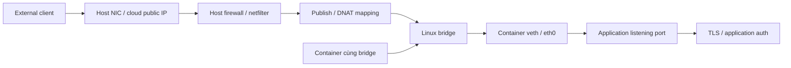
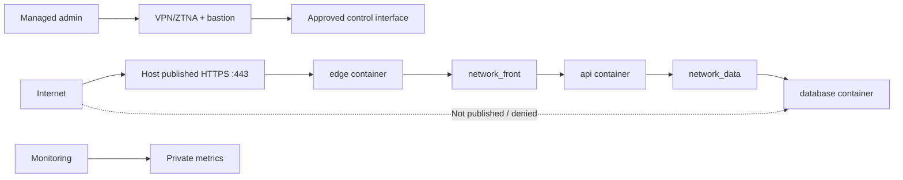

# Bridge network và cơ chế publish port trong bảo mật mạng container

## Mục tiêu học tập

Sau bài học, bạn có thể:

1. Giải thích cách **network namespace, virtual Ethernet (veth), Linux bridge, routing và netfilter** phối hợp để container có địa chỉ mạng riêng và kết nối qua host.
2. Phân biệt **default bridge**, **user-defined bridge**, DNS nội bộ, container-to-container, container-to-host và container-to-external traffic; nhận diện ranh giới cách ly thực tế.
3. Giải thích ý nghĩa của Docker **`-p`/`--publish`, `-P`/`--publish-all`, `EXPOSE`, Compose `ports` và `expose`**; xác định ai có thể kết nối đến ứng dụng.
4. Mô tả gói tin từ client đến **host IP:published port → container IP:target port**, vai trò DNAT, conntrack, source NAT và ngoại lệ theo engine/mode.
5. Đánh giá sai cấu hình như **host bind `0.0.0.0`/`::`, IPv6, host firewall, trực tiếp tới container subnet, multi-network container, rootless/desktop forwarding, host-network mode và Docker daemon socket**.
6. Thiết kế phân đoạn frontend/backend/database, chỉ publish ở edge và dùng **network policies, host/cloud firewall, reverse proxy, TLS và application authorization** đúng mục đích.
7. Lập ma trận **positive/negative tests**, quan sát chỉ đọc và thực hành lab Docker cục bộ có thể thu dọn, phân biệt lộ cổng mạng với lỗi ứng dụng/TLS.

## 1. Vấn đề: một container chạy được không có nghĩa chỉ đúng người dùng truy cập được

Một đội phát triển chạy web app trong container và dùng:

```bash
docker run -d --name web-demo -p 8080:80 nginx:alpine
```

Ứng dụng phản hồi tại `http://localhost:8080`. Người phát triển có thể tưởng chỉ laptop của mình truy cập được; nhưng trên nhiều môi trường Docker Engine Linux, **`-p 8080:80` công bố cổng trên các địa chỉ host theo cấu hình bind mặc định**, có thể bao gồm interface LAN hoặc public IP. Khi host có route và firewall cho phép, người khác có thể truy cập **host:8080**.

Vì sao điều này quan trọng?

- API thử nghiệm hoặc trang admin không cần Internet có thể bị lộ.
- Container database/cache vô tình có **published port** dù chỉ frontend cần dùng.
- Host firewall có thể không xử lý traffic Docker qua đúng chuỗi lọc mà người vận hành tưởng.
- Một container bị xâm nhập có thể kết nối tới các container khác trong cùng bridge nếu không có lớp ngăn phù hợp.
- IPv4 được kiểm soát nhưng IPv6, bridge gateway mode, cloud NAT, port-forward hoặc network mode khác tạo đường tiếp cận bất ngờ.
- Người phát triển có thể nhầm **`EXPOSE 80` là publish**, hoặc nhầm **`ports:` chỉ dành cho giao tiếp giữa các service**.

**Bridge network và publish port** là nền tảng để hiểu ranh giới giữa **mạng bên trong container, network namespace của host, các network của Docker và client ở ngoài máy**.

Trong module `SECURITY_NETWORK_SECURITY`, chủ đề này nối tiếp các lớp **segmentation, firewall, IDS/IPS, TLS, DNS, VPN, cloud network security và đánh giá mối đe dọa**.

> **Nguyên tắc:** **Chỉ publish những cổng cần có người dùng hoặc gateway bên ngoài host truy cập.** Các kết nối service-to-service trên cùng network không cần publish port; việc “đã publish” không tự cung cấp authentication, authorization hay TLS.

### 1.1. Những tên gọi dễ nhầm

| Khái niệm | Định nghĩa thực tế | Không đồng nghĩa |
|---|---|---|
| **Container port** | Cổng mà ứng dụng lắng nghe trong network namespace của container | Cổng tự động mở trên host |
| **Published/host port** | Điểm vào trên host được ánh xạ/chuyển tiếp tới container | Port được bảo vệ bằng ACL/app auth |
| **Docker bridge network** | Mạng L2 ảo nối container interfaces, thường có gateway trên host | VLAN/microsegmentation tự động |
| **Docker `bridge` mặc định** | Network mặc định kiểu bridge của Docker Engine | User-defined bridge với DNS/service features giống hệt |
| **User-defined bridge** | Bridge do người dùng tạo, giúp nhóm service và định danh theo tên | Một firewall ngăn mọi container trong cùng bridge |
| **`EXPOSE` Dockerfile** | Metadata mô tả cổng ứng dụng dự kiến | Mở host port ngay lập tức |
| **Compose `expose`** | Khai báo cổng nội bộ cho service theo metadata Compose | Chính sách block các cổng còn lại |
| **Compose `ports`** | Khai báo host-to-container port mapping | Chỉ service cùng network mới truy cập |
| **`-P` / `--publish-all`** | Publish tất cả cổng được khai báo exposed bằng host ports được chọn | Tự bảo đảm các port đó private |
| **Port binding `127.0.0.1`** | Yêu cầu host-side bind ở IPv4 loopback | Cơ chế xác thực người dùng |
| **Docker daemon API socket** | Control interface có quyền điều khiển containers/networks | Một cổng ứng dụng thông thường |
| **Host network mode** | Container dùng network namespace của host trên nền tảng hỗ trợ | Bridge + `-p` thông thường |

## 2. Trước hết phân biệt host, container và namespace

### 2.1. Network namespace tạo góc nhìn mạng riêng

Trên Linux, một **network namespace** có thể có:

- Danh sách interface mạng và địa chỉ riêng.
- Routing table riêng.
- Loopback interface riêng.
- Socket listening và bảng transport riêng.
- Một số đối tượng netfilter/network settings tùy quyền/kernel.

Ứng dụng trong container lắng nghe `0.0.0.0:8080` nghĩa là **tất cả interface IPv4 trong network namespace của chính container**, không đồng nghĩa nó tự bind `0.0.0.0:8080` ở namespace host.

**`127.0.0.1` trong container khác `127.0.0.1` của host** ở chế độ network bridge. Một service trong container chỉ bind `127.0.0.1` có thể không nhận được traffic được DNAT tới IP bridge của container.

### 2.2. Veth và Linux bridge

Khi tạo container với bridge networking trên Linux Engine, runtime có thể tạo cặp interface **veth**:

```text
Container network namespace                   Host network namespace
+------------------------------+             +---------------------------+
| lo: 127.0.0.1                |             | Host LAN interface        |
| eth0: 172.28.0.2/16         |             | Docker bridge gateway     |
|      |                       |             |       |                   |
|    veth endpoint             |<-- veth --> | veth peer                 |
+------------------------------+             |       |                   |
                                             |    Linux bridge           |
+------------------------------+             |       |                   |
| Container B                  |<-- veth --> | veth peer                 |
| eth0: 172.28.0.3/16         |             +---------------------------+
+------------------------------+
```

Địa chỉ chỉ để mô phỏng; Docker tự cấp subnet/gateway hoặc dùng cấu hình được chỉ định. Không nên đoán tất cả máy đều có `docker0` với cùng CIDR; user-defined bridge thường có interface khác, Docker Desktop còn có VM.

### 2.3. Linux bridge và đường đến gateway

Về khái niệm:

- Nếu hai container nằm cùng bridge và có network policy cho phép, frame có thể chuyển qua bridge mà không phải đi tới Internet.
- Container kết nối đích ngoài subnet cần route qua gateway/interface theo cấu hình.
- Docker Engine có thể cài **NAT/firewall rules** và dùng kernel conntrack cho traffic đi/vào bridge trong chế độ mặc định.
- Routing và policy host/cloud quyết định traffic có thể tiếp tục đến upstream.
- Ứng dụng vẫn phải nghe trên IP/port phù hợp và tự kiểm tra quyền ứng dụng.

**Bridge không tự là “trust boundary giữa mọi container cùng bridge”**. Container A và B cùng bridge có thể giao tiếp trực tiếp bằng container IP và cổng listener, kể cả khi không có port publish.

### 2.4. Các lớp cần quan sát



Sơ đồ minh họa đường Linux Engine điển hình. Thứ tự hook netfilter, NAT, userland proxy và Docker Desktop/rootless có thể **khác sơ đồ**, nên không dùng sơ đồ như bằng chứng packet thực đã qua đúng firewall rule.

## 3. Default bridge và user-defined bridge

### 3.1. Default bridge

Docker Engine thường có network tên `bridge`. Nếu chạy container mà không cung cấp network, nó thường gắn vào default bridge.

Đặc điểm đáng chú ý:

- Một số phương thức service discovery cũ của default bridge khác với user-defined bridge.
- Không nên kỳ vọng **tự động phân giải tên container qua Docker embedded DNS** trên default bridge giống user-defined bridge.
- Các container thuộc default bridge có thể nhìn thấy nhau qua IP khi chế độ liên-container communication và chính sách liên quan cho phép.
- Dùng default bridge cho nhiều ứng dụng không liên quan dễ tạo phạm vi giao tiếp không mong muốn.

Với bài học mới, **user-defined bridge** thường dễ thiết kế ranh giới và DNS nội bộ hơn.

### 3.2. User-defined bridge

Tạo bridge do ứng dụng sở hữu:

```bash
# Lệnh minh họa trong môi trường Docker lab được phép:
docker network create --driver bridge lab_front
```

Khi nhiều container cùng mạng `lab_front`, chúng có thể dùng tên/alias dịch vụ để giao tiếp trên mạng đó trong điều kiện runtime hỗ trợ. Trên Docker Engine user-defined bridge, Docker cung cấp **embedded DNS**, thường qua resolver `127.0.0.11` trong network namespace của container.

Các lợi ích:

- Nhóm containers theo ứng dụng thay vì dùng một bridge chung cho mọi dự án.
- Service discovery theo tên trong network.
- Có thể kết nối/ngắt container khỏi network theo vòng đời.
- Có tùy chọn cấu hình network, bridge và driver theo nhu cầu.

**Nhưng user-defined bridge không mặc định chặn traffic giữa mọi container ở trong cùng mạng.** Khi cần microsegmentation, nên tách networks, kiểm soát ứng dụng, firewall/ebpf policy hoặc giải pháp orchestration phù hợp.

### 3.3. Ví dụ tổ chức ba tầng

```text
Internet -> host published 443 -> FRONTEND
                                  |
                             network_front
                                  |
                             APPLICATION
                                  |
                             network_data
                                  |
                               DATABASE
```

Một topology có thể là:

- `frontend` chỉ nằm trong `network_front` và có cổng published.
- `application` nằm ở **hai mạng** `network_front` và `network_data` để làm service trung gian.
- `database` chỉ nằm trong `network_data`, **không publish** ra host.
- Host/Internet không được route trực tiếp tới DB theo policy thiết kế; không có port mapping DB.
- Database vẫn phải yêu cầu credential/TLS phù hợp; app bị xâm nhập có thể dùng những quyền mà nó đã được cấp.

**Container có nhiều network là một điểm nối giữa security zones**, và một ứng dụng bị compromise có thể gửi request sang mạng khác mà container đó được kết nối. Không nên coi “tách thành hai bridge” là đủ nếu container trung gian có đặc quyền/route rộng.

### 3.4. `internal: true` và phạm vi egress

Docker hỗ trợ tạo network với thuộc tính **internal** trong những chế độ phù hợp, nhằm giới hạn kết nối từ network đó tới ngoài phạm vi network theo cơ chế driver.

```yaml
networks:
  data:
    driver: bridge
    internal: true
```

Cần nhớ:

- `internal` không phải công cụ xác thực hoặc cấm container cùng mạng nói chuyện.
- Một container **multi-homed** nối thêm mạng có egress khác vẫn có thể có đường ra thông qua interface đó.
- Host và kernel routing/firewall, platform/version hoặc driver mode có hành vi cần xác minh.
- Không suy network internal sẽ chặn hết mọi đường tới metadata services, host daemon, link-local hoặc control plane.

Hãy dùng **deny tests và route inspection**, không chỉ đọc một flag trong Compose.

## 4. Cơ chế publish port: nhìn hai cổng, hai địa chỉ

### 4.1. Cú pháp thông dụng

```text
-p [HOST_IP:]HOST_PORT:CONTAINER_PORT[/PROTOCOL]

Ví dụ:
-p 8080:80
-p 127.0.0.1:8080:80
-p 192.0.2.10:8080:80
-p 127.0.0.1:5353:53/udp
```

Đây là biểu diễn cú pháp tổng quát; IPv6 literal dùng **dấu ngoặc vuông** và cấu hình IP family theo sản phẩm, không copy mẫu IPv4 cho địa chỉ IPv6.

Ý nghĩa:

- `HOST_IP`: địa chỉ interface host để công bố cổng (khi nêu rõ).
- `HOST_PORT`: cổng người dùng kết nối tới ở host.
- `CONTAINER_PORT`: cổng đích trong network namespace container.
- `PROTOCOL`: `tcp` hoặc `udp`; nếu không chỉ rõ, thường là TCP trong Docker CLI.

**Host port và container port không phải cùng một cổng bắt buộc.** Ví dụ host `8080` có thể chuyển đến container `80`.

### 4.2. Khi không cung cấp HOST_IP

```bash
docker run --rm -d --name web-lab -p 8080:80 nginx:alpine
```

Ở nhiều môi trường Linux Engine mặc định, Docker publish trên **mọi địa chỉ host tương ứng** (thường IPv4 `0.0.0.0` và có thể IPv6 `::` tùy daemon/network/proxy setting). Do đó:

- `localhost:8080` có thể hoạt động.
- `host-LAN-IP:8080` cũng có thể hoạt động.
- `host-public-IP:8080` có thể hoạt động nếu upstream, cloud firewall/security group và route cho phép.
- Có thể có hành vi khác theo Docker Desktop, rootless Docker, host binding option hoặc network gateway mode.

**Không kết luận “chỉ mở localhost” vì bạn đã thử bằng localhost thành công.**

### 4.3. Khi chỉ publish trên loopback

```bash
# Lab: chỉ yêu cầu IPv4 loopback host-side binding.
docker run --rm -d --name web-local \
  -p 127.0.0.1:8080:80 nginx:alpine
```

Ở môi trường Docker Engine Linux phù hợp, cấu hình host bind này giới hạn đường vào thông thường qua IPv4 host loopback. Tuy nhiên:

- Đây **không phải** bảo vệ application authorization/TLS.
- Local process hoặc một local reverse proxy có thể vẫn gọi endpoint.
- Docker version cũ hoặc cấu hình/direct routing đặc biệt có thể có hành vi ngoại lệ; cần cập nhật engine và **kiểm thử reachability từ nguồn không được phép**.
- Container IP có thể vẫn được các container cùng bridge hoặc những nguồn có route/được phép truy cập trực tiếp.
- Nếu ứng dụng có cổng IPv6 hoặc một listener khác, kiểm tra riêng.
- Một port-forward/SSH tunnel/public reverse proxy có thể cố ý đưa localhost service ra ngoài.

### 4.4. Khi HOST_IP là địa chỉ không phải loopback

```text
-p 192.0.2.10:8443:443
```

Docker cố cấu hình host-side published port ở địa chỉ đã chọn. Tùy Linux routing và gateway mode, **đường packet có thể liên quan tới interface khác** thay vì chỉ dựa vào địa chỉ đích hiển thị. Không dùng bind address làm **nguồn chứng thực** hoặc thay host/cloud firewall.

Hệ thống multi-NIC cần kiểm tra **routing, IP forwarding, host firewall, NAT và address-family behavior**.

## 5. Dockerfile EXPOSE, CLI publish và Compose expose/ports

### 5.1. `EXPOSE` chỉ là metadata

Ví dụ Dockerfile:

```dockerfile
FROM python:3.12-alpine
WORKDIR /srv
EXPOSE 8080/tcp
CMD ["python", "-m", "http.server", "8080", "--bind", "0.0.0.0"]
```

`EXPOSE 8080/tcp` **không mở host port khi build hay khi container chạy mặc định**. Nó mô tả cổng ứng dụng dự kiến.

Nếu chạy bằng:

```bash
docker run --rm --network lab_front IMAGE_NAME
```

Không tự có host publish chỉ vì Dockerfile có `EXPOSE`. Container cùng network vẫn có thể gọi container IP:8080 nếu ứng dụng lắng nghe và chính sách cho phép.

### 5.2. `-p` và `-P`

| Tùy chọn | Mục đích | Cần lưu ý |
|---|---|---|
| `-p 8080:80` | Công bố một host port cụ thể tới container port | Mặc định host address có thể là mọi interface |
| `-p 127.0.0.1:8080:80` | Công bố có giới hạn host IP loopback | Không ngăn local process hoặc mọi đường routing ngoại lệ |
| `-p 5353:53/udp` | Publish UDP | Không tự publish TCP/53 |
| `-p 8080:80/tcp -p 8080:80/udp` | Cùng số port ở host cho hai transport khác nhau | TCP/UDP là hai protocol riêng |
| `-P` / `--publish-all` | Tự chọn host ports cho các exposed ports | Có thể mở cổng ngoài ý muốn nếu EXPOSE nhiều |
| Không có publish | Không tạo host port mapping mặc định | Không có nghĩa container tách biệt với toàn mạng |

`-P` đặc biệt dễ bị hiểu nhầm: nó không “bật protection”, mà **công bố các cổng được khai báo `EXPOSE`** bằng các host ports được Docker chọn. Cần xem `docker port` và cấu hình binding thực tế.

### 5.3. Compose `ports` khác `expose`

```yaml
services:
  web:
    image: nginx:alpine
    ports:
      - "127.0.0.1:8080:80"
    networks:
      - front

  app:
    image: python:3.12-alpine
    command: ["python", "-m", "http.server", "8080", "--bind", "0.0.0.0"]
    expose:
      - "8080"
    networks:
      - front
      - data

networks:
  front:
    driver: bridge
  data:
    driver: bridge
    internal: true
```

Trong ví dụ:

1. `web` có **host publish** ở IPv4 loopback `127.0.0.1:8080` → port 80 container.
2. `app` **không có host publish**; `expose` mô tả cổng nội bộ, không tạo luật chặn.
3. `web` và `app` cùng network `front` có thể giao tiếp theo policy mạng và listener.
4. Vì `app` có thêm `data`, nó có thể giao tiếp với các workloads trên mạng đó; **không suy nó tự bị chặn egress qua `front`**.
5. Nếu app lắng nghe cổng khác ngoài 8080, các container cùng network vẫn có thể kết nối đến cổng đó khi không có policy chặn; `expose` không phải firewall.
6. Để `web` thực sự proxy tới `app`, cần **cấu hình Nginx upstream riêng**; Compose này chỉ minh họa cấu trúc mạng, không tự tạo reverse proxy.

**Không suy “không có `ports` thì host hoàn toàn không thể reach container”.** Host có thể có route trực tiếp đến IP bridge; admin/daemon cũng có thể truy cập qua các cơ chế khác.

### 5.4. Cần xác định giao thức

Một dịch vụ DNS có thể dùng **UDP/53 và TCP/53**. Publish `53:53/udp` không tự mở TCP/53; còn `53:53/tcp` không mở UDP/53.

Cổng được sử dụng bởi protocol khác nhau có **state/timeout** khác nhau. Việc mở UDP rộng có thể tăng attack surface và cần giới hạn theo nhu cầu, authentication ở tầng trên và DDoS controls phù hợp.

## 6. Packet path của một published port trên Linux Engine

### 6.1. Đường đi điển hình với DNAT

Giả sử container có IP `172.28.0.5`, ứng dụng lắng nghe TCP/80 và host có `192.0.2.10:8080`:

```text
Remote client 198.51.100.22:53000
          |
          v
Host NIC 192.0.2.10:8080
          |
    Netfilter DNAT / Docker publish
          |
          v
Container IP 172.28.0.5:80
          |
     Container process HTTP listener
```

Tại điểm publish, Docker Engine trong **bridge NAT mode** có thể cấu hình netfilter để **dịch địa chỉ/cổng đích** (DNAT) trước khi chuyển traffic qua veth/bridge. Conntrack giúp lưu mapping để xử lý các packet thuộc luồng và chiều phản hồi.

Hành vi thực có thể có **userland proxy** và khác biệt giữa incoming vs host-local requests, Docker Engine/kernel version, firewall backend (iptables hoặc nftables), gateway mode và nền tảng virtualization.

### 6.2. DNAT, SNAT và MASQUERADE

| Cơ chế | Thay đổi gì? | Ví dụ khái niệm |
|---|---|---|
| **DNAT** | Địa chỉ/cổng **đích** của packet | Host `:8080` → container `:80` |
| **SNAT** | Địa chỉ/cổng **nguồn** của packet | Đổi nguồn khi container đi ra hoặc qua hairpin path |
| **MASQUERADE** | Dạng source NAT thường dùng khi địa chỉ nguồn ra ngoài phụ thuộc interface | Container ra Internet qua host |
| **Conntrack** | Theo dõi mapping/trạng thái để gói trả lời có thể được xử lý tương ứng | Server reply về client ngoài |
| **Bridge forwarding** | Chuyển frame giữa port/veth của bridge | Container A đến B cùng bridge |

**Port mapping không phải chỉ một câu lệnh “mở firewall”.** Nó có thể bao gồm việc chuyển hướng packet cùng các filter/NAT rules khác nhau.

### 6.3. Container gọi Internet

```text
Container 172.28.0.5:51000
  -> bridge gateway
  -> host routing + source NAT theo cấu hình
  -> external server 203.0.113.20:443
```

Trong bridge NAT mode, nguồn ở phía ngoài thường thấy **địa chỉ host/NAT** thay vì container private IP. Điều đó **không** mặc định cho phép container nhận kết nối inbound mới từ Internet.

Nhưng các đường **direct routing/gateway mode** có thể có quy tắc khác. Không suy tất cả bridge networks luôn NAT và không thể bị reach trực tiếp từ ngoài host.

### 6.4. Hairpin và container-to-host published port

Một container có thể thử gọi **host published port** của container khác hoặc của chính nó. Tùy NAT hairpin, route, proxy và host gateway address, kết quả có thể khác đường container-to-container trực tiếp.

Ví dụ client trong bridge gọi `host-gateway:8080` có thể thấy source IP ở server khác với khi gọi `app:80` trực tiếp. Không dùng một cách gọi thay thế làm bằng chứng **tất cả đường network đều có cùng policy**.

## 7. Host firewall, Docker-managed rules và sai lầm phổ biến

### 7.1. Tại sao tưởng đã khóa UFW mà vẫn thấy port mở?

Trên Linux Engine trong cấu hình iptables phổ biến, traffic hướng đến **published port** có thể bị DNAT và đi qua **FORWARD** path thay vì chỉ đi qua **INPUT** chain của host.

Do đó một policy UFW/firewalld chỉ được kiểm tra ở điểm người vận hành nghĩ là host INPUT có thể **không chặn traffic Docker theo dự kiến**. Việc kết hợp Docker-managed firewall với firewall hệ điều hành phải được thiết kế theo **Docker networking backend hiện hành**.

**Không khẳng định mọi bản Docker đều bypass UFW**: hiện trạng phụ thuộc Docker engine, nftables/iptables backend, hệ điều hành, rule ordering, direct routing và firewalld integration. Kết luận đúng cần dựa trên **packet path và test thực**.

### 7.2. Docker-managed iptables chains

Ở hệ Linux Engine sử dụng **iptables backend**, Docker có thể tạo các chain phục vụ NAT và filtering, ví dụ nhóm chain có tên `DOCKER` và **`DOCKER-USER`**.

Về mặt nguyên tắc:

- Docker-managed rules cho phép publish và container networking hoạt động.
- `DOCKER-USER` là hook để người vận hành áp **filter policy phù hợp** vào traffic forwarded trong mô hình iptables backend.
- Khi packet đã qua DNAT, destination IP/port được thấy ở một số chain có thể là **container IP/port**, không còn host-published IP/port.
- Để match địa chỉ/cổng đích ban đầu của kết nối, có thể cần **conntrack original destination matching**, nhưng phải kiểm chứng ảnh hưởng hiệu năng và syntax của backend.
- Không gắn các quy tắc tùy ý vào chain do Docker sở hữu nếu engine có thể ghi đè/chỉnh trong quá trình vận hành.

### 7.3. Không áp `DOCKER-USER` máy móc cho nftables/rootless/Desktop

Docker Engine có thể hỗ trợ **firewall backend khác nhau** theo phiên bản; cơ chế nftables không thể mặc định sử dụng `DOCKER-USER` giống mô hình iptables. Rootless Docker và Docker Desktop cũng có các lớp forwarding riêng.

Trước khi viết policy:

1. Xác định Docker Engine version/platform.
2. Xác định firewall backend đang chạy và ai quản lý rules.
3. Hiểu đường packet remote, host-local, bridge-to-bridge và IPv4/IPv6.
4. Viết rule ở **đúng hook/chain với priority phù hợp**.
5. Test **traffic hợp lệ và traffic bị cấm**.
6. Kiểm tra sau restart Docker, reboot, reload firewall và failover.
7. Không tắt Docker firewall rules như một “cách đơn giản” nếu chưa hiểu hệ quả port publication/routing.

### 7.4. Port publish và cloud security group

Nếu máy Docker chạy trong cloud:

```text
Internet
  -> Cloud SG/NSG/firewall + route
  -> VM host NIC :8080
  -> Docker port publish / NAT
  -> Container :80
```

Cả hai lớp đều quan trọng:

- **Cloud SG chặn port 8080** có thể ngăn Internet tới host tại 8080, nếu mọi đường đều đi qua lớp đó.
- **Docker publish trên host** không tự khiến cloud SG mở port.
- Ngược lại, **cloud SG allow 8080** không bảo đảm container chạy hoặc port đã publish.
- Có thể có LB, IPv6, private link, VPN, NAT, public IP/secondary NIC khác.
- Cloud firewall không thay việc tách bridge networks, host socket security và app auth.

### 7.5. Hiểu đúng security boundary

**Firewall ở host** cần bổ sung cho:

- Least privilege ở host OS/process.
- Docker daemon/socket RBAC hoặc quyền quản trị container.
- Network segmentation giữa các container networks.
- Cloud SG/NSG và các routes bên ngoài.
- TLS/mTLS, authentication, authorization phía ứng dụng.
- Monitoring/flow logging và cấu hình IaC có kiểm soát.

Một rule host firewall đơn lẻ không đủ khi container được deploy với `--network host`, khi data path đi qua VM forwarding của Desktop hoặc khi cloud LB route qua interface khác.

## 8. Bind address của ứng dụng và bind address của host khác nhau

### 8.1. Tình huống dễ gặp

Ứng dụng trong container chỉ bind loopback:

```bash
# Được chạy trong network namespace của container:
python -m http.server 8080 --bind 127.0.0.1
```

Host publish:

```text
-p 127.0.0.1:9000:8080
```

Dù có mapping, packet được chuyển tới **IP mạng bridge của container:8080**, trong khi process chỉ lắng nghe `127.0.0.1:8080` **bên trong container**. Kết quả thường là **không kết nối được** tới process qua container interface.

Để service có thể nhận traffic qua container interface, process phải listen trên **container network IP** hoặc wildcard `0.0.0.0` (hoặc IPv6 phù hợp).

### 8.2. Bind wildcard trong container không tự mở Internet

Khi app listen `0.0.0.0` bên trong container:

- Nó nhận traffic tới các IPv4 interfaces trong namespace đó.
- Nếu host **không publish** và không có direct route/network access phù hợp, Internet không tự có đường vào chỉ nhờ app listen wildcard.
- Container khác cùng bridge có thể vẫn gọi IP:port.
- Host có thể gọi trực tiếp container IP khi route cho phép.
- Một rule public publish có thể mở đường tới app ngoài host; policy app vẫn cần bảo vệ.

**Không áp quy tắc “luôn bind localhost trong container để an toàn”** nếu ứng dụng cần nhận traffic từ reverse proxy container khác; điều đó có thể phá kết nối mà không tạo security boundary mong muốn.

## 9. IPv4 và IPv6 trong bridge publishing

### 9.1. `0.0.0.0` và `::` không cùng address family

- `0.0.0.0`: wildcard IPv4.
- `127.0.0.1`: IPv4 loopback.
- `::`: wildcard IPv6.
- `::1`: IPv6 loopback.

Khi publish không nêu host IP, Docker Engine/platform có thể thiết lập **IPv4 và/hoặc IPv6 listeners/forwarding** theo mạng, daemon options và userland proxy.

**Đừng chỉ kiểm tra `ss -lnt4` rồi kết luận không có IPv6 exposure**. Cần kiểm tra địa chỉ family, router/firewall, container network IPv6 settings và external probing được phê duyệt.

### 9.2. Docker bridge IPv6 và gateway modes

Linux Engine hỗ trợ các cấu hình **IPv6 bridge** và, tùy phiên bản/tùy chọn, **gateway modes** ảnh hưởng đến NAT và direct routing. Khái niệm:

- **NAT gateway mode**: có thể dùng dịch địa chỉ/port, với đường trả lời theo state.
- **Routed mode**: container prefix có thể được route trực tiếp từ upstream khi đường và policy cho phép; việc host-port trong mapping có thể có **ngữ nghĩa khác** với NAT mode.
- **Isolated/internal mode**: mục tiêu là giảm các đường ra/đường vào theo network driver nhưng không thay thế toàn bộ policy.
- **Direct routing**: nguồn ngoài host có route tới container subnet có thể đi theo đường **không trùng với host published-port** như người vận hành dự đoán.

Không dùng một mẫu `-p HOST:CONTAINER` để giải thích tất cả các gateway modes. Phải đọc thông số mạng và xác minh **địa chỉ/port nào thực sự reachable**, kể cả container IP trực tiếp.

### 9.3. Những kịch bản cần kiểm tra

| Kịch bản | Câu hỏi cần trả lời |
|---|---|
| Host có public IPv4 và IPv6 | Publish có mở cả hai family? |
| Chỉ bind `127.0.0.1` IPv4 | Có listener IPv6 khác hoặc proxy đang forward? |
| Docker bridge có IPv6 | Container có địa chỉ global/ULA và route direct không? |
| Docker Desktop chạy VM | Host OS forwarding có tương đương Linux Engine trực tiếp không? |
| Gateway mode routed | Client có bypass host port mapping để gọi container IP không? |
| Host firewalld/UFW rules | Rules có xử lý cả IPv4/IPv6 và đúng netfilter hooks không? |
| DNS A/AAAA | User có đi qua một frontend khác trên IPv6 không? |
| SNI/HTTP Host | TLS virtual host có route nhầm tới admin port không? |

**Mục tiêu phòng vệ không phải lúc nào cũng là “khóa IPv6”**, mà là **thiết kế policy song song**. Blanket deny ICMPv6 có thể phá Path MTU Discovery/Neighbor Discovery ở môi trường cần IPv6.

## 10. Rootless Docker, Docker Desktop và các network driver khác

### 10.1. Rootless Docker

**Rootless mode** giảm đặc quyền của daemon và container processes so với rootful Docker, nhưng không tự loại bỏ network attack surface.

Cơ chế chuyển tiếp cổng có thể dùng **userspace networking/port forwarder** thay vì đi đúng netfilter path của rootful Linux Engine. Hệ quả:

- Host-side bind, source IP preservation và port forwarding behavior cần xem theo phiên bản/công cụ.
- Một rule chỉ áp trong `DOCKER-USER` của rootful iptables có thể **không tương ứng** với rootless data path.
- Low-numbered ports và quyền bind có thể bị hạn chế theo OS.
- Container-to-container segmentation, app auth và Docker API access vẫn quan trọng.

### 10.2. Docker Desktop

Docker Desktop trên macOS/Windows thường chạy Linux containers trong một **VM/virtualized environment**, và cung cấp host-to-VM port forwarding.

Vì vậy:

- `docker0` và bridge interfaces có thể **không xuất hiện trên host OS** giống Linux Engine.
- Host OS firewall và forwarding software tham gia đường đi.
- Direct container IP từ host OS có thể không hoạt động theo cách ở Linux Engine.
- Một published port có thể được forward từ host vào VM rồi tới container.
- Cần kiểm tra firewall của **host OS và environment VM**, không suy từ lệnh Linux `iptables` trên hệ ngoài VM.

### 10.3. Host, none, macvlan, ipvlan, overlay

| Network driver/mode | Điểm khác bridge | Hướng an ninh |
|---|---|---|
| **`bridge`** | Container có virtual interface/bridge, publish dùng gateway behavior | Thiết kế host mapping và container networks |
| **`host`** | Trên nền tảng hỗ trợ, container chia sẻ host network namespace | App listener có thể trực tiếp mở host; `-p` thường không áp như bridge |
| **`none`** | Không gắn network thông thường (ngoài loopback) | Dùng cho workload không cần network; vẫn xem mounts/daemon |
| **`macvlan`** | Container có L2 identity trên mạng vật lý/ảo | Bảo vệ tại LAN/VLAN/firewall, không mặc định bằng host publish |
| **`ipvlan`** | Gắn container traffic vào L2/L3 host networking theo mode | Phân tích địa chỉ/route và upstream ACL |
| **`overlay`** | Kết nối containers đa host qua overlay network | Network encryption/segmentation tùy driver/orchestrator |
| **Kubernetes CNI** | Pod networking theo plugin/policy | Không coi Docker bridge `-p` tương đương Service/Ingress |

**Không áp một quy tắc security group/port publish cho tất cả network modes.** Khi đổi mode để tăng hiệu năng hoặc “sửa mạng”, phải đánh giá lại các ranh giới và chính sách.

## 11. Mô hình phân đoạn cho frontend, application và database

### 11.1. Kết nối nên được định nghĩa bằng nhu cầu kinh doanh

Giả sử hệ thống xử lý đơn hàng gồm:

- `edge`: reverse proxy tiếp nhận HTTPS public.
- `api`: ứng dụng nghiệp vụ, chỉ nhận request từ edge.
- `db`: cơ sở dữ liệu, chỉ nhận từ API.
- `metrics`: collector, chỉ đọc endpoint quan sát.
- `admin`: người vận hành, vào qua VPN/ZTNA và bastion.

Sơ đồ:



**Chỉ `edge` cần published port**. `api` và `db` có thể giao tiếp qua tên service trong network riêng, không cần bản đồ host port cho DB.

### 11.2. Ma trận policy dự kiến

| Nguồn | Đích | Cổng | Kết quả |
|---|---|---|---|
| Internet | Host public HTTPS → edge | TCP/443 | Allow qua edge + TLS/app policy |
| Internet | Host port 5432 → DB | TCP/5432 | Deny/không publish |
| Internet | Host admin diagnostics | TCP/9901/khác | Deny |
| edge | api qua `network_front` | TCP/8080 | Allow theo ứng dụng |
| edge | db trực tiếp qua `network_data` | TCP/5432 | Không có network attachment theo thiết kế |
| api | db qua `network_data` | TCP/5432 | Allow có app DB credentials |
| db | edge tạo kết nối mới | Bất kỳ | Không route/không có network chung theo thiết kế |
| monitoring | metrics endpoint | TCP/9100 | Allow trong private monitoring path |
| arbitrary container cùng front | api | TCP/8080 | Có thể reach nếu không có policy bổ sung |
| arbitrary container ngoài front | api bridge IP | TCP/8080 | Deny theo routing/network isolation dự kiến |
| admin qua bastion | approved control plane | Theo chính sách | Allow JIT/MFA |
| guest/BYOD | DB/management | Bất kỳ | Deny |

**Hàng “arbitrary container cùng front” là lời cảnh báo quan trọng:** một bridge network không phải per-service firewall. Nếu nhiều workloads không tin cậy cùng front, cần **tách mạng sâu hơn hoặc policy theo identity/process**.

### 11.3. Multi-network API là cầu nối

`api` ở cả `front` và `data` có hai interfaces. Dù `edge` không được gắn vào `data`, một API bị compromise vẫn có thể truy cập DB vì đó chính là khả năng được cấp cho API.

Bảo vệ theo nhiều lớp:

- API container không chạy đặc quyền nếu không cần, hạn chế mounts/capabilities.
- DB dùng mật khẩu/role riêng, mTLS/TLS khi cần.
- Secrets cấp theo nhu cầu, không mount Docker daemon socket.
- Không tạo routing/forwarding giữa hai mạng container chỉ để dễ debug.
- Giám sát các kết nối bất thường từ API sang database/metadata hoặc Internet.
- Phân tách thêm những backends có mức tin cậy và chủ sở hữu khác nhau.

## 12. Những rủi ro thường xuất hiện khi publish port

### 12.1. Lộ admin/database/cache

Các sản phẩm như database, cache, dashboard hoặc debug UI có thể **không thiết kế để mở Internet mặc định**. Một dòng Compose:

```yaml
ports:
  - "5432:5432"
```

có thể làm DB reachable từ host interfaces theo default binding, nếu route và các lớp khác cho phép. Khi đội phát triển chỉ cần kết nối bằng `docker compose exec`, VPN hoặc local tooling, không nên tạo public host port.

Nếu thực sự cần publish phục vụ phát triển, dùng **loopback bind, xác thực, secret handling và cloud/host firewall**; kiểm thử external reachability. Trên production, ưu tiên private service network/bastion hoặc managed database endpoint phù hợp.

### 12.2. Docker API socket và đặc quyền host

Một container có mount `/var/run/docker.sock` (hoặc access Docker daemon API) có thể có khả năng **điều khiển containers, network/volume, mounts và tài nguyên host** ở mức rất nhạy cảm.

Không đánh đồng Docker socket với một application port:

- Không publish Docker daemon TCP API không được bảo vệ ra Internet.
- Hạn chế rootful daemon access; dùng kiểm soát identity/TLS và cấp quyền nếu có API remote được thẩm định.
- Không cho public-facing web app mount Docker socket chỉ để “tự deploy”.
- Dùng broker/CI/controller có quyền hẹp, audit và separation of duties.

**Ứng dụng chỉ cần đọc Docker metrics không nên sở hữu toàn quyền điều khiển daemon.**

### 12.3. Container cùng bridge không phải multi-tenant isolation

Nếu các dự án độc lập được gắn chung `bridge`, container bị compromise có thể kết nối tới các IP/ports của container khác trong cùng network khi policy cho phép. `EXPOSE`/`expose` không đóng vai trò ACL.

Cần thiết kế **network per application/trust zone**, least privilege, network ACL/policy nếu nền tảng hỗ trợ, và hạn chế quyền thao tác `docker network connect`/daemon API.

### 12.4. Public IP và IPv6 route đi vòng

Không có dòng `-p` cho DB vẫn chưa đủ để khẳng định DB chỉ nội bộ nếu:

- Container có **directly routed global IPv6** theo gateway mode/network driver.
- Container sử dụng `host`, `macvlan` hoặc `ipvlan`.
- Có LB/proxy/SSH tunnel/port-forward khác dẫn tới container.
- Docker daemon socket hoặc orchestration API cho phép tạo đường kết nối tùy ý.
- Host có rule DNAT/manual routing do công cụ khác tạo.
- Nhiều container networks hoặc external routes có thể thay đổi reachability.

Phải xác minh **network mode, attached interfaces, route và mọi forwarded listener** theo topology thực tế.

### 12.5. Dùng `-P` trên image chứa nhiều exposed ports

Một image có nhiều metadata `EXPOSE` (ví dụ web, debug, admin) và được chạy với `-P` có thể làm **nhiều cổng được publish cùng lúc**.

Do đó:

- Kiểm tra `docker port CONTAINER` sau khi deploy.
- Đối chiếu những ports được công bố với inventory.
- Ưu tiên `-p` có tên đích, cổng và host IP chính xác.
- Tách admin/debug endpoints khỏi frontend.
- Không giả định host ports ngẫu nhiên khó đoán là biện pháp xác thực.

## 13. Threat modeling: ranh giới có thể hỏng ở đâu?

| Tình huống | Kịch bản rủi ro | Phòng vệ chính |
|---|---|---|
| Default publish trên mọi interface | Dev web/API lộ trên LAN/Internet | Explicit loopback bind hoặc edge-only publish |
| Public DB port mapping | DB/cache tiếp xúc nguồn ngoài | Không publish; private network và DB auth |
| Host firewall sai hook | Rule INPUT không chặn forwarded Docker packets | Hiểu netfilter backend, policy đúng hook, test |
| Direct routed container prefix | Client bỏ qua published host port | Host/upstream routing & firewall, gateway mode review |
| IPv6 bỏ sót | `::` hoặc container IPv6 mở rộng reachability | Dual-stack testing và policy |
| Shared bridge giữa dự án | Lateral movement container-to-container | Tách network, workload policy, app auth |
| Multi-network app compromise | API làm cầu tới DB | Least privilege, DB auth, runtime hardening |
| Docker socket exposed | Remote/compromised app điều khiển container host | Không mount/expose daemon; strong IAM/audit |
| Host-network container | Listener mở trực tiếp host address | Không coi `-p` là boundary, kiểm tra mode |
| Rootless/Desktop forwarder | Traffic path khác Linux iptables | Inspect platform-specific forwarding/firewall |
| Reverse proxy route nhầm | Public Host/path/SNI tới admin/backend private | Route allowlist, app auth, default deny |
| Credentials in logs | Secrets/DB password bị lộ qua diagnostics | Secret store, redaction, RBAC |
| Unsafe debug port | JMX/metrics/IDE service bị truy cập | Không publish hoặc private authentication |
| Compromised edge | Frontend gọi đến app/API ngoài scope | Segment, app authorization, monitoring |
| Cloud SG allow-all | Host published port accessible Internet | Layered SG + host policy + edge |
| Unreviewed Docker restart | Firewall port behavior thay đổi | Desired-state IaC, canary và regression tests |
| Docker image update thêm EXPOSE | `-P` publish thêm cổng | Explicit ports, image policy review |
| Health probe mở quá rộng | Đường debug/status được đưa ra ngoài | Read-only minimal health và private monitoring |

**Không kết luận chỉ từ network diagram rằng hệ thống đã bị khai thác**. Threat modeling xác định **đường có thể tiếp cận và tác động**, sau đó cần có bằng chứng kỹ thuật để phân loại exposure hay compromise.

## 14. Không đánh đồng port publishing với chứng thực dịch vụ

### 14.1. Một port reachable chưa có nghĩa authorized

Giả sử `host:8443` được publish tới API container. TCP handshake thành công chỉ xác minh rằng đường mạng và listener chấp nhận kết nối cơ bản. API vẫn cần:

- TLS server certificate và hostname verification.
- Authentication user/workload (OIDC, mTLS, session, API token phù hợp).
- Authorization theo route, resource và hành động.
- Rate limiting, input validation và audit.
- Resource-level access/secret least privilege.
- WAF/IDS/IPS khi phù hợp.

**Docker `-p` không cung cấp HTTPS**, không thực hiện RBAC hay bảo vệ API admin. Host bind chỉ xác định điểm truy cập từ mạng.

### 14.2. Reverse proxy là boundary phù hợp hơn nhiều publish riêng lẻ

Thay vì:

```text
Host :8080 -> frontend
Host :8081 -> api
Host :5432 -> db
Host :9000 -> admin
```

Thiết kế thường tốt hơn:

```text
Host :443 -> TLS reverse proxy
             |- /app -> app service trên bridge
             |- /api -> API có auth và policy riêng
             \- admin: không route công khai
DB: chỉ nội bộ network_data, không publish
Metrics: endpoint riêng cho private collector
```

Người dùng chỉ thấy **điểm vào đã duyệt**; backend không được publish trực tiếp. Tuy vậy reverse proxy phải bảo vệ đúng `Host`/`:authority`, SNI, headers, TLS, API auth và tránh tạo default route tới admin.

## 15. Quan sát những gì đang được publish

### 15.1. Lệnh read-only của Docker

Trong môi trường Docker Engine **mà bạn được quyền quản lý**:

```bash
# Liệt kê container và port mappings được Docker công bố.
docker ps --format "table {{.Names}}\t{{.Ports}}\t{{.Status}}"

# Xem port mapping một container.
docker port web-lab

# Xem thông tin network; đầu ra có thể chứa IP/metadata.
docker network inspect lab_front

# Xem network mode, port bindings (không cần đọc secret).
docker inspect --format='{{.HostConfig.NetworkMode}} {{json .HostConfig.PortBindings}}' web-lab

# Với Linux host lab: quan sát các TCP/UDP sockets.
ss -lnt
ss -lnu
```

Những lệnh trên nhằm **kiểm kê**, không yêu cầu quét mạng hay thay firewall. Output `docker inspect` có thể chứa metadata nhạy cảm; không chia sẻ nguyên bản công khai.

### 15.2. Đọc `docker ps` đúng cách

Ví dụ:

```text
CONTAINER  PORTS
web       127.0.0.1:8080->80/tcp
api       8080/tcp
db        5432/tcp
```

Ý nghĩa:

- `web` có host published port tại IPv4 loopback.
- `api` và `db` chỉ hiện container ports, **không có host mapping được trình ở ví dụ**.
- Không có `-p` không nghĩa các container khác cùng network không gọi được `api:8080` hay `db:5432`.
- Docker port list có thể hiển thị nhiều host address families/mappings; xem **tất cả dòng**, không chỉ dòng đầu.

### 15.3. Quan sát firewall và route không phá hoại

Trên Linux host được phép, tùy backend đang dùng:

```bash
# Read-only, cần quyền quan sát tương ứng.
ip route
ip -6 route

# Iptables backend nếu có; không sửa rules.
sudo iptables -S
sudo iptables -t nat -S

# Nftables backend nếu có; không sửa rules.
sudo nft list ruleset
```

**Không thực hiện lệnh flush/disable Docker netfilter hoặc bật ip_forward bừa bãi** để “kiểm tra có đúng NAT không”. Chính sách host firewall phải được kiểm thử với quyền và change control phù hợp.

### 15.4. Các nguồn thông tin khác

- Cloud SG/NSG và public IP inventory của VM host.
- Compose/Kubernetes manifests hoặc deploy templates.
- Linux process listening sockets, bridge interfaces và network namespaces.
- Reverse proxy listener/Host/SNI/route configuration.
- Flow logs, firewall counters, application access logs.
- Monitoring hoặc IaC drift alerts.
- SSH tunnels/port forwards và host management gateways có audit.

**Inventory cấu hình chỉ mô tả ý định**, không phải evidence cuối cùng rằng một port từ ngoài Internet thực sự reachable hoặc không reachable.

## 16. Lab có kiểm soát: tạo bridge và publish về localhost

Lab này chỉ dành cho **máy/VM/container host do bạn sở hữu hoặc được phép thao tác**, không dùng trên production. Lệnh `docker run` có thể tải image từ registry nếu máy chưa có; trong môi trường không được phép Internet, dùng image nội bộ đã kiểm duyệt.

### 16.1. Mục tiêu và điều kiện

Mục tiêu:

- Tạo user-defined bridge riêng.
- Chạy web container không có published port.
- Xác nhận một container khác **cùng bridge** có thể truy cập web theo tên.
- Tạo một container thứ hai chỉ publish port ở **IPv4 loopback host**.
- So sánh đường **container-to-container** với **host-to-container**.
- Thu dọn đúng tài nguyên của lab, không xóa dữ liệu môi trường khác.

Điều kiện:

- Docker Engine/CLI và quyền thao tác Docker được cấp.
- Các tên `lab_bridge_ns`, `web_private_lab`, `web_local_lab` chưa được dùng.
- Host port `18080` còn trống và không bị công cụ khác publish.
- Image `nginx:alpine` và `python:3.12-alpine` được chấp thuận trong môi trường lab.
- Tất cả kiểm thử chỉ dùng **loopback hoặc container endpoints do bạn tạo**.

### 16.2. Bước A — Tạo network

```bash
docker network create --driver bridge lab_bridge_ns

# Xem network bạn vừa tạo, không thay đổi firewall thủ công.
docker network inspect lab_bridge_ns
```

Quan sát network driver, subnet/gateway được Docker cấp, container list và các tùy chọn; không lấy subnet đó làm CIDR chuẩn cho mọi host.

### 16.3. Bước B — Chạy web không publish host port

```bash
docker run -d --name web_private_lab \
  --network lab_bridge_ns \
  nginx:alpine

# Port column có thể chỉ hiện 80/tcp của image; không đồng nghĩa host bind.
docker ps --filter "name=web_private_lab" \
  --format "table {{.Names}}\t{{.Ports}}"
```

Mục tiêu: web được phép chạy và lắng nghe cổng trong container. Nó **không có host mapping được yêu cầu**.

Kiểm tra từ container khác cùng bridge:

```bash
# Chỉ request tới web container của lab qua Docker embedded DNS.
docker run --rm --network lab_bridge_ns \
  python:3.12-alpine \
  python -c 'import urllib.request; print(urllib.request.urlopen("http://web_private_lab:80", timeout=3).status)'
```

Kỳ vọng HTTP status **200** nếu Nginx container khỏe và DNS nội bộ hoạt động. Điều này **chứng minh container-to-container access có thể xảy ra dù không publish cổng**. Nếu image thiếu/mạng gặp lỗi, không coi timeout là bằng chứng isolation.

### 16.4. Bước C — Publish một web khác tại host loopback

```bash
docker run -d --name web_local_lab \
  --network lab_bridge_ns \
  --publish 127.0.0.1:18080:80/tcp \
  nginx:alpine

docker port web_local_lab

curl --noproxy '*' --connect-timeout 3 --max-time 6 \
  --head http://127.0.0.1:18080/
```

Kỳ vọng:

- `docker port` cho thấy `127.0.0.1:18080->80/tcp` hoặc biểu diễn tương đương.
- `curl` trên **máy host** tới IPv4 loopback nhận HTTP response từ container mới.
- `curl` thành công không chứng minh ứng dụng có authentication; default Nginx trong lab chỉ phục vụ trang tĩnh.

### 16.5. Bước D — Negative test an toàn

Nếu có **VM thứ hai trong mạng lab được cấp phép**, yêu cầu nó thử **đúng một đích IP:18080** trên interface LAN của host, không chạy port scanner hoặc thử những máy khác.

Mục tiêu kiểm tra: nguồn từ ngoài host **không thể sử dụng mapping chỉ bind loopback**, trừ khi cấu hình Docker/route/proxy khác tạo đường ngoài ý định. Kết luận phải dựa vào **listener khỏe từ localhost** và đường đi/host firewall evidence, không dựa riêng timeout.

**Không sử dụng một máy Internet bất kỳ để thử**. Nếu không có máy lab thứ hai, đánh dấu negative test là **CHƯA KIỂM THỬ**, không suy “không tồn tại đường vào” từ việc port mapping hiển thị `127.0.0.1`.

### 16.6. Bước E — Thu dọn đúng tài nguyên lab

```bash
# Chỉ xóa đúng hai container bạn vừa tạo, không chạy trên tên trùng
# container production. Không sử dụng docker system prune.
docker rm -f web_private_lab web_local_lab

# Xóa network lab sau khi không còn container attached.
docker network rm lab_bridge_ns
```

Nếu tên đã trùng tài nguyên có sẵn, **không thực hiện lệnh xóa**; quay lại kiểm tra inventory. Việc dùng Docker CLI có thể yêu cầu quyền cao đối với daemon; không cấp quyền Docker tùy tiện cho user untrusted để hoàn thành lab.

## 17. Lab Compose: không publish backend/database

### 17.1. Mẫu Compose tách mạng

Một cấu trúc nhiều tầng có thể khai báo:

```yaml
# compose.lab.yaml - mô hình cho máy lab riêng
services:
  edge:
    image: nginx:alpine
    ports:
      - "127.0.0.1:18081:80"
    networks:
      - front

  api:
    image: python:3.12-alpine
    command:
      - python
      - -m
      - http.server
      - "8080"
      - --bind
      - 0.0.0.0
    expose:
      - "8080"
    networks:
      - front
      - data

  db-demo:
    image: nginx:alpine
    expose:
      - "80"
    networks:
      - data

networks:
  front:
    driver: bridge
  data:
    driver: bridge
    internal: true
```

**`db-demo` chỉ là server HTTP tượng trưng cho data-tier workload**, không phải một database thật. Như vậy không cần tạo database credential trong bài thực hành.

Điểm kiểm tra:

- Chỉ service `edge` có `ports`; host loopback được map tới cổng container của edge.
- `api` và `db-demo` chỉ có `expose`/listener, không có host publish.
- `edge` và `api` chung `front`.
- `api` và `db-demo` chung `data`.
- `edge` không tham gia `data`, nên không có kết nối trực tiếp đến `db-demo` **theo network attachment của mô hình**, trừ khi có route khác.
- `api` là **workload multi-homed**; nó là nơi cần application-layer security cho data access.
- `edge` không tự reverse proxy tới `api` chỉ vì cùng network; Nginx vẫn cần cấu hình upstream được phê duyệt.

### 17.2. Review trước khi chạy

```bash
# Trong thư mục lab nơi bạn đã tạo file compose.lab.yaml:
docker compose -f ./compose.lab.yaml config
```

Lệnh `config` giúp xem cấu hình Compose được diễn giải; **không chứng minh các container đang hoạt động hoặc network policy được thực thi**.

Nếu quyết định chạy trong lab, quản lý vòng đời bằng Compose của **chính project lab**, không dùng lệnh xóa volume dữ liệu production hoặc project khác.

### 17.3. Tại sao `expose` không là một firewall?

Nếu `api` có listener trên TCP/9000 bên cạnh TCP/8080 mà Compose chỉ ghi:

```yaml
expose:
  - "8080"
```

`edge` cùng bridge `front` có thể vẫn thử kết nối `api:9000` nếu port đó thực sự được process mở và không có chính sách ngăn. **`expose` là mô tả, không tạo luật chặn những cổng khác**.

Để giới hạn theo ứng dụng hoặc process, cần:

- Giảm số listener hoạt động.
- Không đặt untrusted service trong cùng mạng khi không cần.
- Dùng network-layer policy phù hợp (firewall/CNI/eBPF/sidecar theo nền tảng).
- Kiểm soát authentication và authorization ngay tại API.
- Không cho container có khả năng thay network attachments tùy ý qua Docker daemon.

## 18. Mô hình ngoại tuyến: phân biệt cùng bridge, publish và firewall

Lab Python bên dưới **không mở socket và không thay đổi hệ thống**. Mọi trạng thái là dữ liệu giả lập trong bộ nhớ.

### 18.1. Quy ước đơn giản

- Hai container trên cùng một bridge có thể giao tiếp tới cổng đang listen trong mô hình.
- Nếu khác bridge và không có route/publish phù hợp, mô hình từ chối.
- Nguồn bên ngoài chỉ đi tới host endpoint đã publish và firewall cho phép.
- Mapping chỉ bind IPv4 loopback cho phép client local trong lab nhưng từ chối nguồn remote.
- Một container không có `publish` vẫn có thể nhận kết nối từ peer cùng bridge.
- Mô hình **không mô phỏng** iptables/nftables, direct routing, gateway modes, IPv6, NAT hairpin hoặc rootless forwarding.

### 18.2. Python chính sách trong bộ nhớ

```python
from dataclasses import dataclass

@dataclass(frozen=True)
class Container:
    name: str
    networks: frozenset
    listeners: frozenset

@dataclass(frozen=True)
class Publish:
    host_ip: str
    host_port: int
    container_name: str
    container_port: int
    firewall_allows_remote: bool = False

containers = {
    "edge": Container("edge", frozenset({"front"}), frozenset({80})),
    "api": Container(
        "api", frozenset({"front", "data"}), frozenset({8080, 9000})
    ),
    "db": Container("db", frozenset({"data"}), frozenset({5432})),
}

published = [
    Publish("127.0.0.1", 18080, "edge", 80, False),
    Publish("0.0.0.0", 18443, "edge", 80, True),
]

def peer_request(src_name, dst_name, dst_port):
    source = containers[src_name]
    destination = containers[dst_name]

    if dst_port not in destination.listeners:
        return "DENY_NO_LISTENER"

    shared = source.networks & destination.networks
    if not shared:
        return "DENY_NO_SHARED_BRIDGE"

    return "ALLOW_SAME_BRIDGE"

def host_request(remote, host_ip, host_port):
    for mapping in published:
        if mapping.host_port != host_port:
            continue

        # Chỉ mô hình IPv4 host binding:
        binding_matches = (
            mapping.host_ip == host_ip
            or (mapping.host_ip == "0.0.0.0"
                and host_ip in {"127.0.0.1", "192.0.2.10"})
        )
        if not binding_matches:
            continue

        if remote and mapping.host_ip == "127.0.0.1":
            return "DENY_LOOPBACK_ONLY"

        if remote and not mapping.firewall_allows_remote:
            return "DENY_HOST_FIREWALL"

        target = containers[mapping.container_name]
        if mapping.container_port not in target.listeners:
            return "DENY_NO_LISTENER"

        return "ALLOW_PUBLISHED"

    return "DENY_NO_PUBLISH"

cases = [
    (peer_request("edge", "api", 8080), "ALLOW_SAME_BRIDGE"),
    (peer_request("api", "db", 5432), "ALLOW_SAME_BRIDGE"),
    (peer_request("edge", "db", 5432), "DENY_NO_SHARED_BRIDGE"),
    (peer_request("edge", "api", 9000), "ALLOW_SAME_BRIDGE"),
    (peer_request("api", "edge", 1234), "DENY_NO_LISTENER"),
    (host_request(False, "127.0.0.1", 18080), "ALLOW_PUBLISHED"),
    (host_request(True, "127.0.0.1", 18080), "DENY_LOOPBACK_ONLY"),
    (host_request(True, "192.0.2.10", 18443), "ALLOW_PUBLISHED"),
    (host_request(True, "192.0.2.10", 5432), "DENY_NO_PUBLISH"),
]

for observed, expected in cases:
    assert observed == expected, (observed, expected)
    print(observed)
```

Kỳ vọng: **9 assertion đạt**, bao gồm:

- `edge → api:8080` được phép do chung bridge.
- `edge → api:9000` cũng được phép **dù 9000 không được khai `expose`**: đây là điểm mấu chốt.
- `edge → db:5432` bị từ chối trong mô hình do không chung network.
- Host local có thể dùng mapping `127.0.0.1:18080`.
- Remote source không được mapping loopback cho phép.
- Remote source có thể truy cập host `192.0.2.10:18443` vì mapping wildcard và flag host firewall allow trong mô hình.
- Không publish DB → không có host-to-DB path thông qua mô hình.

### 18.3. Điều lab không chứng minh

Mô hình dùng các **giả định đã được kiểm chứng “bằng tay”**:

- `remote` và `host_ip` là giá trị giả lập, không chứng minh nguồn thực.
- `firewall_allows_remote` là một boolean, không phải netfilter rules hoặc cloud SG.
- Container cùng bridge được giả định giao tiếp không qua policy khác.
- Container khác bridge được giả định không có route ngoài.
- Docker Engine có thể dùng direct routing, NAT/forwarding hoặc bridge driver mode khác.
- Một container compromise có thể có khả năng tạo đường đi bằng quyền không được mô phỏng.
- Các client IPv6/UDP/TLS, multi-NIC, network policies và session tracking chưa được xét.

**Không thể dùng assertion Python làm bằng chứng về reachability của production.** Nó chỉ củng cố mô hình tư duy trước khi đọc route, firewall, process listener và kiểm thử PEP thật.

### 18.4. Bài tập mở rộng

1. Thêm network `monitoring` và giới hạn metrics listener chỉ cho collector.
2. Mô phỏng `-P` tự publish tất cả cổng ghi trong image metadata, gồm debug port.
3. Thêm IPv6 mapping `[::1]:18444` và negative test qua host global IPv6.
4. Thêm cấu hình direct routing để host remote có thể reach container IP; phân tích vì sao `DENY_NO_PUBLISH` không còn đủ.
5. Thêm rule user-defined firewall giữa hai containers cùng bridge.
6. Mô phỏng service `api` chỉ bind `127.0.0.1` trong namespace và check peer request fail.
7. Thêm host network mode: app listener ở host có thể được reach mà không cần `Publish` record.
8. Thêm reverse proxy `edge` đã xác thực user cho `/api`; network allow không bảo đảm app allow.
9. Thêm gateway mode routed và mô tả đường NAT khác biệt.
10. Thêm tracking những port mappings do một deploy template khác ghi đè.
11. Thêm policy cloud SG deny 18443 và quan sát host wildcard không còn đủ cho Internet access.
12. Thêm “owner”, “expiry” cho published port tạm để phát hiện ngoại lệ kéo dài.

## 19. Kiểm thử reachability: luôn có positive và negative cases

### 19.1. Ma trận nguồn và đích

Một kế hoạch thử nghiệm cần ít nhất:

| Source | Destination | Hành vi mong đợi |
|---|---|---|
| Host local | `127.0.0.1:18080` đã publish | Allow |
| Host LAN IP | `host-LAN-IP:18080` của mapping loopback | Deny trong topology/mode đã kiểm tra |
| Remote lab VM | `host-LAN-IP:18080` | Deny, có evidence route/firewall |
| Remote lab VM | Public port được phê duyệt | Allow nếu host/cloud policy đúng |
| Container cùng bridge | `web_private_lab:80` | Allow |
| Container khác bridge | `web_private_lab:80` | Deny nếu không có đường khác |
| Host | Container IP trực tiếp | Phụ thuộc Docker host/route; ghi kết quả thực |
| Remote lab VM | Container IP trực tiếp | Deny trừ khi có direct routing được phê duyệt |
| IPv6 remote | Host IPv6:published port | Theo IPv6 policy riêng |
| Guest/BYOD zone | Admin/DB published port | Deny |
| Edge container | API container | Allow đúng port |
| API container | Database container | Allow đúng port và DB auth |
| Edge container | Database không chung bridge | Deny theo network attachment |
| Untrusted container cùng bridge | Debug port | Có thể reach nếu không có control bổ sung — cần khắc phục |
| Docker daemon API | User không có quyền | Deny ở OS/API IAM |
| Cloud public client | Public LB→proxy port 443 | Allow TLS/app policy |
| Cloud public client | Container debug port | Deny |
| Monitoring | Private metrics endpoint | Allow read-only |

### 19.2. Negative test không được dựa duy nhất vào timeout

Nếu một request tới `host-LAN-IP:18080` timeout, có thể do:

- Không có route hoặc host bị tắt.
- Cloud firewall chặn.
- Không có host listener.
- Network ACL hoặc endpoint firewall chặn.
- Service/app bị treo.
- Port mapping chỉ bind localhost — **đây mới là một giả thuyết**.
- TLS/HTTP protocol mismatch hoặc sai địa chỉ IP.

Bằng chứng mạnh hơn là: **local positive test cùng thời điểm đạt**, IP host đúng, listener/mapping đúng, PEP logs xác minh deny ở nguồn từ xa, và route/network mode đã được ghi lại.

### 19.3. Cần kiểm tra từng address family và protocol

Không chỉ thử TCP IPv4. Với dịch vụ có UDP/IPv6/HTTP/3 cần test:

- Host IPv4 public/private.
- Host IPv6 loopback/global/ULA khi tồn tại.
- TCP/UDP riêng.
- HTTP/1.1, HTTP/2, HTTP/3 nếu ingress hỗ trợ.
- SNI/Host/:authority đúng và sai để xác minh không route tới admin.
- Host network và user-defined bridge nếu image hỗ trợ cả hai.
- Docker Engine rootless/desktop/native behavior khi môi trường thay đổi.

## 20. Phát hiện phơi lộ container port qua telemetry

### 20.1. Những nguồn quan sát

| Nguồn | Thông tin có ích | Giới hạn |
|---|---|---|
| **Docker `ps`/`port`/`inspect`** | Host port, host IP bind, mode và container network | Không chứng minh external reachability |
| **Docker network inspect** | Networks, subnets, gateway, container attachments | Không bảo đảm state của routing bên ngoài |
| **Linux `ss`** | Process/listening sockets ở namespace được quan sát | Không thấy mọi DNAT mapping chỉ từ host sockets |
| **Netfilter/host firewall** | NAT/filter rules, counters, chain/hook | Phụ thuộc engine/backend/rootless/Desktop |
| **Cloud SG/NSG** | Inbound rules đến VM/LB và các NIC | Không phản ánh app auth hoặc Docker mapping |
| **Reverse proxy logs** | HTTP Host/path, origin, upstream, 4xx/5xx | Một route direct tới container có thể bypass proxy |
| **Flow logs/NDR** | Remote source/destination/port, allow/deny khi có | Có sampling/aggregation và NAT correlation |
| **Application logs** | User/session/request, auth result | Không chứng minh port chỉ phục vụ một network |
| **CI/IaC repository** | Ý định `ports`/network/bridge config | Runtime drift có thể khác |
| **Docker daemon audit/host OS** | Ai tạo container, publish port hoặc connect network | Tùy logging và identity attribution |

### 20.2. Những sự kiện nên cảnh báo

- Published port mới trên host **`0.0.0.0` hoặc `::`** ngoài allowlist.
- DB, Redis, admin, debug, monitoring được publish ở host LAN/public IP.
- Container bị đổi từ `bridge` sang `host` mode.
- Một container mới được gắn vào bridge chứa DB/management mà không có change.
- Nguồn không mong đợi đến host published port hoặc direct container prefix.
- IPv6 listener xuất hiện ngoài policy IPv4 tương ứng.
- Cloud SG mở port mới mà không có thay đổi đã duyệt.
- Docker socket được mount vào app container public.
- Docker daemon/network restart làm observed rules khác baseline.
- Host firewall rule drift hoặc mất logging.
- Container image update thêm `EXPOSE` và pipeline vẫn dùng `-P`.
- Port mapping tới internal admin endpoint ở default vhost/reverse proxy.

### 20.3. Event JSON minh họa

```json
{
  "event_type": "container.network.published_port_review",
  "observed_at": "2026-11-28T10:00:00Z",
  "environment": "training-lab",
  "host_id": "docker-host-lab-01",
  "container_id": "container-lab-007",
  "container_name": "db-demo",
  "network_mode": "bridge",
  "host_binding": "0.0.0.0:15432",
  "container_target": "5432/tcp",
  "expected_external_access": false,
  "classification": "unexpected_publish_configuration",
  "external_reachability_confirmed": false,
  "evidence": ["docker-port", "declared-policy"],
  "owner": "platform-lab",
  "next_step": "check host/cloud firewall and remove unnecessary mapping via reviewed change"
}
```

Dữ liệu hoàn toàn giả lập. **`external_reachability_confirmed=false` ở đây nghĩa là chưa có bằng chứng xác nhận**, không nhất thiết là đã chứng minh không thể truy cập. Sự kiện “published unexpectedly” và sự kiện “accessed by unknown client” phải được phân loại khác nhau.

### 20.4. Bảo vệ thông tin trong log

Docker inspect/Compose có thể chứa tên mạng, biến môi trường và cấu hình liên quan secrets. Không sao chép toàn bộ output/log ra ticket công khai.

- Redact password/token/registry credentials.
- Hạn chế quyền đọc audit logs của admin workloads.
- Gắn owner, environment, ticket và container/pod ID thay vì lưu secrets.
- Đồng bộ thời gian UTC và lưu cả host/container network context.
- Log theo mục đích bảo mật, có retention rõ ràng.

## 21. Troubleshooting: vì sao publish rồi vẫn không vào được?

### 21.1. Tầng 1 — Ứng dụng có thực sự listen trong container?

Kiểm tra:

- Process đã chạy và ứng dụng nghe **đúng container port** chưa?
- App bind `127.0.0.1` hay `0.0.0.0` bên trong container?
- Có đổi protocol từ TCP sang UDP hoặc ngược lại không?
- Container có bị crash/restart hoặc readiness chưa đạt không?
- TLS/app middleware có từ chối request dù TCP thông không?

Lỗi thường gặp: Docker publish `8080:8080` nhưng app thực sự listen `3000`, hoặc app chỉ bind container loopback.

### 21.2. Tầng 2 — Port mapping có đúng không?

Kiểm tra:

```bash
docker port CONTAINER_NAME
docker ps --filter "name=CONTAINER_NAME" \
  --format "table {{.Names}}\t{{.Ports}}"
```

Với Docker Compose, xem `ports` **theo service thực được deploy**; một override/profile khác có thể thay mapping. Một container đang chạy từ image cũ có thể không tương ứng manifest mới.

### 21.3. Tầng 3 — Host-side address và firewall

- `127.0.0.1` chỉ nhằm local IPv4.
- `0.0.0.0` thường mở trên IPv4 host addresses phù hợp, tùy mode.
- `::` và IPv6 cần kiểm tra riêng.
- Host firewall phải áp đúng Docker forwarding/NAT path.
- Docker Engine firewall backend có thể khác iptables truyền thống.
- Cloud SG/NSG, upstream ACL và router NAT có thể chặn.
- Multi-NIC/default route và port publish to specific host IP có thể gây khác biệt.
- Rootless/desktop port forwarding có thể cần cấu hình riêng.

### 21.4. Tầng 4 — DNS, HTTP, TLS và reverse proxy

Nếu kết nối TCP hoạt động nhưng HTTP trả lỗi:

| Triệu chứng | Cần xem |
|---|---|
| HTTP 404 | Virtual host, path, upstream route |
| HTTP 401/403 | Authentication, authorization, gateway/WAF policy |
| HTTP 502/503/504 | Backend health, timeout, DNS, TLS upstream |
| TLS certificate mismatch | SNI, hostname SAN, wrong listener/cert |
| Connection reset | App crash, firewall state, proxy timeout |
| DNS lookup failure | Embedded DNS, network attachment, resolver config |
| Name resolves but TCP fails | Listener, port, route, bridge policy |
| IPv4 works, IPv6 fails | IPv6 publish, route, firewall, listener |
| Host works, peer fails | App bind, attached network/DNS service alias |
| Peer works, external fails | Publish binding, host/cloud firewall |

**Không mở cổng vào Internet chỉ để sửa lỗi HTTP 404 hoặc chứng thư TLS sai tên.** Những vấn đề đó thuộc application/PKI layer.

### 21.5. Tầng 5 — Quyền OS và container networking đặc biệt

- Process chạy rootless có thể khác quyền bind/forward port.
- Host networking bỏ qua mô hình publish bridge.
- Desktop VM có forwarding layer.
- Network `internal` và multi-network interfaces ảnh hưởng egress.
- Host firewall và Docker nftables/iptables backend bị drift.
- Kubernetes/Podman/nerdctl có networking implementation riêng; không suy Docker CLI docs áp nguyên xi.

## 22. Những sai lầm vận hành nguy hiểm

### 22.1. “Sửa bằng `--privileged` hoặc `--network host`”

Cấp quyền `--privileged` hoặc chuyển container sang `--network host` chỉ để giải quyết port mapping thường làm **mất một số ranh giới bảo mật**, không sửa đúng nguyên nhân.

Nên kiểm tra:

1. App bind address.
2. Container network attachment.
3. Host publish syntax.
4. Host firewall, cloud SG và route.
5. DNS/TLS/app layer.
6. Product/version-specific packet forwarding.

Chỉ sử dụng host mode khi có **yêu cầu rõ, đánh giá rủi ro và compensating controls**; không coi host mode là “bridge nhanh hơn nên luôn tốt hơn”.

### 22.2. “Mở `0.0.0.0/0` ở cloud firewall để test rồi quên đóng”

Đây là đường exposure thường gặp. Nếu cần kiểm thử một host published port, chỉ mở nguồn thử nghiệm thuộc lab, có owner, thời hạn và audit. Sau kiểm thử cần xác minh rule đã được thu hồi.

### 22.3. “Tắt iptables của Docker để UFW kiểm soát mọi thứ”

Việc tắt/đổi Docker-managed firewall rules có thể phá NAT, bridge isolation, published-port semantics và làm xuất hiện direct routing khác dự kiến. Chỉ thực hiện khi hiểu engine/firewall backend và có cấu hình thay thế được kiểm thử.

### 22.4. “Một network lớn cho toàn bộ compose stack”

Mọi frontend, database, admin và monitoring trên một bridge chung làm tăng bề mặt lateral movement. Hãy tách theo **trust zone**, không đặt container không tin cậy cùng bridge với DB/secret-access workloads.

### 22.5. “Không có `ports` thì không ai truy cập container”

Sai vì peer cùng bridge, host route, direct routing, cloud/overlay networks hoặc runtime management đều có thể tạo đường. Cần phân tích đúng **source zone và data path**.

## 23. Quy trình hardening dành cho development, staging và production

### 23.1. Development trên laptop

- Publish bằng **`127.0.0.1:HOST:CONTAINER`** khi chỉ cần browser/tool local.
- Không publish DB/cache/admin nếu có thể dùng `docker exec` hoặc network-local client.
- Không dùng `-P` với image nhiều exposed ports ngoài mục đích.
- Kiểm tra port mappings mỗi lần thay Compose profiles.
- Không mount Docker daemon socket cho ứng dụng nhận request không tin cậy.
- Tạo network theo project để tránh giao tiếp xuyên dự án.
- Không nhập production secrets vào container lab; kiểm tra logs/volumes trước khi chia sẻ.

### 23.2. Staging

- Dùng **mạng và IAM tách production**.
- Chỉ publish cổng cần test từ dải IP/vùng tester đã duyệt.
- Đưa truy cập external qua một **TLS reverse proxy** với access control.
- Có logging và monitoring exposure, owner cho từng host port.
- Test negative paths từ guest/remote lab và qua IPv6.
- Có pipeline kiểm tra `ports`/`network_mode`/`privileged`/socket mounts.
- Không “mượn” cloud SG allow-all production để staging tiện kết nối.

### 23.3. Production

- Chỉ ingress ở edge/approved gateway; backend và database **không có public host publish**.
- Thiết kế Docker networks theo tiers và workload trust boundaries.
- Host/cloud firewall áp đúng source IP/network role, IPv4/IPv6 và packet path.
- Admin đi qua bastion/PAM/VPN/ZTNA hoặc private channel.
- TLS/mTLS và app authorization bảo vệ dữ liệu, không dựa vào port isolation một mình.
- Docker Engine and daemon API được harden, IAM và change audit.
- Có IaC/Compose version control, config review và expected-published-ports inventory.
- Có acceptance tests sau restart, upgrade, failover và image update.
- Dùng orchestration/network policy phù hợp nếu cần multi-host/microsegmentation.

## 24. Runbook khi phát hiện container port bị lộ

### Giai đoạn A — Xác minh và định phạm vi

1. Ghi **host, container ID/name, engine/platform, network mode, bind IP, published port, container port và protocol**.
2. Xác định service phía sau: public app, API nội bộ, database, admin, debug hay monitoring.
3. Đọc Docker inventory và Compose/IaC, xác nhận có deploy/change ticket hay không.
4. Kiểm tra host/cloud firewall, public/private IP, IPv6, NAT/LB, direct container routing và mạng VPN/overlay.
5. Dùng probe **đúng đích, được cấp phép** từ các source zones cần kiểm tra; không thực hiện quét ngoài phạm vi.
6. Đối chiếu access/flow logs và app auth; phân biệt “đã publish”, “reachable”, “truy cập trái phép” và “compromise”.
7. Xác định workload/data criticality, owner và ảnh hưởng khả năng vận hành.

### Giai đoạn B — Containment có kiểm soát

8. Khi không cần publish, loại mapping qua **quy trình deploy có review**, thay vì chặn app nội bộ một cách tùy tiện.
9. Khi cần cho admin local, cấu hình host bind loopback và bảo vệ bằng authentication; kiểm tra đường ngoài host.
10. Với public app thật, hạn nguồn ở cloud/host firewall và đặt TLS/edge control phù hợp.
11. Nếu Docker socket/API bị lộ, xử lý như **sự cố control plane**, không chỉ một lỗi web port.
12. Với DB/cache/secret service đã reachable, kiểm tra credentials, access logs và dữ liệu có thể đã lộ.
13. Nếu có bằng chứng compromise, phối hợp incident response, cô lập workload và revoke secrets/tokens theo runbook.
14. Không tắt Docker daemon trên host production hàng loạt nếu chưa đánh giá tác động và phương án khôi phục.
15. Không chỉ đóng public LB rule mà bỏ quên IPv6, direct route, secondary NIC hoặc path khác.

### Giai đoạn C — Xác minh sau khắc phục

16. **Positive test:** dịch vụ hợp lệ vẫn truy cập qua đúng ingress, app auth/TLS hoạt động.
17. **Negative test:** nguồn Internet/guest/không có quyền không thể dùng port/admin/API không được duyệt.
18. Xác minh **container-to-container** trên bridge theo policy và DB vẫn dùng được từ APP.
19. Kiểm tra **observed Docker port maps, host/cloud firewall, route và logs** sau deploy/restart.
20. Kiểm tra cả **IPv4/IPv6**, gateway modes và rootless/Desktop path nếu dùng.
21. Đồng bộ template Compose/IaC, pipeline guardrails và inventory.
22. Ghi báo cáo timeline, exposure, bằng chứng truy cập, việc revoke credential, root cause và hậu kiểm.

**Đóng một host published port có thể làm mất access của khách hàng hợp lệ.** Mọi containment nên gắn với ownership, impact, change/incident coordination và rollback, trừ trường hợp cần xử lý khẩn cấp theo quyền đã được phê duyệt.

## 25. Checklist đánh giá bảo mật container bridge networking

- [ ] Đã xác định **Docker Engine/platform/version, rootless/rootful/Desktop và firewall backend**.
- [ ] Đã lập inventory container network modes, interfaces, bridge names, attached networks, IPv4/IPv6.
- [ ] Đã phân biệt network namespace container với namespace host và loopback của mỗi bên.
- [ ] Đã hiểu veth/bridge/router và đường host→container trong NAT/gateway mode thực tế.
- [ ] Đã lập inventory tất cả `-p`/`-P`/Compose `ports`, HOST_IP, HOST_PORT, CONTAINER_PORT, protocol.
- [ ] Không xem Dockerfile `EXPOSE` hoặc Compose `expose` là firewall hay host publish.
- [ ] Không dùng `-P` ngoài mục đích cần thiết, đặc biệt image có debug/admin EXPOSE.
- [ ] Những dịch vụ chỉ dùng trên host local có explicit loopback bind theo policy.
- [ ] Những dịch vụ public chỉ có published ports đã duyệt tại edge, qua TLS/app gateway.
- [ ] Database/cache/admin/metrics không có public host publish khi không được phê duyệt.
- [ ] Network per trust zone, không đặt mọi dự án/container vào một bridge chung.
- [ ] Đã kiểm tra container-to-container access dù không có published port.
- [ ] Đã kiểm tra multi-network containers có khả năng trở thành bridge giữa zones.
- [ ] Docker daemon socket/API không được mount/expose cho untrusted workloads.
- [ ] Host firewall áp đúng packet path Docker, không mặc định INPUT/UFW đã đủ.
- [ ] Với iptables backend, hiểu `DOCKER-USER`; với nftables/rootless/desktop, dùng control phù hợp.
- [ ] Cloud SG/NSG/firewall và network routes được xem cùng Docker host mappings.
- [ ] Dual-stack kiểm tra `0.0.0.0`/`::`, loopback, global IPv6, container IPv6 và gateway mode.
- [ ] Không dùng host networking/privileged mode để chữa lỗi port khi chưa đánh giá security.
- [ ] Service-to-service giao tiếp qua private bridge/DNS nội bộ; app auth/mTLS nếu cần.
- [ ] Reverse proxy không route default/unknown Host/SNI vào admin/backend không dự kiến.
- [ ] Chính sách egress và đường tới host/metadata/secret services được đánh giá đúng engine.
- [ ] Container service listener thực sự bind đúng container interface và protocol.
- [ ] Negative test từ remote/guest không chỉ dựa timeout; có positive-path/PEP evidence.
- [ ] Kiểm tra các thay đổi cấu hình qua Compose/IaC, không để runtime drift.
- [ ] Log/metrics có audit container owner, published endpoints, NAT/route và UTC timestamps.
- [ ] Có alert khi publish wildcard interface hoặc khi Docker socket mount mới xuất hiện.
- [ ] Kiểm tra HA/DR, upgrade Engine, restart Docker và thay image thêm exposed ports.
- [ ] Có runbook đóng mapping không cần thiết mà vẫn giữ application availability.
- [ ] Đã lên lịch rà soát exceptions, owner và thu hồi public debug ports.
- [ ] Chỉ thực hành trong lab được phép; không test truy cập hạ tầng không thuộc phạm vi.

## 26. Câu hỏi ôn tập và đáp án

**Câu 1 — EXPOSE.** Dockerfile có `EXPOSE 8080`. Khi chạy container không dùng `-p`, liệu host tự mở TCP/8080 ra Internet không?

**Đáp án:** **Không** chỉ vì `EXPOSE`. Đây là metadata; cần một cơ chế publish/route phù hợp. Tuy nhiên, những container khác cùng bridge có thể reach port 8080 nếu app listen và policy cho phép.

**Câu 2 — Compose.** `expose: ["5432"]` có chặn peer cùng bridge thử TCP/5433 không?

**Đáp án:** **Không**. `expose` không là firewall. Nếu process lắng nghe 5433 và không có policy chặn, peer cùng bridge vẫn có thể kết nối.

**Câu 3 — Publish mặc định.** Lệnh `-p 8080:80` hoạt động khi truy cập localhost. Có chứng minh chỉ local host được truy cập không?

**Đáp án:** Không. Host bind mặc định có thể là wildcard/all interfaces. Cần xem `docker port`, host/cloud firewall và kiểm thử từ source remote được phép.

**Câu 4 — Loopback.** `-p 127.0.0.1:8080:80` có tương đương user authentication?

**Đáp án:** Không. Nó hạn host-side bind IPv4 theo cấu hình, nhưng local process, reverse proxy/port-forward hoặc một số trường hợp đặc biệt vẫn có đường; ứng dụng phải tự xác thực.

**Câu 5 — Container localhost.** App bind `127.0.0.1:8080` trong container, host publish `8080:8080`. Vì sao kết nối từ host có thể fail?

**Đáp án:** Packet được chuyển tới IP bridge của container; process chỉ listen loopback trong container namespace nên không nhận tại interface đó. Cần bind đúng container interface/wildcard khi thực sự cần remote peer access.

**Câu 6 — Same bridge.** Hai container chung user-defined bridge; container A không publish port. Container B có thể gọi A bằng tên service không?

**Đáp án:** Thường **có** nếu Docker embedded DNS và listener/policy cho phép. Host publish không cần cho traffic giữa peers trên network.

**Câu 7 — Two networks.** API nối `front` và `data`. Frontend chỉ nối `front`. Database chỉ nối `data`. Nếu API bị compromise, database có tự an toàn nhờ hai bridge không?

**Đáp án:** Không. API có network path tới DB theo thiết kế. Cần DB authorization, TLS/mTLS khi phù hợp, runtime hardening và monitoring.

**Câu 8 — DNAT.** `-p 8080:80` theo bridge NAT mode thay trường gì ở packet?

**Đáp án:** Thông thường thay địa chỉ/cổng **đích** (DNAT) từ host published endpoint sang container IP:80. NAT/userland proxy chi tiết tùy engine và mode.

**Câu 9 — SNAT.** Container dùng bridge ra Internet, server ngoài có chắc nhìn thấy container private IP không?

**Đáp án:** Không. Trong NAT/MASQUERADE mode, nguồn có thể là địa chỉ host/NAT; gateway mode/direct routing có thể khác.

**Câu 10 — UFW.** Host đã deny port trong INPUT/UFW nhưng Docker published service vẫn reachable. Điều gì cần kiểm tra?

**Đáp án:** Published traffic có thể đi qua DNAT/FORWARD path và Docker-managed rules. Cần kiểm tra firewall backend, chain/hook order, cloud firewall và logs trước khi thay rule.

**Câu 11 — DOCKER-USER.** Mọi Docker platform đều dùng chuỗi iptables `DOCKER-USER` để chặn traffic phải không?

**Đáp án:** Không. Đây là hook gắn với cơ chế iptables backend trong những môi trường Linux Engine phù hợp; nftables/rootless/Desktop có đường đi/điểm kiểm soát khác.

**Câu 12 — IPv6.** Service chỉ được review rule IPv4, nhưng host có IPv6 listener. Có thể khẳng định port không public không?

**Đáp án:** Không. Cần kiểm tra IPv6 host binding, cloud/host firewall, route và gateway mode.

**Câu 13 — Host mode.** `--network host` rồi dùng `-p 8080:80` có cơ chế NAT publish giống bridge không?

**Đáp án:** Không theo nghĩa bridge. Ở host mode, ứng dụng dùng host network namespace trên nền tảng hỗ trợ, và Docker publish flags thường không còn cùng ý nghĩa; kiểm tra listener trực tiếp.

**Câu 14 — Docker Desktop.** Không thấy `docker0` trong host macOS/Windows. Có chứng minh container không dùng bridge networking không?

**Đáp án:** Không. Linux containers thường chạy trong VM và host forwarding khác Linux Engine native.

**Câu 15 — Private DB.** Database không publish, nhưng một container khác nằm cùng bridge với DB. Có thể kết nối TCP tới database không?

**Đáp án:** Có thể, nếu DB listen và không có policy ngăn. Không publish chỉ loại bớt host mapping, không tự tạo per-container ACL.

**Câu 16 — Docker daemon.** Mount Docker socket vào web container có ảnh hưởng gì?

**Đáp án:** Đây có thể là đường tới **quyền điều khiển daemon/host** rất nhạy cảm, không phải chỉ cổng ứng dụng. Tránh mount cho workload không tin cậy; dùng broker/CI với least privilege.

**Câu 17 — UDP.** Publish `53:53/udp` có tự publish TCP/53 không?

**Đáp án:** Không. UDP và TCP là hai protocol riêng; phải xét service needs, port mappings và policy cho từng giao thức.

**Câu 18 — Gateway mode.** Một container có IP được route trực tiếp từ mạng bên ngoài. Có thể kết luận không ai truy cập nó vì không có `-p` không?

**Đáp án:** Không. Direct routing/gateway mode có thể cho đường tới container IP; cần kiểm tra network mode, routes, firewall và policy.

**Câu 19 — Health check.** Sau hardening published ports, reverse proxy trả 503. Đây có chứng minh firewall đúng không?

**Đáp án:** Không. Có thể backend/upstream không reachable, DNS lỗi hoặc ứng dụng ngừng chạy. Phải kiểm tra allow traffic hợp lệ và negative access riêng.

**Câu 20 — Port mapping evidence.** `docker ps` hiện `0.0.0.0:15432->5432/tcp` cho database. Có chắc Internet truy cập được không?

**Đáp án:** Chưa chắc; cloud SG/host firewall/NAT/route có thể chặn. Nhưng cấu hình là **nguy cơ exposure** và cần review/containment theo policy. Tách cấu hình rộng khỏi bằng chứng reachability.

**Câu 21 — Publish-all.** Vì sao `-P` có thể rủi ro hơn chỉ định `-p`?

**Đáp án:** Nó có thể publish nhiều cổng được khai báo exposed với host ports tự chọn, gồm debug/admin nếu image chứa metadata đó; cần explicit allowlist và kiểm tra mapping.

**Câu 22 — Authentication.** Một request HTTP đi qua published port và trả 200. Có chứng minh user đã được xác thực không?

**Đáp án:** Không. TCP/HTTP success khác authentication/authorization. Cần kiểm tra TLS, user/session/role và dữ liệu ứng dụng.

**Câu 23 — Cloud firewall.** Docker publish port 8443 nhưng cloud SG deny 8443, có chắc ứng dụng chết không?

**Đáp án:** Không. Client nội bộ/container peers hoặc host loopback có thể vẫn truy cập qua đường khác. Cloud SG có thể chặn nguồn Internet ở data path đó nhưng không quyết định mọi đường trong bridge.

**Câu 24 — Negative test.** Remote TCP timeout đủ chứng minh Docker loopback bind không reachable từ remote chưa?

**Đáp án:** Chưa. Cần positive test listener khỏe, route/firewall evidence, đúng source/host address và engine mode; timeout có nhiều nguyên nhân.

## 27. Tài liệu tham khảo

- [Docker Docs — Bridge network driver](https://docs.docker.com/engine/network/drivers/bridge/): bridge, user-defined networks, gateway modes và network behavior.
- [Docker Docs — Publishing and exposing ports](https://docs.docker.com/get-started/docker-concepts/running-containers/publishing-ports/): phân biệt publish host port và expose metadata.
- [Docker Docs — Port publishing and mapping](https://docs.docker.com/engine/network/port-publishing/): host binding, port mappings, gateway/direct routing theo phiên bản.
- [Docker Docs — Packet filtering and firewalls](https://docs.docker.com/engine/network/packet-filtering-firewalls/): Docker firewall rules, iptables/nftables và các điểm cần kiểm soát.
- [Docker Docs — Rootless mode](https://docs.docker.com/engine/security/rootless/): giới hạn đặc quyền và những lưu ý vận hành rootless.
- [Docker Docs — Docker Engine security](https://docs.docker.com/engine/security/): bảo vệ daemon, host và container runtime.
- [Docker Docs — Docker Compose file reference](https://docs.docker.com/reference/compose-file/): `ports`, `expose`, `networks` và các thuộc tính theo Compose hiện hành.
- [Docker Docs — Networking in Compose](https://docs.docker.com/compose/how-tos/networking/): service name resolution, default/user-defined networks.
- [Linux Kernel Docs — Network namespaces](https://docs.kernel.org/networking/net_namespace.html): cô lập thiết bị, routes và socket trong network namespaces.
- [Linux Kernel Docs — Netfilter](https://www.kernel.org/doc/html/latest/networking/netfilter.html): cơ chế packet filtering/NAT ở kernel.
- [Kubernetes — Network Policies](https://kubernetes.io/docs/concepts/services-networking/network-policies/): ngữ nghĩa ingress/egress của NetworkPolicy, phụ thuộc CNI.
- [Kubernetes — Service](https://kubernetes.io/docs/concepts/services-networking/service/): ClusterIP, NodePort, LoadBalancer và đường vào pod.
- [NIST SP 800-190 — Application Container Security Guide](https://csrc.nist.gov/pubs/sp/800/190/final): rủi ro network, runtime, host và container.
- [NIST SP 800-207 — Zero Trust Architecture](https://csrc.nist.gov/pubs/sp/800/207/final): không tin cậy tự động theo mạng, resource-specific access.
- [NIST SP 800-41 Rev. 1 — Guidelines on Firewalls and Firewall Policy](https://csrc.nist.gov/pubs/sp/800/41/r1/final): thiết kế firewall policy và segmentation.
- [RFC 9293 — Transmission Control Protocol](https://www.rfc-editor.org/rfc/rfc9293): TCP và khái niệm connection.
- [RFC 768 — User Datagram Protocol](https://www.rfc-editor.org/rfc/rfc768): UDP và phân biệt với TCP.
- [RFC 8200 — Internet Protocol, Version 6](https://www.rfc-editor.org/rfc/rfc8200): địa chỉ và packet handling IPv6.
- **Tài liệu Docker Engine/Compose, container runtime, Linux distribution, cloud firewall và CNI đúng phiên bản đang triển khai:** đối chiếu behavior thực vì Docker bridge, packet forwarding, gateway modes và port publishing có thể khác theo nền tảng.

**Ghi nhớ:** **Bridge network cho container một mạng ảo và khả năng giao tiếp với những peers được nối cùng mạng; publish port tạo đường vào từ host endpoint tới cổng container theo cơ chế engine.** `EXPOSE`/Compose `expose` không phải firewall; `-p` không tự xác thực người dùng; `127.0.0.1` của container và host là hai loopback khác nhau. Để an toàn cần **chỉ publish cổng thật sự cần, bind đúng host interface, phân đoạn container networks, kiểm soát Docker daemon và host/cloud firewall, xác minh IPv4/IPv6/gateway mode, bảo vệ TLS/app auth và test thực tế cả đường cho phép lẫn bị cấm**.
