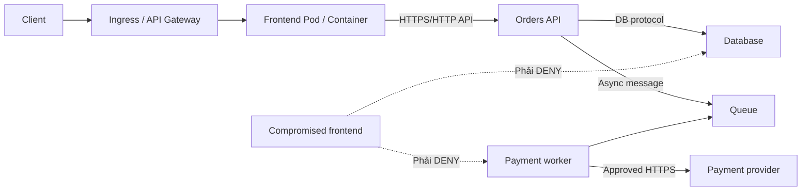
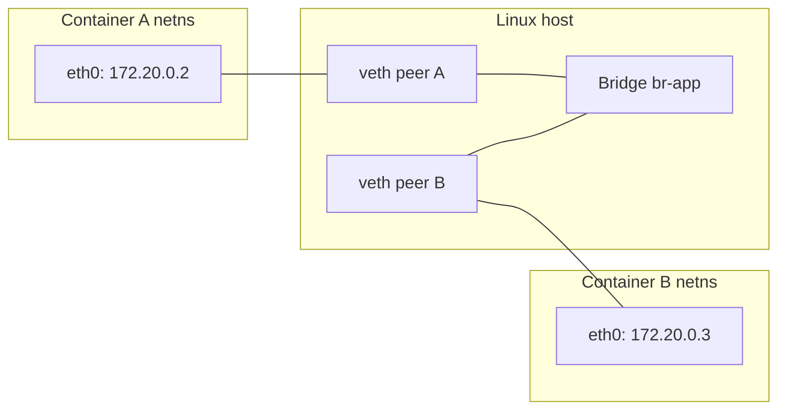
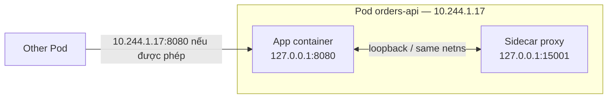
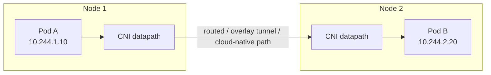
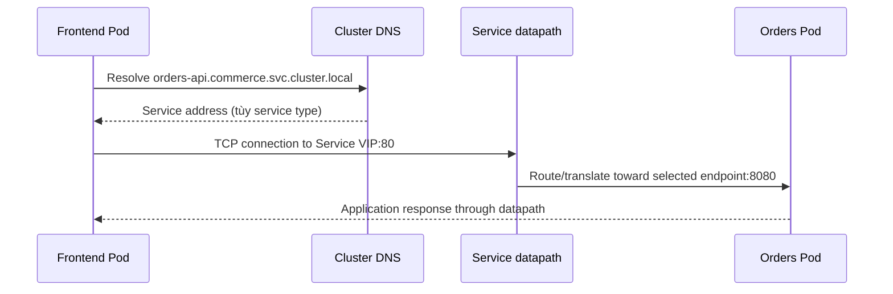
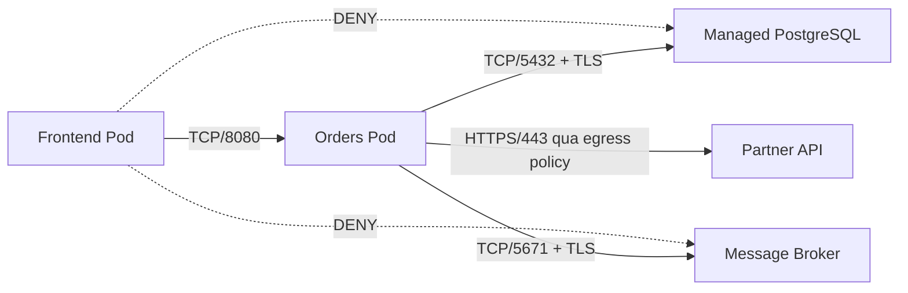
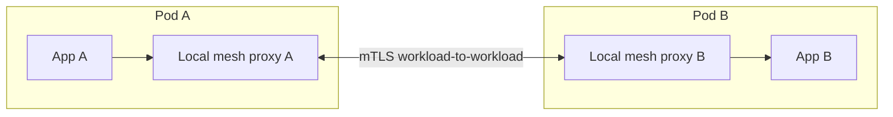
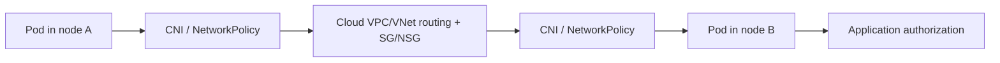
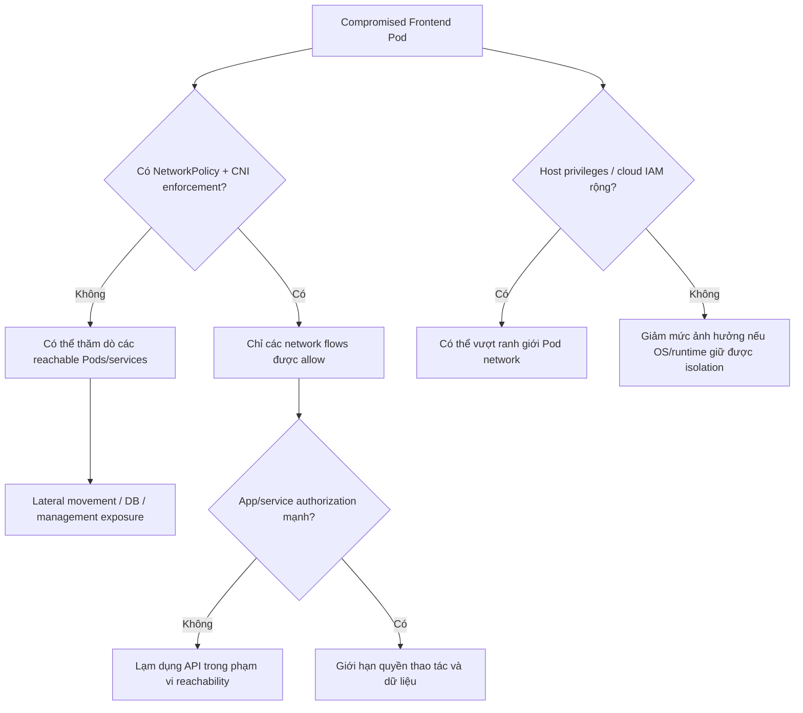
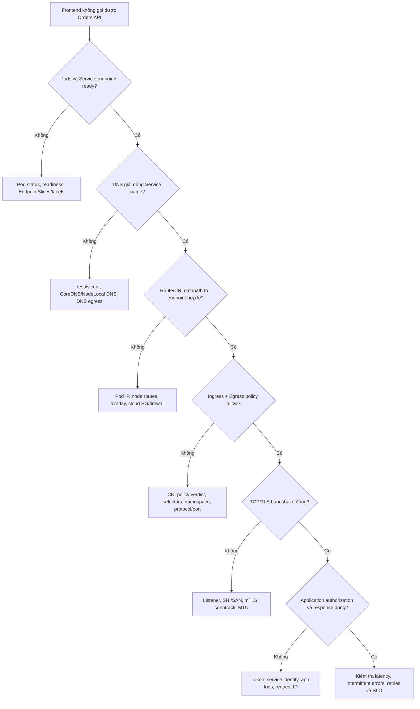

# Container-to-container communication: luồng giao tiếp, phân đoạn và bảo mật mạng container

Một ứng dụng thương mại điện tử gồm các container `frontend`, `orders-api`, `payment-worker` và `database`. Chúng cùng chạy trên một máy Docker hoặc trên nhiều node Kubernetes. Ứng dụng cần cho `frontend` gọi `orders-api`, `orders-api` truy cập database, còn `payment-worker` gọi một dịch vụ thanh toán đã được phê duyệt. Nhưng nếu mọi container có thể kết nối tới mọi container khác, một lỗ hổng ở `frontend` có thể trở thành bàn đạp để thăm dò database, metadata service hoặc API quản trị không thuộc nhiệm vụ của nó.

**Container-to-container communication** là quá trình trao đổi dữ liệu giữa các tiến trình chạy trong những container khác nhau, thông qua các cơ chế như TCP/UDP sockets, loopback, virtual Ethernet (veth), bridge, routing, overlay network, service discovery và proxy. Cách packet đi từ nguồn tới đích phụ thuộc **container có chung network namespace hay không**, cùng host hay khác host, Docker/Compose hay Kubernetes, CNI plugin và các chính sách đang thực thi.

Trong chương **Bảo mật mạng container** của module **SECURITY_NETWORK_SECURITY**, bài học kết nối kiến thức về phân đoạn, firewall, VPN, IDS/IPS, DNS, xác thực kết nối, cloud networking và giám sát xâm nhập với giao tiếp **east–west** giữa workloads. Mục tiêu không phải chặn toàn bộ liên lạc, mà là **cho phép chính xác những luồng cần thiết và xác minh quyền ở cả tầng mạng lẫn ứng dụng**.

Sau bài học, bạn có thể:

1. Giải thích **Linux network namespace**, veth pair, bridge, routing, port publishing và khác biệt giữa giao tiếp qua `localhost`, Pod IP, Service IP và hostname.
2. Phân biệt mạng **Docker default bridge, user-defined bridge, Compose networks** với mạng **Kubernetes Pod/Service/CNI**.
3. Theo dõi một request container → container trên cùng node và khác node, bao gồm DNS, NAT, conntrack, overlay/encapsulation và policy enforcement.
4. Thiết kế **default-deny ingress/egress**, rồi mở đúng ứng dụng và cổng cần thiết bằng **Kubernetes NetworkPolicy** trong phạm vi được CNI hỗ trợ.
5. Nhận biết những giới hạn của NetworkPolicy chuẩn: chủ yếu L3/L4, policy cộng gộp, không tự mã hóa hoặc xác thực người dùng, không thay service mesh/mTLS.
6. Bảo vệ giao tiếp container ↔ database, container ↔ service nội bộ và container ↔ external service bằng firewall, TLS/mTLS, workload identity, DNS/egress policy.
7. Phát hiện các đường vượt ranh giới như `hostNetwork`, `hostPort`, NodePort, privileged container, public service, metadata service và overlay misconfiguration.
8. Chẩn đoán lỗi DNS, socket, Service endpoints, route, NetworkPolicy, CNI, TLS và application authorization mà không tắt firewall để thử.
9. Xây dựng lab kiểm tra **luồng được phép** và **luồng bắt buộc bị từ chối**, theo dõi observability và lập runbook ứng phó.

> **Giới hạn ví dụ:** Các tên `frontend`, `orders-api`, `database`, địa chỉ IP và image trong phần mẫu là tài liệu minh họa. YAML/CLI có thể cần thay namespace, labels, image, cổng và chính sách để chạy trên cluster được cấp phép. Không áp những phép thử thay đổi chính sách hoặc tạo network rộng lên production khi chưa review, canary và có rollback.

## 1. Vì sao giao tiếp giữa container là một ranh giới bảo mật?

Một hệ thống container có thể gồm hàng trăm microservices và sidecars. Số container thay đổi liên tục vì autoscaling, rolling deployment, rescheduling hoặc job ngắn hạn. Địa chỉ IP, port và DNS records có thể thay đổi theo mỗi lần deploy; ứng dụng vẫn cần liên lạc với đúng service.



Nếu `frontend` bị chiếm quyền, attacker có thể cố dùng nó làm một **điểm xuất phát hợp lệ bên trong mạng container**. Trong mô hình không phân đoạn, container này có thể có route tới DB, queue hoặc quản trị node dù không có nhu cầu nghiệp vụ.

### 1.1. Những câu hỏi cần phân biệt

| Câu hỏi | Lớp chịu trách nhiệm | Điều thường bị hiểu nhầm |
|---|---|---|
| Hai tiến trình có chung network namespace? | Linux runtime/Pod configuration | Hai container là hai ranh giới mạng độc lập mặc định |
| Packet đi qua interface/bridge/overlay nào? | CNI/Docker network/kernel route | Tất cả container đều đi qua một firewall trung tâm |
| Tên `orders-api` phân giải thành địa chỉ nào? | DNS/service discovery | DNS thành công nghĩa là traffic được cho phép |
| Source có được gọi destination TCP/8080 không? | Network policy/firewall/SG | Service tồn tại nghĩa là mọi nguồn được truy cập |
| Server đích có đúng identity không? | TLS/mTLS/certificate verification | IP private đồng nghĩa service đáng tin |
| User/service có quyền gọi API này không? | IAM/OAuth/app authorization | NetworkPolicy allow có nghĩa request được cấp quyền |
| Giao tiếp bị từ chối do đâu? | Policy, route, listener, TLS, application | Một TCP timeout luôn là lỗi firewall |

### 1.2. Hai trục cần quan sát

- **North–south traffic:** traffic đi vào/ra môi trường workload, chẳng hạn Internet → ingress → frontend hoặc API → external payment service.
- **East–west traffic:** traffic giữa các workloads/services, kể cả cùng cluster, khác namespace, khác subnet hoặc qua mạng hybrid.

Network segmentation cần kiểm soát **cả hai**. Chỉ bảo vệ Internet ingress bằng WAF mà mở mọi luồng east–west khiến attacker vẫn có nhiều đường lateral movement sau khi một service bị compromise.

### 1.3. Mô hình Zero Trust ở mức workload

Một kết nối nội bộ muốn được coi là hợp lệ cần qua nhiều kiểm tra độc lập:

```text
Source workload identity
    + đúng network reachability
    + được L3/L4 policy cho phép
    + TLS/mTLS xác minh peer nếu yêu cầu
    + authentication/authorization tại application
    + audit và phát hiện hành vi bất thường
```

**NetworkPolicy không tạo danh tính người dùng và không mã hóa payload.** Ngược lại, mTLS không tự chặn một service đã có chứng chỉ hợp lệ gọi nhầm API hoặc truy cập dữ liệu ngoài phạm vi role. Hai nhóm kiểm soát cần bổ sung cho nhau.

## 2. Linux network namespace: nền tảng của container networking

**Network namespace (netns)** cô lập một tập tài nguyên mạng của Linux như network interfaces, IPv4/IPv6 addresses, route tables, sockets, network-related firewall state trong phạm vi tương ứng, và port bindings. Mỗi namespace có thể có loopback interface riêng.

### 2.1. Container và tiến trình

Container về bản chất là một nhóm tiến trình được quản lý bằng namespaces, cgroups và các cơ chế runtime khác. **Không phải mọi container luôn có network namespace riêng**:

- Hai container độc lập trong Docker bridge thông thường có netns riêng.
- Container có thể dùng `--network host` và chia sẻ network namespace của host.
- Docker cho phép một container tham gia network namespace của container khác theo mode được hỗ trợ.
- **Các container trong cùng một Kubernetes Pod thông thường chia sẻ một network namespace và cùng Pod IP**.

Do đó **ranh giới container**, **ranh giới Pod** và **ranh giới host** không đồng nhất.

### 2.2. Veth pair và Linux bridge

Một mô hình phổ biến trên cùng host:



Khi container A mở TCP đến B, Linux kernel sử dụng route, ARP/neighbor discovery, veth, bridge hoặc các forwarding mechanisms thích hợp. Với mạng bridge thông thường, packet không cần rời host vật lý.

**Đây là một đường mẫu, không phải mọi packet của mọi CNI đều phải đi qua Linux bridge.** Một số CNI dùng L3 routing, eBPF datapath, macvlan/ipvlan, OVS hoặc hardware offload.

### 2.3. Loopback `127.0.0.1` và `::1`

Với hai containers ở **hai network namespaces khác nhau**, `127.0.0.1` của A trỏ về **chính A**, không phải B. Muốn gọi B cần tên/service address hoặc một cơ chế networking chung.

Trong một Kubernetes Pod chứa `app` và `sidecar`, chúng thường dùng chung Pod netns nên có thể giao tiếp qua `localhost`:

```text
Pod IP = 10.244.1.17

app container:
  listens on 127.0.0.1:8080

sidecar container (cùng Pod):
  connects to 127.0.0.1:8080
```

**Cảnh báo:** Các containers trong cùng Pod chia sẻ không gian TCP/UDP port: hai process không thể cùng bind một address:port theo cùng điều kiện socket. Đừng coi `localhost` là một network security boundary giữa sidecar và app.

### 2.4. Port binding và IP binding

Ứng dụng lắng nghe `127.0.0.1:8080` chỉ nhận những kết nối tương ứng với loopback trong netns của nó. Lắng nghe `0.0.0.0:8080` có nghĩa lắng nghe trên các IPv4 local addresses phù hợp, **không có nghĩa tự có đường Internet/public exposure**. Route, network policy, host firewall, port publishing và LB vẫn quyết định external reachability.

Ví dụ:

```text
App binds 127.0.0.1:8080:
  Same netns via loopback → có thể kết nối
  Other Pod/container via Pod IP → thường không tới listener này

App binds 0.0.0.0:8080:
  Pod IP:8080 → có thể tới nếu CNI/network policy cho phép
  Internet → chỉ khi có đường công khai và policy tương ứng
```

Không dùng host binding `0.0.0.0` làm phép đo duy nhất cho public exposure. Ngược lại, một container có public port mapping dù app lắng nghe trong container netns cần được kiểm tra thực tế để xác định forwarded traffic có tới được listener không.

## 3. Docker networking: bridge, DNS, port publishing

Docker cung cấp nhiều network drivers/modes, trong đó **bridge networking** phổ biến trên một host. Cần hiểu **mạng tự định nghĩa** khác với **mạng bridge mặc định** của Docker.

### 3.1. Default bridge và user-defined bridge

| Đặc điểm | Docker default `bridge` | User-defined bridge |
|---|---|---|
| Cô lập network namespace | Mỗi container thông thường vẫn có netns riêng | Tương tự |
| Kết nối trong cùng mạng | Có theo semantics/daemon config | Có theo network configuration |
| DNS container names | Không có cùng trải nghiệm automatic name-resolution như user-defined bridge | Docker embedded DNS/service-name resolution được hỗ trợ |
| Quản lý thành viên | Bị ảnh hưởng bởi default network | `docker network connect/disconnect`, Compose networks |
| Phân đoạn theo service | Dễ trộn nhiều containers không liên quan | Có thể tạo nhiều bridge networks tách luồng |
| Network security | Không thay app auth/TLS | Cũng không thay app auth/TLS hoặc host firewall |

Một container nằm trên cùng user-defined bridge có thể kết nối tới **port ứng dụng được bind và reachable** của container khác mà không cần publish port ra host. Port publishing chủ yếu tạo đường **host/external → container**.

### 3.2. Thực nghiệm an toàn: tên container và port nội bộ

Trên một host Docker lab được phép:

```bash
# Tạo một user-defined bridge riêng cho lab.
docker network create lab-app-net

# Chạy container web test chỉ gắn vào network này.
docker run -d --name lab-web \
  --network lab-app-net \
  nginx:alpine

# Một client tạm thời trong cùng bridge có thể gọi tên container.
docker run --rm --network lab-app-net \
  curlimages/curl:8.11.1 \
  -I --max-time 5 http://lab-web:80/
```

Các image tags chỉ để minh họa; chỉ chạy sau khi xác minh nguồn image, digest và policy supply chain của tổ chức. Lệnh tạo containers/network trong lab và có thể phải tải images từ registry; **không chạy trên host sản xuất**.

`lab-web` ở đây là một tên Docker DNS dành cho thành viên trong network thích hợp, **không phải identity được xác thực mật mã**. Một container khác trong cùng network vẫn cần được hạn chế bằng phân đoạn, application auth hoặc service-level controls.

### 3.3. Port publishing không phải giao tiếp nội bộ

```bash
# Ví dụ host bind vào loopback để chỉ test từ host.
docker run -d --name lab-web-local \
  --network lab-app-net \
  -p 127.0.0.1:18080:80 \
  nginx:alpine
```

Ý nghĩa: Docker cấu hình host port mapping từ `127.0.0.1:18080` tới container port `80` theo khả năng của host/daemon. Điều này khác với container khác dùng `http://lab-web-local:80` trong cùng network.

Nếu dùng `-p 8080:80` mà không chỉ host IP, port có thể được bind/publish trên nhiều host interfaces theo Docker daemon và IP-family settings, tạo exposure ngoài dự kiến. Phải kiểm tra bằng `docker ps`, `docker port`, `ss` và host firewall.

**Không dựa duy nhất vào một firewall rule trên host để suy Docker port publishing bị chặn** nếu Docker thiết lập NAT/forwarding rules có ưu tiên khác. Cần kiểm tra packet path và rules hiệu lực đúng phiên bản/môi trường.

### 3.4. Container trên hai bridge networks khác nhau

```text
frontend bridge:  frontend, api-gateway
backend bridge:   api-gateway, orders-api, database
```

Một container `api-gateway` nối vào cả hai networks có thể phục vụ như điểm trung gian. Nhưng việc nó thuộc hai networks **không có nghĩa Docker tự biến nó thành L3 router**; traffic được chuyển ứng dụng qua proxy, hoặc nếu cấu hình IP forwarding/privileges phù hợp, có thể tạo đường ngoài ý định.

**Bridge network separation giúp giảm reachability**, nhưng admin/root trên host, cấu hình runtime đặc quyền hoặc một gateway container có thể thay đổi giả định này. Cần bảo vệ Docker daemon socket và host privileges.

### 3.5. Docker Compose: frontend/backend rõ ràng

```yaml
# compose.yml - kiến trúc minh họa, cần build images thật trước khi chạy.
services:
  web:
    image: registry.example.test/demo-web:1.0.0
    networks:
      - frontend
    ports:
      - "127.0.0.1:8080:8080"

  api:
    image: registry.example.test/demo-api:1.0.0
    networks:
      - frontend
      - backend
    environment:
      DATABASE_HOST: database

  database:
    image: registry.example.test/demo-db:1.0.0
    networks:
      - backend

networks:
  frontend: {}
  backend:
    internal: true
```

`backend` có `internal: true` nhằm hạn chế khả năng kết nối ra ngoài theo semantics Docker/Compose tương ứng. **Nó không là chứng cứ chống mọi đường thoát hay chống một container dual-homed/chủ host bị xâm nhập**; cần kiểm tra thực tế routing, DNS, policy và application proxy. Các images là placeholders; ví dụ không tự triển khai database hoàn chỉnh hoặc bảo vệ thông tin đăng nhập.

Ở ví dụ này:

- `web` và `api` có thể giao tiếp trên mạng `frontend` nếu ứng dụng lắng nghe đúng port.
- `api` và `database` chia sẻ `backend`.
- `web` **không tự có đường trực tiếp** tới tên/IP `database` chỉ vì cả hai nằm cùng một Compose project; cần xem network memberships và đường host/external khác.
- Nếu ứng dụng `api` bị compromise, kẻ tấn công có thể khai thác những quyền `api` đang có với DB. Cần database authentication và least privilege, không chỉ bridge isolation.

### 3.6. Docker `host`, `none`, overlay, macvlan/ipvlan

| Network mode/driver | Tính chất | Rủi ro cần đánh giá |
|---|---|---|
| `bridge` | Kết nối container trên cùng host qua bridge/routing | Port publishing, mạng chung quá rộng |
| `host` | Container dùng network namespace của host | Giảm network isolation; có thể bind host ports và tiếp cận host services |
| `none` | Không có external network interfaces do Docker setup, thường vẫn có loopback | Không tự chặn các kênh IPC/shared volumes/host privileges |
| Overlay | Kết nối workloads qua nhiều nodes theo nền tảng hỗ trợ | Underlay reachability, encapsulation, encryption và control plane |
| macvlan/ipvlan | Container có cấu hình L2/L3 đặc biệt trên underlay | Có thể mở reachability trực tiếp với LAN ngoài bridge/NAT assumptions |

Không dùng `host` networking chỉ để “khắc phục DNS” mà không đánh giá sự mất isolation. Một network mode khác thường làm đổi cả **trust boundary, port management, firewall policy và quan sát**.

## 4. Kubernetes network model: Pod mới là đơn vị địa chỉ cơ bản

Kubernetes thường giả định mỗi **Pod có địa chỉ IP riêng**, các containers trong cùng Pod chia sẻ network namespace và các Pods có khả năng giao tiếp theo mạng do CNI cung cấp. **Service IP/DNS** bổ sung một tên và điểm truy cập ổn định hơn Pod IP.

### 4.1. Container trong cùng một Pod



**Quan trọng:** NetworkPolicy chuẩn chọn **Pod** bằng labels, không chọn riêng từng container trong Pod. Nó không phải công cụ thích hợp để đặt một allow/deny L3/L4 giữa `app` và `sidecar` đang chia sẻ cùng network namespace/loopback. Khi cần cô lập mạnh giữa hai workloads, cân nhắc đặt chúng thành **hai Pods riêng** và áp các chính sách phù hợp.

### 4.2. Pod-to-Pod trên cùng node

```text
Pod A netns
  | veth
Host / node datapath (bridge, L3, OVS hoặc eBPF)
  | veth
Pod B netns
```

Không nhất thiết có NAT giữa hai Pod IPs. CNI quyết định routing, address allocation và nơi áp network policy. Packet có thể đi qua Linux bridge hoặc được chuyển theo cơ chế khác tùy plugin; không mặc định thấy mỗi packet trong `iptables` trên mọi node.

### 4.3. Pod-to-Pod khác node



Các triển khai có thể:

- Routing trực tiếp Pod CIDRs qua underlay/cloud network.
- VXLAN/Geneve hoặc overlay encapsulation giữa nodes.
- eBPF datapath với routing và service load balancing.
- Cloud-native IP allocation để Pod IP gắn với địa chỉ/routing của VPC/VNet.

**Encapsulation không đồng nghĩa encryption.** VXLAN giúp vận chuyển L2/L3 qua underlay nhưng không tự mã hóa payload. Nếu threat model cần bảo mật dữ liệu giữa nodes/workloads, phải xét WireGuard/IPsec underlay overlay, TLS/mTLS hoặc khả năng sản phẩm tương ứng.

### 4.4. Pod IP không bền vững

Pod có thể bị thay khi rolling update hoặc reschedule, dẫn tới IP khác. Không nên hardcode Pod IP vào ứng dụng. Dùng:

- **Kubernetes Service + DNS name** cho nhóm Pods có selector.
- StatefulSet/headless Service khi cần hostname/identity theo replica.
- Service discovery/controller phù hợp khi endpoint là external hoặc không có selector.
- Workload identity và TLS server name để xác minh đích.

IP là địa chỉ định tuyến, **không phải bằng chứng ứng dụng đang kết nối với workload tin cậy**.

## 5. Kubernetes Service, EndpointSlice và DNS: tên ổn định, backend động

Service cho một nhóm Pods một **điểm truy cập logic** thường là DNS name/ClusterIP. Các endpoint thực tế có thể thay đổi khi Pod được thêm, bị loại, crash hoặc scale.

### 5.1. Pod IP, ClusterIP, DNS name

Ví dụ:

```text
Namespace: commerce

Service name: orders-api
DNS (thường): orders-api.commerce.svc.cluster.local
Service ClusterIP: 10.96.40.10
Service port: 80
Target port: 8080

Ready endpoints:
  Pod orders-a: 10.244.1.17:8080
  Pod orders-b: 10.244.2.18:8080
```

Trong mô hình tiêu biểu, Pod nguồn gọi `orders-api.commerce.svc.cluster.local:80` để Kubernetes service datapath chọn một backend hợp lệ. Các IP chỉ là ví dụ; pod CIDR, service CIDR và DNS cluster domain **được cấu hình theo cluster**, không luôn là `cluster.local`.

### 5.2. Đường đi một request



Đây là sơ đồ **khái niệm**, không nhất thiết có một process “Service datapath” đứng giữa. Tùy môi trường, kube-proxy có thể dùng cơ chế iptables/IPVS/nftables phù hợp phiên bản, hoặc một CNI/eBPF datapath có thể thay chức năng service forwarding. Không kết luận mọi flow đều bị DNAT ở cùng thời điểm của stack.

### 5.3. EndpointSlice và readiness

Kubernetes EndpointSlice cung cấp thông tin endpoints cho Services. Các trạng thái readiness/terminating/serving theo tính năng giúp controller và datapath xử lý sự thay đổi Pod.

Một Pod có thể:

- Chưa sẵn sàng vì startup hoặc readiness probe chưa đạt.
- Bắt đầu **terminating** và được ngừng chọn cho traffic mới theo policy.
- Chuyển node/IP khi reschedule, khiến EndpointSlices được cập nhật.

**Service DNS resolve thành công không bảo đảm tồn tại healthy endpoints.** Khi Service không có endpoint phù hợp, các client có thể thấy timeout, connection refused hoặc lỗi proxy khác tùy datapath và client.

### 5.4. Service type và exposure

| Service type/cơ chế | Mục đích thường gặp | Điều phải kiểm tra |
|---|---|---|
| `ClusterIP` | Service address để truy cập trong cluster theo network model | Không đồng nghĩa mọi workload được cấp quyền; policy vẫn cần |
| `Headless` (`clusterIP: None`) | DNS có thể công bố Pod endpoints trực tiếp | Client tự chọn endpoint; readiness/TTL/cache cần xét |
| `NodePort` | Expose service trên node port theo khả năng | Node firewall, external routes, source IP handling, access restrictions |
| `LoadBalancer` | Cloud/cluster controller tạo LB theo cấu hình | Public/internal type, SG/firewall, IP families, annotations |
| `ExternalName` | DNS alias tới tên bên ngoài | DNS resolution và network egress vẫn cần; không tự proxy/TLS verify |
| Ingress/Gateway API | HTTP/TLS ingress routing ở lớp phù hợp | Controller-specific exposure, TLS, WAF và app authorization |

**ClusterIP không phải một firewall policy.** Nếu một Pod có thể route tới Service VIP và không bị NetworkPolicy/other firewall chặn, nó có thể gửi request bất kể tên namespace. Ngược lại, traffic tới `NodePort` hoặc LoadBalancer cần xét các đường NAT/SNAT và policy enforcement khác.

### 5.5. DNS scope và service identity

Trong nhiều cluster, các Pods cùng namespace có thể dùng tên ngắn `orders-api`; khác namespace thường dùng `orders-api.commerce` hoặc FQDN. Nhưng DNS search paths, `ndots`, host aliases và custom DNS policies có thể thay đổi hành vi.

**Một tên DNS không phải định danh mật mã.** Nếu app gọi `https://orders-api.commerce.svc.cluster.local`, nó vẫn phải xác minh certificate/server identity hoặc dùng service identity/mTLS phù hợp. Nếu app gọi plain HTTP, NetworkPolicy không tự mã hóa payload.

## 6. CNI plugin và datapath: chính sách được thực thi ở đâu?

**Container Network Interface (CNI)** là đặc tả/cơ chế để cấu hình networking cho container/pod sandbox; từng implementation có thể thiết lập IP, veth, routes, overlays, network policy và các thành phần khác theo khả năng.

### 6.1. Những lớp nằm trên packet path

```text
Application socket
    ↓
Pod/container network namespace
    ↓
Virtual interface / veth / selected CNI datapath
    ↓
Node networking and policy enforcement
    ↓
Direct route OR overlay tunnel OR cloud fabric
    ↓
Destination node/network namespace
    ↓
Destination process socket
```

Không có một đường áp đặt cho mọi cluster. Với eBPF datapath, một số bước được xử lý khác hoặc bỏ qua những Linux iptables chains mà người vận hành quen kiểm tra. Với cloud VPC-native CNI, Pod IP có thể xuất hiện trực tiếp trong VPC addressing; với overlay, underlay có thể chỉ thấy **node IP** và encapsulated payload.

### 6.2. NetworkPolicy API và CNI enforcement

Kubernetes cung cấp đối tượng API `NetworkPolicy`. Tuy nhiên **một CNI/plugin hoặc mạng của cluster phải thực thi được NetworkPolicy**, nếu không YAML tạo thành công nhưng không chặn traffic như mong đợi.

Phân biệt:

- **NetworkPolicy được API server nhận**: manifest hợp lệ về cấu trúc.
- **CNI hỗ trợ thực thi**: datapath đã hỗ trợ loại rule và traffic scope ấy.
- **Policy thực sự hiệu lực**: các endpoints đang được chọn bởi labels/namespace và packet path đi qua điểm enforcement.
- **Mục tiêu bảo mật được kiểm chứng**: traffic phải deny thực sự không tới đích qua mọi đường liên quan.

Ví dụ Kubernetes có policy object nhưng một CNI tối giản không hỗ trợ policy enforcement; `kubectl get networkpolicies` vẫn hiển thị YAML. **Không đánh dấu phân đoạn thành công chỉ vì API resource tồn tại.**

### 6.3. eBPF, iptables, IPVS và flow tracing

Các implementation có thể dùng:

- Netfilter/iptables hoặc nftables để lọc, NAT và cân bằng Service IP.
- IPVS cho một số mô hình service load balancing.
- eBPF maps/programs để áp policy, routing, load balancing và flow telemetry.
- OVS/virtual switches hoặc cloud security controls theo networking model.

Nơi người vận hành cần tìm log/drop counters, kết nối và policy IDs khác nhau. `iptables -L` **không phải cách kiểm chứng đủ** ở cluster sử dụng eBPF hay flow offload. Dựa vào tool hỗ trợ chính thức của CNI và kết quả **positive/negative traffic test**.

### 6.4. NetworkPolicy tiêu chuẩn không bao phủ mọi tính năng

Các CNI nâng cao có thể thêm chính sách L7 (HTTP methods/paths), FQDN-based egress, DNS policies, clusterwide policies hoặc host endpoint policies thông qua **CRD riêng**. Những tính năng này không tự có khi chỉ dùng Kubernetes `networking.k8s.io/v1` NetworkPolicy.

Khi cần portable policy, dùng phần **L3/L4 chuẩn** và ghi rõ các yêu cầu ngoài chuẩn. Không nhập YAML CRD của CNI này vào cluster dùng CNI khác rồi kỳ vọng chúng được thực thi.

## 7. Kubernetes NetworkPolicy: cách lựa chọn Pod và hướng traffic

NetworkPolicy là công cụ quan trọng để hạn chế kết nối giữa các Pods theo selectors, IP blocks, protocols và ports trong phạm vi định nghĩa.

### 7.1. Ba thành phần chính

```yaml
apiVersion: networking.k8s.io/v1
kind: NetworkPolicy
metadata:
  name: allow-example
  namespace: commerce
spec:
  podSelector:
    matchLabels:
      app: orders-api
  policyTypes:
    - Ingress
  ingress:
    - from:
        - podSelector:
            matchLabels:
              app: frontend
      ports:
        - protocol: TCP
          port: 8080
```

Diễn giải:

1. `metadata.namespace` là **namespace của policy và các Pods được chọn bởi `spec.podSelector`**.
2. `spec.podSelector` chọn các **destination Pods** với label `app=orders-api`.
3. `policyTypes: [Ingress]` khiến những Pods được chọn **bị cô lập ở chiều ingress** theo các NetworkPolicies áp dụng.
4. `ingress[].from[].podSelector` **không có `namespaceSelector`** nên chỉ chọn Pods trong **cùng namespace** `commerce`, có label `app=frontend`.
5. `ports` chỉ cho TCP port `8080`.

Nó **không** có nghĩa app đã được xác thực user, backend TLS bật, hoặc frontend không thể gọi những đích khác. Để kiểm soát traffic frontend gửi đi, cần **egress policy chọn frontend**.

### 7.2. Mặc định cho phép khi không có policy phù hợp

Trong Kubernetes NetworkPolicy chuẩn, một Pod **không bị cô lập** ở ingress/egress nếu không có NetworkPolicy tương ứng chọn Pod và áp hướng đó; phần lớn traffic sẽ được phép **theo lớp NetworkPolicy**, còn routing/firewall bên ngoài có thể chặn.

Khi một NetworkPolicy chọn Pod để cô lập ingress, traffic đến Pod chỉ được phép nếu **ít nhất một NetworkPolicy áp dụng** có ingress rule cho phép flow ấy, cộng với các cơ chế không thuộc phạm vi NetworkPolicy.

**Không suy từ “tạo một NetworkPolicy bất kỳ” rằng mọi Pods trong namespace được default deny.** Phải đọc `podSelector`, `policyTypes` và hướng thật.

### 7.3. Các NetworkPolicies được cộng gộp

Ví dụ hai policies cùng chọn `orders-api`:

```text
Policy A: allow frontend → orders-api TCP/8080
Policy B: allow monitoring → orders-api TCP/9090
```

Kết quả logic là **hợp của các traffic được allow**, không phải policy sau ghi đè policy trước. Kubernetes NetworkPolicy chuẩn **không có luật deny ưu tiên cao** giống ordered ACLs; để thu hẹp quyền phải chỉnh/xóa các allow rules không mong muốn và thiết kế isolation phù hợp.

### 7.4. Ingress và egress được xét độc lập ở hai đầu

Nếu source Pod bị cô lập egress và destination Pod bị cô lập ingress, flow phải:

1. Được **egress policy của source** cho phép.
2. Được **ingress policy của destination** cho phép.
3. Có DNS, route, Service routing, CNI datapath và listener hoạt động.

Một chiều allow không tự “vượt qua” chiều bị deny. Trả lời của kết nối đã được phép thường được datapath theo dõi theo connection state, nhưng cách xử lý các loại traffic, ICMP và host/node traffic có thể khác theo CNI.

### 7.5. Bảng suy luận policy

| Source egress isolation | Destination ingress isolation | Điều kiện |
|---|---|---|
| Không | Không | Không bị chặn bởi NetworkPolicy chuẩn ở hai phía; vẫn có thể bị chặn nơi khác |
| Có | Không | Cần source egress allow |
| Không | Có | Cần destination ingress allow |
| Có | Có | Cần **cả egress allow lẫn ingress allow** |

Một policy đặt trên Pod **không áp tự động lên Pod khác** hay lên VM/database managed service. Với external destination, source egress policy và những firewall/service auth ngoài cluster phải được kiểm tra riêng.

## 8. NetworkPolicy default deny rồi mở luồng cần thiết

**Deny by default** giảm bề mặt lateral movement, nhưng chỉ có tác dụng nếu CNI hỗ trợ và các ngoại lệ thực sự cần cho DNS, monitoring, identity, service mesh, controller health checks đã được thiết kế.

### 8.1. Default deny ingress/egress cho một namespace

```yaml
apiVersion: networking.k8s.io/v1
kind: NetworkPolicy
metadata:
  name: default-deny-all
  namespace: commerce
spec:
  podSelector: {}
  policyTypes:
    - Ingress
    - Egress
```

`podSelector: {}` chọn **mọi Pods trong namespace `commerce`**. Không có `ingress`/`egress` allow rules nên các Pods bị cô lập ở hai chiều theo mô hình NetworkPolicy.

**Đừng áp thẳng lên production khi chưa chuẩn bị đường cấp phép cần thiết.** DNS, monitoring, telemetry, service mesh control-plane, external identity/registry APIs hoặc health checks có thể bị ảnh hưởng. Các traffic node/host/loopback có ngoại lệ/phạm vi phụ thuộc Kubernetes và CNI; không tuyên bố `default-deny-all` chặn được mọi đường tuyệt đối.

### 8.2. Allow frontend → orders API

```yaml
apiVersion: networking.k8s.io/v1
kind: NetworkPolicy
metadata:
  name: allow-frontend-to-orders
  namespace: commerce
spec:
  podSelector:
    matchLabels:
      app: orders-api
  policyTypes:
    - Ingress
  ingress:
    - from:
        - podSelector:
            matchLabels:
              app: frontend
      ports:
        - protocol: TCP
          port: 8080
```

Vì default deny đã chọn **cả frontend và orders**, rule này chỉ cho phép **ingress của `orders-api`**; nó **chưa cho phép egress của `frontend`**. Để hoàn thiện một flow, tạo egress allow riêng.

### 8.3. Allow frontend egress tới orders API

```yaml
apiVersion: networking.k8s.io/v1
kind: NetworkPolicy
metadata:
  name: frontend-egress-to-orders
  namespace: commerce
spec:
  podSelector:
    matchLabels:
      app: frontend
  policyTypes:
    - Egress
  egress:
    - to:
        - podSelector:
            matchLabels:
              app: orders-api
      ports:
        - protocol: TCP
          port: 8080
```

Kết hợp hai manifests cho phép **Pod frontend → Pod orders-api:8080** trong cùng namespace khi hai Pods có labels và CNI enforcement phù hợp.

**Chú ý với Service:** frontend thường gọi Service port, ví dụ `orders-api:80`, rồi datapath chuyển tới target Pod port `8080`. Tại giai đoạn NetworkPolicy được đánh giá, destination và port **có thể được nhìn thấy trước hoặc sau Service NAT tùy CNI/implementation**, nhất là với `ipBlock`. Không suy rằng policy `port: 8080` áp giống nhau lên Service VIP port 80 trong mọi datapath. Nên dùng Service/target ports theo thiết kế có thể kiểm chứng, hoặc thống nhất port để giảm nhầm lẫn, và **thử flow thực tế** trên CNI đang chạy.

### 8.4. Ví dụ chọn namespace khác

Giả sử metrics collector ở namespace `observability` cần scrape orders API qua TCP/9090.

```yaml
apiVersion: networking.k8s.io/v1
kind: NetworkPolicy
metadata:
  name: allow-metrics-from-observability
  namespace: commerce
spec:
  podSelector:
    matchLabels:
      app: orders-api
  policyTypes:
    - Ingress
  ingress:
    - from:
        - namespaceSelector:
            matchLabels:
              kubernetes.io/metadata.name: observability
          podSelector:
            matchLabels:
              app: collector
      ports:
        - protocol: TCP
          port: 9090
```

`namespaceSelector` và `podSelector` **cùng nằm trong một phần tử của `from`**, do đó biểu diễn **collector Pods trong namespace observability** (AND). Nếu viết thành **hai phần tử list riêng**, nó tạo union: mọi Pods trong namespace được chọn **hoặc** mọi Pods có label trong scope khác, rộng hơn ngoài dự kiến.

`kubernetes.io/metadata.name` là namespace label được Kubernetes hỗ trợ ở các phiên bản phù hợp; vẫn cần xác minh labels của cluster và quyền **ai có thể thay đổi namespace/pod labels**.

### 8.5. Cẩn trọng với `ipBlock`

```yaml
egress:
  - to:
      - ipBlock:
          cidr: 10.20.30.0/24
    ports:
      - protocol: TCP
        port: 5432
```

`ipBlock` dùng CIDR/IP prefix, phù hợp với một số external destinations hoặc những vùng IP có đặc tính cố định. **Không dùng Pod IPs biến động hoặc toàn Pod CIDR như mặc định đáng tin**, vì pod addressing/routing, NAT và CNI semantics thay đổi.

Trong một số triển khai, NetworkPolicy enforcement với `ipBlock` xảy ra trước/sau destination NAT, đặc biệt liên quan Service IP, NodePort hoặc egress gateway. Phải kiểm chứng từ đúng source Pod và destination thật thay vì suy từ CIDR chỉ dựa trên manifest.

## 9. DNS egress và giao tiếp với dịch vụ ở namespace khác

Một trong những lỗi thường gặp sau khi bật default-deny là ứng dụng đột ngột báo **không phân giải được tên Service**, dù các policy tới port nghiệp vụ trông đúng.

### 9.1. DNS request cũng là network traffic

Pod cần liên lạc với DNS resolver để tra `orders-api.commerce.svc.cluster.local`. Trong Kubernetes, CoreDNS hoặc một thành phần resolver tương đương thường phục vụ DNS cluster; một số hệ thống dùng **NodeLocal DNSCache**, DNS proxy hoặc custom resolver.

```text
Frontend Pod
   ├── UDP/TCP 53 → DNS server (có thể là CoreDNS hoặc node-local proxy)
   └── TCP/8080   → Orders Pod (sau khi phân giải)
```

Khi Pod bị cô lập egress, phải cấp quyền tới **DNS target thực sự của cluster** với protocol/port phù hợp. Không cứ mặc định rằng DNS luôn nằm trong `kube-system`, Pod mang label `k8s-app=kube-dns`, hoặc traffic luôn trực tiếp tới ClusterIP thay vì link-local node-local DNS.

### 9.2. Policy DNS minh họa, không áp khi chưa xác nhận labels

Trong cluster lab có CoreDNS Pods tại namespace `kube-system` với label `k8s-app: kube-dns`, một policy có thể là:

```yaml
apiVersion: networking.k8s.io/v1
kind: NetworkPolicy
metadata:
  name: allow-frontend-dns
  namespace: commerce
spec:
  podSelector:
    matchLabels:
      app: frontend
  policyTypes:
    - Egress
  egress:
    - to:
        - namespaceSelector:
            matchLabels:
              kubernetes.io/metadata.name: kube-system
          podSelector:
            matchLabels:
              k8s-app: kube-dns
      ports:
        - protocol: UDP
          port: 53
        - protocol: TCP
          port: 53
```

**Phải kiểm tra:**

- Namespace/Pod labels của DNS server có thực sự đúng không?
- CNI có match Pod selectors đúng khi egress đi qua **Service IP** của `kube-dns` và DNAT không?
- DNS có đi qua một **node-local daemon** thay vì CoreDNS Pod không?
- Port/protocol có thay đổi (DNS-over-TLS hoặc custom resolver) không?
- Có DNS caching, retry hoặc fallback ngoài policy không?

Nếu traffic đi tới DNS IP không thuộc selected Pods, policy trên sẽ **không cho phép** truy vấn như kỳ vọng. Chỉ nên điều chỉnh target/scope sau khi quan sát thực tế; tránh tạm thời allow UDP/TCP 53 tới toàn Internet vô hạn.

### 9.3. Cross-namespace service access

Giả sử frontend ở `web` namespace, orders-api ở `commerce`. Một inbound rule của orders-api chỉ cho Pods namespace `web` có label `app=frontend`:

```yaml
apiVersion: networking.k8s.io/v1
kind: NetworkPolicy
metadata:
  name: orders-from-web
  namespace: commerce
spec:
  podSelector:
    matchLabels:
      app: orders-api
  policyTypes:
    - Ingress
  ingress:
    - from:
        - namespaceSelector:
            matchLabels:
              kubernetes.io/metadata.name: web
          podSelector:
            matchLabels:
              app: frontend
      ports:
        - protocol: TCP
          port: 8080
```

Nếu web Pods đã bị egress-isolated, còn cần một egress allow ở **namespace `web`** chọn frontend và trỏ tới orders Pod/namespace phù hợp. Policy trong namespace commerce **không thể tự viết thay quyền egress cho source Pods ở web**.

### 9.4. Namespace isolation khác tenant isolation

`Namespace` hữu ích để chia môi trường quản trị và làm selector scope. Tuy nhiên:

- Namespace **không tự chặn traffic** giữa Pods.
- NetworkPolicies phải chọn đúng Pods, namespaces và hướng traffic.
- Người có quyền thay đổi labels/NetworkPolicies/Pod specs trong namespace có thể làm thay đổi điều kiện match.
- Workloads có privileges quá cao hoặc node-level access có thể vượt assumptions của policy thông thường.
- Multi-tenant cluster có yêu cầu bảo mật cao còn cần RBAC, Pod Security, admission policies, node isolation và cân nhắc cluster boundary riêng.

## 10. Giao tiếp container → database, queue và external services

Một microservice thường không chỉ gọi Service trong cluster mà còn tới **database, queue, object storage, cloud APIs hoặc partner services**. Kiểm soát này là phần giao tiếp giữa workloads, dù đích không phải container Kubernetes.

### 10.1. Luồng mẫu



Một policy chuẩn có thể cho **đúng destination IP range/protocol/port** khi đích nằm ngoài cluster. Nhưng **NetworkPolicy chuẩn không có FQDN selector**, không tự xác minh TLS certificate hoặc phân quyền database.

### 10.2. Database address thay đổi

Managed database thường có hostname và IP có thể thay đổi khi failover, bảo trì hoặc thay private endpoint. Một egress `ipBlock` gắn cứng một IP có thể:

- Làm dịch vụ mất kết nối khi DB chuyển sang IP khác.
- Buộc người vận hành mở một CIDR lớn hơn mức cần thiết.
- Bị bypass nếu DB có public endpoint hoặc route ngoài dự kiến.

Cân nhắc cloud firewall/service endpoint controls, CNI có **FQDN policies** nếu được hỗ trợ, egress proxy hoặc private endpoint theo kiến trúc. Dù chọn cách nào, luôn dùng **TLS server identity** và database authentication được quản lý.

### 10.3. Source IP không phải user/service identity

Khi traffic qua kube-proxy, NAT gateway hoặc egress gateway, database có thể nhìn source IP của node hoặc NAT chứ không phải Pod. Nếu nhiều Pods dùng chung source IP, DB firewall based-on-IP có thể chỉ là một lớp và **không đủ phân biệt workloads**.

Nên kết hợp:

- NetworkPolicy/SG/firewall giới hạn đường đi.
- Workload identity, managed identities/service accounts phù hợp.
- TLS/mTLS certificate hoặc access token.
- Database role chỉ có các quyền SQL cần thiết.
- Audit events gắn với ứng dụng, service identity, request ID.

### 10.4. Egress qua HTTP proxy

Một Pod có thể dùng HTTP CONNECT proxy hoặc egress gateway:

```text
Orders Pod → Egress Proxy → Approved Partner API
```

Proxy giúp quan sát và áp policy theo destination/hostname trong phạm vi TLS/HTTP mà nó thực sự có khả năng xử lý. Tuy nhiên:

- Pod phải không có **đường trực tiếp bypass** tới Internet khi chính sách bắt buộc qua proxy.
- Proxy phải xác thực nguồn hoặc áp workload policy đáng tin.
- Nếu TLS terminate tại proxy, cần chỉ rõ trust boundary và xử lý secrets/dữ liệu.
- DNS, HTTPS SNI, HTTP CONNECT và IPv6 cần policy nhất quán.
- Proxy không tự thay OAuth/API authorization của đối tác.

## 11. mTLS và service identity trong giao tiếp Pod-to-Pod

Kubernetes NetworkPolicy chủ yếu quyết định **ai có thể mở kết nối ở tầng mạng**. Với dữ liệu nhạy cảm, nhiều hệ thống còn cần **TLS/mTLS** giữa services để bảo vệ nội dung và xác minh peer.

### 11.1. TLS một chiều và mTLS

| Cơ chế | Ai trình diện certificate | Mục tiêu | Giới hạn |
|---|---|---|---|
| HTTPS/TLS | Server trình diện certificate, client xác minh | Mã hóa kênh và xác thực đích | Không mặc định xác thực service gọi |
| mTLS | Hai phía trình diện certificate | Xác thực cả caller và callee theo PKI | Không tự cấp quyền cho mọi API |
| NetworkPolicy | Chọn source/destination/protocol/port được phép | Giảm reachability/lateral movement | Không mã hóa, không xác thực user/app payload |
| OAuth/OIDC/API auth | App/IdP xác minh token hoặc session | User/service authorization | Không thay network firewall và peer transport security |

**mTLS không tự chữa lỗi business authorization**. Ví dụ service `frontend` có certificate hợp lệ nhưng không được quyền gọi `POST /admin/delete-all`, thì application hoặc policy layer phải từ chối dù TLS handshake thành công.

### 11.2. Certificate identity cần ràng buộc với workload

Một workload identity certificate có thể dùng SAN hoặc URI/SPIFFE ID theo PKI và nền tảng. Các yêu cầu:

1. Cấp certificate/khóa từ cơ chế được tin cậy, với lifecycle/rotation.
2. Ràng buộc identity tới **workload**, không chỉ IP/hostname tạm thời.
3. Server kiểm tra client certificate đúng issuer/identity; client kiểm tra server certificate đúng tên/identity.
4. Authorization map caller identity tới thao tác được phép.
5. Thu hồi hoặc cho cert hết hạn nhanh khi workload/secret bị compromise theo thiết kế.

Một Pod tên `orders-api` hoặc label `app=orders-api` không tự là identity không thể giả mạo. Những controllers/admission policies/RBAC có quyền tạo Pods và labels quyết định độ tin cậy khi binding identity.

### 11.3. Service mesh và sidecar/ambient datapath



Trong một số service mesh, app nói **plaintext tới local proxy**, proxy nói **mTLS tới proxy đích**. Điều này có thể bảo vệ proxy-to-proxy traffic nhưng **không phải ứng dụng trực tiếp thực hiện TLS end-to-end**.

Cần kiểm tra:

- Mesh mTLS đang ở chế độ **strict** hay permissive theo tính năng thực tế?
- Workloads nào **không được inject/onboard** vào mesh và có thể đi đường ngoài mesh?
- Traffic có thể bypass proxy qua port, host networking hoặc direct IP?
- Service authorization policy map đúng service accounts/workload identities?
- CA/keys được cấp/rotation và bảo vệ như thế nào?
- Giao thức gRPC/HTTP2/WebSocket và long-lived streams có hoạt động đúng sau sidecar intercept không?

**Không coi có sidecar = toàn cluster đã bật mTLS.** Đó là thuộc tính của đường kết nối, endpoint và policy cụ thể cần kiểm chứng.

### 11.4. Encryption in transit và overlay

VXLAN/Geneve encapsulation không phải encryption. Nếu attacker hoặc hệ thống trung gian có thể quan sát underlay, payload plain HTTP trong tunnel không tự bảo mật. Các lựa chọn:

- TLS/mTLS tại application.
- Service mesh mTLS giữa workload proxies.
- CNI/node-to-node encryption bằng IPsec/WireGuard khi implementation hỗ trợ và được cấu hình.

Mỗi lựa chọn có **trust boundary khác nhau**. Node-level encryption có thể bảo vệ dữ liệu giữa nodes nhưng không xác thực user/app và không loại bỏ plaintext trên node trước khi được mã hóa.

## 12. Host network, privileged containers và các đường vượt chính sách

NetworkPolicy chuẩn thường nhắm tới **Pods trong pod network**. Những traffic liên quan host/node, `hostNetwork`, `hostPort`, kernel datapath hoặc privileged workloads có thể không nằm trong cùng phạm vi bảo đảm.

### 12.1. `hostNetwork: true`

Một Pod với:

```yaml
spec:
  hostNetwork: true
```

thường sử dụng **network namespace của node** thay vì Pod namespace độc lập. Điều này giúp một số daemon/network agents nhưng làm thay đổi:

- Những interface/IP/ports mà container có thể nhìn thấy/bind.
- Khả năng áp NetworkPolicy tiêu chuẩn, phụ thuộc CNI.
- Cách traffic được ghi log và quan sát ở host.
- Phạm vi tấn công nếu process có quyền không an toàn.

Không dùng host networking để xử lý DNS/service discovery mà bỏ qua tác động đến ranh giới tin cậy. Với DaemonSets/agents cần host network, áp workload hardening, RBAC, node security và host firewall/policies phù hợp.

### 12.2. `hostPort`, NodePort và load balancer

`hostPort` gắn một container port với node port theo cơ chế runtime/CNI hỗ trợ. `NodePort` mở cổng cho Kubernetes Service qua nodes theo khả năng. LoadBalancer/Ingress/Gateway có thể thêm public đường vào.

Một Pod bị ràng buộc network policies không đồng nghĩa **mọi đường tới nó** đã được chặn qua NodePort, hostPort hoặc provider-specific load balancer. CNI/policy evaluation và SNAT có thể làm source address thay đổi. Cần thử từ client ngoài cluster và từ Pods có quyền khác nhau.

### 12.3. Docker socket, privileged và CAP_NET_ADMIN

Một container được mount Docker socket hoặc có các Linux capabilities/privileges cao như `CAP_NET_ADMIN` trong một phạm vi phù hợp có thể thao tác những network settings vượt quyền ứng dụng bình thường, hoặc chi phối runtime/host tùy cấu hình.

Giảm rủi ro:

- Không mount Docker daemon socket vào app containers không cần thiết.
- Tránh `--privileged` và cấp capabilities tối thiểu.
- Dùng non-root user, read-only root filesystem và seccomp/AppArmor/SELinux theo nền tảng.
- Giới hạn host mounts/host PID/IPC và cloud IAM credentials.
- Duy trì runtime/kernel/CNI patching, image signing/scanning.
- Chỉ cấp quyền modify Kubernetes NetworkPolicy/Pod labels cho identities được ủy quyền.

**NetworkPolicy không phải bảo đảm cô lập khỏi root/kernel hoặc Docker daemon của host bị compromise**. Nếu trust boundary giữa tenants thật sự không tương thích, cân nhắc tách node pools hoặc clusters.

### 12.4. Metadata service và SSRF

Một Pod có quyền gửi outbound tới địa chỉ metadata của cloud VM có thể gặp rủi ro **SSRF và lộ instance credentials**, tùy cloud/Kubernetes/identity setup. Bảo vệ bằng:

- Workload identity và least-privilege cloud roles thay vì chia sẻ quyền node quá rộng.
- Metadata service access controls theo cloud/node/container setup.
- Egress restrictions ở CNI/host/cloud firewall theo khả năng.
- SSRF prevention trong app (URL allowlist, DNS/redirect validation).
- Audit cloud APIs khi một workload đột nhiên dùng quyền bất thường.

Không tự giả định một NetworkPolicy egress default deny luôn chặn được host metadata IP trên mọi CNI/host networking. **Test đường thực tế** trong môi trường được phép.

## 13. Giao tiếp multi-cluster, cross-node và cloud networking

Trong thực tế, một service không chỉ nói với Pods trong cluster. Nó có thể gọi tới cluster khác, database managed service hoặc hệ thống on-prem. **Pod network** phải được đặt trong bức tranh VPC/VNet/hybrid routes và trust boundaries rộng hơn.

### 13.1. Các kiểu đường đi

| Kịch bản | Packet path tiêu biểu | Điều bảo mật cần xem |
|---|---|---|
| Pod A → Pod B, cùng node | veth/CNI node datapath → veth | Local policy enforcement, loopback/host rules |
| Pod A → Pod B, khác node | CNI → routed underlay/overlay → CNI | Node routing, overlay/underlay encryption, network policy |
| Pod → Service ClusterIP | DNS/VIP → Service datapath → endpoint | Service NAT, source/dest IP, policy matching |
| Pod → managed DB private endpoint | CNI → VPC/VNet routes/private endpoint | Cloud SG/NSG/firewall, TLS, IAM/DB auth |
| Pod → Internet | CNI → node/NAT/egress gateway/proxy | Egress filtering, DNS, SNAT, audit |
| Pod → other cluster | Gateway, VPC peering/transit, mesh gateway hoặc VPN | CIDR overlap, route, mTLS, authorization |
| Pod → on-prem | Cloud VPC/VNet → VPN/interconnect | BGP/prefix, return path, firewall, encryption |

**Hai clusters dùng Pod CIDR trùng nhau** không thể mặc nhiên định tuyến trực tiếp tới từng Pod IP. Thay vì mở broad routes, có thể dùng application gateway/Service export hoặc cross-cluster service mesh theo thiết kế, với identity, DNS và routing đúng.

### 13.2. Overlay tunnel không tự bảo đảm security

Một VXLAN tunnel có thể mang packet giữa node A và node B, nhưng dưới lớp encapsulation có:

- Underlay IP routes và firewall rules cho node-to-node transport.
- Tunnel identifiers/overlay metadata.
- MTU giảm vì encapsulation overhead.
- NetworkPolicy enforcement trước/sau encapsulation theo CNI.
- Có hoặc không có encryption tùy cấu hình.

Lỗi MTU có thể khiến TCP handshake thành công nhưng request lớn/gRPC stream bị treo. Đừng dùng “ping nhỏ thành công” để kết luận toàn bộ đường truyền ứng dụng khỏe.

### 13.3. VPC/VNet security groups bổ sung NetworkPolicy

Cloud networking có nhiều lớp:



Một CNI có cloud-native Pod networking có thể cấp security controls ở Pod/ENI level theo dịch vụ; CNI khác chỉ có security groups ở node level. Không suy từ SG trên node rằng Pod-to-Pod isolation đã đạt. Ngược lại, NetworkPolicy trong cluster không thay cloud firewall cho public LoadBalancer hoặc private DB.

### 13.4. Multi-cluster identity

Nếu service A ở cluster `prod-east` gọi service B ở cluster `prod-west`, cả hai nên kiểm tra:

- Danh tính workload có phạm vi trust domain/cluster rõ ràng.
- TLS/mTLS certificate và issuer đáng tin theo cross-cluster PKI.
- Quyền gọi API, tenant/scope và resource identity.
- Ingress/egress gateways có áp network policy.
- DNS/service discovery không đưa traffic nhầm cluster.
- Flow/request logs gắn được source cluster, namespace, service account và request ID.

Một hostname hoặc Pod IP có thể giống nhau giữa hai environments; không dùng chúng làm danh tính bảo mật đủ mạnh.

## 14. Threat modeling: container bị chiếm quyền có thể di chuyển ngang ra sao?

Khi ứng dụng web bị compromise, mục tiêu attacker có thể là tìm thêm services, lateral movement, lấy credentials, dữ liệu nhạy cảm hoặc gọi cloud APIs bằng service account.

### 14.1. Tài sản và trust boundaries

| Tài sản | Đường rủi ro | Phòng vệ trọng tâm |
|---|---|---|
| Service DNS/IP/ports | Discovery nội bộ và kết nối tới API không liên quan | NetworkPolicy và service-level authorization |
| Database/data stores | Kết nối TCP được nhưng database roles quá rộng | Ingress/egress segmentation, TLS, DB credentials |
| Queue/message broker | Publish/subscribe trái nhiệm vụ | Broker ACL, mTLS, application auth, network policy |
| Cloud metadata/identity | SSRF hoặc credentials của node/service | Workload identity, metadata controls, IAM |
| Kubernetes API | Service account token có quyền admin | RBAC least privilege, projected tokens, audit |
| Node/runtime | Privileged mounts, hostNetwork/hostPID/Docker socket | Pod/host hardening, runtime security |
| NetworkPolicy/labels | Tự thay label hoặc policy để nhận quyền rộng hơn | RBAC/admission, policy-as-code, audit |
| Logs/telemetry | Không nhận diện được nguồn thực do NAT/short-lived Pods | Workload identity + flow/context correlation |
| Cross-cluster gateways | Route hoặc trust domain mở rộng | AuthN/AuthZ, mTLS, firewall, DNS/route policy |

### 14.2. Sơ đồ blast radius



Sơ đồ không khẳng định attacker luôn thành công khi thiếu một kiểm soát. Nó cho thấy **những đường cần kiểm chứng** và lý do phải kết hợp network với workload identity, app authorization và host security.

### 14.3. Các kịch bản tấn công cụ thể

| Kịch bản | Vì sao khả thi | Giảm thiểu |
|---|---|---|
| Frontend gọi DB trực tiếp | Pods không bị cô lập hoặc DB allow cả Pod CIDR | Default-deny, allow API→DB, DB role và TLS |
| Sidecar bị compromise truy cập localhost app | Containers trong cùng Pod chia sẻ netns | Giảm trust giữa containers, app local auth và tách Pod nếu cần isolation |
| Dùng ServiceAccount token rộng | App Pod có Kubernetes API permissions lớn | RBAC, disable auto-mount khi không cần, token lifecycle |
| Egress tới C2/domain lạ | Egress unrestricted/NAT route | Egress policy/proxy, DNS logs, monitoring |
| Truy cập node metadata service | SSRF/host access | IMDS restrictions, workload identity, egress controls |
| Giả mạo service qua DNS/route | App dùng HTTP hoặc bỏ TLS hostname verify | TLS/mTLS, correct SAN/issuer, service identity |
| Không nhận diện được cross-node traffic | Overlay che Pod IP ở underlay vantage point | CNI flow telemetry + node/Pod identity correlation |
| Lạm dụng hostPort/NodePort | Mở external listener ngoài ingress | Service exposure review, cloud firewall, RBAC |
| Tạo policy allow rộng | CI/CD/namespace admin có quyền quá lớn | Admission/OPA/Kyverno tương đương, GitOps review |
| Lách deny bằng label spoofing | Người dùng có quyền tạo/chỉnh Pod labels | RBAC và policy theo protected namespaces/identities |

### 14.4. Tình huống mô hình hóa

Giả sử `frontend` chỉ cần gọi `orders-api:8080`, nhưng quan sát được kết nối từ `frontend` đến `db:5432`.

**Bằng chứng cần thu thập:** Pod UID/namespace/labels, thời gian, source/destination IP/port, Service NAT mapping, CNI policy verdict, process/container runtime event và DB logs. Có thể đây là:

- Một chức năng cũ chưa được cập nhật diagram.
- Container bị compromise hoặc chạy mã ngoài ý định.
- Một sidecar/agent cùng netns thực hiện kết nối.
- Flow log gắn IP của Pod đã bị tái sử dụng sang workload khác.

Không gán kết luận chỉ từ **IP hiện tại** hoặc một NetFlow record không đủ thời gian/identity.

## 15. Observability: gắn network flow với Pod, Service và tiến trình

Container IPs biến động và packet có thể bị NAT/encapsulated. Bảo mật mạng container cần **flow visibility mang ngữ cảnh**.

### 15.1. Những nguồn dữ liệu thường hữu ích

| Nguồn | Quan sát | Giới hạn |
|---|---|---|
| CNI flow logs/telemetry | Pod/namespace, source/dest, policy verdict, L3/L4 hoặc L7 nếu hỗ trợ | Tính năng/retention/sampling tùy CNI |
| Kubernetes API events | Pod lifecycle, labels, Service/EndpointSlice changes, NetworkPolicy updates | Không phải packet log; event retention có giới hạn |
| Node networking | `ip`, `ss`, routes, conntrack, iptables/nft/eBPF metrics | Có thể cần quyền host; network datapath khác nhau |
| DNS logs | Service names/domain queries và resolver decisions | DNS cache/DoH và NodeLocal paths gây blind spots |
| Service mesh telemetry | Caller/callee identities, mTLS status, HTTP/gRPC metadata | Không thấy flows bypass mesh, không tự cho raw payload |
| Application logs | API identity, request ID, authorization, business actions | Không cho biết route/packet drop trước app |
| Cloud flow logs | Node/ENI/Pod network metadata theo khả năng | NAT/encap có thể che container identity |
| Runtime/EDR | Process sockets, exec, capabilities, suspicious network behaviors | Agent scope và privacy/overhead cần đánh giá |

### 15.2. Correlation qua Pod UID và thời gian

Ví dụ:

```text
2026-11-28T08:00:00Z  Pod frontend-abc, UID A, IP 10.244.1.10
2026-11-28T08:30:00Z  Pod frontend-abc bị xóa
2026-11-28T08:31:00Z  Pod report-job-xyz, UID B, IP 10.244.1.10
```

**Cùng Pod IP có thể được tái sử dụng**. Một flow lúc 08:05 phải được map vào UID A, không phải B. Cần giữ history của IP allocations, Pod UIDs, node names, labels và timestamps, không chỉ snapshot `kubectl get pods -o wide` hiện tại.

### 15.3. Một bản ghi flow logic

```json
{
  "timestamp": "2026-11-28T08:05:00Z",
  "source_namespace": "commerce",
  "source_pod_uid": "pod-uid-example-a",
  "source_container": "frontend",
  "destination_namespace": "commerce",
  "destination_service": "orders-api",
  "protocol": "TCP",
  "destination_port": 8080,
  "verdict": "FORWARDED",
  "policy_id": "policy-example",
  "request_id": "req-example-001"
}
```

Đây là **schema minh họa** tự tạo. Không mặc định CNI có sẵn mọi trường, đặc biệt `source_container` khi containers cùng Pod dùng chung netns hoặc `request_id` ở tầng HTTP khi chỉ có L3 flow logging. Muốn liên kết với container/process có thể phải bổ sung runtime/EDR tracing.

### 15.4. SLI và alert vận hành

- Tỷ lệ network flows denied giữa những services **lẽ ra phải giao tiếp**.
- Số kết nối bất thường từ frontend tới DB/management/metadata.
- DNS errors và độ trễ resolver.
- TCP connect errors, retransmits, resets, connection tracking pressure.
- CNI agent health và policy enforcement status theo node.
- Service endpoints count, readiness và tỷ lệ 502/503/504.
- mTLS handshake/certificate expiry/authorization failures.
- Cross-node packet loss/latency, overlay MTU issues và tunnel health.
- Những thay đổi NetworkPolicies, namespace labels, privileged Pods, NodePort/LoadBalancer exposure.
- Số workloads không có owner/policy hoặc policy allow-all quá rộng.

Phải phân biệt **network deny đúng theo thiết kế** với incident: một lệnh thử trái quyền bị chặn là tín hiệu kiểm soát hoạt động, chưa chắc sự cố. Tuy nhiên tăng bất thường về số lần deny, source hoặc destination có thể chỉ ra scan, app regression hoặc attacker.

### 15.5. Data minimization

DNS names, service identity, source namespace, process metadata và packet captures có thể chứa thông tin nhạy cảm. Thiết kế log retention, RBAC, mã hóa, che tokens/headers/PII và audit export theo yêu cầu.

**Không log Authorization header, session cookies, private keys hoặc full application payload** để chứng minh một NetworkPolicy đã chặn đúng; dùng metadata và request IDs trong phạm vi cần thiết.

## 16. Troubleshooting có hệ thống: DNS → route → policy → TLS → app

Khi frontend báo “không gọi được orders-api”, đừng lập tức xóa NetworkPolicy. Tìm **bước đầu tiên thất bại** và đối chiếu trạng thái trên từng lớp.



### 16.1. Read-only Kubernetes commands

```bash
# Chỉ chạy với kubeconfig/context/namespace có quyền.
kubectl config current-context
kubectl get pods -n commerce -o wide
kubectl get svc -n commerce
kubectl get endpointslices -n commerce
kubectl get networkpolicies -n commerce

# Xác nhận labels, ports, selectors và trạng thái từng đối tượng.
kubectl describe pod <frontend-pod> -n commerce
kubectl describe service orders-api -n commerce
kubectl describe networkpolicy default-deny-all -n commerce

# Xem sự kiện gần nhất trong namespace; events có thể không chứa traffic.
kubectl get events -n commerce --sort-by=.lastTimestamp
```

Các giá trị `<frontend-pod>` là placeholders, cần thay tên đúng trong lab. Lệnh `get`/`describe` dùng để **đọc trạng thái**, không chứng minh policy được CNI thực thi hoặc traffic đi đúng route. Nên kiểm tra cả labels của Pods lẫn selectors của Service và NetworkPolicy.

### 16.2. Kiểm tra mạng từ source Pod đã được phép

Nếu container có sẵn công cụ:

```bash
# Thử DNS từ network namespace của frontend.
kubectl exec -n commerce <frontend-pod> -- \
  nslookup orders-api.commerce.svc.cluster.local

# Thử HTTP từ source; lệnh phải phù hợp image/app và port thực.
kubectl exec -n commerce <frontend-pod> -- \
  wget -S -O - -T 5 http://orders-api.commerce.svc.cluster.local:80/ready
```

Không phải mọi application image có `nslookup`/`wget`; **không tự cài tool vào container production** khi chưa có quy trình thay đổi và đánh giá tác động. Có thể sử dụng diagnostic Pod/ephemeral debug container được cấp quyền theo phương án tổ chức, nhưng phải nhớ **policy có thể chọn theo labels/namespace**; một debug Pod khác labels với frontend không đại diện quyền của frontend.

Nếu test từ debug Pod, hãy ghi rõ **source identity/namespace/labels/IP** để không đưa ra kết luận sai về policy của workload thật.

### 16.3. Đọc network namespace nếu có quyền

Trong môi trường lab Linux/container có các công cụ tương ứng:

```bash
# Đọc interface, addresses, routes và sockets.
ip -br address
ip route
ip -6 route
ss -ltn

# Resolver thực tế trong namespace.
cat /etc/resolv.conf
```

Một container có thể không có quyền/công cụ để đọc toàn bộ host/CNI state. Trên node, dùng đúng diagnostic tooling của CNI sau khi được cấp quyền; **đừng tự chèn iptables rules hoặc xóa eBPF maps** để “test nhanh” trên production.

### 16.4. Kiểm tra endpoint thực tế và service port

Ví dụ Service:

```yaml
spec:
  selector:
    app: orders-api
  ports:
    - port: 80
      targetPort: 8080
```

Phải xác minh:

1. Pod labels có khớp selector không?
2. EndpointSlice có chứa ready Pod IPs không?
3. App thật sự listen trên `Pod IP:8080` hay chỉ `127.0.0.1:8080`?
4. NetworkPolicy xét đúng source/destination Pod và port hiệu lực trên CNI không?
5. Nếu qua TLS/mTLS, tên certificate và endpoint protocol có phù hợp?

**HTTP 503 từ ứng dụng** khác **không có endpoints** và khác **policy drop**. Cần logs/correlation đúng thành phần để phân biệt.

### 16.5. Packet capture và conntrack

Khi thật sự cần và được phép, packet capture trên node/pod namespace có thể giúp phân biệt:

- DNS request có rời source không và có response không?
- TCP SYN có đến destination netns không?
- Có ICMP errors, TCP resets, retransmits hoặc MTU blackhole không?
- Traffic bị reject/drop trước hay sau NAT/overlay encapsulation?
- TLS alert xuất hiện khi peer mismatch hoặc handshake không được hỗ trợ?

Tuy nhiên:

- Capture ở underlay có thể chỉ thấy **node IP và VXLAN/UDP tunnel**, không thấy app Pod IP nếu encapsulated.
- Capture trong Pod namespace có thể thấy plaintext HTTP khi app chưa mã hóa, chứa dữ liệu nhạy cảm.
- Flow offload/eBPF khiến quan sát ở một interface/iptables chain không đầy đủ.
- `conntrack -L` cần quyền và có thể chứa nhiều kết nối nhạy cảm; xem đúng phạm vi.

Không chạy network scans ngoài quyền hoặc flood để “chứng minh” một deny rule; dùng thử kết nối có giới hạn và một endpoint test do nhóm vận hành sở hữu.

## 17. Các tình huống sự cố thường gặp

### Tình huống A — Hai container cùng Pod gọi nhau qua localhost thành công nhưng Pods khác không truy cập được

**Bối cảnh:** Sidecar proxy gọi app tại `127.0.0.1:8080` được; service Pod khác gọi `orders-api:80` timeout.

**Giả thuyết:** App chỉ bind loopback trong shared Pod netns, nên không nhận kết nối tới Pod IP. Cũng có thể Service selector sai, NetworkPolicy chặn hoặc Pod unready.

**Kiểm chứng:** Dùng `ss -ltn` trong Pod netns, kiểm tra Pod IP, EndpointSlice và Service `targetPort`. Nếu cần truy cập từ Pods khác, cho app bind đúng address trong network namespace, đồng thời áp NetworkPolicy và authorization.

**Điểm học:** Loopback trong cùng Pod là đường nội bộ, **không tự tương đương** Pod-IP reachability.

### Tình huống B — Bật default deny rồi toàn bộ microservices mất DNS

**Bối cảnh:** Các Pods bắt đầu báo `NXDOMAIN` hoặc timeout khi resolve `orders-api`.

**Giả thuyết:** Egress tới resolver bị block; hoặc CoreDNS không hoạt động, private name sai, DNS cache stale.

**Kiểm chứng:** `resolv.conf`, Pod DNS queries, CNI policy verdicts, CoreDNS/NodeLocal DNS targets và labels. Chú ý phân biệt **NXDOMAIN** (có DNS response không tìm thấy tên) với **timeout** (không nhận response) vì nguyên nhân khác nhau.

**Khắc phục:** Cấp egress DNS đúng target/ports, sửa service name/zone nếu sai; không mở DNS tới mọi public resolver một cách vô điều kiện.

### Tình huống C — NetworkPolicy ingress đã allow nhưng frontend vẫn timeout

**Bối cảnh:** Policy của `orders-api` cho ingress từ frontend, nhưng frontend đã bị egress-isolated.

**Nguyên nhân:** Policy chỉ mở **destination ingress**; source egress vẫn bị deny.

**Khắc phục:** Kiểm tra cả hai chiều, DNS, Service NAT và target port. Tạo source egress allow tối thiểu nếu đúng quyền. Không xóa toàn bộ default-deny policy.

### Tình huống D — Pod IP chạy được nhưng Service ClusterIP không

**Bối cảnh:** Gọi thẳng Pod IP trả `200`; qua Service DNS/VIP thất bại.

**Giả thuyết:** Service selector/EndpointSlice lỗi, kube-proxy/eBPF service datapath hỏng, port mapping sai hoặc policy đánh giá khác khi có DNAT.

**Kiểm chứng:** DNS resolve, `kubectl get svc/endpointslices`, Service port vs targetPort, CNI service flow telemetry. Không coi “Pod IP có thể truy cập” là bằng chứng Service đã đúng.

### Tình huống E — Service mTLS handshake thất bại sau deploy

**Bối cảnh:** Network connectivity tốt nhưng TLS báo certificate mismatch hoặc missing client certificate.

**Giả thuyết:** Workload identity mới không có SAN/issuer phù hợp, sidecar chưa ready, cert hết hạn, trust bundle chưa cập nhật hoặc permissive/strict policy không khớp.

**Khắc phục:** Phân biệt lỗi **network allow** với lỗi **peer identity**. Kiểm tra cert chain/SAN/trust domain, service mesh policy và app Authorization; không bỏ certificate validation.

### Tình huống F — HTTP/2/gRPC hoạt động trong Pod nhưng lỗi giữa nodes

**Bối cảnh:** Kết nối TCP nhỏ thành công, nhưng gRPC stream dài hoặc response lớn bị treo.

**Giả thuyết:** Overlay MTU/PMTU issue, gRPC proxy protocol mismatch, timeout, flow control hoặc node-to-node packet loss.

**Kiểm chứng:** Kiểm tra path MTU/fragmentation, CNI tunnel state, HTTP/2 ALPN, proxy timeout và flow logs. Đừng giảm MTU của mọi node hoặc tắt encryption mà chưa có đo đạc và rollback.

### Tình huống G — Container Docker publish port ngoài ý định

**Bối cảnh:** App chỉ dành nội bộ nhưng `docker ps` cho thấy mapping `0.0.0.0:8080->8080/tcp`.

**Rủi ro:** Host IP/interfaces có thể chấp nhận kết nối tới published port theo daemon/firewall/routing, bất kể app được đặt trên bridge network.

**Khắc phục:** Rà soát Compose `ports`, bind localhost nếu chỉ dùng local development, firewall host, service authentication; tách container networks và loại bỏ publishing không cần thiết.

### Tình huống H — CNI báo deny nhưng user vẫn truy cập được qua NodePort

**Bối cảnh:** Negative test từ một Pod bị chặn, nhưng external client đi qua NodePort/LoadBalancer vẫn tới application.

**Giả thuyết:** Những đường ingress khác có source NAT, policy enforcement scope hoặc host/node paths khác. Cũng có thể một Service khác/external proxy đã allow.

**Khắc phục:** Test từng exposure path từ đúng nguồn, kiểm tra host firewall, cloud SG/NSG, CNI node policy, listener và application auth. Không suy từ **một** deny test rằng tất cả paths đều bị chặn.

### Tình huống I — Cross-cluster caller dùng cùng tên Service nhưng bị từ chối

**Bối cảnh:** Cluster A và B cùng có namespace `commerce`, service `orders-api`, nhưng traffic giữa clusters nhận `403`.

**Giả thuyết:** Authorization policy đúng khi từ chối caller ở trust domain khác; hoặc cross-cluster identity/DNS mapping sai.

**Điều tra:** Service identities, mTLS trust bundle, namespace/workload mapping, gateway routing và app logs. Không mở wildcard identity giữa clusters để “sửa” một lỗi DNS chưa xác định.

### Tình huống J — Policy cho đúng port nhưng Pod mới không được allow

**Bối cảnh:** Deployment cũ có label `app=orders-api`, Deployment mới đổi thành `app=orders-v2`; NetworkPolicy ingress chỉ chọn `orders-api`.

**Nguyên nhân:** Selector mismatch khiến Pod mới không được policy chọn hoặc không được đối tác nhận ra đúng định danh. Khi không bị policy chọn, Pod có thể vô tình **không còn ingress-isolated**, nguy hiểm hơn việc bị từ chối.

**Khắc phục:** Version policy/labels cùng deployment, kiểm tra namespace-wide default deny, selectors và negative tests, không chỉ health checks.

### Tình huống K — Sidecar proxy bị compromise ảnh hưởng app cùng Pod

**Bối cảnh:** Sidecar có quyền gọi `127.0.0.1` của app, truy cập localhost metrics hoặc admin endpoint vốn nghĩ “chỉ local”.

**Nguyên nhân:** Các containers trong cùng Pod chia sẻ network namespace; loopback không phải security boundary giữa chúng.

**Khắc phục:** Đánh giá sự tin cậy của sidecar, bảo vệ local admin interfaces, app authorization, giảm capabilities/volumes/secrets, tách workloads thành Pods riêng nếu cần isolation mạng.

### Tình huống L — Container A gọi Internet dù namespace có egress deny

**Bối cảnh:** Một container được chạy với host networking hoặc bên cạnh một gateway có broad egress, khiến traffic nằm ngoài scope dự kiến.

**Giả thuyết:** `hostNetwork`, host firewall policy, NodePort/eBPF handling, sidecar/gateway forwarding hoặc CNI chưa thực thi policy.

**Khắc phục:** Kiểm tra Pod spec, runtime privileges, CNI health, underlay routes, host-level filtering và egress proxy bypass. Không coi Kubernetes API đã lưu policy là bằng chứng enforcement.

## 18. Lab an toàn: xây dựng và xác minh flow matrix

### 18.1. Mô hình

Lab nên dùng **namespace riêng trong cluster được cấp phép**, không chứa dữ liệu khách hàng thật:

```text
namespace: commerce-lab

Pod frontend      label app=frontend     listens test HTTP
Pod orders-api    label app=orders-api   listens TCP/8080
Pod database      label app=database     listens TCP/5432 (mock service)
Pod rogue-test    label app=untrusted    connectivity client only
DNS cluster       resolver thực theo môi trường

Expected flows:
  frontend  → orders-api:8080        ALLOW
  orders-api→ database:5432          ALLOW
  frontend  → database:5432          DENY
  rogue-test→ orders-api:8080        DENY
  rogue-test→ database:5432          DENY
```

**Mock DB nên chỉ là test TCP listener** với dữ liệu giả, không phải database thật hoặc payment API. Test connection có giới hạn và log đơn giản; không dùng port scan bừa bãi.

### 18.2. Policy manifest ghép đôi source/destination

Ví dụ các policy trong namespace `commerce-lab` (giả định tất cả Pods ở cùng namespace và CNI hỗ trợ standard NetworkPolicy):

```yaml
apiVersion: networking.k8s.io/v1
kind: NetworkPolicy
metadata:
  name: lab-deny-all
  namespace: commerce-lab
spec:
  podSelector: {}
  policyTypes:
    - Ingress
    - Egress
---
apiVersion: networking.k8s.io/v1
kind: NetworkPolicy
metadata:
  name: allow-frontend-egress-orders
  namespace: commerce-lab
spec:
  podSelector:
    matchLabels:
      app: frontend
  policyTypes:
    - Egress
  egress:
    - to:
        - podSelector:
            matchLabels:
              app: orders-api
      ports:
        - protocol: TCP
          port: 8080
---
apiVersion: networking.k8s.io/v1
kind: NetworkPolicy
metadata:
  name: allow-orders-ingress-frontend
  namespace: commerce-lab
spec:
  podSelector:
    matchLabels:
      app: orders-api
  policyTypes:
    - Ingress
  ingress:
    - from:
        - podSelector:
            matchLabels:
              app: frontend
      ports:
        - protocol: TCP
          port: 8080
---
apiVersion: networking.k8s.io/v1
kind: NetworkPolicy
metadata:
  name: allow-orders-egress-database
  namespace: commerce-lab
spec:
  podSelector:
    matchLabels:
      app: orders-api
  policyTypes:
    - Egress
  egress:
    - to:
        - podSelector:
            matchLabels:
              app: database
      ports:
        - protocol: TCP
          port: 5432
---
apiVersion: networking.k8s.io/v1
kind: NetworkPolicy
metadata:
  name: allow-database-ingress-orders
  namespace: commerce-lab
spec:
  podSelector:
    matchLabels:
      app: database
  policyTypes:
    - Ingress
  ingress:
    - from:
        - podSelector:
            matchLabels:
              app: orders-api
      ports:
        - protocol: TCP
          port: 5432
```

**Đây là tập policy mẫu**, không tự tạo Pods/Services và **không cho DNS egress**. Có thể thử bằng Pod IP được phép trong lab để tách vấn đề DNS khỏi L3/L4 flow, hoặc thêm policy DNS phù hợp với resolver thật theo mục 9. **Đừng áp nguyên bộ này lên production**, nơi nó có thể chặn DNS, telemetry, probes hoặc đường điều khiển không thuộc phạm vi test.

### 18.3. Kiểm thử từ đúng source Pod

Sau khi đã tạo mock Pods và xác nhận CNI hỗ trợ NetworkPolicy:

```bash
# Read-only inventory và policy inspection.
kubectl get pods -n commerce-lab --show-labels -o wide
kubectl get networkpolicies -n commerce-lab
kubectl describe networkpolicy lab-deny-all -n commerce-lab

# Phép thử kết nối phải dùng Pod thật có label phù hợp.
# Các lệnh sau chỉ minh họa; công cụ netcat có thể không có.
kubectl exec -n commerce-lab <frontend-pod> -- \
  nc -vz -w 3 <orders-pod-ip> 8080

kubectl exec -n commerce-lab <frontend-pod> -- \
  nc -vz -w 3 <database-pod-ip> 5432

kubectl exec -n commerce-lab <orders-pod> -- \
  nc -vz -w 3 <database-pod-ip> 5432
```

Các giá trị `<...>` phải được thay; `nc` có các phiên bản/cú pháp khác nhau và có thể trả exit status không đồng nhất. Một Pod test không có cùng labels/source identity **không đại diện cho Pod đang được kiểm soát**. Hãy giới hạn test targets/ports theo danh sách lab.

**Chú ý:** NetworkPolicy từ chối thường biểu hiện như timeout, nhưng một số datapath có thể reject rõ ràng. Không suy từ exit code của `nc` một mình rằng đúng NetworkPolicy đã chặn; nên đối chiếu CNI policy verdict hoặc policy enforcement evidence.

### 18.4. Ma trận kiểm thử và bằng chứng

| Test ID | Hành động | Kết quả mong đợi |
|---|---|---|
| **CC-01** | Frontend → Orders Pod TCP/8080 | ALLOW |
| **CC-02** | Orders → Database Pod TCP/5432 | ALLOW |
| **CC-03** | Frontend → Database TCP/5432 | DENY |
| **CC-04** | Untrusted → Orders TCP/8080 | DENY |
| **CC-05** | Untrusted → Database TCP/5432 | DENY |
| **CC-06** | Orders → unrelated Pod TCP/8080 | DENY |
| **CC-07** | DNS trong frontend với rule DNS phù hợp | ALLOW tới approved resolver |
| **CC-08** | DNS sau khi bỏ rule trong lab | DENY/timeout theo policy |
| **CC-09** | Same-Pod app ↔ sidecar qua localhost | ALLOW nếu app listen, minh họa shared netns |
| **CC-10** | Frontend → Service VIP tương ứng Orders | ALLOW nếu Service/datapath/port mapping đúng |
| **CC-11** | Frontend → Orders qua wrong namespace/service name | Không resolve hoặc reject đúng trạng thái |
| **CC-12** | Pod có label thay đổi trong lab | Policy selection đổi đúng/được guardrail phát hiện |
| **CC-13** | Frontend → public external IP không được duyệt | DENY bởi egress policy |
| **CC-14** | Pod HTTPS → approved partner mock | TLS validates server + network ALLOW |
| **CC-15** | mTLS client sai certificate → service | TLS/auth rejects dù network cho phép |
| **CC-16** | Một node/Pod restart và đổi IP | Policies vẫn chọn đúng workload labels, không hardcode IP |
| **CC-17** | External client → NodePort hoặc LB test endpoint | Chỉ access theo chính sách exposure, không bypass |
| **CC-18** | Egress tới cloud metadata service trong mock environment | DENY theo host/CNI policy đã xác minh |
| **CC-19** | Cross-node Pod flow khi CNI overlay bật | ALLOW đúng và có telemetry/policy verdict |
| **CC-20** | API NetworkPolicy object tồn tại nhưng enforcement không hỗ trợ (isolated emulator) | Phát hiện **policy-not-enforced**, không ghi PASS |

Các bài `CC-17`–`CC-20` phụ thuộc tính năng lab và quyền quản trị node/CNI. Nếu không có môi trường phù hợp, ghi **NOT RUN/INCONCLUSIVE**, không tìm cách thực hiện bằng việc làm gián đoạn production.

### 18.5. Biên bản kiểm chứng mẫu

```text
Test ID: CC-03 - Frontend must not reach Database
Environment: approved isolated lab
Source:
  namespace: commerce-lab
  pod_uid: <verified-uid>
  pod_labels: app=frontend
Destination:
  namespace: commerce-lab
  pod_labels: app=database
  tcp_port: 5432
Policy:
  lab-deny-all
  allow-frontend-egress-orders
  allow-database-ingress-orders

Expected:
  Frontend -> DB = DENY
  Orders -> DB   = ALLOW

Evidence:
  [ ] CNI policy enforcement confirmed
  [ ] Source/target IP and Pod UIDs at test time
  [ ] Policy selectors and namespace labels
  [ ] Connection result/flow verdict
  [ ] No unexpected Service/NodePort/host path bypass

Result: PASS / FAIL / INCONCLUSIVE
Reviewer: ...
Cleanup: remove only lab namespace/resources after approval.
```

Kết quả **DENY đúng** chỉ được kết luận khi chứng minh hệ thống đang chặn theo chính sách mong đợi; DNS sai tên hoặc server chưa listen có thể tạo timeout giả và che việc policy thực tế chưa được thực thi.

## 19. Rollout NetworkPolicy an toàn và quản trị cấu hình

Default-deny trên toàn namespace hoặc cluster là một thay đổi có thể làm mất DNS, monitoring, authentication, service discovery và traffic nghiệp vụ. Nên triển khai từng bước dựa trên **observed flows + desired allow matrix**, không bật deny-all rồi xóa lỗi bằng wildcard.

### 19.1. Quy trình triển khai

1. **Inventory workloads:** namespaces, Pod labels, Services, ClusterIPs, target ports, CNI implementation và ingress/egress paths.
2. **Vẽ flow matrix:** source workload → destination workload/service/protocol/port, có owner và business justification.
3. **Thu thập baseline:** flow telemetry, DNS requests, external dependencies, metrics và thời gian cao điểm; không dùng một vài phút quan sát làm bằng chứng đủ cho batch jobs chạy theo lịch.
4. **Xác nhận CNI enforcement:** liệu NetworkPolicy chuẩn, host policies, eBPF, DNS/FQDN/L7 policies và namespace selectors có được hỗ trợ không?
5. **Viết allow policies trước:** ingress/egress tối thiểu cho các flows đã biết; bao gồm DNS/telemetry/control plane theo nhu cầu.
6. **Review và stage:** kiểm tra IaC, labels, namespace scopes, health checks, rollout compatibility và RBAC.
7. **Canary namespace/workload:** áp default-deny cho một nhóm được chọn; đo SLI, DNS errors, network denies, mTLS failures.
8. **Negative tests:** thử paths cần DENY từ đúng source identity; đừng chỉ đo request 200.
9. **Mở rộng dần:** từng namespace/service, theo dõi CNI/node performance và pod scheduling.
10. **Giữ rollback kiểm soát:** versioned manifests, người phê duyệt, thời hạn và phương án thu hồi policy có giới hạn mà không mở toàn bộ cluster.
11. **Drift detection:** giám sát NetworkPolicy changes, Pod labels, namespace labels, privileged pods, CNI upgrades và Service exposure.
12. **Định kỳ rà soát:** xóa các ngoại lệ quá hạn và so quyền policy với flow matrix thực tế.

### 19.2. Cẩn trọng khi thay labels

NetworkPolicy selection dựa trên labels, vì vậy một thay đổi như:

```text
Old Deployment label: app=orders-api
New Deployment label: app=orders-v2

Policy podSelector:
  app=orders-api
```

có thể khiến Pods mới **không còn bị chọn bởi policies có hiệu lực**, dẫn tới mở hoặc chặn ngoài dự kiến. Nếu có namespace-wide default deny, Pod không được allow nên bị từ chối; nếu không có default deny thì nó có thể **trở nên không bị cô lập** theo NetworkPolicy.

Kiểm soát bằng policy-as-code, admission validation, labels dùng cho security được quản lý ổn định và tests trong rollout. Không để một developer tùy ý đổi label bảo mật mà không review.

### 19.3. Policy-as-code và quyền sửa policy

Các đối tượng phải được bảo vệ quyền sửa:

- `NetworkPolicy` và CNI-specific policy CRDs.
- Namespace labels dùng trong `namespaceSelector`.
- Pod/Deployment labels, service accounts và host networking settings.
- Ingress/Service type, NodePort, hostPort, egress gateways.
- RBAC roles và cloud IAM cho node/network.

Nếu một principal có thể **tự tạo Pods với labels được allow** và **tự sửa policy** thì network segmentation dựa trên labels có thể không còn là một ranh giới tin cậy mạnh giữa các teams độc lập. Trong multi-tenant setups, dùng admission policies/namespace ownership và tách cluster/node pools khi cần.

### 19.4. Phân biệt network readiness và rollout success

Một Deployment có `Available=True` hoặc Pod có `Ready=True` chưa chứng minh:

- Service DNS phân giải đúng.
- Chỉ source workloads được phép mới gọi được.
- Traffic Pod-to-Pod đã được mã hóa/xác thực đúng.
- Không có NodePort/hostNetwork/public bypass.
- Database/partner APIs không bị chặn nhầm.

Sau rollout cần **positive và negative tests** xuyên qua đúng giao thức và policy scope, đồng thời theo dõi user-facing SLI. Không chỉ dựa trên Kubernetes condition màu xanh.

## 20. Incident response: nghi ngờ lateral movement trong cluster

### 20.1. Phát hiện và xác định phạm vi

Một cảnh báo có thể là `frontend` bất ngờ gửi kết nối tới nhiều Pod IPs/TCP ports hoặc tới database/metadata service. Trước khi cô lập toàn namespace:

1. Xác minh **source Pod UID, namespace, node, labels và container/process** vào thời điểm sự kiện.
2. Đọc CNI flow verdict, DNS/mesh telemetry và application logs.
3. Đối chiếu Deployment rollout/change ticket/batch job có thể giải thích hành vi.
4. Xác định destination service identity, DB/cloud API và có dữ liệu nào thực sự bị truy cập không.
5. Phân loại sự cố và quyền responder trước khi thay policy.

### 20.2. Containment theo blast radius

Các lựa chọn có thể gồm:

- Deny egress/inbound của đúng workload/namespace theo policy được phê duyệt.
- Rút quyền service account/cloud IAM hoặc thu hồi token/certificate nếu có nguy cơ lộ.
- Chặn kết nối tới resource bị đe dọa tại database/app firewall.
- Cô lập node hoặc network path theo runbook khi có dấu hiệu host compromise.
- Giữ đường quản trị/IR và kênh telemetry cần thiết nếu chính sách cho phép.

**Không dùng `kubectl delete namespace` hay kill toàn cluster như phản ứng tự động mặc định** cho một cảnh báo chưa xác minh; thao tác đó có thể xóa bằng chứng và làm gián đoạn dịch vụ diện rộng.

### 20.3. Điều tra danh tính thay vì chỉ Pod IP

```text
Flow event: 10.244.1.10 → 10.244.2.20 TCP/5432
    |
    +-- source IP allocation at event time
    +-- Pod UID and container/process
    +-- ServiceAccount / cloud workload identity
    +-- destination Pod/Service and database identity
    +-- policy verdict and configuration version
    +-- DB/app authorization and query logs
```

Nếu IP bị tái sử dụng hoặc SNAT, cần map theo timestamp và CNI/NAT telemetry. **Một flow được allow không tự chứng minh dữ liệu bị đọc**, cũng như một flow bị deny không chứng minh attacker đã dừng mọi hoạt động ở kênh khác.

### 20.4. Khắc phục và khôi phục

1. Bảo toàn Kubernetes audit, CNI flow logs, workload/runtime logs, cloud IAM API events.
2. Xác định phạm vi compromise: chỉ container, Pod, node, service account hay toàn cluster/control plane?
3. Thu hồi credentials/certificates/secrets liên quan theo chính sách, không chỉ restart Pod.
4. Sửa lỗ hổng ứng dụng/SSRF, nâng cấp image/OS/runtime/CNI khi cần.
5. Sửa NetworkPolicy/egress controls và application authorization theo nguyên nhân gốc.
6. Rebuild từ images/config được kiểm chứng và rollout theo canary.
7. Lặp lại allow/deny tests và theo dõi telemetry trong giai đoạn phục hồi.
8. Cập nhật threat model, runbook, detection và phân quyền teams.

### 20.5. Khi CNI/policy engine lỗi

Một cluster có thể tồn tại NetworkPolicy resources nhưng CNI components lỗi, khiến enforcement suy giảm hoặc traffic bị chặn ngoài ý định. Hành vi **fail-open/fail-closed** phụ thuộc implementation và failure mode, không có một đáp án toàn Kubernetes.

Trong sự cố:

- Xác minh trạng thái agents/controllers trên từng node.
- Đọc policy sync status và datapath error counters theo vendor tools.
- Test các kết nối phải DENY và phải ALLOW trong isolated/canary environment.
- Không tắt NetworkPolicy validation toàn cluster chỉ để phục hồi tạm nếu không có risk approval.
- Cân nhắc đường khôi phục cluster control plane ngoài data path bị lỗi.

## 21. Những hiểu lầm kỹ thuật thường gặp

| Nhận định sai | Thực tế cần nhớ |
|---|---|
| “Hai container nghĩa là hai mạng riêng.” | Có thể chia sẻ netns (cùng Pod hoặc host networking). |
| “`localhost` của Pod A gọi được Pod B.” | Loopback chỉ trong cùng netns; Pod khác phải dùng địa chỉ/service. |
| “Container cùng Pod được NetworkPolicy tách riêng.” | NetworkPolicy chuẩn chọn Pod, không chọn container trong shared netns. |
| “Tạo NetworkPolicy là mạng mặc định deny.” | Chỉ Pods và directions được policy chọn mới bị cô lập. |
| “Một allow ingress là đủ cho mọi nguồn.” | Source bị egress-isolated còn cần egress allow. |
| “Policy có thứ tự ưu tiên như firewall ACL.” | NetworkPolicy chuẩn cho allow rules cộng gộp, không có ordered deny rules. |
| “Namespace tự chặn cross-namespace traffic.” | Namespace là logical scope, không tự là firewall. |
| “`namespaceSelector` và `podSelector` tách list giống nằm chung.” | Tách list là OR; nằm chung peer item thường là AND. |
| “`ClusterIP` chỉ được gọi bởi Pods có quyền.” | Không tự enforce identity; phụ thuộc network policy và app auth. |
| “DNS phân giải đúng thì NetworkPolicy đã đúng.” | DNS, route, policy, TLS và app là các bước khác nhau. |
| “NetworkPolicy tự cho phép DNS.” | Khi egress deny cần cho phép resolver traffic theo thiết kế. |
| “CNI nào cũng thực thi NetworkPolicy.” | Kubernetes API resource có thể tồn tại nhưng datapath không enforce. |
| “VXLAN là một hình thức mã hóa.” | Encapsulation không tự bảo vệ tính bí mật/toàn vẹn. |
| “mTLS thay được NetworkPolicy.” | mTLS xác thực kênh/peer, không giới hạn mọi reachable ports/paths. |
| “NetworkPolicy thay authorization của API.” | L3/L4 connectivity khác quyền nghiệp vụ. |
| “Service DNS là workload identity bảo mật.” | DNS/Pod IP/labels cần gắn với identity và trust policy đúng. |
| “Host network sẽ dùng cùng policy như Pod network.” | Host traffic/policy enforcement có scope khác tùy CNI. |
| “Không publish Docker port thì app hoàn toàn an toàn.” | Cùng bridge/host/private routes vẫn có thể truy cập app. |
| “Dùng `-p 8080:80` luôn chỉ local.” | Có thể bind nhiều host interfaces; phải kiểm tra host IP và firewall. |
| “Một Pod IP hôm nay đại diện cùng workload tuần sau.” | IP được tái sử dụng; phải correlates theo Pod UID và thời gian. |
| “Đọc iptables là đủ ở mọi CNI.” | eBPF/OVS/cloud-native datapaths có thể khác. |
| “Một test timeout chứng minh đúng deny policy.” | Route, DNS, listener, TLS lỗi cũng gây timeout. |
| “Một Pod được Ready nghĩa là mọi dịch vụ khác gọi được.” | Service/endpoints/DNS/policy/TLS/authorization vẫn có thể lỗi. |
| “NetworkPolicy có sẵn FQDN allowlists.” | FQDN/L7 thường là extension ngoài API chuẩn. |
| “Mất DNS thì chỉ việc xóa default deny.” | Cần tìm DNS source/destination và mở rule tối thiểu. |

## 22. Câu hỏi ôn tập và đáp án định hướng

### Câu 1. Hai containers trong cùng Kubernetes Pod có dùng hai Pod IP khác nhau không?

**Gợi ý:** Thông thường không. Chúng chia sẻ network namespace và cùng Pod IP, giao tiếp qua localhost hoặc Pod IP trên những ports đang listen.

### Câu 2. Khi nào `127.0.0.1` của container A có thể truy cập service trong container B?

**Gợi ý:** Khi cả hai chia sẻ cùng network namespace và service B listen tại địa chỉ/cổng phù hợp; ví dụ cùng Pod. Với hai Docker bridge containers độc lập, loopback A không trỏ tới B.

### Câu 3. Vì sao user-defined Docker bridge thường được ưu tiên để tổ chức services?

**Gợi ý:** Có thể phân nhóm network memberships và dùng embedded DNS/container names, tách các nhóm không liên quan. Nhưng không thay application auth/TLS hoặc host security.

### Câu 4. Có cần publish port `8080` để hai container trong cùng user-defined bridge giao tiếp không?

**Gợi ý:** Thông thường không; internal network connectivity dùng container IP/name và port listener. Publishing tạo host/external reachability và cần quản lý riêng.

### Câu 5. VXLAN tunnel có mã hóa mọi payload không?

**Gợi ý:** Không. VXLAN là encapsulation. Muốn bảo vệ dữ liệu cần encryption như TLS/mTLS, IPsec/WireGuard hoặc cơ chế được cấu hình đúng.

### Câu 6. Một NetworkPolicy ingress chọn `orders-api` có tự hạn chế `frontend` gửi traffic đi đâu không?

**Gợi ý:** Không. Nó giới hạn traffic vào orders Pods. Egress của frontend được quyết định bởi egress isolation/policies chọn frontend.

### Câu 7. Hai NetworkPolicies cùng chọn một Pod: một cho TCP/8080 và một cho TCP/9090. Kết quả?

**Gợi ý:** Cho phép hợp những flows được allow theo policy semantics, không phải policy sau ghi đè policy trước.

### Câu 8. Tại sao `podSelector` nằm trong một `from` item cùng `namespaceSelector` khác hai `from` items?

**Gợi ý:** Cùng item là điều kiện kết hợp (AND). Hai items là các lựa chọn thay thế (OR), có thể mở phạm vi nguồn rộng hơn.

### Câu 9. Khi bật default deny egress, tại sao DNS query timeout?

**Gợi ý:** Resolver traffic UDP/TCP 53 chưa được allow hoặc thực tế đi qua CoreDNS/NodeLocal khác với policy selector. Cần đo path thật.

### Câu 10. Service ClusterIP trỏ tới Pods nào?

**Gợi ý:** Service controller/datapath dùng endpoints như EndpointSlices theo Service selector và trạng thái. Pod IP và membership có thể thay đổi theo lifecycle.

### Câu 11. Vì sao `kubectl get networkpolicies` có kết quả chưa chứng minh đã chặn traffic?

**Gợi ý:** API server nhận resource nhưng CNI có thể không hỗ trợ hoặc chưa thực thi. Cần policy verdict và negative tests.

### Câu 12. mTLS giữa sidecar proxies có nghĩa app-to-app end-to-end TLS không?

**Gợi ý:** Không mặc định. App thường nói plaintext với local proxy và mTLS được thực hiện giữa proxies. Nêu rõ điểm kết thúc TLS.

### Câu 13. Vì sao một label `app=orders-api` chưa phải workload identity mật mã?

**Gợi ý:** Label là metadata có thể thay đổi bởi principal được cấp quyền. Identity cần PKI/issuer/RBAC/admission và app authorization phù hợp.

### Câu 14. Frontend bị compromise nhưng chỉ được mở TCP/8080 tới Orders. Đã an toàn tuyệt đối chưa?

**Gợi ý:** Không. Kẻ tấn công vẫn có thể lạm dụng API Orders trong phạm vi allowed flow, nhất là khi Orders không kiểm tra authorization; cũng có thể có host/IAM bypass.

### Câu 15. `hostNetwork: true` làm thay đổi điểm nào của bảo mật Pod?

**Gợi ý:** Pod dùng host netns; port/interface và phạm vi thực thi NetworkPolicy có thể thay đổi. Cần host firewall, quyền tối thiểu và đánh giá CNI.

### Câu 16. Vì sao chỉ `ipBlock` theo Pod CIDR thường không phải cách tốt để xác thực service?

**Gợi ý:** Pod IPs biến động và có thể bị NAT; CIDR không phân biệt identity hoặc nghiệp vụ, CNI policy semantics khác nhau. Ưu tiên selectors/workload identity khi phù hợp.

### Câu 17. Flow log ghi IP của một Pod đã bị xóa. Có thể dùng current Pod list để truy ngược ngay không?

**Gợi ý:** Không. IP có thể được tái cấp; cần lịch sử UID/IP/node tại timestamp.

### Câu 18. Vì sao `orders-api` gọi DB qua TCP/5432 không đồng nghĩa DB phải chấp nhận query?

**Gợi ý:** NetworkPolicy chỉ cho kết nối; DB còn yêu cầu TLS, database role, credentials, IAM/app permissions và audit.

### Câu 19. Một Pod không resolve được Service nhưng gọi thẳng Pod IP thành công. Nên kiểm tra gì?

**Gợi ý:** CoreDNS/NodeLocal, DNS egress, Service name/namespace, cluster domain, `resolv.conf` và Service selector.

### Câu 20. Vì sao thử TCP port từ debug Pod khác namespace có thể cho kết luận sai?

**Gợi ý:** NetworkPolicy chọn source theo Pod/namespace labels và isolation. Debug Pod khác label/identity sẽ có quyền khác frontend thật.

### Câu 21. Có thể dùng NetworkPolicy chuẩn để chặn đúng HTTP path `/admin` không?

**Gợi ý:** Không bằng API NetworkPolicy chuẩn. Cần ứng dụng/gateway/service mesh/WAF hoặc CNI L7 extension có hỗ trợ và kiểm chứng.

### Câu 22. Một container có Docker socket và root trên host có còn bị giới hạn bởi bridge network policy không?

**Gợi ý:** Không nên coi bridge là ranh giới bảo vệ trước một principal có runtime/host privileges mạnh; cần bảo vệ daemon socket, host, capabilities và tenancy boundary.

## 23. Checklist bảo mật giao tiếp container-to-container

### 23.1. Mô hình mạng và inventory

- [ ] Đã vẽ rõ application-to-application flow, container/Pod IP, network namespaces, Docker bridges, Kubernetes Services, CNI datapath và external dependencies.
- [ ] Phân biệt **containers chung một Pod/netns** với **Pods độc lập**; không coi localhost là security boundary giữa containers cùng Pod.
- [ ] Có inventory workloads, namespaces, service accounts, network labels, Pods/Services, ports, host networking, NodePort/LoadBalancer và public endpoints.
- [ ] Các Docker/Compose workloads được chia thành networks theo chức năng; không đưa mọi application, DB và admin tools vào một bridge chung ngoài nhu cầu.
- [ ] Host port publishing có chủ đích, bind tới interface phù hợp và có host/cloud firewall tương ứng.
- [ ] CNI implementation, network mode (overlay/VPC-native/eBPF/bridge) và route/encapsulation được xác định; không suy mọi cluster dùng cùng datapath.
- [ ] Node-to-node/Pod-to-Pod traffic path và phạm vi mã hóa được mô tả rõ; VXLAN/Geneve không bị nhầm với encryption.
- [ ] Đã đánh giá IPv4/IPv6, `localhost`, Pod IP, Service IP, DNS, private endpoints và cross-cluster addresses.

### 23.2. NetworkPolicy và segmentation

- [ ] Cluster đã xác minh **CNI thực thi được NetworkPolicy chuẩn**; API resource tồn tại không đủ làm bằng chứng.
- [ ] Ingress/egress isolation được áp cho đúng Pods qua selectors và `policyTypes`.
- [ ] Có baseline default deny ở đúng namespace/workloads; được rollout theo canary cùng danh sách cho phép tối thiểu.
- [ ] Source egress và destination ingress được kiểm tra **độc lập**, kể cả khi route tới Service VIP.
- [ ] NetworkPolicies được hiểu là **allow rules cộng gộp**, không có ordered deny trong API chuẩn.
- [ ] `namespaceSelector` và `podSelector` được viết đúng ngữ nghĩa AND/OR; quyền sửa labels được kiểm soát.
- [ ] Ingress cho đúng service ports/target ports; có test Service NAT behavior theo CNI thực tế.
- [ ] DNS egress tới resolver thực tế được cho phép nếu cần, với UDP/TCP và NodeLocal/CoreDNS paths phù hợp.
- [ ] Không dùng một `ipBlock` rộng hoặc Pod CIDR động để thay security identity.
- [ ] Các traffic tới external DB, queue, cloud APIs, partner endpoints có egress policy phù hợp và private routing nếu cần.
- [ ] Có giải pháp L7/FQDN riêng nếu yêu cầu; không gán chức năng ngoài chuẩn cho Kubernetes NetworkPolicy.
- [ ] Host/node traffic, `hostNetwork`, `hostPort`, NodePort, LoadBalancer và metadata paths đã được đánh giá với enforcement points riêng.

### 23.3. Authentication, encryption và workload identity

- [ ] App và service-to-service connections dùng TLS/mTLS khi threat model yêu cầu, đúng CA/SAN/server identity.
- [ ] Workload identities có issuer, namespace/cluster/trust-domain scope và PKI lifecycle rõ ràng.
- [ ] mTLS handshake thành công **không thay** application authorization, token scopes, user roles hoặc database credentials.
- [ ] Sidecar/mesh proxies có policy thực sự bật; permissive/strict mode, traffic bypass và certificate rotations được kiểm chứng.
- [ ] Secrets/tokens không bị in log, mount dư thừa hoặc cấp quyền đọc toàn cluster.
- [ ] Kubernetes RBAC, Pod Security, admission policies và IAM giới hạn ai có thể tạo privileged workloads/sửa labels/NetworkPolicies.
- [ ] Docker socket, hostPath mounts, host networking và `CAP_NET_ADMIN`/privileged mode bị hạn chế đúng nhu cầu.
- [ ] SSRF/metadata service access được kiểm soát bằng nhiều lớp, không chỉ suy từ một NetworkPolicy.

### 23.4. Resilience, quan sát và ứng phó

- [ ] Kubernetes Pod readiness và Service EndpointSlices phản ánh đúng workloads có thể nhận traffic.
- [ ] Có timeout/retry/idempotency/circuit breaker phù hợp; không tạo request storms khi CNI/DNS/mTLS gặp sự cố.
- [ ] Có monitoring source/destination **Pod UID**, namespace, node, Service, protocol/port, flow verdict và thời gian.
- [ ] Biết giới hạn của CNI telemetry, overlay/NAT/conntrack, không suy từ source IP rằng biết chính xác workload.
- [ ] DNS, CNI agent, Service datapath, HTTP 5xx, mTLS failures, packet drops và network changes được giám sát.
- [ ] Có positive tests cho flows được allow **và** negative tests cho flows phải deny, từ source đúng labels/identity.
- [ ] Đã thử các đường NodePort, load balancer, egress proxy, IPv6, host networking và private endpoints khi có.
- [ ] Có staged deployment, rollback/versioned policies, out-of-band management và change approval.
- [ ] Có IR playbook cho compromised Pod, unexpected east–west, CNI failure và service identity/key compromise.
- [ ] Logs/PCAP được bảo vệ theo retention/RBAC/privacy; không thu thập full payload/credentials không cần thiết.
- [ ] Quy trình cleanup lab/resources rõ ràng, không giữ exposed diagnostic endpoint hoặc test credentials sau bài thử.

### 23.5. Bảng kiểm quyết định nhanh

| Vấn đề muốn giải quyết | Lớp kiểm soát phù hợp | Cách kiểm chứng |
|---|---|---|
| Frontend không được gọi trực tiếp DB | NetworkPolicy ingress/egress, DB firewall | Frontend→DB DENY; API→DB ALLOW |
| Caller service phải đúng identity | mTLS/workload identity | Cert sai phải bị reject dù TCP reachable |
| Chỉ caller được phép gọi `/admin` | App authorization/L7 policy | Caller hợp lệ và caller trái quyền trả kết quả đúng |
| Pod có DNS khi đã egress-isolated | Egress rule tới resolver thật | Resolve service name từ source Pod |
| App không bị truy cập ngoài ingress | Service exposure, host/cloud firewall | Negative tests NodePort/hostIP/direct Pod path |
| Bắt lateral movement sau compromise | CNI/flow logs, runtime/EDR, app audit | Map source Pod UID, policy verdict và app events |
| Giao tiếp cross-node cần mã hóa | TLS/mTLS hoặc node-level encryption được hỗ trợ | Đánh giá actual TLS/overlay design; test interoperability |
| Đổi labels không vô tình mở truy cập | Default deny, RBAC/admission, GitOps tests | Review selectors, run positive/negative regression |
| Khôi phục khi CNI agent lỗi | CNI runbook, HA/control-plane protection | CNI health + allow/deny tests sau recovery |

**Ghi nhớ:** Giao tiếp container-to-container an toàn bắt đầu từ **hiểu ranh giới network namespace và đường packet thật**, sau đó giới hạn **những source Pods/containers nào được tới những destinations và ports nào**. Docker bridges, Kubernetes Services, CNI và NetworkPolicy giải quyết bài toán routing/phân đoạn ở những phạm vi khác nhau; **TLS/mTLS và application authorization** giải quyết xác thực peer và quyền nghiệp vụ. Một thiết kế đạt yêu cầu không chỉ có các requests thành công mà còn chứng minh được **các đường trái quyền bị từ chối**, kể cả khi có DNS, NAT, overlay, Service VIP, privileged workload hoặc nhiều kết nối cross-node/cross-cluster.
