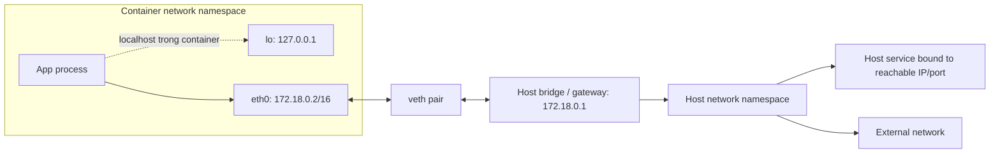
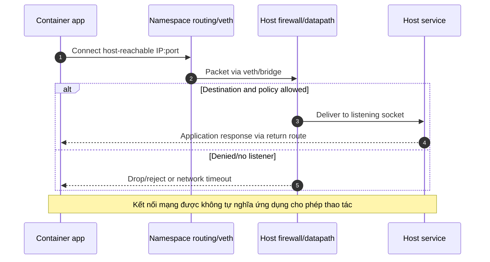
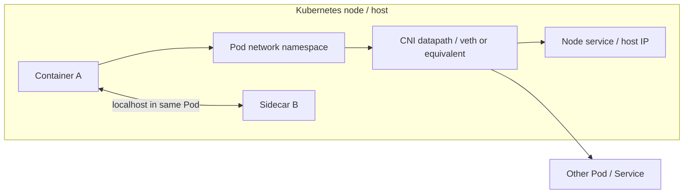
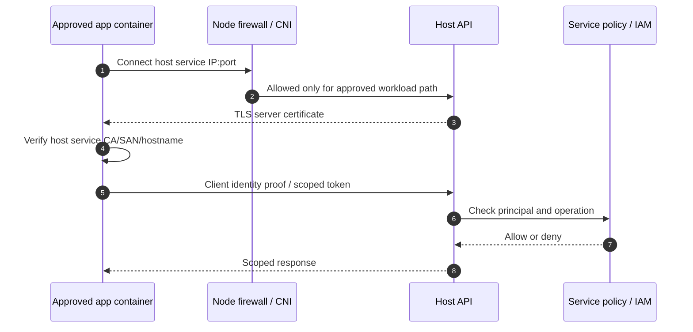
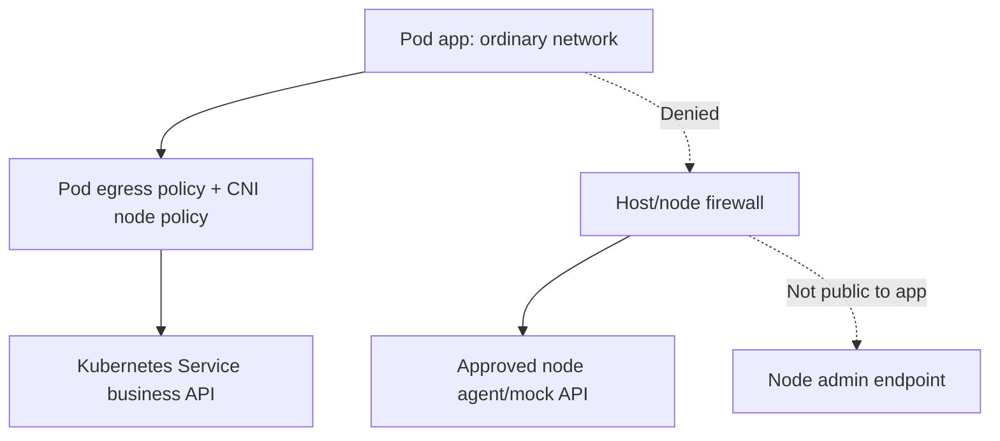

# Container-to-host communication

> **Học phần:** `SECURITY_NETWORK_SECURITY`  
> **Chương:** Bảo mật mạng container  
> **Chủ đề:** Cách một container hoặc Pod kết nối tới **host/node**, cách host kết nối tới container, những khác biệt giữa Docker, Podman, Kubernetes và các loại network namespace, cùng phương pháp kiểm soát **reachability, identity, authorization, firewall, network policy và telemetry** để không tạo đường vượt phân đoạn.

## Mục tiêu học tập

Sau bài này, người đọc có thể:

1. Phân biệt **container → host** với **host → container**, **container → container**, **Pod → node** và **Pod → Service**.
2. Giải thích vai trò của Linux **network namespace, veth, bridge, routing, NAT/conntrack, loopback và host gateway**.
3. Hiểu các chế độ Docker `bridge`, `host`, `none`, user-defined networks, rootless và khác biệt trên Docker Desktop.
4. Phân tích cách Kubernetes Pod kết nối tới node, Service và các thành phần control plane; phân biệt `hostNetwork`, `hostPort`, `NodePort` và ClusterIP.
5. Áp dụng network segmentation, firewall, CNI policy, host firewall và workload identity để hạn chế truy cập dịch vụ host.
6. Phòng vệ trước SSRF, dịch vụ quản trị bị mở ngoài ý muốn, metadata abuse, trust vào source IP và lateral movement.
7. Chẩn đoán lỗi bằng route, DNS, socket binding, TLS, policy, NAT và telemetry; xây dựng bài lab/kiểm thử âm-dương có kiểm soát.

## 1. Vì sao container-to-host communication là chủ đề bảo mật?

Container không phải máy ảo có một lớp mạng độc lập tuyệt đối. Trong nhiều triển khai, một container có **network namespace riêng**, được kết nối với host thông qua **virtual Ethernet pair (veth)**, Linux bridge, CNI datapath hoặc cơ chế tương đương. Lưu lượng phát ra từ container vẫn được xử lý bởi **network stack/kernel và network policy của môi trường host**.

Ví dụ dịch vụ cần thực hiện chức năng hợp lệ:

- Một container gọi agent giám sát chạy trên host để lấy metric.
- Một Pod kết nối tới node-local DNS cache hay log collector có chính sách rõ ràng.
- Một công cụ development trong container truy cập database mock chạy trên máy phát triển.
- Một ứng dụng container sử dụng service ở host thông qua gateway nội bộ và mTLS.

Nhưng cùng khả năng đó có thể thành rủi ro:

- Container bị chiếm thử gọi **host admin API** hoặc daemon quản lý.
- Một endpoint có lỗi SSRF làm container gọi dịch vụ host mà người dùng từ Internet không trực tiếp thấy.
- Một container có network route tới private host service không có authentication vì “chỉ chạy nội bộ”.
- Người vận hành bật `hostNetwork` hoặc mở listener `0.0.0.0` để “sửa kết nối”, vô tình mở rộng bề mặt.

**Đặc tính cốt lõi:** Kết nối được tới host **không đồng nghĩa** container đã escape khỏi sandbox hoặc có quyền root trên host; nhưng nó có thể tạo một **đường tấn công mạng** đến tài sản có quyền cao. Cần phân tích reachability, service authentication và host privilege riêng rẽ.

## 2. Thuật ngữ quan trọng và chiều đi của kết nối

| Khái niệm | Ý nghĩa | Điều dễ nhầm |
|---|---|---|
| **Host/node** | Máy vật lý/VM chạy container runtime hoặc Kubernetes node | Không đồng nhất với Kubernetes control plane |
| **Container IP** | Địa chỉ trong network namespace/Pod network | Có thể bị thay đổi khi restart/recreate |
| **Host IP** | IP trên interface host (LAN, bridge, private VPC, v.v.) | Không nhất thiết là default gateway của container |
| **Network namespace** | Không gian mạng riêng: interfaces, IPs, route, ports, loopback | Không tự tách Linux kernel hoặc toàn bộ tài nguyên |
| **veth pair** | Hai đầu interface ảo nối namespace với bridge/datapath | Không phải firewall |
| **Bridge gateway** | IP host-side của bridge làm next hop cho container | Không có cùng địa chỉ trên mọi máy |
| **Published port** | Cơ chế đưa traffic từ host vào container | Không cấp quyền container gọi mọi dịch vụ host |
| **hostNetwork** | Workload dùng network namespace của host | Không phải chỉ “thêm một route”, làm mất một phần cô lập |
| **NetworkPolicy** | Policy pod ingress/egress ở Kubernetes khi CNI hỗ trợ | Không phải host firewall tổng quát |
| **CNI** | Hệ thống/plugin tạo và quản lý kết nối mạng của Pod | Không phải mọi CNI có cùng cách xử lý traffic tới node |
| **NAT/conntrack** | Dịch địa chỉ/trạng thái flows ở các điểm của datapath | NAT không thay authentication |
| **mTLS** | TLS xác thực hai phía theo chứng thư/danh tính | Kênh được xác thực không tự cấp mọi quyền ứng dụng |

### Phải phân biệt ba đường

**Container → host:** process trong container chủ động mở socket tới một địa chỉ/dịch vụ được xử lý trên host.

**Host → container:** process bên ngoài namespace container mở kết nối tới container, có thể qua container IP, published port hoặc overlay/bridge tùy topology.

**Container → Internet/service khác:** traffic qua router/gateway/overlay, có thể đi ngang host nhưng **không được xử lý bởi dịch vụ của host**.

Một luồng “đi qua host kernel” chưa chắc là **kết nối tới host**: host có thể chỉ forwarding gói tới network khác.

## 3. Linux network namespaces và ý nghĩa của localhost

Mỗi network namespace có thể có **loopback interface, IP addresses, routing table, sockets và port-binding scope** riêng.

### Sơ đồ Linux bridge điển hình



**Địa chỉ là ví dụ minh họa, không phải Docker mặc định mọi hệ.** Docker có nhiều loại bridge, subnet và gateway; Kubernetes CNI có thể dùng routing hoặc eBPF thay bridge truyền thống.

### Localhost luôn có ngữ cảnh

- Container với namespace riêng: `127.0.0.1` và `::1` trỏ tới **chính namespace đó**, không mặc định trỏ host.
- Kubernetes: các container **trong cùng Pod** thường chia sẻ **network namespace**, vì vậy có thể gọi lẫn nhau qua `localhost:<port>`.
- Pod thường khác Pod khác: không dùng `localhost` để gọi Pod khác.
- Container/Pod dùng `hostNetwork`: `localhost` trỏ tới **host network namespace**, tạo rủi ro nếu host có service nhạy cảm chỉ bind loopback.

**Không thay một lỗi kết nối bằng giả định “localhost = máy chủ vật lý”.** Phải xác định tiến trình đang ở **namespace nào**.

## 4. Đường đi container → host khi dùng bridge

Trong mô hình container network namespace riêng và bridge:

1. App trong container mở TCP connection tới **IP đích của host**.
2. Kernel tra route trong network namespace container.
3. Packet đi qua `eth0`, veth và datapath Linux bridge/CNI.
4. Nếu đích là IP thuộc host, packet được chuyển tới **local input/socket** trên host theo quy tắc hệ thống.
5. Host firewall, routing/NAT và socket binding quyết định có nhận được không.
6. Host service xác thực và phân quyền request nếu đã nhận được.



**Hai khả năng độc lập cần thử:**

- **Reachability:** route/firewall/NAT có cho kết nối tới IP/port?
- **Service authorization:** sau khi tới port, TLS/server identity và credentials có được chấp nhận?

Một host service lắng nghe `127.0.0.1:9000` thường **không nhận trực tiếp** kết nối gửi tới bridge gateway `172.18.0.1:9000`. Muốn phục vụ container phải chọn một interface/endpoint **thật sự được cho phép**, không tự nới thành `0.0.0.0` nếu chưa đánh giá nguồn được tiếp cận.

## 5. Bind address của dịch vụ host quyết định bề mặt

| Host service bind | Ý nghĩa thông thường | Container khác namespace có gọi được không? |
|---|---|---|
| `127.0.0.1:9000` | Loopback IPv4 của host | Thông thường **không** trực tiếp qua bridge IP |
| `[::1]:9000` | Loopback IPv6 của host | Thông thường **không** qua địa chỉ node v6 khác |
| `172.18.0.1:9000` | Một host bridge IP ví dụ | Có thể khi route/firewall và namespace phù hợp |
| `10.10.0.5:9000` | Host private/LAN IP ví dụ | Có thể khi reachable và firewall cho phép |
| `0.0.0.0:9000` | Mọi địa chỉ IPv4 được chấp nhận trên host | Có thể **mở rộng tới LAN/public** nếu firewall không chặn |
| `[::]:9000` | Wildcard IPv6 trên host | Cần xem dual-stack/v6-only semantics của OS/socket |

### Nguyên tắc thiết kế

- Một dịch vụ chỉ dành cho host admin nên giữ bind loopback hoặc **Unix domain socket** được bảo vệ bằng quyền file khi phù hợp.
- Nếu container **thực sự cần** truy cập host service, định nghĩa **host-side interface/port cụ thể** và firewall theo nguồn/identity.
- Không coi `0.0.0.0` là giải pháp bảo mật; đó là cách mở listener rộng hơn.
- Nếu cần TLS/mTLS, certificate phải có expected hostname/identity phù hợp kết nối, **không tắt hostname verification** vì đang dùng bridge gateway IP.
- Khi có nhiều containers, không dựa vào IP động làm principal duy nhất; dùng authentication và workload identity.

### Lỗi hay gặp

Một dev làm dịch vụ `127.0.0.1:8080` trên host, container cố gọi `host.docker.internal:8080`. DNS có thể resolve được, nhưng service **không listen tại host gateway address**. Đây là lỗi binding/firewall, không có nghĩa tên `host.docker.internal` sai.

## 6. Docker bridge và user-defined bridge

Docker Engine trên Linux có thể dùng bridge mặc định hoặc **user-defined bridge networks**. Trên user-defined bridge, Docker thường cung cấp DNS/service discovery cho tên container/alias trong cùng mạng, nhưng **tên của host** là vấn đề khác.

### Các đường tới host

- **Host bridge gateway IP:** thường là địa chỉ host-side của mạng bridge, nhưng không nên hardcode.
- **Host private/LAN IP:** có thể reachable theo route và firewall; thường không phải lựa chọn ít quyền nhất.
- **Host alias được engine hỗ trợ:** như `host.docker.internal` được cấu hình phù hợp.
- **Unix domain socket bind mount:** không phải TCP/IP, có mô hình quyền khác; không coi là tự an toàn.

### Security review cho Docker

| Cấu hình | Rủi ro |
|---|---|
| Container nằm trên bridge dùng chung với mọi workload | Lateral movement nếu không có segmentation và app auth |
| Docker engine socket được mount vào container | Quyền control plane rất cao; có thể tương đương khả năng quản trị host, không chỉ một API thông thường |
| Container có `--network host` | Mất namespace network isolation và mở rộng reachability |
| Container được thêm capabilities/privileged để “sửa mạng” | Có thể tăng quyền can thiệp network stack/host |
| Port publish không giới hạn source | Dịch vụ container có thể trở nên reachable từ bên ngoài |
| Host service wildcard binding | Container hoặc peer khác có thể gọi host service ngoài ý muốn |

**Điểm quan trọng:** Docker socket là một **management interface nhạy cảm**, không nên mount vào untrusted app chỉ vì app cần hỏi “container đang chạy không”. Nếu cần quan sát, tạo broker/API có **quyền tối thiểu**, không trao quyền điều khiển engine rộng.

## 7. Docker Desktop, Linux host-gateway và các tên host

Có sự khác nhau giữa môi trường Docker Desktop và Docker Engine Linux.

### Docker Desktop

Tên như `host.docker.internal` thường được Docker Desktop cung cấp để container truy cập một địa chỉ nội bộ đại diện cho host, theo phiên bản/chế độ chạy được hỗ trợ. Trong một số môi trường Desktop, traffic đi qua **VM/network virtualization layer** chứ không trực tiếp qua Linux bridge đơn giản.

### Docker Engine Linux

Một số phiên bản hiện đại hỗ trợ ánh xạ **`host-gateway`** bằng `--add-host` hoặc cấu hình Compose `extra_hosts`. Đây là **cơ chế cấu hình host alias**, không phải DNS name luôn có sẵn ở mọi container.

Ví dụ minh họa:

```bash
# Chỉ thử trên máy/lab được phép, với Docker Engine hỗ trợ host-gateway.
docker run --rm \
  --add-host=host.docker.internal:host-gateway \
  --network bridge \
  alpine:3.20 \
  sh -c 'getent hosts host.docker.internal || cat /etc/hosts'
```

**Lưu ý:** Ví dụ xác minh **name mapping**, không chứng minh host service thực sự nghe port hoặc firewall cho phép. Distro/image có thể không có `getent`; phần `/etc/hosts` phản ánh mapping do runtime cung cấp.

### Compose

```yaml
services:
  app:
    image: alpine:3.20
    command: ["sh", "-c", "cat /etc/hosts && sleep 30"]
    extra_hosts:
      - "host.docker.internal:host-gateway"
    networks:
      - appnet
networks:
  appnet:
    driver: bridge
```

**Không dùng container mapping này làm cách bypass host service protection.** Host gateway alias không phải cơ chế authentication và không cấp quyền mặc định. Gateway IP cụ thể còn phụ thuộc bridge network, engine settings và topology VM.

## 8. Docker network modes và sự khác nhau

| Network mode | Tính chất | Hệ quả container ↔ host |
|---|---|---|
| `bridge` | Namespace riêng, veth/bridge/routing | Kết nối host qua địa chỉ reachable và policy |
| **User-defined bridge** | Namespace riêng, network-scoped discovery | Có thể route host, cần cấu hình gateway/ACL |
| `host` | Dùng host network namespace trong môi trường hỗ trợ | `localhost`/port scope của host; rủi ro cao hơn |
| `none` | Network namespace ít/không interface ngoài loopback | Không có outbound network thông thường qua Docker network |
| `macvlan` | Container có interface L2 riêng theo cấu hình | Host↔container **có thể không giao tiếp trực tiếp** theo mô hình macvlan thông thường |
| `ipvlan` | Cơ chế phân phối IP/forward khác macvlan/bridge | Host reachability phụ thuộc mode, route và policy |
| Overlay/multi-host | Network giữa nhiều hosts | Node host access và service discovery phụ thuộc overlay implementation |
| Rootless network | User-mode networking hoặc các giải pháp tương ứng | Host reachability và source IP semantics có thể khác rootful bridge |

### Host mode cần thận trọng

Trên Linux Docker Engine, `--network host` thường khiến container dùng **host network namespace**, không còn địa chỉ container riêng theo bridge. Các tùy chọn publish port như `-p` không có cùng ý nghĩa ở host mode và có thể bị bỏ qua/cảnh báo. Một số Docker Desktop phiên bản mới có tính năng host networking với điều kiện/hạn chế riêng; **không áp máy móc mọi kết luận Linux kernel cho Desktop**.

**Không chọn `--network host` chỉ để giải quyết hostname không tìm thấy.** Hãy ưu tiên sửa endpoint, DNS, bridge route, firewall và service binding, giữ nguyên network isolation.

## 9. Rootless Docker/Podman và môi trường desktop khác nhau

Rootless runtime có thể dùng **user-mode networking** (ví dụ slirp4netns, pasta hoặc backend tùy phiên bản), khác với rootful Docker bridge. Podman và Docker cũng có cách cung cấp host aliases/host access khác nhau.

### Điểm phải kiểm chứng

- Runtime thực sự là Docker Desktop, Docker Engine rootful/rootless hay Podman?
- Bridge interface/gateway được tạo ở host hay nằm trong VM/user networking?
- Host alias như `host.docker.internal` hoặc `host.containers.internal` có tồn tại trên môi trường đó không?
- Host loopback có được expose qua cơ chế user-mode networking cụ thể hay bị chặn?
- Container có thấy source IP thực của host/peer không, hay bị NAT/proxy đổi?
- Firewall nào áp được cho traffic user-mode? Host iptables/nftables có nhìn cùng flow không?
- Tính năng publishing ports và chế độ netns có khác với rootful không?

**Không coi rootless = tự động chống SSRF hoặc truy cập host.** Rootless giảm một số quyền của container runtime nhưng vẫn cần **network reachability, workload identity, secrets và egress rules** đúng.

## 10. Host → container: published ports và chiều ngược lại

Một nhầm lẫn phổ biến là dùng `-p 8080:80` để “cho container gọi host”. Tùy chọn này thường **publish port 80 trong container ra port 8080 phía host**; đó chủ yếu là hướng **host/external client → container**.

### Ví dụ

```bash
# Chỉ expose web container cho loopback của host trong lab.
docker run --rm -d \
  --name web-lab \
  -p 127.0.0.1:18080:80 \
  nginx:stable-alpine

# Host có thể thử từ localhost; dọn container khi hoàn tất.
curl --fail http://127.0.0.1:18080/
docker rm -f web-lab
```

**Quan trọng:** Bind host-side `127.0.0.1` hạn chế exposure theo cấu hình; nhưng luôn xác minh version/runtime, các route và network firewall thực tế. Không mặc định một published port trên `0.0.0.0` là “chỉ dành cho Docker host”.

### Chênh lệch hướng

| Hướng | Ví dụ | Công cụ chính |
|---|---|---|
| Host → container | Host gọi port được publish | Port publishing/NAT/userland proxy, firewall |
| Container → host | Container gọi node agent | Host IP/gateway, host firewall, host service auth |
| Container A → B cùng network | A gọi B qua service name | Docker network DNS, service policy |
| Pod → K8s Service | Pod gọi ClusterIP/DNS name | CNI, kube-proxy/eBPF, NetworkPolicy |
| Internet → Pod | LB/Ingress/NodePort đến Pod | Cloud firewall, Service, CNI ingress policy |

**Reachability hai chiều cần kiểm riêng**: một rule inbound trên host service không tự cho phép đường trả về qua firewall state/route khác.

## 11. Kubernetes: Pod network khác Docker bridge mặc định

Kubernetes thường quản lý Pod networking qua CNI. Trong Pod thông thường, các container chia sẻ **một network namespace** và **Pod IP**; khi Pod được gán sang node khác, IP/route và datapath có thể đổi.



**Pod → node IP** là một đường cần threat modeling riêng. Pod IP có thể route tới node IP mà không cần Service. Điều này không có nghĩa Pod phải có quyền truy cập kubelet, container runtime, monitoring agent hay các dịch vụ quản trị.

### ClusterIP và node IP khác nhau

- **ClusterIP:** virtual IP của Kubernetes Service, được datapath chuyển tới endpoints theo chính sách.
- **Node IP:** IP của máy chạy kubelet/CNI và các dịch vụ host.
- **Pod IP:** địa chỉ thuộc namespace Pod.
- **External/LoadBalancer IP:** endpoint công bố qua cloud/LB theo thiết kế.
- **Loopback:** phụ thuộc network namespace.

Nếu một Pod gọi `kubernetes.default.svc`, nó thường đi qua **Kubernetes Service/API server path**, không phải trực tiếp “host localhost”. Cần tách **service authorization/RBAC** khỏi khả năng định tuyến.

## 12. hostNetwork: chia sẻ network namespace của node

Kubernetes `hostNetwork: true` đặt Pod vào **host network namespace** theo cách triển khai của hệ thống. Hệ quả:

- Pod có thể thấy host-side network interfaces và dùng host port space.
- `localhost` đối với Pod có thể tham chiếu dịch vụ trên node.
- Port collisions có thể xảy ra nếu nhiều process dùng cùng node/port.
- Các giả định về Pod IP, DNS và network isolation thay đổi.
- Policy áp theo Pod IP/namespace có thể **không bao phủ hostNetwork traffic theo cách kỳ vọng** tùy CNI.
- Workload nhạy cảm như node agents đôi khi cần host network, nhưng phải giới hạn quyền.

### Minh họa một PodSpec có rủi ro

```yaml
apiVersion: v1
kind: Pod
metadata:
  name: hostnet-demo
  namespace: lab-only
spec:
  hostNetwork: true
  dnsPolicy: ClusterFirstWithHostNet
  containers:
    - name: demo
      image: busybox:1.36
      command: ["sh", "-c", "sleep 3600"]
      securityContext:
        allowPrivilegeEscalation: false
```

**Chỉ để nhận diện cấu hình trong lab**, không khuyến khích chạy trong production. Không cấp `hostNetwork` cho mọi Pod vì “cần gọi API host”; hãy xem khả năng cung cấp service qua route được giới hạn và yêu cầu mTLS/authorization.

### hostNetwork không phải hostPID/hostPath

Dùng host network namespace **không tự** chia sẻ PID namespace, filesystem hoặc Docker socket, nhưng đã giảm một lớp isolation và có thể kết hợp nguy hiểm với **privileged, hostPID, hostPath hoặc broad Linux capabilities**. Đánh giá tổng quyền của Pod, không chỉ một field.

## 13. hostPort, NodePort và hostNetwork: ba cơ chế khác nhau

| Thuộc tính | Vai trò | Rủi ro/chú ý |
|---|---|---|
| **hostPort** | Mở cổng node tới một container port của Pod theo CNI/implementation | Tạo host-facing exposure, scheduling/port collision |
| **NodePort** | Service Kubernetes được expose trên một port ở node | Firewall/node address scope quyết định nguồn nào tới được |
| **hostNetwork** | Pod chạy trong host network namespace | Có thể listen trực tiếp trên host ports và kết nối localhost node |
| **ClusterIP** | Service virtual IP trong cluster | Không bảo đảm chỉ Pod được phép truy cập nếu NP/auth thiếu |
| **LoadBalancer** | Dịch vụ cloud/LB expose Service | Cần cloud firewall, source restrictions và auth |
| **Ingress/Gateway API** | HTTP/TLS routing vào workloads | Không tự cấm đường NodePort hoặc direct Pod/service |

**HostPort/NodePort chủ yếu nói về đường đi vào workload từ host/network.** Chúng không cấp quyền đặc biệt để Pod gọi host service, dù một số datapath/router có thể tạo route và listener mới. Không nhầm chúng với khả năng outbound của container.

### Cần kiểm thử

- NodePort có reachable qua public node IP không?
- IPv6 và node addresses có cùng firewall restriction?
- NodePort bypass Ingress/WAF/auth gateway đã định không?
- hostPort của sidecar/agent có lộ control endpoint không?
- Policy ở node/host firewall có bảo vệ trước traffic vào Pod không?
- Khả năng direct Pod IP có vượt qua intended L7 gateway không?

## 14. DNS: host aliases, Service DNS và split-horizon

Trong container-to-host communication, có ít nhất ba cơ chế resolution:

1. **Container runtime host aliases:** mapping trong `/etc/hosts` hoặc DNS nội bộ, ví dụ `host.docker.internal`.
2. **Kubernetes Service DNS:** tên như `my-service.namespace.svc.cluster.local`, trỏ tới Service hoặc endpoint theo cơ chế của cluster.
3. **Enterprise/internal DNS:** FQDN cho host agent hoặc management service được phép, ví dụ `node-metrics.internal.example.test`.

### Quy tắc

- Đừng hardcode bridge gateway IP vì mạng có thể thay khi recreate container/network.
- Đừng coi `host.docker.internal` là standard DNS phổ quát của Kubernetes.
- Kiểm tra `/etc/hosts`, DNS resolver, search domains, IPv4/IPv6 records và connection target.
- DNS tên đúng không chứng minh route/firewall/certificate đúng.
- Khi dùng TLS, certificate SAN phải khớp **expected service hostname**, không tắt verification vì IP ở bridge thay đổi.
- Không cho URL fetcher do user kiểm soát tự chọn node/service DNS nếu không có nhu cầu.
- Kiểm DNS rebinding, CNAME và một số tên nội bộ đặc biệt trong threat model SSRF.

## 15. Host firewall: INPUT, FORWARD, OUTPUT và CNI datapath

Để hiểu tại sao host nhận hoặc chặn traffic, cần biết đích của gói và điểm thực thi rule.

### Khái niệm Linux

- **INPUT (local delivery):** gói được chuyển tới socket của host theo netfilter path điển hình.
- **FORWARD:** gói được host forward sang interface/network khác.
- **OUTPUT:** gói phát ra từ một process **trong host network namespace**.
- **PREROUTING/POSTROUTING:** có thể áp NAT và các xử lý trước/sau route.
- **Bridge filtering/eBPF/CNI:** một phần quyết định có thể xảy ra ngoài đường iptables truyền thống.

**Cẩn trọng:** Đây là mô hình giải thích; thực tế phụ thuộc iptables/nftables, bridge netfilter, conntrack, Docker rules, CNI, eBPF hooks, hostNetwork và đường gói đặc thù. **Không suy rằng mọi packet container → host luôn đi cùng một chain/hook**.

### Câu hỏi chẩn đoán

- Gói đích là địa chỉ **local của host** hay một mạng khác được forward?
- Địa chỉ nguồn/đích có đổi qua DNAT/SNAT/masquerade không?
- Policy đang áp **pre-NAT hay post-NAT**?
- Rule của Docker/CNI được chèn ở chain nào, trước hay sau host rule?
- Traffic IPv6 có đi qua bộ rule tương ứng không?
- Stateful firewall có conntrack entry và return path phù hợp không?
- Host firewall có cho phép Pod/container IP ranges vào host agent port không?

### Tránh thao tác nguy hiểm

Không nên tắt host firewall, flush iptables/nftables hoặc đổi Docker network isolation chỉ để “test vì sao ping không chạy”. Trong production, thay đổi rule phải có ticket, backup, rollback và xét ảnh hưởng của tất cả workloads.

## 16. NAT, conntrack, hairpin và asymmetry

Một container có thể thấy địa chỉ nguồn/đích khác giữa từng hop. Một số môi trường thực hiện NAT cho traffic đi Internet, published ports hoặc kết nối tới một địa chỉ host được forward tới container khác.

### Các tình huống đáng chú ý

| Tình huống | Dấu hiệu | Hướng phân tích |
|---|---|---|
| Container gọi public IP của chính host | Có thể qua DNAT/hairpin hoặc đi đường khác | Kiểm service/published port, route, NAT path |
| Host nhận IP nguồn khác dự kiến | SNAT/masquerade/proxy thay source | Xem conntrack và application trusted-proxy policy |
| Request vào được, response mất | Asymmetric route/firewall state | Kiểm route trả, conntrack/NAT |
| DNS đúng nhưng TCP timeout | Firewall drop, không có listener, wrong iface | Kiểm bind, route, firewall, policy |
| TCP mở nhưng HTTPS báo cert mismatch | Dùng IP/alias không nằm trong SAN | Dùng hostname phù hợp và đúng CA |
| Một Pod chạy được, Pod khác không | Node/CNI policy/NetworkPolicy, service placement | So node location, policy selectors, datapath |
| Sự cố chỉ khi dùng IPv6 | AAAA route/policy khác IPv4 | Kiểm dual-stack và host v6 listener |

**Ping không chứng minh HTTP/TLS hoạt động**, và ICMP có thể bị chặn theo policy dù TCP được cho phép. Để xác nhận cần thử **đúng protocol/port/hostname và phương thức xác thực** trong phạm vi cho phép.

## 17. Threat modeling các host services

Không phải tất cả host services có độ rủi ro như nhau.

| Service/asset trên host | Rủi ro khi container có thể kết nối | Kiểm soát |
|---|---|---|
| Container runtime management API/socket | Có thể có quyền quản lý containers/images/mounts rất cao | Không expose TCP tùy ý; socket ACL; proxy quyền tối thiểu |
| Kubelet/management interface | Có API quản lý node/Pod, thường nhạy cảm | Network restrictions, authentication/authorization, audit |
| Node-local metadata/identity | Có thể lộ thông tin node/workload/credential theo implementation | Chặn ngoài nhu cầu, role scoping, metadata protections |
| Host SSH/admin endpoint | Mở đường brute force/lateral movement nếu thiếu policy | Bastion/management zone, IAM/MFA, firewall |
| Metrics/monitoring agent | Có thể lộ topology, process, secret nếu cấu hình sai | Authn, limited endpoints, no debug leakage |
| DNS/cache proxy | Có thể bị lạm dụng truy vấn hoặc bypass policy | Query scope, workload identity, rate limits |
| Node-local image registry | Có thể lộ image hoặc phát tán nội dung không tin cậy | Authentication, TLS, image policy |
| Database/cache chạy trên host | Có thể đọc/sửa dữ liệu ngoài app boundary | TLS, authz, bind narrow, firewall |
| Debug/tracing endpoint | Có thể chạy tác vụ nhạy cảm hoặc lộ dữ liệu | Disable production, admin-only routes |
| Host-local log collector | Có thể bị flood/poisoning hoặc ghi dữ liệu nhạy cảm | Authenticated ingest, quotas, parsing safely |

**Một port “chỉ dùng nội bộ” chưa chắc có authorization.** Lịch sử hệ thống có thể dựa vào loopback trust, trong khi việc bật host networking hoặc bind bridge IP đã làm thay đổi tập callers.

## 18. Host API/metadata và sự khác nhau của node vs cloud

Cần phân biệt:

- **Node service:** process đang chạy trên VM/bare-metal host, có thể bind private/loopback IP.
- **Kubernetes API server:** control plane endpoint; không mặc định nằm trên mọi worker node.
- **Kubelet:** node agent, có endpoints theo cấu hình và RBAC/auth policy.
- **Container runtime:** local management interface/Unix socket hoặc daemon network API.
- **Cloud instance metadata:** endpoint provider-specific, có thể qua link-local hoặc cơ chế đặc thù, không nhất thiết là TCP service host thông thường.
- **Pod identity service:** sidecar/agent/token projection/service account workflow tùy cloud/CNI.

Trong threat modeling, một URL fetcher bị SSRF có thể cố gọi **host-private/service metadata** nếu route và policy cho phép. Hạn chế ở egress, workload IAM, host firewall và authentication tại dịch vụ đích. Không đưa địa chỉ metadata production vào bài lab; thay bằng mock endpoint trong mạng test.

### Bài học về trust boundary

**Network location không phải danh tính.** Một container kết nối từ bridge IP tới host không tự có quyền gọi API quản trị; host cần xác minh **workload/service identity và resource authorization**, không tin rằng “cùng host” đồng nghĩa “tin cậy”.

## 19. Threat modeling STRIDE cho container-to-host

| Nhóm STRIDE | Tình huống | Bảo vệ |
|---|---|---|
| **Spoofing** | App giả danh agent hợp lệ từ bridge IP hoặc header | mTLS/workload identity, không tin chỉ source IP |
| **Tampering** | Container thay DNS/proxy target hoặc cấu hình policy khi có quyền cao | Least privilege, admission, signed configuration, audit |
| **Repudiation** | Không rõ Pod/container nào kết nối host endpoint | Per-workload logs, flow metadata, request IDs |
| **Information Disclosure** | Host metrics/metadata/debug API lộ secrets | Network isolation, authz, redaction, secret scoping |
| **Denial of Service** | Container flood host service/conntrack/agent | Rate limits, quotas, host firewall, resource budgets |
| **Elevation of Privilege** | Container truy cập Docker socket/kubelet management rồi lạm dụng API | Disable exposure, strong authz, no broad capabilities |

### Threat statement mẫu

> Một public-facing PDF renderer chạy trong container có quyền network tới host bridge IP. Host có một debug API chỉ dựa vào việc request đến từ mạng nội bộ. Nếu renderer nhận nội dung do user tạo có external URLs và tự fetch, một SSRF có thể làm nó kết nối host debug API ngoài mục đích. Giảm thiểu bằng isolated network/egress policy cho renderer, host firewall, xác thực debug API và tắt external resource fetch khi không cần.

**Đừng đồng nhất SSRF với container escape.** SSRF có thể dẫn tới request vào host API; việc chuyển thành host compromise còn phụ thuộc quyền API và khả năng kiểm soát tiếp theo.

## 20. Kubernetes NetworkPolicy: egress từ Pod tới node có giới hạn gì?

Một NetworkPolicy chuẩn thường chọn Pods bằng `podSelector` và mô tả traffic ingress/egress được phép theo **pod/namespace selectors, IP blocks và ports**. Nó có ích để thu hẹp lateral movement và egress, nhưng **không tự đảm bảo mọi luồng Pod → node host service đều bị lọc giống Pod → Pod**.

### Mẫu default-deny egress

```yaml
apiVersion: networking.k8s.io/v1
kind: NetworkPolicy
metadata:
  name: app-default-deny-egress
  namespace: applications
spec:
  podSelector:
    matchLabels:
      app: untrusted-renderer
  policyTypes:
    - Egress
  egress: []
```

**Cảnh báo quan trọng:** NetworkPolicy có tính **additive**: mọi policy khác cũng chọn Pod có thể cho phép egress bổ sung. Chỉ đọc một file `default-deny` không đủ xác nhận effective isolation. Hơn nữa, nhiều CNI áp chính sách traffic tới node/host và hostNetwork bằng **cơ chế riêng hoặc ngoại lệ**. Cần test với **CNI cụ thể**, không tuyên bố manifest này chắc chắn chặn tất cả host endpoints.

### Mẫu chỉ cho một service trong cluster

```yaml
apiVersion: networking.k8s.io/v1
kind: NetworkPolicy
metadata:
  name: renderer-to-approved-api
  namespace: applications
spec:
  podSelector:
    matchLabels:
      app: untrusted-renderer
  policyTypes:
    - Egress
  egress:
    - to:
        - namespaceSelector:
            matchLabels:
              access-zone: shared-services
          podSelector:
            matchLabels:
              app: approved-content-api
      ports:
        - protocol: TCP
          port: 443
```

Ví dụ này cho phép egress tới **Pods đích** thỏa selectors theo semantics của NetworkPolicy; **không** phải một rule cho toàn bộ host node hoặc DNS. Nếu Pod cần DNS, xây rule riêng hướng tới DNS endpoint được duyệt hoặc dùng proxy đảm nhiệm resolution. Với Service IP và NAT, semantics thực tế của CNI cần được kiểm thử, không suy từ manifest rằng mọi service traffic được nhận diện đồng nhất.

### Giới hạn cần biết

- Kubernetes NetworkPolicy chuẩn không phải L7 HTTP authorization và không xác minh TLS certificate.
- Việc host traffic được xử lý ở tầng nào phụ thuộc CNI, eBPF/iptables, routing và loại endpoint.
- Một số CNI có **host firewall/node policy** hoặc policy mở rộng để bảo vệ node endpoints.
- Host network Pods thường cần **admission restrictions + host firewall** bên cạnh Pod NetworkPolicy.
- Không giả định NetworkPolicy tự hạn chế `kubectl exec`, secret permissions hoặc cloud IAM: đó là RBAC/admission/runtime boundaries khác.
- Khi thay CNI hoặc nâng phiên bản, phải chạy lại test **Pod → node**, **node → Pod**, **Pod → Pod** và đường đi từ hostNetwork Pods.

## 21. Host firewall và network policy theo zone

Để bảo vệ dịch vụ host, cần mô hình **zone**:

- **Management zone:** kubelet/engine/admin/SSH, chỉ từ bastion/quản trị đã xác thực.
- **Node services zone:** DNS cache, metrics/log collector mà một số Pods cần.
- **Application zone:** Pods/containers với nhiệm vụ nghiệp vụ.
- **Untrusted rendering/fetching zone:** Workloads xử lý nội dung/URL người dùng.
- **Data zone:** Database, cache, message broker và tài sản nhạy cảm.

### Ma trận reachability ví dụ

| Nguồn | Đích | Quyết định | Điều kiện |
|---|---|---|---|
| App Pod | Service nghiệp vụ được duyệt | **Allow hẹp** | TCP 443, service identity và authorization |
| Node metrics agent | Node-local collector | **Allow hẹp** | Agent principal, port được duyệt và audit |
| Untrusted renderer | Host admin service | **Deny** | Không có nhu cầu |
| Untrusted renderer | Cloud metadata | **Deny** | Không có quyền truy cập instance identity |
| App container | Docker socket / runtime API | **Deny** | Không trao engine control |
| Management bastion | Node admin endpoint | **Allow có điều kiện** | Network ACL, MFA/PAM, TLS/SSH auth |
| Guest/partner network | Host debug port | **Deny** | Chặn ngoài trust boundary |
| Approved ingress | App public listener | **Allow có điều kiện** | WAF/PEP, authn/authz và rate limiting |

**Nguồn IP của container không tự là danh tính đáng tin.** IP có thể đổi, NAT hoặc bị dùng lại khi Pod được tái tạo. Rule L3/L4 giảm reachability, nhưng host service nhạy cảm vẫn cần xác thực principal.

### Triển khai kiểm soát nhiều lớp

1. Đặt listener host tại **địa chỉ và interface hẹp** đúng nhu cầu.
2. Host firewall lọc nguồn, cổng, protocol và network zone; áp cả IPv6.
3. CNI/pod egress policy giới hạn đường ra của workload.
4. Cloud security group/VPC firewall và route policy chặn đường khác.
5. Ở host service, dùng **mTLS/SSH/token + RBAC** thay vì “tin mọi địa chỉ bridge”.
6. Tách admin/control plane khỏi application/data plane.
7. Audit rule changes và hiệu lực sau failover/node replacement.

**Không áp rule nftables/iptables theo một công thức chung cho mọi cluster**: Docker/CNI có thể quản lý chains, eBPF có thể bypass các hooks bạn tưởng là đầy đủ, và rule sai có thể làm mất kết nối điều khiển node. Thiết kế qua IaC và test rollout/rollback trên hạ tầng thật.

## 22. Docker daemon socket: một ranh giới cần đặc biệt bảo vệ

Docker daemon hoặc container runtime cung cấp **management API**, khác với API ứng dụng bình thường. Đường socket như `/var/run/docker.sock` thường được dùng để điều khiển containers và resources của runtime.

### Vì sao việc mount socket có rủi ro?

Một process có thể gọi management API để tạo containers hoặc thay đổi cấu hình/volumes/capabilities tùy quyền daemon và cơ chế authorization. Trong cấu hình rootful truyền thống, quyền điều khiển daemon có thể **mở đường tới quyền rất cao trên host**.

Không đồng nhất mọi runtime/socket là giống nhau; quyền thực tế còn tùy rootless/rootful, namespace, authorization plugin và thiết kế daemon. Nhưng **không bao giờ coi Docker socket như một read-only metrics endpoint mặc định**.

### Khuyến nghị

- Không mount daemon socket vào web app, URL fetcher, document renderer hoặc untrusted CI job.
- Nếu cần đọc metadata, ưu tiên agent trung gian có API read-only **được kiểm chứng bằng quyền thực**.
- Tách management/control plane và application network; không expose runtime API TCP rộng.
- Giới hạn ai có thể dùng socket bằng filesystem permissions, SELinux/AppArmor hoặc cơ chế nền tảng thích hợp.
- Tránh nhóm user có quyền socket rộng và không cấp `privileged` để sửa lỗi network.
- Audit containers có hostPath/volume mounts nhạy cảm, daemon API listeners và changes.

**Hệ quả đối với container-to-host:** Một container có thể không có host filesystem access, nhưng nếu được trao **management interface** đủ quyền, tác động có thể nghiêm trọng hơn một lỗ hổng ứng dụng thuần mạng.

## 23. Bảo mật host services bằng TLS/mTLS và authorization

Khi một container được phép truy cập host service, phải xác định **hai hướng identity**:

1. Container xác minh **đúng host service** (server certificate/hostname, CA).
2. Host service xác minh **đúng workload client** (mTLS, bearer token có audience hoặc cơ chế khác phù hợp).

### Sơ đồ xác thực host API



### Thực hành

- Dùng FQDN dịch vụ ổn định với **SAN certificate đúng**, không nhờ vào việc IP gateway ngẫu nhiên được “tin”.
- Đừng tắt certificate verification để kết nối tới `host.docker.internal` hoặc node IP.
- Host service giới hạn operations: read-only metrics không được cấp quản lý containers.
- Credential của mỗi workload riêng, có expiration/rotation.
- Khi ingress đi qua host proxy, chỉ tin identity metadata do **proxy đã xác thực** cung cấp; không tin `X-Authenticated-User` hay `X-Forwarded-For` do client tự khai.
- Có request quotas và input validation để tránh một Pod làm cạn tài nguyên host service.

### Unix domain socket có phải an toàn hơn TCP?

Unix domain sockets có thể tránh mở TCP listener ra mạng, đồng thời dùng quyền file/credential trên cùng host. Tuy nhiên nếu mount socket vào container không tin cậy thì **bên nhận socket vẫn có quyền API tương ứng**. **Socket transport không thay thế authorization**.

## 24. Egress kiểm soát container → host trước SSRF

Một public-facing app có thể nhận URL, hostname hoặc cấu hình callback từ user. Nếu app có quyền tới host gateway, lỗi SSRF có thể khiến nó **gửi request tới node/host services**.

### Phòng vệ

- Không cho URL renderer/fetcher kết nối tới **node gateway, loopback, link-local, metadata hoặc private management ranges** ngoài yêu cầu.
- Kiểm URL parser, redirect và DNS rebinding khi có user-controlled destinations.
- Áp egress control tại **socket/network boundary**, không chỉ pre-check DNS.
- Chạy fetcher trong sandbox network/IAM ít quyền.
- Mỗi host service vẫn kiểm authentication và authorization, không tin source IP.
- Nếu có proxy broker, **chặn direct socket fallback**.
- Tắt remote fetch của PDF/XML/parser khi không cần.
- Theo dõi connection attempts tới host endpoints bất thường.

### Host mode tăng tác động thế nào?

Ở một Pod/container thông thường, `127.0.0.1` là loopback trong namespace của chính nó. Khi bật host network, request tới `127.0.0.1` có thể vào **host-local service**. Như vậy **một lỗi SSRF vốn chỉ tới local sidecar** có thể có đích mạng khác hẳn khi đổi network mode.

**Threat modeling phải xem effective deployment configuration**, không chỉ mã nguồn; các flag/runtime policies có thể thay đổi target reachable của cùng một URL.

## 25. Container → node và cloud instance metadata

Cloud metadata là hệ thống **provider-specific**; không luôn nằm trên host như một process trong VM. Nhưng với nhiều workloads, endpoint metadata có thể reachable qua link-local hoặc một đường nội bộ khác.

### Phân biệt các đối tượng

| Đối tượng | Vị trí/chức năng | Chính sách |
|---|---|---|
| Host node metrics service | Process trên node | Chỉ agent được duyệt, auth và limited port |
| Kubernetes API server | Control plane/endpoint điều khiển cluster | RBAC, workload identity, network restriction |
| Kubelet endpoint | Node agent | Authn/authz, node firewall, audit |
| Cloud instance metadata | Provider-specific identity/config endpoint | Metadata protection, IAM least privilege, block khi không cần |
| Pod identity/token projection | Credential/service account mechanism | Audience/role scope, token lifecycle |
| Runtime management socket | Container engine API | Không expose cho untrusted workloads |

### Defense in depth

- Tránh gán cloud node instance role quyền rộng cho Pods; dùng **workload identity** theo sản phẩm/cluster khi có.
- Cấu hình metadata access controls mà cloud provider hỗ trợ; không dựa chỉ vào một rule IP.
- Chặn fetcher/renderer truy cập metadata paths ở host/CNI/network boundary.
- Không mount service account credentials vào container không cần Kubernetes API khi có cấu hình hỗ trợ.
- Kiểm tra mọi identity/token trên request ở service đích.
- Giám sát hành vi metadata access bất thường theo workload.
- Có quy trình revoke/rotate credential khi container bị chiếm.

**Không test bằng cách truy vấn metadata thật ngoài phạm vi được duyệt.** Dùng mock endpoint hoặc synthetic denial test trong lab để xác minh chính sách.

## 26. Observability: nhìn thấy container-to-host flows ở đâu?

Một flow đến host có thể không xuất hiện trong log của một L7 proxy hoặc cloud firewall nếu được xử lý nội bộ node. Vì vậy cần nhiều nguồn.

| Nguồn | Dữ liệu có ích | Giới hạn |
|---|---|---|
| Container/runtime metadata | Container/Pod ID, network mode, node placement | Không chứng minh socket thực đã kết nối |
| Host socket inventory | Listener address/port/process (theo quyền) | Không chứng minh remote source được cho phép |
| Host firewall/nftables/iptables | Allow/deny, counters, hook/rule | CNI/eBPF có thể thực thi nơi khác |
| CNI/eBPF flow visibility | Source Pod identity, destination, policy verdict | Phụ thuộc khả năng plugin |
| VPC flow logs | Routed traffic tại cloud ENI/VPC | Một số traffic node-local không hiển thị đầy đủ |
| Kubernetes events/audit | Deployment, hostNetwork, service config, policy changes | Không tự ghi mọi packet |
| Host service logs | Client principal, requested operation, status | Cần tránh tin header giả, hạn chế sensitive data |
| SIEM/IDS/NDR | Tương quan nguồn, thời gian, deny và anomaly | TLS che payload; placement quyết định coverage |

### Trường log gợi ý

```json
{
  "timestamp": "2026-11-28T11:15:00Z",
  "node": "lab-node-01",
  "workload": {
    "namespace": "applications",
    "pod": "renderer-demo",
    "container": "worker"
  },
  "networkMode": "pod-namespace",
  "sourceIp": "10.244.3.21",
  "destinationIp": "10.10.0.12",
  "destinationPort": 9443,
  "destinationType": "node-host-service",
  "policy": "node-egress-restricted-v3",
  "decision": "deny",
  "reason": "workload-not-authorized",
  "requestId": "cth-lab-004"
}
```

Dữ liệu là **giả lập**. IP minh họa thuộc dải private; không suy mọi CNI sẽ dùng subnet này hoặc log đủ tất cả trường.

### Chỉ số vận hành

- Số connection Pod/container → node/host theo workload và destination.
- Số deny vào host management/metadata/debug endpoints.
- Tỷ lệ host-service mTLS/auth failure.
- Số workload có `hostNetwork`, hostPort, hostPath hoặc privileged capability ngoài policy.
- Số direct host endpoints truy cập từ public-facing containers.
- NetworkPolicy/host firewall rule drift và config changes.
- Latency/error rate của node services hợp lệ (DNS cache, metrics/collector).
- Lượng egress tới external/cloud metadata sau thay đổi runtime/CNI.
- Coverage của flow logs trên bridge, overlay, hostNetwork và IPv6.

## 27. Điều tra theo lớp khi container không gọi được host service

### Thứ tự xác minh

1. **Runtime/topology:** Docker Desktop/Linux Engine/rootless/Podman/Kubernetes? Container ở network nào? Có `hostNetwork` không?
2. **Endpoint:** đang gọi `localhost`, host alias, gateway IP, node IP hay service DNS? Địa chỉ đó thuộc namespace nào?
3. **Resolution:** DNS/`/etc/hosts` trả gì, A/AAAA, split DNS?
4. **Routing:** Container có route tới đích; host có return route đúng không?
5. **Socket binding:** Host service có đang listen đúng IP/port/family không?
6. **Network enforcement:** host firewall, CNI, cloud security group, eBPF có allow?
7. **Transport:** TCP connect/UDP packet và conntrack/NAT có đi đúng?
8. **TLS/identity:** cert SAN/hostname, CA trust, client credential có đúng?
9. **Application authorization:** principal có được gọi route/method đó?
10. **Lifecycle:** khi restart/failover, gateway IP, Pod IP, certificates, node placement có thay đổi?

### Bảng triage

| Triệu chứng | Khả năng thường gặp | Hướng kiểm |
|---|---|---|
| Container gọi `localhost:8080` báo refused | Đang gọi chính container, không phải host | Namespace/network mode |
| Host alias không resolve | Desktop/Engine khác hỗ trợ, thiếu mapping | Runtime/version và hosts config |
| Alias resolve nhưng TCP refused | Host service bind loopback hoặc không listen target | Host listener address, IPv4/v6 |
| TCP timeout | Host/CNI firewall, route, NAT drop | Flow counters, routing, policy |
| TLS hostname mismatch | Host gateway IP/alias khác SAN | Expected hostname và certificate |
| TLS handshake OK nhưng API 403 | Application authz deny | Client principal và resource scope |
| Pod A gọi node được, Pod B không | CNI/hostNetwork/node placement/policy khác | So namespace, node, effective policy |
| Chỉ lỗi trên một node | Gateway, host listener hoặc node firewall drift | Node comparison và configuration |
| Lỗi sau restart | IP/gateway/container placement đổi | Service discovery và ownership |
| IPv4 chạy, IPv6 lỗi | v6 listener, AAAA, route/policy thiếu | Dual-stack packet path |

### Không sửa lỗi bằng cách phá ranh giới

Tránh “tạm thời” dùng `--privileged`, `--network host`, cho firewall allow-all, tắt TLS verify hoặc mount Docker socket nếu chưa có security review. Những thao tác này **đổi thuộc tính bảo mật**, không chỉ sửa hostname.

## 28. Lệnh quan sát an toàn trên Linux/Docker

Các lệnh ví dụ **chỉ đọc** trạng thái trong một lab/host được phép. Tùy môi trường cần quyền quản trị; không đăng nguyên toàn bộ kết quả vào ticket nếu chứa địa chỉ, tên tài sản hoặc cấu hình nhạy cảm.

```bash
# Xem địa chỉ/route trên host Linux.
ip address show
ip route show
ip -6 route show

# Xem những listener TCP trên host (nếu được phép).
ss -ltn

# Xem network mode của container cụ thể.
docker inspect --format '{{.HostConfig.NetworkMode}}' demo-container

# Xem gateway của bridge mặc định, thay tên nếu lab dùng network khác.
docker network inspect bridge \
  --format '{{range .IPAM.Config}}{{.Gateway}}{{end}}'

# Đọc cấu hình tên host từ bên trong container.
docker exec demo-container cat /etc/hosts
docker exec demo-container cat /etc/resolv.conf

# Xem tổng quan chính sách firewall (chỉ chạy với quyền phù hợp).
sudo nft list ruleset
```

**Cảnh báo:** Output `docker inspect` đầy đủ có thể chứa env variables/metadata nhạy cảm; dùng format chọn chính xác trường cần. `nft list ruleset` có thể lộ topology và rule nội bộ; redaction khi chia sẻ. Không dùng lệnh thay đổi/chặn firewall trên host sản xuất để “debug”.

### Kubernetes — các truy vấn trạng thái

```bash
# Chọn namespace/pod trong lab được cấp quyền.
kubectl get pod renderer-demo -n applications \
  -o jsonpath='{.spec.hostNetwork}{"\n"}{.spec.nodeName}{"\n"}{.status.podIP}{"\n"}'

kubectl get networkpolicy -n applications

# Nếu image có iproute2, đọc route từ container cụ thể.
kubectl exec -n applications renderer-demo -c worker -- ip route
```

**Không mặc định có quyền `kubectl exec` trong mọi cluster.** Hạn chế RBAC và không thu secrets/env vars của workload để debug mạng. Không cần chạm vào host admin endpoints nếu chỉ muốn xác nhận policy.

## 29. Lab Docker: phân biệt namespace, gateway và host listener

### Mục tiêu

Phân biệt:

1. Container `localhost` và host `localhost`.
2. Host gateway alias và IP thực.
3. Socket binding `127.0.0.1` vs bridge-reachable IP.
4. Quyết định network firewall và application authorization.

### Chuẩn bị có kiểm soát

Dùng **máy lab Linux** do bạn quản lý, một host service mock vô hại, không chạy Docker daemon API qua TCP và không đổi firewall production. Không dùng privileged containers hoặc host networking để đạt mục tiêu.

Ví dụ inspection:

```bash
# Liệt kê network gateway trên máy lab.
docker network inspect bridge \
  --format '{{range .IPAM.Config}}{{.Gateway}}{{end}}'

# Từ trong một container tạm thời, đọc host alias được engine ánh xạ.
docker run --rm --network bridge \
  --add-host=host.docker.internal:host-gateway \
  alpine:3.20 sh -c 'cat /etc/hosts'
```

### Dự đoán kết quả

| Bài thử | Kết quả mong đợi |
|---|---|
| Container gọi `127.0.0.1` nhưng không có local service | Không gọi được host service |
| Container resolve host-gateway alias | Có mapping nếu engine hỗ trợ |
| Host service chỉ bind `127.0.0.1` | Bridge connection tới gateway IP thường không chạm listener |
| Host service bind **cụ thể** vào bridge gateway IP, firewall cho phép lab source | Có thể kết nối nếu route/policy đúng |
| Host firewall deny container subnet → host port | Kết nối bị deny dù hostname đúng |
| Host service yêu cầu auth và caller thiếu credential | TCP/TLS có thể tới nhưng API deny |
| Chuyển sang network khác có gateway khác | Không giả định hardcoded IP vẫn đúng |

### Thiết kế host mock an toàn

Nếu muốn thử kết nối thành công, hãy chạy một **mock service chỉ ở host-side bridge IP** trong mạng lab và firewall giới hạn tới container test. Không chạy listener `0.0.0.0` trên máy dùng chung chỉ để dễ kết nối. Nếu runtime là Docker Desktop, lớp VM có thể khiến cách binding khác; ghi rõ môi trường và quan sát trạng thái thật.

**Không sử dụng Docker daemon port, kubelet admin port hoặc cloud metadata thật làm target của lab.** Mục tiêu ở đây là hiểu kết nối và chính sách, không khai thác host.

## 30. Lab Kubernetes: kiểm thử Node reachability và policy coverage

### Mục tiêu

- Pod app bình thường không cần `hostNetwork`.
- Service hợp lệ trong cluster có thể được truy cập theo policy.
- Node management/mock endpoint **không** được truy cập từ Pod không có quyền.
- CNI/policy + host firewall bảo vệ cả đường direct Pod IP → node.
- HostNetwork Pods, nếu có, được inventory và có quyền riêng.

### Test topology



### Kiểm thử tối thiểu

| Test | Điều cần quan sát |
|---|---|
| Pod gọi business Service được phép | App response thành công, principal đúng |
| Pod thử gọi node mock endpoint không được phép | Deny ở tầng được thiết kế |
| Pod thử gọi node endpoint qua IPv6 | Có policy tương đương |
| Pod di chuyển sang node khác | Quy tắc host access vẫn nhất quán |
| NetworkPolicy default-deny được tạo | CNI thực sự áp rule, không có additive allow-all |
| Runtime dùng hostNetwork được phát hiện | Admission/host firewall đánh giá đúng |
| Node agent caller hợp lệ | mTLS/authz cho đúng hành động, có audit |
| CNI bị đổi/cấu hình lại | Test được chạy lại, không giả định coverage |

**Phải kiểm bằng flow/host logs.** Một lần TCP timeout không tự chứng minh đã bị firewall chặn; có thể không có listener hoặc route. Cần có **đối chứng** để phân biệt tình trạng.

## 31. Các tình huống điển hình

### Case A — Docker container không gọi được host API

**Quan sát:** App trong container gọi `http://localhost:8080` và nhận connection refused. Trên host, API đang listen `127.0.0.1:8080`.

**Phân tích:** `localhost` ở container bridge là namespace container; host service chỉ bind host loopback. **Hai vấn đề độc lập**: lựa chọn đích và binding host.

**Cách xử lý đúng:** Xác định nhu cầu kinh doanh; cung cấp một host service endpoint **hẹp** tại bridge-reachable interface hoặc proxy có identity, giới hạn nguồn bằng firewall, dùng TLS/auth phù hợp, không cho cả container dùng host network. Nếu đây chỉ là app phát triển, có thể dùng cơ chế host alias chính thức của runtime và một mock service được cô lập.

### Case B — Pod có NetworkPolicy vẫn truy cập node service

**Quan sát:** Một Pod nằm trong namespace có default-deny egress nhưng kết nối được tới một node-local endpoint; nhóm vận hành tưởng Kubernetes NetworkPolicy luôn chặn mọi Pod → node traffic.

**Phân tích:** Cần kiểm **CNI-specific node traffic handling, hostNetwork, policy selection, additive policies và firewall/node policy**. Một vài mô hình implementation có ngoại lệ hoặc hook khác; không kết luận NetworkPolicy “lỗi” chỉ từ tên manifest.

**Khắc phục:** Thiết kế host firewall/node policy trong CNI/cloud theo đúng enforcement, giảm listener exposure, xác thực node service, kiểm lại bằng negative tests trên mọi node quan trọng.

### Case C — SSRF từ renderer tới host debug service

**Quan sát:** Document renderer được phép tải remote images, chạy trên container có route tới host gateway; host debug API không xác thực vì “chỉ nội bộ”.

**Rủi ro:** Untrusted document references có thể khiến renderer tạo request không theo ý người dùng và vượt mạng ứng dụng. Chưa đủ kết luận đã bị chiếm nếu chưa có log.

**Khắc phục:** Cô lập renderer, cấm node/metadata egress, tắt subresource fetch ngoài nhu cầu, yêu cầu authentication ở debug API, audit job→connection logs và regression tests.

### Case D — HostNetwork Pod bị port conflict và policy lệch

**Quan sát:** Một agent mới dùng `hostNetwork: true` trên node, bind host port trùng với agent hiện tại hoặc vô tình thấy node loopback endpoints. Application policy ban đầu được thiết kế cho Pod IP.

**Phân tích:** Shared port space và local network boundary đã thay; một số Pod NetworkPolicy không áp như mong đợi. Không đồng nhất vấn đề với container escape nhưng cần xem access path.

**Khắc phục:** Chỉ cấp hostNetwork khi thật cần, pin port/daemonset scheduling, dùng admission control, giới hạn capabilities, host firewall và mTLS giữa node agents.

## 32. Gherkin — xác nhận phân tách host/container

```gherkin
Feature: Container-to-host access is explicit and authorized

  Scenario: Container localhost does not silently map to host localhost
    Given a container has its own network namespace
    And a host service is bound only to the host loopback address
    When the container connects to 127.0.0.1
    Then the request stays in the container network namespace
    And it does not authenticate to the host service

  Scenario: Host service is available only through an approved path
    Given a host service listens on a lab-approved interface and port
    And a firewall permits only the trusted workload source
    When the trusted workload connects with valid credentials
    Then the host service accepts only authorized operations
    And the access is auditable

  Scenario: Host gateway mapping is not considered proof of authorization
    Given a container resolves its configured host gateway alias
    When it attempts a request without required service identity
    Then the host service denies privileged operations
    And hostname resolution alone grants no privileges

  Scenario: Untrusted workload cannot access node management
    Given a renderer Pod handles user-supplied content
    And policy denies node management and metadata destinations
    When its process attempts a connection to a mock management endpoint
    Then the network policy or host boundary denies the request
    And the denied attempt is available in telemetry

  Scenario: Network policy covers both address families
    Given a cluster supports IPv4 and IPv6
    When an untrusted Pod tries a forbidden node target over either family
    Then both connection attempts are denied by effective controls
    And no IPv6 bypass remains

  Scenario: A valid network connection still requires application authorization
    Given a Pod is allowed to connect to an approved node metrics API
    And its principal lacks permission for an administrative operation
    When the Pod requests the administrative operation
    Then the API denies it
    And the successful TCP connection does not grant admin rights

  Scenario: HostNetwork usage is gated by policy
    Given an admission policy restricts hostNetwork workloads
    When an unapproved application requests hostNetwork true
    Then the admission controller rejects the deployment
    And approved node agents use least privilege and host firewall controls

  Scenario: Egress proxy failure does not become direct host access
    Given an untrusted fetcher must use an authenticated egress proxy
    When its proxy is unavailable
    Then it cannot connect directly to node or metadata endpoints
    And the feature degrades according to the restricted failure policy

  Scenario: A policy update does not expose host management via NodePort
    Given node and cluster ingress policies deny unapproved management ports
    When a service deployment changes exposure settings
    Then policy validation detects unintended host-facing listeners
    And the change is rejected or remediated before production

  Scenario: Node migration preserves network security invariants
    Given a workload migrates from one Kubernetes node to another
    When its Pod network namespace and route are recreated
    Then approved service paths still function
    And host or metadata destinations remain restricted
```

### Điều kiện PASS

- Host gateway và localhost được hiểu đúng theo namespace.
- Host service chỉ nhận từ nguồn/identity được phép, không bind rộng vô lý.
- NetworkPolicy và **host firewall/node policy** được test thực tế trên CNI/runtime hiện hành.
- HostNetwork/hostPort/NodePort không tạo exposure ngoài ý định.
- IPv4/IPv6, DNS và đường return đều được kiểm.
- mTLS/service authorization còn đúng khi node/pod chuyển vị trí.
- Không test lên control plane/metadata production ngoài phạm vi.

## 33. Tính sẵn sàng, failover và đổi node

Container/Pod thường được recreate hoặc chuyển node. Khi đó:

- Container IP, Pod IP và bridge gateway có thể đổi.
- Service discovery/host aliases có thể thay đổi theo runtime.
- Node-local agent có thể không tồn tại trên node mới.
- Firewall chính sách node A và node B có thể lệch.
- Service certificate trên node mới có SAN/CA khác.
- Đường metadata/egress từ node mới có thể khác.
- Host port có thể bị trùng nếu hai agents cùng schedule.
- Retry và session churn có thể tạo tải vào node service.

### Thiết kế bền vững

- Tránh hardcode node IP/gateway cho business service; ưu tiên **Service DNS/registry hoặc host agent discovery có auth**.
- Với node-local access, thiết kế DaemonSet/placement theo policy và **thừa nhận node affinity** khi cần.
- Giữ host firewall/CNI/IAM/cert policy đồng nhất bằng IaC, có test sau node replacement.
- Khi agent không sẵn sàng, dùng **restricted/fail-closed** cho các tác vụ có kiểm soát bắt buộc, không mở admin endpoint.
- Dùng timeout, retry budget, backoff và circuit breaker để tránh làm sập node service.
- Log node identity và phiên bản cấu hình khi kết nối thất bại.
- Kiểm tra IPv4/IPv6, DNS và return path sau khi chuyển node.

**Availability không phải lý do mặc định để cấp hostNetwork hoặc mở node firewall allow-all.**

## 34. Những hiểu nhầm thường gặp

**“Container localhost luôn là localhost của host.”** Sai khi container có network namespace riêng. Ngoại lệ quan trọng là host network mode hoặc những topology đặc thù.

**“Docker -p cho container gọi host.”** Không. Port publishing chủ yếu phục vụ traffic từ host/ngoài vào container.

**“host.docker.internal là DNS name phổ quát của mọi Linux/Kubernetes.”** Không. Phụ thuộc Docker Desktop/Engine, mapping, Podman/runtime và môi trường.

**“Host gateway alias có nghĩa có quyền admin host.”** Sai. Alias chỉ cung cấp đường phân giải/route; authentication và authorization độc lập.

**“Bật --network host là cách sửa tốt nhất mọi vấn đề Docker DNS.”** Không. Nó thay ranh giới cô lập mạng và mở bề mặt host.

**“hostNetwork tự trao quyền filesystem/PID root.”** Không tự động, nhưng khi kết hợp capabilities/mounts/privileged có thể tăng rủi ro đáng kể.

**“Kubernetes NetworkPolicy default-deny luôn chặn mọi Pod → node packet.”** Không được giả định; phụ thuộc CNI, host traffic semantics và policy khác.

**“NetworkPolicy tự chặn HTTP GET /admin.”** Không. NetworkPolicy chuẩn chủ yếu L3/L4; cần L7 gateway/service authorization.

**“Nếu TCP connect được tức container có quyền dùng API.”** Không. Cần mTLS/credential và per-resource authorization.

**“Host service bind 0.0.0.0 chỉ mở cho containers.”** Không. Nó thường bind tất cả host IPv4 interfaces, có thể mở rộng exposure.

**“Private subnet có nghĩa không có đường tới metadata.”** Không. Route/link-local và cloud metadata riêng có thể vẫn tồn tại.

**“Docker socket chỉ để đọc danh sách containers.”** Không mặc định; management API có quyền rất mạnh theo daemon.

**“Rootless networking tự động loại SSRF.”** Không. Runtime privilege khác network permission và destination policy.

**“NAT làm client identity đáng tin.”** Không. NAT chỉ thay thông tin địa chỉ theo routing state.

**“Ping thành công chứng minh HTTPS/mTLS đúng.”** Không. Cần kiểm đúng protocol, certificate và resource auth.

**“Kubelet chạy trên worker node nên mọi Pod được quyền gọi.”** Không. Node management là trust boundary riêng.

**“Không có firewall deny log nghĩa traffic không đi tới host.”** Không. Có thể datapath khác, sampling hoặc policy không được instrument.

## 35. Checklist triển khai container-to-host an toàn

- [ ] Xác định container runtime: Docker Desktop/Linux Engine/rootless/Podman hay Kubernetes/CNI.
- [ ] Biết network mode/namespace, Pod sharing, node placement và bridge gateway theo môi trường thật.
- [ ] Phân biệt rõ container localhost, host localhost, Pod localhost và Service DNS.
- [ ] Không bật hostNetwork hoặc privileged chỉ để sửa kết nối.
- [ ] Inventory mọi host service listener, address family, port, owner và business purpose.
- [ ] Host services nhạy cảm bind loopback/Unix socket khi không có nhu cầu network access.
- [ ] Nếu cần host API từ container, chỉ expose một **interface và port hẹp**, không wildcard bừa.
- [ ] Host firewall/CNI/cloud ACL hạn chế ingress từ đúng source/workload và node zone.
- [ ] Kiểm IPv4/IPv6, NAT, conntrack và return path.
- [ ] Không expose Docker/runtime socket hoặc kubelet/admin API cho untrusted workloads.
- [ ] Container không được mount socket/hostPath hoặc có broad capabilities nếu không cần.
- [ ] Kubernetes hostNetwork/hostPort/NodePort bị kiểm soát bởi admission và cloud/node firewall.
- [ ] Kiểm NetworkPolicy **effective** với CNI thật, gồm additive policies và host traffic handling.
- [ ] Chặn untrusted URL renderer/fetcher tới host management, metadata và data zones.
- [ ] Có isolated fetcher/egress broker nếu xử lý user-controlled URLs.
- [ ] Host service và container client xác minh TLS peer identity/certificate đúng hostname.
- [ ] Service-to-host API cần credential riêng và authorization theo hành động, không tin source IP.
- [ ] Dùng IAM least privilege, token audience/expiry, secrets rotation và node identity controls.
- [ ] Không log private keys, tokens, cloud credentials hoặc raw sensitive environment.
- [ ] DNS/host alias được quản lý, không hardcode gateway/node IP thiếu kiểm soát.
- [ ] Không dùng published port thay security boundary hoặc mặc định exposure chỉ trong host.
- [ ] Giám sát runtime network-mode drift, new host listeners và NodePort/Ingress changes.
- [ ] Có telemetry kết hợp application logs, host sockets/firewall, CNI flows và cloud IAM.
- [ ] Test negative cho host admin service, metadata, IPv6, direct gateway và hostNetwork abuse.
- [ ] Test positive cho node metrics/DNS/service được phép nhưng vẫn có authn/authz.
- [ ] Khi đổi CNI, runtime, kernel, node image hoặc cloud networking phải chạy lại test reachability.
- [ ] Failover/migration giữ cùng security invariants, không mở route hoặc giảm TLS policy.
- [ ] Mọi exception có owner, mục đích, phạm vi, expiry, approval và audit.
- [ ] Có runbook triage: namespace → DNS → route → binding → firewall → TLS → authorization.

## 36. Kết luận và tài liệu tham khảo

**Container-to-host communication** là khả năng các workload trong container hoặc Pod kết nối tới những dịch vụ được xử lý trong **host/node network namespace**. Khả năng này hữu ích cho giám sát, node agents, development và một số kết nối có quyền rõ ràng, nhưng cần hiểu chính xác **localhost, bridge gateway, hostNetwork, CNI datapath, port publishing, NAT và firewall** để tránh mở đường truy cập ngoài ý muốn.

Thiết kế an toàn phải tách **reachability** khỏi **identity** và **authorization**. Cách bảo vệ bền vững là:

- Chỉ mở host service cần thiết tại đúng interface/port và hạn chế nguồn bằng **host firewall/CNI/cloud policy**.
- Không cho untrusted workload dùng **hostNetwork, runtime socket hoặc quyền host** ngoài yêu cầu.
- Áp **mTLS/service identity, per-operation authorization, network segmentation và metadata protection**.
- Kiểm chứng IPv4/IPv6, policy thực của runtime/CNI, logs và negative test kể cả lúc restart/failover.
- Đặt container-to-host trong chiến lược rộng hơn gồm firewall, IDS/IPS, VPN, DNS, zero trust và cloud IAM.

### Tài liệu học sâu

- **NIST SP 800-190** — *Application Container Security Guide*: isolation, container runtime, host risks.
- **NIST SP 800-207** — *Zero Trust Architecture*: identity và authorization độc lập network location.
- **Linux man-pages** — `network_namespaces(7)`, `veth(4)`, `ip-netns(8)`, tài liệu networking/routing/firewall của kernel.
- **Docker documentation** — *Networking overview*, *Bridge network driver*, *Host network driver*, *Port publishing and mapping*, *Rootless mode*, *Docker Desktop networking*.
- **Podman documentation** — network modes và host/container connectivity trong runtime tương ứng.
- **Kubernetes documentation** — *Cluster Networking*, *Network Policies*, *Services*, *PodSpec hostNetwork*, *Pod Security Standards*.
- **IANA IPv4/IPv6 Special-Purpose Address Registries**, **RFC 1918**, **RFC 3927**, **RFC 4193** — phân loại địa chỉ cần thiết khi phân đoạn và chống SSRF.
- **RFC 8446** — *TLS 1.3*, cùng các tiêu chuẩn PKI/TLS identity liên quan.
- **OWASP SSRF Prevention Cheat Sheet** và tài liệu về Kubernetes/cloud network hardening.

**Lưu ý triển khai:** Cách host traffic được lọc phụ thuộc **kernel, runtime version, CNI, cloud provider và effective configuration**. Phải xác minh trên môi trường thực bằng logging/test được phê duyệt thay vì áp dụng trực tiếp một sơ đồ Linux bridge cho mọi Kubernetes/desktop/rootless network.
