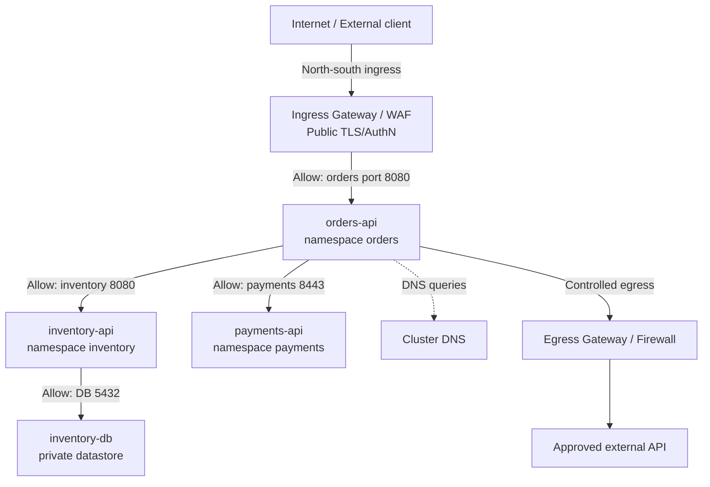
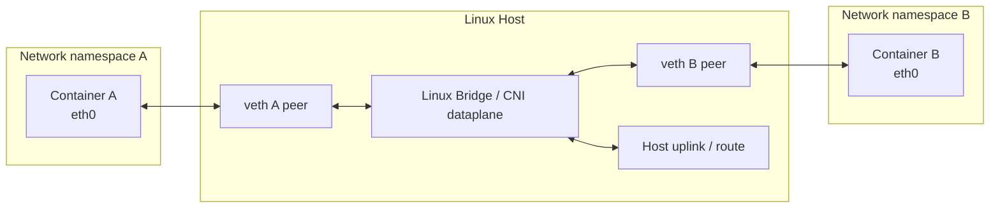
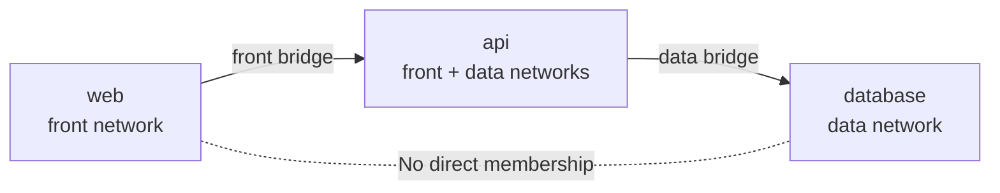
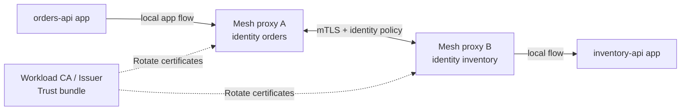
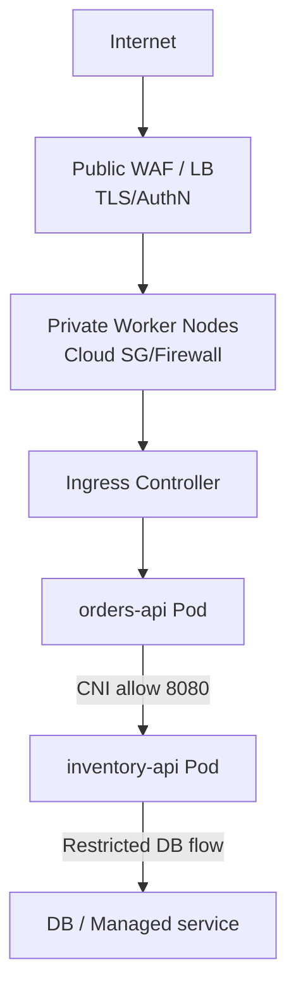

# Network isolation giữa các ứng dụng trong bảo mật mạng container

**Network isolation giữa các ứng dụng** là tập hợp các cơ chế giới hạn **ứng dụng hoặc workload container nào được tạo kết nối đến ứng dụng nào, theo chiều nào, giao thức/cổng nào và trong điều kiện tin cậy nào**. Mục tiêu không phải làm cho mọi container hoàn toàn không giao tiếp, mà là **chỉ cho phép những luồng cần thiết đối với nghiệp vụ**, để khi một container bị lỗi cấu hình hoặc bị chiếm quyền, kẻ tấn công không dễ dàng truy cập các dịch vụ khác.

Trong Docker, một số mức cô lập được hình thành từ **Linux network namespace, virtual Ethernet (veth), bridge, routing và firewall của host**. Trong Kubernetes, các **Pod có địa chỉ mạng riêng theo mô hình mạng cluster**, còn **CNI plugin, NetworkPolicy, chính sách mạng mở rộng và service mesh** quyết định nhiều phần của thực thi kết nối. Những lớp này cần phối hợp với **IAM/RBAC, TLS/PKI, mTLS, DNS security, ingress/egress gateways, giám sát, bảo vệ node và an toàn ứng dụng**.

Bài học thuộc chương **Bảo mật mạng container** của mô-đun **SECURITY_NETWORK_SECURITY**: hiểu phân đoạn mạng, firewall, VPN, IDS/IPS, xác thực kết nối, bảo vệ lưu lượng và mô hình hóa mối đe dọa để thiết kế mạng an toàn. Trọng tâm ở đây là **ngăn kết nối không cần thiết giữa ứng dụng**, không chỉ tách tài nguyên thành nhiều namespace hoặc tạo một mạng overlay.

> **Nguyên tắc xuyên suốt:** Một kết nối chỉ nên tồn tại khi **đường mạng được cho phép**, **peer được xác thực đúng danh tính** và **hành động trên tài nguyên được phân quyền**. Network isolation chủ yếu giải quyết điều kiện thứ nhất; hai điều kiện sau vẫn cần cơ chế riêng.

Các ví dụ sử dụng workload giả định **orders-api**, **inventory-api**, **payments-api**, **database** và các namespace **orders**, **inventory**, **payments**. Địa chỉ IP dùng dải dành cho tài liệu. Mọi lệnh kiểm thử tạo request chỉ áp dụng trong **cluster/lab được phép**, không quét hoặc gây tải cho hạ tầng không được ủy quyền.

## 1. Mục tiêu học tập

Sau bài học, người học có thể:

1. Phân biệt **network namespace, network interface, bridge, overlay, CNI, Service, NetworkPolicy, firewall, mTLS và application authorization**.
2. Xác định **north–south traffic**, **east–west traffic**, ingress/egress và các ranh giới tin cậy bên trong cluster.
3. Giải thích vì sao **container riêng, Kubernetes namespace riêng hoặc private Pod IP** không tự tạo deny-by-default network isolation.
4. Thiết kế policy theo nguyên tắc **default deny + explicit allow** cho đúng Pod, namespace, cổng và chiều kết nối.
5. Đọc và viết **Kubernetes NetworkPolicy** với **podSelector, namespaceSelector, ipBlock, policyTypes, ingress và egress**.
6. Phân biệt phép **AND** giữa selectors trong **cùng một peer** và phép **OR** giữa các peers khác nhau.
7. Hiểu chính xác phạm vi chuẩn Kubernetes NetworkPolicy: **L3/L4, allow-list cộng gộp, phụ thuộc CNI**, không mặc định là policy HTTP, FQDN hoặc kiểm tra chứng chỉ.
8. Thiết kế kết nối cần thiết tới **DNS, identity/CA, telemetry, cloud APIs, databases, ingress controllers và service mesh control plane**.
9. Nhận diện rủi ro từ **hostNetwork, privileged containers, quyền trên node, NodePort, published ports, multiple interfaces và direct backend bypass**.
10. Kết hợp **mTLS/workload identity và authorization** để tránh tin quá mức vào IP/label.
11. Quan sát được **policy verdict, flow, DNS, routing, service discovery, drops và nguyên nhân lỗi thực tế**.
12. Xây dựng bộ kiểm thử **allow/deny, failover, rollout, performance** và runbook ứng phó sự cố.

## 2. Network isolation bảo vệ trước điều gì?

Giả sử **orders-api** chỉ cần đọc tồn kho của **inventory-api** và gửi một số yêu cầu đã phê duyệt đến **payments-api**. Nó không cần:

- Truy cập trực tiếp cơ sở dữ liệu của payroll.
- Kết nối tới API quản trị Kubernetes.
- Đọc nội dung từ service của tenant khác.
- Gọi ra Internet tùy ý.
- Truy cập thẳng node control plane hoặc metadata endpoint.
- Kết nối tới backend admin/debug nằm ngoài luồng kinh doanh.

Nếu container orders-api bị **remote code execution**, một mạng flat cho phép pod-to-pod mọi nơi có thể mở rộng phạm vi ảnh hưởng. Với **segmentation và chính sách mạng**, lưu lượng không cần thiết bị chặn ngay cả trước khi ứng dụng đích phải xử lý request.

### 2.1. Ba mục tiêu an toàn

| Mục tiêu | Ý nghĩa | Ví dụ |
| --- | --- | --- |
| **Giảm blast radius** | Workload bị chiếm khó tiếp cận dịch vụ khác | orders-api không thể gọi payroll-db |
| **Ngăn truy cập ngoài ý định** | Mọi luồng phải được khai báo/duyệt | Chỉ inventory-api:8080 nhận orders-api |
| **Tăng bằng chứng và kiểm soát thay đổi** | Có thể giải thích allow/deny bằng policy/flow | CNI log ghi rõ source identity, destination, port, verdict |

**Isolation không sửa được lỗ hổng ngay bên trong một dịch vụ được phép gọi.** Nếu orders-api được gọi payments-api và payments-api có lỗi phân quyền, network policy không tự chặn hành động trái phép trên API đó.

### 2.2. Các giới hạn cần nhớ

- **NetworkPolicy không tự mã hóa traffic**.
- Một firewall L3/L4 **không hiểu** HTTP endpoint GET/DELETE hoặc object-level permission.
- Label Kubernetes là metadata điều khiển lựa chọn Pod, không phải bằng chứng mật mã xác thực process.
- CNI enforcement sai, thiếu, hoặc bị bypass có thể làm policy không có tác dụng.
- Pod cùng một network namespace và container chạy trong cùng Pod không được cô lập bằng policy Pod-to-Pod thông thường.

## 3. Mô hình kiến trúc: north–south và east–west

**North–south traffic** là lưu lượng đi vào/đi ra ranh giới cluster hoặc dịch vụ công bố, ví dụ Internet → ingress gateway → orders-api. **East–west traffic** là lưu lượng giữa các workloads nội bộ như orders-api → inventory-api.



Sơ đồ là **luồng mong muốn**, không mặc định mọi cluster đã thực thi các mũi tên này.

### 3.1. Những câu hỏi cần trả lời trước khi viết policy

1. Workload nào là **nguồn** và workload nào là **đích**?
2. Kết nối do bên nào **khởi tạo**? Request và phản hồi có được theo dõi state không?
3. Đích thực là **Pod IP, Service ClusterIP, external DNS name, private endpoint hay host/node IP**?
4. Port/protocol là TCP, UDP, SCTP hay ứng dụng khác?
5. Traffic có đi qua **sidecar, ingress controller, NodePort, NAT, egress gateway hoặc VPN** không?
6. **Trust domain/tenant/environment** có khớp không?
7. Có cần **mTLS, JWT, service account identity, AuthZ** sau khi qua mạng không?
8. Nếu chặn, đâu là đường vận hành tối thiểu cho DNS, health check, metrics và issuer?

## 4. Các tầng cô lập: không chỉ một lớp firewall

| Lớp | Mục tiêu | Điểm hạn chế |
| --- | --- | --- |
| **Linux network namespace** | Tách network stack, interfaces, routes, socket tables | Không tự quyết định Pod nào được giao tiếp |
| **Bridge/VLAN/VRF/overlay** | Phân chia miền kết nối và cách forwarding | Cấu hình bridging/routing vẫn có thể nối các miền |
| **Host firewall/eBPF/iptables/nftables** | Thực thi điều kiện packet/flow trên host hoặc dataplane | Quy tắc phải theo đúng hook và topology |
| **CNI NetworkPolicy** | Cho phép/từ chối Pod traffic theo labels, IP/cổng và hướng | Có thể không được CNI triển khai; native policy không có AuthZ L7 |
| **Namespace/tenant boundary** | Tổ chức tài nguyên, RBAC, quotas và cấu hình | Namespace riêng **không tự** deny mạng |
| **Ingress/egress gateway** | Điểm kiểm soát luồng north–south | Có thể tồn tại đường bypass ngoài gateway |
| **Service mesh mTLS/AuthZ** | Xác thực workload, mã hóa và quyền theo identity | Phải bảo đảm traffic đi qua enforcement point |
| **Application authorization** | Kiểm tra API, resource, user/tenant và nghiệp vụ | Không thay khả năng giảm blast radius ở network |
| **Cloud SG/NACL/NetworkPolicy** | Giới hạn ở NIC/subnet/VPC hoặc cloud workload | Có thể không nhìn rõ từng Pod hoặc proxy identity |
| **Host/kernel/node security** | Bảo vệ tầng thực thi CNI và các workloads | Node bị chiếm có thể ảnh hưởng nhiều Pods |

**Defense in depth:** CNI chặn network flow không cần thiết; mesh/mTLS xác thực peer; ứng dụng từ chối hành động không có quyền; cloud firewall và node hardening bảo vệ những đường không đi qua CNI.

## 5. Linux network namespace, veth và bridge

Nhiều container runtime sử dụng **Linux network namespace** để mỗi container hoặc Pod có một góc nhìn riêng về interface, địa chỉ, route và socket.



**veth pair** là hai interface ảo nối hai đầu: một ở namespace container, đầu kia ở host hoặc lớp mạng do runtime/CNI quản trị. Linux bridge có thể chuyển Ethernet frames giữa các cổng bridge; một CNI khác có thể dùng **routing, eBPF, tunnel hoặc mô hình khác** thay vì một bridge Linux đơn giản.

### 5.1. Namespace là cô lập network stack, không phải deny policy

Một container có eth0 riêng vẫn có thể giao tiếp tới container khác nếu:

- Host bridge/route kết nối hai địa chỉ.
- CNI cho phép Pod-to-Pod trong cluster.
- NetworkPolicy không được khai báo hoặc không được hỗ trợ.
- Pod/host có port được publish hoặc cơ chế chuyển tiếp tương đương.

### 5.2. Container trong cùng Pod

Trong Kubernetes, các container thông thường của **cùng một Pod chia sẻ network namespace**: cùng Pod IP, cùng không gian TCP/UDP port và có thể giao tiếp qua loopback.

**Kubernetes NetworkPolicy chọn Pod**, không áp quy tắc riêng giữa hai app containers trong cùng Pod. Nếu hai ứng dụng cần trust boundary mạnh, không đặt chúng trong cùng Pod chỉ vì triển khai thuận tiện; tách thành workloads khác và kiểm soát luồng thực.

### 5.3. Không coi network namespace là sandbox tuyệt đối

Container chạy **privileged**, được cấp quá nhiều Linux capabilities hoặc có đường truy cập host/kernel/network control có thể gây rủi ro vượt phạm vi network namespace. Network isolation phải đi cùng **runtime hardening, capabilities tối thiểu, seccomp/AppArmor/SELinux, host security và admission policies**.

## 6. Docker bridge networks: network khác nhau không tự thay AuthZ

Docker thường cung cấp các chế độ như **bridge**, **host**, **none** và một số mô hình mạng plugin/overlay khác.

| Chế độ | Ý nghĩa | Lưu ý bảo mật |
| --- | --- | --- |
| **Bridge** | Container nối qua mạng bridge do Docker quản trị | Container trên cùng user-defined bridge thường có khả năng giao tiếp khi không có policy khác |
| **User-defined bridge khác nhau** | Tách miền kết nối theo network membership | Published port, host routing hoặc gateway có thể tạo đường giữa các miền |
| **Host network** | Container dùng network stack của host | Giảm ranh giới tách network, cần giới hạn chặt |
| **None** | Không cấp networking thông thường ngoài loopback | Hữu ích cho job không cần mạng, nhưng không thay kiểm soát filesystem/process |
| **Overlay** | Kết nối container giữa nhiều hosts | Overlay **không tự** có mã hóa và policy workload đúng nếu chưa cấu hình |

### 6.1. Ví dụ Docker Compose chia frontend và backend

Dưới đây là sơ đồ kết nối mong muốn: **web** chỉ cần gọi **api**; **api** được phép gọi **database**. Web không cần có route trực tiếp tới database.



Một mẫu Compose **để học cách chia network**, chưa phải triển khai production đầy đủ:

```yaml
services:
  web:
    image: nginx:alpine
    networks:
      - front
    ports:
      - "127.0.0.1:8080:80"

  api:
    image: registry.example.net/demo/api:1.0
    networks:
      - front
      - data

  database:
    image: postgres:17
    networks:
      - data
    # Không publish database port ra host

networks:
  front:
    driver: bridge
  data:
    driver: bridge
    internal: true
```

**Lưu ý khi đọc ví dụ:** cấu hình chỉ minh họa membership, không chứa thông tin khởi tạo database và không được coi là stack có thể chạy production. Image API là tên giả, Postgres cần credentials/volume/backup theo chính sách. **127.0.0.1:8080:80** chỉ bind host loopback trong mô hình local demonstration, không dùng để public Internet.

### 6.2. Các lỗ hổng cô lập thường gặp ở Docker

- Publish database port bằng **ports** ra tất cả interfaces.
- Dùng **network_mode: host** khiến container dùng host network trực tiếp.
- Gắn quá nhiều ứng dụng vào cùng một **shared bridge**.
- Gắn container **api** vào hai mạng rồi cho API tự proxy mọi request từ web tới database.
- Để container có quyền sửa firewall hoặc điều khiển Docker daemon.
- Tin rằng **expose** hay tên mạng tạo authentication ở ứng dụng.
- Quên kiểm tra firewall của host và quy tắc do Docker tạo.

**Bridge membership là ranh giới mạng**, không chứng minh user hoặc service gọi API là ai.

## 7. Published ports, hostNetwork và đường vượt qua bridge

Một lệnh publish port container ra host có thể tạo đường từ bên ngoài tới ứng dụng, tùy bind address, host firewall và NAT/proxy implementation.

### 7.1. Ví dụ cần phân biệt

```text
Public publishing:
  host:0.0.0.0:8443 -> container:8443

Loopback-only local publishing:
  host:127.0.0.1:8080 -> container:8080

No published port:
  container:5432 reachable only according to container network membership
  and other network paths/policies
```

Cấu hình publish **0.0.0.0** trên host có khả năng làm dịch vụ nghe trên nhiều interface, nhưng Internet reachability còn phụ thuộc **cloud route/SG, host firewall và listener**.

### 7.2. Firewall ordering trong Docker

Docker có thể cài đặt NAT/firewall rules để phục vụ published ports. Một rule host firewall được tạo thủ công **không chắc tác động theo cách người quản trị tưởng** nếu đặt ở hook/chain không phù hợp. Khi có yêu cầu filtering đặc biệt, phải đọc **Docker networking và firewall integration của phiên bản đang dùng**, kiểm thử từ nguồn được phép và duy trì rules thông qua cơ chế được hỗ trợ.

### 7.3. Host networking không phải Pod networking thông thường

Container dùng **host network** có bề mặt kết nối khác; trong Kubernetes, **hostNetwork: true** và host-level agents/DaemonSets cần đánh giá riêng, vì NetworkPolicy triển khai đối với host-networked traffic **phụ thuộc CNI và điểm enforcement**.

Không tuyên bố mọi NetworkPolicy đều áp được y hệt cho hostNetwork Pods hoặc traffic từ node.

## 8. Kubernetes Pod networking: một mạng logic nhưng không tự an toàn

Trong mô hình Kubernetes thông thường, mỗi Pod có **địa chỉ IP riêng** và các Pod có thể liên lạc xuyên node theo cơ chế CNI mà không cần container ứng dụng biết nhiều chi tiết định tuyến. **Service ClusterIP** cung cấp địa chỉ dịch vụ ảo hoặc cơ chế định tuyến tới các Pod endpoints.

Cách hiện thực có thể gồm:

- veth + Linux bridge.
- Pod routing/BGP.
- VXLAN/Geneve hoặc overlay tunnels.
- eBPF dataplane.
- Cloud-native VPC IP allocation, ENI hoặc network interfaces.
- Các kết hợp dataplane và service proxy khác.

### 8.1. Vai trò của CNI

**Container Network Interface (CNI)** là giao diện/plugin framework cho việc cấu hình mạng của workload. Trong Kubernetes, CNI plugin và các thành phần điều khiển/agent có thể thực hiện địa chỉ hóa, routing và **NetworkPolicy enforcement** khi hỗ trợ.

**Không phải CNI plugin nào cũng thực thi Kubernetes NetworkPolicy.** Việc API server chấp nhận object NetworkPolicy **không bảo đảm traffic bị chặn**; phải xác nhận plugin đang chạy và test dataplane thực tế.

### 8.2. Kubernetes namespace không là virtual network độc lập

Các namespace chủ yếu dùng để **tổ chức tài nguyên, áp RBAC, quotas và naming scope**. Một Pod ở namespace **orders** vẫn có thể kết nối tới Pod ở namespace **payments** nếu networking và policy cho phép.

Tách namespace có ích để phân quyền quản trị nhưng **không thay firewall segmentation**.

## 9. Service, ClusterIP, EndpointSlice và đường packet thật

Ứng dụng có thể gọi:

```text
http://inventory-api.inventory.svc.cluster.local:8080/v1/stock
```

DNS thường ánh xạ tên Service tới ClusterIP hoặc thông tin phù hợp. Traffic được chuyển tới một Pod endpoint của Service.

### 9.1. Service không phải security policy

Một **Service** chỉ công bố cách tìm/chọn endpoints theo cấu hình. Nó không tự chứng minh orders-api có quyền gọi inventory-api và không tự chặn một Pod khác dùng **Pod IP trực tiếp**.

**NetworkPolicy thường lựa chọn Pod endpoints theo label/namespace**, không coi Service name là principal bảo mật.

### 9.2. Vì sao test hostname thôi là chưa đủ?

Một client có thể:

- Gọi Service name qua DNS.
- Gọi ClusterIP.
- Gọi Pod IP trực tiếp nếu routing/policy cho phép.
- Đi qua gateway/proxy/service mesh.
- Gọi NodePort hoặc LoadBalancer bên ngoài theo topology.

Để chứng minh isolation, cần kiểm tra **đường được phép và các đường bypass**, không chỉ một request hợp lệ qua tên Service.

### 9.3. NAT và timing trong NetworkPolicy

Một số dữ liệu packet có thể được **NAT trước hoặc sau** điểm NetworkPolicy enforcement tùy CNI/service implementation. Đặc biệt khi dựa vào **ipBlock**, external LoadBalancer source IP hoặc Service VIP, phải test theo platform. Không suy chắc chắn Kubernetes policy đánh giá luôn cùng một IP nguồn/đích trong mọi CNI.

## 10. Kubernetes NetworkPolicy: mô hình chuẩn cần hiểu

**NetworkPolicy** là tài nguyên Kubernetes cho phép khai báo **những kết nối L3/L4 nào được chấp nhận đối với các Pod được chọn** trong một namespace.

Các thành phần:

| Trường | Ý nghĩa |
| --- | --- |
| **metadata.namespace** | Namespace chứa chính sách |
| **spec.podSelector** | Chọn **Pod được áp policy** trong namespace đó |
| **policyTypes** | Chọn **Ingress**, **Egress** hoặc cả hai |
| **ingress** | Các nguồn và port/protocol được phép đi **vào Pod đích** |
| **egress** | Các đích và port/protocol được phép đi **ra từ Pod nguồn** |
| **from/to podSelector** | Chọn Pod peers theo label |
| **from/to namespaceSelector** | Chọn namespace peers theo label |
| **ipBlock** | Chọn CIDR IP và có thể loại trừ các CIDR con theo policy |
| **ports** | Port và protocol, thường TCP/UDP; SCTP phụ thuộc khả năng triển khai |

### 10.1. Chỉ áp cho Pods được chọn

Nếu **spec.podSelector: {}**, policy chọn **mọi Pod trong namespace của policy**. Nếu selector có nhãn **app: inventory-api**, nó chỉ chọn những Pod mang nhãn đó.

**Policy ở namespace A không trực tiếp chọn Pod namespace B làm đối tượng bảo vệ**, nhưng có thể sử dụng selectors để xác định **peer nguồn/đích** ở namespace khác.

### 10.2. Ingress và egress được đánh giá riêng

Một flow Pod A → Pod B chỉ được phép khi:

- **Egress từ A** được cho phép bởi chính sách áp lên A, hoặc A chưa bị isolate theo chiều egress.
- **Ingress vào B** được cho phép bởi chính sách áp lên B, hoặc B chưa bị isolate theo chiều ingress.

Nói gọn: **cả hai chiều liên quan đều phải cho phép**. Nếu A có egress allow nhưng B bị ingress deny, request vẫn bị chặn.

### 10.3. NetworkPolicy có tính cộng gộp

Trong **Kubernetes NetworkPolicy chuẩn**, không có rule priority hoặc explicit deny theo thứ tự như một số firewall. Nếu nhiều policies chọn cùng Pod, các luồng được phép là **hợp của các allow rules** theo từng chiều. Một policy allow quá rộng có thể vô hiệu hóa ý định hẹp của policy khác.

**Các sản phẩm CNI có thể cung cấp chính sách mở rộng** với deny, tiers hoặc priorities riêng; không suy diễn chúng là hành vi mặc định của NetworkPolicy chuẩn.

## 11. Default deny: bước đầu của segmentation

Một namespace mới không nhất thiết có isolation. Muốn xây kiểu deny-by-default, cần policy rõ ràng và CNI hỗ trợ.

### 11.1. Chặn tất cả ingress trong namespace orders

```yaml
apiVersion: networking.k8s.io/v1
kind: NetworkPolicy
metadata:
  name: default-deny-ingress
  namespace: orders
spec:
  podSelector: {}
  policyTypes:
    - Ingress
```

Policy **không có ingress rules**, nên những Pods được chọn bị cô lập ingress và không nhận **các kết nối ingress mới không được một NetworkPolicy khác cho phép** trong mô hình hỗ trợ.

### 11.2. Chặn tất cả egress trong namespace orders

```yaml
apiVersion: networking.k8s.io/v1
kind: NetworkPolicy
metadata:
  name: default-deny-egress
  namespace: orders
spec:
  podSelector: {}
  policyTypes:
    - Egress
```

Khi cả hai policy tồn tại, tất cả Pods trong namespace orders được isolate ở **cả ingress và egress**.

### 11.3. Một policy chặn cả hai chiều

```yaml
apiVersion: networking.k8s.io/v1
kind: NetworkPolicy
metadata:
  name: default-deny-all
  namespace: inventory
spec:
  podSelector: {}
  policyTypes:
    - Ingress
    - Egress
```

Cú pháp trên là Kubernetes NetworkPolicy hợp lệ. Tuy nhiên **triển khai thực tế sẽ bị gián đoạn** nếu không bổ sung các allow rules cho DNS, kết nối nghiệp vụ, telemetry và các dependencies cần thiết.

### 11.4. Lưu ý về kết nối đang tồn tại

Khi NetworkPolicy thay đổi, cách dataplane xử lý **established connections** và connection tracking có thể khác giữa plugins. Không khẳng định mọi phiên đang mở bị cắt tức thì. Kiểm thử **connection mới lẫn connection đang tồn tại** theo CNI và yêu cầu bảo mật.

## 12. Explicit allow ingress: chỉ orders-api được gọi inventory-api

Mục tiêu: chỉ Pod mang nhãn **app: orders-api** trong namespace **orders** được kết nối tới Pod **app: inventory-api** trên **TCP/8080** trong namespace **inventory**.

```yaml
apiVersion: networking.k8s.io/v1
kind: NetworkPolicy
metadata:
  name: allow-orders-to-inventory
  namespace: inventory
spec:
  podSelector:
    matchLabels:
      app: inventory-api
  policyTypes:
    - Ingress
  ingress:
    - from:
        - namespaceSelector:
            matchLabels:
              kubernetes.io/metadata.name: orders
          podSelector:
            matchLabels:
              app: orders-api
      ports:
        - protocol: TCP
          port: 8080
```

**Cần có policy cô lập ingress** cho các Pod đích nếu muốn bảo vệ các Pod khác nhau một cách rõ ràng; policy trên tự nó cũng làm các inventory-api Pods được chọn trở thành ingress-isolated theo phạm vi mà policy cho phép. Nếu có policy khác cho ingress rộng hơn, **tập allow được cộng gộp**.

### 12.1. Vì sao có cả namespaceSelector và podSelector?

Đây là **cùng một phần tử** trong danh sách **from**, nên yêu cầu **đồng thời**:

- Namespace có nhãn **kubernetes.io/metadata.name: orders**.
- Pod trong namespace đó có nhãn **app: orders-api**.

Label **kubernetes.io/metadata.name** thường được Kubernetes tự gắn cho Namespace ở các phiên bản hỗ trợ; hãy xác minh trên cluster thực tế. Nếu dùng namespace labels do tổ chức đặt, cần giới hạn **ai được sửa namespace labels**.

### 12.2. Nguồn TCP vẫn cần AuthN/AuthZ

Một Pod mang đúng label có thể được policy cho phép, nhưng **label không chứng minh đó là code chính danh của orders-api**. Nếu attacker có quyền tạo Pod với nhãn phù hợp trong namespace orders, có thể được hưởng đường mạng. Cần bảo vệ **RBAC/admission, service account, workload identity/mTLS và API authorization**.

## 13. Explicit allow egress: orders-api chỉ gọi inventory-api

Ingress policy ở inventory là một nửa kết nối. Với namespace orders bị default deny egress, cần mở luồng từ orders-api tới inventory-api.

```yaml
apiVersion: networking.k8s.io/v1
kind: NetworkPolicy
metadata:
  name: allow-egress-to-inventory
  namespace: orders
spec:
  podSelector:
    matchLabels:
      app: orders-api
  policyTypes:
    - Egress
  egress:
    - to:
        - namespaceSelector:
            matchLabels:
              kubernetes.io/metadata.name: inventory
          podSelector:
            matchLabels:
              app: inventory-api
      ports:
        - protocol: TCP
          port: 8080
```

**Kiểm tra port thật của Pod:** Kubernetes Service có thể dùng **port: 80 → targetPort: 8080**. NetworkPolicy đánh giá port tại điểm dataplane thích hợp theo CNI; khi dùng named ports/Service NAT cần đối chiếu manifest Service và endpoint thực, không suy rằng port 80 ở DNS name là target port 80.

### 13.1. Ý nghĩa của egress policy

Policy không mở outbound từ mọi Pod ở namespace orders. Nó chỉ cho phép những Pods **app: orders-api** kết nối các đích match selector. Các Pods khác bị **default-deny-egress** nếu không có policy mở riêng.

### 13.2. Một kết nối được cho phép không đồng nghĩa mọi method đều hợp lệ

Nếu orders-api gọi **GET /v1/stock**, inventory-api có thể cho phép, nhưng **DELETE /v1/stock** vẫn phải bị chặn bởi AuthZ ở API, dù cùng TCP/8080.

## 14. AND/OR: lỗi selector nguy hiểm nhất

Xét hai cách viết NetworkPolicy ingress.

### 14.1. Cùng một peer: AND

```yaml
ingress:
  - from:
      - namespaceSelector:
          matchLabels:
            kubernetes.io/metadata.name: orders
        podSelector:
          matchLabels:
            app: orders-api
```

Nghĩa là cho phép **Pod orders-api thuộc namespace orders** (giả sử labels đúng).

### 14.2. Hai peers độc lập: OR

```yaml
ingress:
  - from:
      - namespaceSelector:
          matchLabels:
            kubernetes.io/metadata.name: orders
      - podSelector:
          matchLabels:
            app: orders-api
```

Nghĩa là:

1. **Mọi Pod trong namespace orders** theo selector namespace, **HOẶC**
2. Các Pod **app: orders-api trong cùng namespace với policy** (vì podSelector không đi kèm namespaceSelector trong phần tử đó).

Điều này **rộng hơn** ý định chỉ cho Pod orders-api ở namespace orders. Trong review, phải chú ý **thụt lề YAML** và số phần tử **from/to**.

### 14.3. Empty selector không phải deny

- **podSelector: {}** chọn tất cả Pods trong namespace đối tượng policy.
- **namespaceSelector: {}** khi dùng làm peer có thể chọn mọi namespace.
- Một **ingress: - {}** thường mang nghĩa allow mọi nguồn và mọi port cho Pod được chọn theo chiều ingress, không phải deny.
- Một **egress: - {}** tương tự có thể mở mọi đích và port.

Muốn chặn toàn bộ một chiều, dùng **policyTypes** tương ứng với **không có allow rules cho chiều đó**, rồi thêm allow rules tối thiểu.

## 15. DNS egress: dependency hay bị quên khi default deny

Một service gọi **inventory-api.inventory.svc.cluster.local** thường cần **DNS**. Sau khi bật default deny egress, kết nối có thể thất bại ngay từ bước phân giải tên nếu quên cho phép truy cập DNS resolver.

### 15.1. Ví dụ policy mở DNS cho tất cả Pods ở orders

```yaml
apiVersion: networking.k8s.io/v1
kind: NetworkPolicy
metadata:
  name: allow-cluster-dns
  namespace: orders
spec:
  podSelector: {}
  policyTypes:
    - Egress
  egress:
    - to:
        - namespaceSelector:
            matchLabels:
              kubernetes.io/metadata.name: kube-system
          podSelector:
            matchLabels:
              k8s-app: kube-dns
      ports:
        - protocol: UDP
          port: 53
        - protocol: TCP
          port: 53
```

**Cần xác minh nhãn DNS thật.** Một số cluster dùng CoreDNS với nhãn khác, NodeLocal DNSCache, DNS proxy của CNI hoặc resolver custom. Không copy nguyên policy nếu cluster không có Pods mang **k8s-app: kube-dns**, vì DNS sẽ vẫn bị chặn.

### 15.2. NodeLocal DNSCache

Một số cluster chạy **NodeLocal DNSCache** trên node, thường ở địa chỉ link-local hoặc theo mô hình cấu hình riêng. Traffic tới hostNetwork/node-local resolver có thể không khớp **Pod selectors** trong ví dụ. Cần xác định **IP/endpoint DNS thực tế, đường NAT và CNI enforcement**.

### 15.3. DNS allow không phải Internet allow

Cho phép query UDP/TCP 53 tới resolver không mặc nhiên cho app ra Internet TCP/443. Ngược lại, nếu DNS resolver có thể cung cấp bất kỳ tên nào, **DNS allow không kiểm tra destination TCP mà app sẽ kết nối tới**.

## 16. Egress Internet, ipBlock và FQDN: ranh giới của chính sách chuẩn

Khi workload cần gọi một API bên ngoài, có thể muốn cho phép theo **domain** như api.partner.example. Kubernetes NetworkPolicy chuẩn **không cung cấp một trường FQDN/hostname selector** để allow theo tên DNS.

### 16.1. ipBlock theo CIDR

Ví dụ chỉ cho một nhóm Pods kết nối TCP/443 tới một dải mạng được cấp quyền trong lab:

```yaml
apiVersion: networking.k8s.io/v1
kind: NetworkPolicy
metadata:
  name: allow-lab-egress-cidr
  namespace: orders
spec:
  podSelector:
    matchLabels:
      app: orders-api
  policyTypes:
    - Egress
  egress:
    - to:
        - ipBlock:
            cidr: 203.0.113.0/24
      ports:
        - protocol: TCP
          port: 443
```

**203.0.113.0/24 là dải tài liệu, không phải một đối tác thật.** Trong triển khai thực, CIDR phải được đối tác/phần kiểm soát mạng phê duyệt.

### 16.2. Những hạn chế

- Địa chỉ của CDN/SaaS có thể thay đổi theo DNS, vùng hoặc thời điểm.
- Không có đảm bảo **ipBlock** dùng để match Pod IP/Service IP có hành vi portable giữa mọi CNI.
- Việc **SNAT/DNAT trước hoặc sau policy evaluation** có thể ảnh hưởng cách CIDR được so khớp.
- CIDR allow không chứng minh **hostname hoặc TLS identity** của peer.
- Bất kỳ ứng dụng nào nằm trong dải được phép vẫn cần authentication và AuthZ.
- IPv6 egress là một **address family khác**, cần chính sách và test phù hợp.

### 16.3. Nếu cần domain/URL-aware egress

Có thể sử dụng **egress proxy, secure web gateway, DNS-aware network firewall hoặc CNI-specific FQDN policy** khi sản phẩm hỗ trợ. Nhưng cần kiểm soát:

1. DNS result và đường kết nối thật, kể cả IPv4/IPv6.
2. IP reuse, DNS rebinding và redirect theo ngữ cảnh.
3. TLS certificate validation và SNI/hostname.
4. Đường **direct egress bypass** không qua gateway/proxy.
5. Danh tính workload và scope quyền.
6. Logs, quota, HA và policy khi proxy/identity service không sẵn sàng.

**Một rule FQDN của một CNI vendor không phải trường chuẩn của Kubernetes NetworkPolicy.** Cần ghi rõ implementation khi tài liệu hóa.

## 17. Egress tới API server, metadata và control plane

Một Pod không nên tự động được quyền truy cập mọi đường quản trị chỉ vì đang nằm trong cluster.

Các đích nhạy cảm cần đánh giá:

- **Kubernetes API server** và endpoint authentication/authorization của nó.
- **Cloud instance metadata service**, tùy provider.
- **Kubelet, node management ports**, container runtime APIs.
- **Service mesh control plane/CA/identity issuer**.
- **Secret manager, database management, internal dashboards**.
- **Container registries, telemetry collectors và package mirrors**.

### 17.1. Network restrictions và RBAC cùng cần thiết

Chặn network tới API server có thể giảm một số kiểu lạm dụng, nhưng **Kubernetes RBAC** vẫn phải hạn chế quyền của ServiceAccount. Ngược lại, một ServiceAccount thiếu quyền không bảo đảm Pod không thể khai thác một dịch vụ khác qua network.

### 17.2. Metadata và SSRF

Lỗ hổng **Server-Side Request Forgery (SSRF)** có thể khiến một application tạo request tới metadata/management IP. Một số endpoints dùng **link-local/host-network path** không nhất thiết đi theo egress rules mà người quản trị tưởng. Cần:

- Hardening metadata service theo khả năng provider.
- Workload identity/IAM least privilege.
- Host-level và CNI/node network controls phù hợp.
- URL allowlist/chống SSRF ở ứng dụng.
- Network telemetry và audit credential usage.

**Không giả định một default-deny NetworkPolicy đã chặn hoàn toàn metadata endpoint trên mọi CNI.** Phải kiểm thử đường thực.

## 18. Multi-tenant isolation: namespace, node pool hay cluster riêng?

Một Kubernetes cluster chia sẻ **control plane và nodes/kernels** giữa nhiều workloads. Namespace + NetworkPolicy có thể phù hợp cho phân đoạn giữa **các nhóm ứng dụng tin cậy ở mức nhất định**, nhưng không mặc nhiên là ranh giới đủ mạnh cho mọi tenant không tin cậy nhau.

### 18.1. Chọn cấp độ cô lập

| Cấp độ | Phù hợp điển hình | Giới hạn cần xem |
| --- | --- | --- |
| **Pod/network policy** | Dịch vụ trong cùng tổ chức, nhiều teams | Shared CNI/node, policy bypass và label governance |
| **Namespace + RBAC + quotas** | Tách dev/prod hoặc ứng dụng theo scope quản trị | Không tự phân đoạn network |
| **Node pool/taints/affinity** | Workloads cần tài nguyên/host controls riêng | Shared control plane; Pod vẫn có thể routable |
| **Dedicated VPC/VNet hoặc subnet** | Ranh giới network mạnh hơn ở cloud layer | Cần firewall/VPN/peering trust controls |
| **Dedicated cluster/account/project** | Tenant có rủi ro cao hoặc compliance nghiêm ngặt | Chi phí/độ phức tạp; vẫn cần IAM và network policy |
| **VM/microVM/sandbox runtime** | Workload không tin cậy hơn mức container chung kernel | Yêu cầu vận hành và bảo đảm riêng |

### 18.2. Khi nào nên tách cluster?

Cân nhắc **dedicated cluster hoặc isolation mạnh hơn** nếu các tenant có thể chạy code không tin cậy, có yêu cầu pháp lý hoặc blast radius vượt mức chấp nhận, hay cần bảo vệ node/kernel khỏi việc dùng chung. NetworkPolicy giúp hạn chế L3/L4 nhưng **không tạo isolation tuyệt đối ở kernel/control plane**.

### 18.3. Governance của namespace labels

Nếu policy cho phép **mọi Pod thuộc namespace có label environment=production**, người có quyền đổi label một namespace có thể làm nó được chọn như production. Do đó cần **RBAC/admission** kiểm soát quyền sửa Namespace/Pod labels và service accounts, không dùng labels làm nguồn danh tính mạnh duy nhất.

## 19. Ingress Gateway, LoadBalancer và NodePort

Network isolation giữa ứng dụng phải xét cả cách request **từ bên ngoài vào cluster**.

Một số cách công bố service:

- **ClusterIP:** phục vụ qua địa chỉ/đường cluster theo topology.
- **NodePort:** mở cổng trên nodes theo mô hình Service; có thể tạo đường không đi qua ingress gateway.
- **LoadBalancer:** có thể tạo frontend tại cloud/load balancer.
- **Ingress/Gateway API controller:** route HTTP/TLS theo hostname/path và điều kiện chính sách.
- **Service mesh ingress gateway:** xác thực, route và thực thi policy cho traffic inbound.

### 19.1. Không để backend bị bypass

Nếu orders-api được bảo vệ tại WAF/API Gateway nhưng Pod/Service vẫn có **NodePort/public LB khác**, request có thể đi đường khác ngoài identity/inspection policy dự kiến.

Cần:

1. Inventory **mọi Service/Ingress/Gateway/public endpoints**.
2. Chỉ tạo public LB/NodePort khi có nhu cầu được duyệt.
3. Khóa đường tới backend bằng **NetworkPolicy, cloud firewall/security group và routing** phù hợp.
4. Thực thi AuthN/AuthZ tại backend, không chỉ tin proxy headers.
5. Kiểm tra IPv4/IPv6, direct Pod/Node paths và cloud LB health check.
6. Review quyền của các controllers tạo load balancer.

### 19.2. Chọn nguồn của ingress policy cho đúng

Traffic từ một **ingress controller Pod** có thể match Pod labels của controller. Nhưng traffic qua **external LoadBalancer, NodePort, hostNetwork hoặc SNAT** có thể xuất hiện với nguồn khác tại dataplane. Không copy một rule chỉ chọn Pod ingress nếu đường thực không đi qua Pod đó.

## 20. Service mesh mTLS: lớp danh tính trên mạng được phân đoạn

Một service mesh có thể xác thực service-to-service bằng **mTLS** dựa trên certificate/workload identity. NetworkPolicy và service mesh giải quyết các ranh giới khác nhau.



### 20.1. Ba điều kiện cần

- **NetworkPolicy:** orders-api được phép kết nối inventory-api trên port cần thiết.
- **mTLS identity:** inventory-api xác minh peer thật là orders-api thuộc trust domain đúng, không chỉ một IP/label.
- **Application authorization:** orders-api chỉ được gọi những API/resource/method đã cấp quyền.

### 20.2. “mTLS enabled” chưa đủ

- Mesh có thể ở chế độ **permissive** hoặc cho phép plaintext ngoài ý định.
- Một số port, hostNetwork Pods hoặc workloads không được inject/redirect traffic có thể bypass.
- Chứng chỉ hợp lệ từ cùng CA không tự cho quyền mọi API.
- Backend có thể nhận user identity từ header do proxy thêm; nếu direct access còn mở, header dễ bị giả.
- Traffic tới **control plane/CA/DNS** có thể cần policy bổ sung.
- Tùy mode sidecar/ambient và CNI integration, dataplane có **đường và điểm enforcement khác nhau**.

Cần kiểm thử **plaintext traffic bị từ chối khi policy yêu cầu mTLS**, và luồng hợp lệ hoạt động trong thời gian certificate rotation.

## 21. Identity-based policy và Zero Trust

**Label selector** là cách tiện lợi để áp L3/L4 policy, nhưng labels có thể bị người có quyền Kubernetes sửa. Với yêu cầu mạnh hơn, cần một **workload identity** được cấp từ issuer tin cậy (chẳng hạn X.509-SVID/SPIFFE ID) và ràng buộc vào admission/RBAC.

### 21.1. Cấu trúc một quyết định access

```text
Network decision:
  source workload / Pod selector
  destination workload / namespace selector
  protocol + destination port
  ingress and egress allowed?

Peer identity decision:
  mTLS certificate trusted?
  service identity + environment + trust domain matched?

Resource authorization:
  API route/method/resource/tenant allowed?
  delegated user identity required and verified?

Audit:
  source identity + destination + policy ID + decision + trace ID
```

**Zero Trust** không có nghĩa phải dùng một sản phẩm cụ thể. Nó là cách tiếp cận **không mặc định tin “nội bộ”**, kiểm tra chính sách theo danh tính/ngữ cảnh và sử dụng nhiều lớp enforcement.

### 21.2. Không đưa tất cả service vào một nhóm “trusted”

Nếu chỉ dùng nhãn **tier: backend** để cho phép mọi backend giao tiếp với nhau, phạm vi cấp phép có thể gần như mạng flat. Hãy tạo chính sách theo **service dependencies**: orders → inventory; inventory → its database; payments → approved processor, không mở mọi chiều giữa toàn bộ backend.

## 22. HostNetwork, node-originated traffic và privileged Pod

Một số đường kết nối **không đi qua dataplane Pod-to-Pod như các workload thông thường**:

- **hostNetwork Pods** dùng network stack của node.
- Kubelet/container runtime hoặc host agents gửi traffic trực tiếp.
- Một số **DaemonSets** gắn vào host namespace.
- CNI/networking agent chạy privileged hoặc có quyền chỉnh host rules.
- Host port, NodePort, routing đến Pod từ node.
- SR-IOV hoặc interfaces phụ có thể không đi qua CNI enforcement giống interface chính.

### 22.1. Vì sao dễ tạo lỗ hổng?

Một NetworkPolicy chuẩn được kiểm thử từ Pod thường có thể chặn Pod A → Pod B, nhưng không nhất thiết chặn **traffic phát từ node** hoặc hostNetwork theo cùng cách. Một số implementations cho phép node-to-Pod traffic do yêu cầu vận hành; những giới hạn này cần xác minh theo CNI.

### 22.2. Phòng vệ

- Hạn chế **hostNetwork, hostPID, hostPath, privileged, CAP_NET_ADMIN và NET_RAW** theo nhu cầu thực.
- Dùng **Pod Security Standards/admission** và RBAC.
- Bảo vệ kubelet, node SSH, container runtime sockets và cloud IAM của nodes.
- Áp **host firewall/cloud security groups** hoặc host endpoint policies nơi cần.
- Kiểm tra đường qua **secondary interfaces**, SR-IOV và network attachments.
- Duy trì CNI agent/version updates và bảo vệ control plane có quyền đẩy policy.
- Không gộp host-level threats vào một NetworkPolicy tưởng tượng có thể chặn mọi trường hợp.

## 23. Overlay, underlay và mã hóa liên node

Kubernetes CNI có thể dùng overlay như **VXLAN/Geneve**, native routing hoặc các công nghệ khác. Kết nối Pod-to-Pod có thể đi qua **host/underlay network** giữa các nodes.

### 23.1. Overlay không mặc định là encryption

Một tunnel overlay giúp đóng gói traffic để đi qua underlay, nhưng **không có nghĩa dữ liệu được mã hóa**. Tính bảo mật phụ thuộc tính năng CNI, host transport, VPN/IPsec/WireGuard hoặc **mTLS**.

### 23.2. Lỗ hổng khi bỏ qua underlay

Nếu node-to-node ports/tunnels bị mở ngoài phạm vi đáng tin hoặc node bị chiếm, có thể có rủi ro traffic injection, packet observation hoặc lạm dụng routing tùy kiến trúc.

Cần:

1. Giới hạn **node/underlay communications** vào những peers và protocols cần thiết.
2. Không mở toàn bộ CNI tunnel control/data ports ra Internet.
3. Xác định khi nào cần **network encryption** giữa nodes hoặc mTLS ở workload.
4. Kiểm tra routing/BGP peers và cloud firewall SG/NACL theo sản phẩm.
5. Ghi log dataplane và kết quả mTLS certificate validation theo yêu cầu.

### 23.3. Lưu ý về mã hóa

Mã hóa traffic giữa nodes có thể bảo vệ dữ liệu trên underlay, nhưng nếu ứng dụng plaintext trong cùng node hoặc ở đoạn sau proxy, vẫn cần đánh giá **end-to-end application trust boundary**.

## 24. Multus, multi-homed Pod, SR-IOV và bypass đường chính

Một Pod có thể nhận **nhiều network interfaces** khi sử dụng plugin/thiết kế multihomed, chẳng hạn một interface cho cluster traffic và một interface cho mạng chuyên dụng.

### 24.1. Nguy cơ

- NetworkPolicy áp trên interface chính nhưng **không áp trên interface phụ**.
- Workload có route khác ra external/VLAN/VRF.
- Direct SR-IOV device gắn với pod có đường dataplane riêng.
- Traffic không xuất hiện trong telemetry của CNI mà SOC đang xem.
- Interface dùng cho storage/data plane trở thành đường truy cập quản trị.

### 24.2. Yêu cầu kiểm chứng

Với mỗi interface, xác định:

- **Address/routing table/VRF**, default route và IP family.
- Endpoint nào reachable qua interface đó?
- **Ai thực thi firewall/policy** trên đường này?
- Traffic có đi qua mesh, proxy hoặc IDS/IPS không?
- Có mTLS hoặc transport encryption độc lập không?
- Có log/alert và ownership không?

Một policy test ở **eth0** không chứng minh mạng ở **net1/SR-IOV** được cô lập.

## 25. Cloud VPC/VNet và Kubernetes NetworkPolicy phải phối hợp

Trong Kubernetes chạy trên cloud, có thể tồn tại ít nhất hai lớp network policy:

1. **Cloud-level**: VPC/VNet, subnet route, security group/NSG, firewall rules, private/public IP, NAT/IGW.
2. **Pod-level**: Kubernetes NetworkPolicy hoặc CNI-native policies.

### 25.1. Ví dụ private service



**Không nên chỉ dựa vào cloud SG theo Node IP** nếu cần phân biệt orders-api và một Pod khác trên cùng node, trừ khi nền tảng hỗ trợ chính sách ở mức Pod identity/ENI phù hợp. Ngược lại, NetworkPolicy không thay cloud SG để chặn **Node SSH, public LoadBalancer exposure hoặc host-level paths**.

### 25.2. Egress và private endpoints

Nếu workload cần gọi cloud object storage hoặc secret manager, có thể dùng **private endpoint** thay vì mở Internet egress rộng, tùy provider. Nhưng private endpoint vẫn cần:

- IAM/resource-level permissions.
- DNS và TLS hostname verification.
- Source network policy và private endpoint firewall.
- Monitoring request/action và policy changes.

## 26. Phân đoạn ứng dụng theo dependency graph

Một lỗi triển khai là bắt đầu bằng rules ngẫu hứng, ví dụ **allow all TCP/443 between all namespaces**, rồi mới hỏi traffic nào cần thiết. Cách tốt hơn là mô hình hóa **application dependency graph**.

### 26.1. Ma trận luồng minh họa

| Source | Destination | Protocol/port | Mục đích | Access policy |
| --- | --- | --- | --- | --- |
| ingress-gateway | orders-api | TCP/8080 | Public API ingress qua gateway | Allow có source identity |
| orders-api | inventory-api | TCP/8080 | Đọc tồn kho | Allow; backend AuthZ |
| orders-api | payments-api | TCP/8443 | Tạo giao dịch theo nghiệp vụ | Allow; mTLS/OAuth + AuthZ |
| inventory-api | inventory-db | TCP/5432 | Đọc/ghi DB đúng vai trò | Allow; DB credentials và roles |
| workloads | cluster DNS | UDP/TCP 53 | Name resolution | Allow tới resolver đúng |
| workloads | telemetry collector | TCP/4317 | Trace/metrics nếu triển khai | Allow theo owner/policy |
| workloads | CA/identity issuer | Protocol/port theo sản phẩm | Credential rotation | Allow có kiểm soát |
| payments-api | approved external processor | HTTPS qua egress gateway | Payment integration | Allow, kiểm soát hostname/TLS |
| orders-api | payroll-db | Bất kỳ | Không có dependency | Deny |
| namespace dev | prod-sensitive APIs | Bất kỳ | Không được phép | Deny |

Một flow cần có **owner, use case, port, identity và ngày review**. Hãy tách data plane (ứng dụng) và control plane (DNS/CA/telemetry) thành nhóm dependency có giải thích.

### 26.2. Quy trình từ graph tới policy

1. Thu thập thông tin **application architecture, traces, service discovery, flow telemetry** và tài liệu API.
2. Loại bỏ traffic không còn nhu cầu; đánh dấu những kết nối **chưa xác định nguồn gốc**.
3. Xác nhận mỗi flow với owner của **nguồn và đích**.
4. Chọn **namespace/pod labels** có governance, tránh nhãn dùng chung quá rộng.
5. Viết **default deny** theo nhóm ứng dụng.
6. Thêm allow rules cho đúng port/peer; tách DNS/identity/telemetry.
7. Kiểm thử dương tính/âm tính ở staging.
8. Rollout canary và quan sát drop/latency/SLO.
9. Theo dõi drift và review định kỳ khi service thay đổi.

## 27. Full example: policy cho ba ứng dụng

Dưới đây là một gói policy **minh họa Kubernetes chuẩn**, giả định các namespace và Pod labels đã tồn tại:

- Namespace **orders** có Pod **app: orders-api**, Service listening tới Pod port 8080.
- Namespace **inventory** có Pod **app: inventory-api**, port TCP/8080.
- Namespace **payments** có Pod **app: payments-api**, port TCP/8443.
- Gateway nguồn ở namespace **ingress-system**, Pods có label **app: ingress-gateway**.
- CNI hỗ trợ NetworkPolicy.
- DNS và control-plane access được bổ sung theo topology thực tế.

### 27.1. Default deny toàn bộ namespace orders

```yaml
apiVersion: networking.k8s.io/v1
kind: NetworkPolicy
metadata:
  name: default-deny-all
  namespace: orders
spec:
  podSelector: {}
  policyTypes: [Ingress, Egress]
```

### 27.2. Allow ingress từ gateway tới orders-api

```yaml
apiVersion: networking.k8s.io/v1
kind: NetworkPolicy
metadata:
  name: allow-ingress-gateway
  namespace: orders
spec:
  podSelector:
    matchLabels:
      app: orders-api
  policyTypes: [Ingress]
  ingress:
    - from:
        - namespaceSelector:
            matchLabels:
              kubernetes.io/metadata.name: ingress-system
          podSelector:
            matchLabels:
              app: ingress-gateway
      ports:
        - protocol: TCP
          port: 8080
```

**Chú ý:** nếu ingress gateway là hostNetwork, external LB hoặc có SNAT khác, rule **Pod selector** có thể không khớp như mong đợi. Đo actual source và CNI behavior.

### 27.3. Allow orders-api egress tới inventory-api và payments-api

```yaml
apiVersion: networking.k8s.io/v1
kind: NetworkPolicy
metadata:
  name: allow-business-dependencies
  namespace: orders
spec:
  podSelector:
    matchLabels:
      app: orders-api
  policyTypes: [Egress]
  egress:
    - to:
        - namespaceSelector:
            matchLabels:
              kubernetes.io/metadata.name: inventory
          podSelector:
            matchLabels:
              app: inventory-api
      ports:
        - protocol: TCP
          port: 8080
    - to:
        - namespaceSelector:
            matchLabels:
              kubernetes.io/metadata.name: payments
          podSelector:
            matchLabels:
              app: payments-api
      ports:
        - protocol: TCP
          port: 8443
```

### 27.4. Allow DNS tới đúng DNS resolver

Dùng policy DNS riêng ở mục **15**, sau khi xác minh labels/port và NodeLocal DNSCache. Nếu app cần gọi mesh CA, telemetry hoặc service discovery qua cổng khác, thêm **policy riêng có owner**, không mở mọi egress để hết lỗi.

### 27.5. Peer target vẫn phải mở ingress

Nếu inventory/payments namespace đã bị cô lập ingress, phải có rules cho phép requests từ orders-api (xem mẫu mục **12**), và payments-api phải có chính sách tương đương với TCP/8443. Một policy egress phía orders **không đủ** để mở kết nối khi phía target deny ingress.

### 27.6. Có thể áp gói này ngay lên production không?

**Không.** Đây là ví dụ dùng để học semantics. Cần kiểm tra:

- CNI và namespace labels thực.
- Ports/targetPorts, named ports, readiness probes.
- Sidecar/service mesh traffic, DNS, CA, telemetry.
- Host/node traffic và cloud LB.
- Service accounts/RBAC và authorization.
- Khả năng gián đoạn khi bật default deny.
- Những policy khác đã tồn tại và **hợp allow rules**.
- Logging, rollback và danh sách dịch vụ phụ thuộc.

## 28. Logging, flow telemetry và policy verdict

Network isolation phải **quan sát được**. Chỉ xem NetworkPolicy YAML không đủ để kết luận dataplane đã thực thi đúng.

### 28.1. Dữ liệu cần có

| Trường | Câu hỏi giải đáp |
| --- | --- |
| **Timestamp/cluster/node** | Lúc nào, ở node/cluster nào? |
| **Source namespace/Pod/workload** | Caller nào tạo flow? |
| **Destination namespace/Pod/workload** | Flow hướng đến đâu? |
| **Source/destination IP:port** | Traffic thực đi qua địa chỉ/cổng nào? |
| **Protocol/IP family** | TCP/UDP/SCTP, IPv4 hay IPv6? |
| **Service name/EndpointSlice** | Có qua Service VIP hoặc Pod IP? |
| **Policy ID/label selector match** | Rule nào cho phép hoặc chặn? |
| **Verdict/drop reason** | Allowed, denied, route failure, conntrack? |
| **DNS query/answer** | Tên được phân giải ra địa chỉ nào? |
| **mTLS identity/certificate** | Peer đã được xác thực không? |
| **HTTP/gRPC status và trace ID** | Network pass nhưng ứng dụng từ chối vì sao? |
| **Policy version/change ID** | Lỗi xuất hiện sau deployment nào? |

### 28.2. Mẫu event có kiểm soát

```json
{
  "timestamp": "2026-11-28T08:00:00Z",
  "cluster": "prod-cluster",
  "source": {
    "namespace": "orders",
    "pod": "orders-api-demo",
    "identity": "orders-api"
  },
  "destination": {
    "namespace": "inventory",
    "pod": "inventory-api-demo",
    "port": 8080,
    "protocol": "tcp"
  },
  "direction": "egress",
  "network_policy_verdict": "allow",
  "policy_reference": "orders/allow-business-dependencies",
  "application_authorization": "verified_separately",
  "trace_id": "trace-demo-001",
  "credential_values_logged": false
}
```

Đây là **schema minh họa**, không phải output tiêu chuẩn của Kubernetes NetworkPolicy. Kubernetes API không tự cung cấp log flow/verdict dưới dạng này; khả năng quan sát đến từ **CNI, eBPF, firewall/NDR, mesh hoặc agent** được triển khai.

### 28.3. Không log raw credentials

Không ghi **JWT, OAuth bearer tokens, mTLS private keys, database passwords, full sensitive payloads** vào pcap/log chỉ để debug policy. Network telemetry có thể chứa IP/user/hostname và cần **RBAC, retention, audit và privacy controls**.

## 29. Kiểm thử network isolation: positive và negative tests

**Positive tests** chứng minh các kết nối hợp lệ vẫn hoạt động. **Negative tests** chứng minh các kết nối không được phép thực sự bị từ chối. Phải kiểm tra cả hai, nếu không việc bật default deny có thể làm service bị lỗi hoặc policy quá rộng mà không ai phát hiện.

### 29.1. Nguyên tắc thiết kế bài test

1. **Nguồn test** là Pod/workload đúng namespace và labels, có danh tính phù hợp.
2. **Đích test** bao gồm Service name, Service IP, Pod IP và alternate network paths nếu cần.
3. Ghi **namespace/pod labels, service account, policy versions và CNI version** tại thời điểm test.
4. Thử TCP/UDP/DNS phù hợp; không lấy ICMP/ping làm bằng chứng thay cho kết nối API.
5. Thử cả **IPv4 và IPv6** nếu cluster dual-stack.
6. Kiểm thử **allow**, **deny**, **deny sau thay label/policy**, **failover**.
7. Với mesh, kiểm tra cả **mTLS identity pass/fail** và API AuthZ.
8. Tránh tạo load/traffic bất thường trên production; dùng lab/canary có rollback.
9. Đối chiếu **CNI verdict + application status**, không chỉ exit code curl.
10. Lưu bằng chứng ngắn gọn, ẩn dữ liệu nhạy cảm.

### 29.2. Ma trận 30 tình huống

| ID | Kiểm thử có phép | Kết quả mong đợi |
| --- | --- | --- |
| **T01** | CNI có hỗ trợ NetworkPolicy trên cluster | Có dataplane enforcement, không chỉ object tồn tại |
| **T02** | Default deny ingress cho namespace orders | Kết nối mới ngoài allowlist bị chặn |
| **T03** | Default deny egress cho namespace orders | Kết nối tới đích không được cấp quyền bị chặn |
| **T04** | Gateway có nhãn/namespace đúng gọi orders-api:8080 | Luồng ingress hợp lệ được phép |
| **T05** | Pod khác namespace giả gọi orders-api:8080 | Bị deny |
| **T06** | orders-api gọi inventory-api:8080 | Kết nối được phép khi cả hai phía cho phép |
| **T07** | orders-api gọi inventory-api:9090 | Bị chặn khi không có allow rule khác |
| **T08** | orders-api gọi payments-api:8443 | Được phép theo phụ thuộc nghiệp vụ và AuthZ |
| **T09** | dev workload gọi inventory production | Bị deny theo namespace/identity policy |
| **T10** | Pod có label tương tự nhưng sai namespace | Không vượt qua selector AND |
| **T11** | Test selector viết thành hai peers | Phát hiện quyền mở rộng do OR |
| **T12** | Policy khác có allow rộng chồng lên | Phát hiện union allow làm vượt ý định |
| **T13** | orders-api truy vấn DNS UDP/53 | Resolve tên hợp lệ khi DNS policy đúng |
| **T14** | DNS dùng TCP/53 theo tình huống cần thiết | Hoạt động khi đã được cấp phép |
| **T15** | Cluster dùng NodeLocal DNSCache | Chính sách theo topology không chặn DNS hợp lệ |
| **T16** | App gọi external API ngoài allowlist | Bị deny qua các đường network liên quan |
| **T17** | App gọi external API được duyệt | DNS, route, TLS và AuthZ đều pass |
| **T18** | ipBlock với Service/NAT path | Kết quả khớp CNI thực, không suy từ YAML |
| **T19** | Pod cố kết nối metadata/control-plane ngoài quyền | Bị chặn bởi kết hợp runtime/network/IAM controls |
| **T20** | API gọi Pod IP trực tiếp thay Service | Không bypass security policy |
| **T21** | NodePort/public LB alternate path | Backend không bị lộ ngoài ingress đã duyệt |
| **T22** | hostNetwork/host-level traffic | Xác định thực tế enforcement và compensating controls |
| **T23** | Pod có secondary interface/SR-IOV | Không có đường bypass ngoài policy |
| **T24** | Service mesh mTLS sai identity | Bị từ chối dù L3/L4 route có thể tới |
| **T25** | API token hợp lệ nhưng thiếu quyền resource | 403/deny ở AuthZ, không bị nhầm với network error |
| **T26** | Workload bị rotate cert/trust bundle | Luồng hợp lệ không gián đoạn ngoài SLO |
| **T27** | Rollout default deny qua canary | DNS, metrics, health checks và phụ thuộc vẫn hoạt động |
| **T28** | Established connection khi policy đổi | Hành vi conntrack được đo và ghi vào runbook |
| **T29** | DNS/CA/telemetry dependency lỗi trong lab | Phát hiện đúng nguyên nhân và phục hồi an toàn |
| **T30** | Rollback policy lỗi | Khôi phục ứng dụng, đồng thời deny paths vẫn đúng |

### 29.3. Kiểm thử âm tính không đồng nghĩa gây tấn công

Một request TCP tới **lab service** hoặc DNS query được phê duyệt đủ để chứng minh nhiều deny rules. Không cần exploit, scan diện rộng, làm tràn connection hay tạo traffic phá hoại trên hạ tầng của người khác.

## 30. Lệnh Kubernetes quan sát cấu hình không gây thay đổi

Những lệnh dưới đây chỉ nên thực hiện khi có **quyền đọc cluster** và không thay đổi cluster state. Kết quả có thể chứa thông tin nhạy cảm về topology, labels và endpoints.

### 30.1. Xem NetworkPolicies

```bash
# Liệt kê policies trong các namespace mà tài khoản được phép đọc
kubectl get networkpolicy --all-namespaces

# Xem policy và selector của ứng dụng
kubectl -n orders get networkpolicy -o wide
kubectl -n orders describe networkpolicy allow-business-dependencies

# Xem YAML policy để review đầy đủ AND/OR và port
kubectl -n inventory get networkpolicy allow-orders-to-inventory -o yaml
```

**Kết quả kubectl get/describe chỉ cho biết desired state** và metadata, không chứng minh CNI đang thực sự chặn traffic.

### 30.2. Xem Pod/Namespace labels và Service endpoints

```bash
# Namespace labels quan trọng cho namespaceSelector
kubectl get namespaces --show-labels

# Pod labels và vị trí node
kubectl -n orders get pods -o wide --show-labels
kubectl -n inventory get pods -o wide --show-labels

# Service và EndpointSlices để đối chiếu target ports/IPs
kubectl -n inventory get services -o wide
kubectl -n inventory get endpointslices
```

Tài nguyên **EndpointSlice** phù hợp với cơ chế khám phá endpoints hiện đại; cụ thể output/permissions phụ thuộc cluster. Khi debug phải đối chiếu **Service port → targetPort → Pod listener**.

### 30.3. Xem trạng thái dịch vụ và sự kiện

```bash
# Deployment/Pod events giúp phân biệt app không ready với policy drop
kubectl -n orders get deployments
kubectl -n orders get pods
kubectl -n orders get events --sort-by=.lastTimestamp
```

Không xem Pod **Ready** là bằng chứng mọi API dependency đi qua NetworkPolicy thành công; readiness endpoint có thể không kiểm tra các kết nối đó.

### 30.4. Quan sát quyền người vận hành

```bash
# Quyền của danh tính Kubernetes hiện tại
kubectl auth can-i list networkpolicies -n orders
kubectl auth can-i create networkpolicies -n orders
kubectl auth can-i update namespaces
```

Nếu một nhóm có quyền **update Pods/Deployments/Namespace labels** quá rộng, phải xem lại label governance vì labels ảnh hưởng trực tiếp đến selectors.

## 31. Kiểm thử kết nối trong lab đã được phê duyệt

Dưới đây là **ý tưởng kiểm thử**, không phải lệnh cần chạy trên production không có change approval.

### 31.1. Kiểm thử từ một test Pod có labels được xác nhận

Trong một namespace test có Pod chạy sẵn (hoặc Pod test được tạo theo quy trình), gọi endpoint nghiệp vụ đã được phê duyệt:

```bash
# Lệnh này tạo request tới dịch vụ lab đã được phép,
# không sửa NetworkPolicy hoặc Service.
kubectl -n orders exec deploy/orders-api -- \
  sh -c 'wget -S -O /dev/null --timeout=3 http://inventory-api.inventory.svc.cluster.local:8080/health'
```

**Không mặc định** image của orders-api có sh hoặc wget. Nhiều production containers dùng **distroless** và không có shell; dùng một **test workload riêng được ủy quyền** sẽ an toàn và rõ ràng hơn.

### 31.2. Đo denied path

Từ một test Pod trong namespace không có quyền, thử cùng endpoint ở mức tải thấp và ghi kết quả. Lỗi **timeout/connection refused** là dấu hiệu nhưng **không đủ chứng minh NetworkPolicy deny** nếu thiếu dữ liệu DNS, route, listener và CNI verdict.

### 31.3. Tránh kết luận từ ICMP

Kubernetes NetworkPolicy chuẩn tập trung vào **TCP/UDP/SCTP** ở mô hình được hỗ trợ; việc ICMP bị cho qua hoặc bị chặn có thể phụ thuộc CNI. **Ping pass/fail không đại diện đầy đủ cho policy L4**.

### 31.4. Phân biệt lỗi DNS, TLS và AuthZ

- **DNS failure:** tên service không resolve, chưa đến TCP application.
- **Network deny:** flow bị dataplane chặn; thường có timeout/drop, tùy plugin.
- **TCP refused:** Pod/service không listen, firewall gửi reject hoặc endpoint mismatch.
- **TLS unknown_ca/hostname mismatch:** transport identity sai, không nhất thiết network deny.
- **HTTP 401:** thiếu/không hợp lệ authentication credential.
- **HTTP 403:** thiếu authorization dù network/TLS có thể thành công.
- **HTTP 502/503/504:** gateway/upstream/availability failure; không mặc định do NetworkPolicy.

## 32. Quy trình rollout NetworkPolicy có kiểm soát

Một sai lầm phổ biến là bật **default-deny-all** cho toàn production trước khi xác định các phụ thuộc. Network isolation cần triển khai theo quy trình thay đổi có bằng chứng.

### 32.1. Các giai đoạn

1. **Inventory:** tập hợp services, namespaces, labels, ports, endpoints và owner.
2. **Observe:** thu flow traces, CNI telemetry, DNS và dependency graph.
3. **Design:** chọn deny-by-default, viết allow tối thiểu và chỉ ra các rủi ro.
4. **Preflight:** xác nhận CNI hỗ trợ, cluster node/hostNetwork/SR-IOV behaviors.
5. **Staging:** chạy positive/negative matrix, bao gồm mesh/DNS/CA/telemetry.
6. **Review:** app owner, platform, network security và SRE cùng duyệt.
7. **Canary:** áp policy theo nhóm Pod/namespace giới hạn, đo SLO và denies.
8. **Rollout:** mở rộng theo namespace/service đã xác minh.
9. **Reconcile:** so desired policy với actual CNI behavior và cloud routes.
10. **Maintain:** review khi service, labels, namespace, ports hoặc CNI thay đổi.

### 32.2. GitOps và policy-as-code

- Lưu NetworkPolicy manifests trong repo có code review.
- Dùng **admission/policy-as-code** để ngăn **namespaceSelector: {}** quá rộng hoặc public network settings ngoài baseline theo ngữ cảnh.
- Có test/lint kiểm tra **selector semantics, duplicate allow, incorrect default deny**.
- Gắn owner, change ticket và mục đích cho mỗi policy.
- Phân biệt **cluster-wide security policy** của CNI vendor với policy chuẩn.
- Kiểm soát quyền chỉnh policy của app teams và platform automation.

### 32.3. Rollback không phải bật allow-all

Khi một policy gây outage, hãy xác định rule thiếu cho **DNS/CA/telemetry/backend** và khôi phục **cấu hình đã kiểm chứng** theo change plan. Việc xóa toàn bộ policies hoặc thêm allow-all tạm có thể tạo đường lateral movement ngoài kiểm soát.

Nếu buộc phải có ngoại lệ khẩn cấp, phải ghi **owner, phạm vi, thời hạn, phê duyệt và cách thu hồi**.

## 33. Các tình huống sự cố thực tế

### 33.1. Case A — Sau default deny, ứng dụng không resolve được DNS

**Biểu hiện:** orders-api đang hoạt động; sau khi áp default-deny-egress, các request dùng tên inventory-api bắt đầu lỗi DNS.

**Giả thuyết:** chưa allow UDP/TCP 53 đến resolver thực; cluster dùng NodeLocal DNSCache hoặc nhãn CoreDNS khác với policy mẫu.

**Điều tra:** kiểm tra **/etc/resolv.conf** hoặc cấu hình resolver trong test workload được phép, Kubernetes DNS service/Pod labels, CNI drop telemetry, source/destination IP thực.

**Khắc phục:** chỉ mở luồng tới **DNS resolver đúng**, không thêm egress allow-all. Test UDP/TCP DNS và ứng dụng qua Service name.

### 33.2. Case B — Namespace tách rồi nhưng dev vẫn gọi được prod

**Biểu hiện:** một Pod ở namespace dev gọi được inventory-api/prod qua Pod IP hoặc Service.

**Nguyên nhân thường gặp:** chỉ tạo namespace mới mà **không có NetworkPolicy**, hoặc policy có **namespaceSelector** quá rộng, hoặc CNI không thực thi policy.

**Khắc phục:** xác minh CNI; áp default deny tại target/source theo chính sách; khai báo labels/namespace selectors được quản trị. Test dev bị chặn và orders-prod được phép.

### 33.3. Case C — Review sai thụt lề, mở toàn namespace

**Biểu hiện:** mong đợi chỉ orders-api/namespace orders có quyền, nhưng tất cả Pods trong orders cũng gọi được inventory-api.

**Nguyên nhân:** policy có **namespaceSelector** và **podSelector** ở hai phần tử trong **from**, tạo OR thay vì AND.

**Khắc phục:** gộp selectors trong **cùng peer item**, kiểm thử từ Pod có label khác và review YAML structure trước deploy.

### 33.4. Case D — mTLS mesh đúng nhưng direct backend port mở

**Biểu hiện:** request đi qua mesh proxy được xác thực; nhưng một Pod ngoài mesh vẫn có thể kết nối tới backend trực tiếp theo route khác.

**Nguyên nhân:** mesh ở permissive mode, traffic không bị redirect hoặc NetworkPolicy/cloud firewall không chặn direct path.

**Khắc phục:** bắt buộc mTLS đúng nơi, giới hạn đường không qua proxy và xác thực identity ở service phù hợp; test plaintext/unauthorized peer bị từ chối.

### 33.5. Case E — Một app có secondary interface bỏ qua CNI policy

**Biểu hiện:** eth0 traffic bị chặn, nhưng workload có **net1/SR-IOV** vẫn tới một VLAN nhạy cảm.

**Nguyên nhân:** policy chỉ được CNI thực thi trên interface chính; secondary network có dataplane/chính sách riêng.

**Khắc phục:** inventory multihomed network, áp firewall/VRF/host policies trên đường thứ hai hoặc loại interface không cần. Kiểm thử mọi đường mạng theo scope.

### 33.6. Case F — Service LoadBalancer được tạo ngoài quy trình

**Biểu hiện:** team chỉ dự kiến ClusterIP + ingress gateway, nhưng Service thay thành LoadBalancer tạo external frontend mới.

**Nguyên nhân:** Kubernetes RBAC/admission/cloud controller privileges không giới hạn kiểu public exposure.

**Khắc phục:** giới hạn loại Service/annotations, quản lý cloud IAM, kiểm tra actual public endpoint và policy ở backend; không coi NetworkPolicy là biện pháp duy nhất bảo vệ Internet ingress.

### 33.7. Case G — HTTP 403 bị chẩn đoán nhầm là NetworkPolicy

**Biểu hiện:** service A kết nối được TCP/TLS tới service B nhưng nhận HTTP 403.

**Nguyên nhân thực có thể:** JWT scope, RBAC/ABAC ở API, tenant mismatch, ownership, mTLS identity mapping.

**Khắc phục:** xem CNI allowed flow + TLS peer validation + application AuthZ logs theo request ID. Không mở network CIDR rộng chỉ vì 403.

### 33.8. Case H — CNI upgrade làm traffic chập chờn

**Biểu hiện:** chỉ một số nodes có drop tăng sau nâng cấp CNI.

**Giả thuyết:** policy implementation change, agent health, eBPF map capacity, conntrack behavior hoặc routing mismatch.

**Điều tra:** so node/CNI versions, agent logs, flow verdicts, service endpoints và node placements; đối chiếu trước/sau upgrade.

**Khắc phục:** dùng rollout/rollback theo phương án đã duyệt và kiểm thử per-node. Không vô hiệu hóa toàn bộ policies để che lỗi.

## 34. Threat model: network isolation thất bại ở đâu?

| Điểm yếu | Hậu quả | Phòng vệ |
| --- | --- | --- |
| Không có NetworkPolicy, CNI mặc định allow | Lateral movement dễ hơn | Default deny + CNI dataplane test |
| Có policy API nhưng CNI không hỗ trợ | False sense of security | Xác nhận plugin/features và negative tests |
| Namespace tách nhưng không có egress deny | Dev/prod còn kết nối tùy ý | Isolation cho từng chiều theo dependency |
| NamespaceSelector/PodSelector viết OR | Mở quá nhiều peers | YAML review, automated selector tests |
| Policy khác allow-all chồng lên | Union allow vượt ý định | Inventory tất cả policies áp Pod |
| DNS/CA/telemetry bị chặn | Outage hoặc certificate rotation lỗi | Tách dependency policies có owner |
| Egress rộng TCP/443 mọi IP | Exfiltration/SSRF qua HTTPS | Egress firewall/proxy, identity, app SSRF controls |
| ipBlock không khớp do NAT | Bypass hoặc false deny | CNI-specific data path tests |
| Pod có hostNetwork/privileged | Vượt ranh giới Pod policy | Admission, RBAC, host firewall |
| CNI/host bị chiếm | Enforcement bị thao túng | Node security, least privilege, integrity monitoring |
| Secondary interface thiếu policy | Alternate path bypass | Inventory all NICs, SR-IOV/VRF controls |
| NodePort/public LB ngoài policy | Direct backend exposure | Ingress inventory, cloud firewall, admission |
| Service mesh mTLS permissive/bypass | Unauthenticated peer | Strict identity policy + path validation |
| Labels bị sửa tùy ý | Caller nhận quyền mạng ngoài scope | RBAC/admission/label governance |
| Token/API AuthZ yếu | Kẻ tấn công dùng flow hợp lệ để làm sai | mTLS/OAuth và resource-level AuthZ |
| No monitoring of denied flows | Không phân biệt outage/attack | CNI flow logs, SIEM, traces |
| Policy đổi không kiểm thử established flows | Session tồn tại ngoài dự đoán | Conntrack behavior validation |
| Shared nodes/tenant untrusted | Kernel/control-plane blast radius | Dedicated node/cluster hoặc sandbox isolation |

### 34.1. Phân biệt ba loại bằng chứng

- **Configuration evidence:** NetworkPolicy YAML, namespace labels, route/firewall settings.
- **Enforcement evidence:** CNI verdict, packet capture có phép, allow/deny tests.
- **Application evidence:** mTLS/token verification, API AuthZ decision, trace/status.

**Chỉ có configuration evidence chưa đủ kết luận isolation thành công.**

## 35. Những hiểu lầm thường gặp

| Hiểu lầm | Vì sao sai | Cách hiểu đúng |
| --- | --- | --- |
| “Container đã tách namespace nên mọi kết nối bị chặn” | Namespace tách network stack, không tự lọc peers | Có policy/route/firewall |
| “Kubernetes Namespace tự là một VPC” | Namespace chủ yếu tổ chức tài nguyên | NetworkPolicy/CNI mới phân đoạn Pod flows |
| “Có NetworkPolicy object là đã bị chặn” | CNI có thể không triển khai enforcement | Thử dataplane allow/deny |
| “Default deny ingress đã chặn mọi outbound” | Hai chiều tách riêng | Cần egress policy |
| “Egress allow ở A thì B chắc nhận” | B có thể bị ingress-isolated | Cả hai điều kiện phải cho phép |
| “Rule cuối cùng thắng” | Native NetworkPolicy là hợp allow rules | Kiểm tra mọi policy chọn Pod |
| “Policy thứ tự ưu tiên cao hơn sẽ deny” | Native policy không có deny/priority như firewall | CNI extensions khác chuẩn |
| “Hai from selectors cùng list luôn là AND” | Nhiều peers là OR | Cùng peer item mới AND |
| “podSelector rỗng nghĩa không Pod nào” | Nó chọn tất cả Pod trong namespace | Dùng đúng selector/không có allow rules |
| “NetworkPolicy có thể allow api.example.net” | Native policy không có FQDN field | Dùng gateway/CNI-specific FQDN |
| “Port 443 nghĩa peer hợp lệ” | Network TCP port không xác thực danh tính | TLS/mTLS và AuthZ |
| “Cho DNS là cho toàn Internet” | DNS query khác data egress | Kiểm soát từng kết nối |
| “NetworkPolicy tự encrypt overlay” | Isolation và encryption là hai việc | mTLS hoặc network encryption |
| “Pod trên cùng node được bảo mật tự động” | Host routing/privileged paths vẫn có rủi ro | Node/host policies |
| “NetworkPolicy kiểm soát mọi hostNetwork flow” | CNI/host implementation khác | Test và host firewall |
| “Chặn eth0 là chặn SR-IOV” | Secondary interface có dataplane khác | Multi-interface policy |
| “Service ClusterIP là firewall” | Service là service discovery/load distribution | NetworkPolicy và app auth |
| “Ingress gateway bảo đảm không có NodePort bypass” | Có thể có alternate ingress | Inventory/routing/firewall |
| “Mesh mTLS thay tất cả NetworkPolicy” | Mesh traffic có thể bypass, DoS/L3 reachability còn | Kết hợp segmentation và identity |
| “NetworkPolicy thay application authorization” | Nó không biết object/tenant/method | Resource-level AuthZ |
| “Một 403 nghĩa firewall đang chặn” | 403 thường ở HTTP/authz layer | Correlate network, TLS, application |
| “Ping fail là mọi TCP đều bị deny” | ICMP behavior phụ thuộc CNI | Test protocol thực |
| “Pods private không bao giờ bị Internet truy cập” | Public LB/Ingress/NodePort có thể expose | Xem mọi frontend |
| “Đã bật default deny có thể ngừng giám sát” | Policy/config drift và false deny vẫn xảy ra | Flow telemetry, regression, alerts |

## 36. Checklist xây dựng network isolation giữa các ứng dụng

- [ ] Có dependency graph nguồn–đích theo service, namespace, port, protocol, môi trường và owner.
- [ ] Phân loại north–south, east–west, ingress, egress và management/control-plane flows.
- [ ] Xác minh CNI thực thi Kubernetes NetworkPolicy; không chỉ kiểm tra object API tồn tại.
- [ ] Có default deny ingress cho những workloads/namespace cần cô lập.
- [ ] Có default deny egress tương ứng, không chỉ một chiều.
- [ ] Mỗi allow policy chỉ chọn đúng Pod/namespace theo nhu cầu.
- [ ] Các selectors dùng **AND/OR** chính xác; kiểm thử trường hợp label giống nhưng sai namespace.
- [ ] Kiểm tra mọi NetworkPolicy khác có thể mở rộng union allow rules.
- [ ] Namespace/Pod labels được bảo vệ bằng RBAC/admission.
- [ ] ServiceAccounts và quyền tạo/sửa Pod/network policies được giới hạn.
- [ ] DNS policy khớp resolver thực (CoreDNS/NodeLocal), UDP và TCP khi cần.
- [ ] CA/identity/telemetry/registry/service discovery dependencies có đường được phép.
- [ ] Service ports/targetPorts/named ports và endpoints được đối chiếu.
- [ ] Kết nối được kiểm thử qua Service name, ClusterIP, Pod IP và alternate paths phù hợp.
- [ ] Egress đến external APIs dùng IP/CIDR hoặc gateway/proxy có kiểm soát.
- [ ] Không coi FQDN policy là tính năng native NetworkPolicy khi nó thuộc CNI vendor.
- [ ] Mọi IP family IPv4/IPv6 đều được kiểm soát theo policy.
- [ ] Những đường NAT/SNAT/DNAT trước/sau policy được kiểm thử theo CNI thực.
- [ ] Metadata, Kubernetes API, kubelet và node management flows được đánh giá riêng.
- [ ] HostNetwork, privileged Pods, host ports và DaemonSets được kiểm soát.
- [ ] SR-IOV/Multus/secondary interfaces không tạo bypass ngoài ý định.
- [ ] Overlay/underlay và node-to-node control traffic có routing/firewall/mã hóa phù hợp.
- [ ] Cloud VPC/VNet SG/NSG/NACL/route phù hợp với Pod-level policies.
- [ ] Không có public ingress/NodePort/LoadBalancer bypass ngoài gateway/WAF được duyệt.
- [ ] Service mesh mTLS buộc peer identity đúng nơi, không có plaintext fallback ngoài policy.
- [ ] API authorization vẫn kiểm tra role, scope, tenant, object ownership và business rules.
- [ ] Có cảnh báo CNI agent/flow drop, DNS failure, cert rotation và policy change.
- [ ] Logs có source/destination identities, policy IDs, timestamps, verdict và trace IDs.
- [ ] Không log raw access tokens, private keys, database passwords hoặc payload nhạy cảm.
- [ ] Có positive/negative tests cho flow hợp lệ, sai label, sai namespace và sai port.
- [ ] Test node/hostNetwork/multi-interface/IPv6 theo topology cluster thực.
- [ ] Test canary/rollout/rollback, service SLO và established connections behavior.
- [ ] Có GitOps/IaC review, policy validation và change approvals.
- [ ] Exceptions có owner, scope, expiry, audit và kế hoạch thu hồi.
- [ ] Có runbook điều tra DNS, route, NetworkPolicy drop, TLS/mTLS, 401/403 và service availability.
- [ ] Tenant không tin cậy có đánh giá cần dedicated node/cluster hoặc sandbox mạnh hơn.
- [ ] Các bài kiểm thử chỉ dùng tài sản/cluster được phép, không gây tải phá hoại.

## 37. Tổng kết

**Network isolation giữa các ứng dụng** làm giảm khả năng một workload container truy cập những workload không thuộc dependency nghiệp vụ. Trong Docker, điều này liên quan **network namespace, veth/bridge, published ports và host networking**. Trong Kubernetes, trọng tâm là **CNI enforcement và NetworkPolicy**, với mô hình **default deny theo ingress/egress, explicit allow theo Pod/namespace/port và các allow rules cộng gộp**.

**Namespace riêng, Service ClusterIP, private Pod IP hay một rule NetworkPolicy hiện diện không tự là bằng chứng cô lập thành công.** Cần xác minh bằng **đường packet thực, selectors AND/OR, policy ở cả nguồn và đích, DNS/identity dependencies, Pod IP/Service/NAT paths, node/hostNetwork và secondary interfaces**. Đồng thời, NetworkPolicy L3/L4 **không thay thế mã hóa, xác thực peer hoặc phân quyền API**.

Trong mô-đun **SECURITY_NETWORK_SECURITY**, một kiến trúc an toàn cần kết hợp **network segmentation + CNI NetworkPolicy + cloud/host firewall + TLS/PKI/mTLS + workload identity + API authorization + giám sát và kiểm thử liên tục**. Kết quả mong muốn không chỉ là “traffic không đi được” mà là **luồng hợp lệ đi đúng đường, luồng không có quyền bị từ chối, thay đổi có thể kiểm soát và mọi quyết định kết nối đều có bằng chứng kiểm chứng được**.
