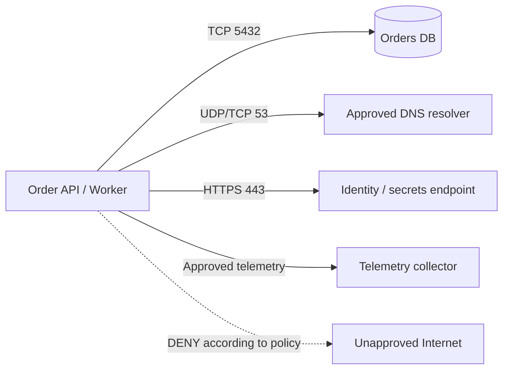
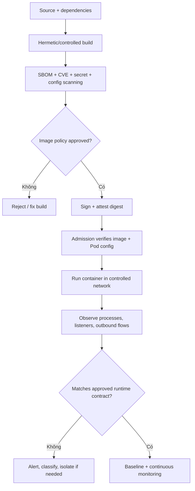
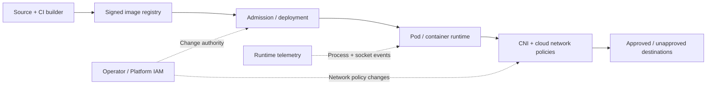

# Kiểm soát image có tiến trình mạng không cần thiết: từ chuỗi cung ứng đến runtime container

## 1. Vì sao cần kiểm soát tiến trình mạng đi kèm container image?

Một ứng dụng Java chỉ cần tiếp nhận HTTPS tại một cổng được công bố có thể được đóng gói vào một container image chứa **SSH daemon, công cụ quản trị từ xa, web server phụ, dịch vụ debug, công cụ chuyển tiếp TCP** hoặc một script tự chạy nhiều tiến trình. Những thành phần đó có thể xuất hiện do lựa chọn base image quá rộng, package phụ thuộc, cấu hình khởi động cũ, tool của nhà cung cấp hoặc hành vi đáng ngờ trong chuỗi cung ứng.

Giả sử nhóm vận hành mong đợi:

```text
Container: order-api
Main process: java -jar /app/order-api.jar
Inbound listener: TCP/8080 (application API)
Outbound: database TCP/5432, DNS theo nhu cầu, HTTPS tới dịch vụ đã duyệt
Debug/admin listeners: không có trong Production
```

Nếu khi chạy thực tế còn xuất hiện `sshd` trên TCP/22, server debug trên TCP/5005, một HTTP admin listener trên TCP/9090 hoặc một tiến trình tạo kết nối ra ngoài không rõ đích, đây là **chênh lệch giữa hành vi mong đợi và hành vi thật**. Không phải mọi chênh lệch đều chứng minh mã độc; nhưng nó cần được điều tra, quyết định cho phép hoặc loại bỏ có căn cứ.

**Phân biệt cơ bản:** *OCI/container image* là **artifact bất động gồm filesystem layers, metadata và cấu hình chạy mặc định**. Bản thân image đang nằm trong registry **không có tiến trình đang chạy, không mở socket và không thể tự nhận kết nối**. Tiến trình mạng xuất hiện khi container được tạo/chạy, do **ENTRYPOINT/CMD, ứng dụng, supervisor, hook, injected code, user thao tác hoặc nền tảng runtime**. Vì vậy “kiểm soát image có tiến trình mạng không cần thiết” nghĩa là kiểm soát **khả năng, cấu hình và hành vi** của phần mềm được phân phối bằng image.

Trong mô-đun **SECURITY_NETWORK_SECURITY**, nội dung này kết nối **an ninh chuỗi cung ứng, phân đoạn mạng, firewall, zero-trust, IDS/IPS, egress filtering, TLS/mTLS, quản trị container/Kubernetes và giám sát lưu lượng**. Một image gọn giúp giảm bề mặt tấn công, nhưng **network policy mới thực thi giới hạn reachability**, còn ứng dụng vẫn phải có authentication/authorization.

### Mục tiêu học tập

Sau bài này, người học có thể:

1. Xác định tiến trình, socket và lưu lượng **được phép** theo contract của workload.
2. Phân biệt **image content, cấu hình build, OCI metadata, container runtime, Pod và host network**.
3. Kiểm tra **ENTRYPOINT/CMD, base image, packages, SBOM và runtime processes/listeners** bằng cách an toàn.
4. Giảm phần mềm không cần thiết bằng **multi-stage build, minimal runtime, non-root, capability reduction và egress restrictions**.
5. Hiểu **`EXPOSE`, `-p`, `hostNetwork`, `containerPort`, Service, Ingress, NetworkPolicy** không đồng nghĩa nhau.
6. Thiết kế kiểm tra CI/CD, baseline hành vi, kiểm thử âm tính và quy trình xử lý tiến trình/socket bất thường.

## 2. Phân biệt bốn đối tượng: image, container, Pod và node

| Đối tượng | Bản chất | Thông tin mạng/proccess cần kiểm |
|---|---|---|
| **Container image** | các layers, OCI config, manifest/digest, package/binaries | có daemon/tools gì, ENTRYPOINT/CMD, EXPOSE, user, entrypoint scripts, SBOM |
| **Container đang chạy** | tiến trình thực thi trong namespaces/cgroups với filesystem từ image | PID, subprocess, listening sockets, established connections, privileges, environment |
| **Kubernetes Pod** | nhóm containers có một số resources và **network namespace chung** | app containers, sidecars, init containers, shared Pod IP/ports, traffic policies |
| **Node/host** | kernel và container runtime cùng các dịch vụ của host | hostNetwork/hostPort, privileged containers, host processes, container escape, CNI and firewall |

Một package như `openssh-server` có mặt trong filesystem **chưa chứng minh `sshd` đang chạy**. Ngược lại, **một ứng dụng Java duy nhất** có thể mở cả TCP/8080, TCP/9090 và outbound WebSocket; chỉ đếm số PID bằng 1 sẽ bỏ sót listeners ngoài contract.

### 2.1. Ba câu hỏi độc lập

1. **Có thành phần nào đáng lẽ không được đóng gói?** Xem image/layers/SBOM.
2. **Có tiến trình hoặc socket nào đáng lẽ không được chạy?** Xem runtime.
3. **Một socket hoặc kết nối có thể tới được từ đâu?** Xem bind address, namespace, port publishing, Service/Ingress, network/firewall policy và đường qua proxy.

**Image sạch ≠ runtime không thể bị xâm nhập. Runtime không mở port ≠ không thể có outbound exfiltration. Firewall chặn inbound ≠ phần mềm thừa không còn rủi ro.**

## 3. Thiết lập “hợp đồng tiến trình và mạng” cho từng workload

Trước khi loại bỏ một binary hoặc đóng port, cần biết **ứng dụng thật sự cần gì**. Một service giao tiếp theo HTTP/gRPC có hành vi khác worker chỉ đọc queue.

Ví dụ contract lý tưởng:

```yaml
# Tài liệu kiểm soát minh họa, không phải Kubernetes/Docker manifest.
service: order-api
environment: production
image_owner: commerce-team
approved_image_reference: registry.example.com/orders/api@sha256:<approved-digest>
expected_processes:
  - role: application
    executable: java
    command_pattern: "-jar /app/order-api.jar"
    max_instances: 1
allowed_inbound:
  - transport: tcp
    port: 8080
    bind: "0.0.0.0"
    source_role: internal-api-gateway
allowed_outbound:
  - destination_role: orders-database
    transport: tcp
    port: 5432
  - destination_role: internal-dns
    transport: udp
    port: 53
  - destination_role: authorized-identity-endpoint
    transport: tcp
    port: 443
prohibited_listeners:
  - sshd
  - telnetd
  - unauthenticated-debug-server
runtime:
  run_as_non_root: true
  privileged: false
  allow_privilege_escalation: false
exception_requirements: [owner, reason, approval, expires_at]
```

`<approved-digest>` là **ký hiệu giữ chỗ**, không phải digest hợp lệ để triển khai. Các values cần được thay bằng thông tin từ hệ thống build và policy đã duyệt.

### 3.1. Hợp đồng cần bao phủ những thành phần nào?

- **Application PID chính** và subprocess hợp lệ: worker pools, language runtime helper, exporter, sandboxed child process.
- **Inbound listener:** transport, bind address, port, purpose và nguồn được phép.
- **Outbound flows:** DNS, database, cloud metadata khi cần, secrets, registry/artifact, telemetry và third-party APIs.
- **Health, metrics, admin và debug endpoints:** ai truy cập, có cần tách cổng hoặc workload không.
- **Sidecar/init container:** ai sở hữu, vì sao xuất hiện, có chia sẻ network namespace hay quyền host không.
- **Filesystem/runtime privileges:** user, capabilities, seccomp/AppArmor/SELinux nếu dùng, mount, secrets.
- **Thay đổi có lịch:** version mới có thêm listener hợp lệ phải qua review; không giữ allowlist tĩnh mãi.

### 3.2. Các dạng service cần contract riêng

| Kiểu workload | Hành vi mong đợi | Điều bất thường ví dụ |
|---|---|---|
| REST API | lắng nghe app port, outbound DB/IdP | `sshd` hoặc unauthenticated JMX ngoài contract |
| Background worker | thường **không cần inbound application port** | bất ngờ mở HTTP admin trên `0.0.0.0` |
| API gateway | nhiều listeners và upstream connections được quản lý | dynamic proxy tự chuyển traffic tới arbitrary destination |
| DNS proxy | UDP/TCP 53 theo thiết kế | resolver công cộng trái chính sách |
| Service mesh sidecar | listener/redirect nội bộ theo sản phẩm | port mới không có ownership, bypass mesh |
| Monitoring exporter | metrics port với phạm vi giới hạn | metrics/debug không auth bị public |
| Database | DB port và replication/health theo vendor | web console phụ không được kiểm soát |

**Không có một “cổng nguy hiểm” tuyệt đối**. TCP/22, 5005 hay 9090 có thể cần cho một hệ thống chuyên biệt, nhưng phải có justification, AuthN/AuthZ, network restrictions và logging tương ứng.

## 4. Mô hình mối đe dọa: phần mềm thừa có thể tạo rủi ro gì?

Một daemon hoặc thư viện network không cần thiết mở rộng **attack surface** dù chưa bị khai thác:

- **Listening service không cần:** tăng parser/protocol handlers có thể bị quét hoặc tấn công nếu reachability cho phép.
- **Debug/management endpoint:** có thể lộ biến môi trường, memory, stack trace, heap dump hoặc cho thao tác nhạy cảm tùy sản phẩm/cấu hình.
- **Remote administration daemon:** tạo credential/authentication surface ngoài giải pháp truy cập chính thức.
- **Outbound client/agent không rõ:** có thể gọi đích bên ngoài, gửi telemetry không được phép hoặc bị lợi dụng để exfiltrate.
- **Process supervisor không cần:** có thể khởi động lại daemon bị vô hiệu hóa bằng cách sửa process hiện tại.
- **Package thừa có CVE:** tăng công sức vá và nguy cơ khai thác khi component được gọi.
- **Tool có thể bị lạm dụng:** `curl`, `nc`, shell, interpreters, package managers có thể hỗ trợ hoạt động hậu xâm nhập, dù **bản thân sự hiện diện không chứng minh độc hại**.

### 4.1. Cân bằng hai hướng phòng vệ

**Giảm khả năng thực thi:** loại daemon/package không cần, không cung cấp entrypoint phụ, không bật remote debugging, không dùng privileged mode.

**Giới hạn khi vẫn xảy ra thực thi:** network allowlist, non-root, least capabilities, seccomp, read-only root filesystem, runtime monitoring, service identity và application authorization.

**Điểm cốt lõi:** scan image chỉ thấy một phần của rủi ro, **runtime và network enforcement phải cùng tham gia**.

## 5. OCI image metadata: nhìn gì trước khi chạy?

Một OCI/Docker image thường mô tả **filesystem layers**, config và một số metadata. Những trường hữu ích gồm:

| Thành phần | Vai trò | Điều cần kiểm |
|---|---|---|
| `ENTRYPOINT` | chương trình chạy mặc định khi container start | có gọi shell script, supervisor hoặc daemon phụ không? |
| `CMD` | tham số/lệnh mặc định, có thể bị override | có flag bật debug/management không? |
| `USER` | UID/GID thực thi mặc định | có đang chạy root dù không cần? |
| `EXPOSE` | metadata mô tả port dự kiến | có phù hợp contract, nhưng **không tự mở firewall** |
| `ENV` | biến môi trường mặc định | có flag bật listener/debug, hoặc **bí mật bị đóng gói** không? |
| `WORKDIR` | thư mục chạy mặc định | path có quyền phù hợp không? |
| Image layers/history | dấu vết Dockerfile/build steps | có cài package thừa, download script không xác minh không? |
| Manifest digest | nội dung artifact bất biến tham chiếu | release có được pin/attest theo digest không? |
| Labels/annotations | metadata owner/build/provenance | dùng để inventory, **không tự chứng minh tin cậy** |

### 5.1. Xem cấu hình image theo cách read-only

```bash
# Image giả định đã có trong local Docker daemon được cấp phép.
docker image inspect registry.example.com/orders/api:approved

# Chỉ xem một số trường cấu hình thay vì in toàn bộ metadata.
docker image inspect \
  --format '{{json .Config.Entrypoint}} {{json .Config.Cmd}} {{json .Config.User}} {{json .Config.ExposedPorts}}' \
  registry.example.com/orders/api:approved

# Xem các layer instructions/size của image đã có.
docker image history --no-trunc registry.example.com/orders/api:approved
```

Đây là **lệnh quan sát**; `docker image inspect` không khởi chạy image. Một số Docker clients/configs và image types có output khác nhau. `image history` có thể không mô tả đầy đủ **mọi package hoặc byte được chép trong layer**; cần SBOM/file inventory.

### 5.2. Metadata không phải runtime truth

- `EXPOSE 8080` không bắt buộc app phải lắng nghe 8080.
- Image không khai `EXPOSE 22` vẫn có thể chạy `sshd` trên TCP/22 nếu script khởi động nó.
- `ENTRYPOINT ["java",...]` không bảo đảm Java không mở **nhiều sockets**.
- `USER 10001` có thể bị override bởi deployment config.
- Nếu Kubernetes Pod có **sidecar**, image chính không mô tả được toàn bộ Pod behavior.

**Nhìn metadata là bước phát hiện lệch thiết kế, không phải kết luận port đang được mở.**

## 6. Base image: vì sao image quá rộng gây khó kiểm soát?

Một base image mang hệ điều hành và nhiều packages đa dụng có thể chứa phần mềm **không phục vụ workload**:

- SSH server/client, telnet client, FTP daemon hoặc debugging tools.
- Daemons, init systems, cron và process managers.
- Shells, package managers, compilers, interpreters không cần trong runtime.
- Web server phụ, metrics agent hoặc database clients cũ.
- Thư viện có CVE trong dependency graph dù không phải mọi CVE đều khai thác được.

**Phân biệt:** một `ssh` **client binary** trong image không có nghĩa có một `sshd` **server process** đang chạy. Package manager được cài không đồng nghĩa nó mở socket. Việc đánh giá phải dựa vào **chức năng, cấu hình thực thi và mức độ cần thiết**.

### 6.1. Những lựa chọn giảm bề mặt

1. **Multi-stage builds:** build với SDK/compiler trong stage riêng, copy chỉ artifact vào runtime.
2. **Minimal runtime image:** JRE thay JDK nếu chức năng/observability cho phép; image nhỏ đã được quản trị.
3. **Distroless hoặc tương đương:** tránh shell/package manager không cần; vẫn phải biết cách debug và vá.
4. **Dùng runtime user không phải root**, gắn quyền đọc file đúng.
5. **Không bật init/supervisor theo thói quen** khi chỉ chạy một service.
6. **Không ghép nhiều ứng dụng** vào cùng container nếu không có lý do rõ.
7. **Pin digest, scan và rebuild định kỳ**, vì ngay cả image gọn cũng có thể có CVE và phiên bản runtime lỗi thời.

### 6.2. Minimal không có nghĩa tuyệt đối an toàn

- Một binary Go/Java duy nhất vẫn có thể mở network listeners và thực thi chức năng nhạy cảm.
- Image không có shell có thể bị tấn công qua lỗ hổng app hoặc dependency.
- Distroless có thể khiến **điều tra tại chỗ** khó hơn; cần endpoint telemetry và ephemeral debug workflow có kiểm soát.
- Thời gian cập nhật base và khả năng patch quan trọng hơn chỉ số kích thước image.
- “Zero CVE scanner finding” không chứng minh không có backdoor hoặc runtime misbehavior.

## 7. ENTRYPOINT, CMD và startup script: điểm khởi động thật sự

Một container thường bắt đầu từ **PID 1 trong PID namespace của nó** hoặc một process được container runtime quản lý. Dockerfile `ENTRYPOINT`/`CMD` chỉ là cấu hình mặc định; Kubernetes `command`/`args` và runtime configuration có thể override.

### 7.1. Ví dụ startup có daemon ngoài ý muốn

```sh
#!/bin/sh
# Ví dụ anti-pattern để phân tích, KHÔNG sử dụng làm entrypoint.
service ssh start
java -jar /app/order-api.jar
```

Script này cố gắng khởi động SSH service trước ứng dụng. Nếu image chứa init/service scripts phù hợp và process có đủ quyền, một daemon phụ có thể tồn tại mà người đọc Dockerfile chỉ chú ý đến Java.

**Thiết kế tốt hơn:** nếu không cần SSH daemon, **không cài và không khởi động nó**. Dùng kênh quản trị container/nền tảng được phê duyệt như `kubectl logs`, `kubectl exec` hoặc hệ thống observability với RBAC/audit, thay vì tự mở SSH server trong application container.

### 7.2. Exec form và tín hiệu dừng

```dockerfile
# Ví dụ đúng khi container chỉ chạy một ứng dụng:
ENTRYPOINT ["java", "-jar", "/app/order-api.jar"]
```

Exec form thường tránh một lớp shell không cần và giúp tín hiệu đến process đúng cách, tùy runtime. Nếu entrypoint **phải là script**, nên dùng `exec java ...` ở bước cuối để không giữ shell làm parent không cần thiết, đồng thời xử lý signals/cleanup phù hợp.

### 7.3. Supervisor hoặc nhiều tiến trình khi nào hợp lệ?

Một số image đặc thù như networking gateway, monitoring agent hoặc legacy multi-process appliance thật sự cần supervisor. Đó là **ngoại lệ cần tài liệu hóa**:

- Liệt kê tất cả child processes và ports.
- Kiểm tra lifecycle, restart, logging và signal handling.
- Không trao quyền root hoặc host network không cần.
- Có owner, admission policy và runtime detection riêng.

**Không coi mọi container nhiều process là độc hại**; hãy so với contract đã duyệt.

## 8. `EXPOSE` không phải mở port: phân biệt các cơ chế công bố

| Cơ chế | Công dụng | Có tự làm service public không? |
|---|---|---|
| Dockerfile `EXPOSE 8080` | khai báo **metadata** port mà app dự kiến dùng | **không** |
| `docker run -p 127.0.0.1:8080:8080` | map host loopback port vào container port | không trực tiếp mở cho mọi network interface, nhưng còn phụ thuộc host networking/policy |
| `docker run -p 8080:8080` | publish trên host theo default binding và Docker/network settings | có thể truy cập từ mạng ngoài nếu host/firewall/routing cho phép |
| `docker run -P` | publish các port được khai báo trong image theo cơ chế Docker | **có thể tạo port mappings** không mong đợi |
| Kubernetes `containerPort: 8080` | metadata/documentation để đặt tên cổng/probes, networking tools | **không tự tạo Service/public exposure** |
| Kubernetes `Service` | virtual endpoint/routing cho Pods được chọn theo loại Service | mức reachability tùy ClusterIP/NodePort/LoadBalancer và network |
| `Ingress` / Gateway API | định nghĩa HTTP routing từ gateway vào service | tùy controller, LB, TLS và routes |
| `hostPort` | expose container port trên node host theo hỗ trợ CNI | có thể mở đường ngoài Pod qua node |
| `hostNetwork: true` | dùng network namespace của node | có thể thay đổi ranh giới rất lớn; phải hạn chế |
| Process bind `127.0.0.1` | nhận kết nối tại loopback **của network namespace đó** | không phải mặc định public qua Pod IP |
| Process bind `0.0.0.0` | nghe trên IPv4 interfaces trong namespace | cần network policy/service/firewall để giới hạn nguồn |

### 8.1. Port không khai báo vẫn có thể mở

Nếu ứng dụng tự gọi `bind(0.0.0.0:5005)` hoặc config bật JDWP trên 5005, socket có thể hoạt động **dù Dockerfile không có `EXPOSE 5005`**. Tương tự, `EXPOSE 8080` tồn tại không chứng minh process đang listen.

**Đánh giá “port exposure” cần kết hợp:** listener thực tế + bind interface + container/Pod network + publish/Service/Ingress + network/firewall policy + authentication.

### 8.2. IPv6 và dual-stack

Một tiến trình lắng nghe `[::]:8080` có thể có hành vi IPv6/IPv4 khác nhau theo socket options/kernel, runtime và network settings. Không kiểm tra chỉ `0.0.0.0` rồi bỏ qua IPv6. Trong cloud/Kubernetes dual-stack cần kiểm tra cả network paths và IPv4/IPv6 firewall rules.

## 9. Linux namespaces: ai nhìn thấy process và port?

Linux container isolation dựa trên các cơ chế như **PID namespace, network namespace, mount namespace, cgroups và Linux security controls**. Chúng cung cấp cô lập có giới hạn, **không đồng nghĩa với một máy ảo hoặc kernel riêng**.

### 9.1. Network namespace

Một network namespace có interfaces, addresses, routing table và một tập sockets tương ứng. `127.0.0.1` bên trong container thông thường **không phải** loopback của host.

Trong **Kubernetes Pod**, nhiều containers trong cùng Pod thường **chia sẻ network namespace**: chung Pod IP và loopback, có thể kết nối đến socket của nhau qua `127.0.0.1`; đồng thời **không thể hai container cùng bind cùng địa chỉ/port/protocol** một cách tùy ý trong namespace đó.

### 9.2. PID namespace

Containers trong cùng Pod **không nhất thiết chia sẻ PID namespace** trừ khi được cấu hình hoặc cơ chế nền tảng tạo khác đi. Vì vậy:

- App container có thể **thấy socket/port của sidecar** qua shared network namespace.
- Nhưng `ps` trong app container có thể **không thấy PID sidecar**, tùy PID namespace.
- Người điều tra phải kiểm tra **toàn Pod**, không chỉ process list từ container chính.

### 9.3. Host networking và privileged modes

`hostNetwork: true` làm Pod dùng network namespace của host theo mô hình Kubernetes, khiến giả định “loopback chỉ trong Pod” không còn đúng như Pod thông thường. Các cấu hình `hostPID`, privileged containers, hostPath mounts và capabilities quá rộng cũng có thể giảm ranh giới cô lập.

**Không áp một cách mù quáng hướng dẫn “bind 127.0.0.1 là an toàn”** với hostNetwork hoặc hệ thống có sidecar không đáng tin cùng namespace.

## 10. Xem container runtime: tiến trình nào thực sự chạy?

Khi điều tra được cấp quyền, nên bắt đầu bằng **inventory read-only**:

```bash
# Liệt kê container trong Docker environment được cấp phép.
docker ps --no-trunc

# Xem cấu hình container, entrypoint, user, network mode, ports và trạng thái.
docker inspect <approved-container-name>

# Quan sát process list do Docker daemon báo về container.
docker top <approved-container-name>

# Xem port mappings mà Docker daemon quản lý.
docker port <approved-container-name>
```

Đây là **lệnh kiểm tra thông tin**, nhưng access tới Docker daemon/socket thường có **quyền rất cao** trên host. Chỉ cấp quyền này cho operator/tool được phê duyệt; không gắn Docker socket vào application container để “dễ xem”.

### 10.1. Xem trong container khi đã được ủy quyền

```bash
# Trong container/lab có sẵn công cụ tương ứng:
ps -eo pid,ppid,user,comm,args

# Listening TCP/UDP sockets; tên process có thể cần quyền bổ sung.
ss -lntup

# Các kết nối TCP/UDP được kernel báo qua ss.
ss -tunap

# Chỉ xem một số thông tin hệ thống process nếu được cấp quyền.
cat /proc/1/cmdline
```

Lệnh `cat /proc/1/cmdline` trả chuỗi phân tách bởi NUL, có thể không dễ đọc và **command-line arguments đôi khi chứa bí mật**; không copy thẳng vào logs công khai. Một số minimal/distroless images **không có `ps`, `ss`, `cat` hoặc shell**: đó không phải bằng chứng “không có socket”.

### 10.2. Tính read-only của việc quan sát

`docker exec`/`kubectl exec` khởi chạy một **process mới trong container** và vì thế không hoàn toàn không làm thay đổi trạng thái runtime; nó khác với `inspect`/`top`. Ở Production, ưu tiên **runtime telemetry từ node/eBPF, platform tooling và logs**, hoặc debug session được kiểm soát. Không chạy công cụ lạ có thể thay đổi môi trường đang điều tra.

### 10.3. Quyền quan sát bị giới hạn

Các lệnh `ss -p`, `lsof` hoặc đọc `/proc/<pid>` có thể **không hiển thị process/owner** do Linux permissions, namespace hoặc security profiles. Kết quả thiếu process mapping không có nghĩa socket vô chủ. Cần dùng công cụ được cấp phép ở đúng namespace/node và bảo vệ dữ liệu.

## 11. Listener, socket và outbound connection: các dạng cần phân biệt

| Dấu hiệu | Ví dụ | Diễn giải đúng |
|---|---|---|
| TCP LISTEN tại `0.0.0.0:8080` | application API | có listener trên interfaces IPv4 trong namespace, **không tự chứng minh reachable từ Internet** |
| TCP LISTEN tại `127.0.0.1:9090` | local metrics/debug | trong cùng network namespace, các containers cùng Pod có thể truy cập |
| TCP LISTEN tại `[::]:8443` | IPv6 server socket | cần kiểm tra IPv4/IPv6 stack behavior |
| UDP socket tại port 53 | DNS resolver/forwarder | UDP không có TCP LISTEN state tương đương; cần kiểm tra bind và mục đích |
| TCP ESTABLISHED tới DB | API → database | có flow hiện tại; chưa chứng minh mọi request được ủy quyền |
| TCP SYN/attempt tới external IP | outbound connector | cần đối chiếu DNS, workload role và egress policy |
| Unix-domain socket | `/run/app.sock` | không phải IP port; có thể gây rủi ro qua mounts/permissions |
| `SO_REUSEPORT`/multiworker sockets | nhiều process cùng port khi được cấu hình hợp lệ | có thể là thiết kế đúng, cần inspect owners |
| Connection đã đóng | không còn trong output tức thời | snapshots có thể bỏ lỡ process/socket tồn tại rất ngắn |

### 11.1. Inbound ít không có nghĩa outbound an toàn

Một container không có bất cứ port lắng nghe nào vẫn có thể **gửi HTTPS ra ngoài**, gọi cloud metadata service, DNS tunneling hoặc một endpoint chưa được phê duyệt nếu chính sách egress cho phép. Vì vậy inventory phải có **connections và destinations**, không chỉ listening sockets.

### 11.2. Port được mở có thể không do image chính

Một sidecar mesh proxy, init-to-runtime agent, CNI component hoặc admission-injected container có thể mở sockets chung trong Pod. Tên process trong một PID namespace có thể không phản ánh toàn bộ network namespace; cần ghép dữ liệu theo **Pod UID, container ID, namespace và node**.

## 12. Java/Spring Boot: các cổng phụ thường bị bỏ sót

Một ứng dụng `java -jar app.jar` có thể có **một process nhưng nhiều network endpoints**:

| Tính năng | Khả năng mở kết nối/listener | Kiểm soát |
|---|---|---|
| HTTP/Tomcat/Netty server | app port, ví dụ TCP/8080 | giới hạn ingress từ gateway và authentication |
| Spring Boot Actuator | health/metrics/admin endpoints có thể trên app port hoặc management port riêng | giới hạn `exposure.include`, auth và network visibility |
| Remote JDWP debugger | debug listener khi bật JVM agent | **không bật trên Production** nếu không có exception được kiểm soát |
| JMX remote | network listener/management ports khi cấu hình remote JMX | tránh public, yêu cầu TLS/auth nếu thật sự cần |
| Embedded H2 console | web UI phục vụ DB test | vô hiệu hóa trong Production nếu không cần |
| DevTools/live reload | hỗ trợ development, có thể kéo thêm capabilities | không đóng gói chế độ development vào production image |
| Micrometer/Prometheus exporter | metrics endpoint | chỉ cho monitoring identity/network được phép |
| HTTP client/gRPC/database driver | outbound connections | egress allowlist, TLS hostname validation, credentials tối thiểu |

### 12.1. Không kết luận chỉ theo process name

Một tiến trình Java có thể tự bind `0.0.0.0:5005` khi được bật JDWP hoặc một library cho phép management server. Vì vậy:

```text
process count == 1
  KHÔNG SUY RA
listening ports == 1
```

### 12.2. Spring Boot configuration minh họa

```yaml
# application-prod.yml - ví dụ, phải ghép security controls thực.
server:
  port: 8080
management:
  endpoints:
    web:
      exposure:
        include: "health,info"
  endpoint:
    health:
      show-details: "never"
spring:
  h2:
    console:
      enabled: false
```

Ví dụ này **chỉ giới hạn một số endpoints và tắt H2 console**. Nó **không tự cấu hình authentication**, không chặn Java mở sockets khác và không ngăn người khác dùng `/actuator/health` nếu ingress/network cho phép. Với production cần xét **Spring Security, actuator endpoint sensitivity, management address/port, ingress routing và logs**.

### 12.3. Management port riêng có tác động đến probes

Nếu đặt `management.server.address=127.0.0.1` cho một management listener riêng, **Kubernetes HTTP probe thông thường gửi tới Pod IP** có thể không truy cập được socket chỉ bind Pod loopback. Phải chọn probe phù hợp (HTTP trên reachable management port, exec probe, hoặc endpoint health tích hợp app port) và kiểm chứng với CNI/sidecar thực tế; **không mở admin port ra Internet để sửa probe**.

### 12.4. Không đưa bí mật vào debug logs

JVM process arguments, system properties, heap dumps, thread dumps và actuator environment/config endpoints có thể chứa token, URL có credentials hoặc thông tin hệ thống. Chỉ thu thập qua **kênh quản trị được cấp quyền**, có masking/retention và không mặc định public chúng.

## 13. Dockerfile: đóng gói chỉ phần mềm được phép

Một mẫu Dockerfile runtime đơn giản cho Spring Boot artifact đã build:

```dockerfile
# Minh họa: chọn runtime base được tổ chức phê duyệt, scan
# và pin bằng digest trong CI/CD Production.
FROM eclipse-temurin:21-jre

WORKDIR /app

# Không cài SSH daemon, cron, package manager bổ sung hay debug server.
# Artifact đã được build, test và scan trong pipeline riêng.
COPY --chown=10001:10001 target/order-api.jar /app/order-api.jar

USER 10001:10001

# EXPOSE là metadata; không mở firewall/port publishing.
EXPOSE 8080

ENTRYPOINT ["java", "-jar", "/app/order-api.jar"]
```

**Điểm được minh họa:**

- Dùng **JRE thay vì JDK** nếu ứng dụng không cần JDK tools lúc chạy.
- Không thêm daemon hoặc shell script giấu tiến trình phụ.
- Dùng **non-root UID/GID** và artifact có ownership phù hợp.
- Chỉ mô tả app port `8080`; không bật debug/admin listener ngoài contract.
- Giữ runtime image nhỏ và có thể kiểm tra.

**Hạn chế cần nhớ:**

- `eclipse-temurin:21-jre` là **tag có thể thay đổi**; production nên **pin đúng digest** và dùng quy trình cập nhật base được phê duyệt.
- Base JRE vẫn có thể chứa tiện ích hệ điều hành hoặc thành phần không dùng; cần **SBOM + scanning + runtime tests**.
- Chỉ có `USER` không thay Kubernetes `securityContext`, seccomp, capabilities hay network rules.
- Binary Java vẫn có thể mở listeners theo config/env/JVM flags. Phải đo socket **sau khi start**.
- Nếu volume được mount với quyền không phù hợp, app có thể không chạy; kiểm tra writable paths (tmp/log/heap) theo cơ chế triển khai.
- Trong môi trường Java 21, tương thích application/JVM flag vẫn cần test đầy đủ theo build thực tế.

### 13.1. Multi-stage build ở mức ý tưởng

```text
Stage 1: builder
  JDK + build tool + source/tests
  → build artifact, SBOM, tests

Stage 2: runtime
  approved minimal JRE + app artifact
  → non-root, no build tools, one declared entrypoint
```

Đừng sao chép toàn bộ `/usr/bin`, package caches hoặc build workspace từ builder sang runtime. **Multi-stage build không tự miễn nhiễm supply-chain attack**: nếu artifact đã bị sửa trước khi copy, runtime image gọn vẫn chứa phần mềm độc hại.

## 14. Kiểm tra package, filesystem và SBOM trước khi phát hành

**Software Bill of Materials (SBOM)** là danh mục component/dependency được xây từ nguồn và artifact. Nó hữu ích để phát hiện:

- Package server không cần: `openssh-server`, `dropbear`, `inetd`, database server, embedded web server cũ.
- Công cụ chẩn đoán có khả năng network chưa được phê duyệt.
- Thư viện vulnerable hoặc không có owner.
- Thay đổi dependency bất ngờ giữa hai bản build.
- Ứng dụng tự mang runtime/framework version không thuộc baseline.

### 14.1. SBOM không phải danh sách tiến trình đang chạy

Một SBOM có thể cho biết image chứa `libcurl` hoặc `openssh-client`; điều đó **không chứng minh** container khởi động SSH server. Ngược lại, một binary tĩnh hoặc code tự mở socket **có thể không được mô tả đầy đủ** qua package-manager inventory.

Vì vậy cần các nguồn:

1. **Package inventory/SBOM** từ build artifact.
2. **Filesystem/binary inspection** và review Dockerfile/entrypoint.
3. **Static/configuration analysis** cho debug flags, startup hooks và listeners.
4. **Runtime process/socket/network inventory** ở staging/Production.
5. **Behavior monitoring** phát hiện sự thay đổi về sau.

### 14.2. Các loại scanning giải quyết câu hỏi khác nhau

| Công cụ/kiểu kiểm tra | Thường phát hiện | Không tự chứng minh |
|---|---|---|
| Vulnerability scanner | CVEs và package version/known exposure | daemon có đang chạy hoặc có thể truy cập không |
| SBOM generator | thành phần, dependency và nguồn | mọi binary được tải động hoặc malicious behavior |
| Dockerfile/IaC linter | cấu hình `USER`, base pin, privileged, image policies | runtime listener thực sự |
| Secret scanner | hardcoded secrets trong filesystem/layers/logs | network egress được phép |
| Image signing/attestation | nguồn, build/provenance theo hệ thống tin cậy | code không có lỗ hổng logic |
| Runtime process/network sensor | exec, sockets, process ancestry, outbound flows | toàn bộ logic ứng dụng hoặc business AuthZ |

**Kết luận:** kết hợp kiểm soát **phát hành image** và **hành vi khi chạy** mới đáp ứng mục tiêu chủ đề.

## 15. Image provenance: ai tạo artifact và có bị thay không?

Không chỉ hỏi “image có gói gì” mà phải hỏi **“image này đến từ pipeline nào và có đúng artifact được duyệt?”**.

Các cơ chế hữu ích:

- **Registry allowlist:** chỉ pull từ registry/repository được phê duyệt.
- **Digest pinning:** triển khai image theo immutable digest thay vì tag mutable khi áp dụng.
- **Signature/provenance attestation:** xác minh artifact xuất phát từ build identity/pipeline hợp lệ với công cụ như Sigstore/cosign hoặc giải pháp tương đương.
- **SBOM attestation:** liên kết thông tin thành phần với đúng image digest.
- **SLSA/SSDF controls:** bảo vệ build process, source dependencies, artifacts và credentials.
- **Admission policy:** Kubernetes hoặc deployment control plane từ chối unsigned/unapproved images theo chính sách.
- **Continuous rebuild:** cập nhật base/dependencies và ký artifact mới theo phiên bản/phê duyệt.

### 15.1. Một image được ký vẫn có thể chạy daemon sai

Chữ ký xác minh **artifact/provenance theo trust policy**, không bảo đảm nội dung đúng yêu cầu nghiệp vụ. Nếu pipeline được tin vô tình cài thêm SSH daemon hoặc bật debug listener, image vẫn có thể được ký hợp lệ. Phải bổ sung **policy về packages, entrypoint, runtime sockets và network access**.

### 15.2. Kiểm soát tag drift

Một Pod ghi `image: registry.example.com/api:latest` có thể nhận nội dung khác giữa các lần deploy/pull. Điều này làm việc đối chiếu SBOM, logs và rule exceptions khó hơn. Nên ghi **digest, build ID, provenance và configuration version** vào inventory/telemetry.

## 16. Runtime hardening: làm giảm quyền nếu tiến trình lạ xuất hiện

Một tiến trình ngoài mong đợi nguy hiểm hơn khi container có đặc quyền lớn. Linux container security controls gồm:

- **Non-root UID/GID** và user namespaces/rootless theo khả năng runtime.
- **Drop Linux capabilities** không cần, chỉ add chính xác capability có justification.
- **`allowPrivilegeEscalation: false` / no-new-privileges**, khi platform hỗ trợ.
- **Seccomp** để giới hạn một số system calls, dùng profile được duyệt.
- **AppArmor/SELinux** khi có cơ chế thực thi phù hợp.
- **Read-only root filesystem** và mounts được hạn chế.
- **Không dùng privileged container**, hostPID, hostNetwork hoặc hostPath trừ khi có exception.
- **Không gắn Docker/containerd socket** hoặc host credentials vào application Pod.
- **Resource limits** cho CPU/memory/PIDs khi phù hợp workload.

### 16.1. `NET_ADMIN` và `NET_RAW` có ý nghĩa gì?

`CAP_NET_ADMIN` liên quan nhiều thao tác quản trị mạng (routing, firewall, interfaces...) theo phạm vi kernel; `CAP_NET_RAW` liên quan raw/packet sockets theo các điều kiện hệ thống. Một API thông thường hiếm khi cần chúng.

**Không cấp `NET_ADMIN` hoặc privileged chỉ để ứng dụng bind TCP/8080.** Linux thường cho bind cổng cao không cần capability đặc biệt. Nếu cần bind cổng thấp, nên cân nhắc **front proxy/LB port mapping** hoặc capability cụ thể với policy, không cấp `ALL`.

### 16.2. Seccomp không phải network firewall

Seccomp có thể giới hạn syscalls nhưng không phải một hệ thống **allowlist FQDN/TCP destination** thay cho network policy. Một process được phép gọi `connect()` vẫn cần egress firewall/identity policy để giới hạn đích. Tương tự, **non-root không tự ngăn mở listener** ở port cao.

### 16.3. Read-only root filesystem vẫn cần đường ghi hợp lệ

Java hoặc sidecars có thể cần `/tmp`, cache/temp file, certificate trust material hoặc writable mount. Thiết kế `readOnlyRootFilesystem` cùng **ephemeral volumes và file permissions** phù hợp, không sửa bằng cách vô hiệu hóa toàn bộ hardening khi ứng dụng gặp lỗi.

## 17. Kubernetes Deployment: baseline cho một Java API

Ví dụ triển khai tham khảo:

```yaml
# Manifest giản lược để học, chưa có Service/Ingress/NetworkPolicy.
apiVersion: apps/v1
kind: Deployment
metadata:
  name: order-api
  namespace: production
spec:
  replicas: 2
  selector:
    matchLabels:
      app: order-api
  template:
    metadata:
      labels:
        app: order-api
    spec:
      automountServiceAccountToken: false
      hostNetwork: false
      containers:
        - name: api
          image: registry.example.com/orders/api@sha256:<approved-digest>
          ports:
            - name: http
              containerPort: 8080
              protocol: TCP
          securityContext:
            runAsNonRoot: true
            runAsUser: 10001
            runAsGroup: 10001
            allowPrivilegeEscalation: false
            readOnlyRootFilesystem: true
            capabilities:
              drop: ["ALL"]
            seccompProfile:
              type: RuntimeDefault
          resources:
            requests: {cpu: "100m", memory: "256Mi"}
            limits: {cpu: "1", memory: "512Mi"}
          volumeMounts:
            - name: tmp
              mountPath: /tmp
          readinessProbe:
            httpGet: {path: /actuator/health/readiness, port: 8080}
            initialDelaySeconds: 10
            periodSeconds: 10
      volumes:
        - name: tmp
          emptyDir:
            sizeLimit: 64Mi
```

**Bắt buộc điều chỉnh trước khi áp dụng:**

- Digest giữ chỗ không hợp lệ; thay bằng digest đã được build, scan, ký và phê duyệt.
- `/actuator/health/readiness` phải tồn tại, có health group phù hợp và không lộ dữ liệu; Spring Boot profile/Actuator config cần được kiểm thử.
- `automountServiceAccountToken: false` phù hợp khi workload **không cần Kubernetes API**; nếu cần, dùng service account tối thiểu thay vì bật token mặc định và quyền rộng.
- Có thể cần thêm writable directories cho Java/container runtime; test với read-only root filesystem.
- `containerPort` **không giới hạn ingress**, không phải firewall.
- Một container có securityContext chặt vẫn có thể mở socket trên TCP/5005 nếu app config cho phép; cần **network policy và runtime detection**.
- Kubelet/ingress/monitoring probes và NetworkPolicy phải hỗ trợ luồng thật; không mở toàn namespace chỉ để health check chạy.
- Pod admission policies có thể cần yêu cầu cả `seccompProfile` ở cấp Pod hoặc container theo khả năng nền tảng.

**Giới hạn:** đây là deployment baseline, không gồm PodDisruptionBudget, Service, HPA, IAM/cloud secrets, TLS, imagePullSecrets, admission configuration hay application-level authorization.

## 18. Kubernetes NetworkPolicy: hạn chế đường đi của listener và egress

Ngay cả khi image chỉ chứa đúng ứng dụng, một container vẫn có thể bị xâm nhập qua lỗ hổng app và mở socket mới bằng code sẵn có. **Kubernetes NetworkPolicy** giúp giảm khả năng các Pods khác kết nối tới socket ngoài dự kiến và hạn chế destination của traffic do workload khởi tạo.

### 18.1. Default-deny trong một namespace

```yaml
# Staging/lab trước khi đưa vào production.
apiVersion: networking.k8s.io/v1
kind: NetworkPolicy
metadata:
  name: default-deny
  namespace: production
spec:
  podSelector: {}
  policyTypes:
    - Ingress
    - Egress
```

Đây là chính sách chọn mọi Pod trong namespace và tạo isolation cho hai directions theo **standard NetworkPolicy semantics**. Nó **không phủ định** traffic đã được một NetworkPolicy khác cho phép, vì những allow rules **được cộng dồn**.

**Chỉ có ý nghĩa khi CNI/dataplane triển khai NetworkPolicy đúng.** Kubernetes API có thể lưu manifest dù plugin thực thi chưa hỗ trợ đầy đủ. Kiểm chứng bằng các flow tests, không chỉ `kubectl get networkpolicy`.

### 18.2. Chỉ cho ingress gateway vào API và egress đúng nơi

```yaml
# Minh họa: namespace/labels phải khớp với deployment thực.
apiVersion: networking.k8s.io/v1
kind: NetworkPolicy
metadata:
  name: order-api-allowed-flows
  namespace: production
spec:
  podSelector:
    matchLabels:
      app: order-api
  policyTypes: [Ingress, Egress]
  ingress:
    - from:
        - namespaceSelector:
            matchLabels:
              kubernetes.io/metadata.name: ingress-system
          podSelector:
            matchLabels:
              app: ingress-gateway
      ports:
        - protocol: TCP
          port: 8080
  egress:
    - to:
        - podSelector:
            matchLabels:
              app: orders-db
      ports:
        - protocol: TCP
          port: 5432
    - to:
        - namespaceSelector:
            matchLabels:
              kubernetes.io/metadata.name: kube-system
          podSelector:
            matchLabels:
              k8s-app: kube-dns
      ports:
        - protocol: UDP
          port: 53
        - protocol: TCP
          port: 53
```

Phân tích:

1. Policy chọn `app=order-api` trong `production`.
2. Ingress chỉ cho từ các Pods gateway có label phù hợp trong `ingress-system` tới TCP/8080.
3. Egress tới `orders-db` **cùng namespace**, trên TCP/5432.
4. DNS egress cho Pods trong `kube-system` có label phù hợp trên UDP/TCP 53.
5. `namespaceSelector` và `podSelector` **đặt trong cùng một `from`/`to` entry** có nghĩa lọc đồng thời. Nếu viết thành **hai entries riêng**, ta thường tạo hợp của các nhóm, có thể cho phép nhiều Pods hơn dự định.

**Ràng buộc thực tế:**

- Label DNS `k8s-app=kube-dns` có thể **không đúng** với cluster dùng NodeLocal DNS hoặc một CoreDNS deployment khác.
- Traffic tới Kubernetes Service/VIP có thể chịu tác động của NAT/packet processing và NetworkPolicy implementation; không suy rằng mọi `ipBlock`/Pod selector cho service translation giống nhau.
- Egress tới IdP, cloud secrets service, metrics collector hoặc object storage **chưa có trong mẫu**; cần bổ sung chính xác theo inventory.
- DB Pod cũng phải có ingress policy cho đúng source, nếu bị cô lập.
- Health checks từ kubelet/node và sidecar có thể cần phân tích riêng theo dataplane.
- Labels là metadata quản trị; bảo vệ **RBAC, admission, namespace ownership**, không cho ứng dụng tùy ý nhận label gateway.

### 18.3. NetworkPolicy không xóa daemon

Nếu `sshd` vẫn chạy nhưng inbound đã bị NetworkPolicy chặn, nguy cơ bên ngoài giảm nhưng **daemon thừa và package có CVE vẫn tồn tại**. Một Pod khác cùng network namespace, đường hostNetwork hoặc cấu hình CNI đặc biệt có thể thay reachability. Đích cuối của remediation vẫn là **loại bỏ tiến trình và thành phần không cần**, đồng thời giữ network controls để phòng vệ sâu.

## 19. Sidecar, init container và service mesh: kiểm kê toàn bộ Pod

Một Pod có thể chứa:

```text
Pod order-api
  ├─ init container (chuẩn bị cấu hình rồi kết thúc)
  ├─ app container (java -jar ...)
  ├─ service mesh proxy sidecar
  └─ telemetry/secret agent sidecar (nếu kiến trúc yêu cầu)
```

Với Pod networking thông thường, các containers **chia sẻ network namespace**. Vì vậy:

- Sidecar có thể bind một **local admin port** có thể truy cập từ app container qua loopback.
- App container có thể thấy port nhưng không thấy PID sidecar do PID namespaces khác.
- Một container chạy độc hại trong cùng Pod có thể gọi local admin endpoint nếu endpoint không có xác thực/quyền thích hợp.
- Các ports của sidecar có thể thay đổi sau nâng cấp mesh/agent, cần owner và phiên bản baseline.
- Init container thường kết thúc trước khi app chạy, nhưng nó có thể **ghi files/volumes**, cài cấu hình hoặc tác động startup behavior; không bỏ qua khi đánh giá supply chain.

### 19.1. Cổng mesh nội bộ có phải bất thường?

Không nhất thiết. Mesh proxy có thể cần inbound/outbound interception listeners, health/admin/metrics ports. Nên lập contract theo **loại proxy và phiên bản**:

| Loại listener | Có thể hợp lệ khi | Điều kiện kiểm soát |
|---|---|---|
| Traffic interception | sidecar/gateway được platform inject | không public ngoài phạm vi, CNI/iptables/eBPF rules đúng |
| Local admin interface | control plane/agent cần | bind và auth theo sản phẩm, không tin mọi process trong Pod |
| Metrics listener | monitoring collector có quyền | restricted sources, redaction, không lộ secrets |
| Certificate/SDS interface | cung cấp workload credentials | bảo vệ Unix socket/permissions và identity |
| Unexpected debug listener | không có approved owner | điều tra, disable/remove nếu không cần |

### 19.2. Sidecar injection và policy drift

Nếu webhook/admission controller tự inject sidecar vào Pod, build image của app **không thấy** sidecar đó. Kiểm kê cả:

1. Deployment/PodSpec **sau khi admission mutation**.
2. Versions/digests của sidecar images.
3. Runtime process/socket inventory ở **cùng Pod UID**.
4. CNI/mesh network redirection rules.
5. Credentials/volumes/host networking mà sidecar có thể truy cập.

**Không khuyến nghị tắt mesh/sidecar tùy tiện** để giảm số process. Nếu mesh là điểm thực thi mTLS, tắt sidecar có thể khiến đường traffic mất bảo vệ hoặc ngừng hoạt động.

## 20. Egress: container không cần listener vẫn có thể gọi Internet

Một background worker chỉ có outbound connections không đương nhiên an toàn. Nó có thể:

- Kết nối DB/queue đúng contract.
- Gọi DNS/IdP/secrets manager để hoạt động.
- Gửi logs và metrics tới collector.
- Hoặc, nếu bị xâm nhập, kết nối tới **đích ngoài chính sách**.

### 20.1. Egress policy theo dependency



Không nên viết duy nhất `allow egress 443 to 0.0.0.0/0` cho mọi workload khi threat model yêu cầu hạn chế exfiltration. Nhưng cũng không thể thay bằng một rule DNS tên miền chung nếu CNI/firewall không hỗ trợ FQDN enforcement có độ tin cậy phù hợp.

### 20.2. Limitations của egress filtering

- Kubernetes standard NetworkPolicy chủ yếu diễn tả **IP blocks, namespace/pod selectors và ports**, không phải một FQDN allowlist đầy đủ.
- Cloud APIs có endpoints/addresses biến động; cần **private endpoints, resource/IAM policies và cơ chế egress gateway** nếu phù hợp.
- DNS response có thể đổi; chỉ cho DNS resolver không có nghĩa mọi resolved destination đều hợp lệ.
- IPv6 phải được xét độc lập nếu cluster/network hỗ trợ dual-stack.
- NAT và mesh redirect có thể làm điểm quan sát IP nguồn/đích khác nhau.
- HostNetwork/privileged workloads có thể cần enforcement ở node/cloud, không chỉ Pod NetworkPolicy.

### 20.3. Egress không thay app authorization

Nếu API được phép gọi object-storage provider, việc đó không đồng nghĩa được phép ghi **mọi bucket/account**. Cần kết hợp **cloud IAM/service identity, resource policy, encryption/DLP, request logging và egress controls**.

## 21. Image scanning và runtime behavior: hai vòng bảo vệ liên tiếp

Một quy trình thực tế:



**Đây là pipeline mục tiêu, không phải một sản phẩm duy nhất làm hết.** Những dự án nhỏ có thể bắt đầu từ SBOM + image policy + Kubernetes securityContext + runtime alerts tối thiểu, rồi tăng độ chi tiết theo mức rủi ro và năng lực đội vận hành.

### 21.1. Kiểm soát tại build time

- Kiểm tra base image có owner, version/digest và lịch vá.
- Kiểm tra Dockerfile cài daemon/network tools không cần.
- Kiểm tra `ENTRYPOINT/CMD` và startup scripts; tìm flag bật debug.
- Scan dependencies, SBOM và secrets.
- Review image history, multi-arch variants và layers.
- Chạy test trên **image được phát hành**, không chỉ source tree.
- Ghi provenance và ký đúng digest.

### 21.2. Kiểm soát tại deploy time

- Chỉ chấp nhận registry/digests/signatures được duyệt.
- Từ chối hoặc kiểm tra ngoại lệ với **privileged, hostNetwork, hostPID, excessive capabilities, root user, hostPath/socket mounts**.
- Giới hạn namespace, service account và imagePullSecrets.
- Áp NetworkPolicy/firewall và cấu hình TLS.
- Kiểm tra môi trường `JAVA_TOOL_OPTIONS`/`JAVA_OPTS` không bật JDWP/JMX ngoài contract.

### 21.3. Kiểm soát tại runtime

- Quan sát process starts/exec và **socket bind/listen**.
- Quan sát outbound connects, DNS destinations và unusual traffic patterns.
- Cảnh báo listener mới sau deploy hoặc không thuộc baseline.
- Tương quan container ID, image digest, Pod UID, namespace, node và workload owner.
- Phân biệt **release thay đổi có phê duyệt** với sự kiện xuất hiện bất thường.
- Khi nghi compromise, bảo toàn log/bằng chứng và theo incident response playbook.

## 22. Runtime detection: nhìn hành vi thay vì chỉ xem `ps` một lần

Một snapshot `ps` hoặc `ss` có thể bỏ lỡ tiến trình chạy ngắn, socket được mở rồi đóng, hoặc chỉ xuất hiện sau khi một feature được gọi. Runtime sensors có thể quan sát các sự kiện **process exec, socket bind, TCP connect, DNS, filesystem hoặc capabilities** theo cơ chế được platform hỗ trợ.

### 22.1. Những loại tín hiệu hữu ích

| Tín hiệu | Ví dụ điều kiện đáng chú ý | Đánh giá đúng |
|---|---|---|
| Unexpected process exec | một network daemon ngoài process allowlist | có thể là agent hợp lệ hoặc dấu hiệu compromise; xem parent/image digest |
| New listening port | cổng debug không thuộc release contract | xác minh namespace, bind address và reachability |
| Repeated outbound connects | nhiều đích mới ngoài dependency map | đối chiếu rollout, SDK updates, DNS và policy |
| Raw sockets / elevated capability use | process yêu cầu networking capabilities bất thường | cần kiểm tra workload role; một số agent mạng hợp lệ |
| Shell spawn in minimal app | shell mới trong runtime image ứng dụng | kiểm tra debug/incident session có quyền hay không |
| Modified startup/config files | listener xuất hiện sau thay đổi volume/env | đối chiếu changes và audit trail |
| New sidecar/container | Pod mutation không được phê duyệt | xem admission, deploy/mesh version |

### 22.2. eBPF và kernel-event telemetry

Một số hệ thống runtime detection dùng **eBPF hoặc cơ chế kernel audit khác** để theo dõi sự kiện mà không cần cài `ss`/`ps` vào application image. Công cụ dạng này có thể là cloud-native runtime sensors hoặc giải pháp như Falco/Tetragon theo khả năng sản phẩm.

**Không tự mặc định eBPF sẽ thấy mọi thứ**: còn phụ thuộc kernel, privileges, CNI, sampling, dropped events, policy configuration, container ID mapping và khả năng của sensor. Sensors cũng cần được harden; không chạy privileged agent không rõ nguồn chỉ để tìm tiến trình thừa.

### 22.3. Runtime baseline phải có phiên bản

Không nên tạo alert “có bao nhiêu PID khác 1” hoặc “mọi outbound 443 đều đáng ngờ”. Baseline cần gắn:

```text
service + environment + image digest + deployment revision
  + container name + Pod UID + allowed process identities
  + allowed local listeners + allowed outbound destination roles
  + exception/version + owner
```

Khi release mới thay đổi hợp lệ, cập nhật contract và kiểm thử; không tắt alert hoàn toàn chỉ vì một lần phát sinh false positive.

## 23. Kiểm soát bằng admission, policy-as-code và cấu hình cluster

**Admission policies** hữu ích để chặn những triển khai có đặc tính làm tăng khả năng chạy tiến trình mạng không cần:

- Image đến từ registry không được duyệt hoặc không có digest/signature hợp lệ theo policy.
- `privileged: true`, `hostNetwork: true` hoặc `hostPID: true` không có exception.
- `runAsUser: 0` hoặc không xác định non-root policy.
- Added capabilities ngoài allowlist.
- Host-mounted Docker socket và những hostPath nguy hiểm.
- Container dùng command/args không khớp approved runtime configuration.
- Namespace Production thiếu network policy/identity constraints được yêu cầu.

### 23.1. Admission không tự biết mã trong image làm gì

Một policy chỉ nhìn PodSpec **không thấy tất cả** daemon/package bên trong image hoặc JVM flags được xây vào file cấu hình. Cần **image metadata/SBOM attestation và runtime behavioral checks**.

### 23.2. Policy-as-code theo release

Một ví dụ rule bằng ngôn ngữ khái niệm:

```text
IF environment == production
  REQUIRE approved_image_digest
  REQUIRE non_root_execution
  REQUIRE drop_unnecessary_capabilities
  DENY privileged_or_host_network_unless_approved
  REQUIRE workload_network_policy
  REQUIRE process_listener_contract
  REQUIRE exception_owner_and_expiry
END
```

Đoạn này **không phải cú pháp OPA/Gatekeeper/Kyverno thực thi**. Triển khai cần viết rule đúng engine, đặt chế độ audit/enforce, kiểm tra failurePolicy và làm canary để tránh chặn rollout khi admission webhook lỗi.

### 23.3. Phòng ngừa bypass admission

Kiểm soát quyền:

- Ai được sửa admission config, mutating webhook, validation rules?
- Ai được tạo workload ở namespace khác không có policy?
- Ai được tạo Pod trực tiếp bỏ qua Deployment pipeline?
- Ai được dùng exception/`hostNetwork`/privileged hoặc tạo ephemeral debug container?
- Ai được đổi service account, labels hoặc image reference?

Một pipeline chặt nhưng operator có quyền trực tiếp sửa cluster không có audit/approval vẫn có thể bị bypass ở control plane.

## 24. Network namespaces, host firewall và hai đường bypass thường gặp

### 24.1. `hostNetwork` và `hostPort`

Pod dùng `hostNetwork: true` hoặc container có host port mapping có thể làm socket từ application trở nên reachable theo đường **node network** thay vì đường Pod IP dự kiến. Standard Kubernetes NetworkPolicy **không bảo đảm hành vi giống nhau** cho host-networked workloads giữa các CNI.

Nếu workload thực sự cần host networking như một node agent/network appliance:

1. Document owner và tại sao Pod network không đủ.
2. Bind addresses/ports theo principle of least exposure.
3. Áp **host firewall/cloud SG/NSG** và identity checks.
4. Giảm capabilities/host mounts theo khả năng.
5. Theo dõi socket/listener và runtime behavior bằng node-aware telemetry.

### 24.2. Docker socket và runtime API

Mount `/var/run/docker.sock` hoặc container runtime socket vào app container có thể cung cấp quyền quản lý containers/host ở mức rất cao tùy runtime configuration. Đây là **nguy cơ control-plane escalation**, không chỉ một “port lạ”.

Không gắn runtime socket để hỗ trợ health check hoặc đọc danh sách process; dùng telemetry collector/daemon có RBAC/privileges phù hợp và API có kiểm soát.

### 24.3. Các đường khác

- NodePort/LoadBalancer Service được tạo thêm ngoài review.
- Ingress/Gateway route trỏ vào debug service.
- Host-level reverse proxy forwarding tới Pod loopback/sidecar ports.
- Pod chạy trong network namespace của một thành phần đặc biệt.
- Cloud firewall chỉ kiểm IPv4 trong khi IPv6 policy rộng.
- Service mesh bypass, direct Pod IP hoặc đường không qua ingress khi NetworkPolicy thiếu.

**Đừng coi `EXPOSE` là điểm kiểm soát duy nhất**: thực tế cần lập đồ thị request path từ client tới listener, kể cả đường ngoài ý muốn.

## 25. Chuỗi cung ứng và các layers: “xóa file” không luôn xóa dấu vết

Docker/OCI layers thường là bất biến theo content address. Nếu một Dockerfile ở layer sớm đã thêm package, secret hoặc binary, rồi layer sau chạy `rm -rf`, file đó có thể **không xuất hiện trong final merged filesystem** nhưng bytes từ layer cũ vẫn có thể nằm trong image layers được phân phối.

### 25.1. Anti-pattern

```dockerfile
# KHÔNG dùng ví dụ này để lưu secret hoặc tool nhạy cảm.
FROM some-approved-base
RUN download-and-install-debug-tools
RUN rm -rf /opt/debug-tools
```

Lệnh `download-and-install-debug-tools` chỉ là **ký hiệu minh họa**, không phải command thực. Vấn đề là **lịch sử layers** có thể giữ bytes của tool đã xóa.

### 25.2. Thiết kế phù hợp hơn

- Dùng **multi-stage** và chỉ copy cần thiết sang final image.
- Khi cần cài/gỡ build dependencies trong một stage dùng shell, hiểu layer mechanics và kiểm tra final artifact.
- Không đưa **secret build tokens** vào Dockerfile `ARG`/`ENV` hoặc layer; dùng build secret mechanisms và kiểm chứng không rò rỉ.
- Scan image **theo digest final** cả filesystem và layers/history nếu scanner hỗ trợ.
- Ghi software provenance và rebuild sạch khi phát hiện thành phần thừa.

**“Binary không còn trong rootfs đang chạy”** khác với **“binary chưa từng có trong artifact layers/registry”**. Tùy loại rủi ro, cả hai đều cần xem.

## 26. Phân biệt CVE finding và listener thực sự nguy hiểm

Một image scanner có thể báo CVE trong network package; runtime detector có thể báo một listener mới. Cả hai tín hiệu cần **triage**.

### 26.1. Quy trình ưu tiên rủi ro

| Câu hỏi | Ý nghĩa |
|---|---|
| Component có thực sự nằm trong artifact được triển khai? | kiểm chứng SBOM/image digest, tránh nhầm image chưa chạy |
| Binary/library có được gọi hoặc load không? | giảm nhiễu nhưng **không phủ định mọi đường khai thác** |
| Có listener trên interface nào và port nào? | ảnh hưởng khả năng tiếp cận |
| Có nguồn mạng nào đi được tới listener? | xem firewall, Service/Ingress, network policies và host paths |
| Có authentication/TLS và quyền gì? | ước lượng hậu quả |
| Workload chạy với quyền gì? | root/privileged/capabilities/secret mounts |
| Có data access hoặc network egress nào? | lateral movement/exfiltration |
| Có fix/rebuild an toàn và owner không? | chuyển từ phát hiện sang hành động |

### 26.2. Đừng loại bỏ mọi công cụ chẩn đoán một cách cực đoan

Việc bỏ shell trong runtime có thể phù hợp với stateless API, nhưng một networking appliance hoặc hỗ trợ sản phẩm chuyên dụng có thể cần công cụ quan sát đã được kiểm soát. Đánh giá **functional necessity + exploitability + access controls**, và nếu cần ngoại lệ thì giới hạn thời hạn/quyền.

### 26.3. VEX và exploitability context

Thông tin **Vulnerability Exploitability eXchange (VEX)** có thể hỗ trợ giải thích một CVE **không áp dụng** theo ngữ cảnh hoặc thành phần không bị ảnh hưởng. Nhưng đó không phải lý do bỏ qua **process/sockets không nằm trong contract**: CVE applicability và runtime exposure là hai lớp kiểm tra khác nhau.

## 27. Ví dụ điều tra ít xâm nhập trên Kubernetes

Khi được cấp quyền và trong đúng context, có thể bắt đầu bằng:

```bash
# Xem containers, images, labels, security contexts từ PodSpec.
kubectl get pod order-api-0 -n production -o yaml

# Xem trạng thái/Events được Kubernetes ghi.
kubectl describe pod order-api-0 -n production

# Xem các NetworkPolicy trong namespace.
kubectl get networkpolicy -n production

# Xem Services liên quan; tránh kết luận chỉ từ containerPort.
kubectl get service -n production

# Xem log của container ứng dụng nếu được phép.
kubectl logs order-api-0 -n production -c api --tail=200
```

**Chú ý:**

- `order-api-0` là tên giả định. Deployment thường tạo tên Pod khác StatefulSet; lấy đúng tên từ inventory đã được phép.
- `kubectl get pod -o yaml` có thể chứa metadata/env references, annotations và thông tin nội bộ; không xuất dữ liệu nhạy cảm vào kênh không được phân quyền.
- `kubectl logs` có thể chứa token nếu ứng dụng log sai; bật redaction và hạn chế retention.
- Không phải tất cả runtime processes/listening sockets đều hiện trong PodSpec hoặc event logs.
- `kubectl get networkpolicy` chỉ cho thấy cấu hình API; phải xác minh **CNI enforcement** bằng tests.

### 27.1. Khi image không có shell

Không nhất thiết nên sửa image và deploy lại chỉ để cài `ss`/`ps`. Các lựa chọn phù hợp hơn:

1. Dùng **runtime agent/eBPF/network telemetry** đã phê duyệt.
2. Dùng **ephemeral debug container** trong môi trường và quyền cho phép, kiểm soát image và audit.
3. Dùng **node/network namespace inspection** theo incident-response procedure, không cho ứng dụng tùy ý chiếm quyền host.
4. Phân tích **container logs, deployment manifest, packet/flow metadata và process events**.

Ephemeral container debugging vẫn là **hành động thay đổi runtime/Pod**; nó cần authorization và có thể làm nhiễu bằng chứng điều tra. Không tự coi nó read-only.

### 27.2. Kiểm tra runtime từ host có rủi ro riêng

Quan sát `/proc`, network namespaces hoặc eBPF ở node có thể yêu cầu quyền cao. Chỉ sử dụng agent/tooling có owner và logging rõ. **Không chạy `nsenter` hoặc thay iptables trên production node** chỉ để trả lời một câu hỏi kiểm kê thông thường.

## 28. Thiết kế negative tests và thử nghiệm reachability an toàn

Một bài kiểm thử tốt không chỉ cho thấy **API TCP/8080 trả HTTP 200**, mà còn xác minh **các ports không được duyệt không thể truy cập** theo network policy, và không có process lạ ở runtime.

### 28.1. Phân biệt ba kiểu test

1. **Image test:** scan SBOM/layers/entrypoint/config để tìm thành phần bị cấm.
2. **Runtime test:** trong staging, ghi lại process tree và listening sockets sau startup, khi có traffic và sau vài hoạt động nghiệp vụ.
3. **Reachability test:** từ một nguồn được phép và một nguồn **không được phép** thử kết nối đến ports theo contract, kiểm tra firewall/policy verdict.

### 28.2. Snapshot và quan sát theo thời gian

Một tiến trình debug chỉ khởi động khi feature flag được bật hoặc khi nhận admin command. Vì vậy cần test:

- Start container/Pod.
- Sau readiness.
- Trong luồng nghiệp vụ tiêu biểu (GET/POST/queue processing).
- Khi reload certificate/config hoặc rolling deployment.
- Khi bật feature đã được phê duyệt.
- Khi ứng dụng phục hồi từ lỗi/đổi network path.

Các thử nghiệm phải **không gửi tải hoặc payload gây hại** vào hệ thống bên ngoài. Chạy trên staging hoặc workload được phép với dữ liệu giả.

### 28.3. Vì sao “connection refused” chưa đủ?

Một test tới TCP/5005 thất bại có thể do:

- Không có process listen.
- Process bind loopback trong namespace khác.
- Host/Pod firewall chặn.
- DNS hoặc route sai.
- NetworkPolicy chưa có hiệu lực nhưng service chưa khởi chạy.

**Phải đối chiếu runtime listener + effective network policy + nguồn test** để nói rõ kiểm soát nào đã hoạt động.

## 29. Ma trận kiểm thử chấp nhận

| Test case | Kỳ vọng | Bằng chứng |
|---|---|---|
| Image được phép theo digest | có owner và provenance | admission/build attestation |
| Image chứa package SSH server không cần | bị reject hoặc có remediation/exception | SBOM + package file inventory |
| Dockerfile có service startup phụ | được review và chỉ cho nếu hợp lệ | Dockerfile/entrypoint audit |
| Docker `EXPOSE` khác runtime contract | cảnh báo drift, không kết luận socket đã mở | OCI metadata + runtime test |
| Java API có đúng listener TCP/8080 | pass nếu listener được phép | runtime socket inventory |
| Java API bật debug listener TCP/5005 | fail nếu không có exception | runtime sensor + JVM config |
| Process mới ngoài allowlist | alert/triage và xác minh owner | exec event, process ancestry |
| Image có non-root user | runtime thực chạy đúng UID | container inspect + Pod securityContext |
| Privileged/hostNetwork ngoài chính sách | admission reject | admission decision + PodSpec |
| Container không gắn runtime socket | không có mount không được duyệt | PodSpec/host mount inventory |
| Pod ingress từ gateway tới TCP/8080 | allow | CNI verdict + application test |
| Pod khác namespace tới TCP/8080 | deny nếu không được phép | connectivity test + policy |
| Gateway tới TCP/5005 | deny khi ngoài contract | no reachability + event |
| API egress tới DB TCP/5432 | allow nếu cần | flow logs + DB auth |
| API egress tới đích Internet trái phép | deny | egress policy + controlled negative test |
| API egress DNS hợp lệ | allow theo resolver thực | DNS resolution + network evidence |
| Unknown sidecar listener | cảnh báo và kiểm tra injection owner | PodSpec + runtime process/socket |
| NetworkPolicy được áp nhưng CNI không thực thi | test fail → blocker triển khai | CNI + negative test |
| Pod dùng IPv6 | chính sách đạt mức tương đương IPv4 | IPv6 socket/route/policy |
| Read-only filesystem + writable tmp | app hoạt động, không ghi rootfs | startup/health + Pod config |
| Secret exposed in environment/log | fail security policy | secret scanner/controlled audit |
| Image rebuild bỏ daemon | daemon/binary không còn theo yêu cầu | SBOM/layer comparison + runtime test |
| Rollout/rollback | không sinh listener ngoài baseline | canary runtime evidence |
| Ephemeral debug session | chỉ được tạo theo RBAC/audit | admission/audit trail |
| Service/Ingress thêm port ngoài contract | block/review | resource diff + network exposure test |

**Không có một test đơn lẻ đủ chứng minh an toàn**. Các testcase cần **expected + actual + policy evidence**, và nếu test bị lỗi do hệ thống lab chưa sẵn sàng thì phải phân biệt với việc security control thực thi đúng.

### 29.1. Một record kiểm thử mẫu

```yaml
# Minh họa kết quả test trong staging, không phải cấu hình triển khai.
test_id: CONTAINER-NET-PROC-011
workload: order-api
environment: authorized-staging
image_digest: sha256:<approved-digest>
expected:
  process_roles: [java-application]
  listeners:
    - {transport: tcp, port: 8080, bind: "0.0.0.0"}
  prohibited_listeners: [22, 5005, 9090]
  outbound: [database-5432, approved-dns, approved-identity]
observed:
  image_inventory_complete: false
  runtime_listener_snapshot_complete: false
  network_negative_tests_complete: false
result: PENDING
review_owner: platform-security
```

Các cổng bị cấm trong mẫu **chỉ tương ứng contract ví dụ**, không phải chính sách universal. Một service có thể dùng 9090 hợp lệ cho metrics nội bộ nếu bảo vệ đúng.

## 30. Tình huống thực hành: Java API bị lộ listener debug

### 30.1. Bối cảnh

Nhóm phát triển có một Java API container triển khai trên Kubernetes:

```text
Public HTTPS Load Balancer
  -> Ingress Controller
  -> Pod order-api (Java HTTP 8080)
  -> Database (5432)
```

Image build từ JRE, không có SSH server. Nhưng ở môi trường staging, runtime detector ghi nhận **một Java process đang listen TCP/5005** bên cạnh TCP/8080.

### 30.2. Điều tra hợp lý

Không kết luận ngay rằng “image bị cài mã độc”. Những giả thuyết cần kiểm tra:

- JVM được khởi động cùng **JDWP agent option** qua `JAVA_TOOL_OPTIONS`, `JAVA_OPTS`, command/args hoặc wrapper script.
- Build/deployment image dùng nhầm **debug profile**.
- Developer vô tình để một debug container/agent có cùng namespace mạng.
- Admission webhook/sidecar injection đưa vào listener khác.
- Socket được gán nhầm cho process vì chỉ nhìn Pod-level network namespace.

### 30.3. Kiểm tra theo ranh giới

1. **Image:** xác minh digest, Dockerfile, entrypoint, SBOM và provenance.
2. **Deployment:** xem PodSpec sau admission, env/config references và securityContext.
3. **Runtime:** đối chiếu process tree, socket owners, bind address, namespace, startup events.
4. **Network:** xem NetworkPolicy, Service/Ingress, Pod IP/hostNetwork và reachability từ gateway/Pods khác.
5. **Identity:** xem debug endpoint có thể bị dùng để truy cập memory/secret hoặc thao tác nhạy cảm không.
6. **Logs:** correlation image version, revision, node, timestamp và changes.

### 30.4. Khắc phục

- Loại **JDWP remote listener** khỏi production/staging configurations nếu không có nhu cầu đã phê duyệt.
- Nếu cần debug ngắn hạn, dùng **quy trình được phép**, phạm vi network rất hẹp, authentication và thời gian kết thúc rõ.
- Chặn port ngoài contract ở network policy/firewall, **không chỉ ẩn `EXPOSE`**.
- Bổ sung CI config test phát hiện debug flags và runtime listener test.
- Kiểm chứng sau redeploy bằng cả image metadata, socket snapshots và negative tests.
- Kiểm tra logs/credential exposure nếu debug endpoint từng reachable từ nguồn không được phép.

### 30.5. Bài học

Trong tình huống này, **image không có daemon thừa** nhưng **process Java hợp lệ tự mở network listener thừa**. Chỉ scan packages hoặc `ps` sẽ dễ bỏ sót. Phải xem **ứng dụng + configuration + runtime socket + reachability**.

## 31. Quản lý ngoại lệ cho network process cần thiết

Một số ứng dụng như **VPN agent, DNS forwarder, sidecar mesh, IDS sensor hoặc legacy management appliance** có lý do chính đáng để chạy nhiều tiến trình hoặc có raw/host network access.

Nếu cần ngoại lệ, record nên ghi:

| Trường | Lý do |
|---|---|
| Workload/image digest | biết đúng artifact và deployment nào |
| Executable/process + command fingerprint | biết chính xác process được chấp nhận |
| Listener/protocol/bind/source | giới hạn network exposure |
| Outbound destinations | ngăn egress tùy ý |
| Capabilities/privileges | giới hạn quyền hệ điều hành |
| Authentication/TLS | bảo vệ dịch vụ quản trị nếu có |
| Business justification | chứng minh chức năng thực sự cần |
| Owner/approver | người chịu trách nhiệm |
| Expiry/review date | tránh ngoại lệ vô thời hạn |
| Monitoring/alerts | phát hiện drift và lạm dụng |
| Removal/replacement plan | giảm nợ kỹ thuật và rủi ro |

**Ngoại lệ không đồng nghĩa mở toàn bộ egress hoặc privileged mode.** Có thể cho phép một listener nội bộ trên đúng namespace/port nhưng giữ non-root và network restrictions.

## 32. STRIDE threat modeling cho image và runtime network processes

| STRIDE | Kịch bản | Điều kiện dẫn tới rủi ro | Phòng vệ |
|---|---|---|---|
| **Spoofing** | tiến trình giả làm service quản trị hoặc sidecar | process/port names được tin hơn identity | image provenance, Pod/workload identity, TLS/mTLS và approval |
| **Spoofing** | người lạ truy cập debug service | debug listener reachable, thiếu AuthN | disable debug, network deny, authenticated debug workflow |
| **Tampering** | startup script bị thay để khởi động daemon phụ | build pipeline/volume/entrypoint có thể bị sửa | signature, immutable images, RBAC, read-only filesystem, audit |
| **Tampering** | PodSpec/labels/NetworkPolicy bị sửa | cluster admin/RBAC quá rộng | admission policy, change control, drift alerts |
| **Repudiation** | không biết ai tạo listener mới | thiếu exec/socket telemetry và deploy revision | runtime audit, image digest, request/incident correlation |
| **Information disclosure** | actuator/JMX/debug lộ secrets | endpoint không kiểm soát, access logs thiếu | disable, authenticated access, redaction, network isolation |
| **Information disclosure** | app không listen nhưng gửi dữ liệu ra ngoài | egress allow-any, compromised code | egress policy, IAM/resource controls, anomaly detection |
| **Denial of Service** | daemon thừa chiếm CPU/port hoặc nhận quá nhiều kết nối | không có process/port budgets | resource limits, listener inventory, firewall/rate limits |
| **Denial of Service** | policy siết quá mạnh chặn health/DNS | dependency chưa được inventory | staging, canary, positive/negative tests |
| **Elevation of privilege** | container có host socket/`NET_ADMIN` bị lạm dụng | quá nhiều Linux capabilities/host mounts | non-root, least capabilities, seccomp, host isolation |
| **Elevation of privilege** | container chạy trong host network và debug port được public | thiếu host-level network restrictions | deny hostNetwork, host firewall, admission guardrails |

### 32.1. Trust boundaries



Mỗi ranh giới cần xác định **ai có quyền thay đổi**, dữ liệu nào có thể tin và bằng chứng nào dùng khi có sự cố. Nếu attacker kiểm soát CI builder hoặc deployment credentials, họ có thể đưa daemon ngoài contract vào một image **được triển khai hợp lệ về mặt kỹ thuật**.

### 32.2. Residual risk

Một image tối giản và runtime process đúng baseline vẫn có thể chứa **lỗi application logic, unsafe deserialization, dependency compromise hoặc credential leakage**. Segmentation và hardening giúp giảm bề mặt/ảnh hưởng, nhưng cần tiếp tục **application security, patch management, IAM và SOC monitoring**.

## 33. Playbook khi phát hiện tiến trình/socket mạng ngoài contract

### A — Triage và xác định nguồn

1. Ghi **timestamp, cluster/namespace, Pod UID, container ID, image digest, node và release revision**.
2. Xác minh process/socket thực tồn tại; phân biệt socket của app, sidecar và host.
3. Ghi bind interface, protocol/port, process ancestry và **network reachability**.
4. Đối chiếu contract, exception list, last deployment và admission mutations.
5. Kiểm tra có **outbound connections lạ, admin/debug requests, credential access hoặc file changes** không.
6. Phân loại **approved change, accidental misconfiguration, suspicious activity hoặc confirmed compromise** dựa trên bằng chứng.

### B — Containment

Khi có nguy cơ cao, phối hợp incident commander/platform owner:

- Hạn chế network paths tới listener không cần thiết bằng **effective network policy/firewall**.
- Cô lập workload có dấu hiệu compromise, cân nhắc **evidence preservation** và khả năng mất data in memory.
- Thu hồi tokens/credentials nếu có bằng chứng hoặc nguy cơ lộ.
- Chặn image digest/config chưa được phê duyệt ở admission/deployment policy.
- Nếu tiến trình được inject từ sidecar/webhook, điều tra **control-plane credentials** và các Pods chịu ảnh hưởng.
- Tránh làm thay đổi host/container hàng loạt trước khi thu thập bằng chứng tối thiểu theo quy trình.

**Lưu ý quan trọng:** thêm một NetworkPolicy `default-deny` **không bảo đảm chặn traffic** nếu policies khác vẫn allow, CNI không enforce hoặc Pod hostNetwork. Khi cô lập phải chứng minh hiệu lực thật và xem các đường node/cloud.

### C — Remediation và recovery

1. Sửa Dockerfile/dependencies/entrypoint/config bật daemon/port thừa.
2. Rebuild image mới từ base/source được kiểm soát; scan/SBOM/sign đúng digest.
3. Thay deployment qua rollout có kiểm chứng; tránh sửa file trực tiếp trong running Pod như giải pháp lâu dài.
4. Xác minh sockets/processes sau startup, workloads hợp lệ và network negative tests.
5. Rà soát quyền IAM/K8s RBAC, admission và exceptions.
6. Kiểm tra application data/secret exposure và log access nếu listener từng reachable.
7. Bổ sung regression tests, alert và post-incident review.

### D — Tiêu chí đóng sự cố

- Root cause được giải thích dựa trên evidence.
- Image mới không chứa thành phần trái policy, hoặc exception được phê duyệt.
- Runtime listener/process inventory khớp contract.
- Các đường truy cập ngoài allowlist bị chặn ở điểm thực thi được xác minh.
- Application vẫn đạt SLO, health checks/DNS/telemetry hoạt động.
- Credentials bị ảnh hưởng đã được xử lý; audit không còn dấu hiệu misbehavior.

**Không coi “đã xóa `EXPOSE`” là hoàn tất**, vì socket vẫn có thể được mở bởi application.

## 34. Rollout kiểm soát theo giai đoạn để tránh outage

### Giai đoạn 1 — Inventory, không chặn ngay

- Liệt kê image digests, base images, owners, Dockerfile/entrypoint và current Pod manifests.
- Thu thập runtime process/listener snapshots và flow telemetry trong cửa sổ đại diện.
- Tách process/port **approved, unknown, prohibited**.
- Xem môi trường dev/staging/Production, architecture và các exception đang tồn tại.

### Giai đoạn 2 — Thiết kế baseline

- Lập process/network contract cho từng workload type.
- Loại các daemon không cần trong build.
- Định nghĩa image admission, securityContext và egress/ingress policy.
- Xác định DNS, IdP, DB, metrics, readiness và backup dependencies.
- Chỉ rõ ngưỡng alert và owner/approver.

### Giai đoạn 3 — Shadow/monitor trong staging

- Chạy image đã build bằng config tương đương Production.
- So sánh process tree, listeners, outbound flows với baseline.
- Test app API, health, log, cert rotation, scaling và graceful shutdown.
- Ghi false positives cho sidecar, ephemeral helper, liveness agent.
- Không tự động fail release chỉ từ một tên process không hiểu; cần một policy quyết định có căn cứ.

### Giai đoạn 4 — Canary và enforce

- Bật admission rules/baseline network policies cho một nhóm workloads/namespace có kế hoạch.
- Test **allowed flows và denied flows** từ đúng network identity.
- Theo dõi 4xx/5xx, latency, DNS failures, crash loops, network deny verdicts.
- Chặn release khi có **prohibited listener** hoặc policy bypass được xác minh.
- Rollback có kiểm soát, **không mở toàn bộ ingress/egress** chỉ để phục hồi.

### Giai đoạn 5 — Vận hành liên tục

- Review image updates và dependency/CVE exposure.
- Đối chiếu runtime behavior theo digest/release.
- Duy trì process/network contracts và exception expirations.
- Phát hiện rule drift, sidecar injection mới, image tag change và privileged configs.
- Diễn tập xử lý sự cố ít nhất theo chu kỳ tổ chức yêu cầu.

## 35. Những hiểu lầm phổ biến

1. **“Image có tiến trình đang chạy ngay trong registry.”** Image là artifact bất động; process xuất hiện ở runtime.
2. **“Có `openssh-client` nghĩa là container chạy `sshd`.”** Client binary khác server daemon.
3. **“Không có SSH daemon là không thể truy cập container.”** Control plane/debug APIs và network/services khác vẫn tồn tại.
4. **“`EXPOSE 8080` mở cổng ra Internet.”** Đây là metadata; publishing/routing/firewall quyết định đường truy cập.
5. **“Không khai `EXPOSE 5005` nghĩa là debugger không listen.”** App có thể bind port mà không có metadata.
6. **“Có `containerPort` nghĩa Kubernetes đã mở Service.”** Service/Ingress và network policies là đối tượng khác.
7. **“Bind `127.0.0.1` là an toàn trong mọi trường hợp.”** Sidecars cùng Pod và hostNetwork làm thay đổi phạm vi.
8. **“Một PID tức chỉ một TCP port.”** JVM/Go server có thể mở nhiều sockets.
9. **“Distroless bảo đảm không có backdoor.”** Minimal runtime vẫn chứa executable logic và dependencies.
10. **“Image scanner không báo CVE thì không có tiến trình lạ.”** CVE scan không giám sát runtime.
11. **“SBOM chứa `curl` là bằng chứng data exfiltration.”** Cần hành vi, đích, thời điểm và context.
12. **“Không có listener nghĩa container không truy cập mạng.”** Outbound connects vẫn xảy ra.
13. **“NetworkPolicy đã apply nghĩa là CNI chắc chắn enforce.”** Phải kiểm chứng dataplane và negative flows.
14. **“Một default-deny NetworkPolicy luôn thắng allow rules khác.”** Standard policies có semantics cộng dồn.
15. **“Một Pod có nhiều containers thì mỗi container có localhost riêng.”** Containers trong cùng Pod thường chia sẻ network namespace.
16. **“`ps` trong app container chắc chắn thấy mọi process của sidecar.”** PID namespaces có thể khác.
17. **“Chặn inbound TCP/22 đồng nghĩa có thể giữ SSH server mãi.”** Thành phần thừa vẫn tăng attack surface.
18. **“Non-root làm ứng dụng không thể mở socket.”** Non-root thường vẫn bind được high ports.
19. **“Seccomp là firewall theo destination IP.”** Seccomp lọc syscalls, không thay network allowlist.
20. **“`NET_ADMIN` cần thiết cho Java web app.”** API trên port cao thường không cần quyền network admin.
21. **“Bỏ shell luôn khiến điều tra dễ hơn.”** Cần observability và authorized debug workflow riêng.
22. **“Xóa file trong layer sau sẽ xóa hoàn toàn khỏi image.”** Bytes có thể còn ở layers trước.
23. **“Ký image nghĩa mọi daemon trong image được phép.”** Signature/provenance không thay security policy.
24. **“NetworkPolicy chặn đích xấu là đủ, không cần app AuthZ.”** Ứng dụng/DB vẫn phải xác thực và phân quyền.
25. **“Một snapshot `ss` không thấy port thì nó chưa bao giờ được mở.”** Listener có thể transient/được bật sau.
26. **“Docker daemon access chỉ là quyền đọc logs.”** Docker socket/daemon APIs có thể có quyền host rất cao.
27. **“Sidecar do platform inject nên không cần scan/audit.”** Sidecar cũng là image/process và có thể mở listeners.
28. **“Lỗi port access đồng nghĩa NetworkPolicy deny đã hoạt động.”** Có thể là DNS, service, routing hoặc TLS failure.
29. **“Chỉ kiểm IPv4 là đủ.”** Một listener IPv6 có thể có đường truy cập khác.
30. **“Cài thêm SSH để debug production là mặc định hợp lý.”** Nên dùng authorized platform debug và quan sát có kiểm soát.

## 36. Câu hỏi tự kiểm tra và bài tập

**Câu 1.** Vì sao nói “image đang chạy `sshd`” không chính xác về mặt kỹ thuật? Image và container khác nhau thế nào?

**Câu 2.** Phân biệt package `openssh-client`, package `openssh-server`, process `sshd` và listener TCP/22. Các bằng chứng nào chứng minh từng sự kiện?

**Câu 3.** Vì sao Dockerfile `EXPOSE 8080` không đồng nghĩa public port, và vì sao một listener không có EXPOSE vẫn có thể reachable?

**Câu 4.** Trong một Kubernetes Pod có app Java và mesh sidecar, vì sao app container có thể kết nối `127.0.0.1` tới cổng sidecar nhưng không nhìn thấy process sidecar qua `ps`?

**Câu 5.** Một image chỉ có process Java. Hãy liệt kê năm kiểu network listener/connection vẫn có thể tồn tại.

**Câu 6.** So sánh tác dụng của SBOM scanner, vulnerability scanner, image signature, admission policy và runtime socket detection. Công cụ nào không thể thay công cụ nào?

**Câu 7.** Trong Spring Boot, vì sao nên tắt H2 console và giới hạn Actuator endpoints ở Production? Cần kiểm soát thêm gì ngoài `management.endpoints.web.exposure.include`?

**Câu 8.** Vì sao bind management listener về Pod loopback có thể làm HTTP readiness probe do kubelet gửi tới Pod IP thất bại?

**Câu 9.** Một NetworkPolicy default deny đã được tạo nhưng debug port vẫn reachable. Nêu ít nhất sáu giả thuyết hợp lý.

**Câu 10.** NetworkPolicy `namespaceSelector` và `podSelector` trong cùng peer khác với hai peers tách riêng ở điểm nào?

**Câu 11.** Vì sao container không có inbound listener vẫn cần egress policy và cloud IAM?

**Câu 12.** Tác dụng và giới hạn của `runAsNonRoot`, `readOnlyRootFilesystem`, `drop: ALL` và `seccompProfile: RuntimeDefault` là gì?

**Câu 13.** Tại sao `CAP_NET_ADMIN` không nên được cấp cho API chỉ dùng TCP/8080?

**Câu 14.** Dockerfile tải một tool ở layer A rồi xóa ở layer B. Vì sao scan/layer audit vẫn có thể phát hiện byte của tool?

**Câu 15.** Image được ký bằng pipeline hợp lệ nhưng runtime mở debugger ngoài contract. Những biện pháp nào cần phối hợp để giảm rủi ro?

**Câu 16.** Phân biệt việc process **listen**, socket **reachable** và user **authorized**. Cho ví dụ một trường hợp mỗi điều kiện sai.

**Bài tập A — process/network contract:** thiết kế contract cho một Spring Boot API, background worker và metrics sidecar. Mô tả expected processes, inbound listeners, outbound roles, TLS, owner và exceptions.

**Bài tập B — Dockerfile review:** xem một Dockerfile lab có base image đầy package, shell startup và `EXPOSE 22 8080 5005`. Đề xuất runtime image tối thiểu, cách xử lý SSH/debug tool và quá trình test. Không cần cố chạy dịch vụ rủi ro ngoài lab.

**Bài tập C — OCI/SBOM:** trên image tự quản lý, thu thập `docker image inspect`, image history và SBOM; so sánh metadata với runtime process/socket snapshot. Ghi rõ cái gì **không thể kết luận** từ từng nguồn.

**Bài tập D — Kubernetes policies:** trên cluster staging được cấp phép, tạo namespace/Pod demo, dùng NetworkPolicy default deny và allow gateway→API TCP/8080, API→DB TCP/5432, DNS cần thiết. Kiểm thử cả Pod được phép và Pod ngoài allowlist.

**Bài tập E — Java debug:** thiết kế negative test phát hiện JDWP/JMX listener không được phép trong image release. Phân biệt image config, JVM options, process list, listening port, Service/Ingress và network reachability.

**Bài tập F — egress:** mô hình hóa một worker chỉ cần queue, DNS và metrics. Thiết kế egress segmentation, identity/resource policy và alert khi worker gọi Internet ngoài hợp đồng.

**Bài tập G — STRIDE:** đánh giá một cluster có CI/CD build image, private registry, mutating admission webhook, mesh sidecars và runtime detector. Tìm các đường vượt kiểm soát khi attacker có quyền sửa image tag, Pod labels hoặc privileged workloads.

**Bài tập H — incident response:** giả định SOC thấy container mở TCP/9090 mới và outbound HTTPS tới một đích không được phê duyệt. Lập checklist bảo toàn chứng cứ, phân biệt false positive/compromise, containment, rebuild và test trước khi release.

## 37. Tổng kết

**Kiểm soát image có tiến trình mạng không cần thiết** không thể chỉ dựa vào việc kiểm Dockerfile `EXPOSE` hoặc đếm packages. **Image là artifact**, còn **process, socket và network flow là sự kiện runtime**. Một image có daemon thừa có thể chưa chạy; một Java process duy nhất cũng có thể mở debug listener hoặc gửi dữ liệu ra ngoài ngoài contract.

Phương pháp hiệu quả gồm: định nghĩa **hợp đồng tiến trình/network** cho từng service; kiểm kê **base image, ENTRYPOINT/CMD, packages, layers, SBOM và provenance**; giảm runtime dependencies bằng **minimal images và multi-stage build**; áp **non-root, least capabilities, seccomp, read-only filesystem**, kiểm soát **Kubernetes admission, NetworkPolicy và cloud firewall**; liên tục quan sát **process exec, socket binds và outbound connections** theo image digest/Pod identity.

Đừng nhầm **“không có port được khai báo”** với **“không có listener”**, hay **“không đi tới được port”** với **“phần mềm thừa đã bị loại”**. Khi triển khai trong môi trường cloud/Kubernetes, phải xét **shared Pod network namespace, sidecars, hostNetwork, Service/Ingress, IPv6, DNS và egress**. Cuối cùng, kiểm thử phải chứng minh đồng thời: **request hợp lệ được phục vụ, network paths trái phép bị chặn và runtime behavior khớp baseline**.

**Tài liệu tham khảo để đọc sâu:** Open Container Initiative (*OCI Image Specification*, *OCI Runtime Specification*); Docker documentation (*Dockerfile reference*, *EXPOSE*, *ENTRYPOINT*, image layers, security/rootless mode); Kubernetes documentation (*Pods*, *Container Lifecycle*, *NetworkPolicy*, *Security Context*, *Pod Security Standards*, *Ephemeral Containers*); Linux kernel documentation về namespaces, capabilities, seccomp, cgroups và eBPF; NIST SP 800-190 (*Application Container Security Guide*); NIST SP 800-207 (*Zero Trust Architecture*); NIST SP 800-218 (*Secure Software Development Framework*); SLSA supply-chain security framework; SPDX/CycloneDX SBOM specifications; Sigstore/cosign provenance guidance; OWASP Docker Security, Kubernetes Security, SSRF và API Security guidance; tài liệu chính thức của Spring Boot Actuator, OpenJDK JDWP/JMX và giải pháp CNI/runtime detection thực tế.
