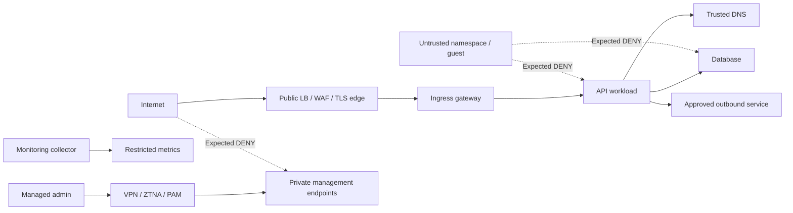
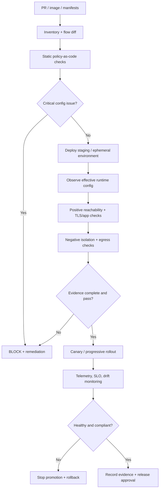

# Kiểm tra container network trước khi phát hành

## Mục tiêu học tập

Sau khi học xong, bạn có thể:

1. Xác định **tiêu chí nghiệm thu bảo mật mạng trước release** cho container và phân biệt kiểm tra khai báo (desired configuration), kiểm tra trạng thái chạy (observed state) và kiểm tra lưu lượng thực (effective enforcement).
2. Lập **ma trận nguồn → đích → giao thức/cổng → mục đích → quyết định allow/deny** cho frontend, API, database, DNS, monitoring, quản trị, external services và control plane.
3. Kiểm tra **Docker/Compose networking**: bridge network, `ports`, `expose`, `network_mode: host`, nhiều networks, IP binding, IPv4/IPv6, daemon socket, firewall và direct routing.
4. Kiểm tra **Kubernetes Service, Ingress/Gateway, NetworkPolicy, CNI, namespace, hostNetwork, NodePort, LoadBalancer** và tính nhất quán với SG/NSG/cloud firewall.
5. Xác minh **DNS, outbound Internet, NAT, egress proxy, TLS/mTLS, service identity, certificate expiry, trust chain và quyền API** ở những điểm đường mạng không thể tự bảo vệ.
6. Thiết kế **preflight, staging, canary, positive/negative reachability tests, rollback** với bằng chứng có thể truy vết và điều kiện dừng phát hành.
7. Viết và đọc **mẫu Compose, Kubernetes YAML, bảng kiểm, bản ghi release evidence và mô hình Python ngoại tuyến**, biết rõ giới hạn của mỗi công cụ.
8. Phân loại kết quả **PASS / BLOCK / WARN / INCONCLUSIVE** mà không nhầm một lần timeout hoặc một file cấu hình hợp lệ là bằng chứng an toàn.

## 1. Vì sao phải kiểm tra container network trước release?

Một ứng dụng container có thể vượt qua unit test, vulnerability scan và CI build, nhưng vẫn gây sự cố ngay khi phát hành:

- Database hoặc Redis vô tình được publish trên interface public.
- Một API chỉ dành cho frontend lại reachable từ guest VLAN, workload khác hoặc một namespace không được phép.
- Security policy khóa ingress nhưng bỏ qua **egress**, khiến container có thể kết nối tùy ý đến Internet.
- Kubernetes NetworkPolicy đã viết nhưng **CNI không thực thi**, selector không match pod nào, hoặc DNS bị chặn làm ứng dụng khởi động thất bại.
- Ingress HTTPS bảo vệ đúng nhưng **NodePort/pod IP/direct route** tạo đường vòng tới backend.
- Rule IPv4 chặt nhưng IPv6 `::/0` hoặc một listener UDP/443 khác vẫn mở.
- Service mesh bật mTLS, song một cổng debug hoặc đường giao tiếp không đi qua sidecar vẫn thiếu bảo vệ.
- Một thay đổi NetworkPolicy làm mất health probes; rollout gây 503 dù code ứng dụng không đổi.
- Firewall policy đã cập nhật trong Git nhưng workload chạy thực tế chưa nhận policy.
- Sự cố được phát hiện muộn, rollback không được thử và logs thiếu dữ liệu chứng minh nguyên nhân.

**Kiểm tra container network trước khi phát hành** là một **security gate** trong quy trình delivery: chỉ đưa bản phát hành qua môi trường tiếp theo khi đường mạng thiết kế đúng, các luồng cần thiết vẫn hoạt động và các đường không được phép đã được kiểm chứng là bị chặn.

Trong module `SECURITY_NETWORK_SECURITY`, chủ đề thuộc chương **Bảo mật mạng container**, kết hợp kiến thức về **phân đoạn, firewall, VPN/ZTNA, IDS/IPS, DNS, TLS/PKI, cloud security và threat modeling**.

> **Nguyên tắc cốt lõi:** “Không thấy kết nối thành công” không tự chứng minh traffic đã bị policy chặn; “file YAML có default deny” không tự chứng minh CNI thực thi; và “ứng dụng HTTP 200” không tự chứng minh TLS, user authorization hay segmentation an toàn.

### 1.1. Release gate phải trả lời những câu hỏi nào?

1. **Ai cần kết nối tới ai?** Danh tính nguồn/đích thật, không chỉ tên container.
2. **Đi qua những điểm nào?** Host, network namespace, bridge, proxy, NAT, cloud VPC, CNI, mesh, load balancer.
3. **Hướng nào được phép?** Ingress và egress đều có quy định.
4. **Giao thức/cổng nào?** TCP, UDP, ICMP/ICMPv6, HTTPS, gRPC, DNS, management.
5. **Danh tính nào được chấp nhận?** Workload identity, TLS server name, client cert, service account, end-user role.
6. **Nếu policy sai thì chuyện gì xảy ra?** Lộ dữ liệu, lateral movement, mất DNS, outage, không nhận telemetry.
7. **Bằng chứng nào xác nhận?** Manifest diff, runtime inventory, effective rules, logs, positive/negative tests, owner approval.
8. **Đâu là điều kiện BLOCK?** Đường public bất ngờ, quyền admin bị mở, rò network giữa tenant, test deny fail, missing evidence ở điểm rủi ro cao.

## 2. Định nghĩa phạm vi và các loại kiểm tra

### 2.1. Ba trạng thái không được đánh đồng

| Trạng thái | Câu hỏi | Ví dụ bằng chứng | Giới hạn |
|---|---|---|---|
| **Declared** | Hệ thống *được định nghĩa* như thế nào? | Compose `ports`, Kubernetes YAML, Terraform, Helm values, policy-as-code | Có thể khác runtime |
| **Observed** | Hiện tại *đang chạy* như thế nào? | `docker inspect`, `kubectl get`, cloud rule inventory, listener/route inventory | Không đảm bảo request thực đi được hay bị chặn |
| **Enforced** | Packet/request *thực sự* được cho phép hoặc từ chối ra sao? | Probe ở đúng source zone, firewall/CNI telemetry, proxy logs, mTLS/auth results | Bị ảnh hưởng health, sampling, timeout, test scope |

**PASS trước release cần bằng chứng phù hợp cả ba lớp** cho những network boundaries quan trọng. Không phải luồng nào cũng đòi packet capture; cần mức kiểm thử cân xứng rủi ro.

### 2.2. Đối tượng của bài kiểm tra

- **Workloads:** containers, pods, sidecars, init containers, jobs và gateway components.
- **Runtime/host:** Docker Engine, containerd/CRI, namespaces, veth, bridge, hostNetwork, port mappings.
- **Orchestrator:** Compose, Kubernetes, CNI, NetworkPolicy, Gateway/Ingress, service discovery.
- **Cloud:** VPC/VNet, SG/NSG/firewall rules, load balancer, NAT, peering, private endpoints.
- **Security services:** DNS, WAF, service mesh, cert manager, identity provider, secrets, egress proxy, monitoring.
- **Nguồn truy cập:** Internet, internal user, guest/BYOD, admin workstation, CI runner, other workload/namespace/tenant, partner/VPN.
- **Dịch vụ đích:** public HTTPS, private API, DB, cache, metrics, admin endpoint, metadata/control plane.

Không cần đánh giá lại toàn bộ bảo mật hệ điều hành hoặc chất lượng code trong bài này; chỉ ghi nhận những phần **ảnh hưởng trực tiếp đến đường mạng và ranh giới truy cập**.

### 2.3. Mẫu sơ đồ cần có trước khi triển khai



Đây là **mô hình logic**, không thay thế bản đồ địa chỉ, route, NAT và chính sách thực. Một reverse proxy L7 tạo phiên tới upstream riêng; cloud LB và container network có thể làm đổi source IP ở từng hop.

## 3. Lập tiêu chí chấp nhận và chủ sở hữu

### 3.1. Đầu vào bắt buộc

Bản phát hành nên xác định ít nhất:

| Đầu vào | Cần ghi |
|---|---|
| Release | Release ID, commit/image digest, environment, thời điểm dự kiến |
| Workload | Image, container/pod, namespace/network, service account, owner |
| Host/cluster | Node/VM, VPC/VNet, zone/region, CNI/network driver version |
| Network intents | Allowed flows + explicitly denied flows, protocol/ports |
| Public exposure | DNS/FQDN, VIP/LB, host published ports, IPv4/IPv6 |
| Private traffic | App→DB, DNS, metrics, mesh control, secrets, artifact registry |
| Management | Admin endpoint, bastion/PAM, CI identity, runtime/daemon/API access |
| Security policy | NetworkPolicy, cloud SG/firewall, gateway/mTLS/auth policy |
| Evidence | Test plan, observed inventory, logs, change approval, rollback |
| Ownership | Service owner, platform/network owner, security reviewer |

**Không có owner** cho một cổng public mới là dấu hiệu cần dừng hoặc đưa vào review, thay vì giả định “cổng do framework tạo ra nên hợp lệ”.

### 3.2. Phân loại mức rủi ro trước khi lập phép thử

| Nhóm | Ví dụ | Mức kiểm soát gợi ý |
|---|---|---|
| **Public edge** | HTTPS do tổ chức chủ động công khai | TLS, WAF/rate, ingress scope, app auth phù hợp |
| **Private application** | API giữa service A và B | Segmentation + service auth + scoped ports |
| **Data tier** | Database, secrets, cache | Không public, allow nguồn cần, auth/crypto, audit |
| **Control/management** | Docker API, Envoy admin, Kubernetes API | Không lộ Internet; IAM/MFA/PAM/UDS và audit |
| **Observability** | Metrics, tracing, health | Read-only collector, không dùng quyền admin |
| **Third-party egress** | Payment, mail, registry | Allow theo endpoint/identity, không tự allow-all |
| **DNS/time/PKI** | DNS resolver, NTP, OCSP/CRL | Cho phép tối thiểu để TLS, startup và logging hoạt động |

Một service admin hoặc data-tier mới được expose rộng thường là **release blocker**, trong khi một thay đổi nhãn metrics không tạo network exposure có thể chỉ cần review bình thường.

## 4. Bắt đầu từ ma trận lưu lượng mong đợi

### 4.1. Mẫu ba tầng

Ví dụ workload:

- `edge`: reverse proxy public HTTPS.
- `api`: API đặt hàng.
- `db`: cơ sở dữ liệu private.
- `observability`: collector chỉ đọc.
- `management`: admin gateway riêng, không trùng public edge.

| Flow ID | Nguồn | Đích | Protocol/port | Quyết định | Lý do |
|---|---|---|---|---|---|
| F01 | Internet | edge | TCP/443 | ALLOW | Giao diện public |
| F02 | edge | api | TCP/8080 | ALLOW | Reverse proxy |
| F03 | api | db | TCP/5432 | ALLOW | Truy vấn DB |
| F04 | api | approved resolver | UDP/TCP 53 | ALLOW | DNS |
| F05 | api | secrets endpoint | TCP/443 | ALLOW | Lấy cấu hình/credential |
| F06 | observability | metrics exporter | TCP/9100 | ALLOW | Thu telemetry |
| F07 | approved admin via ZTNA | management | TCP/443 | ALLOW có điều kiện | Vận hành |
| F08 | Internet | db | TCP/5432 | DENY | DB không public |
| F09 | Internet | management | Bất kỳ | DENY | Admin private |
| F10 | untrusted workload | api | TCP/8080 | DENY | Không cùng trust zone |
| F11 | edge | db | TCP/5432 | DENY | Edge không có quyền DB |
| F12 | api | arbitrary Internet | Bất kỳ | DENY theo policy | Egress least privilege |
| F13 | guest/BYOD | internal metrics | TCP/9100 | DENY | Metrics không public |
| F14 | db | api (new connection) | TCP/8080 | DENY | Không có lý do khởi tạo ngược |

Trong hệ thống thật, bổ sung **DNS labels, namespaces, pod/service identity, network source IP sau NAT, IPv6, TLS name, owner, kiểm thử và log source**.

### 4.2. Ma trận phải chỉ rõ đường phản hồi

Với filter **stateful**, response thuộc connection APP→DB được cho phép có thể không cần rule cho một phiên mới từ DB→APP. Nhưng nếu có **stateless ACL** giữa đường, chiều phản hồi vẫn cần rule tương ứng.

Không ghi `F14 DENY` để chặn mọi packet DB→API, vì như thế có thể vô tình chặn **responses** hợp lệ. Hãy diễn đạt rõ “**DB khởi tạo phiên mới đến API**” và “**DB phản hồi kết nối do API khởi tạo**”.

### 4.3. Đừng chỉ viết “internal” hoặc “trusted”

Một network tên `trusted-net` không tự tạo identity hoặc ACL. Mỗi flow cần nêu **đích thật, nguồn được phép, port, owner và căn cứ**. Nếu source được chọn bằng tag/service account, phải kiểm soát **ai được gán nhãn/tài khoản đó**.

## 5. Threat modeling trước khi chọn công cụ

### 5.1. Các giả định dễ sai

- “Container chưa có `ports` thì không ai gọi được”: peer cùng bridge/pod có thể vẫn kết nối, hoặc có direct routing.
- “Có Kubernetes NetworkPolicy file là đã enforce”: CNI có thể không hỗ trợ hoặc policy không chọn đúng pod.
- “Cùng namespace nên được phép gọi mọi service”: namespace không tự là firewall.
- “Không có public IPv4 nên không exposure”: có thể có IPv6 global, LB, VPN, peering, NodePort hoặc proxy.
- “Chặn cổng 8080 trên host INPUT là đủ”: Docker DNAT/forwarded traffic có thể đi qua hook khác.
- “Đã có mTLS nên không cần egress filtering”: identity authentication và network reachability giải quyết vấn đề khác nhau.
- “Cổng debug khó đoán nên không cần auth”: URL/port obscurity không phải quyền.
- “Cloud SG đã deny nên app network isolation hoàn chỉnh”: traffic nội bộ cùng node/pod hoặc đường khác có thể không đi qua SG theo kỳ vọng.
- “Smoke test trả HTTP 200 là release an toàn”: không thử negative paths, TLS identity hoặc dữ liệu nhạy cảm.

### 5.2. Phân tích tình huống xâm nhập container

Giả sử attacker kiểm soát được một process trong `edge` nhưng **không có quyền Docker/Kubernetes admin**. Hãy hỏi:

1. Process có thể gọi API/DB/metadata/metrics/internal admin nào?
2. Container có nhiều network attachments không?
3. NetworkPolicy nào chọn đúng pod `edge` và egress tương ứng?
4. Cloud/host firewall nhìn source nào sau NAT?
5. Có Docker daemon socket, service account token, secrets hoặc privileged network capability không?
6. Có route đến node IP, host loopback (trong cùng namespace), overlay, VPN hoặc IPv6?
7. Ứng dụng đích có tự kiểm tra service identity và authorization?
8. Egress Internet/approved DNS có được giám sát?

Mục tiêu không phải “đảm bảo không bao giờ bị compromise”, mà là **giảm khả năng lateral movement và exfiltration nếu một workload bị compromise**.

### 5.3. Bảng nguy cơ gắn với release gate

| Sai lệch | Đường tấn công hoặc sự cố | Gate |
|---|---|---|
| Public `db:5432` | Unauthorized DB access | BLOCK |
| App `--network host` không được duyệt | Listener vượt giả định bridge | BLOCK/approve exception |
| Docker socket vào web | Container control plane exposure | BLOCK |
| Cross-tenant allow không hợp lệ | Lateral movement | BLOCK |
| Policy không được CNI enforce | Isolation chỉ nằm trên giấy | BLOCK |
| Egress allow-all ngoài baseline | Exfiltration/C2 path | BLOCK hoặc security exception có hạn |
| DNS bị chặn sau policy mới | Availability failure | BLOCK |
| Monitoring scrape thất bại | Mất phát hiện sự cố | BLOCK nếu là telemetry bắt buộc |
| Một canary trả certificate sai | TLS trust failure | BLOCK |
| Thiếu chứng cứ negative test rủi ro cao | Không xác minh isolation | INCONCLUSIVE → không promote |
| Label không ảnh hưởng rule | Rủi ro nhỏ hơn | WARN/review theo policy |

Giá trị `BLOCK`/`WARN` là **chính sách minh họa**, tổ chức cần xác định severity và exception authority riêng.

## 6. Kiểm tra Docker/Compose trước khi phát hành

### 6.1. Cổng published và giao diện host

Rà soát tất cả:

- Docker CLI `-p`/`--publish`, `-P`/`--publish-all`.
- Dockerfile `EXPOSE` (metadata) và tác động khi dùng `-P`.
- Compose `ports` và `expose`; **`expose` không publish port ra host và không chặn các cổng khác**.
- `HOST_IP:HOST_PORT:CONTAINER_PORT/PROTOCOL` và binding mặc định.
- `0.0.0.0`, `127.0.0.1`, `::`, `::1`, cùng dải IPv6 của host.
- UDP port mapping ngoài TCP, đặc biệt DNS/QUIC/metrics/debug.
- Những Docker Compose overrides/profiles và biến môi trường có thể thay publish.
- Nguy cơ port host trùng với service khác hoặc runtime gán port ngẫu nhiên.

Ví dụ:

```yaml
services:
  edge:
    image: nginx:alpine
    ports:
      - "127.0.0.1:18080:80/tcp"
    networks: [front]

  api:
    image: python:3.12-alpine
    command: ["python", "-m", "http.server", "8080", "--bind", "0.0.0.0"]
    expose:
      - "8080"
    networks: [front, data]

  db-demo:
    image: nginx:alpine
    networks: [data]

networks:
  front:
    driver: bridge
  data:
    driver: bridge
    internal: true
```

**Ví dụ chỉ minh họa network declarations**, không phải hệ thống đã có reverse proxy hay DB thật: `edge` chưa có upstream tới `api`, `db-demo` chỉ đóng vai workload nội bộ. Địa chỉ loopback ở edge thích hợp cho **lab local**, không phải ingress public production.

### 6.2. Cần đọc network mode và attachments

- `bridge`/user-defined bridge.
- `host`: workload có thể trực tiếp dùng namespace host trên platform hỗ trợ; `ports` không tạo publish bridge như bình thường.
- `none`: phù hợp workload không cần mạng, nhưng vẫn cần xem mounts/daemon access.
- `macvlan`/`ipvlan`: địa chỉ và đường vào có thể đi trực tiếp trên LAN/route.
- `overlay`: phạm vi liên host, có thể cần encrypted overlay/policies.
- Rootless Docker/Desktop: VM/user-space port forwarding có thể khác Linux Engine rootful.

**Đặt tên network “private” không tự chặn traffic.** Các container cùng bridge có thể gọi tất cả ports đang listening nếu không có policy khác. Container multi-homed `front+data` là một điểm có thể đi sang data-tier nếu bị compromise.

### 6.3. Quyền runtime và control socket

Rà soát nguy cơ quan trọng hơn một cổng app:

- Bind mount Docker daemon socket (`/var/run/docker.sock`) vào container nhận Internet requests.
- Container `privileged` hoặc capabilities như `NET_ADMIN`/`NET_RAW` không có yêu cầu rõ.
- `pid: host` hoặc `network_mode: host` ngoài phê duyệt.
- Mount host network namespace, host path chứa configs/secrets.
- Remote Docker API không có TLS/auth và giới hạn IP.
- User trong host có quyền Docker không được quản lý/audit.

Trong môi trường rootful, quyền điều khiển Docker daemon có thể rất nhạy cảm với host. **Network isolation của container không bù được quyền quản trị daemon quá rộng.**

### 6.4. Review static chưa đủ

Một file Compose có `ports: []` không bảo đảm host không có:

- Container khác cùng project bị publish.
- Override file khác trong CI.
- Container cũ chưa được dừng.
- Reverse proxy/tunnel thủ công vào container.
- Direct routes đến container prefix.
- Rule cloud/host firewall đổi ngoài IaC.
- Service host-network cùng chức năng.

Kết quả review chỉ là **declared-state PASS**; kiểm tra runtime và external path vẫn cần.

## 7. Kiểm tra Kubernetes workloads và Services

### 7.1. Các thành phần phải có trong manifest inventory

| Đối tượng | Điều cần kiểm |
|---|---|
| **Pod/Deployment/DaemonSet/Job** | Labels, namespace, service account, `hostNetwork`, container ports, sidecars |
| **Service** | Type `ClusterIP`/`NodePort`/`LoadBalancer`, ports/targetPorts, selectors, externalIPs |
| **Ingress/Gateway** | Hostnames, TLS listeners, backends, matching rules, default routes |
| **NetworkPolicy** | Pod selector, policyTypes, ingress/egress rules, namespaceSelectors, ipBlock |
| **CNI / networking implementation** | Có thực thi NetworkPolicy không, limitations/IPv6/host traffic |
| **Service mesh** | Sidecar enrollment, mTLS mode, auth policies, egress gateway và exceptions |
| **Cloud infrastructure** | Node/Pod SG, VPC routes, LB security, firewall/NACL |
| **RBAC/Admission** | Ai sửa Service/Ingress/NetworkPolicy, exec, port-forward, Secrets |

Một `containerPort: 8080` trên PodSpec chủ yếu là **thông tin cấu hình cổng**; nó không tự publish ra Internet hay chặn những cổng khác mà process mở.

### 7.2. ClusterIP không đồng nghĩa “chỉ namespace của mình gọi được”

`ClusterIP` thường phục vụ lưu lượng trong cluster, nhưng phạm vi reachable chịu ảnh hưởng network topology, policies và gateways. Không mặc định:

- Service chỉ nhận request từ pod cùng namespace.
- Một pod ngoài namespace không biết DNS name.
- Client từ VPN/VPC không có route tới endpoint.
- Chỉ cổng khai trong Service mới có thể bị pod peers gọi trực tiếp.

Cần phân biệt **Service VIP** với **Pod IP trực tiếp**, và kiểm tra CNI/network policy có xử lý những đường này đúng không.

### 7.3. NodePort và LoadBalancer

`NodePort` có thể mở đường tới Service qua **node address:nodePort** khi route/cloud firewall và triển khai cho phép. `LoadBalancer` có thể tạo **public hoặc internal load balancer** tùy annotations/provider settings.

Release gate phải xem:

- Service type có thay so với baseline?
- `loadBalancerIP`/annotations hoặc cloud controller có tạo public LB không?
- NodePort trên node nào và source zones nào có route?
- IPv4/IPv6 listeners và health checker sources.
- `externalTrafficPolicy` và source IP preservation có ảnh hưởng network rules?
- LB WAF/TLS có còn bao phủ đường đến backend nếu NodePort direct route được mở?
- Có Service `externalIPs` hoặc hostPort tạo đường ít được chú ý không?

Không suy cứ có NodePort là đã reachable Internet; cũng không suy không có Ingress là không có đường public khác.

### 7.4. hostPort và hostNetwork

Pod có `hostPort` hoặc `hostNetwork: true` có thể tác động trực tiếp listener trên node, tùy CNI/runtime. Điều này khác với Pod trên overlay chỉ có `containerPort`.

Policy của tổ chức nên mặc định **không cho hostNetwork/hostPort ngoài các DaemonSets/gateway được phê duyệt**, kèm điều kiện bắt buộc về host firewall, node role và monitoring.

## 8. NetworkPolicy: đọc đúng semantics trước khi release

### 8.1. Chọn pod để cô lập

Một NetworkPolicy có:

```yaml
apiVersion: networking.k8s.io/v1
kind: NetworkPolicy
metadata:
  name: api-default-deny
  namespace: app
spec:
  podSelector:
    matchLabels:
      app: api
  policyTypes:
    - Ingress
    - Egress
```

Chính sách này mô tả **không có allow rules** cho ingress và egress của các pod `app=api` được chọn, với điều kiện **CNI thực thi NetworkPolicy** và không có chính sách khác cho phép thêm lưu lượng.

Quan trọng:

- NetworkPolicy là **additive allow** trong mô hình Kubernetes tiêu chuẩn: policy khác cũng chọn cùng pod có thể thêm những đường được phép; “default deny” không có nghĩa một policy sau không thể mở lại flow.
- **Ingress isolation và egress isolation độc lập** dựa trên `policyTypes`/ngữ nghĩa lựa chọn.
- Nếu không có policy nào chọn pod theo hướng tương ứng, pod có thể không bị cô lập bởi NetworkPolicy ở hướng đó.
- NetworkPolicy chuẩn không cung cấp authentication user hoặc DNS-domain-based firewall chung.
- CNI implementation và network path như hostNetwork/node/local traffic cần được kiểm tra thực tế.

### 8.2. Namespace labels và selectors phải match đúng

Trong NetworkPolicy:

- `podSelector` trong một `from`/`to` thường chọn pods **cùng namespace của policy** khi dùng riêng.
- `namespaceSelector` chọn namespaces theo labels.
- `podSelector` và `namespaceSelector` **trong cùng một phần tử** thường mang ý nghĩa giao của hai điều kiện.
- Hai phần tử riêng trong danh sách `from`/`to` thường là **hợp** (OR), có thể mở rộng hơn mong đợi.

Ví dụ đúng ý định *chỉ pod ingress gateway trong namespace ingress*:

```yaml
ingress:
  - from:
      - namespaceSelector:
          matchLabels:
            kubernetes.io/metadata.name: ingress
        podSelector:
          matchLabels:
            app: ingress-gateway
    ports:
      - protocol: TCP
        port: 8080
```

Đây chỉ là **đoạn của NetworkPolicy**, không deploy độc lập. Cần xác minh labels thực tế của namespace/pod. Với tổ chức muốn match namespace theo nhãn do chính mình quản trị, sử dụng nhãn ổn định, được bảo vệ khỏi chỉnh sửa trái phép.

### 8.3. Egress và DNS

Nếu bật egress default deny, API thường phải gọi được **DNS resolver được duyệt**. Việc cấu hình cluster DNS tùy nền tảng:

- DNS service có thể chạy ở `kube-system`, với label/deployment khác nhau giữa cụm.
- CoreDNS/kube-dns có thể được truy cập qua **Service IP**, đôi khi có node-local DNS caching.
- CNI policy có thể quan sát địa chỉ trước/sau service DNAT theo triển khai.
- DNS có thể cần **UDP và TCP 53**.
- Một số ứng dụng dùng DNS-over-TLS/HTTPS qua endpoint đã duyệt; NetworkPolicy L3/L4 không tự hiểu query name.

Ví dụ policy review không thể kết luận “DNS được mở” chỉ vì có allow port 53 tới **mọi destination**. Cần chọn đúng resolver/source, tránh tạo egress DNS bypass.

### 8.4. Ingress được phép thường cần egress tương ứng

Để `edge → api TCP/8080` hoạt động:

- Egress policy ở `edge` cần cho phép đi tới `api`.
- Ingress policy ở `api` cần cho phép từ `edge`.
- Routing/Service/CNI và cloud firewall/host policy cũng phải cho traffic phù hợp.
- Response của kết nối được phép được xử lý theo ngữ nghĩa stateful liên quan; không tạo rule mở kết nối mới ngược hướng một cách tùy tiện.

Không quy lỗi mọi timeout cho một selector; kiểm tra từng lớp và dùng telemetry.

## 9. Service mesh: mTLS không tự cho phép release

### 9.1. Những tín hiệu cần xác minh

- Workload có thực sự **được enroll vào mesh/sidecar/ambient data plane** không?
- **mTLS strict/permissive/disabled** được áp ở đâu; có đường bypass sidecar/gateway?
- Certificate của client/server có đúng **service identity, SAN/URI SAN, trust bundle, validity**?
- AuthorizationPolicy có thực thi **source principal → destination → action** không?
- Gateway egress/ingress có route đúng; HTTP/2/gRPC có giữ header/authority và mTLS identity?
- Metrics/logs có phân biệt **TLS handshake failure, policy deny, application 401/403 và network timeout**?
- Client không thuộc mesh có đường direct tới pod/service khi L3/L4 policy quá rộng không?

**mTLS không đồng nghĩa mọi service được phép gọi lẫn nhau**, cũng không thay quota, rate limit, API-level authorization hay network segmentation.

### 9.2. “Zero Trust” cần hai hướng

NetworkPolicy giảm số workload có thể reach một listener; service identity và authorization kiểm soát **ai đang gọi và được làm gì**. Một release gate đáng tin cần xác minh cả hai, không chỉ “TLS handshake succeeds”.

Nếu identity control plane hoặc trust bundle lỗi, traffic hợp lệ có thể bị từ chối. Kịch bản mất CA/renewal nên có **monitoring, runbook và không tự tắt mTLS để khôi phục mà bỏ qua đánh giá rủi ro**.

## 10. Kiểm tra ingress, reverse proxy và quản trị

### 10.1. Chỉ một điểm vào công cộng có chủ đích

Thiết kế thường là:

```text
Internet
  -> public LB / WAF / TLS edge
  -> ingress gateway
  -> application Service/Pod
  -> database (private)

Admin (managed workstation)
  -> ZTNA/VPN + MFA + PAM
  -> management service

Monitoring collector
  -> private metrics endpoint
```

Gate cần bảo đảm:

- Chỉ đúng hostnames/routes/ports được phê duyệt là public.
- TLS certificate khớp tên, không hết hạn; HTTP→HTTPS policy đúng.
- Không có default vhost/`Host`/`:authority`/SNI misrouting tới admin hoặc tenant khác.
- Không có alternate `NodePort`, `hostPort`, Docker `-p` hoặc internal LB public ngoài dự kiến.
- Reverse proxy không tin `X-Forwarded-For`/`Forwarded` do client tự khai khi quyết định quyền.
- Health/metrics endpoints được phân biệt với admin mutation/control APIs.
- Rate/DoS controls và request size/timeouts được kiểm tra theo yêu cầu vận hành.

### 10.2. Admin endpoints không phải một route ứng dụng bình thường

Những bề mặt như **Envoy admin, HAProxy Runtime API, Traefik dashboard/API, Nginx status, Docker API, Kubernetes API và cloud LB console** có khả năng chứa topology hoặc thao tác control plane.

Không đưa admin listener ra public chỉ vì “đã có path dài và password”. Hãy có **management network riêng, identity mạnh, authorization, PAM/JIT, audit và OS/socket ACL**. Monitoring chỉ cần quyền đọc dữ liệu tối thiểu.

### 10.3. Phân biệt app admin với proxy admin

`/admin` của ứng dụng nghiệp vụ và control API của proxy có thể cùng tên “admin” nhưng khác đặc quyền. Test phải chỉ rõ **endpoint nào, owner nào, role nào và phép deny nào**; không lấy 403 ở app admin làm bằng chứng Envoy admin listener đã bị chặn.

## 11. Egress: một nửa release gate thường bị bỏ quên

### 11.1. Egress cần đi đâu?

Nguồn egress hợp lệ có thể gồm:

- DNS resolver/NodeLocal DNS cache.
- Time sync khi workload/host cần.
- Secret management, cloud identity/token endpoint theo kiến trúc.
- API đối tác có FQDN hoặc IP/endpoint danh sách duyệt.
- Container registry/artifact repository (thường do **node runtime pull** image, khác pod egress).
- Telemetry collector và log/traces.
- Certificate status/trust distribution hoặc service mesh control plane.
- Database/private service đúng cổng.

**Không mở TCP/443 đến mọi Internet chỉ vì cần gọi một API HTTPS.** L3/L4 NetworkPolicy/SG theo IP không tự phân biệt tên miền/URL; dùng egress proxy, DNS firewall, cloud L7 firewall hoặc application allowlist nếu yêu cầu theo domain.

### 11.2. Tránh egress bị vô hiệu hóa nhầm

Trước khi chuyển egress thành default deny:

1. Đo workload dependencies có quyền quan sát; phân biệt đường startup và đường chạy thường ngày.
2. Kiểm tra DNS UDP/TCP 53, secrets, identity, telemetry, DB, CA status.
3. Xác định NAT/public/egress gateway và source IP ở điểm firewall.
4. Áp staged rule trên canary; kiểm tra app startup, refresh token, renewal cert, retry paths.
5. Cố gắng phủ cả IPv4/IPv6 và những nguồn như hostNetwork/sidecars.
6. Không bỏ qua traffic đã established sau khi policy mới áp: kiểm tra new connection, timeouts và route thật.

### 11.3. SSRF và metadata endpoint

Ứng dụng có chức năng fetch URL do người dùng nhập có thể bị lợi dụng để truy cập private endpoints/loopback/link-local hoặc metadata service nếu route cho phép.

Pre-release checks:

- URL fetcher có **destination allowlist, chống chuyển hướng tới địa chỉ nội bộ và giới hạn protocol/method** theo thiết kế.
- Egress đến host/control plane/metadata được hạn chế bằng các cơ chế **provider-specific** phù hợp.
- Workload không giữ cloud credentials quá rộng; áp IAM/workload identity least privilege.
- Không chỉ dựa vào rule chặn RFC1918; còn IPv6, link-local, loopback, DNS rebinding và mạng overlay.
- Không dùng kiểm thử SSRF trên hệ ngoài phạm vi; với lab, chỉ kiểm tra deny policy và mô phỏng an toàn.

## 12. DNS và service discovery trong nghiệm thu

### 12.1. DNS thành công không chứng minh traffic đã được phép

Một container có thể resolve `db.internal.test` thành IP đúng nhưng TCP/5432 vẫn bị chặn ở NetworkPolicy, cloud SG hoặc host firewall. Ngược lại, TCP kết nối tới IP được phép nhưng TLS server certificate không đúng hostname.

Kiểm tra **theo lớp**:

```text
Name resolution (DNS A/AAAA / internal service DNS)
    ↓
Routing / Service discovery / endpoint selection
    ↓
L3/L4 filtering + stateful return traffic
    ↓
TCP/UDP connection
    ↓
TLS/mTLS certificate + identity verification
    ↓
HTTP/gRPC/DB authentication and authorization
```

### 12.2. Docker và Kubernetes DNS khác nhau

- Docker user-defined bridge thường hỗ trợ **embedded DNS** cho tên container/service.
- Docker default bridge có ngữ nghĩa name discovery khác; không tự giả định giống user-defined bridge.
- Kubernetes Service DNS thường dựa vào CoreDNS/kube-dns và conventions namespace.
- DNS chính sách egress ở CNI có thể nhìn destination service/pod khác theo implementation.
- DNS caching/negative caching làm thay đổi kết quả ngay sau rollout.
- IPv6 AAAA query và dual-stack Service có thể chọn đường khác IPv4.

Dùng **tên dịch vụ và expected IP family** trong test evidence; không cố định IP pod thay đổi qua rollout.

### 12.3. Không để DNS trở thành bypass

Một rule “allow UDP/53 tới mọi đích” có thể tạo đường DNS không được giám sát hoặc ảnh hưởng đến tổ chức muốn dùng resolver bắt buộc. Khi cần **DNS security**, chỉ cho phép tới approved resolvers, logging/response policy phù hợp và phân quyền egress; nhưng tính khả dụng của cluster DNS phải được giữ.

## 13. IPv4, IPv6, UDP và HTTP/3

### 13.1. Dual-stack là hai bộ đường mạng cần kiểm tra

Nếu một pod/host có cả IPv4 và IPv6, cùng một hostname có thể trả bản ghi A và AAAA. Một policy chỉ review `0.0.0.0/0` chưa bao quát `::/0`.

Gate nên nêu:

- Địa chỉ IPv4/IPv6 thực tế của node, pod, service, load balancer.
- IPv4 và IPv6 ingress/egress deny rules.
- Host bindings `127.0.0.1`/`0.0.0.0` và `::1`/`::`.
- NetworkPolicy/CNI và cloud firewall có hỗ trợ IPv6 tương ứng không.
- ICMPv6 cần cho PMTUD/Neighbor Discovery theo nền tảng; không cấm tất cả.
- Telemetry/flow logs và negative tests qua cả hai family.

### 13.2. TCP/443 và UDP/443 khác nhau

HTTP/3 chạy qua QUIC/UDP trong khi HTTPS truyền thống thường qua TCP. Nếu edge hỗ trợ cả hai, cần:

- Listener/firewall rules cho **TCP và UDP** nếu mở cả hai.
- TLS/authority/routing policy tương đương tại ingress HTTP/3-aware.
- Không suy TCP SYN probe đại diện UDP reachability.
- Không coi parser TLS-over-TCP là công cụ giám sát đầy đủ QUIC.
- Có đường fallback/giới hạn protocol được phê duyệt khi hạ tầng chưa hỗ trợ HTTP/3.

### 13.3. IPv6 direct route và bypass host publish

Một Docker bridge có network/gateway mode cho direct routing hoặc pod có địa chỉ reachable qua overlay/VPC có thể truy cập **không đi qua host published port** như đường thông thường.

**Không có `ports` trên Docker hay không có public Ingress trong Kubernetes chưa đủ**. Hãy tìm mọi route đến container/pod IP, node IP, Service VIP và alternate LB.

## 14. Host firewall, cloud policy và NAT phải được xem cùng nhau

### 14.1. Trình tự logic, không phải một thứ tự cố định

```text
External source
   -> public IP / VPN / private network
   -> cloud SG/NSG/firewall, route, NAT, LB (nếu có)
   -> host network namespace
   -> Docker netfilter / CNI service path
   -> container or pod network namespace
   -> process listener / mesh
   -> application
```

Một số bước có thể thay vị trí hoặc không có tùy mode: Docker Desktop dùng VM, rootless có user-space forwarder, Kubernetes Service có DNAT/eBPF processing, L7 proxy tạo session mới.

### 14.2. Netfilter Docker và UFW

Trong Linux Engine với iptables backend, traffic published port có thể bị DNAT và qua **FORWARD**, không chỉ `INPUT`. Rule UFW/host firewall chỉ xem INPUT có thể bỏ sót đường published traffic.

Trong môi trường phù hợp, `DOCKER-USER` là hook để áp filtering trên forwarded traffic; nhưng **nftables backend, rootless, Desktop và gateway modes có khác biệt**. Không viết quy tắc dựa trên tên chain mà không xác minh backend thực.

### 14.3. Conntrack, established sessions và policy rollback

Stateful filtering có thể chấp nhận reply của kết nối được phép. Khi cập nhật rule, tác động lên các kết nối đã được tracking **phụ thuộc engine/provider**; không mặc định một lệnh “remove allow” chấm dứt mọi session hiện tại.

Gate cần:

- Test **new connections** khi thay policy.
- Test idle timeouts/long-lived gRPC/WebSocket/DB pool khi quan trọng.
- Xem NAT/LB/conntrack capacity hoặc asymmetric routing trong hệ nhiều node.
- Có kế hoạch terminate session tại điểm phù hợp nếu phát hiện compromise.
- Không coi rollback thành công khi rule mới đã quay lại nhưng service vẫn có connection pool lỗi.

## 15. Kiểm tra TLS, mTLS và danh tính mạng

### 15.1. Những mục cần xác minh

- Public ingress phục vụ certificate đúng FQDN/`SAN`, issuer, validity và chain.
- Client vẫn bật **hostname verification** và truststore đúng, không dùng `--insecure`.
- mTLS workloads có cert client/server phù hợp EKU/trust, renewal, authorization.
- Egress proxy và backend TLS dùng **upstream certificate verification**; TLS termination ở edge không tự bảo vệ hop edge→backend.
- Certificate/secret rotation có kế hoạch và không làm mất service access.
- QUIC/HTTP3 và SNI/HTTP Host/`:authority` được route đúng origin; không có đường vào admin.
- Logs ghi nhận lỗi handshake và quyết định policy mà không ghi private key hoặc token.

### 15.2. Network allow khác authorization

Khi `api → db TCP/5432` được network allow, database vẫn phải kiểm tra **identity, credentials, RBAC và quyền dữ liệu**. Khi mTLS thành công, một workload có certificate hợp lệ chưa chắc được gọi mọi phương thức API.

**Nghiệm thu phải có ít nhất một test “network reachable, ứng dụng từ chối role không hợp lệ”** cho resource nhạy cảm, để tránh nhầm segmentation thành authorization.

## 16. Quy trình release gate từ khai báo đến thực thi

### 16.1. Sơ đồ pipeline



Mục đích là **fail closed đối với rủi ro nghiêm trọng**, nhưng **không phá sản xuất vì một phép thử thiếu chứng cứ**: với INCONCLUSIVE, giữ trạng thái ở staging/canary, điều tra nguồn lỗi rồi quyết định theo quyền release owner.

### 16.2. Các phase và output

| Phase | Công việc | Artifact/bằng chứng |
|---|---|---|
| **Design** | Flow matrix, threat model, owners | Approved network intent |
| **Static** | Lint IaC/Compose/K8s và policy checks | CI report + ruleset version |
| **Deploy staging** | Apply bản candidate vào scope được phép | Deployment revision/digest |
| **Observed inventory** | Lấy listener, Service/Ingress, SG, policy attachments | Runtime snapshot |
| **Positive tests** | Kết nối đúng flow, DNS/TLS/auth và health | Test results + timestamps |
| **Negative tests** | Chặn Internet→DB, cross-namespace, admin, egress lạ | PEP/probe evidence |
| **Canary** | Mở lưu lượng hạn chế, quan sát connection reuse | SLO, error metrics, audit |
| **Promotion** | Chỉ khi blocker cleared | Sign-off + evidence references |
| **Post-release** | Drift/reachability regression, incident readiness | Monitor alert thresholds |

**Không bắt buộc mọi hệ có công cụ giống nhau**. Release gate mô tả kết quả cần xác minh, sau đó chọn tool theo Docker, Kubernetes, cloud và CNI thực tế.

## 17. Static preflight: kiểm tra IaC và manifests trước deploy

### 17.1. Các dấu hiệu cấu hình cần phát hiện tự động

| Loại | Điều kiện phát hiện | Hành động |
|---|---|---|
| **Docker publish** | `0.0.0.0`/`::` hoặc host IP ngoài allowlist trên port nhạy cảm | BLOCK hoặc yêu cầu phê duyệt public ingress |
| **Docker publish-all** | `-P`/`--publish-all` ở release không được duyệt | BLOCK |
| **Host network** | `network_mode: host` hoặc `hostNetwork: true` | BLOCK nếu không thuộc nhóm ngoại lệ |
| **Privileged** | `privileged: true`, network capabilities quá rộng | BLOCK nếu thiếu lý do và owner |
| **Docker socket** | Mount daemon socket vào Internet-facing container | BLOCK |
| **Database expose** | DB/cache/admin host published port | BLOCK trừ use case được duyệt riêng |
| **K8s Service** | `type: LoadBalancer`/`NodePort` mới, `externalIPs`, `hostPort` | Review/Block theo policy |
| **Ingress/Gateway** | Public listener mới hoặc default route tới management | BLOCK |
| **NetworkPolicy** | Không có ingress/egress isolation cần thiết | BLOCK nếu policy bắt buộc |
| **Policy selectors** | Namespace/pod selector rộng hoặc không match thực tế | BLOCK hoặc INCONCLUSIVE cho tới khi xác minh |
| **Egress** | Allow-all ngoài danh sách dịch vụ được phép | BLOCK/exception có hạn |
| **IPv6** | Public IPv6 chưa được đưa vào bộ rule/test | BLOCK cho release dual-stack quan trọng |
| **Mesh** | Workload nhạy cảm chạy ở chế độ permissive ngoài phê duyệt | BLOCK |
| **IAM/RBAC** | Workload có quyền thay Service/NetworkPolicy không cần thiết | BLOCK |
| **Secrets** | Token/API key hoặc private key xuất hiện trong manifest/log | BLOCK và xử lý secret theo quy trình |

**“Image không có `EXPOSE`” không phải kiểm soát bảo mật.** Container process có thể mở cổng dù không khai metadata. Static checks phải kết hợp thực tế network deployment và runtime listener.

### 17.2. Kiểm tra manifest đã render, không chỉ template

Helm/Kustomize/Compose có **values, overlays, profiles và defaults** làm bản release khác tệp nguồn đơn lẻ. Kiểm tra nên chạy trên **manifest/rendered config thực dùng để deploy**.

Ví dụ các lệnh quan sát/chuẩn hóa trong **môi trường được cấp quyền**:

```bash
# Docker Compose: hiển thị cấu hình được Compose diễn giải.
docker compose -f ./compose.release.yaml config

# Kustomize: render YAML, không apply.
kubectl kustomize ./overlays/staging

# Helm: render chart/values, không install.
helm template release-demo ./chart \
  --namespace app \
  --values ./values.staging.yaml
```

Lưu ý:

- Các lệnh có thể in **biến môi trường/secret values** nếu template chứa chúng. Chỉ chạy trong pipeline có bảo vệ, redact output và không đưa raw results lên public artifact.
- `helm template` không xác nhận admission controller/CNI/cloud integrations thực thi.
- `kubectl kustomize` chỉ render; không làm thay đổi cluster.
- Pipeline phải ghi **config revision và hash** của artifact được kiểm tra, tránh thay manifest sau khi gate PASS.

### 17.3. Policy-as-code có thể tự động chặn sai lệch

Có thể dùng **OPA/Conftest, Gatekeeper, Kyverno hoặc CI lint custom** theo môi trường phù hợp. Chúng hỗ trợ chính sách như:

- Không cho `LoadBalancer` public trong namespace `data`.
- Chỉ namespace `ingress` được khai báo internet-facing listener.
- Không cho `hostNetwork` ngoại trừ DaemonSets thuộc owner được phê duyệt.
- Bắt buộc chủ sở hữu và expiry cho network exceptions.
- NetworkPolicy hoặc chính sách tương đương phải tồn tại cho workloads nhạy cảm.
- Cấm egress toàn Internet mặc định nếu không thuộc allowlist.

**Admission PASS chỉ nói manifest phù hợp rule được viết.** Nếu policy engine thiếu rule, CNI không thực thi hoặc rule đã drift, hệ thống vẫn có thể lộ. Vì vậy cần quan sát runtime và test đường mạng.

## 18. Bản kiểm tra NetworkPolicy hoàn chỉnh để học

### 18.1. Giả định topology

- Namespace `app` chứa Pod label `app: api`.
- Namespace `ingress` chứa Pod label `app: ingress-gateway`.
- Namespace `data` chứa Pod label `app: db`.
- DNS Pods của cluster có thể thuộc namespace `kube-system` và label `k8s-app: kube-dns` **trong một số cụm**, nhưng điều này phải được xác minh.
- API chỉ cần nhận TCP/8080 từ ingress gateway; outbound đến DB TCP/5432 và DNS UDP/TCP 53.
- CNI thực thi NetworkPolicy chuẩn với những đường test trong lab.

### 18.2. Mẫu NetworkPolicy

```yaml
# Ví dụ cho lab, CHỈ áp khi namespaces/pod labels đã được kiểm chứng.
apiVersion: networking.k8s.io/v1
kind: NetworkPolicy
metadata:
  name: api-network-allow-required
  namespace: app
spec:
  podSelector:
    matchLabels:
      app: api
  policyTypes:
    - Ingress
    - Egress
  ingress:
    - from:
        - namespaceSelector:
            matchLabels:
              kubernetes.io/metadata.name: ingress
          podSelector:
            matchLabels:
              app: ingress-gateway
      ports:
        - protocol: TCP
          port: 8080
  egress:
    - to:
        - namespaceSelector:
            matchLabels:
              kubernetes.io/metadata.name: data
          podSelector:
            matchLabels:
              app: db
      ports:
        - protocol: TCP
          port: 5432
    - to:
        - namespaceSelector:
            matchLabels:
              kubernetes.io/metadata.name: kube-system
          podSelector:
            matchLabels:
              k8s-app: kube-dns
      ports:
        - protocol: UDP
          port: 53
        - protocol: TCP
          port: 53
```

### 18.3. Điều gì được và chưa được đảm bảo?

Nếu các giả định đúng, policy nhằm:

- Chỉ cho **ingress gateway Pods đúng namespace và label** gọi API TCP/8080.
- Cho API đi tới DB Pods đúng namespace/label trên TCP/5432.
- Cho API gọi những DNS Pods đã chọn ở UDP/TCP 53.
- Cô lập các ingress/egress không nằm trong allow rules **của policy này** theo ngữ nghĩa additive.

Nhưng:

1. **Một NetworkPolicy khác** chọn cùng API Pods có thể **cho phép thêm** các flow khác.
2. Traffic từ **node, hostNetwork, kubelet hoặc dịch vụ hạ tầng** có thể mang ngữ nghĩa đặc biệt tùy CNI.
3. Nếu ingress source thực đến từ LB/node IP, selector Pods ingress có thể không match; cần kiểm tra đường thực.
4. DNS Pods không mang label `k8s-app: kube-dns` hoặc dùng NodeLocal DNSCache sẽ cần rule khác.
5. Nếu API cần secrets/cloud metadata/control plane, egress cần được thiết kế thêm, không dùng allow-all để chữa.
6. NetworkPolicy không kiểm tra **HTTP method/path, DNS name hoặc DB user authorization**.
7. Policy không trực tiếp bảo đảm DB chỉ chấp nhận APP; **DB ingress và những nguồn khác cũng cần kiểm soát**.
8. Mọi namespace/pod labels phải được kiểm tra sau rollout; selector đúng cú pháp nhưng match **0 pod** có thể tạo outage.

**Đừng copy policy này vào production mà không có ma trận traffic và smoke/negative tests**.

## 19. Kiểm tra trạng thái runtime an toàn, chỉ đọc

### 19.1. Docker/Compose

```bash
# Chạy trên host lab hoặc môi trường được phép. Chỉ đọc trạng thái.
docker ps --format "table {{.Names}}\t{{.Ports}}\t{{.Networks}}"

# Kiểm tra port publish và network mode một container cụ thể.
docker port CONTAINER_NAME
docker inspect --format \
  '{{.HostConfig.NetworkMode}} {{json .HostConfig.PortBindings}}' \
  CONTAINER_NAME

# Xem attached containers, network driver/subnet/gateway.
docker network inspect NETWORK_NAME

# Khi sử dụng Compose, quan sát config đã render.
docker compose -f ./compose.release.yaml config
```

Cần đối chiếu **mọi container instance**, nhất là instance cũ hoặc những container ngoài stack có tên gần giống. Không cần đọc `Config.Env` chứa secret để xác minh network exposure; hạn chế phạm vi thông tin.

### 19.2. Kubernetes

```bash
# Các lệnh read-only trong namespace mà bạn có quyền.
kubectl get pods -n app -o wide
kubectl get services -n app -o wide
kubectl get ingress -n app
kubectl get networkpolicy -n app
kubectl describe networkpolicy api-network-allow-required -n app

# Đọc endpoints đã resolve cho Service:
kubectl get endpointslices -n app \
  -l kubernetes.io/service-name=api

# Xác minh quyền API đang dùng, không thử port-forward thực:
kubectl auth can-i create pods/portforward -n app
```

Ngoài ra cần xem **Ingress/Gateway ở namespace liên quan**, network policies của source Pods, CNI capabilities, cloud LB/SG và admission policy.

Không giả định output `kubectl describe` bằng chứng enforcement. Một policy được API server chấp nhận **không đồng nghĩa packet đã bị CNI chặn**.

### 19.3. Host Linux và cloud

```bash
# Read-only trên máy lab được cấp quyền.
ip route
ip -6 route
ss -lnt
ss -lnu

# Nếu firewall backend phù hợp; cần quyền đọc rules.
sudo iptables -S
sudo iptables -t nat -S
sudo nft list ruleset
```

Không chạy `iptables -F`, đổi `ip_forward`, stop Docker hoặc tắt firewall để chẩn đoán. Với cloud, kiểm tra SG/NSG/effective rules bằng công cụ/role đọc phù hợp; không mở `0.0.0.0/0` chỉ để xem app có “hết timeout” không.

### 19.4. Runtime snapshots có thể chứa dữ liệu nhạy cảm

Các lệnh inventory đôi khi in network aliases, internal IP, môi trường và metadata. Artifact evidence cần:

- Redact tokens, cookies, private keys, cloud account secrets.
- Hạn chế access theo owner/reviewer.
- Ghi version, UTC timestamp và scope của snapshot.
- Tránh đưa toàn bộ `kubectl get secret -o yaml` hoặc `docker inspect` vào logs công khai.

## 20. Kiểm thử động: positive path và negative path

### 20.1. Phép thử phải xuất phát từ đúng vị trí

Một kết nối từ **cluster node** tới PodIP không thể thay thế kiểm thử từ **untrusted namespace Pod**. NetworkPolicy có thể xử lý node traffic khác pod traffic; cloud SG cũng thấy source IP khác khi NAT.

Nguồn test có thể gồm:

- Một **synthetic client trong namespace ingress** được phép.
- Một **client trong untrusted namespace** bị cấm.
- Một **client từ Internet/LAN test** qua public ingress.
- **Managed admin** qua ZTNA/PAM.
- **Monitoring collector** đúng service identity.
- **Workload APP** cần DB/DNS/egress hợp lệ.
- Một **client IPv6** hoặc UDP khi service có liên quan.

Phải có **authorization** để tạo probe client và kết nối đến các endpoint này; tránh dùng production secrets trong môi trường test.

### 20.2. Kiểm tra kết nối đúng mục tiêu

Ở lab hoặc staging có quyền:

```bash
# Chỉ kiểm tra đúng các endpoints lab đã được thiết lập.
curl --connect-timeout 3 --max-time 8 \
  --cacert ./lab-ca.pem \
  https://api.lab.example.test/health

# Ví dụ kiểm tra một TCP listener cụ thể do nhóm sở hữu:
nc -vz -w 3 198.51.100.30 5432
```

Hai lệnh không có nhiệm vụ như nhau:

- `curl` qua HTTPS có thể xác minh **TLS hostname/CA** và kết quả HTTP.
- `nc` kết nối TCP chỉ xác minh tầng transport/listener; **không chứng minh mTLS, DB auth hay quyền dữ liệu**.
- Các hostname/IP ví dụ là dữ liệu minh họa, **không mặc định tồn tại**. Không chạy với hệ không thuộc quyền quản lý.

### 20.3. Test deny cần bằng chứng ở điểm thực thi

Một negative test tốt ghi:

```text
Test ID: NEG-DB-001
Source identity / namespace: untrusted/ns-b
Source pod/node: synthetic-client-b (được cấp phép)
Destination: db/data TCP/5432
Expected: DENY NEW CONNECTION
Observed: TCP timeout + CNI deny telemetry
Destination health: PASS từ authorized API source
Policy revision: policy-commit-abc123
Timestamp: UTC
Decision: PASS
```

Nếu chỉ có **timeout** mà không biết đích đang healthy hoặc CNI có log, kết luận nên là **INCONCLUSIVE**, không phải PASS.

### 20.4. Positive test cũng phải được phân lớp

Khi API→DB được phép:

1. Resolve được tên DB qua DNS phù hợp.
2. Có route đến endpoint dự kiến.
3. TCP connection thành công.
4. TLS server được xác minh nếu policy yêu cầu.
5. Database user có đúng quyền tối thiểu.
6. Một user sai quyền bị DB từ chối dù network reachable.
7. Logs/metrics được cập nhật.
8. App vẫn đáp ứng SLO khi chính sách mới áp.

**Network allow = ứng dụng đang reachable**, không chứng minh application authorization luôn đúng.

## 21. Bằng chứng, phân loại kết quả và điều kiện chặn

### 21.1. Bốn trạng thái nên dùng

| Trạng thái | Ý nghĩa | Có được promote? |
|---|---|---|
| **PASS** | Rule và runtime đúng ý định; tests cần thiết có bằng chứng | Có thể, nếu không còn blocker khác |
| **WARN** | Rủi ro chấp nhận được theo policy, có owner và action | Theo chính sách/approval |
| **BLOCK** | Sai lệch nghiêm trọng, exposure hoặc test deny thất bại | Không |
| **INCONCLUSIVE** | Thiếu bằng chứng, test environment hỏng hoặc không thể quy kết | Không tự coi là PASS; giữ lại để điều tra |

Một exception được duyệt **không tự biến một lỗ hổng thành “PASS không điều kiện”**. Nó cần owner, lý do, điều kiện bù, thời hạn và bằng chứng phê duyệt.

### 21.2. Chính sách phát hành mẫu

```yaml
# PSEUDOCODE: không phải GitHub Actions/Kyverno/OPA config chạy trực tiếp.
release_gate: container-network-v1
required:
  - rendered_manifest_review
  - runtime_listener_inventory
  - network_policy_enforcement_verified
  - public_port_allowlist_match
  - ipv4_ipv6_coverage_when_enabled
  - ingress_positive_tests
  - ingress_negative_tests
  - dns_egress_positive_tests
  - egress_negative_tests
  - tls_identity_validation
  - telemetry_available
  - rollback_plan_reviewed

block_on:
  - unapproved_admin_or_data_port_exposure
  - docker_daemon_socket_to_untrusted_workload
  - unauthorized_cross_tenant_network_path
  - missing_isolation_for_sensitive_workload
  - unapproved_internet_egress
  - invalid_tls_identity
  - failed_required_health_or_negative_test
  - missing_high_risk_evidence

exception_policy:
  require_owner: true
  require_approver: true
  require_compensating_controls: true
  require_expiry_utc: true
  require_audit_link: true
```

Cấu hình trên là **đặc tả mục tiêu**, không có tool nào tự hiểu các khóa này nếu chưa được tích hợp. Một CI pipeline thực phải mapping rule tới scanner, kube admission, cloud APIs, test harness và report formatter.

### 21.3. Release evidence record

```json
{
  "release_id": "container-net-lab-r014",
  "candidate_digest": "sha256:EXAMPLE_ONLY",
  "environment": "staging-lab",
  "recorded_at": "2026-11-28T12:00:00Z",
  "service": "order-api",
  "runtime": "kubernetes",
  "network_policy_revision": "policy-abc123",
  "manifest_revision": "manifest-def456",
  "expected_public_ports": ["tcp/443"],
  "observed_public_ports": ["tcp/443"],
  "required_tests": 12,
  "passed_tests": 11,
  "failed_tests": 0,
  "inconclusive_tests": 1,
  "critical_findings": 0,
  "decision": "INCONCLUSIVE",
  "approved_to_promote": false,
  "owner": "platform-security",
  "evidence_locations": ["private-artifact-store/test-report-014"]
}
```

Lưu ý: dù `failed_tests=0`, một required test là **INCONCLUSIVE**, nên **không tự động promote**. `candidate_digest` chỉ minh họa, không phải image digest hợp lệ.

### 21.4. Không để exception trở thành đường tắt vĩnh viễn

Một exception cần ít nhất: resource, lý do, owner, approver, mức rủi ro, kiểm soát bù, ngày hết hạn, nguồn telemetry và test xác minh. Exception cho public debug port không nên được chấp nhận chỉ vì “đã chạy staging lâu rồi”.

## 22. Lab Python ngoại tuyến: chấm điểm một release candidate

Lab chỉ xử lý **dữ liệu cố định trong bộ nhớ**, không đọc secrets, không mở socket, không gọi Kubernetes/Docker/cloud APIs và không chạy lệnh triển khai.

### 22.1. Chính sách giả định

Một release candidate bị chặn nếu:

- Có published port không thuộc danh sách đã phê duyệt.
- Có Docker daemon socket mount vào workload không tin cậy.
- Dùng host network khi chưa được phê duyệt.
- Workload thuộc nhóm nhạy cảm cần policy nhưng chưa có bằng chứng **policy thực thi**.
- Một negative test bắt buộc FAIL hoặc INCONCLUSIVE.
- Kiểm thử TLS identity bắt buộc không PASS.

Trong mô hình, mọi input đã được một bước thu thập có quyền cung cấp. Production cần **không tin các trường do container/client tự khai**.

### 22.2. Python minh họa hoàn chỉnh

```python
from dataclasses import dataclass
from typing import Tuple

Port = Tuple[str, int, str]  # host_ip, host_port, protocol

@dataclass(frozen=True)
class Candidate:
    name: str
    published: Tuple[Port, ...]
    approved: Tuple[Port, ...]
    docker_socket_mounted: bool
    host_network: bool
    host_network_approved: bool
    sensitive_workload: bool
    network_policy_enforced: bool
    negative_test: str
    tls_test_required: bool
    tls_test: str

def review(candidate):
    findings = []

    approved = set(candidate.approved)
    for port in candidate.published:
        if port not in approved:
            findings.append("UNAPPROVED_PUBLISHED_PORT")

    if candidate.docker_socket_mounted:
        findings.append("DOCKER_SOCKET_EXPOSED")

    if candidate.host_network and not candidate.host_network_approved:
        findings.append("UNAPPROVED_HOST_NETWORK")

    if (candidate.sensitive_workload
            and not candidate.network_policy_enforced):
        findings.append("POLICY_ENFORCEMENT_NOT_VERIFIED")

    if candidate.negative_test != "PASS":
        findings.append("NEGATIVE_TEST_" + candidate.negative_test)

    if candidate.tls_test_required and candidate.tls_test != "PASS":
        findings.append("TLS_TEST_" + candidate.tls_test)

    if findings:
        return "BLOCK", sorted(set(findings))
    return "PASS", []

approved_edge = Candidate(
    name="edge",
    published=(("0.0.0.0", 443, "tcp"),),
    approved=(("0.0.0.0", 443, "tcp"),),
    docker_socket_mounted=False,
    host_network=False,
    host_network_approved=False,
    sensitive_workload=True,
    network_policy_enforced=True,
    negative_test="PASS",
    tls_test_required=True,
    tls_test="PASS",
)

private_database = Candidate(
    name="db",
    published=(),
    approved=(),
    docker_socket_mounted=False,
    host_network=False,
    host_network_approved=False,
    sensitive_workload=True,
    network_policy_enforced=True,
    negative_test="PASS",
    tls_test_required=False,
    tls_test="NOT_APPLICABLE",
)

bad_database = Candidate(
    name="db-public",
    published=(("0.0.0.0", 5432, "tcp"),),
    approved=(),
    docker_socket_mounted=False,
    host_network=False,
    host_network_approved=False,
    sensitive_workload=True,
    network_policy_enforced=True,
    negative_test="FAIL",
    tls_test_required=False,
    tls_test="NOT_APPLICABLE",
)

bad_control_plane = Candidate(
    name="debug-api",
    published=(),
    approved=(),
    docker_socket_mounted=True,
    host_network=True,
    host_network_approved=False,
    sensitive_workload=True,
    network_policy_enforced=False,
    negative_test="PASS",
    tls_test_required=False,
    tls_test="NOT_APPLICABLE",
)

missing_evidence = Candidate(
    name="api-unverified",
    published=(),
    approved=(),
    docker_socket_mounted=False,
    host_network=False,
    host_network_approved=False,
    sensitive_workload=True,
    network_policy_enforced=True,
    negative_test="INCONCLUSIVE",
    tls_test_required=True,
    tls_test="PASS",
)

cases = [
    (approved_edge, "PASS"),
    (private_database, "PASS"),
    (bad_database, "BLOCK"),
    (bad_control_plane, "BLOCK"),
    (missing_evidence, "BLOCK"),
]

for candidate, expected_decision in cases:
    decision, findings = review(candidate)
    assert decision == expected_decision, (
        candidate.name, decision, expected_decision
    )
    print(candidate.name, decision, ",".join(findings) or "NONE")
```

### 22.3. Kết quả kỳ vọng

```text
edge PASS NONE
db PASS NONE
db-public BLOCK NEGATIVE_TEST_FAIL,UNAPPROVED_PUBLISHED_PORT
debug-api BLOCK DOCKER_SOCKET_EXPOSED,POLICY_ENFORCEMENT_NOT_VERIFIED,UNAPPROVED_HOST_NETWORK
api-unverified BLOCK NEGATIVE_TEST_INCONCLUSIVE
```

**Chỉ là quyết định trên input giả lập**, không phải chứng nhận thực tế một cluster an toàn. Ví dụ cố ý **đơn giản hóa**: có thể không cần NetworkPolicy chuẩn nếu dùng một cơ chế tương đương được chứng minh là enforce; logic ở đây bắt buộc `network_policy_enforced` theo policy lab.

### 22.4. Bài tập mở rộng

1. Thay `approved` bằng tập các port được phê duyệt **theo environment**, không dùng allowlist production cho staging.
2. Phân biệt `127.0.0.1`, `::1`, `0.0.0.0` và `::`; kiểm tra cả remote IPv6.
3. Thêm protocol UDP, ví dụ QUIC/443 và DNS/53.
4. Bắt buộc image digest và manifest digest đã ký/được phê duyệt.
5. Thêm EGRESS wildcard detection và DNS allowlist.
6. Thêm dữ liệu policy selector có match đúng Pods hay không.
7. Thêm source zone để test `edge→db` deny nhưng `api→db` allow.
8. Thêm tình huống **CNI không hỗ trợ NetworkPolicy** nhưng YAML tồn tại.
9. Mô hình hóa kết quả WARN với exception owner/expiry/approver hợp lệ.
10. Thêm kiểm tra `hostPort` và `type: LoadBalancer` trên Kubernetes.
11. Thêm phiên rollout canary mà policy drift sau 5 phút; release bị giữ lại.
12. Thêm condition service health và TLS mismatch để nhận biết firewall không phải lỗi duy nhất.

## 23. Rollout và regression sau release

### 23.1. Canary có mục đích gì?

Static checks và staging tests không dự đoán toàn bộ traffic distribution. Canary giúp xác minh dưới một phần lưu lượng thật:

- DNS/resolver, cache và connection pool hoạt động.
- Backend health, p95/p99 latency, error rate trong SLO.
- Policy không chặn traffic ít phổ biến: batch job, webhook, retry, gRPC stream.
- Mesh mTLS không làm tăng handshake failures.
- DNS/cert rotation/token refresh vẫn có kết nối cần thiết.
- Metrics/logs không bị rớt do egress deny.
- IPv6/HTTP3 và LB health check không bị bỏ qua.
- Unexpected ingress/egress attempts không tăng sau deploy.

### 23.2. Bước promote

1. Lưu hash của manifests đã kiểm tra, image digest và policy revision.
2. Canary chỉ một slice/replica/region thích hợp với khả năng rollback.
3. Chạy positive tests và negative tests ở scope an toàn.
4. Đối chiếu **flow matrix** và thực tế logs, route, API authorization.
5. So số liệu với baseline trước rollout; xét alert thresholds theo SLO.
6. Kiểm tra CNI policy enforcement/SG attachments/mesh và health trên các nodes mới.
7. Khi đạt mọi required tests mới tăng lưu lượng/replicas.
8. Lưu lại kết quả và revoke mọi temporary test exceptions.

### 23.3. Sau khi promote vẫn phải giám sát

Release gate là **kiểm soát thời điểm**, không có nghĩa network đứng yên:

- Autoscaling tạo pods/nodes mới.
- CNI/controller update có thể đổi datapath.
- Cloud SG/Ingress/Service bị sửa thủ công.
- Một image version sau mở thêm listener.
- Failover sang DR region có rule khác.
- DNS A/AAAA hoặc LB health checker source thay đổi.
- Sidecar certificate hết hạn hoặc mesh policy không đồng bộ.

Có thể dùng **scheduled policy audit, synthetic reachability test và drift detection** sau deploy, nhưng chúng phải tiếp tục tuân thủ quyền truy cập và mức độ tác động được cho phép.

## 24. Troubleshooting khi gate thất bại

### 24.1. Phân loại lỗi theo triệu chứng

| Triệu chứng | Khả năng cần kiểm | Không nên làm |
|---|---|---|
| Policy YAML hợp lệ nhưng traffic không bị deny | CNI support, selector match, other additive policies, hostNetwork | Tuyên bố PASS từ manifest |
| Traffic hợp lệ bị timeout | Route, egress/ingress policy, Service endpoints, cloud SG, host firewall | Mở allow-all cho nhanh |
| DNS fail sau egress deny | Resolver IP/Service, UDP/TCP, NodeLocal DNS, labels | Cho UDP/53 tới mọi Internet vĩnh viễn |
| IPv4 PASS, IPv6 FAIL | IPv6 policy, listener, A/AAAA, route, ICMPv6 | Tắt IPv6 không có review |
| HTTP 404 sau network change | Ingress Host/path/default route, backend routing | Đổi SG trước khi xem HTTP |
| TLS mismatch | SNI/SAN, CA/truststore, certificate rotated | Dùng `curl -k` để nghiệm thu |
| HTTP 401/403 | Authn/authz, gateway/mesh policy | Cho thêm network ports |
| HTTP 502/503 | Backend health, targetPort, Service selectors, upstream TLS | Mở mọi NodePort |
| NetPolicy denies LB health | LB source/Node path, CNI handling, probe design | Bỏ default deny trên toàn cluster |
| Port xuất hiện ngoài manifest | Override, old container, hostPort, direct route, manual change | Chỉ sửa file nguồn và bỏ qua runtime |
| Egress logs thiếu | Agent/collector bị chặn, sampling, logging disabled | Coi không có logs là không có traffic |
| Long-lived sessions tiếp tục sau deny | Conntrack/LB/mTLS session behavior | Kết luận policy không áp dụng |
| Một region bị lộ | Policy drift, alternate LB, IPv6, SG attachments | Chỉ test primary |
| Pod crash loop sau hardening | DNS/secrets/API control traffic bị chặn, startup dependency | Vô hiệu hóa toàn bộ isolation |

### 24.2. Quy trình khoanh vùng

1. Xác nhận **candidate revision, namespace/network, pod/node/container**, UTC timestamp.
2. Phân biệt **DNS, route, network filtering, TLS, HTTP/app auth**.
3. Kiểm tra process listener và Service endpoints.
4. Kiểm tra NetworkPolicy selectors/policyTypes và những policies khác.
5. Xem cloud SG/NACL/NSG, LB/NAT/host firewall.
6. Dùng flow logs/CNI decisions/proxy/app logs tương quan.
7. Positive test từ nguồn được phép để xác định hệ thống khỏe.
8. Negative test từ nguồn bị cấm có chứng cứ.
9. Sửa rule có scope nhỏ, rerun test và xem regression.
10. Không cho promote nếu root cause chưa được giải thích ở đường rủi ro cao.

## 25. Runbook khi phát hiện exposure ngay trước phát hành

### Giai đoạn A — Đóng băng promotion và xác minh

1. Tạm **dừng promote candidate**, không tự động rollback production nếu sự cố mới chỉ ở staging.
2. Ghi release ID, service owner, container/pod ID, environment, exposed endpoint và policy revision.
3. Xác minh exposure là **cấu hình dự kiến, runtime reachable hay truy cập trái phép đã xảy ra**.
4. Thu thập manifests, Docker/Kubernetes/cloud inventory và audit logs dưới quyền được cấp.
5. Kiểm tra source zones, IPv4/IPv6, UDP/TCP, route/LB/NAT, NodePort/port-forward/hostNetwork.
6. Đối chiếu service health để không nhầm timeout với security deny.

### Giai đoạn B — Sửa đúng lớp

7. Nếu là Docker host port không cần, gỡ mapping qua deploy có review; không chỉ đổi `EXPOSE`.
8. Nếu Ingress/Service công khai sai, sửa đúng Service/Gateway/LoadBalancer và cloud policy.
9. Nếu CNI không enforce, sửa nền tảng/network policy chứ không chỉ thêm YAML.
10. Nếu có đường bypass management, cô lập admin listener/API/socket bằng network và identity controls.
11. Nếu app bị compromise hoặc secret lộ, kích hoạt security incident và revoke credentials theo chính sách.
12. Nếu egress bị chặn gây outage, bổ sung flow cụ thể từ inventory, không mở toàn Internet.
13. Thử lại **đúng đường allow và deny**, làm rõ các trường hợp INCONCLUSIVE.

### Giai đoạn C — Quyết định release

14. Chạy full regression cho service dependencies (DNS, DB, telemetry, TLS, health).
15. Rà network attachments và control-plane privileges.
16. Ghi evidence tests, reviewer, exception (nếu có), expiry và action owner.
17. Chỉ mở lại promotion khi gate được cấp quyền xác nhận **PASS**.
18. Theo dõi canary, drift và rollback signal trong cửa sổ đã duyệt.
19. Hậu kiểm nguyên nhân template/admission/test coverage thiếu và sửa guardrail để không lặp.

**Không xóa logs hoặc thay firewall bừa bãi để làm dashboard hết báo đỏ.** Một gate hữu ích cần **tìm và loại đúng sai lệch**, không chỉ làm test ngừng phát hiện.

## 26. Ma trận nghiệm thu end-to-end

| ID | Nguồn/đối tượng | Điều kiện hoặc phép thử | Kỳ vọng |
|---|---|---|---|
| T01 | Compose candidate | Rendered config khớp source of truth | PASS |
| T02 | Docker published ports | Chỉ đúng host IP/port/protocol được duyệt | PASS |
| T03 | Database | Không có public `ports`/hostPort/NodePort/direct route | PASS |
| T04 | Docker `-P` | Không dùng ở release ngoài exception | PASS |
| T05 | Docker socket | Không mount vào untrusted app | PASS |
| T06 | Host mode | Không có `hostNetwork` không duyệt | PASS |
| T07 | User-defined bridge | API chỉ tham gia networks cần thiết | PASS |
| T08 | Cross-project bridge | Không tự giao tiếp trái trust zone | DENY |
| T09 | Internal service | Không có host public publish | PASS |
| T10 | Ingress public | Internet→edge TCP/443 | ALLOW + TLS hợp lệ |
| T11 | Internet→DB | Kết nối mới TCP/5432 | DENY |
| T12 | Internet→admin | Direct management API | DENY |
| T13 | Edge→API | TCP/8080 đúng identity/namespace | ALLOW |
| T14 | Untrusted ns→API | TCP/8080 | DENY có CNI evidence |
| T15 | Edge→DB | TCP/5432 trực tiếp | DENY |
| T16 | API→DB | TCP/5432 | ALLOW, DB auth riêng |
| T17 | DB→API new | Kết nối mới không được duyệt | DENY |
| T18 | APP→DNS | Approved resolver UDP/53 | ALLOW |
| T19 | APP→DNS TCP | TCP/53 khi cần | ALLOW |
| T20 | APP→arbitrary DNS | Unapproved resolver | DENY |
| T21 | APP→secrets service | TCP/443 đúng đích và identity | ALLOW |
| T22 | APP→unknown Internet | Egress ngoài baseline | DENY |
| T23 | Monitoring→metrics | Scoped read-only | ALLOW |
| T24 | Guest→metrics | Truy cập ngoài ý định | DENY |
| T25 | Admin qua ZTNA | MFA/PAM/role đúng | ALLOW theo quyền |
| T26 | Admin trực tiếp | Không qua PEP theo policy | DENY |
| T27 | K8s NetworkPolicy | Selector chọn đúng API Pods | PASS |
| T28 | CNI | Enforce deny trên đường pod-to-pod | PASS |
| T29 | NetworkPolicy additive | Không có policy thứ hai mở source cấm | PASS |
| T30 | Kubernetes NodePort | Không tồn tại đường public ngoài ý định | PASS |
| T31 | HostPort/hostNetwork | Không bypass edge control | PASS |
| T32 | Service VIP/Pod IP | Test cả hai đường theo topology | PASS |
| T33 | Pod identity | mTLS source identity đúng | PASS |
| T34 | Unauthorized service principal | API resource nhạy cảm | DENY |
| T35 | TLS certificate | SAN/CA/validity/chain đúng | PASS |
| T36 | Backend TLS | Verify upstream hostname, không trust-all | PASS |
| T37 | IPv4 public | Chỉ approved ingress | PASS |
| T38 | IPv6 public | Policy tương đương; không có `::/0` lạ | PASS |
| T39 | QUIC/HTTP/3 | UDP/443 theo ingress policy nếu bật | PASS |
| T40 | Cloud firewall | SG/NSG/firewall effective rules khớp | PASS |
| T41 | Docker host firewall | Policy áp đúng NAT/FORWARD/backend | PASS |
| T42 | Egress and NAT | Route/source IP đúng, không bypass | PASS |
| T43 | Health checks | LB/kubelet có đường hợp lệ | PASS |
| T44 | Long-lived streams | Không bị ngắt ngoài dự kiến | PASS |
| T45 | HA/DR node | Security parity khi failover | PASS |
| T46 | Secrets/CI artifacts | Không có token/private key trong report | PASS |
| T47 | Audit trail | Principal, ticket, policy/image revision, UTC | PASS |
| T48 | Negative test evidence | Listener khỏe, policy deny được xác nhận | PASS |
| T49 | Canary | SLO/error/latency/telemetry ổn định | PASS |
| T50 | Rollback | Có cơ chế quay lại scope an toàn | PASS |

**Ma trận là mẫu; không yêu cầu mọi sản phẩm triển khai đủ 50 test nếu không liên quan.** Ví dụ workload chỉ IPv4 không cần tự tạo IPv6 listener để thử, nhưng phải **ghi rõ không áp dụng** và vẫn kiểm tra không có đường IPv6 bất ngờ.

## 27. Các anti-pattern khi nghiệm thu mạng

| Anti-pattern | Vấn đề | Cách sửa |
|---|---|---|
| Chỉ chạy unit tests | Không đánh giá network enforcement | Có flow matrix + runtime/negative tests |
| Chỉ grep `ports:` ở một YAML | Bỏ qua overrides, NodePort, hostNetwork và proxy routes | Review rendered manifests + runtime |
| Chỉ nhìn Docker `EXPOSE` | Metadata không phải publish/firewall | Kiểm tra host mapping và listeners |
| Chỉ nhìn Kubernetes `containerPort` | Không phản ánh app thực listen | Runtime listener inventory |
| Một NetworkPolicy “default deny” là đủ | Additive policies và selector/CNI caveats | Xem effective policy + test deny |
| Cho DNS egress tới mọi IP | Bypass approved resolver policy | Scoped DNS + app health |
| Mở `0.0.0.0/0` để sửa timeout | Tạo exposure và exfil paths | Troubleshoot theo từng lớp |
| Không test NodePort/hostPort | Đường vòng bỏ qua WAF/Ingress | Inventory và negative tests |
| Chỉ kiểm tra TCP/IPv4 | Bỏ qua UDP/HTTP3 và IPv6 | Protocol/IP-family test matrix |
| Dùng `curl -k` làm TLS PASS | Bỏ xác minh danh tính server | CA+hostname verification |
| Dùng cùng namespace làm authorization | Namespace không tự cách ly network | CNI policy + service auth |
| Metrics dùng admin token | Mở rộng đặc quyền monitoring | Read-only identity và endpoint |
| Dựa vào `X-Forwarded-For` chưa tin | Header spoofing | Trusted proxy chain, authorization riêng |
| Timeout = deny PASS | Endpoint có thể down | Positive listener check + PEP evidence |
| Flow-log ACCEPT = API auth PASS | L3/L4 khác L7 | Check user/service role |
| Quên DNS trong egress deny | Pod không resolve/start được | Allow resolver đúng |
| Chỉ test staging primary | Production/DR/HA có đường khác | Canary + parity tests |
| Không ghi revision/digest | Không biết bản được test có phải bản deploy | Immutable evidence links |
| Exception không hết hạn | Cổng debug tồn tại mãi | Owner/expiry/compensating controls |
| Rollback chỉ là revert Git | Runtime/conntrack/secrets có thể còn sai | Tested operational rollback |
| Không thu log CNI/firewall | Không chứng minh isolation | Telemetry coverage/retention |
| Dùng test client ở node thay pod bị cấm | Sai source context | Test từ đúng identity/namespace |
| Tắt CNI/firewall để làm app chạy | Xóa security boundary | Fix narrow allow rule |
| Đóng gate khi WARN bất kể severity | Risk bypass không được phê duyệt | Policy-based release authority |

## 28. Câu hỏi ôn tập và đáp án

**Câu 1 — Docker EXPOSE.** Image có `EXPOSE 8080`, nhưng không có `-p`. Có thể khẳng định host đã public TCP/8080 chưa?

**Đáp án:** Không. `EXPOSE` chỉ là metadata. Tuy nhiên container peers cùng network hoặc direct route có thể reach listener, nên cần review network attachments.

**Câu 2 — Port publish.** Compose có `ports: ["8080:80"]` và developer chỉ thử `localhost:8080`. Còn phải kiểm tra gì?

**Đáp án:** Host binding mặc định, interface LAN/public, cloud/host firewall, IPv6/other mappings, external reachability có quyền và app auth.

**Câu 3 — Database.** DB không có Service type LoadBalancer, nhưng có NodePort do chart khác tạo. Gate có PASS không?

**Đáp án:** Chưa. Cần xem NodePort, routes/firewall và đường public/private. Nếu tạo đường vào trái policy, phải BLOCK.

**Câu 4 — NetworkPolicy.** YAML default deny có mặt và `kubectl get networkpolicy` trả về đúng tên. Đủ chứng minh isolation không?

**Đáp án:** Không. Phải kiểm tra pod selector, policies khác theo additive semantics, CNI enforcement và negative tests.

**Câu 5 — Namespace selector.** Hai phần tử riêng `podSelector` và `namespaceSelector` trong `from` có giống khi đặt cả hai trong cùng một phần tử không?

**Đáp án:** Không. Hai phần tử riêng thường mang nghĩa OR, còn hai selectors trong một phần tử kết hợp điều kiện; tách sai có thể mở rộng nguồn.

**Câu 6 — DNS.** Sau khi bật egress default deny, API không resolve được Service name. Nên mở Internet TCP/443 hay làm gì?

**Đáp án:** Kiểm tra approved resolver, DNS UDP/TCP 53, CNI handling của Service/NodeLocal DNS, policy selectors và logs; không mở egress Internet bừa bãi.

**Câu 7 — Same bridge.** Container không có published port nhưng có process nghe TCP/9000. Peer cùng bridge có gọi được không?

**Đáp án:** Có thể, nếu không có network policy/firewall ngăn. `EXPOSE`/`expose` không giới hạn các ports khác.

**Câu 8 — Trust boundary.** Một API có hai mạng `front` và `data`. Vì sao app compromise vẫn nguy hiểm cho DB?

**Đáp án:** API đã có đường mạng hợp lệ sang data zone. Cần DB authentication, scoped role, runtime hardening và monitoring; bridge separation không thay authorization.

**Câu 9 — mTLS.** API đã dùng mTLS. Có cần NetworkPolicy nữa?

**Đáp án:** Tùy threat model nhưng thường nên phối hợp để giảm reachability/lateral movement. mTLS xác minh peer, NetworkPolicy giảm đường kết nối.

**Câu 10 — Kết nối TCP.** `nc -vz` thành công tới DB có chứng minh service account đủ quyền đọc dữ liệu không?

**Đáp án:** Không. Nó chỉ kiểm tra transport. DB authentication và quyền bảng/record cần kiểm riêng.

**Câu 11 — TLS.** `curl --insecure` trả HTTP 200. Có tính TLS validation PASS không?

**Đáp án:** Không. Cần xác minh CA chain và hostname với truststore/CA phù hợp.

**Câu 12 — Host network.** Pod dùng `hostNetwork: true` và không có `hostPort`. Có thể khẳng định không ảnh hưởng host listener không?

**Đáp án:** Không. Container có thể dùng host network namespace; kiểm tra process binding, node firewall và chính sách ngoại lệ.

**Câu 13 — Inconclusive.** Negative test timeout nhưng service ở đích cũng crash. Đánh giá gì?

**Đáp án:** INCONCLUSIVE. Không có bằng chứng PEP deny; sửa health rồi thử lại từ nguồn được phép và bị cấm.

**Câu 14 — Egress.** NetworkPolicy chỉ allow DB và DNS, nhưng app còn cần secrets endpoint. Lỗi nào xuất hiện?

**Đáp án:** Startup/token refresh/config fetch có thể fail. Gate phải kiểm dependency và bổ sung allow scoped theo đích phù hợp.

**Câu 15 — IPv6.** IPv4 đã deny Internet→DB nhưng pod/node có IPv6 route mới. Chỉ test IPv4 đủ không?

**Đáp án:** Không. Phải rà IPv6 firewall, listener, route và kiểm thử nguồn tương ứng.

**Câu 16 — HTTP/3.** Edge hỗ trợ QUIC/UDP 443; test TCP/443 đạt. Đã đủ chưa?

**Đáp án:** Không. UDP/443 có listener/path và policy riêng, cần test nếu nằm trong phạm vi phát hành.

**Câu 17 — NodePort và WAF.** Client bypass WAF và vào Service qua NodePort. Sửa thế nào?

**Đáp án:** Giới hạn node/NodePort reachability, LB/cloud SG và cấu hình Service phù hợp; đảm bảo chỉ ingress đã duyệt đến backend, không dựa vào WAF một mình.

**Câu 18 — Egress firewall logs.** Không thấy log denied trong SIEM. Có chắc mọi flow bị cấm không tồn tại?

**Đáp án:** Không. Logging có thể bị disable, sampled, agent egress bị chặn hoặc traffic qua đường khác. Cần telemetry coverage.

**Câu 19 — Kubernetes policy additive.** Một default deny chọn pod API, nhưng policy khác cho egress toàn bộ. Kết quả?

**Đáp án:** Egress có thể được mở rộng vì standard NetworkPolicy allow rules cộng dồn. Phải kiểm tra tập policy hiệu lực, không chỉ một YAML.

**Câu 20 — Docker socket.** Web container có `/var/run/docker.sock` để đọc danh sách container. Có nên release trực tiếp?

**Đáp án:** Không nếu không có kiến trúc kiểm soát đặc biệt; daemon access nhạy cảm. Cần broker read-only hoặc phương án monitoring ít đặc quyền thay vì mount raw socket vào Internet-facing app.

**Câu 21 — Cloud SG.** SG inbound deny đúng nhưng một L7 proxy tạo backend connection riêng. Cần kiểm tra nguồn nào?

**Đáp án:** Source IP/identity thực mà backend thấy từ proxy/LB, chứ không chỉ IP người dùng. Review cả hai connections và application headers.

**Câu 22 — Runtime drift.** Git không khai public port, nhưng `docker port` có mapping mới. Gate đánh giá gì?

**Đáp án:** BLOCK hoặc điều tra ngay theo severity; observed state không khớp declared. Không promote cho đến khi biết nguồn thay đổi và khắc phục/test lại.

**Câu 23 — Release artifact.** Tại sao cần image digest và manifest revision trong report?

**Đáp án:** Để chứng minh bản đã qua kiểm tra là bản được triển khai, hỗ trợ rollback và audit, tránh “test bản A, deploy bản B”.

**Câu 24 — Egress SSRF.** Chặn RFC1918 nhưng ứng dụng URL fetcher còn gọi được metadata/link-local. Đã đủ an toàn chưa?

**Đáp án:** Chưa. Còn link-local, IPv6, DNS rebinding, redirects và provider-specific metadata paths; cần allowlist đích và controls nhiều lớp.

**Câu 25 — Canary.** Static và staging PASS, nhưng canary làm p95 latency tăng mạnh và DNS errors. Có nên promote tiếp không?

**Đáp án:** Không. Dừng promotion, xác định egress/DNS/route/telemetry issues và rollback scoped nếu cần.

**Câu 26 — Exception.** Một namespace tạm cần egress rộng trong hai ngày để migration. Có thể chấp nhận không?

**Đáp án:** Chỉ theo chính sách với owner, approver, phạm vi, expiry, audit, compensating controls và test; không tự đánh PASS vô điều kiện.

**Câu 27 — Cross-tenant.** Negative test từ một pod trong cùng namespace thành công tới backend của tenant khác. Vì sao rủi ro?

**Đáp án:** Namespace không phải network isolation. Nếu policy yêu cầu tách tenant, đây là sai lệch nghiêm trọng; cần sửa topology/CNI policy và app authorization.

**Câu 28 — Sau release.** Vì sao vẫn cần giám sát network drift khi gate đã PASS?

**Đáp án:** Autoscale, LB/SG changes, CNI updates, image changes, failover và manual ops có thể thay effective networking; gate tại thời điểm release không bất biến mãi.

## 29. Checklist trước khi cho phép phát hành

- [ ] Đã có release ID, image digest, manifest/policy revision và owner.
- [ ] Đã vẽ topology/tier và ma trận allow/deny theo source/destination/protocol/port.
- [ ] Mọi public listener và domain đều có business justification/approval.
- [ ] Docker `ports`/`-P`, host IP binding, IPv4/IPv6 và UDP mappings được kiểm kê.
- [ ] Dockerfile `EXPOSE`/Compose `expose` không bị nhầm là host publish hoặc firewall.
- [ ] Không có DB, cache, metrics, debug, admin port public trái policy.
- [ ] Network mode `host`/`macvlan`/`ipvlan`/`overlay` có review nếu sử dụng.
- [ ] Không mount raw Docker daemon socket vào workload không tin cậy.
- [ ] Workloads không có `privileged`/network capabilities ngoài exception được duyệt.
- [ ] Các bridges/networks được phân theo trust zones; multi-network workloads được đánh giá.
- [ ] Kubernetes `Service` types, `NodePort`, `LoadBalancer`, `hostPort` và `externalIPs` được review.
- [ ] Ingress/Gateway có TLS, Host/SNI/authority routing và default-deny đúng.
- [ ] Namespace/Pod selectors và labels của NetworkPolicy match đúng runtime.
- [ ] CNI được xác nhận thực thi policy trên datapath yêu cầu.
- [ ] NetworkPolicy additive rules không tạo implicit allow ngoài dự kiến.
- [ ] Host/node traffic, hostNetwork, sidecars và CNI special cases được xét.
- [ ] DNS UDP/TCP 53, NodeLocal DNS hoặc resolver thực tế có egress đúng.
- [ ] Egress Internet, cloud APIs, secrets, package registry và telemetry theo baseline tối thiểu.
- [ ] SSRF/metadata/loopback/private endpoint paths có ranh giới phù hợp.
- [ ] IPv4/IPv6 cùng có kiểm soát và negative tests theo route đang dùng.
- [ ] TCP/UDP/HTTP3 policies được kiểm tra theo protocol dịch vụ hỗ trợ.
- [ ] Host/cloud firewall và Docker/CNI NAT/routing được xem cùng nhau.
- [ ] mTLS/TLS chain, hostname/SAN, EKU, client identity và cert expiry được xác minh.
- [ ] App authentication/authorization vẫn hoạt động khi network allow.
- [ ] CI review sử dụng rendered manifests/config cuối, không chỉ một source template.
- [ ] Desired config và observed runtime đều được lưu bằng chứng có revision/time.
- [ ] Positive tests từ đúng nguồn được phép đều PASS.
- [ ] Negative tests từ đúng nguồn bị cấm có PEP/flow evidence, không chỉ timeout.
- [ ] Health, monitoring, DNS, token refresh, connection pools và SLO đều PASS.
- [ ] Canary/progressive rollout và rollback plan đã được thẩm định.
- [ ] Không còn critical findings; INCONCLUSIVE ở boundary nhạy cảm đã được giải quyết.
- [ ] Mọi exception có owner/approver/expiry/compensating controls.
- [ ] Bằng chứng không chứa secrets/private keys/tokens.
- [ ] Có giám sát drift và runbook khi exposure xuất hiện sau deploy.
- [ ] Người phê duyệt release xem đúng candidate digest và trạng thái gate.

## 30. Tài liệu tham khảo

- [Docker Docs — Bridge network driver](https://docs.docker.com/engine/network/drivers/bridge/): default và user-defined bridge, network behavior và gateway modes.
- [Docker Docs — Port publishing and mapping](https://docs.docker.com/engine/network/port-publishing/): `-p`, host binding, direct routing và sự khác biệt theo platform/version.
- [Docker Docs — Packet filtering and firewalls](https://docs.docker.com/engine/network/packet-filtering-firewalls/): netfilter, iptables/nftables và Docker networking.
- [Docker Docs — Compose file reference](https://docs.docker.com/reference/compose-file/): `ports`, `expose`, `networks`, `network_mode` và Compose configuration.
- [Docker Docs — Docker Engine security](https://docs.docker.com/engine/security/): bảo vệ daemon/API, host và container runtime.
- [Kubernetes — Network Policies](https://kubernetes.io/docs/concepts/services-networking/network-policies/): additive allow semantics, pod/namespace selectors, policyTypes và limitations.
- [Kubernetes — Services, Load Balancing, and Networking](https://kubernetes.io/docs/concepts/services-networking/): Services/Ingress/Gateway/cluster networking.
- [Kubernetes — Service](https://kubernetes.io/docs/concepts/services-networking/service/): ClusterIP, NodePort, LoadBalancer, Service endpoints.
- [Kubernetes — Ingress](https://kubernetes.io/docs/concepts/services-networking/ingress/): virtual hosting và HTTP routing.
- [Kubernetes — Gateway API](https://gateway-api.sigs.k8s.io/): network traffic management, Routes, Gateways và policy implementations.
- [Kubernetes — RBAC](https://kubernetes.io/docs/reference/access-authn-authz/rbac/): quyền API, port-forward, controller và cấu hình mạng.
- [Open Policy Agent — Documentation](https://www.openpolicyagent.org/docs): policy-as-code, admission và CI checks.
- [Kyverno — Documentation](https://kyverno.io/docs/): Kubernetes admission và policy validation.
- [NIST SP 800-190 — Application Container Security Guide](https://csrc.nist.gov/pubs/sp/800/190/final): phòng vệ container runtime, orchestration và networking.
- [NIST SP 800-207 — Zero Trust Architecture](https://csrc.nist.gov/pubs/sp/800/207/final): không mặc định tin cậy theo vị trí mạng.
- [NIST SP 800-41 Rev. 1 — Guidelines on Firewalls and Firewall Policy](https://csrc.nist.gov/pubs/sp/800/41/r1/final): ranh giới và firewall policy.
- [RFC 8446 — TLS 1.3](https://www.rfc-editor.org/rfc/rfc8446): channel security và certificate-based authentication.
- [RFC 9110 — HTTP Semantics](https://www.rfc-editor.org/rfc/rfc9110): HTTP authority, request và response semantics.
- [RFC 9114 — HTTP/3](https://www.rfc-editor.org/rfc/rfc9114): HTTP/3 trên QUIC và lưu lượng UDP.
- [RFC 4890 — Recommendations for Filtering ICMPv6](https://www.rfc-editor.org/rfc/rfc4890): lọc ICMPv6 không phá khả năng mạng.
- **Tài liệu của cloud provider, CNI, service mesh, Docker Engine, Kubernetes, Helm và công cụ policy-as-code thực tế:** luôn kiểm tra khả năng, syntax và default theo phiên bản/sản phẩm trước khi áp vào production.

**Ghi nhớ:** **Kiểm tra container network trước phát hành là xác minh đường mạng dự kiến và đường mạng thực tế trước khi đổi trạng thái release.** Một gate tốt kết hợp **ma trận luồng, kiểm tra Docker/Compose/Kubernetes/cloud, chứng minh CNI/firewall thực thi, kiểm thử allow và deny có bằng chứng, DNS/egress, TLS/mTLS/app authorization, quan sát runtime, canary/rollback và audit có owner**. Nếu boundary quan trọng thiếu bằng chứng hoặc còn đường public/cross-tenant không được phép, kết quả phải là **BLOCK hoặc INCONCLUSIVE**, không được coi là PASS chỉ vì build thành công.
