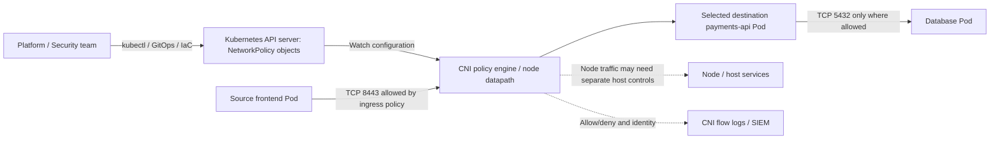
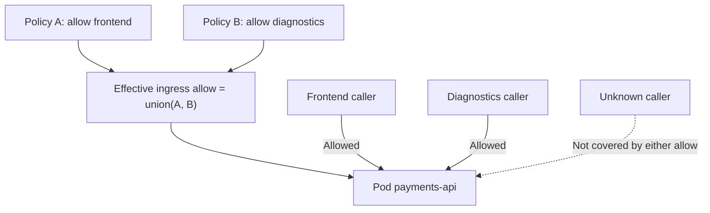
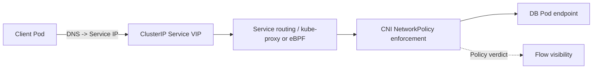
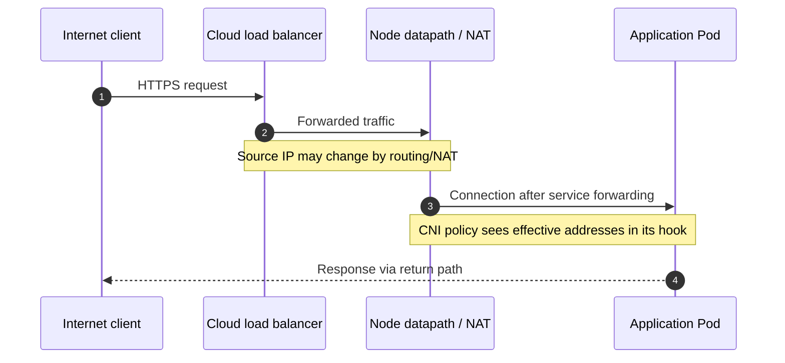
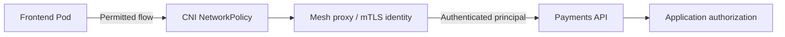

# Kubernetes NetworkPolicy

> **Học phần:** `SECURITY_NETWORK_SECURITY`  
> **Chương:** Bảo mật mạng Kubernetes  
> **Chủ đề:** Cơ chế `NetworkPolicy` chuẩn Kubernetes, cách mô tả **Pod ingress/egress** theo namespace, nhãn, IP và port; giới hạn của policy L3/L4; thực thi qua CNI; và phối hợp firewall, phân đoạn, WAF, VPN, TLS/mTLS, IAM, cloud và giám sát xâm nhập để xây dựng mạng Kubernetes an toàn.

## Mục tiêu học tập

Sau bài này, người học có thể:

1. Giải thích vì sao Pod-to-Pod network reachability mặc định không đồng nghĩa Pod có quyền truy cập tài nguyên.
2. Hiểu chính xác `NetworkPolicy` là API khai báo **chính sách kết nối** và **CNI/datapath hỗ trợ mới thực thi** nó.
3. Dùng `podSelector`, `namespaceSelector`, `ipBlock`, `policyTypes`, `ingress`, `egress`, `ports` và `protocol` đúng ngữ nghĩa.
4. Phân biệt **default allow**, **default deny**, **ingress isolation**, **egress isolation**, tập hợp các quy tắc **additive**, và thứ tự AND/OR của selectors.
5. Viết YAML cho default deny, chỉ cho phép gateway→API, API→DB và DNS cần thiết; tránh cho phép cả namespace ngoài ý muốn.
6. Hiểu các giới hạn với hostNetwork, node-local traffic, NAT, Service VIP, DNS, IPv6, LoadBalancer, NodePort và các giao thức ngoài TCP/UDP/SCTP.
7. Kiểm thử policy bằng positive/negative tests, quan sát bằng CNI/host logs, phát hiện drift và xây dựng chiến lược rollout không gây gián đoạn.
8. Kết hợp NetworkPolicy với authentication, authorization, service mesh mTLS, firewall, WAF, IAM và zero trust.

## 1. NetworkPolicy giải quyết vấn đề gì?

Trong một cluster Kubernetes, ứng dụng có thể được triển khai dưới dạng nhiều **Pods** chia nhau theo workload và namespace. Nhiều mô hình mạng Kubernetes cho phép các Pod có thể kết nối trực tiếp với nhau qua Pod IP khi chưa có ràng buộc bổ sung.

Một kẻ tấn công chiếm được container trong Pod public-facing có thể thử kết nối tới database, cache, message broker hoặc API quản trị trong cùng cluster. Nếu chỉ dựa vào câu nói “nội bộ cluster nên an toàn”, bề mặt lateral movement sẽ lớn.

**Kubernetes NetworkPolicy** cho phép người vận hành mô tả các **luồng mạng được phép tới và đi từ những Pods được chọn** theo điều kiện phù hợp. Khi CNI/plugin thực thi policy, workload không nằm trong những luồng cho phép sẽ bị giới hạn ở hướng đã cô lập.

### Ví dụ ứng dụng

```text
Internet
   |
Ingress / API gateway
   |
frontend Pods
   |
payments-api Pods ----> payment-db Pods
   |
   +----> external payment provider (qua egress broker)

Không mong muốn:
frontend Pods ------X----> payment-db Pods
public file-renderer -X----> admin / metadata / database
guest-namespace Pods -X--> payments-api Pods
```

NetworkPolicy có thể mô tả **Pod-level allow** cho những luồng quan trọng. Nhưng nó **không** tự xác thực người dùng, bảo vệ token, kiểm tra SQL queries hoặc kiểm chứng certificate. Những lớp đó vẫn cần IAM, app authorization, TLS/mTLS và service controls.

## 2. Mô hình đe dọa: east-west, north-south và egress

| Loại traffic | Ví dụ | Rủi ro |
|---|---|---|
| **East–west** | frontend Pod → API Pod → DB Pod | Lateral movement hoặc gọi nhầm service ngoài quyền |
| **North–south ingress** | Internet → CDN/WAF → cloud LB → Ingress → Pod | Pod bị expose qua route ngoài dự kiến, đi vòng WAF |
| **Outbound egress** | Pod → SaaS, registry, Internet, cloud metadata | SSRF, credential leakage, C2/exfiltration, vi phạm outbound policy |
| **Control-plane/node** | Pod → Kubernetes API, kubelet, node-local DNS/agent | Lạm dụng service account, truy cập host/admin |
| **Cross-cluster/VPC/VPN** | Pod → peered network hoặc database managed | Mở rộng phạm vi mạng ra ngoài Kubernetes |

NetworkPolicy hữu ích đặc biệt để **giảm reachability** và blast radius của Pod bị xâm nhập. Tuy nhiên, muốn chặn việc một principal bị đánh cắp gọi API đã cho phép ở L3/L4, vẫn cần **mTLS identity, token scopes, authorization theo resource và detection ở ứng dụng**.

### Các câu hỏi trước khi viết rule

- Pod nào đang cần **nhận** traffic? Ai là caller thực?
- Pod nào đang cần **gửi** traffic? Có tới DNS, storage, SaaS hoặc control plane?
- Đích là Pod khác, Kubernetes Service, node host, endpoint cloud hay địa chỉ Internet?
- Namespace labels có được quản lý bằng RBAC/admission không?
- CNI nào thực thi policy? Có hỗ trợ IPv6, host policies, named ports hoặc flow logging không?
- Traffic trải qua NAT/LoadBalancer/Ingress/mesh làm thay đổi source/destination trước khi policy áp không?

## 3. Thành phần trong mô hình thực thi



**Điểm quyết định:** API server lưu tài nguyên `NetworkPolicy`, nhưng **không tự biến các gói tin thành cho phép/từ chối**. Network plugin/datapath của cluster phải có **network-policy enforcement**. Nếu plugin không hỗ trợ hoặc chế độ enforce bị tắt, object có thể được API chấp nhận mà **traffic vẫn đi được**.

### Đường đánh giá

- **Control plane** chấp nhận policy object hợp lệ.
- **Controller/CNI agent** đọc object và lập trình rule.
- **Datapath** (iptables/nftables, eBPF, OVS hoặc cơ chế khác tùy plugin) kiểm tra traffic.
- **Observability** hiển thị policy/flow decisions nếu implementation hỗ trợ.

Không có API portable yêu cầu “mọi cluster áp cùng hook hoặc cùng flow log format”. Phải xác minh bằng tests trên plugin thực tế.

## 4. NetworkPolicy là tài nguyên namespaced

Một `NetworkPolicy` nằm trong **namespace cụ thể** và `spec.podSelector` chọn các Pod **thuộc chính namespace đó**. Không thể dùng một policy namespaced đặt ở namespace `payments` để trực tiếp chọn làm **đối tượng được bảo vệ** một Pod thuộc namespace `analytics`.

### Cấu trúc

```yaml
apiVersion: networking.k8s.io/v1
kind: NetworkPolicy
metadata:
  name: payments-api-example
  namespace: payments
spec:
  podSelector:
    matchLabels:
      app: payments-api
  policyTypes:
    - Ingress
  ingress: []
```

Policy ví dụ **chọn Pods có nhãn `app: payments-api` trong namespace `payments`**, đồng thời cô lập **ingress** của chúng vì không có rules cho ingress. Nó **không** bảo vệ mọi namespace hay tự cô lập egress.

### Chọn Pod mục tiêu

- `podSelector: {}` chọn **mọi Pod trong namespace của policy**.
- `podSelector.matchLabels` chọn Pods có toàn bộ cặp key/value phù hợp.
- `podSelector.matchExpressions` hỗ trợ các operator selector như `In`, `NotIn`, `Exists`, `DoesNotExist` theo semantics labels.
- Nếu Pods không có nhãn như policy yêu cầu, policy **không chọn** chúng.
- Một Pod có thể được chọn bởi **nhiều policy** cùng lúc.

**Điểm dễ bỏ sót:** Deployment mới đổi labels thì Pod có thể vô tình **không còn bị chọn bởi policy** (hoặc được chọn bởi policy rộng khác). Vì vậy labels trở thành yếu tố cần quản trị và kiểm thử bảo mật, không chỉ để lọc UI.

## 5. Ingress isolation và egress isolation là hai quyết định riêng

Một Pod có thể:

- **Không bị cô lập ingress và egress:** traffic được phép theo mô hình NetworkPolicy, trừ các kiểm soát khác.
- **Bị cô lập ingress:** chỉ các kết nối **đến Pod** được cho phép bởi hợp tập các ingress rules áp lên Pod.
- **Bị cô lập egress:** chỉ các kết nối **đi từ Pod** được cho phép bởi hợp tập các egress rules áp lên Pod.
- **Bị cô lập cả hai:** cả inbound lẫn outbound cần phù hợp chính sách.

Trong mô hình NetworkPolicy chuẩn, khi không có policy nào chọn Pod theo một hướng, hướng đó **không bị giới hạn bởi NetworkPolicy**. CNI, firewall, service mesh, cloud security group hoặc chính sách mở rộng có thể vẫn hạn chế traffic.

### Điều kiện kết nối giữa hai Pods

Giả sử Pod A gọi Pod B:

- **Egress policy** áp vào A, nếu A bị cô lập egress, phải cho phép A → B.
- **Ingress policy** áp vào B, nếu B bị cô lập ingress, phải cho phép A → B.
- Nếu cả hai đều bị cô lập, **cả hai phía** phải cho phép.
- Lưu lượng phản hồi thuộc một kết nối được phép thường được xử lý bởi cơ chế theo dõi trạng thái; **không** cần viết rule đối xứng cho từng gói phản hồi trong trường hợp tiêu chuẩn.

**Cẩn trọng với UDP và connection tracking:** Chính sách và khoảng thời gian coi các packet là liên quan đến flow có thể phụ thuộc implementation. Kiểm thử ứng dụng thực thay vì chỉ dựa trên logic TCP.

## 6. policyTypes và các mảng quy tắc

`spec.policyTypes` có thể chỉ rõ `Ingress`, `Egress` hoặc cả hai.

| Khai báo | Ý nghĩa đối với Pod được chọn |
|---|---|
| `policyTypes: [Ingress]` và `ingress: []` | Cô lập ingress, không có kết nối ingress nào được policy này cho phép |
| `policyTypes: [Egress]` và `egress: []` | Cô lập egress, không có kết nối egress nào được policy này cho phép |
| `policyTypes: [Ingress, Egress]` với cả hai mảng rỗng | Đề xuất default deny ở hai hướng trong namespace cho Pods được chọn |
| Không khai báo `policyTypes` | Kubernetes suy ra theo sự hiện diện của rules/fields; **nên khai báo tường minh** để giảm nhầm |
| `ingress: - {}` | **Cho phép mọi ingress** qua rule rỗng, trái với `ingress: []` |
| `egress: - {}` | **Cho phép mọi egress** qua rule rỗng, trái với `egress: []` |

### Khác biệt nguy hiểm: mảng rỗng và rule rỗng

```yaml
# BẢO VỆ: ingress bị cô lập, không có allow rule.
policyTypes: [Ingress]
ingress: []

# KHÁC HẲN: ingress được cho phép rộng bởi một rule trống.
# policyTypes: [Ingress]
# ingress:
#   - {}
```

Trước khi copy ví dụ vào policy đang dùng, kiểm tra **schema chính xác của resource** và không bỏ context của các trường `spec`. Không nên dùng cách “chỉ còn một dấu gạch ngang” rồi nghĩ đó là default deny.

### Ngữ nghĩa khi bỏ policyTypes

Theo Kubernetes, khi `policyTypes` không được khai báo, `Ingress` được mặc định bổ sung và `Egress` được bổ sung khi policy có phần `egress`; nên đọc đặc tả phiên bản đang triển khai. Một tài liệu dạy học và chính sách GitOps thường tốt hơn khi **viết rõ cả hai hướng** thay vì dựa vào default có thể gây ngộ nhận.

## 7. NetworkPolicy là additive, không có thứ tự firewall kiểu “deny thắng”

NetworkPolicy tiêu chuẩn **không có native explicit deny rule với độ ưu tiên** như nhiều firewall. Nếu **bất kỳ NetworkPolicy** áp dụng với Pod cho phép một luồng trong hướng đang cô lập, luồng đó có thể được phép theo hợp tập policy.

### Ví dụ

- Policy A chọn `payments-api`, cho ingress từ Pods `frontend` ở namespace được chỉ định.
- Policy B cũng chọn `payments-api`, cho ingress từ **mọi Pod** trong namespace `diagnostics`.
- Kết quả không phải “A hẹp hơn nên thắng”; **cả hai nguồn** được cho phép trong hợp tập các policy.



**Kết luận:** Default deny giúp tạo nền an toàn, nhưng một policy `allow-all` bổ sung có thể **mở lại** traffic. Phải review tất cả objects chọn Pod, không chỉ file `default-deny`.

### Có thể áp “deny override” bằng NetworkPolicy thường không?

Không có cơ chế priority/deny-first chuẩn trong API `networking.k8s.io/v1`. Một số CNI cung cấp **CRD mở rộng** như cluster-wide policy, deny action hoặc priority. Đó là **khả năng riêng nhà triển khai**, không được coi là tính năng portable của Kubernetes NetworkPolicy.

## 8. Default deny toàn namespace

Đây là baseline phổ biến cho namespace workload nhạy cảm.

```yaml
apiVersion: networking.k8s.io/v1
kind: NetworkPolicy
metadata:
  name: default-deny-all
  namespace: payments
spec:
  podSelector: {}
  policyTypes:
    - Ingress
    - Egress
  ingress: []
  egress: []
```

**Hiệu ứng nếu CNI thực thi đúng và không có policy cho phép bổ sung:** mọi Pod trong namespace `payments` bị cô lập ingress và egress theo phạm vi NetworkPolicy. Kết nối tới DNS, API server, database, storage, telemetry hoặc external partner có thể **ngừng hoạt động** nếu chưa có allow rules.

### Cách rollout

1. Inventory traffic đang hoạt động ở namespace.
2. Chuẩn bị rules cho flows nghiệp vụ, DNS và dependencies.
3. Test staging và những đường negative/positive đại diện.
4. Canary trên namespace/workload có kiểm soát; ghi nhận lỗi trước khi mở rộng.
5. Apply default deny và kiểm **effective union** với các policies khác.
6. Duy trì log/drop telemetry; không thêm `allow-all` để “khôi phục tạm” mà không phê duyệt.

**Không có quy tắc “default deny mọi namespace” tự xuất hiện khi tạo namespace mới.** Nếu muốn baseline tổ chức, cần cơ chế GitOps/admission/namespace provisioning/policy controller phù hợp; Kubernetes không mặc định tạo policy này.

## 9. Chỉ cô lập ingress hoặc egress

Hai ví dụ này hữu ích để hiểu sự độc lập giữa hướng.

### Chặn ingress chưa được cho phép, không hạn chế egress bởi policy này

```yaml
apiVersion: networking.k8s.io/v1
kind: NetworkPolicy
metadata:
  name: ingress-default-deny
  namespace: applications
spec:
  podSelector: {}
  policyTypes:
    - Ingress
  ingress: []
```

### Chặn egress chưa được cho phép, không hạn chế ingress bởi policy này

```yaml
apiVersion: networking.k8s.io/v1
kind: NetworkPolicy
metadata:
  name: egress-default-deny
  namespace: applications
spec:
  podSelector: {}
  policyTypes:
    - Egress
  egress: []
```

**Lưu ý:** Nếu namespace đã có policy khác chọn những Pods tương ứng, quyền cho phép thực tế là **hợp** của các rules. Thêm một policy deny trống **không thể thu hồi** một luồng đang được policy khác cho phép.

## 10. podSelector và namespaceSelector: AND/OR dễ nhầm nhất

Một `ingress.from` hoặc `egress.to` gồm **danh sách peers**. Nhiều entries ngang hàng là logic **OR**. Khi một entry chứa **cả `namespaceSelector` và `podSelector`**, đó là **AND**: Pods phải có labels phù hợp và thuộc namespace có labels phù hợp.

### AND: từ đúng frontend Pods trong namespace đúng

```yaml
ingress:
  - from:
      - namespaceSelector:
          matchLabels:
            team: storefront
        podSelector:
          matchLabels:
            app: frontend
    ports:
      - protocol: TCP
        port: 8443
```

**Ý nghĩa:** Cho source Pods `app=frontend` **và** namespace được gắn `team=storefront`.

### OR: hai peer selectors tách thành hai phần tử

```yaml
ingress:
  - from:
      - namespaceSelector:
          matchLabels:
            team: storefront
      - podSelector:
          matchLabels:
            app: frontend
    ports:
      - protocol: TCP
        port: 8443
```

**Ý nghĩa khác hoàn toàn:** Cho phép **mọi Pods** trong các namespace `team=storefront` **HOẶC** Pods `app=frontend` trong **namespace của policy**. Đây có thể là lỗi mở rộng phạm vi nghiêm trọng.

### Chọn cả namespace và Pods

| Khối trong cùng peer | Nghĩa |
|---|---|
| Chỉ `podSelector` | Chọn Pods trong **namespace của NetworkPolicy** |
| Chỉ `namespaceSelector` | Chọn các Pods thuộc namespaces khớp nhãn |
| Cả hai trong **một entry** | Chọn Pods khớp nhãn **trong** namespaces khớp nhãn |
| Hai entries riêng biệt | OR giữa hai điều kiện nguồn/đích |
| `namespaceSelector: {}` | Mọi namespaces trong phạm vi API, **không** chỉ một namespace |
| `podSelector: {}` ở peer | Mọi Pods trong namespace được diễn giải theo peer entry |

**YAML indentation là security control.** Một dấu gạch đầu dòng sai chỗ có thể đổi AND thành OR mà Kubernetes vẫn chấp nhận object hợp lệ.

## 11. Ví dụ ingress: chỉ gateway được gọi payments-api

Giả định tổ chức **đã quản lý** namespace `edge` và đảm bảo gateway Pods có labels đáng tin. Namespace mục tiêu là `payments`.

```yaml
apiVersion: networking.k8s.io/v1
kind: NetworkPolicy
metadata:
  name: payments-api-from-gateway
  namespace: payments
spec:
  podSelector:
    matchLabels:
      app: payments-api
  policyTypes:
    - Ingress
  ingress:
    - from:
        - namespaceSelector:
            matchLabels:
              kubernetes.io/metadata.name: edge
          podSelector:
            matchLabels:
              app: approved-api-gateway
      ports:
        - protocol: TCP
          port: 8443
```

### Giải thích

- Policy chỉ bảo vệ `app=payments-api` trong namespace `payments`.
- Source peer bắt buộc là Pod `approved-api-gateway` thuộc namespace có tên/label được tin tương ứng.
- Chỉ TCP port `8443` được phép bởi **rule này**.
- Không có rule cho Pods khác trong cùng namespace, nhưng **policy khác** có thể mở thêm.
- `namespaceSelector` kiểm **namespace labels**, không kiểm username/OIDC role.
- Gateway được chọn bởi labels không tự chứng minh binary trong Pod đó an toàn; cần RBAC, admission, image/provenance và service authentication.

**Khuyến nghị vận hành:** Dùng labels do platform team kiểm soát và tránh để tenant tùy ý đặt namespace labels trùng vùng tin cậy. Nếu tên namespace được dùng trong selector, vẫn cần bảo vệ quyền create/label namespace và xem phiên bản Kubernetes hỗ trợ nhãn hệ thống.

## 12. Ví dụ egress: chỉ API được gọi database Pod

Với database chạy cùng namespace `payments`, có thể cho API gọi DB qua cổng TCP cụ thể:

```yaml
apiVersion: networking.k8s.io/v1
kind: NetworkPolicy
metadata:
  name: payments-api-to-db
  namespace: payments
spec:
  podSelector:
    matchLabels:
      app: payments-api
  policyTypes:
    - Egress
  egress:
    - to:
        - podSelector:
            matchLabels:
              app: payments-db
      ports:
        - protocol: TCP
          port: 5432
```

**Đây là policy cho hướng egress của API**, không tự cho DB nhận connection nếu DB đang bị cô lập ingress.

### Quy tắc ingress tương ứng trên database

```yaml
apiVersion: networking.k8s.io/v1
kind: NetworkPolicy
metadata:
  name: payments-db-from-api
  namespace: payments
spec:
  podSelector:
    matchLabels:
      app: payments-db
  policyTypes:
    - Ingress
  ingress:
    - from:
        - podSelector:
            matchLabels:
              app: payments-api
      ports:
        - protocol: TCP
          port: 5432
```

**Hai policy này là minh họa**, không bảo đảm database thực sự có PostgreSQL, tên labels chính xác hoặc TLS đã được bật. DB phải yêu cầu **database credentials, TLS và quyền dữ liệu**, không coi việc được qua TCP 5432 là đã được đọc mọi schema.

### Trường hợp DB ở namespace khác

Dùng **`namespaceSelector` và `podSelector` trong cùng entry**. Đặc biệt kiểm labels của namespace đích/caller và cách CNI xử lý traffic qua ClusterIP service trước/sau NAT.

## 13. DNS sau khi áp default-deny egress

DNS là một trong những luồng thường bị quên khi áp default deny. Nhiều workload resolve tên qua **CoreDNS** trong namespace `kube-system`, nhưng có cluster dùng **NodeLocal DNSCache**, DNS resolver tùy biến hoặc service mesh.

### Ví dụ allow DNS tới Pods CoreDNS được gắn nhãn tương ứng

```yaml
apiVersion: networking.k8s.io/v1
kind: NetworkPolicy
metadata:
  name: allow-dns-to-coredns
  namespace: payments
spec:
  podSelector:
    matchLabels:
      app: payments-api
  policyTypes:
    - Egress
  egress:
    - to:
        - namespaceSelector:
            matchLabels:
              kubernetes.io/metadata.name: kube-system
          podSelector:
            matchLabels:
              k8s-app: kube-dns
      ports:
        - protocol: UDP
          port: 53
        - protocol: TCP
          port: 53
```

**Giả định minh họa:** CoreDNS Pods có label `k8s-app=kube-dns` và namespace có label `kubernetes.io/metadata.name=kube-system`. Không phải mọi cluster dùng cùng labels; trước khi áp hãy kiểm **effective Pod labels, DNS path và CNI semantics**.

### Vì sao cho cả UDP và TCP?

DNS có thể chạy qua UDP hoặc TCP (ví dụ response lớn, fallback, cấu hình resolver đặc biệt). Chỉ cho UDP 53 đôi khi gây lỗi gián đoạn khó chẩn đoán. **Không tự mở UDP/TCP 53 tới toàn bộ Internet**; giới hạn đúng resolver được duyệt.

### Khi NodeLocal DNSCache được bật

DNS traffic có thể được gửi tới **node-local IP/address**, không phải Pod IP CoreDNS. CNI có thể xử lý node-local traffic khác Pod-to-Pod. Đừng suy một policy chọn CoreDNS Pods sẽ luôn cho phép NodeLocal DNSCache. Kiểm DNS address trong Pod, datapath, node policy và thực hiện connectivity tests.

## 14. ipBlock, CIDR và except

`ipBlock` mô tả một dải IP/CIDR dùng trong peer; có thể loại trừ các subranges với `except`. Thường phù hợp khi muốn mô tả đích **bên ngoài cluster có IP ổn định**, thay vì chọn Pods theo IP động.

```yaml
apiVersion: networking.k8s.io/v1
kind: NetworkPolicy
metadata:
  name: lab-egress-to-test-network
  namespace: lab-only
spec:
  podSelector:
    matchLabels:
      app: connectivity-test
  policyTypes:
    - Egress
  egress:
    - to:
        - ipBlock:
            cidr: 198.51.100.0/24
            except:
              - 198.51.100.128/25
      ports:
        - protocol: TCP
          port: 443
```

**Chỉ sử dụng trong mô phỏng/lab:** `198.51.100.0/24` là **TEST-NET-2 dành cho tài liệu** và không phải endpoint Internet production. Rule minh họa cú pháp `cidr`/`except`, không có mục tiêu public để kết nối thật.

### Những điều quan trọng

- `except` chỉ loại **subranges nằm trong CIDR gốc**.
- IP/CIDR không ổn định khi Pods bị recreate/relocate; nên chọn Pod bằng labels thay vì `ipBlock` khi thích hợp.
- Nếu Service trải qua DNAT/SNAT, **IP được policy nhìn thấy** có thể phụ thuộc thứ tự xử lý policy/NAT của CNI.
- `ipBlock` không phải FQDN allowlist; NetworkPolicy chuẩn không cho chọn domain bằng tên.
- Một đích Internet dùng CDN có IP động; ép IP allowlist thô có thể làm hỏng tích hợp hoặc bị nới quá rộng.
- Với dual-stack, policy cần xét cả IPv4 và IPv6, phụ thuộc cluster và CNI hỗ trợ.
- Cho phép một subnet không đồng nghĩa cho phép service account/tenant bất kỳ trong subnet đó; cần TLS/authz.

## 15. ports, protocol, endPort và named ports

Rules ingress/egress có thể giới hạn cổng và transport protocol.

| Trường | Chức năng | Lưu ý |
|---|---|---|
| `protocol: TCP` | TCP port được phép | Nếu thiếu protocol, mặc định thường là TCP theo API |
| `protocol: UDP` | UDP port được phép | DNS và một số ứng dụng sử dụng UDP |
| `protocol: SCTP` | SCTP nếu cluster/CNI hỗ trợ | Kiểm khả năng thực thi của plugin |
| `port: 8443` | Một port cụ thể | Quy tắc và NAT thực tế cần test |
| `port: http` | Named port theo semantics Kubernetes | Tên/port phải tồn tại ở đúng đối tượng và implementation hỗ trợ |
| `endPort` | Phạm vi port khi dùng với port số | Hỗ trợ và giới hạn tùy phiên bản/CNI; không dùng với named port |

### Ví dụ dải port cho môi trường lab

```yaml
ports:
  - protocol: TCP
    port: 8000
    endPort: 8005
```

Mục tiêu minh họa cú pháp. **Không mở port range rộng** chỉ vì dễ hơn quản lý. Khi có cấu hình L7 qua gateway/mTLS, đừng suy traffic tới port 8443 tương đương HTTP request đã được xác thực.

### Một số thứ không được bảo đảm bởi NetworkPolicy thường

- URL path, HTTP method và request body;
- TLS certificate, hostname/SNI, JWT, OAuth scopes;
- Linux process/user identity trong Pod;
- gRPC service method, WebSocket messages;
- ICMP/ARP/những giao thức khác theo một API portable duy nhất;
- Trạng thái dữ liệu bên trong database.

Sử dụng API gateway/WAF/service mesh/host firewall và application authorization tùy mục đích.

## 16. Rules: từ nhiều nguồn và nhiều cổng

`ingress` và `egress` là **danh sách các rules**. Các rules là lựa chọn **OR**; danh sách peers bên trong một rule cũng là OR; các phần trong **một peer** được kết hợp theo semantics tương ứng.

```yaml
ingress:
  - from:
      - podSelector:
          matchLabels:
            app: frontend
    ports:
      - protocol: TCP
        port: 8080
  - from:
      - podSelector:
          matchLabels:
            app: metrics-scraper
    ports:
      - protocol: TCP
        port: 9090
```

**Ý nghĩa:** Cho frontend → port 8080, hoặc metrics-scraper → port 9090 theo selectors tương ứng.

### Một lỗi cấu hình thường gặp

Nếu đặt **hai peers** và **hai ports** trong **cùng một ingress rule**, Kubernetes không diễn giải “peer A đi port 8080, peer B đi port 9090”. Rule cho phép **mọi peer trong danh sách dùng mọi port của rule**. Muốn gắn cặp nguồn–cổng cụ thể, dùng **hai rules riêng** như ví dụ.

### Cách review dễ đọc

Mỗi rule nên được diễn giải thành câu:

> “Các Pod có identity theo selector X trong namespace Y được phép kết nối tới những Pods đích này qua TCP port Z.”

Nếu không diễn giải rõ logic AND/OR, policy có khả năng đang quá rộng hoặc khó vận hành.

## 17. Kubernetes Service, ClusterIP và DNAT: không suy chỉ từ VIP

Một request Pod A → `payments-db.payments.svc.cluster.local:5432` có thể được DNS resolve thành **ClusterIP Service**, sau đó datapath chuyển đến backend Pod IP.



**Sơ đồ khái niệm:** Thứ tự NAT và network-policy checks **có thể khác giữa các plugin**. Không kết luận mọi rule IPBlock theo Service VIP sẽ hoạt động giống mọi môi trường.

### Best practices

- Ưu tiên Pod/namespace selectors khi nói về **Pods đích**.
- Dùng Service DNS để ứng dụng tìm dịch vụ; **Service DNS không thay policy**.
- Không giả định NetworkPolicy chọn được Service theo tên; API chuẩn chọn **Pod/namespace/IP**.
- Đo source IP mà backend thực thấy sau LoadBalancer/Ingress/NAT khi debug ingress policy.
- Các loại Service `NodePort`/`LoadBalancer` có thể tạo đường ingress **song song** ngoài gateway dự kiến; cần audit và cloud/node firewall.
- Khi dùng `ExternalName`, DNS có thể trỏ tới hostname ngoài cluster; NetworkPolicy không tự biết FQDN là đích được phép.

**Cẩn trọng với host traffic:** Một số đường node-local, hostNetwork hoặc control-plane traffic có semantics khác Pod-to-Pod và phải có **host-level controls**.

## 18. CNI là điều kiện cần để policy có hiệu lực

Kubernetes định nghĩa **đối tượng API**, còn **CNI/datapath** xử lý việc phân phối và lọc packet. Các nền tảng phổ biến có thể dùng những tổ hợp khác nhau của iptables/nftables, eBPF, OVS, routing hoặc overlay.

### Kiểm tra trước rollout

1. Plugin có **NetworkPolicy enforcement** hay chỉ cấp mạng cho Pods?
2. Policy controller/agent đã chạy khỏe trên **mọi node** liên quan chưa?
3. Có khác biệt giữa node pool Linux/Windows hoặc loại CNI và plugin version không?
4. Có hỗ trợ SCTP, endPort, named ports, dual-stack theo kỳ vọng không?
5. Các luồng Pod → node, hostNetwork, node-local DNS và cloud endpoints được xử lý ra sao?
6. Service DNAT/SNAT trước hay sau khi policy chọn source/destination?
7. Các rules L3/L4 được thực thi trong bridge, overlay và đường direct route thế nào?
8. Có flow logs, counters, audit và policy verdict gắn với Pod/namespace không?
9. Khi CNI agent bị lỗi, policy fail-open/fail-closed theo thực tế triển khai ra sao?
10. Có thể test positive/negative mà không tác động production không?

### Không đồng nhất apply thành công với enforcement

```text
kubectl apply -f networkpolicy.yaml  ->  API chấp nhận object

KHÔNG tương đương:

Mọi gói Pod vào/ra đều đã được kiểm soát đúng như mong muốn.
```

Phải dùng **connectivity tests từ đúng Pod nguồn** tới đúng đích/port và **dữ liệu datapath**. Khi cần yêu cầu bảo mật cao, kết hợp host firewall, VPC security groups, WAF/gateway và identity-based controls để không đặt tất cả niềm tin vào một lớp.

## 19. Traffic Pod ↔ node/host: ranh giới đặc biệt

Một Pod có thể kết nối tới node IP, node-local DNS cache, kubelet, metrics agent hoặc cloud metadata theo topology. Đây là trường hợp dễ gây hiểu nhầm nhất nếu coi Kubernetes NetworkPolicy là “host firewall hoàn chỉnh”.

### Theo semantics Kubernetes

NetworkPolicy tiêu chuẩn tập trung vào traffic **tới/từ Pods được chọn**. Lưu lượng **giữa Pod và node mà Pod đang chạy** được đặc tả/triển khai xử lý đặc biệt; không nên giả định mọi Pod→node packet sẽ bị chặn bởi một default-deny NetworkPolicy thông thường. Với traffic tới **các node khác, hostNetwork Pods, node-local services, cloud metadata**, hành vi cụ thể phụ thuộc datapath/CNI và hạ tầng.

### Ma trận đánh giá

| Đường đi | Kiểm soát nào cần xét | Không nên suy diễn |
|---|---|---|
| Pod → Pod khác | NetworkPolicy hai chiều nếu Pods bị cô lập | Chỉ ingress ở source là đủ |
| Pod → local node service | **Host firewall/CNI host policy + service auth** | Default deny Pod egress chắc chắn chặn node-local |
| Pod → remote node IP | Routing, NetworkPolicy implementation, host firewall | Mọi node IP là một Service thông thường |
| Pod → kubelet/control API | RBAC/IAM, endpoint authz, firewall | Reachable đồng nghĩa caller có quyền quản trị |
| Host process → Pod | Host/node traffic semantics, firewall, app auth | Pod ingress deny luôn chặn node process |
| hostNetwork Pod → host service | Host network namespace, host firewall/authorization | Cùng isolation như Pod namespace riêng |

### Phòng vệ đúng lớp

- Chặn **host management listeners** bằng host firewall hoặc cơ chế host policy của CNI/cloud.
- Không mở Docker/container runtime API, kubelet/debug hoặc admin endpoints cho mọi Pod.
- Internal node agents vẫn cần authentication và least-privilege authorization.
- Dùng service account và node/cloud IAM đúng scope; không cấp quyền “vì Pod đã nằm trong cluster”.
- Phân biệt node-local metrics/DNS có nhu cầu với metadata/host-admin không cần.
- Ghi nhận Pod-to-host flows ở tầng **host/CNI**, không chỉ HTTP gateway logs.

**Điểm học thuật:** Không có một YAML NetworkPolicy chuẩn portable nào **bảo đảm chặn tuyệt đối mọi traffic giữa Pod và chính node của nó** trên mọi CNI. Muốn đạt yêu cầu bảo mật, phải dùng và kiểm chứng lớp host enforcement thích hợp.

## 20. hostNetwork, hostPort và NodePort: không thay NetworkPolicy

### hostNetwork

Pod có `hostNetwork: true` dùng network namespace của node theo triển khai Kubernetes. Như vậy:

- Có thể thấy loopback và port space của node.
- Source/destination identity theo Pod IP thông thường có thể không còn áp như kỳ vọng.
- NetworkPolicy chuẩn có thể **không bao phủ hostNetwork traffic** theo cùng semantics với Pod có namespace mạng riêng.
- Các node agents có nhu cầu đặc biệt vẫn có thể cần hostNetwork; phải phê duyệt và giảm quyền.

### hostPort và NodePort

- **hostPort** ánh xạ cổng host tới một container port của Pod theo CNI implementation.
- **NodePort** expose Service trên một port của các node theo cấu hình Service/network.
- **LoadBalancer** có thể tạo public endpoint; Ingress/Gateway API là lớp routing riêng.
- NetworkPolicy **không** phải công cụ để quản trị hết cloud public listener, node firewall và WAF routing.

### Mối nguy bypass

Một API dự kiến chỉ đi qua Ingress/WAF có thể bị expose thêm bởi một `NodePort` hoặc cloud `LoadBalancer` không nằm trong topology được phê duyệt. Dù Pod policy vẫn có thể hạn chế một số luồng đến, **đừng đặt toàn bộ trách nhiệm vào NetworkPolicy**. Cần kiểm Service types, source CIDRs, cloud security group, host firewall, admission policy và auth ở API.

### Bảng lựa chọn

| Nhu cầu | Công cụ phù hợp |
|---|---|
| Giới hạn Pod nguồn được gọi API Pod | NetworkPolicy selectors + service auth |
| Chặn Internet tới node admin port | Host/VPC/cloud firewall |
| Giới hạn ai tạo NodePort/LoadBalancer | RBAC, admission, GitOps policy review |
| HTTP path/header/URL rule | API gateway, WAF, application |
| mTLS identity giữa services | Service mesh hoặc TLS/mTLS trực tiếp |
| Kiểm soát hostNetwork Pods | Admission/Pod Security + host firewall/CNI host policy |

## 21. IP nguồn thật, NAT và cloud LoadBalancer

NetworkPolicy đánh giá traffic ở các điểm phụ thuộc datapath. Khi request đi từ Internet qua LB, NodePort, kube-proxy hoặc eBPF Service handling, IP nguồn thực được CNI nhìn thấy có thể là:

- Địa chỉ client ban đầu;
- Địa chỉ cloud load balancer;
- Địa chỉ node làm forwarding;
- Địa chỉ gateway/sidecar/proxy;
- Một địa chỉ đã biến đổi bởi SNAT.

### Hệ quả

Một `ipBlock` dùng allowlist client IP có thể hoạt động khác khi `externalTrafficPolicy`, node path, proxy chain hoặc LB provider thay đổi. Trong một số triển khai, source IP chỉ được giữ khi chọn thiết kế/routing thích hợp.

**Không suy từ HTTP `X-Forwarded-For` rằng tầng L3/L4 nhìn thấy đúng IP đầu tiên đó**: HTTP header có thể bị client giả và tồn tại sau TLS termination; NetworkPolicy không hiểu hoặc xác thực nó.

### Mẫu phân tích



Đây là mô hình khái niệm, không phải trace áp dụng cho mọi cloud. Kiểm tra **cloud LB type, Service spec, CNI flow logs, node route và source IP thực** thay vì đoán.

## 22. DNS, FQDN egress và giới hạn NetworkPolicy chuẩn

NetworkPolicy `networking.k8s.io/v1` tiêu chuẩn **không có trường cho phép FQDN hoặc HTTP URL**. Các tài nguyên được chọn dựa trên Pod labels, namespace labels, IP blocks và port/protocol.

### Khi Pod cần gọi một SaaS qua DNS

Ví dụ service `fraud-detector` gọi HTTPS tới `api.risk-partner.example.test`. Có thể dùng:

1. **Egress broker/gateway** có danh sách đối tác theo hostname/destination policy.
2. Workload chỉ được kết nối tới egress gateway theo Pod selector/port.
3. Broker resolve và kiểm IP/certificate/hostname ở connection boundary.
4. Cloud firewall hỗ trợ FQDN filtering nếu phù hợp và đã đánh giá giới hạn.
5. App dùng endpoint cố định, token theo audience và TLS verification.

**Không cho phép toàn `0.0.0.0/0` qua TCP 443 rồi coi đó là đủ SSRF protection.** Rule này có thể cho phép request tới nhiều đích không được cấp, trừ khi có lớp egress kiểm soát khác.

### Ngoại lệ thường thấy

Một số CNI có CRD hoặc policy nâng cao hỗ trợ DNS-aware/FQDN egress. Chúng có cách cập nhật DNS→IP, TTL/cache và bảo vệ riêng, **không phải Kubernetes NetworkPolicy chuẩn**. Phải tham khảo phiên bản CNI đang dùng và test DNS rebinding, redirects, IPv6, DNS resolver bypass.

## 23. SSRF, cloud metadata và private egress

NetworkPolicy giúp giảm reachability từ Pod công khai đến những vùng mạng không cần thiết. Tuy nhiên, Pod → **node-local host service hoặc metadata** có thể cần các host/CNI controls bổ sung.

### Ví dụ rủi ro

Một Pod render HTML/PDF từ tài liệu người dùng tải lên. Renderer tự fetch ảnh, font hoặc CSS bên ngoài. Nếu Pod có route tới node admin API, metadata hoặc database, input ngoài ý muốn có thể khiến renderer gửi request theo những đường đó.

### Phòng vệ nhiều lớp

- Tách renderer/fetch worker ra namespace/node pool phù hợp, IAM ít quyền.
- Default deny egress tại CNI **và kiểm tra host/node exceptions**.
- Chỉ cho outbound qua egress broker đã xác thực.
- Broker kiểm scheme, port, resolved IP, actual connection, redirect, IPv4/IPv6.
- Chặn metadata/management zone ở host/VPC/firewall đúng phạm vi.
- Không gán Kubernetes service account hoặc cloud IAM quyền cao nếu worker không cần.
- API nội bộ vẫn yêu cầu mTLS/authorization theo principal.
- Hạn chế response bytes, timeout, concurrency và parser nested subrequests.

**SSRF không tự là Kubernetes RBAC escalation.** Đó là một đường mạng; khả năng tác động control plane phụ thuộc việc endpoint có reachable, credential nào bị sử dụng và quyền của credential.

## 24. IPv4, IPv6, dual-stack và ipBlock

Một cluster dual-stack có thể cấp cả IPv4/IPv6 cho Pods hoặc hỗ trợ dịch vụ qua nhiều address families. Policy enforcement phải bảo vệ **những đường thật sự hoạt động**.

| Tình huống | Rủi ro |
|---|---|
| Policy chỉ có `ipBlock` IPv4 | IPv6 path có thể không nằm trong allow/deny dự kiến |
| DNS có A và AAAA | Client có thể chọn address family khác |
| Source/service IP qua NAT64 hoặc mapped address | Kiểm tra IP ở hook khác với kỳ vọng |
| IPv6 node/public listener | Có thể lộ endpoint ngoài kiểm soát IPv4 |
| CNI hỗ trợ dual-stack chưa đầy đủ | Effective policy không đồng đều giữa node pools |
| Control plane hoặc DNS node-local dùng IPv6 | Cần host policy và resolver path đúng |

### Cách làm

1. Inventory PodCIDR, ServiceCIDR, node IPs, IPv4/IPv6 egress routes.
2. Xác định CNI version/feature support và kết quả enforcement.
3. Kiểm tra positive/negative connection với mỗi address family được bật.
4. Không dùng một `ipBlock` IPv4 làm bằng chứng “cấm toàn bộ Internet”.
5. Giới hạn IPv6 egress bằng chính sách tương ứng, không mặc định disable IPv6 tùy tiện gây lỗi dịch vụ.
6. Ghi log destination IP/address family và policy verdict.

**Kết luận:** Chọn theo Pod/namespace labels giúp giảm phụ thuộc vào Pod IP cụ thể nhưng **không thay việc kiểm dual-stack**.

## 25. Service mesh, mTLS và NetworkPolicy bổ sung nhau

Một service mesh có thể sử dụng sidecar hoặc data-plane proxy để quản lý **mTLS, identity, retries, routing và application-layer authorization**. NetworkPolicy vẫn có vai trò L3/L4.



### Phân biệt vai trò

| Câu hỏi | Lớp có thể trả lời |
|---|---|
| Có đường TCP từ Pod A sang Pod B không? | CNI NetworkPolicy, firewall |
| Workload A có certificate identity hợp lệ không? | mTLS/service mesh |
| A được gọi gRPC method này không? | Mesh authorization khi hỗ trợ + application |
| User A được đọc dữ liệu tenant B không? | Application authorization |
| HTTPS body có chứa nội dung tấn công không? | WAF/IDS ở nơi có quyền/khả năng inspection |
| Sidecar/mesh có áp cho mọi route không? | Mesh config, admission và effective deployment |

### Hai bẫy thường gặp

- **Bypass sidecar/gateway:** Một route Pod IP trực tiếp có thể không đi qua proxy chính sách nếu cách triển khai cho phép; cần kiểm cả mesh và CNI.
- **Tin cùng namespace là danh tính:** Namespace/labels hữu ích để phân đoạn mạng, nhưng không phải cryptographic identity. Không trao quyền API chỉ vì một IP thuộc namespace đã duyệt.

**mTLS không thay NetworkPolicy:** mTLS giúp xác thực peer và bảo vệ kênh; NetworkPolicy giảm khả năng kết nối đến đích không cần thiết. Một kẻ đã chiếm workload có identity hợp lệ vẫn có thể gọi endpoint nằm trong quyền được cấp; cần authorization/monitoring.

## 26. Multi-tenant Kubernetes: labels, RBAC và namespace ownership

Khi nhiều team/tenant sử dụng cùng cluster, một policy selector có thể trở thành **ranh giới tin cậy gián tiếp**. Nếu một tenant có thể tự gán nhãn mà policy dùng để nhận diện gateway đáng tin, người đó có thể làm traffic của Pod được coi thuộc nhóm nguồn cho phép.

### Đặt câu hỏi đúng

- Ai được tạo/sửa namespace và namespace labels?
- Ai được sửa labels của Pods/Deployments và các tài nguyên tạo Pod?
- Ai được thêm NetworkPolicies mở rộng egress/ingress?
- Ai được chạy Pods với hostNetwork, hostPID, privileged, hostPath?
- Có namespace-level RBAC đủ chặn team khác sửa policy ở namespace quan trọng không?
- Policy selectors có trỏ vào labels do operator quản lý hay user tùy ý đặt?
- Có admission validation bảo vệ reserved labels/role selectors không?

### Ví dụ nguy cơ

Policy của namespace `payments` chỉ cho ingress từ namespace có `access-zone=trusted-gateway`. Nếu bất kỳ namespace owner nào có thể tự gán label này, tính cô lập thực tế phụ thuộc quyền gán label, **không chỉ YAML**.

**Giải pháp:** Đặt labels mang ý nghĩa an ninh dưới quyền platform team, áp RBAC/admission/namespace lifecycle controls, test policy với một namespace tenant không tin cậy.

### NetworkPolicy không thay Kubernetes RBAC

RBAC quyết định **ai được gọi Kubernetes API để tạo/sửa/xóa tài nguyên**; NetworkPolicy quyết định **reachability ở data plane**. Một ServiceAccount bị đánh cắp với quyền `get secrets` có thể truy vấn API qua đường được phép; NetworkPolicy **không** hiểu RBAC verb hoặc ngăn được hành vi thuộc quyền API đó.

## 27. Cloud/VPC, VPN và ngoại vi cluster

NetworkPolicy chỉ là một phần của mô hình bảo mật Kubernetes trong cloud/hybrid.

| Boundary | Kiểm soát bổ sung |
|---|---|
| Internet → CDN/WAF/LB | Cloud DDoS, WAF, firewall, TLS |
| LB/Ingress → Pods | Ingress/Gateway policy, NetworkPolicy, mTLS |
| Pod → managed database | VPC security group/firewall, private endpoint, DB TLS/authz |
| Pod → SaaS | Egress broker, FQDN/destination policy, token scope |
| Pod → VPN/peered VPC | Route filtering, firewall, IAM và segmentation |
| Pod → node/metadata | Host/node firewall, metadata controls, workload identity |
| Pod → cluster control plane | RBAC, APIServer authn/authz, admission, audit |
| Multi-cluster east–west | Gateway/service identity, cross-cluster policy, VPN/mTLS |

### Shared responsibility

- Kubernetes API không quản lý mọi cloud firewall rules.
- Một cloud security group có thể không biết namespace/Pod label (trừ tích hợp provider/CNI cụ thể).
- Một Ingress Controller được bảo vệ không ngăn một service bị expose thêm qua NodePort nếu các lớp khác không chặn.
- Một service mesh có thể mã hóa traffic nhưng không chặn outbound internet khi route/firewall vẫn mở.
- Policy consistency giữa các vùng/node pools cần tự động hóa và kiểm thử khi nâng cấp/migrate.

## 28. Chính sách nền theo vai trò workload

Thiết kế một **policy matrix** trước khi viết YAML giúp giảm các rules khó hiểu.

| Workload nguồn | Workload đích | Port | Hướng cần cấp | Quyền nghiệp vụ |
|---|---|---|---|---|
| Approved API gateway | payments-api | TCP 8443 | Gateway egress + API ingress nếu bị cô lập | API authentication và scopes |
| payments-api | payments-db | TCP 5432 | API egress + DB ingress nếu bị cô lập | DB credentials/least privilege |
| payments-api | DNS resolver | UDP/TCP 53 | API egress | Chỉ resolver được duyệt |
| metrics-scraper | payments-api | TCP 9090 | Scraper egress + API ingress khi cần | Không lộ admin metrics |
| payments-api | payment egress broker | TCP 3128 hoặc mTLS port được định nghĩa | API egress + broker ingress | Broker xác thực workload |
| payment egress broker | External partner | TCP 443 | Broker egress + cloud firewall | Destination allowlist và TLS |
| Untrusted renderer | node-admin | Bất kỳ | **Không cấp** | Node firewall + service authz |
| Guest namespace | payments-db | TCP 5432 | **Không cấp** | Isolation và DB authz |

### Tại sao cần cả network và business policy?

Một policy cho API → DB 5432 không xác nhận được SQL user nào được thực thi câu lệnh gì. Có thể dùng TLS database, account chỉ có quyền đọc/ghi phạm vi hẹp, audit query và secrets management. Đây là mô hình **defense in depth**.

## 29. Quan sát NetworkPolicy: policy object, flow và kết quả

Một runbook tốt cần phân biệt **điều mong muốn**, **điều CNI thực thi** và **kết quả ứng dụng**.

### Nguồn dữ liệu

| Nguồn | Thấy được | Giới hạn |
|---|---|---|
| NetworkPolicy objects | Declarative intent, selectors, ports | Không chứng minh datapath đã enforce |
| Pod/namespace labels | Identity theo labels, placement | Nhãn có thể đổi; không phải identity mật mã |
| CNI policy status/agent health | Controller/agent và effective rules (tùy plugin) | Format/vendor-specific |
| CNI flow logs/eBPF telemetry | Source/destination identities, allow/drop verdict | Không phải mọi plugin lưu cùng dữ liệu |
| Node firewall/iptables/nftables | Packet counters và host-path decisions | Một số flows đi qua eBPF hook khác |
| VPC flow logs | Network traffic qua cloud interfaces | Node-local có thể thiếu/sampling |
| Proxy/service mesh telemetry | TLS peer, route, HTTP status, retries | Không quan sát đường bypass không qua proxy |
| App/DB logs | Authentication/authorization, business effects | TCP timeout không có nghĩa authz bị lỗi |
| Kubernetes audit | Ai tạo/sửa/xóa policy/Pod/namespace | Không có mọi data-plane packet |

### Event schema minh họa

```json
{
  "event_time": "2026-11-28T09:00:00Z",
  "cluster": "lab-cluster",
  "source_namespace": "edge",
  "source_pod": "gateway-demo",
  "destination_namespace": "payments",
  "destination_pod": "payments-api-demo",
  "source_ip": "10.244.1.10",
  "destination_ip": "10.244.2.15",
  "destination_port": 8443,
  "protocol": "TCP",
  "address_family": "IPv4",
  "policy_verdict": "allow",
  "policy_source": "CNI datapath demo",
  "request_id": "k8s-np-004"
}
```

Đây là dữ liệu **giả lập**, không phải schema chuẩn của NetworkPolicy hay một CNI. Không ghi thông tin user/secret hoặc URL query không cần thiết vào flow log. Một allow verdict ở L3/L4 không được diễn giải thành API permission granted.

### Metrics hữu ích

- Số Pod/namespace có default-deny cả hai hướng và policy exceptions.
- Tỷ lệ egress từ workloads nhạy cảm tới những destination classes đã duyệt.
- Deny events tới metadata, node admin, data zone và external unknown IPs.
- NetworkPolicy changes và Pod/namespace label drift.
- Số policies có broad peers `namespaceSelector: {}`, `ipBlock 0.0.0.0/0`.
- CNI agent health, flow logging coverage, policy sync latency.
- Application errors sau rollout, DNS success rate và business transaction success.
- Network reachability test PASS/FAIL theo namespace/workload/address family.

## 30. Troubleshooting: Pod-to-Pod không kết nối được

Khi request bị timeout hoặc refused, không nên kết luận ngay “NetworkPolicy chặn”.

### Quy trình theo lớp

1. **Pod lifecycle:** Pod Running/Ready? Đúng namespace và labels?
2. **Service discovery:** DNS name resolve thành gì? ClusterIP/EndpointSlice có endpoints khỏe?
3. **Source and destination:** Pod A thực gọi Pod B nào, port nào, protocol nào?
4. **NetworkPolicy isolation:** Cả source egress và destination ingress có bị cô lập không?
5. **Selector evaluation:** Policy objects nào chọn từng Pod; namespace labels là gì?
6. **CNI enforcement:** Controller/agents có áp rule; error logs/counters nói gì?
7. **NAT/Service path:** Request đi thẳng Pod IP hay qua Service VIP/NodePort?
8. **Host/network firewall:** Host/VPC/route có chặn, IPv6 có khác không?
9. **Transport:** TCP connect timeout hay refused? TLS handshake thất bại?
10. **Application authorization:** HTTP 401/403, DB access denied hoặc gRPC permission denied?

### Dấu hiệu và cách hiểu

| Dấu hiệu | Nguyên nhân có thể |
|---|---|
| DNS không resolve | Chưa cho DNS egress, DNS service lỗi hoặc name sai |
| DNS resolve nhưng TCP timeout | CNI/network firewall drop, route lỗi, target chưa reachable |
| TCP connection refused | Không có listener hoặc target từ chối; chưa chắc NetworkPolicy |
| TLS handshake failed | Certificate/SNI/CA/cipher/mTLS mismatch |
| HTTP 401/403 | Đã tới ứng dụng; identity hoặc authorization từ chối |
| Chỉ một node lỗi | CNI agent, node firewall, labels hoặc routes khác |
| Pod IP chạy, ClusterIP lỗi | Service/EndpointSlice/NAT path cần kiểm tra |
| Chỉ IPv6 lỗi | IPv6 listener, route, policy hoặc CNI support khác |
| Chỉ sau policy deploy lỗi | Diff selectors/policyTypes/ports, DNS egress, additive policies |

**Cách điều tra đúng:** Đối chiếu client logs, CNI/flow verdict, effective policy, server-side logs và thời gian thay đổi. Không tạm mở `allow-all` trước khi hiểu phạm vi ảnh hưởng nếu dịch vụ nhạy cảm.

## 31. Các lệnh kiểm tra an toàn, chỉ đọc

Chạy trong namespace/cluster **được cấp quyền**. Các lệnh là ví dụ kiểm tra object và labels, không thực thi traffic tấn công.

```bash
# Xem mọi NetworkPolicies (có thể cần quyền cluster-scope).
kubectl get networkpolicy -A

# Xem policy trong namespace được phê duyệt.
kubectl get networkpolicy -n payments
kubectl describe networkpolicy payments-api-from-gateway -n payments

# Kiểm Pod labels ở namespace nguồn và đích.
kubectl get pods -n edge --show-labels
kubectl get pods -n payments --show-labels

# Xem namespace labels và khả năng match namespaceSelector.
kubectl get namespaces --show-labels

# Xem Service/EndpointSlices của đích.
kubectl get svc -n payments
kubectl get endpointslices -n payments

# Kiểm workload network mode bằng thông tin Pod spec.
kubectl get pod payments-api-demo -n payments \
  -o jsonpath='{.spec.hostNetwork}{"\n"}{.spec.nodeName}{"\n"}{.status.podIP}{"\n"}'
```

**Các tên resources trong ví dụ là giả định; không nhất thiết tồn tại trong cluster.** Không truy vấn secrets, lấy toàn bộ environment variables hoặc chạy lệnh đổi firewall chỉ để debug traffic.

### Connectivity test có kiểm soát

- Dùng **Pod test** do nhóm vận hành quản lý trong **lab/staging**.
- Test positive từ gateway identity được phép tới API mock và ghi response.
- Test negative từ Pod không được phép tới cùng API mock; xác minh CNI verdict.
- Không dùng production admin API hoặc cloud metadata làm đích thử.
- Nếu Pod không có quyền tạo test workloads, dùng test environment/service đã có.
- Kiểm IPv4/IPv6 nếu triển khai bật dual-stack.
- Tránh UDP flood hoặc quét cổng, chỉ dùng một số request có giới hạn.

**Một timeout không đủ chứng minh policy chặn đúng:** test cần **đối chứng** như backend xác nhận sẵn sàng, network path kiểm đúng và CNI policy deny verdict.

## 32. Rollout an toàn: default-deny theo từng bước

Một rollout default deny lớn có thể làm hỏng DNS, service discovery, third-party integrations, monitoring và thậm chí các luồng cần để ứng dụng sẵn sàng. Cần kế hoạch.

### Giai đoạn 1 — Inventory

- Liệt kê namespace, Pods, labels, Services, egress destinations, node-local dependencies.
- Vẽ data flow application↔database, API↔gateway, observability, DNS, SaaS.
- Xác nhận CNI version và node pools/OS.
- Lập matrix business flows và security invariants.

### Giai đoạn 2 — Policy design

- Chọn labels ổn định cho nguồn/đích, phân quyền quản lý labels.
- Thiết kế default deny theo namespace/role.
- Viết allow rules **tối thiểu** cho traffic cần thiết.
- Đối chiếu AND/OR semantics của selectors; tách rule khi source-port khác nhau.
- Không sử dụng IPBlock broad để thay việc xác định Pod/namespace identity.
- Tính DNS, node-local và cloud endpoints riêng.

### Giai đoạn 3 — Staging và tests

- Test positive/negative từ **đúng source Pods** và destination.
- So sánh source IP/NAT path khi dùng Services/Ingress.
- Kiểm hostNetwork/node exceptions và IPv6.
- Xác minh mTLS/authz không đổi và flow logs đầy đủ.
- Thử restart Pod, node migration, CNI upgrades và failover proxy nếu có.

### Giai đoạn 4 — Canary

- Áp trên namespace/test workload không gây gián đoạn lớn.
- Theo dõi p95/p99 latency, error rates, DNS resolution, policy drops.
- Tách lỗi policy thật khỏi lỗi certificate, Service endpoint hoặc app.
- Có change approval và rollback về **policy đã được kiểm chứng an toàn**.

### Giai đoạn 5 — Enforce và duy trì

- Áp default deny đến phạm vi đã được phê duyệt.
- Thiết lập CI/admission/GitOps để giảm drift và broad allow rules.
- Định kỳ xác nhận labels, Services, CNI agent health và flows.
- Rà soát ngoại lệ sau khi dependencies thay đổi hoặc service bị xóa.

**Rollback không nên là “mở Internet/cluster cho tất cả Pods”**. Khi sự cố, nên khôi phục một allow rule hẹp hoặc phiên bản policy đã được duyệt, với expiry/audit, hơn là gỡ bỏ toàn bộ isolation không kiểm soát.

## 33. Ứng phó sự cố: phát hiện lateral movement qua cluster

### Dấu hiệu

- Một Pod public-facing bắt đầu kết nối tới database/admin Pods vốn không có dependency.
- Nhiều denied connections tới private IP/ports khác nhau sau một request đến web app.
- Một namespace tenant mới sửa labels trùng với namespace “trusted” để hưởng allow rule.
- NodePort/LoadBalancer được tạo bất ngờ song song với API gateway.
- Egress đến cloud metadata, Kubernetes API hoặc remote VPC tăng bất thường.
- NetworkPolicy bị xóa hoặc một `allow-all` policy được thêm trái quy trình.
- CNI policy agent mất đồng bộ trên một node, gây enforcement gap.

### Quy trình điều tra

1. Lấy thời gian Pod/network policy changes và tình trạng CNI.
2. Xác định source Pod, namespace, node, service account, image/version và endpoint thực.
3. Tương quan CNI flows, host/firewall logs, Kubernetes audit, app/DB auth logs.
4. Phân biệt **connection attempt**, **packet được phép**, **service interaction** và **confirmed business impact**.
5. Nếu nguy cơ đang diễn ra, hạn chế egress/ingress workload bị ảnh hưởng bằng thay đổi có phê duyệt; cô lập workload/credentials theo playbook.
6. Bảo toàn bằng chứng, tránh xóa Pod/log trước khi thu thập điều cần thiết nếu an toàn vận hành cho phép.
7. Sửa root cause: policy selector quá rộng, CNI thiếu enforcement, host bypass, token/RBAC lạm dụng hoặc app authorization.
8. Thêm regression tests và kiểm lại multi-node/IPv6/DR path.

**Kết nối tới DB bị NetworkPolicy cho phép không tự chứng minh DB bị đọc trái phép.** Cần auth logs/query logs và ngữ cảnh nghiệp vụ trước khi kết luận tác động.

## 34. Threat modeling STRIDE cho NetworkPolicy

| STRIDE | Tình huống | Kiểm soát |
|---|---|---|
| **Spoofing** | Pod trong namespace khác tự gắn labels để match nguồn trusted; backend tin Pod IP | RBAC/admission cho labels, mTLS identity, app authz |
| **Tampering** | Attacker có Kubernetes API quyền sửa policy, làm nới egress | Least-privilege RBAC, GitOps review, audit, drift detection |
| **Repudiation** | Không biết ai thêm allow-all, không có flow verdict | Kubernetes audit, policy version/change ID, CNI logs |
| **Information Disclosure** | Compromised Pod kết nối DB/secrets service hoặc cloud metadata | Default deny, segmentation, IAM và DB authz |
| **Denial of Service** | Policy sai chặn DNS hoặc core dependencies, gây outage; hoặc một Pod flood service | Staged rollout, quotas, rate limits, monitoring |
| **Elevation of Privilege** | Workload chạm Kubernetes API/kubelet và credential có quyền quá rộng | RBAC, workload identity, host firewall, token scope |

### Threat statement mẫu

> Một cluster multi-tenant có default deny ingress cho payments-api, nhưng allow rule chọn namespace theo label `security-zone=trusted`. Nếu tenant có quyền sửa labels namespace của mình, tenant có thể tự vào tập nguồn được phép và mở TCP kết nối tới payments-api. NetworkPolicy chỉ kiểm label/network, không kiểm business identity. Giảm thiểu bằng giới hạn quyền namespace labels, selector do platform quản lý, mTLS service identity, API authorization và audit.

**Điểm chính:** NetworkPolicy giới hạn **reachability**, còn **danh tính mật mã và quyền nghiệp vụ** phải được quản lý độc lập.

## 35. Tình huống thực tế: ba bài học thiết kế

### Case A — Default deny làm gián đoạn DNS

**Bối cảnh giả định:** Nhóm vận hành triển khai default-deny egress trong namespace `payments`. Sau rollout, API pods vẫn chạy nhưng không resolve được tên database và SaaS.

**Nguyên nhân:** Chưa cho traffic tới DNS resolver; CoreDNS/NodeLocal DNSCache dùng topology khác giả định.

**Xử lý:**

1. Xác định resolver thật của Pods, CNI agent và Service/Pod endpoints.
2. Viết allow rule hẹp theo actual DNS path, cho cả UDP/TCP khi cần.
3. Dùng positive test DNS và negative test egress ngoài phạm vi.
4. Kiểm CNI flow logs; không mở `0.0.0.0/0` chỉ để “cho DNS chạy”.
5. Bổ sung DNS vào dependency inventory và CI test.

**Bài học:** DNS là dependency nền tảng; default deny phải đi kèm **bản đồ outbound flows**.

### Case B — Sai dấu gạch đầu dòng làm OR thay vì AND

**Bối cảnh giả định:** API chỉ muốn cho Pods frontend thuộc namespace `edge` gọi TCP 8443. Manifest vô tình viết `namespaceSelector` và `podSelector` thành **hai items** trong danh sách `from`.

**Tác động:** Policy có thể cho phép tất cả Pods namespace edge hoặc frontend Pods trong namespace hiện tại, rộng hơn ý định.

**Khắc phục:** Đưa hai selectors vào **cùng một peer entry**, thêm static validation/negative test với Pod không có label; giới hạn ai gán namespace labels.

**Bài học:** YAML hợp lệ không có nghĩa **semantics bảo mật** đúng.

### Case C — Pod vẫn gọi được node management dù default deny

**Bối cảnh giả định:** Một Pod được áp ingress/egress default deny nhưng vẫn tiếp cận một node-local endpoint. Nhóm quản trị tưởng NetworkPolicy chuẩn bao phủ mọi node traffic.

**Phân tích:** Kiểm CNI-specific host policies, local-node traffic semantics, hostNetwork flags, node listeners và host firewall. Không kết luận “Kubernetes không an toàn” hoặc “CNI hỏng” khi chưa xác định actual datapath.

**Khắc phục:** Đặt node management trong vùng riêng, chặn bằng host/CNI host policy, yêu cầu strong authz và kiểm thử trên mọi node pool. Không dùng node management production làm mục tiêu thử nghiệm không được phê duyệt.

**Bài học:** Pod NetworkPolicy **không thay host firewall**.

### Case D — NodePort bỏ qua Ingress/WAF

**Bối cảnh giả định:** Một nhóm triển khai Service `NodePort` trong namespace production để debug. API vốn chỉ dự kiến nhận traffic qua Ingress có WAF, nhưng node addresses cho phép route khác.

**Khắc phục:** Policy admission hạn chế NodePort/LoadBalancer, kiểm cloud firewall, giới hạn source và giữ API authz; test route bypass từ mạng có quyền theo scope. Không phụ thuộc một WAF nếu có direct service exposure.

**Bài học:** Phải kiểm **toàn bộ ingress paths**, không chỉ Pod selector.

## 36. Gherkin — các tình huống kiểm thử NetworkPolicy

Các kiểm thử dưới đây dùng **lab/staging được cấp quyền** và mock services; không nhằm thăm dò cluster bên thứ ba.

```gherkin
Feature: Kubernetes NetworkPolicy preserves least-privilege connectivity

  Scenario: Default deny isolates ingress and egress
    Given a namespace has an enforced default-deny policy for both directions
    And no other NetworkPolicy allows the tested flow
    When an unapproved Pod attempts a connection to a protected Pod
    Then the connection is denied in the enforced policy scope
    And a policy drop verdict is recorded when supported by the CNI

  Scenario: Approved gateway reaches payments API only on its port
    Given the payments API ingress permits approved gateway Pods from the edge namespace
    When the gateway connects to TCP 8443
    Then the connection is allowed by network policy
    And application authentication and authorization remain required

  Scenario: Another namespace cannot claim gateway privileges
    Given a tenant namespace is not authorized for the gateway selector
    When a Pod in that namespace connects to the payments API
    Then the ingress policy does not permit that connection
    And unauthorized namespace labeling is prevented by administrative controls

  Scenario: AND selector is not silently changed into OR
    Given a rule requires both a matching namespace and Pod label
    When a Pod matches only one of the two selectors
    Then that peer is not allowed by the intended rule
    And the rule structure is checked during configuration review

  Scenario: Two policies combine additively
    Given a protected Pod is selected by two ingress NetworkPolicies
    And one policy allows a specific monitoring Pod
    When that monitoring Pod connects to its approved port
    Then the connection is allowed by the union of rules
    And a separate empty deny policy does not override the explicit allow

  Scenario: DNS remains available only to the approved resolver
    Given a workload is isolated for egress
    And a narrow DNS allow rule matches the configured DNS path
    When the workload resolves an approved service name
    Then the DNS query succeeds
    And queries to an unauthorized resolver remain restricted where enforced

  Scenario: API cannot reach the database unless egress and ingress permit it
    Given the API and database Pods are isolated in their relevant directions
    When only the API egress rule allows TCP 5432
    Then the database ingress remains restricted until separately allowed
    And DB credentials are still required even after connection succeeds

  Scenario: Special node-local paths have compensating host controls
    Given an untrusted Pod is not authorized to access node management
    And standard NetworkPolicy may not isolate all local-node traffic
    When the Pod attempts to reach a mock node management endpoint
    Then the host or CNI node policy blocks the unauthorized connection
    And the enforcement boundary is recorded in evidence

  Scenario: IPv6 cannot bypass policy enforced for IPv4
    Given a cluster supports both IPv4 and IPv6 traffic
    When an unapproved Pod connects to a protected destination over either family
    Then effective network controls deny the unauthorized paths
    And IPv4-only tests are not accepted as complete coverage

  Scenario: Proxy and WAF are not bypassed by a new Service
    Given an API must be exposed only through an approved gateway
    When an unapproved Service of type NodePort is proposed
    Then admission or governance controls reject or flag the exposure
    And the API still requires application authorization

  Scenario: Policy rollout preserves business transactions
    Given a canary namespace has an approved flow matrix
    When default deny and narrow allow policies are deployed
    Then all positive connectivity cases succeed
    And all negative cases fail by intended controls
    And the application error budget remains within the approved threshold

  Scenario: CNI policy enforcement is verified, not assumed
    Given the API server accepts a valid NetworkPolicy object
    When a negative test is executed from an unapproved source
    Then the actual CNI datapath behavior is checked
    And API acceptance alone is not counted as proof of enforcement
```

### PASS criteria

- Namespace và Pod selectors match đúng nguồn/đích theo AND/OR.
- Policy default deny có hiệu lực khi **không có allow rules khác**.
- Source egress và destination ingress được kiểm độc lập.
- DNS, database, gateway và metrics được phép đúng port; ứng dụng hợp lệ vẫn chạy.
- Direct node/host paths có **compensating controls** được kiểm chứng.
- Service exposure, IPv4/IPv6, NAT và proxy routes không gây bypass.
- Test có bằng chứng CNI/host/app, không chỉ TCP timeout.
- Không nới chính sách bằng rule allow-all để che lỗi.

## 37. Những hiểu nhầm thường gặp

**“Cứ tạo NetworkPolicy là traffic bị chặn.”** Sai. Phải có CNI thực thi; API server chỉ lưu resource.

**“Một policy default-deny luôn thắng allow rule khác.”** Sai. NetworkPolicy tiêu chuẩn có **additive union**, không có thứ tự deny-override.

**“Không có NetworkPolicy nghĩa Kubernetes mặc định cấm traffic.”** Không đúng với NetworkPolicy chuẩn; traffic không bị cô lập bởi chính API này, dù CNI/firewall khác có thể chặn.

**“podSelector chọn Pods ở mọi namespace.”** Sai. `spec.podSelector` chọn Pods **trong namespace của policy**.

**“namespaceSelector là quyền user trong IAM.”** Sai. Nó chọn **namespace labels**, không phải chứng thư/SSO identity.

**“Hai mục namespaceSelector và podSelector trong from là AND.”** Sai. Hai peer entries thường là **OR**; AND khi cùng một peer entry.

**“Thêm ingress: - {} giống ingress: [].”** Sai. Một rule rỗng có thể mở mọi ingress trong phạm vi rule; một danh sách rules rỗng không cho traffic.

**“Cho source Pod egress tức destination Pod luôn nhận được.”** Sai nếu destination Pod đang bị cô lập ingress.

**“NetworkPolicy chặn từng gói response theo chiều ngược nếu không có rule.”** Không nên hiểu như vậy đối với response traffic của connections được phép; datapath tracking có semantics riêng.

**“ipBlock là cách tốt nhất chọn Pod nội bộ.”** Không mặc định. Pod IP động và service NAT; selectors thường thích hợp hơn.

**“NetworkPolicy biết hostname DNS của SaaS.”** API chuẩn không có FQDN allow rule.

**“TCP 443 được phép là HTTPS đúng đích và an toàn.”** Không. NetworkPolicy không kiểm hostname, TLS certificate, URL hoặc token.

**“Policy chọn CoreDNS Pods tự động cho mọi dạng DNS.”** Không. NodeLocal DNSCache và datapath khác cần kiểm theo cluster.

**“Default deny Pod egress luôn chặn node-local metadata/kubelet.”** Không thể giả định; cần host/node controls và test CNI.

**“HostNetwork Pods có isolation y như Pods thường.”** Không mặc định; host namespace thay đổi trust boundary.

**“NetworkPolicy bảo vệ NodePort/LoadBalancer trước Internet thay cloud firewall.”** Không. Các lớp exposure/cloud/node cần kiểm riêng.

**“Một lần TCP timeout là bằng chứng rule đã chặn.”** Không. Có thể do DNS, route, listener, TLS hoặc network khác.

**“NetworkPolicy thay mTLS và API authorization.”** Không. Network reachability khác peer identity và quyền tài nguyên.

**“NetworkPolicy chỉ cần chỉnh khi tạo namespace.”** Không. Deployments, labels, CNI upgrades, service topology và IAM thay đổi theo thời gian.

## 38. Checklist triển khai Kubernetes NetworkPolicy

- [ ] Có inventory namespace/Pod labels, Service, Gateway/Ingress, DNS, host services và egress dependencies.
- [ ] Xác nhận CNI thực sự **hỗ trợ và enforce** NetworkPolicy trên các node pools/OS liên quan.
- [ ] Xác định threat model cho east–west, north–south, egress và node/control-plane paths.
- [ ] Namespace nhạy cảm có baseline default deny ingress/egress đúng scope.
- [ ] Có allow rules tối thiểu cho business traffic, DNS, telemetry và SaaS integrations.
- [ ] Không có broad allow-all policies làm vô hiệu hóa ý định default deny.
- [ ] Review `policyTypes`, `ingress: []` vs `ingress: - {}` và tương đương egress.
- [ ] Kiểm selector AND/OR và YAML indentation bằng code review/automated tests.
- [ ] Các namespace labels dùng cho vùng trusted được bảo vệ bởi RBAC/admission.
- [ ] Các Pod labels nhạy cảm không thể bị workload tenant không tin cậy tự gán ngoài policy.
- [ ] Policy namespaced chọn đúng Pods; có test khi Deployment labels thay đổi.
- [ ] Source egress **và** destination ingress được kiểm khi cả hai bị cô lập.
- [ ] Các rules không vô tình cấp mọi port cho mọi peer khi ghép danh sách sai.
- [ ] DNS policy phù hợp CoreDNS/NodeLocal DNSCache và cho UDP/TCP khi cần.
- [ ] Service DNS, ClusterIP/EndpointSlice và NAT path được test với CNI thật.
- [ ] `ipBlock`/`except` chỉ dùng khi phù hợp, không dựa vào Pod IP động.
- [ ] IPv4/IPv6/dual-stack và các paths không dùng TCP được đánh giá.
- [ ] Node-local/hostNetwork/kubelet/metadata bảo vệ bằng host/CNI node policy và IAM.
- [ ] HostPort, NodePort, LoadBalancer và host networking bị kiểm soát bằng governance/admission.
- [ ] Cloud/VPC firewall, VPN/peering và external endpoints không tạo đường vượt dự kiến.
- [ ] Service mesh mTLS và app authorization vẫn thực thi sau network allow.
- [ ] Egress tới Internet đi qua broker/FQDN policy khi cần, không allow-all 443 một cách máy móc.
- [ ] Có positive và negative connectivity tests cho mọi flow trọng yếu.
- [ ] Một test deny có **CNI verdict/flow evidence**, không chỉ timeout.
- [ ] CNI agent health, policy sync và logging coverage được giám sát.
- [ ] Có audit cho changes NetworkPolicy, namespace labels, service types và Pod security fields.
- [ ] Rollout bằng staging/canary, rollback an toàn và đo business metrics.
- [ ] Không dùng production metadata/host admin service làm đích thử nghiệm không được phép.
- [ ] Mỗi ngoại lệ có owner, lý do, scope, thời hạn và approver.
- [ ] Có runbook xử lý DNS/route/NAT/TLS/app authz khi kết nối lỗi.
- [ ] Re-test khi upgrade cluster/CNI, thay node image, thay LB/Ingress hoặc đổi topology.

## 39. Kết luận và tài liệu tham khảo

**Kubernetes NetworkPolicy** là công cụ nền tảng để **giới hạn reachability tới/từ Pods theo mô hình least privilege**. Nền tảng của việc sử dụng đúng là hiểu **namespace-scoped Pod selection**, **ingress/egress isolation**, **additive allow semantics**, **selector AND/OR**, và điều kiện **CNI phải thực thi** các rules.

Một cấu hình mặc định từ chối chỉ là bước bắt đầu. Để bảo vệ ứng dụng thực, cần cho phép có chủ đích những đường **gateway→API, API→database, DNS, service-to-service và outbound integrations**; đồng thời kiểm tra **Service NAT, NodePort/hostNetwork, node-local/metadata, IPv4/IPv6, cloud firewall và service mesh**. Với tài nguyên nhạy cảm, NetworkPolicy không thay **TLS/mTLS, IAM/RBAC, WAF, IDS/IPS, API authorization hay bảo mật dữ liệu**.

**Giá trị của NetworkPolicy nằm ở những đường bị chặn có thể chứng minh và những đường hợp lệ vẫn hoạt động**, kể cả sau node restart, Pod migration, thay DNS hoặc nâng cấp CNI. Mọi policy nên được quản lý như mã nguồn, qua review, kiểm thử âm/dương và giám sát thực thi.

### Tài liệu học sâu

- **Kubernetes documentation — Network Policies:** đặc tả resource, selectors, policyTypes, ingress/egress, default deny, limitations và policy behavior.
- **Kubernetes documentation — Services, EndpointSlices, DNS for Services and Pods:** giải thích Service routing, discovery và backend selection.
- **Kubernetes documentation — Pod Security Standards, RBAC, Admission Controllers:** quản trị hostNetwork, labels, namespace ownership và quyền thay policy.
- **Kubernetes Gateway API / Ingress documentation:** các đường expose HTTP/HTTPS bên ngoài cluster.
- **Container Network Interface (CNI) specification và tài liệu plugin đang vận hành:** policy enforcement, datapath, node/host traffic, flow visibility.
- **NIST SP 800-190 — Application Container Security Guide:** container/host isolation và network segmentation.
- **NIST SP 800-207 — Zero Trust Architecture:** nguyên tắc identity và resource authorization ngoài network reachability.
- **OWASP Kubernetes Security Cheat Sheet** và **OWASP SSRF Prevention Cheat Sheet:** hardening workload và kiểm soát egress.
- **RFC 1918**, **RFC 4193**, **IANA Special-Purpose Address Registries:** phân loại address space trong egress policy.
- **RFC 8446 — TLS 1.3:** bảo vệ kênh và peer identity trong service-to-service traffic.

**Lưu ý triển khai:** Các hành vi ở ranh giới host/node, Service NAT, SCTP/endPort, dual-stack, hostNetwork và traffic tới metadata **phụ thuộc CNI, cloud provider và phiên bản Kubernetes**. Hãy xác nhận bằng tài liệu phiên bản đang dùng và kiểm thử trực tiếp trong môi trường được cấp quyền, không xem một file YAML hợp lệ là bằng chứng bảo mật cuối cùng.
