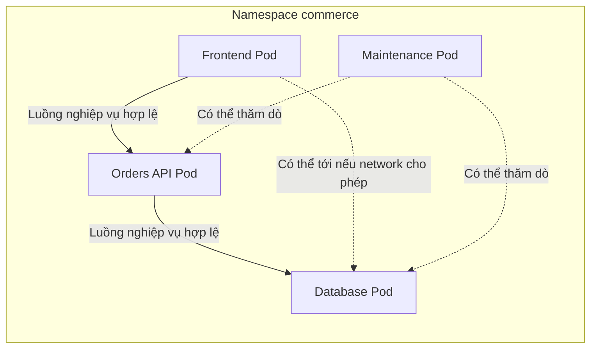
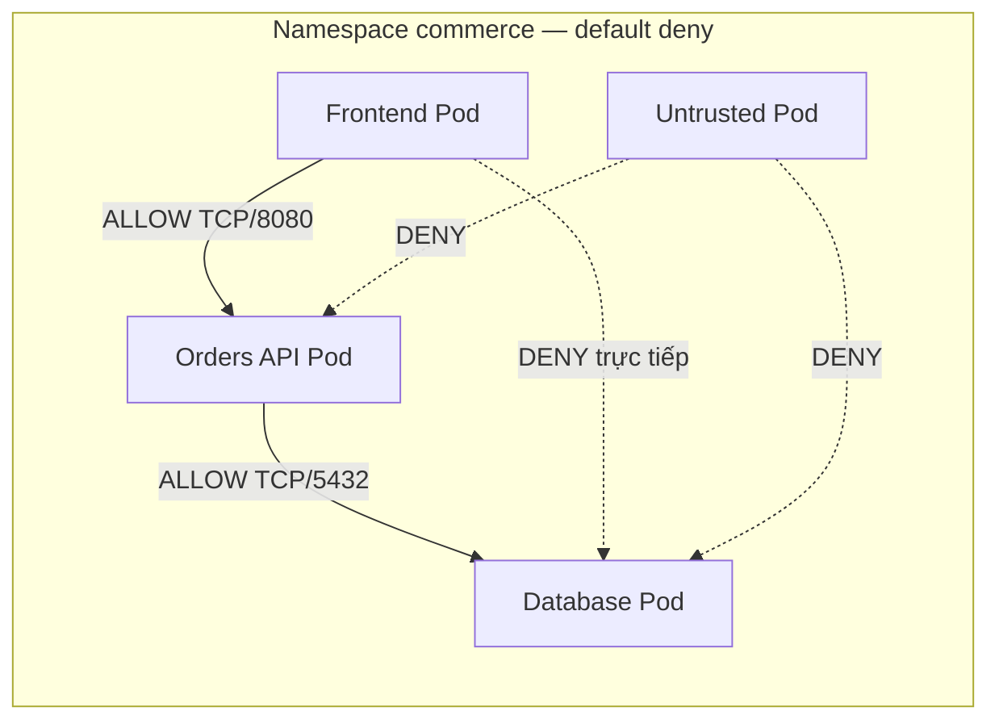
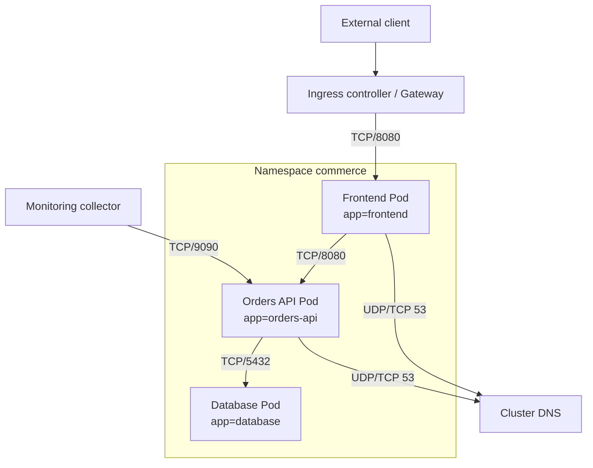
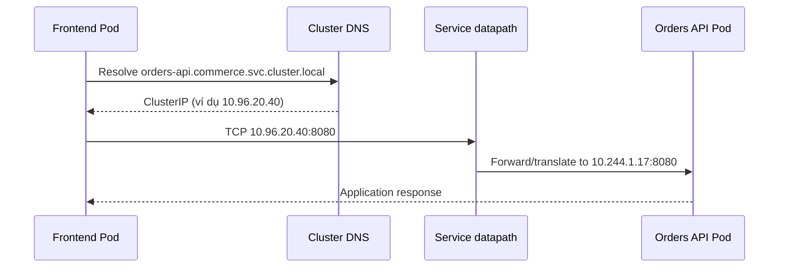
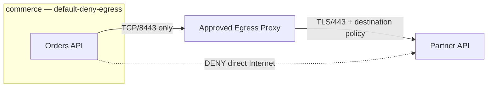
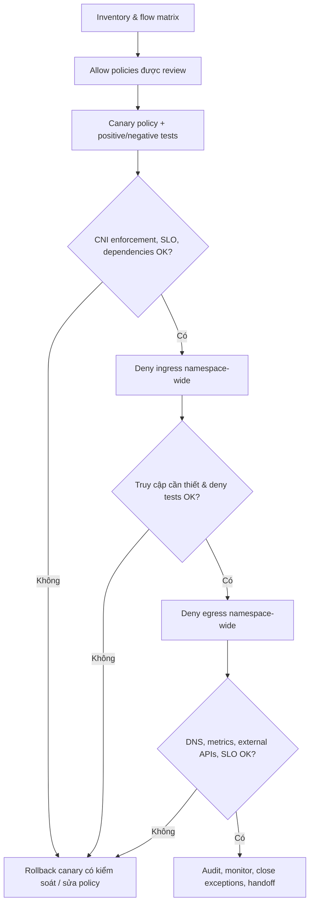
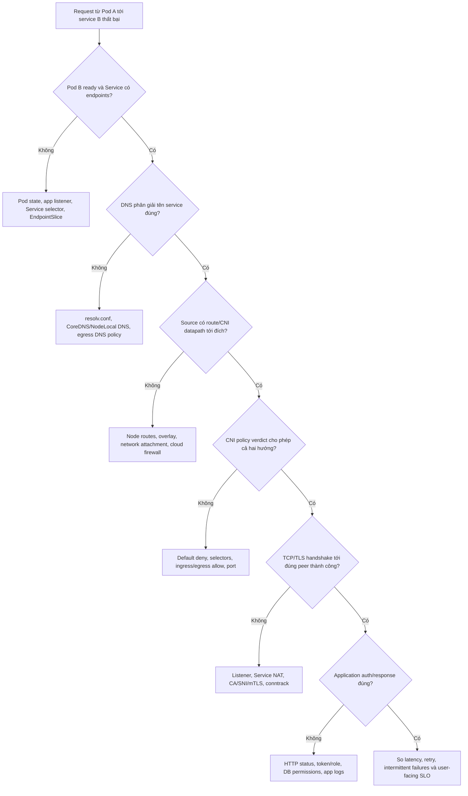
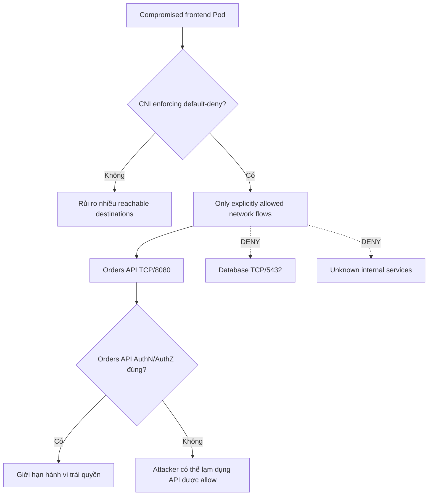

# Default deny cho namespace: thiết kế NetworkPolicy an toàn trong Kubernetes

Giả sử một cluster Kubernetes chạy các dịch vụ `frontend`, `orders-api` và `database` trong namespace `commerce`. Theo yêu cầu nghiệp vụ, `frontend` chỉ cần gọi `orders-api:8080`, còn `orders-api` mới được kết nối tới `database:5432`. Nếu không có quy tắc phân đoạn phù hợp, một Pod `frontend` bị chiếm quyền có thể thử kết nối trực tiếp đến database, service nội bộ khác hoặc các đích ngoài Internet. Bước phòng vệ đầu tiên thường là áp dụng **default deny**: không cho những kết nối chưa được khai báo rõ ràng, sau đó mở tối thiểu những luồng hợp lệ.

Tuy nhiên, chỉ thêm một YAML `NetworkPolicy` không đủ để bảo đảm an toàn. Cấu hình sai có thể cắt DNS, telemetry và traffic ứng dụng; một CNI không thực thi NetworkPolicy có thể khiến policy tồn tại trong API nhưng chẳng chặn packet nào. Ngoài ra, một default deny không tự thay thế TLS/mTLS, IAM, ứng dụng kiểm tra quyền hay các lớp firewall ở node/cloud.

Trong chương **Bảo mật mạng Kubernetes** thuộc module **SECURITY_NETWORK_SECURITY**, bài học đi sâu vào cách dùng **Kubernetes NetworkPolicy để xây dựng default deny theo namespace**, theo tinh thần phòng vệ nhiều lớp: phân đoạn mạng, firewall, xác thực kết nối, giám sát xâm nhập và kiến trúc mạng an toàn.

Sau bài học, bạn có thể:

1. Giải thích **default allow**, **ingress isolation**, **egress isolation** và default deny theo từng chiều đối với Pods.
2. Viết các `NetworkPolicy` mặc định từ chối ingress, egress hoặc cả hai trong một namespace.
3. Xây dựng **ma trận luồng** rồi bổ sung allow rules tối thiểu cho DNS, ingress controller, service-to-service, database và monitoring.
4. Tránh lỗi với `podSelector`, `namespaceSelector`, labels, các rule được **cộng gộp** và tình huống cả nguồn lẫn đích cùng bị cô lập.
5. Phân biệt phạm vi của NetworkPolicy chuẩn với traffic cùng Pod, node/host, `hostNetwork`, service mesh, cloud load balancer và các extension CNI.
6. Lập kế hoạch rollout/rollback có kiểm soát, kiểm chứng **ALLOW và DENY** bằng bằng chứng từ datapath và telemetry.
7. Chẩn đoán lỗi DNS, Service VIP/EndpointSlice, port, NetworkPolicy, CNI, TLS và authorization mà không phải xóa policy một cách mù quáng.
8. Xây dựng bài lab, runbook sự cố, kiểm soát quyền sửa policy và checklist vận hành.

> **Phạm vi và quy ước:** Tất cả namespace `commerce`, `edge-ingress`, `observability`, ứng dụng, IP, hostname và nhãn trong ví dụ là giả lập; chúng chỉ có tác dụng trên cluster đã được cấu hình tương ứng. Các lệnh thay đổi Kubernetes resources chỉ được thực hiện trong môi trường lab/staging được phép sau khi xác minh context, CNI, labels, routes, ứng dụng và phương án khôi phục.

## 1. Default deny giải quyết vấn đề gì?

Kubernetes cung cấp `NetworkPolicy` để mô tả **traffic được cho phép** tới và từ những Pods được chọn, theo hướng ingress và egress. Trong mô hình NetworkPolicy chuẩn, nếu không có NetworkPolicy nào chọn Pod để cô lập một hướng, Pod đó **không bị hạn chế ở hướng ấy bởi NetworkPolicy**, dù firewall/cloud routing hoặc ứng dụng vẫn có thể chặn.

### 1.1. Trước khi có default deny



Những mũi tên nét đứt minh họa **đường có thể tồn tại nếu các lớp khác không chặn**; không có nghĩa mọi cluster chắc chắn cho phép mọi packet. Lỗi kiến trúc ở đây là **quyền mạng không được tuyên bố tường minh**: khi xuất hiện Pod mới, nó có thể tiếp cận những đích không liên quan.

### 1.2. Sau khi áp default deny và allow tối thiểu



Khi **default deny hai chiều** được thực thi đúng, những kết nối chưa có allow rule ở hướng cần thiết sẽ bị từ chối. Tuy nhiên:

- Policy áp trên **Pods được chọn**, không gắn trực tiếp lên Service object, node hoặc container đơn lẻ.
- NetworkPolicy tiêu chuẩn chủ yếu xử lý **L3/L4 reachability**, không có sẵn quyền theo HTTP path, JWT scope hoặc database table.
- Các allow rules của nhiều NetworkPolicies **cộng gộp**, không có một `deny` ưu tiên cao trong API chuẩn.
- Kết quả thực tế phụ thuộc **CNI hỗ trợ enforcement** và đường packet thực sự.
- Một Pod trong namespace khác không tự bị cô lập chỉ vì namespace `commerce` có default deny.

### 1.3. Mục tiêu bảo mật và khả dụng cần đặt cùng nhau

Default deny có hai mặt:

| Góc nhìn | Được cải thiện khi thiết kế đúng | Có thể hỏng khi cấu hình sai |
|---|---|---|
| Bảo mật | Giảm lateral movement, hạn chế quét nội bộ | Một allow rule quá rộng vô hiệu hóa phân đoạn |
| Ứng dụng | Luồng cần thiết được liệt kê rõ | API và DB mất kết nối vì thiếu rule |
| DNS | Chỉ được truy vấn resolver hợp lệ | Pod không resolve được Service/endpoint |
| Observability | Tăng khả năng nhận diện traffic trái policy | Monitoring/OTel/tracing bị chặn |
| Vận hành | Dễ review thay đổi giữa các services | Deploy/sidecar/health check thất bại |
| Khôi phục | Có rollback được kiểm thử | Cắt đường quản trị hoặc phụ thuộc control plane ngoài ý muốn |

Một thiết kế đạt yêu cầu cần **bằng chứng rằng luồng hợp lệ hoạt động và luồng không hợp lệ bị chặn**, không chỉ YAML tạo thành công hoặc dashboard hiển thị màu xanh.

## 2. Hiểu đúng cơ chế cô lập ingress và egress

### 2.1. NetworkPolicy là tài nguyên trong namespace

Một NetworkPolicy tồn tại trong đúng **một namespace**. `spec.podSelector` chọn những Pods **trong namespace đó**. `namespaceSelector` trong `ingress.from` hoặc `egress.to` dùng để chọn các Pods ở những namespace khác theo nhãn.

Ví dụ:

```yaml
apiVersion: networking.k8s.io/v1
kind: NetworkPolicy
metadata:
  name: deny-ingress
  namespace: commerce
spec:
  podSelector: {}
  policyTypes:
    - Ingress
  ingress: []
```

Ở đây `podSelector: {}` có nghĩa **chọn tất cả Pods trong namespace `commerce`**. Nó **không** có nghĩa chọn tất cả Pods trong cluster.

### 2.2. Một Pod khi nào bị ingress-isolated?

Một Pod trở thành **ingress-isolated** nếu có ít nhất một NetworkPolicy chọn Pod ấy và có `Ingress` trong `policyTypes` (hoặc hướng được suy luận theo API khi field không được khai báo).

Khi đã ingress-isolated, traffic từ Pod khác chỉ được phép theo **hợp những ingress allow rules** của các NetworkPolicies chọn Pod đích, kết hợp các quy định về traffic ngoài phạm vi API và implementation.

Điểm quan trọng: NetworkPolicy mặc định **không chặn** một Pod chỉ vì namespace có tên `secure` hoặc vì resource `Service` có `ClusterIP`.

### 2.3. Một Pod khi nào bị egress-isolated?

Pod là **egress-isolated** nếu ít nhất một NetworkPolicy chọn Pod và đưa hướng `Egress` vào `policyTypes`. Khi đó traffic đi ra phải được một egress rule thích hợp cho phép.

Một policy chỉ có `Ingress` **không tự hạn chế egress** của Pods được chọn. Một policy chỉ có `Egress` **không tự chặn ingress**.

### 2.4. Allow hai đầu khi source và destination đều bị cô lập

Giả sử `frontend` và `orders-api` đều bị default deny ingress/egress. Muốn frontend gọi orders qua TCP/8080, cần:

1. Egress từ **frontend** đến **orders-api** TCP/8080 được cho phép.
2. Ingress tại **orders-api** từ **frontend** TCP/8080 được cho phép.
3. Có DNS/route/CNI/Service datapath phù hợp và ứng dụng thực sự lắng nghe.

| Source bị egress-isolated | Destination bị ingress-isolated | Quy tắc NetworkPolicy cần thỏa |
|---|---|---|
| Không | Không | Không bị chặn bởi NetworkPolicy ở hai hướng |
| Có | Không | Source egress allow |
| Không | Có | Destination ingress allow |
| Có | Có | **Cả source egress và destination ingress allow** |

Traffic phản hồi của một kết nối được phép thường được CNI theo dõi theo connection state; **không nhất thiết cần viết rule đối xứng cho reply packets** như một ACL stateless. Nhưng các trường hợp UDP, ICMP, host/node traffic và connection tracking có khác biệt theo implementation, cần kiểm tra.

### 2.5. NetworkPolicies là phép hợp, không phải danh sách deny ưu tiên

Giả sử:

```text
Policy A cho frontend → orders-api TCP/8080
Policy B cho monitoring → orders-api TCP/9090
```

Khi cả hai chọn `orders-api` ingress, kết quả là **cả hai tập luồng được phép**. Không có chính sách “deny cuối cùng thắng”. Nếu một policy khác vô tình cho toàn bộ namespace kết nối tất cả ports, những allow rules chặt chẽ hơn **không thể phủ định** nó.

```yaml
# Ví dụ RỦI RO: cho tất cả sources đến tất cả ports
# trên các Pods được chọn. Không áp cho production.
apiVersion: networking.k8s.io/v1
kind: NetworkPolicy
metadata:
  name: broad-allow-example
  namespace: commerce
spec:
  podSelector: {}
  policyTypes:
    - Ingress
  ingress:
    - {}
```

`ingress: [{ }]` theo semantics NetworkPolicy nghĩa là **cho phép ingress rộng** đối với các Pods được chọn, không phải default deny. Cấu hình này có thể làm mất mục tiêu security dù vẫn giữ một policy khác tên `default-deny`.

## 3. Ba cấu hình default deny cơ bản

Một lựa chọn phù hợp tùy mục tiêu: chặn **người khác gọi vào**, chặn **Pods gọi ra**, hoặc chặn **cả hai**. Dùng `policyTypes` tường minh và danh sách rules rỗng để dễ review.

### 3.1. Default deny ingress cho namespace

```yaml
apiVersion: networking.k8s.io/v1
kind: NetworkPolicy
metadata:
  name: default-deny-ingress
  namespace: commerce
spec:
  podSelector: {}
  policyTypes:
    - Ingress
  ingress: []
```

**Hiệu lực mong đợi:** tất cả Pods trong namespace `commerce` bị cô lập ở chiều ingress, trừ những flows được ingress rules từ các NetworkPolicies khác cho phép. Không làm Pods bị egress-isolated.

Phù hợp khi mục tiêu đầu tiên là giảm các nguồn gọi vào service, trong khi egress vẫn đang được khảo sát. Nhưng để chống exfiltration hoặc lateral movement từ một Pod bị compromise, cần thêm egress controls.

### 3.2. Default deny egress cho namespace

```yaml
apiVersion: networking.k8s.io/v1
kind: NetworkPolicy
metadata:
  name: default-deny-egress
  namespace: commerce
spec:
  podSelector: {}
  policyTypes:
    - Egress
  egress: []
```

**Hiệu lực mong đợi:** tất cả Pods trong `commerce` bị cô lập ở chiều egress, trừ những flows được egress rules của các NetworkPolicies khác cho phép. Không làm Pods bị ingress-isolated.

**Lưu ý:** DNS, metrics push, service discovery, API calls, database queries và một số external identity dependencies có thể bị chặn. Không dùng egress deny khi chưa xác định đường cần thiết.

### 3.3. Default deny cả ingress và egress

```yaml
apiVersion: networking.k8s.io/v1
kind: NetworkPolicy
metadata:
  name: default-deny-all
  namespace: commerce
spec:
  podSelector: {}
  policyTypes:
    - Ingress
    - Egress
  ingress: []
  egress: []
```

**Hiệu lực mong đợi:** mọi Pods thuộc `commerce` bị cô lập hai hướng theo khả năng NetworkPolicy. Chỉ những flows được allow từ các policies khác, cộng với traffic ngoài phạm vi/ngoại lệ của implementation, mới có thể đi qua.

**Không áp thẳng lên namespace production trước khi chuẩn bị allow rules.** Đặc biệt, `kubectl apply` thành công chỉ xác nhận API chấp nhận resource; chưa chứng minh CNI đã thực thi hoặc các dependencies không bị gián đoạn.

### 3.4. Dùng một policy hai chiều hay hai policies riêng?

| Lựa chọn | Điểm mạnh | Đánh đổi |
|---|---|---|
| `default-deny-all` | Một baseline dễ nhận ra và kiểm tra | Rollout cả hai hướng đồng thời dễ gây disruption |
| `default-deny-ingress` + `default-deny-egress` | Bật từng hướng, rollback theo giai đoạn | Cần bảo đảm cả hai luôn tồn tại sau rollout |
| Deny baseline chọn riêng các workload labels | Canary theo workload có thể ít rủi ro hơn | Không đạt **namespace-wide** default deny khi có Pod mới/đổi labels |

Đối với mục tiêu lâu dài **default deny cho cả namespace**, `podSelector: {}` là lựa chọn điển hình vì một Pod mới thêm vào namespace vẫn được baseline chọn. Trong giai đoạn canary, dùng policy chọn nhóm cụ thể có thể giúp giảm tác động, nhưng phải ghi rõ đó **chưa phải default deny toàn namespace**.

### 3.5. Vì sao “policy tồn tại” chưa đủ?

Kubernetes chỉ định nghĩa đối tượng NetworkPolicy; **network plugin/CNI phải hỗ trợ thực thi**. Có thể xảy ra:

```text
kubectl get networkpolicy default-deny-all -n commerce
→ Resource EXISTS

Pod frontend → Pod database
→ Kết nối vẫn thành công do CNI không enforce policy hoặc đường ngoài scope
```

Để kết luận `default-deny` hoạt động cần:

1. Xác nhận CNI/datapath có hỗ trợ chuẩn `networking.k8s.io/v1`.
2. Kiểm tra đúng namespace, Pods, labels và directions.
3. Thử một luồng **trái policy nhưng đích thực sự đang lắng nghe**.
4. Thu bằng chứng CNI verdict/drop hoặc công cụ tương đương khi có.
5. Kiểm tra các đường trực tiếp/Service/NodePort/host networking và đường egress ngoài dự kiến theo threat model.

## 4. Chuẩn bị flow matrix trước khi khóa namespace

Đây là bước quan trọng nhất để default deny **không biến thành một sự cố availability**.

### 4.1. Ví dụ kiến trúc của namespace `commerce`



Sơ đồ đơn giản hóa: trong thực tế, ingress controller, DNS và monitoring có thể ở các namespace khác, có egress isolation riêng. Database có thể là managed service không phải Pod; khi đó các allow rules sẽ khác.

### 4.2. Ma trận nguồn–đích

| Nguồn | Đích | Protocol/port đích | Hành động mong đợi | Lý do |
|---|---|---|---|---|
| Trusted ingress controller | Frontend Pods | TCP/8080 | ALLOW | Request từ gateway công khai |
| Frontend Pods | Orders API Pods | TCP/8080 | ALLOW | Nghiệp vụ |
| Orders API Pods | Database Pods | TCP/5432 | ALLOW | Truy cập dữ liệu |
| Frontend/Orders Pods | Resolver được duyệt | UDP/TCP 53 | ALLOW | Service discovery |
| Monitoring collector | Orders API Pods | TCP/9090 | ALLOW | Scrape metrics |
| Frontend Pods | Database Pods | TCP/5432 | **DENY** | Không có nhu cầu |
| Unknown Pod | Orders API Pods | TCP/8080 | **DENY** | Chống lateral movement |
| Orders API Pods | Internet tùy ý | Any | **DENY** | Ngăn egress không được phê duyệt |
| Unknown external source | Pod admin/debug port | Any | **DENY** | Bảo vệ quản trị |

**Một ALLOW trong bảng cần được ánh xạ sang cả ingress và egress khi hai đầu đều bị cô lập.** Cần ghi ownership, namespace/Pod selectors, DNS target thực, expected TLS identity, route và công cụ test cho từng dòng.

### 4.3. Danh sách phụ thuộc hay bị bỏ sót

Ngoài API chính, hãy khảo sát:

- Cluster DNS/CoreDNS/NodeLocal DNSCache, UDP và TCP.
- Ingress controller/Gateway API controller và health checking từ load balancer.
- Monitoring: Prometheus scrape, OpenTelemetry collector, log shipping agent.
- Service mesh proxies: control plane discovery, CA/certificate rotation và telemetry.
- Workload identity và external identity provider, KMS/secrets service, approved API endpoints.
- Stateful database/queue/cache, cloud private endpoints và external payment partner.
- Batch jobs/cronjobs chạy thưa, không xuất hiện trong cửa sổ log ngắn.
- Ứng dụng cần egress để kiểm tra revocation/certificate renewal hoặc gọi upstream service.

**Phân biệt lưu lượng do Pod ứng dụng gửi** với traffic do kubelet/node thực hiện, chẳng hạn việc node tải container image. Không tự thêm egress tới container registry cho mọi Pod nếu image pulling không diễn ra trong Pod network namespace.

## 5. Các allow rules tối thiểu sau default deny

Phần này triển khai ma trận ở mục 4 bằng **Kubernetes NetworkPolicy chuẩn**. Giả định:

```text
Namespace: commerce
  app=frontend    — HTTP listener TCP/8080
  app=orders-api  — HTTP listener TCP/8080; metrics TCP/9090
  app=database    — PostgreSQL listener TCP/5432

Namespace: edge-ingress
  app.kubernetes.io/name=ingress-nginx

Namespace: observability
  app=prometheus

Namespace: kube-system
  k8s-app=kube-dns (chỉ trong cluster thử nghiệm có label này)
```

Những labels/ports này **không phải mặc định bắt buộc của Kubernetes hay của các nhà cung cấp**. Trước khi áp dụng, phải xác minh bằng `kubectl get pods --show-labels`, Service target ports, namespace labels và loại CNI của cluster. Tất cả chính sách dưới đây giả định đã có `default-deny-all` ở namespace `commerce`.

### 5.1. Allow ingress từ trusted ingress controller tới frontend

```yaml
apiVersion: networking.k8s.io/v1
kind: NetworkPolicy
metadata:
  name: frontend-from-edge-ingress
  namespace: commerce
spec:
  podSelector:
    matchLabels:
      app: frontend
  policyTypes:
    - Ingress
  ingress:
    - from:
        - namespaceSelector:
            matchLabels:
              kubernetes.io/metadata.name: edge-ingress
          podSelector:
            matchLabels:
              app.kubernetes.io/name: ingress-nginx
      ports:
        - protocol: TCP
          port: 8080
```

Một phần tử trong `from` đồng thời chứa `namespaceSelector` và `podSelector` diễn đạt:

> Chỉ Pods có `app.kubernetes.io/name=ingress-nginx` **nằm trong namespace `edge-ingress`** mới được ingress vào `frontend:8080`.

**Cần xác minh nguồn thật:** Một số ingress/LB triển khai host networking, node-local proxy, source NAT hoặc backend traffic với địa chỉ node/proxy-only subnet, không còn là Pod source IP như selector giả định. Policy này **không bảo đảm tự động cho phép ingress từ mọi loại cloud load balancer**. Kiểm tra traffic path và scope thực thi CNI.

Nếu Pod của ingress controller cũng egress-isolated trong namespace riêng của nó, phải có **egress allow ở namespace của controller**, không thể mở egress cho nó bằng policy trong `commerce`.

### 5.2. Allow frontend egress tới orders-api

```yaml
apiVersion: networking.k8s.io/v1
kind: NetworkPolicy
metadata:
  name: frontend-to-orders
  namespace: commerce
spec:
  podSelector:
    matchLabels:
      app: frontend
  policyTypes:
    - Egress
  egress:
    - to:
        - podSelector:
            matchLabels:
              app: orders-api
      ports:
        - protocol: TCP
          port: 8080
```

Vì `podSelector` trong `to` không kèm `namespaceSelector`, nó chọn `orders-api` Pods trong **chính namespace `commerce`**. Policy này chỉ mở **egress của frontend** tới đúng Pods/port; nó chưa mở ingress của orders.

### 5.3. Allow orders-api ingress từ frontend

```yaml
apiVersion: networking.k8s.io/v1
kind: NetworkPolicy
metadata:
  name: orders-from-frontend
  namespace: commerce
spec:
  podSelector:
    matchLabels:
      app: orders-api
  policyTypes:
    - Ingress
  ingress:
    - from:
        - podSelector:
            matchLabels:
              app: frontend
      ports:
        - protocol: TCP
          port: 8080
```

Kết hợp **5.2 và 5.3** để frontend có thể gọi orders TCP/8080 theo NetworkPolicy, giả sử route, Service và listener hoạt động. Nếu chỉ áp 5.3 sau default deny toàn bộ, frontend vẫn bị từ chối egress.

### 5.4. Allow orders-api egress tới database

```yaml
apiVersion: networking.k8s.io/v1
kind: NetworkPolicy
metadata:
  name: orders-to-database
  namespace: commerce
spec:
  podSelector:
    matchLabels:
      app: orders-api
  policyTypes:
    - Egress
  egress:
    - to:
        - podSelector:
            matchLabels:
              app: database
      ports:
        - protocol: TCP
          port: 5432
```

### 5.5. Allow database ingress từ orders-api

```yaml
apiVersion: networking.k8s.io/v1
kind: NetworkPolicy
metadata:
  name: database-from-orders
  namespace: commerce
spec:
  podSelector:
    matchLabels:
      app: database
  policyTypes:
    - Ingress
  ingress:
    - from:
        - podSelector:
            matchLabels:
              app: orders-api
      ports:
        - protocol: TCP
          port: 5432
```

Kết hợp **5.4 và 5.5** chỉ mở TCP/5432 từ orders tới database trong namespace giả lập. Frontend không nằm trong nguồn được cho phép, nên luồng frontend → DB phải bị từ chối ở ít nhất một hướng khi default-deny enforcement đúng.

**Lưu ý an toàn dữ liệu:** NetworkPolicy cho kết nối tới DB không thay database authentication, TLS và phân quyền SQL. Một `orders-api` bị compromise vẫn có thể sử dụng chính quyền DB hợp lệ của nó; cần database roles và app-level authorization.

### 5.6. Allow monitoring scrape metrics

```yaml
apiVersion: networking.k8s.io/v1
kind: NetworkPolicy
metadata:
  name: orders-metrics-from-prometheus
  namespace: commerce
spec:
  podSelector:
    matchLabels:
      app: orders-api
  policyTypes:
    - Ingress
  ingress:
    - from:
        - namespaceSelector:
            matchLabels:
              kubernetes.io/metadata.name: observability
          podSelector:
            matchLabels:
              app: prometheus
      ports:
        - protocol: TCP
          port: 9090
```

Policy mở **ingress vào orders** cho đúng monitoring Pods. Nếu monitoring Pod bị egress-isolated, nhóm observability phải cho phép chiều egress riêng. Nếu metrics endpoint chứa dữ liệu nhạy cảm, hãy dùng **mTLS/service authentication, mạng giám sát và endpoint authorization** phù hợp; NetworkPolicy không kiểm soát nội dung response.

### 5.7. Diễn giải tổng hợp

| Flow | Source egress | Destination ingress | Kết quả kỳ vọng |
|---|---|---|---|
| Edge controller → Frontend:8080 | Theo policy nguồn ở `edge-ingress` | Rule 5.1 | ALLOW nếu đường datapath đúng |
| Frontend → Orders:8080 | Rule 5.2 | Rule 5.3 | ALLOW |
| Orders → Database:5432 | Rule 5.4 | Rule 5.5 | ALLOW |
| Prometheus → Orders:9090 | Theo policy nguồn ở `observability` | Rule 5.6 | ALLOW nếu đã mở egress nguồn |
| Frontend → Database:5432 | Không có allow egress | Không có allow ingress từ frontend | **DENY** |
| Unknown Pod → Orders:8080 | Tùy policy nguồn | Không có allow ingress tương ứng | **DENY** |
| Orders → Internet tự do | Không có allow egress tương ứng | Ngoài namespace | **DENY** trong phạm vi NetworkPolicy |

**Cảnh báo về cổng:** Nếu Kubernetes Service dùng `port: 80`, còn Pod `targetPort: 8080`, cơ chế NetworkPolicy matching liên quan DNAT/Service VIP có thể khác theo CNI và packet path. Ví dụ này cố tình dùng **cùng target port 8080** cho flow policy để giảm nhập nhằng. Hãy kiểm tra kết nối thông qua **đúng Service mà ứng dụng thực sự gọi**, không chỉ thử direct Pod IP.

## 6. Cho phép DNS mà không mở toàn bộ egress

### 6.1. Vì sao deny egress làm DNS mất khả dụng?

Khi Pod dùng tên `orders-api.commerce.svc.cluster.local`, nó cần gửi DNS request đến resolver phù hợp với cấu hình `dnsPolicy`, `/etc/resolv.conf` và mạng của cluster. Nếu Pod đã egress-isolated, DNS request cũng phải được allow trong phạm vi enforcement.

```text
Frontend Pod
    |
    +-- UDP/TCP 53 → Cluster DNS resolver
    |
    +-- TCP/8080  → Orders API sau khi resolve
```

Khi thiếu quyền DNS:

- Một số client báo timeout vì DNS request/response không tới được resolver.
- DNS cache còn kết quả có thể tạm che lỗi.
- Ứng dụng dùng hardcoded IP đôi khi vẫn chạy nếu flow IP được allow.
- `NXDOMAIN` lại thường là **resolver đã phản hồi rằng tên không có**; không nên nhầm với timeout do network deny.

### 6.2. Ví dụ egress allow tới CoreDNS Pods

Giả sử đã xác minh CoreDNS Pods có label `k8s-app=kube-dns` trong namespace `kube-system` và CNI hỗ trợ policy với Service destination này:

```yaml
apiVersion: networking.k8s.io/v1
kind: NetworkPolicy
metadata:
  name: allow-cluster-dns
  namespace: commerce
spec:
  podSelector: {}
  policyTypes:
    - Egress
  egress:
    - to:
        - namespaceSelector:
            matchLabels:
              kubernetes.io/metadata.name: kube-system
          podSelector:
            matchLabels:
              k8s-app: kube-dns
      ports:
        - protocol: UDP
          port: 53
        - protocol: TCP
          port: 53
```

`podSelector: {}` ở đây cố tình cho **tất cả Pods trong `commerce`** egress tới resolver được chọn. Nó **không** cho mọi Pod truy cập mọi đích khác vì chỉ có destination Pods/ports trong rule.

**Điểm cần xác minh trước khi dùng:**

1. `kube-system` và Pod labels có thật hay không.
2. DNS request đi tới **CoreDNS Pod IP, Service VIP, NodeLocal DNSCache hay resolver custom**?
3. CNI áp policy ở đâu so với Service DNAT/NodeLocal forwarding?
4. DNS có dùng UDP/TCP 53 hoặc cơ chế khác như DNS-over-TLS ở một thành phần riêng?
5. Đã thử query từ **đúng source Pod** với chính sách đang áp chưa?

Một số cluster dùng **NodeLocal DNSCache** trên link-local address, hoặc cấu hình DNS traffic từ Pod tới node được xử lý khác. Khi đó một allow rule chỉ chọn CoreDNS Pods có thể **không match đường thực tế**. Phải điều chỉnh rule dựa trên thiết kế/telemetry thực tế, không đoán địa chỉ.

### 6.3. DNS egress allow chưa phải DNS security đầy đủ

Cho phép Pod hỏi một resolver không chứng minh **tên trả về đúng service**, cũng không giới hạn hoàn toàn data exfiltration qua DNS nếu resolver cho phép truy vấn domain tùy ý.

Cần kết hợp:

- Approved DNS resolvers và DNS query logging/phân tích nếu phù hợp.
- Resolver-level policies, DNS firewall hoặc egress filtering theo nhu cầu.
- Ngăn direct outbound tới các resolver trái phép và đường DoH/DoT bypass nếu threat model yêu cầu.
- TLS/mTLS xác minh service identity sau khi phân giải.
- Không xem DNS name là credential hoặc user authorization.

### 6.4. Đừng cho egress DNS quá rộng chỉ để làm ứng dụng chạy

Ví dụ rule dưới đây có thể làm DNS hoạt động nhưng mở query tới mọi IPv4 destination, không đúng least privilege:

```yaml
# Ví dụ KHÔNG KHUYẾN NGHỊ nếu chỉ cần cluster DNS.
egress:
  - to:
      - ipBlock:
          cidr: 0.0.0.0/0
    ports:
      - protocol: UDP
        port: 53
      - protocol: TCP
        port: 53
```

Nó còn bỏ qua IPv6/DoH và có thể bị áp theo cách khác ở các CNI. Chọn resolver cụ thể, bảo vệ đường resolution thực tế và kiểm thử policy enforcement.

## 7. Selectors và labels: lỗi cú pháp nhỏ có thể mở rộng quyền lớn

### 7.1. Một `podSelector` chỉ chọn Pods trong phạm vi cần thiết

Ví dụ:

```yaml
podSelector:
  matchLabels:
    app: orders-api
```

Ở `spec.podSelector`, điều kiện này chọn **Pods trong namespace của policy**. Nó **không** tự chọn `orders-api` Pods ở tất cả namespaces. Với `from/to.podSelector` không có `namespaceSelector`, peer Pods cũng được hiểu trong namespace của NetworkPolicy.

### 7.2. AND và OR giữa namespaceSelector/podSelector

**Cách viết đúng để chọn monitoring Pods thuộc đúng namespace:**

```yaml
from:
  - namespaceSelector:
      matchLabels:
        kubernetes.io/metadata.name: observability
    podSelector:
      matchLabels:
        app: prometheus
```

Đây là **AND**: Pods phải cùng lúc thuộc namespace phù hợp và có label `app=prometheus`.

**Cách viết sau rộng hơn rất nhiều:**

```yaml
from:
  - namespaceSelector:
      matchLabels:
        kubernetes.io/metadata.name: observability
  - podSelector:
      matchLabels:
        app: prometheus
```

Đây là **OR** giữa hai peer alternatives: mọi Pods trong namespace `observability`, **hoặc** những Pods `app=prometheus` trong namespace của NetworkPolicy. Hai ví dụ **không tương đương**.

### 7.3. `namespaceSelector: {}` không có nghĩa “chính namespace”

Một empty selector như:

```yaml
from:
  - namespaceSelector: {}
```

thường chọn **tất cả namespaces**, không phải chỉ namespace hiện tại. Nếu mục đích là allow Pods có nhãn cụ thể trong cùng namespace, hãy dùng `podSelector` mà không kèm `namespaceSelector`.

Tương tự, một peer:

```yaml
from:
  - podSelector: {}
```

chọn mọi Pods thuộc **cùng namespace với policy**. Nhưng nếu ghi:

```yaml
from:
  - namespaceSelector: {}
    podSelector: {}
```

thì có thể mở thành **mọi Pods của mọi namespaces**, với một rule cực rộng.

### 7.4. Labels thay đổi, quyền cũng thay đổi

Nếu rule chỉ cho Pod `app=frontend` gọi orders, nhưng một principal không tin cậy có quyền tạo Pod mang label `app=frontend`, nó có thể được allow bởi **network policy dựa vào label**. Do đó:

- Kiểm soát quyền tạo/sửa Pods, labels và NetworkPolicies bằng Kubernetes RBAC.
- Bảo vệ namespace membership/labels và admission policies theo nhu cầu.
- Không xem label tự khai là **cryptographic workload identity**.
- Dùng mTLS/service identity/application authorization để kiểm tra caller thật.
- Áp default deny chọn **tất cả Pods** để Pods mới không tự trở thành unisolated khi labels bị đổi.

### 7.5. Policy bị bỏ sót sau rollout

```text
Deployment cũ: app=orders-api
Deployment mới: app=orders-v2

Rule ingress:
  podSelector app=orders-api
```

Sau deploy, Pod mới có thể không nhận các allow rules cần thiết. Với namespace-wide default deny, Pod mới vẫn bị baseline cô lập, nên request thất bại — một lỗi **fail closed** dễ quan sát. Nhưng nếu chỉ dùng policy chọn `app=orders-api` để cô lập ingress mà **không có namespace default deny**, Pod `orders-v2` có thể **không bị ingress-isolated**, dẫn tới exposure ngoài ý định.

Hãy kiểm thử selectors bằng chính **labels của rollout mới** và theo dõi Pod UIDs, EndpointSlices, error rate ngay trong quá trình triển khai.

## 8. NetworkPolicy chuẩn không bảo vệ những gì?

Default deny cho namespace là một biện pháp quan trọng nhưng có **phạm vi bảo đảm hữu hạn**.

| Đối tượng / luồng | NetworkPolicy chuẩn có bảo vệ toàn bộ không? | Kiểm soát bổ sung |
|---|---|---|
| Pod-to-Pod giữa namespaces | Có trong phạm vi được CNI hỗ trợ | Authorization, mTLS, ingress/egress đúng hai đầu |
| Hai containers trong cùng một Pod | **Không dùng để tách riêng từng container** | Tách Pods nếu cần, app local auth, least privilege |
| `localhost` trong cùng network namespace | Không xem là ranh giới Pod NetworkPolicy | Local listener protection, process boundaries |
| `hostNetwork` Pod | Hành vi policy có thể khác theo CNI | Host firewall/CNI host policies, RBAC, hardening |
| Kubelet ↔ Pod/node traffic | Có ngoại lệ/phạm vi theo Kubernetes và CNI | Node security/health design |
| `hostPort`/NodePort/LoadBalancer | Phụ thuộc datapath/source NAT/loại exposure | Node/cloud firewall, ingress security, test trực tiếp |
| Cloud managed DB/public endpoint | Không thể chỉ dựa vào policy trong namespace | Cloud SG/NSG/service firewall, IAM, TLS/DB auth |
| HTTP `/admin` nhưng cho HTTP `/health` | Không phải tính năng L7 chuẩn | App auth, gateway, L7 CNI extensions nếu hỗ trợ |
| Chỉ cho domain `payments.example.test` | Không có FQDN selector chuẩn | CNI FQDN policy extension, proxy/egress controls |
| Cấm một flow đã được policy khác allow | Không có ordered explicit deny trong API chuẩn | Sửa broad allow, CNI-specific deny extension nếu hỗ trợ |
| Certificate/secret/token bị đánh cắp | NetworkPolicy không xác thực credentials | IAM, short-lived credentials, mTLS, secrets policy |

### 8.1. Containers cùng Pod chia sẻ netns

Các container trong cùng Pod thường có **chung Pod IP và loopback namespace**. Một sidecar có thể gọi endpoint `127.0.0.1` do app đang listen. Một NetworkPolicy chọn Pod không thể mô tả “sidecar A được localhost:8080 nhưng sidecar B bị từ chối” theo **container identity**.

Khi cần cách ly mạng thật sự giữa hai workloads, hãy xem xét **tách thành Pods riêng**, kết hợp NetworkPolicy và application authentication.

### 8.2. Node, hostNetwork và packet-path exceptions

Traffic đến/từ node chạy Pod có những đặc thù trong mô hình Kubernetes, và việc áp NetworkPolicy cho `hostNetwork` Pods phụ thuộc implementation. Không được khẳng định default deny của namespace **chặn mọi luồng với host, metadata IP, kubelet hoặc CNI agent**.

Để đạt mục tiêu:

- Kiểm tra host/node firewall, cloud SG/NSG và CNI-specific host policies.
- Hạn chế `hostNetwork`, `hostPort`, privileged Pods và khả năng truy cập Docker/container runtime socket.
- Dùng admission policy và RBAC để kiểm soát ai được tạo các Pod specs có rủi ro.
- Kiểm thử traffic tới node IP, metadata service, API server và các đường không đi như Pod-to-Pod thông thường theo scope được phép.

### 8.3. NetworkPolicy không mã hóa payload

Giao tiếp Pod A → Pod B được NetworkPolicy allow vẫn có thể là HTTP plaintext. Nếu cần confidentiality/integrity và xác thực peer, dùng **TLS/mTLS** tại ứng dụng hoặc service mesh, với trust anchor, SAN/workload identity và certificate rotation đúng.

Service mesh mTLS cũng không tự thay NetworkPolicy: proxy-to-proxy có thể bảo vệ transport, nhưng app vẫn cần authorization; các luồng bypass sidecar/ambient datapath phải được đánh giá.

### 8.4. NetworkPolicy không thay các chính sách bảo mật khác

Kubernetes Pod Security Admission, RBAC, IAM, image provenance, secrets management và ứng dụng AuthN/AuthZ xử lý những mối đe dọa khác. Một kẻ tấn công có quyền sửa NetworkPolicies/labels hoặc có host admin privileges có thể phá mô hình tin cậy mà NetworkPolicy ở tầng Pod giả định.

**Tóm tắt phạm vi:** NetworkPolicy giúp thu hẹp *đường mạng nào được phép tới đâu*; nó không tự chứng minh *ai đang gọi*, *nội dung yêu cầu hợp lệ* hay *control plane không bị lạm dụng*.

## 9. Service VIP, NAT, CNI và cổng đích: những chi tiết làm policy khó đoán

Một Pod thường gọi **Service DNS name**, không gọi trực tiếp Pod IP. Kubernetes Service giới thiệu địa chỉ logic như ClusterIP; phần datapath chuyển traffic tới endpoint Pods được chọn. Điểm mà NetworkPolicy nhìn thấy IP/port có thể bị ảnh hưởng bởi **DNAT/SNAT và implementation**.

### 9.1. Sơ đồ request tới ClusterIP



Sơ đồ mô tả logic. `Service datapath` không nhất thiết là một Pod/process riêng. Nó có thể được thực thi bằng netfilter/iptables, nftables, IPVS hoặc eBPF tùy cluster/version/CNI.

### 9.2. NetworkPolicy chọn Pods, không chọn Service object

Ví dụ egress:

```yaml
egress:
  - to:
      - podSelector:
          matchLabels:
            app: orders-api
    ports:
      - protocol: TCP
        port: 8080
```

Nó diễn đạt **đích Pod** theo labels, không chọn `Service` bằng tên. Khi frontend kết nối tới một Service VIP, CNI phải xử lý policy theo datapath đang dùng.

Nếu `Service port=80` và `targetPort=8080`, hãy thử **đúng đường gọi `orders-api:80`** để xác minh kết quả. Không mặc định policy tại mọi CNI luôn so cổng trước/sau DNAT giống nhau, đặc biệt khi sử dụng `ipBlock` hoặc gateway.

### 9.3. `ipBlock` có giới hạn với Pod và Service IP

Ví dụ external destination:

```yaml
apiVersion: networking.k8s.io/v1
kind: NetworkPolicy
metadata:
  name: example-egress-to-approved-private-db
  namespace: commerce
spec:
  podSelector:
    matchLabels:
      app: orders-api
  policyTypes:
    - Egress
  egress:
    - to:
        - ipBlock:
            cidr: 10.20.30.0/24
      ports:
        - protocol: TCP
          port: 5432
```

Đây là **chính sách ví dụ**, chỉ phù hợp nếu dải `10.20.30.0/24` chính là phạm vi DB được phê duyệt và không bao phủ các đích không liên quan. Không dùng `ipBlock` của cả Pod CIDR để “tin mọi Pod” vì địa chỉ Pod có thể thay đổi và semantics implementation không bảo đảm một policy sẽ có ý nghĩa service identity.

Với managed DB:

- Private endpoint IP có thể đổi khi failover/maintenance.
- DNS có thể trả nhiều A/AAAA records.
- Kết nối từ Pod có thể đi qua egress gateway/NAT.
- Kubernetes NetworkPolicy chuẩn không hỗ trợ domain/FQDN selector.
- Cloud SG/NSG/firewall và database credentials vẫn phải cho phép hợp lệ.

Đừng thay DB TLS server certificate validation bằng một CIDR allowlist.

### 9.4. Ingress từ cloud load balancer không luôn mang source Pod identity

```text
Internet client → Cloud LB → NodePort/Ingress Controller → Frontend Pod
```

Một policy `namespaceSelector + podSelector` có thể match được nếu source thật là ingress controller Pod bình thường. Nhưng ở những mô hình host networking, NodePort/SNAT, proxy-only subnet hoặc managed gateway, nguồn quan sát tại điểm enforcement có thể là **node IP/LB IP**, không phải Pod ingress đã giả định.

Khi điều tra:

1. Xác định loại LB/Ingress/Gateway và đường tới Pod endpoint.
2. Kiểm tra địa chỉ nguồn trước/sau NAT và CNI policy evaluation.
3. Xác minh traffic bị chặn/được phép trên **đúng datapath**.
4. Áp cloud firewall, gateway authentication và application authorization bổ sung.
5. Tránh sửa rule thành `ipBlock: 0.0.0.0/0` chỉ để làm health check chuyển xanh.

### 9.5. `hostNetwork`, node-to-Pod và CNI-specific host policies

Một số traffic tới/từ node nơi Pod chạy được xử lý theo các ngoại lệ/phạm vi của Kubernetes/CNI. Liveness/readiness probes từ kubelet, CNI agents, node-local DNS và traffic của host-network Pods có thể không chịu đúng rules như hai Pods thông thường.

**Do đó:** default deny theo namespace không thể được dùng như một chứng cứ rằng node quản trị, metadata service hoặc toàn bộ host ingress đã bị chặn. Khi cần chặn các đường này, chọn điểm thực thi **host firewall, cloud security groups, CNI host policies hoặc application authentication** được nhà cung cấp hỗ trợ.

## 10. Thiết kế egress khi cần DNS, observability và external dependencies

Default deny ingress có thể được áp sớm hơn trong nhiều hệ thống; **default deny egress** thường đòi khảo sát kỹ hơn vì Pods phụ thuộc nhiều dịch vụ không cùng namespace.

### 10.1. Phân loại egress dependency

| Nguồn | Đích | Khả năng cần egress của Pod? | Cách quản lý |
|---|---|---|---|
| App Pod | Cluster DNS resolver | Thường có | Allow UDP/TCP 53 đúng resolver |
| App Pod | In-cluster API khác | Có | `podSelector`/`namespaceSelector`, port |
| App Pod | Managed DB | Có | IP/private endpoint, firewall, TLS và IAM |
| App Pod | External identity provider | Có nếu app gọi trực tiếp | Egress proxy/FQDN policy extension, TLS |
| App Pod | External payment service | Có theo chức năng | Egress gateway/proxy, auth và monitoring |
| App Pod | OpenTelemetry Collector | Có nếu app push telemetry | Allow collector target/protocol |
| Prometheus | App Pod metrics | **Nguồn là monitoring**, app nhận ingress | Allow app ingress; monitoring egress riêng |
| Node kubelet | Image registry | Thường là traffic của node | Node networking/IAM, không suy app Pod cần registry egress |
| Sidecar proxy | Mesh control plane / CA | Có thể có | Allow đúng sidecar/Pod egress và namespace |

### 10.2. Egress Internet theo least privilege

NetworkPolicy chuẩn có `ipBlock`, protocol/port và Pod/namespace selectors; **không có allow FQDN thông thường**. Nếu API đối tác dùng nhiều IP thay đổi, các phương án gồm:

- Egress proxy được xác thực, Pod chỉ được mở kết nối tới proxy.
- CNI FQDN policy extension (nếu cluster có cài/được vận hành chính thức).
- Private Endpoint/Private Service Connect hoặc đường riêng của cloud.
- Cloud firewall policy hoặc egress gateway hỗ trợ service/URL identity theo đúng tính năng.

Một pattern:



Điểm cần bảo đảm là **không có đường khác bypass proxy**, gồm trực tiếp IP, DNS/DoH, IPv6, host networking, service mesh gateway hoặc NAT route. Proxy phải có authentication/authorization riêng khi nhiều workloads cùng chia sẻ.

### 10.3. Metrics, tracing và log forwarding

Nếu `orders-api` gửi spans OTLP/gRPC đến Collector trong `observability`:

```yaml
apiVersion: networking.k8s.io/v1
kind: NetworkPolicy
metadata:
  name: orders-egress-to-otel
  namespace: commerce
spec:
  podSelector:
    matchLabels:
      app: orders-api
  policyTypes:
    - Egress
  egress:
    - to:
        - namespaceSelector:
            matchLabels:
              kubernetes.io/metadata.name: observability
          podSelector:
            matchLabels:
              app: otel-collector
      ports:
        - protocol: TCP
          port: 4317
```

Đây là ví dụ **OTLP gRPC ở port 4317**, không có nghĩa mọi Collector dùng port ấy. Nếu Collector cũng ingress-isolated, cần mở ingress của nó **trong namespace `observability`**. Lưu ý log shipping có thể do node DaemonSet thực hiện, không nhất thiết Pod ứng dụng gửi trực tiếp.

### 10.4. Service mesh control plane

Sidecar/ambient mesh có thể cần liên hệ control plane, certificate authority hoặc telemetry service để lấy service discovery/config/trust material. Nếu default-deny egress làm proxies không có config/cert, ứng dụng có thể fail dù Pod ở trạng thái `Ready`.

Trước rollout:

- Xác định port/target thực tế của mesh control plane và CA.
- Kiểm tra sidecar interception rules và service ports.
- Xác minh mesh mTLS mode (strict/permissive) và tác động khi sidecar không ready.
- Đo DNS/mTLS/HTTP errors theo từng workload.
- Không mở allow-all egress để che lỗi config; thêm đúng dependencies.

### 10.5. Khi không thể thu hẹp theo IP hoặc Pod selector

Nếu một dependency có danh sách IP thay đổi không thể quản lý bằng NetworkPolicy chuẩn, ghi nhận **giới hạn của API**, lựa chọn một thành phần enforcement phù hợp như egress gateway/firewall hoặc extension chính thức, và kiểm thử các đường bypass. Không khai rằng `ipBlock: 0.0.0.0/0` cộng port 443 tương đương “chỉ cho API đối tác” — nó cho phép tới nhiều HTTPS services tùy mạng.

## 11. Các bước rollout an toàn cho một namespace đang phục vụ production

Thứ tự thao tác quan trọng: khi tạo một default-deny policy ở namespace đã hoạt động, traffic có thể bị chặn **ngay sau khi CNI áp dụng**; policy có thể lan đến nodes không đồng bộ. Phải có kế hoạch thay đổi mang tính vận hành.

### 11.1. Giai đoạn A — Khảo sát và thiết kế

1. **Chọn phạm vi chính xác:** namespace `commerce`, owner, criticality, workload SLO, CNI và các thành phần phụ thuộc.
2. **Ghi nhận đường traffic thật:** Service-to-Service, DNS, ingress, monitoring, logging, identity, DB, queue, các job định kỳ và external APIs.
3. **Lập ma trận allow/deny:** ai được gọi ai, protocol/port, source Pod/namespace labels, destination identity và policy owner.
4. **Phân loại đường đặc biệt:** hostNetwork, NodePort, cloud LB, node-local DNS, service mesh, managed service private endpoint.
5. **Kiểm tra quyền:** ai có thể sửa NetworkPolicy/Pod/Namespace labels, CI/CD pipeline hay cloud network config?
6. **Đo baseline:** 5xx, latency, DNS failures, target health, flow logs và in-flight connections trước thay đổi.

### 11.2. Giai đoạn B — Chuẩn bị các allow rules

Đưa các allow rules tối thiểu vào một versioned manifest/GitOps change; review theo:

- Pod/namespace selectors đang match **đúng resources sống**.
- Source và destination policy directions.
- Service port/targetPort, CNI NAT semantics.
- DNS egress tới resolver thật.
- Ingress controller/observability egress policies ở **namespace nguồn**, nếu chúng cũng cô lập.
- External dependencies và các trường hợp ít xảy ra như monthly jobs/secret renewal.

**Không dựa vào network traffic của một ngày bình thường để chứng minh toàn bộ dependencies.** Jobs cuối tuần, certificate rotation, recovery và disaster failover có thể dùng đường khác.

### 11.3. Giai đoạn C — Canary

Áp policy cô lập thử cho một nhóm Pods có label được quản lý, hoặc dùng **namespace canary** tương đương môi trường thật. Một default-deny policy chọn riêng `app=orders-api` trong canary **chưa phải default-deny toàn namespace**, nhưng giúp kiểm tra trước khi áp `podSelector: {}`.

Khi canary đạt:

1. Thêm/kiểm chứng các allow policies.
2. Áp default deny một hướng (thường ingress) theo risk plan.
3. Kiểm tra user-facing requests và deny tests.
4. Bật egress default deny khi DNS/external dependencies đã được xác nhận.
5. Theo dõi rollout đồng thời qua tất cả nodes/CNI agents, không chỉ Pod `Ready`.

### 11.4. Giai đoạn D — Mở rộng và giám sát



**Hướng rollout có thể khác nếu môi trường có rủi ro cao về egress/exfiltration**; quyết định dựa trên threat model và yêu cầu downtime, không phải thứ tự cứng.

### 11.5. Rollback phải có khả năng thực hiện thật

Đừng xem việc `kubectl delete networkpolicy default-deny-all` là phương án an toàn duy nhất:

- Nó có thể mở lại mọi luồng không được cho phép, kể cả lateral movement.
- Các NetworkPolicies khác vẫn có thể chọn Pods và tiếp tục cô lập một hướng.
- Policy propagation có thể trễ và existing connections có trạng thái khác nhau.
- Có thể tạo/điều chỉnh allow rule đúng đích nhanh hơn và ít rủi ro hơn so với tháo baseline.

Runbook nên có **owner, phạm vi, approval, định nghĩa rollback, đường quản trị dự phòng và tiêu chí dừng**. Nếu vì availability cần tạm nới một rule, đặt thời hạn, log change và lên lịch review để tránh biến ngoại lệ thành permanent allow-all.

### 11.6. Yêu cầu quan sát trong rollout

Trong từng giai đoạn, phải theo dõi ít nhất:

| Tín hiệu | Ý nghĩa |
|---|---|
| `NetworkPolicy`/CNI applied state | Policy đã được datapath thực thi hay chưa |
| DNS query success/latency | Resolver traffic còn đi được không |
| Pod readiness, EndpointSlice endpoints | Service có backend sẵn sàng không |
| HTTP/gRPC success/latency | Trải nghiệm người dùng và application |
| CNI denied flows | Rule nào chặn và ở nguồn/đích nào |
| mTLS/identity errors | TLS bị lỗi hay network bị chặn |
| Telemetry ingestion | Metrics/traces/logs có bị mất khi siết egress không |
| Node/CNI agent health | Policy enforcement đồng đều giữa nodes không |

Tên metrics cụ thể khác nhau theo CNI, ingress, cloud và monitoring stack. Không tự cho rằng một nguồn logs có sẵn tất cả trường.

## 12. Quyền kiểm soát policy: RBAC, admission và label governance

NetworkPolicy dựa trên Pod/namespace labels. Vì vậy quyền thay đổi các labels và chính policies cũng là **quyền thay đổi ranh giới mạng**.

### 12.1. Các thao tác nhạy cảm

- `create`, `update`, `patch`, `delete` NetworkPolicy trong namespace.
- Thay labels của Pods/Deployments hoặc namespace.
- Tạo Pod có labels bắt chước workload đang được allow.
- Tạo Pod `hostNetwork`, `hostPort`, `privileged` hoặc mount host networking credentials.
- Tạo Service `NodePort`/`LoadBalancer` hoặc sửa ingress annotations.
- Sửa CNI-specific Clusterwide policies và gateway routes.
- Thay cloud firewall, transit routes hoặc IAM permissions.

Nếu một team không tin cậy có thể tự sửa NetworkPolicy rồi tự thêm allow-all, **default deny không còn là ranh giới bảo mật đáng tin đối với team đó**. Cần phân tách quyền theo mức nhạy cảm và thiết lập review/admission.

### 12.2. Chính sách theo GitOps và least privilege

Một cách làm phổ biến:

1. Định nghĩa policies trong Git/IaC với owner và lý do nghiệp vụ.
2. CI kiểm tra YAML schema, selectors, namespace scope, broad rules và những trường có nguy cơ.
3. Mỗi thay đổi phải có reviewer từ workload owner và security/platform khi cần.
4. CI/CD identity chỉ có quyền apply đúng namespaces/resources được ủy quyền.
5. Audit events theo namespace/policy/version và cảnh báo drift ngoài GitOps.
6. Kiểm thử định kỳ để phát hiện CNI/cluster upgrades làm thay đổi enforcement.

### 12.3. Ví dụ tiêu chí policy-as-code

```text
FAIL nếu:
  - Production namespace thiếu baseline ingress/egress isolation
  - Có ingress rule "- {}" không được phê duyệt
  - Egress allow tới 0.0.0.0/0 hoặc ::/0 mà không có ngoại lệ cụ thể
  - Tên namespace/labels nguồn không có owner
  - Policy có selector bất ngờ mở nhiều namespaces
  - Deployment mới đổi security-critical labels không có policy update
  - CNI không hỗ trợ feature đang dựa vào

WARN/REVIEW nếu:
  - Cho cả namespace egress tới DNS nhưng chưa có DNS egress governance
  - Cho phép toàn port range thay vì một service port
  - Policy yêu cầu FQDN/L7 extension nhưng thiếu CRD/controller tương ứng
```

Đây là **logic kiểm tra minh họa**, không phải file cấu hình sẵn dùng của Gatekeeper/Kyverno/OPA. Mỗi tổ chức cần triển khai theo policy engine, cluster version và cơ chế review thật; tránh tạo rule validation quá cứng làm chặn emergency remediation hợp lệ.

### 12.4. Namespace default deny không tự bảo vệ tenant độc lập

Nếu các tenants khác nhau cùng có quyền quản lý Pods, labels và policy trong một namespace, họ có thể làm giảm hiệu quả phân đoạn. Ngay cả nhiều namespaces trong cùng cluster cũng không tự bảo đảm cô lập nếu có shared node privileges, CNI host bypass hoặc broad cluster-admin roles.

Với threat model có tenants không tin cậy lẫn nhau, cân nhắc:

- Kubernetes RBAC/admission và Pod Security Standards.
- CNI policy có scope/hierarchy phù hợp.
- Node pool isolation, runtime sandbox hoặc tách clusters nếu yêu cầu.
- Workload identity và application-level authorization.
- Kiểm chứng control-plane privileges, không chỉ test L3 reachability.

## 13. Chẩn đoán sau khi áp default deny: DNS, route hay policy?

Khi một ứng dụng báo “không gọi được service”, đừng lập tức gỡ `default-deny-all`. Bước đầu tiên là xác định **thành phần nào thấy lỗi và traffic đang thất bại ở lớp nào**.

### 13.1. Sơ đồ tìm nguyên nhân



Đây là trình tự điều tra, không phải bộ phân loại lỗi tự động. Ví dụ một DNS query thành công có thể dùng kết quả cache; một CNI verdict allow chưa chứng minh application listener nhận được packet; một HTTP `403` có thể là authorization **đang hoạt động đúng**.

### 13.2. Đọc trạng thái Kubernetes theo namespace

```bash
# Các lệnh đọc, chạy với kubeconfig/context có quyền trong lab/staging.
kubectl config current-context
kubectl get namespaces --show-labels
kubectl get pods -n commerce --show-labels -o wide
kubectl get svc -n commerce
kubectl get endpointslices -n commerce
kubectl get networkpolicies -n commerce
kubectl describe networkpolicy default-deny-all -n commerce

# Kiểm tra nhãn Pod đích và thông tin service/endpoints.
kubectl describe service orders-api -n commerce
kubectl get events -n commerce --sort-by=.lastTimestamp
```

`kubectl get namespaces` liệt kê namespace labels có thể nhạy cảm; chỉ dùng trong phạm vi quyền được cấp. `EndpointSlice` có thể chứa nhiều endpoints và trạng thái serving/ready; phải xem **đúng Service owner** thay vì chỉ đoán từ tên Pod.

`kubectl describe networkpolicy` cho biết cấu hình được API chấp nhận, **không phải bằng chứng CNI enforcement**.

### 13.3. Kiểm tra Service DNS từ đúng Pod nguồn

```bash
# Ví dụ có placeholders; thay đúng tên Pod và kiểm tra tool tồn tại.
kubectl exec -n commerce <frontend-pod> -- \
  cat /etc/resolv.conf

kubectl exec -n commerce <frontend-pod> -- \
  nslookup orders-api.commerce.svc.cluster.local
```

Nếu container tối giản không có `nslookup`, **không tự cài công cụ vào production container**. Có thể dùng ephemeral debug container hoặc một diagnostic Pod được cấp quyền, nhưng chú ý NetworkPolicy chọn theo Pod/namespace labels. Debug Pod khác source labels/identity với frontend **không tái hiện chính xác quyền của frontend**.

Phân biệt:

- **DNS timeout:** resolver không reachable, DNS process/network issue hoặc policy drop.
- **NXDOMAIN:** resolver có trả lời nhưng không có tên theo vùng/namespace đang hỏi.
- **DNS trả ClusterIP đúng nhưng API timeout:** chuyển sang route/CNI/NetworkPolicy/Service datapath.
- **DNS trả Pod IP qua headless Service:** các hành vi cân bằng và endpoint readiness khác ClusterIP thông thường.

### 13.4. So sánh direct Pod IP và Service VIP

Nếu được phép thử từ đúng source:

```bash
# Direct Pod IP và Service DNS cần dùng host/port thực của lab.
kubectl exec -n commerce <frontend-pod> -- \
  sh -c 'nc -vz -w 3 10.244.1.17 8080'

kubectl exec -n commerce <frontend-pod> -- \
  sh -c 'wget -S -O - -T 5 http://orders-api.commerce.svc.cluster.local:8080/ready'
```

Kết quả:

- **Pod IP hoạt động, Service VIP không:** kiểm tra Service selector, EndpointSlices, Service port/targetPort, DNS, kube-proxy/eBPF datapath và policy NAT timing.
- **Cả hai thất bại:** đọc ingress/egress policy, listener, network route và CNI verdict.
- **TCP thành công nhưng HTTP 401/403:** có thể là authentication/authorization, không phải NetworkPolicy deny.
- **HTTP 503:** backend/service readiness hoặc application unavailable, không mặc định do NetworkPolicy.

Các lệnh dùng `nc`/`wget` chỉ là ví dụ; công cụ/flags có thể khác theo image. Không thực hiện scans diện rộng, chỉ thử các endpoints thuộc phạm vi lab.

### 13.5. Quan sát từ CNI và node

Theo khả năng CNI, cần tìm:

- Policy ID, source/destination Pod UID và namespaces.
- Direction ingress/egress và policy verdict allow/drop.
- Actual source/destination IP, protocol/port **trước/sau NAT** nếu telemetry có.
- Node/CNI agent health, policy synchronization lag và datapath error counters.
- Connection tracking state, packet drops, DNS query latency.
- Các kết nối được phép đã tồn tại trước khi policy mới có hiệu lực.

Một số CNI dùng eBPF thay/khác iptables, nên **chỉ đọc `iptables -L` không đủ**. Công cụ/vendor logs chính xác phụ thuộc CNI đã triển khai. Nếu telemetry chỉ có packet metadata, không tự thêm user identity hoặc HTTP request ID không được thu thập.

### 13.6. Chẩn đoán lỗi sau khi đổi NetworkPolicy

| Hiện tượng | Câu hỏi đầu tiên | Điều cần tránh |
|---|---|---|
| Toàn bộ Pod mất DNS | Egress tới resolver nào, qua IP/port nào? | Cho UDP/53 tới toàn Internet |
| Frontend gọi orders timeout | Ingress orders và egress frontend đều allow? | Chỉ sửa một hướng rồi kết luận |
| Prometheus không scrape được | Source Prometheus có egress, Orders có ingress? | Tắt default deny toàn namespace |
| API Pod vẫn ready nhưng client 502 | Ingress controller → Pod có được allow, Service endpoints đúng? | Coi readiness là bằng chứng network reachability |
| Pod mới bị timeout sau rollout | Labels/Service selectors có đổi không? | Mở allow-all để giữ deploy |
| Một node hoạt động, node khác drop | CNI agent, policy sync, route hoặc NAT khác nhau? | Restart toàn cluster khi chưa có evidence |
| Database TCP connect được nhưng query fail | DB auth/TLS/roles ra sao? | Bớt quyền IAM/database để sửa network |
| Policy tồn tại nhưng traffic trái quyền vẫn đi | CNI có enforce không, có broad allow policy khác không? | Chỉ nhìn YAML `default-deny-all` |
| Mới áp policy mà existing connection vẫn chạy | Conntrack/session lifetime hoặc policy update semantics? | Kết luận policy hoàn toàn vô hiệu từ một flow cũ |
| NodePort còn reachable | Host/node/CNI scope và cloud firewall? | Coi Pod default deny thay NodePort security |

## 14. Quan sát default deny: đo đúng thay vì chỉ đếm số lần drop

Một namespace có 1.000 denied flows mỗi phút **không tự là an toàn hoặc đang bị tấn công**. Có thể đó là ứng dụng bị lỗi cấu hình và retry vô hạn, hoặc một synthetic monitor chủ động thử các đường DENY.

### 14.1. Các tín hiệu cần có

| Telemetry | Hỏi điều gì? | Giới hạn |
|---|---|---|
| Policy inventory/versions | Baseline deny còn tồn tại và chọn đúng Pods không? | YAML không chứng minh datapath enforcement |
| CNI flow verdict | Flow nào bị policy drop/forward? | Fields khác theo CNI, có thể sample/aggregate |
| DNS success/latency | Pod có resolve được Services không? | DNS cache/NodeLocal có thể che paths |
| Service endpoints/readiness | Có backend để route không? | Ready không đồng nghĩa application khỏe hoàn toàn |
| HTTP/gRPC 4xx/5xx | User-facing requests có thất bại không? | 403 đúng quyền không phải network fail |
| TLS/mTLS handshakes | Peer certificate/identity có bị từ chối không? | Không suy trực tiếp từ TCP success |
| Pod/namespace label changes | Rule match có bị thay đổi? | Chỉ log khi audit/retention bật |
| CNI agent/node metrics | Có policy sync errors/capacity issues? | Vendor-specific metrics |
| External egress logs | Workload có ra Internet ngoài policy không? | NAT có thể che Pod identity |
| Config/audit logs | Ai sửa NetworkPolicy, labels và exposure? | Cần IAM/RBAC và bảo vệ logs |

### 14.2. Một log logic minh họa

```json
{
  "timestamp": "2026-11-28T08:30:00Z",
  "source_namespace": "commerce",
  "source_pod_uid": "frontend-pod-uid-example",
  "destination_namespace": "commerce",
  "destination_pod_uid": "database-pod-uid-example",
  "protocol": "TCP",
  "destination_port": 5432,
  "direction": "EGRESS",
  "verdict": "DROPPED",
  "policy_label": "default-deny-all",
  "cluster": "staging-example"
}
```

**Đây là schema tự minh họa**, không khẳng định mọi CNI có sẵn trường `policy_label` hoặc biết đích qua Pod UID khi traffic đã NAT. Đặc biệt, không tự kết luận rằng `default-deny-all` là policy “đã từ chối” nếu một implementation không chỉ rõ rule matching; default deny có thể là hiệu quả của việc **không có allow rule** trong tập policies, không phải một explicit deny rule.

### 14.3. Pod IP tái sử dụng cần correlation theo thời gian

```text
08:00  Pod frontend-a UID=X IP=10.244.1.10
08:30  Pod frontend-a bị xóa
08:31  Pod batch-job-b UID=Y IP=10.244.1.10
```

Nếu flow log tại 08:05 ghi `10.244.1.10`, không thể dùng snapshot Pod hiện tại để khẳng định batch-job đã tạo flow. Cần dữ liệu lịch sử về **Pod UID, node, IP allocation và timestamp**.

### 14.4. Các cảnh báo có ý nghĩa

- Namespace sản xuất thiếu baseline ingress/egress deny mà policy yêu cầu.
- Một allow-all hoặc namespaceSelector rộng bất thường được thêm vào.
- CNI agent/endpoint policy sync thất bại trên một nhóm nodes.
- Denied flows tăng cao cùng lúc HTTP 5xx/DNS failures sau deploy.
- Frontend liên tục thử DB/metadata/management ports ngoài ma trận cho phép.
- Mất telemetry sau khi siết egress hoặc đổi logging pipelines.
- Namespace/Pod labels bị sửa bởi một principal không thuộc owner group.
- Một service xuất hiện public NodePort/LoadBalancer mới ngoài quy trình.

Alert **thiếu log** cũng quan trọng: pipeline flow logs hoặc CNI telemetry bị tắt có thể làm dashboard trống chứ không chứng minh traffic không còn.

## 15. Threat model: default deny giảm lateral movement đến mức nào?

Giả sử attacker đã khai thác một lỗ hổng trong `frontend` và có thể chạy code với quyền process ứng dụng.

### 15.1. Nếu không có default deny

Một network namespace có route tới các Pod IPs khác có thể trở thành bàn đạp để thử:

- TCP connections đến DB, queue, cache hoặc internal admin endpoints.
- Gọi API không dành cho frontend.
- Truy cập metadata service và lấy credentials theo cấu hình.
- Gửi dữ liệu tới external endpoint qua NAT/egress.
- Giao tiếp với workloads nằm ở namespace khác nếu đường và policy cho phép.

Các hành vi này **không đồng nghĩa attacker luôn thành công**, vì IAM/TLS/app authorization có thể chặn. Nhưng nó mở rộng bề mặt cần bảo vệ.

### 15.2. Nếu có default deny hai chiều đúng



Default deny **giảm reachability**, không loại bỏ hoàn toàn rủi ro qua những flows được allow. Kết nối frontend → orders là một quyền mạng hợp lệ; nếu Orders thiếu authorization hoặc dễ bị injection, attacker vẫn có đường tấn công.

### 15.3. Các đường khác cần kiểm tra

| Đường | Vì sao default deny có thể không đủ | Lớp cần bổ sung |
|---|---|---|
| Gọi API Orders đã được allow | Policy không xem HTTP method/path/token | App authorization, rate limiting, input validation |
| Sidecar cùng Pod gọi localhost app | Shared network namespace | Local auth và tách Pods khi cần |
| Lộ Kubernetes ServiceAccount token | NetworkPolicy không thu hồi token | RBAC, workload identity, token lifecycle |
| `hostNetwork`/privileged container | Host-level path/scope khác | Pod Security, host firewall, admission |
| Sửa NetworkPolicy/labels | Control-plane permissions quá rộng | RBAC/GitOps/admission/audit |
| Cloud metadata/managed APIs | Node-specific routes/IAM/service paths | Metadata restrictions, IAM, egress controls |
| Direct NodePort/public LB | Exposure path khác Pod-to-Pod | Gateway/host/cloud firewall, app auth |
| DNS tunneling qua approved resolver | DNS egress vẫn là một allowed channel | DNS security, resolver policy, detection |
| Gọi remote service bằng allowed port 443 | IP/port không chứng minh service đúng | TLS verify, proxy/FQDN policy, IAM |

### 15.4. Khi nào nên tách namespaces hoặc clusters?

Default deny trong một namespace **không tạo isolation giữa containers của cùng Pod**, cũng không đủ làm boundary giữa các tenants có quyền sửa policies hoặc tạo privileged workloads.

Nếu threat model yêu cầu nhiều tenants **không tin cậy nhau**:

- Chọn namespaces với RBAC/admission và policy governance tách rõ.
- Hạn chế cross-namespace access và service accounts.
- Cân nhắc node isolation/runtime sandbox hoặc cluster separation nếu cần bảo đảm mạnh hơn.
- Kiểm soát quyền tạo `hostNetwork`, `hostPID`, privileged Pods, NodePort/LB và policy CRDs.
- Tiếp tục áp TLS/mTLS, secrets management và per-user/per-service authorization.

## 16. Mười hai tình huống dễ gặp khi triển khai default deny

### Tình huống A — API chết ngay sau khi bật deny-egress

**Hiện tượng:** Frontend trả 502, `nslookup` từ app Pod timeout.

**Khả năng:** chưa có allow DNS, hoặc rule đang chọn CoreDNS Pods trong khi app dùng NodeLocal DNSCache.

**Cách xử lý:** kiểm tra `/etc/resolv.conf`, resolver path, CNI verdict và labels; thêm đúng egress DNS rule. Không tự cho UDP/53 toàn Internet.

### Tình huống B — Frontend không gọi được Orders dù Orders ingress policy đã allow

**Hiện tượng:** Có policy `orders-from-frontend`, nhưng kết nối vẫn timeout.

**Khả năng:** frontend đang egress-isolated; thiếu `frontend-to-orders`. Hoặc Service/target ports khác ví dụ.

**Cách xử lý:** đối chiếu source egress, destination ingress, Service/EndpointSlice và packet verdict; thêm đúng rule còn thiếu.

### Tình huống C — Database vẫn truy cập được từ một Pod không tin cậy

**Hiện tượng:** default deny tồn tại nhưng Pod lạ kết nối tới DB thành công.

**Khả năng:** CNI không enforce, policy không chọn DB Pod, có broad ingress allow từ policy khác, hoặc một đường host/external bypass.

**Cách xử lý:** kiểm tra tổng hợp tất cả policies chọn DB, CNI enforcement, source identity và packet path; **không suy** policy cuối cùng trong danh sách sẽ deny.

### Tình huống D — Một policy mới vô tình mở mọi ingress

**Hiện tượng:** Một team thêm `ingress: - {}` để sửa timeout; các negative tests trước đó không còn bị chặn.

**Nguyên nhân:** empty ingress peer rule có thể đại diện allow-any cho selected Pods. Default deny vẫn tồn tại nhưng **một allow khác đã cộng gộp**.

**Cách xử lý:** revert policy quá rộng, thêm source/port có phạm vi và tự động lint cho allow-any.

### Tình huống E — Prometheus mất metrics nhưng API vẫn khỏe

**Hiện tượng:** User requests tiếp tục thành công, còn monitoring scrape báo timeout.

**Khả năng:** thiếu allow ingress từ Prometheus hoặc Prometheus bị deny egress ở namespace `observability`.

**Cách xử lý:** xác định actual source Pod labels/IP, metrics port và policy hai đầu; không tắt giám sát để hợp thức hóa lỗi.

### Tình huống F — Rolling update tạo Pods mới không còn match rules

**Hiện tượng:** Pods cũ hoạt động, Pods mới `app=orders-v2` không nhận traffic sau deploy.

**Khả năng:** Pod/Service/NetworkPolicy selectors lệch nhau.

**Cách xử lý:** review labels và thay đổi đồng thời Service + policies + Deployment. Giữ namespace-wide deny để Pod mới fail closed.

### Tình huống G — Direct Pod IP gọi được, Service DNS không

**Hiện tượng:** TCP tới `10.244.1.17:8080` thành công; `orders-api.commerce.svc...:80` fail.

**Khả năng:** DNS/service selector/EndpointSlice/port mapping hoặc CNI Service NAT policy timing khác.

**Cách xử lý:** kiểm tra từng layer; không tự kết luận NetworkPolicy sai chỉ vì Service VIP thất bại.

### Tình huống H — Một zone/node bị deny, node khác được allow

**Hiện tượng:** Cùng source labels/destination/port nhưng kết quả khác nhau theo node.

**Khả năng:** CNI agent lỗi, policy state chưa đồng bộ, cloud firewall/routing/overlay khác hoặc eBPF maps stale.

**Cách xử lý:** so logs và policy versions trên mỗi node, network path, Pod UID và CNI health; không restart toàn cluster khi chưa có bằng chứng.

### Tình huống I — Requests qua cloud LB thất bại dù in-cluster Pod tests tốt

**Hiện tượng:** Pod nội bộ gọi frontend thành công, public ingress trả 502/503.

**Khả năng:** nguồn LB/ingress khác Pod selector giả định, health probe path bị chặn, target selection hoặc TLS khác.

**Cách xử lý:** thử từ đúng đường client → LB → ingress → Pod, đọc cloud/LB/firewall/CNI logs, mở ingress controller source thật với scope nhỏ nhất.

### Tình huống J — NetworkPolicy không chặn một kết nối đã mở từ trước

**Hiện tượng:** Một TCP stream tiếp tục trao đổi sau khi áp policy, nhưng kết nối mới bị chặn.

**Khả năng:** conntrack/session state hoặc CNI policy update semantics đối với existing connections.

**Cách xử lý:** phân biệt **new connection** với **existing session**, đọc implementation docs/logs; không coi một session duy nhất là bằng chứng policy vô hiệu hoặc tự ý xóa conntrack production.

### Tình huống K — Container dùng host networking vẫn tới được đích bị deny

**Hiện tượng:** Pod bình thường bị chặn, một DaemonSet `hostNetwork: true` lại kết nối tới được.

**Khả năng:** host networking ngoài phạm vi enforcement Pod như giả định hoặc có host-level allow rules.

**Cách xử lý:** đánh giá node firewall, CNI host policies, Pod Security/RBAC và quyền của DaemonSet; không dùng namespace default deny làm kiểm soát duy nhất cho host traffic.

### Tình huống L — Container cần gọi external identity provider qua HTTPS

**Hiện tượng:** User login/API requests lỗi sau khi egress deny, DNS vẫn hoạt động.

**Khả năng:** app cần gọi IdP qua TCP/443 nhưng NetworkPolicy chỉ allow Pod-to-Pod/DNS.

**Cách xử lý:** xác định domain/service identity và egress path, dùng proxy hoặc CNI FQDN policy extension được hỗ trợ, TLS hostname verification và kiểm soát allowlist. Không mở toàn Internet TCP/443 nếu yêu cầu chỉ một IdP.

## 17. Lab thực hành: khóa namespace nhưng vẫn giữ luồng hợp lệ

Mục tiêu lab không chỉ làm một Pod bị timeout. Mục tiêu là **chứng minh CNI thực thi default deny cho đúng source/destination, trong khi các luồng được cấp phép vẫn hoạt động**.

### 17.1. Yêu cầu trước khi thử

- Có một **Kubernetes cluster lab/staging** được cấp quyền, hỗ trợ NetworkPolicy và công cụ quan sát policy verdict nếu có.
- Có quyền tạo namespace, Pods, Services và NetworkPolicies **trong phạm vi lab**.
- Có ba Pod mock/containers với TCP listener đáng tin cậy và một Pod client thử nghiệm, không dùng DB/payment thật.
- Có DNS resolver được xác nhận là CoreDNS hoặc NodeLocal theo cluster.
- Không dùng secret thật; test endpoints không chứa dữ liệu khách hàng.
- Không chạy scans trên IP ngoài scope; dùng một số đích/ports đã được phê duyệt.

Trước khi tạo resources, xác nhận cluster context. **Lệnh trong bài chỉ để hướng dẫn; không có lệnh nào đã được thực thi trên cluster của người học.**

### 17.2. Topology

```text
Namespace: commerce-lab

  Pod web-client     labels: app=frontend     TCP client
  Pod orders-server  labels: app=orders-api   listens TCP/8080
  Pod db-mock        labels: app=database     listens TCP/5432
  Pod rogue-client   labels: app=untrusted    TCP client

  Service orders-api:
    port=8080, targetPort=8080, selector app=orders-api

Expected:
  Frontend    → Orders TCP/8080   ALLOW
  Orders      → DB TCP/5432       ALLOW
  Frontend    → DB TCP/5432       DENY
  Untrusted   → Orders TCP/8080   DENY
  Untrusted   → DB TCP/5432       DENY
```

Nếu dùng test container chỉ có HTTP server trên `8080` và `5432`, đó vẫn là **TCP mock listener**, không phải database thật. Điều cần xác minh trong lab là connection/packet reachability, không cần SQL query hoặc thông tin đăng nhập production.

### 17.3. Tạo namespace thử nghiệm

```yaml
apiVersion: v1
kind: Namespace
metadata:
  name: commerce-lab
  labels:
    purpose: networkpolicy-training
```

Trong lab được phép:

```bash
# Chỉ là các bước mẫu; file cần được review và tạo trong lab riêng.
kubectl config current-context
kubectl apply --dry-run=server -f commerce-lab-namespace.yaml
kubectl apply -f commerce-lab-namespace.yaml
```

**Lưu ý:** Các tên file `commerce-lab-namespace.yaml`, `commerce-lab-policies.yaml` ở đây là tên do người học tự chuẩn bị trong lab, **không phải files đã được tạo bởi bài này**. Chạy `apply` chỉ sau khi có quyền và hiểu cluster context.

### 17.4. Policy bundle cô lập và cấp quyền tối thiểu

Ví dụ dưới đây có thể lưu thành **một tệp nhiều YAML documents** cho lab. Nó không tạo mock Pods/Services; chuẩn bị chúng trước theo topology.

```yaml
apiVersion: networking.k8s.io/v1
kind: NetworkPolicy
metadata:
  name: default-deny-all
  namespace: commerce-lab
spec:
  podSelector: {}
  policyTypes:
    - Ingress
    - Egress
  ingress: []
  egress: []
---
apiVersion: networking.k8s.io/v1
kind: NetworkPolicy
metadata:
  name: frontend-egress-orders
  namespace: commerce-lab
spec:
  podSelector:
    matchLabels:
      app: frontend
  policyTypes:
    - Egress
  egress:
    - to:
        - podSelector:
            matchLabels:
              app: orders-api
      ports:
        - protocol: TCP
          port: 8080
---
apiVersion: networking.k8s.io/v1
kind: NetworkPolicy
metadata:
  name: orders-ingress-frontend
  namespace: commerce-lab
spec:
  podSelector:
    matchLabels:
      app: orders-api
  policyTypes:
    - Ingress
  ingress:
    - from:
        - podSelector:
            matchLabels:
              app: frontend
      ports:
        - protocol: TCP
          port: 8080
---
apiVersion: networking.k8s.io/v1
kind: NetworkPolicy
metadata:
  name: orders-egress-db
  namespace: commerce-lab
spec:
  podSelector:
    matchLabels:
      app: orders-api
  policyTypes:
    - Egress
  egress:
    - to:
        - podSelector:
            matchLabels:
              app: database
      ports:
        - protocol: TCP
          port: 5432
---
apiVersion: networking.k8s.io/v1
kind: NetworkPolicy
metadata:
  name: db-ingress-orders
  namespace: commerce-lab
spec:
  podSelector:
    matchLabels:
      app: database
  policyTypes:
    - Ingress
  ingress:
    - from:
        - podSelector:
            matchLabels:
              app: orders-api
      ports:
        - protocol: TCP
          port: 5432
```

**Giới hạn:** Bundle này cố tình chưa cho DNS egress; đó là phép thử **direct Pod IP** để tập trung vào NetworkPolicy source/destination. Trước khi dùng Service DNS name, bổ sung allow DNS đúng resolver thực tế của lab như mục 6. **Không sao chép bundle này vào namespace production**, vì nó sẽ chặn nhiều dependencies cần thiết.

### 17.5. Kiểm tra trạng thái manifest trước khi thử

```bash
kubectl get pods -n commerce-lab --show-labels -o wide
kubectl get services -n commerce-lab
kubectl get endpointslices -n commerce-lab
kubectl get networkpolicies -n commerce-lab
kubectl describe networkpolicy default-deny-all -n commerce-lab
```

Kỳ vọng Pods/Services khớp nhãn. Một mock listener cần được xác minh **đang phục vụ trên Pod IP**, không chỉ `127.0.0.1`. Nếu không có Pods/endpoints, negative test timeout sẽ **không có giá trị chứng minh policy deny**.

### 17.6. Thử kết nối từ đúng source Pod

```bash
# Thay placeholders bằng Pod names/IPs có thật trong lab.
# Các lệnh cần nc/wget trong image; không cài thêm vào production.

# Kỳ vọng ALLOW.
kubectl exec -n commerce-lab <frontend-pod> -- \
  nc -vz -w 3 <orders-pod-ip> 8080

# Kỳ vọng DENY.
kubectl exec -n commerce-lab <frontend-pod> -- \
  nc -vz -w 3 <database-pod-ip> 5432

# Kỳ vọng ALLOW.
kubectl exec -n commerce-lab <orders-pod> -- \
  nc -vz -w 3 <database-pod-ip> 5432

# Kỳ vọng DENY.
kubectl exec -n commerce-lab <untrusted-pod> -- \
  nc -vz -w 3 <orders-pod-ip> 8080
```

**Đọc đúng kết quả:** một exit code lỗi/timeout từ `nc` có thể do network policy, không có listener, route, Pod termination hoặc công cụ không hỗ trợ flags. Để kết luận PASS cho DENY cần **positive control** (cùng đích đang lắng nghe từ source được phép), Pod UID và policy/CNI verdict khi có.

Không thử bằng một debug Pod khác labels rồi coi kết quả đại diện frontend; NetworkPolicy có thể cấp quyền **khác nhau cho từng source labels/namespace**.

### 17.7. Ma trận kiểm thử tối thiểu

| Mã | Phép thử | Kết quả kỳ vọng | Bằng chứng |
|---|---|---|---|
| **DD-01** | Frontend → Orders direct Pod IP TCP/8080 | ALLOW | Client connect, server log |
| **DD-02** | Orders → DB mock TCP/5432 | ALLOW | Client connect, server log |
| **DD-03** | Frontend → DB mock TCP/5432 | DENY | CNI verdict/negative test + positive control |
| **DD-04** | Untrusted → Orders TCP/8080 | DENY | Policy selection và CNI verdict |
| **DD-05** | Untrusted → DB TCP/5432 | DENY | Policy selection, connection failure |
| **DD-06** | Orders → unrelated mock Pod | DENY | Egress isolation evidence |
| **DD-07** | Frontend → DNS trước khi thêm allow | DENY hoặc timeout theo đường đã xác minh | DNS/CNI logs |
| **DD-08** | Frontend → DNS sau allow resolver đúng | ALLOW | Resolve tên Service hợp lệ |
| **DD-09** | Frontend → Orders Service DNS/VIP | ALLOW nếu Service/port/CNI đúng | DNS + EndpointSlice + request |
| **DD-10** | Wrong Service name | Không phân giải hoặc response DNS đúng kỳ vọng | Phân biệt NXDOMAIN với policy drop |
| **DD-11** | Dùng Pod source ở namespace khác | DENY nếu chưa allow | Namespace/Pod selector test |
| **DD-12** | Allow monitoring collector đúng identity | ALLOW metrics port | Metrics scrape + policy |
| **DD-13** | Monitoring Pod không nằm trong selector | DENY | Negative test và CNI verdict |
| **DD-14** | Giới thiệu broad allow trong lab được kiểm soát | Phát hiện permission expansion | Policy diff/negative regression |
| **DD-15** | Thay label Pod Orders ở lab | Không bypass baseline; phát hiện thiếu allow | Selector/EndpointSlice/logs |
| **DD-16** | Thêm Pod mới không có nhãn ứng dụng | Vẫn thuộc namespace-wide deny | Pod selection/negative test |
| **DD-17** | NodePort/host path trong lab nếu có | Không mở trái policy | Cloud/host policy verification |
| **DD-18** | Kết nối đã mở trước policy change | Quan sát theo CNI semantics | New vs established flow |
| **DD-19** | CNI agent/policy sync simulated outage | Phát hiện enforcement gap | CNI state và positive/negative results |
| **DD-20** | NetworkPolicy được API chấp nhận nhưng CNI không enforce trong môi trường thử | **Không ghi PASS** | Traffic test chứng minh gap |

**DD-14, DD-17–DD-20** chỉ chạy trong lab riêng với fault injection được phê duyệt; không phá policy hoặc CNI trên cluster phục vụ người dùng. Nếu môi trường không hỗ trợ, ghi **NOT RUN/INCONCLUSIVE**.

### 17.8. Biên bản kiểm thử mẫu

```text
Test ID: DD-03
Goal: frontend must not reach database directly
Environment: isolated staging namespace commerce-lab

Source:
  namespace: commerce-lab
  Pod UID: <actual-source-pod-uid>
  labels: app=frontend

Destination:
  namespace: commerce-lab
  Pod UID: <actual-destination-pod-uid>
  labels: app=database
  TCP port: 5432

Policies:
  default-deny-all
  frontend-egress-orders
  db-ingress-orders

Expected:
  Frontend → DB: DENY
  Orders → DB: ALLOW (positive control)

Evidence:
  [ ] Source and destination listener present
  [ ] CNI enforcement status
  [ ] Actual policy selectors & versions
  [ ] Connection attempt result
  [ ] Flow/drop verdict and timestamps, if supported
  [ ] No direct host/Service alternate path bypass

Result: PASS / FAIL / INCONCLUSIVE
Reviewer: ...
Cleanup: only authorized lab resources
```

### 17.9. Cleanup

Sau lab, xác nhận namespace/test resources thuộc quyền quản lý của nhóm thử nghiệm, không dùng chung với workloads khác. Chỉ xóa **những resources được tạo trong lab và đã được xác nhận owner**, không xóa production namespace theo suy luận từ tên.

Khi cleanup, kiểm tra:

- Không còn test `NodePort`/LoadBalancer hoặc host port public.
- Không còn test credentials, permissive policy hoặc privileged Pod.
- Các flow log/security audit records cần giữ theo retention.
- Các alerts/tickets về thử nghiệm được ghi nhận là đã kết thúc.

## 18. Runbook khi rollout default deny gây gián đoạn

### 18.1. Phát hiện và đánh giá mức độ

Một incident có thể bắt đầu khi API error rate tăng đột ngột sau khi một policy được apply. Runbook:

1. Xác định namespace, thời điểm thay đổi, policy phiên bản nào, người triển khai, số Pods/nodes ảnh hưởng.
2. Kiểm tra user-facing SLI: 5xx, latency, checkout/login, gRPC errors và synthetic checks.
3. Phân biệt **DNS**, **Service endpoints**, **CNI enforcement**, **ingress/egress policy**, **TLS**, **application authorization**.
4. Đọc CNI flow verdict theo source/destination Pod UID/namespace, đối chiếu allow matrix.
5. Kiểm tra CNI agent health/policy synchronization và labels có thay đổi cùng lúc hay không.
6. Đánh giá một change rollback hoặc allow-rule correction có mức ảnh hưởng nhỏ nhất.
7. Chỉ thực thi remediations có quyền/được phê duyệt và có logging.
8. Theo dõi recovery của user-facing metrics, telemetry pipeline và negative tests.

### 18.2. Phản ứng nào làm tăng rủi ro?

**Không mặc định:**

- Xóa toàn bộ NetworkPolicies để HTTP 200 trở lại.
- Thêm `ingress: - {}` hoặc `egress: - {}` không giới hạn.
- Cho egress tới `0.0.0.0/0`/`::/0` trên mọi ports.
- Tắt CNI policy enforcement để thử trên toàn production.
- Tạo Pod `hostNetwork/privileged` làm đường vòng thiếu audit.
- Tắt mTLS/TLS certificate verification để sửa lỗi không xác định.
- Restart toàn cluster nếu chỉ một label/port selector sai.
- Đóng/cắt node hay namespace trước khi giữ bằng chứng IR cần thiết.

Một ngoại lệ khẩn cấp có thể cần thiết, nhưng nên có **scope, lý do, TTL, người phê duyệt, log và kế hoạch hoàn nguyên**.

### 18.3. Tình huống A — Rollback một policy broad allow sai

Nếu một rule mở toàn bộ ingress khiến traffic trái quyền được phép, ưu tiên thu hồi/sửa **rule broad allow** theo GitOps/change policy, xác minh CNI enforcement và lặp lại các negative tests. Đừng tin rằng `default-deny-all` còn tồn tại sẽ tự từ chối flow bị một policy khác allow.

### 18.4. Tình huống B — Khôi phục DNS bị chặn

Nếu DNS bị chặn nhưng các workloads còn sống:

1. Xác nhận source Pod `resolv.conf` và resolver path.
2. Dùng CNI/DNS logs để biết đích/port đang bị drop.
3. Tạo egress allow đúng resolver identity/IP theo cluster configuration.
4. Kiểm tra cả UDP/TCP cần thiết và NodeLocal DNS nếu dùng.
5. Chạy DNS positive tests và app requests, giữ default deny cho những luồng khác.

### 18.5. Tình huống C — Nguy cơ security breach từ một Pod đã compromise

Default deny có thể hỗ trợ containment, nhưng nếu attacker đã có service account token hoặc host privileges, phải:

- Cô lập Pod/workload trong phạm vi vừa đủ, giữ đường log/forensic nếu khả thi.
- Kiểm tra Kubernetes RBAC, cloud IAM, secret exposure và quyền sửa policies/labels.
- Thu hồi credentials/certificates có nguy cơ và vá ứng dụng/runtime.
- Đánh giá các flows **đã được allow** bị lợi dụng như frontend → orders.
- Dùng workload identity, app logs và CNI telemetry để xác định truy cập dữ liệu thực.
- Rebuild từ nguồn tin cậy rồi kiểm thử negative/positive sau phục hồi.

Chỉ chuyển Pod sang `NotReady` hoặc chỉ thêm NetworkPolicy **không xóa một token đã bị lộ** và không đảm bảo attacker không còn đường khác.

### 18.6. Chốt incident

Sau recovery, ghi:

```text
Incident:
Namespace:
Changed policies / versions:
Source and target Pod UIDs:
Impact on user-facing SLI:
First failed network layer:
Root cause (policy, DNS, CNI, TLS, app, route):
Corrective change:
Negative tests result:
Positive tests result:
Remaining security exceptions / expiration:
Owner / review / prevention:
```

Một báo cáo “đã chạy lại Pod nên hết lỗi” không đủ nếu nguyên nhân là **label drift, selector OR/AND, missing DNS allow hoặc policy không được CNI enforce**.

## 19. Những hiểu lầm cần tránh

| Phát biểu không chính xác | Cách hiểu đúng |
|---|---|
| “Tạo namespace mới đã có default deny.” | Namespace mới không tự cô lập Pod traffic bằng NetworkPolicy; phải có policy/enforcement phù hợp. |
| “NetworkPolicy nằm trong namespace là chặn cả namespace.” | `spec.podSelector` và `policyTypes` quyết định Pods và directions được cô lập. |
| “`podSelector: {}` chọn toàn cluster.” | Ở `spec.podSelector`, nó chọn tất cả Pods **trong namespace của policy**. |
| “Deny ingress cũng làm Pod không ra Internet.” | Ingress và egress được xét độc lập. |
| “Deny egress cũng chặn tất cả clients gọi vào.” | Chỉ egress của Pods được chọn bị cô lập; ingress cần policy riêng. |
| “Mọi rule trong các policy được áp theo thứ tự.” | NetworkPolicy chuẩn cộng gộp các allow rules, không có ordered deny. |
| “Một broad allow sẽ bị default-deny ưu tiên cao phủ định.” | Broad allow vẫn được cộng vào tập allowed flows; cần sửa/xóa nó. |
| “Chỉ cần mở destination ingress là đủ.” | Nếu source bị egress-isolated, còn phải cho phép source egress. |
| “Hai selectors ở hai `from` items tương đương AND.” | Hai items là OR; cùng một item chứa namespace + Pod selectors là AND. |
| “`namespaceSelector: {}` nghĩa là namespace hiện tại.” | Thường chọn **tất cả namespaces**. |
| “Chặn egress nhưng DNS vẫn miễn trừ.” | DNS traffic thường cần allow đúng resolver, tùy datapath. |
| “CoreDNS luôn có một label/IP cố định.” | Labels, Service IP và NodeLocal DNS path thay đổi theo cluster. |
| “Có Service ClusterIP thì mọi Pods có quyền gọi.” | Service discovery không thực thi authentication hay tự thay NetworkPolicy. |
| “IP dải Pod CIDR là danh tính đủ mạnh.” | Pod IPs biến động, có thể NAT và không chứng minh workload identity. |
| “NetworkPolicy luôn match port giống nhau trước/sau Service NAT.” | Cần kiểm chứng CNI/datapath, nhất là khi Service port khác targetPort. |
| “Có NetworkPolicy trong API chứng minh CNI đang chặn.” | Phải xác minh CNI support, enforcement và negative tests. |
| “Pod Ready=True nghĩa là policy cho phép client kết nối.” | Readiness/EndpointSlice khác với DNS/route/policy/TLS. |
| “Một timeout của `nc` chứng minh đúng default deny.” | DNS, route, listener, CNI error hoặc TCP timeout khác cũng có thể gây lỗi. |
| “NetworkPolicy tách được hai containers trong cùng Pod.” | Chúng thường chia sẻ network namespace, policy chọn Pod chứ không chọn container. |
| “Default deny đảm bảo hostNetwork cũng bị chặn.” | Host/node traffic có scope/exception theo CNI; cần host controls. |
| “Vừa thêm deny thì mọi established connections sẽ lập tức dừng.” | Connection tracking và policy-update semantics phụ thuộc datapath. |
| “`0.0.0.0/0:443` nghĩa là chỉ cho dịch vụ HTTPS đối tác.” | Nó có thể cho nhiều đích TCP/443; không phải FQDN/service identity allowlist. |
| “VXLAN hoặc mạng private tự mã hóa và xác thực peer.” | Encapsulation/routing không thay TLS/mTLS và identity verification. |
| “mTLS khiến NetworkPolicy không còn cần thiết.” | mTLS bảo vệ/định danh peer; NetworkPolicy hạn chế reachability và blast radius. |
| “NetworkPolicy thay authorization của Orders API.” | Network access khác quyền nghiệp vụ, token, user/tenant/role. |
| “Thêm Pod có label được allow luôn đáng tin.” | Ai có quyền đặt labels? Cần RBAC/admission và service identity mạnh. |

## 20. Câu hỏi ôn tập và lời giải định hướng

### Câu 1. Default deny cho namespace trong Kubernetes có phải là một switch bật ở Namespace object không?

**Định hướng:** Không trong Kubernetes NetworkPolicy chuẩn. Thông thường cần `NetworkPolicy` trong namespace với `podSelector: {}` và `policyTypes` tương ứng, được CNI thực thi.

### Câu 2. Policy chỉ ghi `policyTypes: [Ingress]` có ngăn Pod kết nối Internet không?

**Định hướng:** Không tự động. Nó chỉ cô lập ingress của những Pods được chọn. Egress cần policy direction riêng, thêm các lớp firewall/egress controls nếu threat model yêu cầu.

### Câu 3. Tại sao `policyTypes: [Ingress, Egress]`, `ingress: []`, `egress: []` được gọi default deny?

**Định hướng:** Nó cô lập hai hướng và không cung cấp allow rule nào; flows khác chỉ được phép nếu NetworkPolicy khác phù hợp cho phép hoặc nằm ngoài phạm vi policy implementation.

### Câu 4. Nếu một policy khác có `ingress: - {}`, default deny còn ngăn mọi nguồn vào không?

**Định hướng:** Không. NetworkPolicies là phép hợp của allow rules. Một rule quá rộng có thể mở ingress cho những Pods được chọn dù baseline deny còn đó.

### Câu 5. Một source egress-isolated gọi destination ingress-isolated, cần gì?

**Định hướng:** Cần egress allow ở source **và** ingress allow ở destination, cùng DNS, CNI route, listener và application policy hoạt động.

### Câu 6. Một policy trong namespace `commerce` có `spec.podSelector: {}` ảnh hưởng namespace `observability` không?

**Định hướng:** Nó chọn tất cả Pods **trong `commerce`**, không trực tiếp chọn Pods ở namespace khác. Tuy vậy nó có thể chặn request từ `observability` **đi vào các Pods commerce** nếu ingress chưa allow.

### Câu 7. `namespaceSelector` và `podSelector` trong cùng một `from` item có ý nghĩa gì?

**Định hướng:** AND: chọn những Pods mang nhãn đích trong các namespaces được chọn. Hai `from` items riêng là OR.

### Câu 8. Vì sao egress default deny thường làm DNS hỏng?

**Định hướng:** Pod phải gửi UDP/TCP DNS request tới resolver. Nếu resolver traffic chưa allow và không có ngoại lệ, query timeout. Cần xác minh CoreDNS/NodeLocal path và CNI matching.

### Câu 9. Một CoreDNS allow policy theo `k8s-app=kube-dns` có bảo đảm chạy mọi cluster không?

**Định hướng:** Không. DNS Pods labels/namespace/Service/Nodelocal resolver và policy NAT semantics phụ thuộc cluster; phải inspect và test.

### Câu 10. Tại sao một Pod source khác labels không thể đại diện cho frontend khi test policy?

**Định hướng:** Pod/namespace labels là điều kiện chọn source và isolation. Debug Pod khác labels có tập allow khác.

### Câu 11. Frontend gọi Service port 80, backend targetPort 8080. Có thể kết luận dùng `port: 8080` trong mọi CNI sẽ giống nhau không?

**Định hướng:** Không. NetworkPolicy matching khi có DNAT/Service VIP cần kiểm chứng theo datapath; chọn test qua chính Service path ứng dụng gọi.

### Câu 12. NetworkPolicy có thể cho HTTPS chỉ tới `payments.example.test` bằng API chuẩn không?

**Định hướng:** Không có FQDN selector chuẩn. Cần proxy/gateway, CNI-specific FQDN extension hoặc dịch vụ firewall được hỗ trợ; vẫn xác minh TLS hostname và API auth.

### Câu 13. Kubernetes `NetworkPolicy` có ordered deny như AWS NACL không?

**Định hướng:** Không trong API chuẩn; các allow rules cộng gộp. CNI-specific policy CRDs có thể có ngữ nghĩa khác nhưng không phải portable NetworkPolicy.

### Câu 14. Default deny trong namespace có chặn sidecar gọi app qua `127.0.0.1` cùng Pod không?

**Định hướng:** Không thể dùng NetworkPolicy chuẩn để tách các containers trong cùng network namespace theo identity riêng. Cần local auth hoặc tách Pods.

### Câu 15. Tại sao NodePort/public LB cần kiểm tra riêng?

**Định hướng:** Đường host/network, source NAT và CNI policy scope có thể khác Pod-to-Pod; kết hợp node/cloud firewall, gateway policy và application auth.

### Câu 16. Vì sao một NetworkPolicy hiển thị trong `kubectl get` vẫn có thể không chặn?

**Định hướng:** CNI có thể không hỗ trợ/enforce, policy chưa được sync, không chọn Pod, broad allow khác đang mở hoặc traffic nằm ngoài scope. Cần positive/negative traffic tests.

### Câu 17. Nếu Pods mới đổi label từ `app=orders-api` thành `app=orders-v2`, default deny namespace-wide hoạt động ra sao?

**Định hướng:** `podSelector: {}` vẫn chọn Pod mới, nên baseline isolation giữ nguyên. Nhưng các allow rules dựa trên label cũ có thể không match, làm traffic bị chặn tới khi sửa policy phù hợp.

### Câu 18. Tại sao default deny không tự ngăn một frontend bị compromise lạm dụng API Orders?

**Định hướng:** Frontend → Orders là flow được allow đúng nghiệp vụ. Attacker vẫn có thể gửi requests độc hại trong flow ấy nếu Orders thiếu authorization/input validation.

### Câu 19. Trong một incident, một established TCP stream còn chạy sau policy update có chứng minh default deny sai không?

**Định hướng:** Không đủ. Connection tracking/session handling có thể cho existing flows tiếp tục theo CNI semantics; kiểm tra new connections và policy verdict.

### Câu 20. Làm sao tránh ngắt logging/tracing khi deny egress?

**Định hướng:** Inventory collector endpoints và traffic source/direction; thêm allow tối thiểu cho OTLP/logging/metrics theo thực tế và theo dõi telemetry pipeline sau rollout.

### Câu 21. Nếu namespace `observability` Prometheus không scrape được `commerce`, sửa policy ở đâu?

**Định hướng:** Cần Orders Pod **ingress allow** từ Prometheus trong `commerce`; nếu Prometheus egress-isolated cần egress allow ở **namespace observability**. Không sửa policy egress của Orders để giải quyết scrape pull.

### Câu 22. Quyền sửa labels và policies ảnh hưởng default deny thế nào?

**Định hướng:** Một principal có thể giả Pod labels được phép hoặc thêm broad allow rules nếu RBAC quá rộng. Cần governance, admission, audit và workload identity.

### Câu 23. Tại sao DNS response `NXDOMAIN` và query timeout phải điều tra khác nhau?

**Định hướng:** NXDOMAIN thường là resolver phản hồi “không có tên”; timeout có thể do resolver/down/network/policy. Kiểm tra đúng resolver, Service name, namespace và CNI logs.

### Câu 24. Một IP block tới private database có đủ bảo đảm app chỉ kết nối đúng DB không?

**Định hướng:** Chưa. CIDR có thể chứa nhiều dịch vụ, IP thay đổi, NAT/route khác hoặc service identity sai. Cần TLS hostname/CA, DB auth và cloud service policies.

### Câu 25. Có thể kết luận thành công khi chỉ kiểm thử `frontend → orders` ALLOW?

**Định hướng:** Không. Phải kiểm tra những luồng DENY như frontend → DB, unknown → Orders, egress trái phép và xác minh enforcement. Chỉ đo ALLOW có thể bỏ sót broad policy/bypass.

## 21. Checklist default deny cho namespace

### 21.1. Thiết kế và phạm vi

- [ ] Namespace đích, owner, mức nhạy cảm và danh sách workloads đã được xác minh.
- [ ] Đã vẽ **flow matrix** theo nguồn, đích, protocol/port, identity và business justification.
- [ ] Đã xác nhận `NetworkPolicy` chọn Pods trong **đúng namespace**, không nhầm với cluster-wide.
- [ ] Đã xác nhận CNI thực sự hỗ trợ **NetworkPolicy ingress và egress enforcement**.
- [ ] Có namespace-wide baseline `podSelector: {}` thay vì chỉ chọn vài nhãn dễ bị bỏ sót.
- [ ] Biết rõ cần deny ingress, egress hay cả hai; `policyTypes` được khai báo tường minh.
- [ ] Đã rà soát mọi NetworkPolicies áp trên cùng Pods, tránh broad allow rules vô tình phá mục tiêu deny.
- [ ] Đã review `namespaceSelector` và `podSelector` theo ngữ nghĩa AND/OR.
- [ ] Namespace/Pod labels dùng cho security có owner và quyền sửa được kiểm soát.

### 21.2. Các luồng phải ALLOW

- [ ] Trusted ingress controller/gateway → application Pod đúng port được kiểm chứng trên datapath thực.
- [ ] Frontend → API có **source egress và destination ingress** phù hợp nếu cả hai bị cô lập.
- [ ] API → database/queue/cache chỉ mở đúng source/đích/port cần thiết.
- [ ] DNS egress tới resolver thực tế (CoreDNS/NodeLocal/custom) được cấp đủ UDP/TCP và đã test.
- [ ] Monitoring/Prometheus scrape, OTLP/gRPC, log shipping có quyền đúng theo hướng traffic thật.
- [ ] Service mesh proxy → control plane/CA/telemetry và workload identity dependencies có path phù hợp.
- [ ] External APIs/private endpoints được xử lý bằng egress policy/proxy/firewall theo khả năng nền tảng.
- [ ] Health checks, readiness, EndpointSlice updates và failover paths đã được kiểm thử.
- [ ] Batch jobs, periodic certificates/secrets renewal và disaster-recovery paths không bị bỏ sót.

### 21.3. Các luồng phải DENY

- [ ] Frontend → database trực tiếp bị chặn **bởi policy**, không chỉ do listener/DNS lỗi.
- [ ] Unknown Pod/namespace → API hoặc DB bị từ chối nếu ngoài allow matrix.
- [ ] Unapproved egress ra Internet bị chặn, gồm IP trực tiếp và IPv6 khi áp dụng.
- [ ] Không có broad rule `ingress: - {}`, `egress: - {}` hoặc `0.0.0.0/0`/`::/0` ngoài ngoại lệ được phê duyệt.
- [ ] Đã kiểm tra đường Service VIP, direct Pod IP, NodePort, LoadBalancer, hostNetwork, hostPort và metadata theo threat model.
- [ ] Không dựa vào một `nc` timeout đơn lẻ làm chứng cứ: có listener positive control và CNI verdict khi hỗ trợ.
- [ ] Pods mới/đổi labels vẫn bị namespace-wide default deny, không tự trở nên unisolated.

### 21.4. Bảo mật ngoài NetworkPolicy

- [ ] TLS/mTLS xác minh CA/hostname/workload identity khi cần; không tắt verification để sửa timeout.
- [ ] API/database authentication và authorization vẫn thực thi trên những flows được allow.
- [ ] CNI-specific extensions được ghi rõ, không nhầm với `networking.k8s.io/v1` portable policies.
- [ ] Kubernetes RBAC/admission/Pod Security hạn chế sửa policies, labels và tạo privileged/host-network Pods.
- [ ] Cloud IAM/SG/NSG/firewall bảo vệ node/host/LB/private endpoints ngoài phạm vi Pod policy.
- [ ] Secrets, service account tokens và metadata access được bảo vệ với least privilege.

### 21.5. Kiểm thử và vận hành

- [ ] Các policies được review trong Git/IaC, có policy-as-code checks và người phê duyệt.
- [ ] Có canary/staging rollout trước khi áp namespace-wide ingress/egress deny.
- [ ] Có rollback và đường quản trị dự phòng; ngoại lệ khẩn cấp có scope/TTL/audit.
- [ ] Đã thực hiện **positive tests và negative tests** từ đúng source Pods/labels/namespace.
- [ ] Có ghi Pod UID, node, source/destination, policy version, protocol/port và timestamps.
- [ ] CNI agent health, policy sync, DNS, 5xx, latency, mTLS errors và monitoring pipeline được quan sát.
- [ ] Sau rollout đã đối chiếu Service endpoints, external ingress, DB dependencies và synthetic user requests.
- [ ] Mỗi change về Deployment labels, Services, CNI, DNS hoặc ingress đều có NetworkPolicy regression tests.
- [ ] Có incident runbook cho DNS failure, allow rule quá rộng, bypass, CNI outage và credential compromise.
- [ ] Review định kỳ các allow rules không còn dùng, broad exceptions và thay đổi workloads.

### 21.6. Quy tắc quyết định nhanh

| Nếu muốn... | Hãy làm... | Và xác minh... |
|---|---|---|
| Không ai gọi Pod không được phép | Namespace-wide ingress deny + allow tối thiểu | Unknown source bị từ chối |
| Pod không tự gọi mọi đích | Namespace-wide egress deny + allow tối thiểu | Unapproved egress bị chặn |
| Frontend gọi API nhưng không được tới DB | Frontend egress → API + API ingress ← Frontend; DB chỉ ingress từ API | Frontend→API ALLOW, Frontend→DB DENY |
| DNS vẫn hoạt động | Allow resolver path đúng | Query từ Pod thật thành công |
| Prometheus scrape được | Orders ingress ← monitoring và monitoring egress → Orders khi cần | Scrape success, không broad allow |
| Không mở quyền sai do labels | RBAC/admission/GitOps + baseline `podSelector: {}` | Pod mới không tự unisolated |
| Chứng minh policy có hiệu lực | CNI support + flow verdict + negative tests | Không phải timeout giả vì không có listener |
| Ngăn lạm dụng API trong allowed flow | mTLS + application authorization | Caller trái quyền vẫn bị 401/403 đúng |

**Ghi nhớ:** **Default deny cho namespace không phải là “thêm một file YAML rồi xong”**. Mô hình bền vững gồm một baseline `NetworkPolicy` chọn **tất cả Pods trong namespace**, xác định rõ ingress/egress isolation, một **ma trận allow tối thiểu** cho DNS/ingress/service/data/observability, kiểm soát quyền sửa labels và policy, cùng bằng chứng từ **positive và negative traffic tests trên CNI đang chạy**. Khi đi cùng TLS/mTLS, ứng dụng authorization, host/cloud firewall và runbook rollout/rollback, default deny mới thực sự giảm lateral movement mà không phá tính sẵn sàng của hệ thống.
