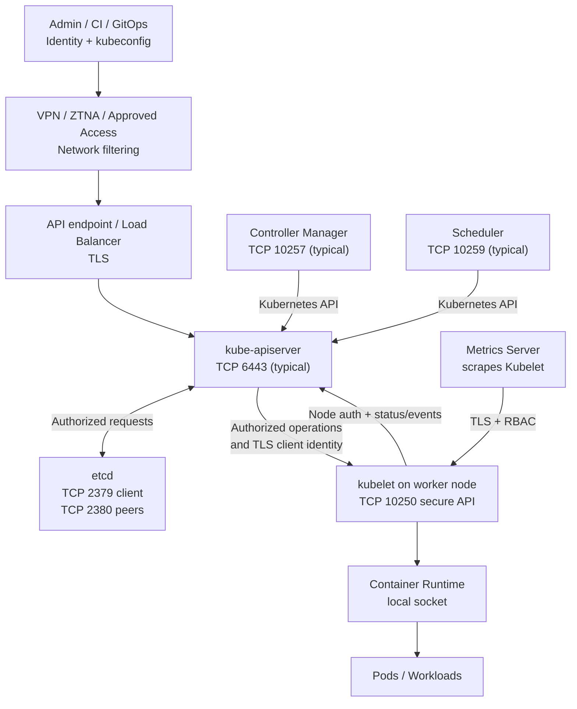
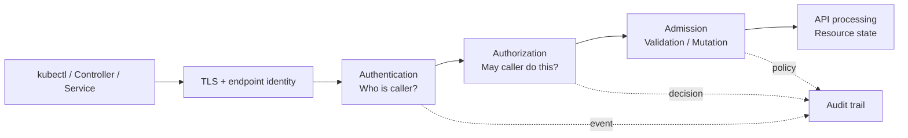
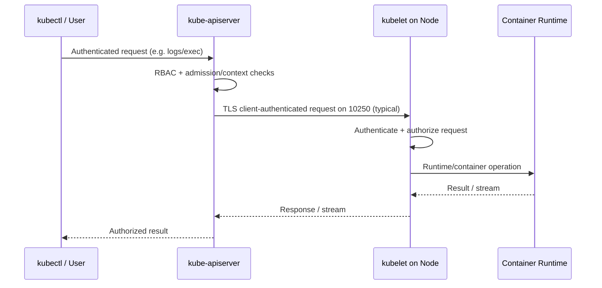
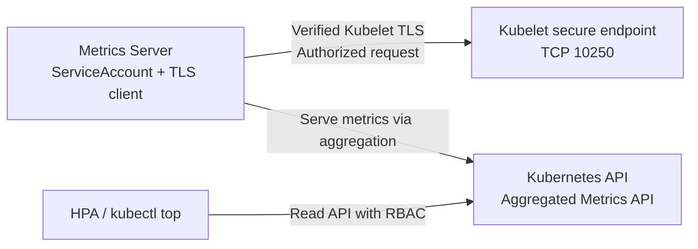
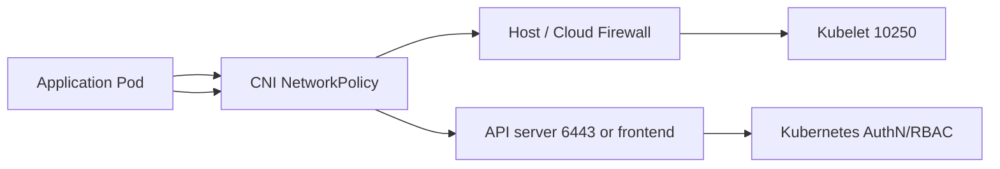
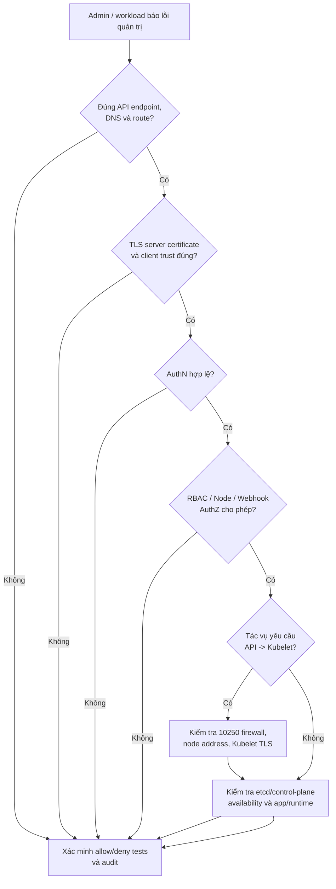

# Kubelet, API server và các cổng quản trị trong bảo mật mạng Kubernetes

Trong Kubernetes, **kube-apiserver** là cửa ngõ quản trị và điều khiển trạng thái cluster, còn **kubelet** là tác nhân chạy trên node để quản lý vòng đời Pod và giao tiếp với control plane. Hai thành phần này không chỉ cần kết nối mạng để cluster hoạt động: chúng còn nằm trên những **ranh giới tin cậy quan trọng nhất**. Nếu endpoint API server hoặc Kubelet được công bố quá rộng, dùng chứng chỉ sai, cho phép truy cập ẩn danh hoặc cấp RBAC quá quyền, người có quyền truy cập có thể xem thông tin nhạy cảm, thao tác workload hoặc giành quyền điều khiển hạ tầng.

Bài học thuộc chương **Bảo mật mạng Kubernetes** của mô-đun **SECURITY_NETWORK_SECURITY**, kết nối kiến thức về **phân đoạn mạng, firewall/NGFW, VPN/ZTNA, PKI/TLS, NAC, IDS/IPS, bảo vệ DNS, lưu lượng, mô hình hóa mối đe dọa và hạ tầng cloud**. Chủ đề tập trung vào **Kubelet, API server và các cổng quản trị**, không chỉ liệt kê port numbers: người học phải hiểu **ai khởi tạo kết nối, ai xác thực ai, ai phân quyền, traffic đi qua firewall nào và cách kiểm chứng chính sách thực sự hoạt động**.

Các giá trị cổng trong bài là **mặc định phổ biến** ở nhiều bản phân phối upstream/kubeadm; cấu hình thực tế có thể đổi cổng, bind address, proxy qua load balancer, dùng dịch vụ managed hoặc giới hạn theo bản phát hành. Không dùng danh sách cổng như một allow-all firewall template. Những ví dụ dùng tài sản giả định; các lệnh chỉ đọc và bài test chỉ nên chạy trên cluster mà người học được phép quản trị.

## 1. Mục tiêu học tập

Hoàn thành bài này, người học có thể:

1. Phân biệt **API server, Kubelet, etcd, scheduler, controller manager, kube-proxy, metrics-server, CNI** và phạm vi mỗi thành phần.
2. Trình bày các luồng **kubectl/CI → API server**, **Kubelet → API server**, **API server → Kubelet**, **API server ↔ etcd**, và luồng tới metrics/health endpoints.
3. Hiểu chức năng của các cổng thường gặp **TCP/6443, TCP/10250, TCP/10248, TCP/10255, TCP/2379–2380, TCP/10257, TCP/10259**, cùng các cổng liên quan.
4. Xác định vì sao cổng API server và Kubelet cần **TLS, xác thực mạnh, authorization và firewall giới hạn nguồn**.
5. Phân biệt **client certificate, bearer token, OIDC identity, ServiceAccount token, Node identity và RBAC**.
6. Giải thích **Kubelet authentication, webhook authorization, client/server certificate rotation** và rủi ro Kubelet read-only endpoint.
7. Thiết kế chính sách truy cập quản trị **từ mạng đáng tin**, cho phép đúng đường control plane–node, ngăn direct Internet exposure.
8. Biết ý nghĩa của **Node authorizer, NodeRestriction admission, pods/exec, pods/attach, pods/portforward, pods/log, nodes/proxy** đối với phân quyền.
9. Chẩn đoán lỗi **TLS, certificate expiration, DNS, routing, firewall, webhook, RBAC, API availability và kubelet connectivity**.
10. Xây dựng **audit log, positive/negative tests, incident runbook và checklist hardening** để vận hành an toàn.

## 2. Phân biệt control plane và node management

Kubernetes điều phối **desired state** thông qua control plane. API server nhận yêu cầu tạo/sửa/xem tài nguyên; các controllers và scheduler xử lý kế hoạch; kubelet trên node thực thi phần workload được giao.

| Thành phần | Nhiệm vụ chính | Ranh giới bảo mật |
| --- | --- | --- |
| **kube-apiserver** | Cung cấp Kubernetes API, xác thực, phân quyền, admission, lưu/đọc trạng thái qua storage | Điểm quản trị quyền cao, cả user và máy đều có thể gọi |
| **kubelet** | Tạo/dừng Pod thông qua runtime, cập nhật node/Pod status, thực hiện một số hoạt động với Pod | Điểm quản lý workload trên từng node |
| **etcd** | Lưu trạng thái Kubernetes cho control plane | Dữ liệu cluster nhạy cảm, phải hạn chế truy cập |
| **kube-controller-manager** | Chạy controllers điều hòa trạng thái | Có quyền điều khiển tài nguyên qua API server |
| **kube-scheduler** | Chọn node phù hợp cho Pods | Điều khiển việc đặt workload thông qua API |
| **kube-proxy / dataplane Service** | Thiết lập forwarding cho Services theo triển khai | Khác với Kubelet API và API quản trị |
| **CNI plugin** | Cấp mạng Pod, routing, có thể thực thi NetworkPolicy | Có thể nắm quyền lớn ở host/dataplane |
| **Metrics Server** | Thu resource metrics từ Kubelets và cung cấp Metrics API | Cần kết nối có xác thực tới node |

**Không phải thành phần nào chạy trên control-plane node cũng cần được truy cập từ Internet.** Sự khác nhau giữa **management plane, control-plane internals và data-plane traffic** là nền tảng thiết kế firewall.

### 2.1. Điều gì làm Kubelet và API server nhạy cảm?

- API server có thể **tạo/sửa Pods, xem tài nguyên, thay RoleBindings, cấp hoặc xác minh quyền thông qua Kubernetes authorization**, tùy danh tính caller.
- Kubelet có đường tương tác sâu với **Pod, runtime và trạng thái node**, nên một endpoint Kubelet cấu hình sai có thể ảnh hưởng toàn bộ node.
- Control plane thường được tin để **đọc trạng thái/credentials, cấp lệnh cho nodes và quản trị cluster**.
- Một node bị chiếm có thể dùng **node identity** và các credentials cục bộ; phải giới hạn node chỉ được tác động lên tài nguyên mà nó có trách nhiệm.

## 3. Bản đồ đường kết nối quản trị



Đây là sơ đồ **logic**. Trong managed Kubernetes, API endpoint có thể được công bố bằng hostname và cổng **443** ở frontend, còn thực thi control plane chạy sau LB với chi tiết bị provider che. Scheduler/controller manager có thể nằm cùng node và giao tiếp qua loopback; metrics-server có thể chạy trên worker pods; container runtime thường dùng **Unix domain socket** cục bộ thay vì TCP port.

### 3.1. Ba chiều kết nối không được nhầm

1. **Administrator / automation → API server:** thao tác quản trị, bảo vệ bằng IdP/kubeconfig, TLS, RBAC, admission và network policy.
2. **Kubelet → API server:** node **khởi tạo kết nối outbound** đến API để đăng ký/cập nhật node/Pod status và nhận thông tin công việc theo cơ chế watch.
3. **API server → Kubelet:** control plane cần truy cập một số endpoint Kubelet cho các tính năng thao tác với Pod/node; đường này phải **giới hạn nguồn và xác thực TLS/authorization**.

**Một luồng chiều 2 hoạt động không chứng minh chiều 3 hoạt động**. Vì thế cluster có thể vẫn nhận Pod status nhưng **kubectl logs/exec** gặp lỗi khi control plane không kết nối đúng Kubelet.

## 4. Bảng cổng Kubernetes cần quản trị

| Thành phần / dịch vụ | Cổng phổ biến | Protocol / hướng sử dụng | Chính sách gợi ý |
| --- | --- | --- | --- |
| **Kubernetes API server** | **6443/TCP** (nhiều bản cài đặt) | Admin, automation, nodes, control-plane components → API | Chỉ mạng/quyền quản trị và nodes cần thiết; TLS/AuthN/AuthZ |
| **Kubelet secure API** | **10250/TCP** | Control plane, metrics collector và nguồn quản trị được cấp quyền → Kubelet | Không mở Internet; authenticated + webhook AuthZ |
| **Kubelet read-only port** | **10255/TCP** (legacy) | Endpoint đọc Kubelet trên bản cài đặt cũ | **Tắt (readOnlyPort: 0)**; không xem là endpoint quản trị an toàn |
| **Kubelet healthz** | **10248/TCP** (thường loopback nếu bật) | Kiểm tra health tại node | Bind loopback hoặc phạm vi giám sát đáng tin, không public |
| **etcd client endpoint** | **2379/TCP** | API server hoặc clients được phê duyệt → etcd | Tách vùng, mTLS, không Internet |
| **etcd peer endpoint** | **2380/TCP** | etcd members ↔ etcd peers | Chỉ peers, mTLS và network isolation |
| **Controller Manager secure endpoint** | **10257/TCP** | Control-plane-local health/metrics, nếu bật/cho phép | Không public; kiểm tra bind/authn theo phiên bản |
| **Scheduler secure endpoint** | **10259/TCP** | Control-plane-local health/metrics, nếu bật/cho phép | Không public; kiểm tra bind/authn theo phiên bản |
| **kube-proxy health endpoint** | **10256/TCP** (điển hình) | Health check của kube-proxy, thường bind giới hạn | Theo cấu hình, không Internet |
| **kube-proxy metrics** | **10249/TCP** (điển hình) | Metrics từ kube-proxy, thường giới hạn | Chỉ monitoring đáng tin |
| **DNS của cluster** | **53/UDP và TCP** | Pods/nodes → DNS resolver theo topology | Hạn chế tới resolver đúng, không mở public DNS ngoài nhu cầu |
| **NodePort Services** | Thường **30000–32767/TCP/UDP** mặc định | Client/LB → node theo Service type | Chỉ public khi được thiết kế; không coi đây là cổng quản trị control plane |
| **SSH/remote admin node** | **22/TCP** trên nhiều Linux hosts | Operator qua bastion/VPN/managed session | Ưu tiên không public; MFA/least privilege |
| **RDP Windows node** | **3389/TCP** nếu được bật | Quản trị Windows host | Không public; kênh quản trị có kiểm soát |

**Bảng không phải một danh sách port “cần mở”.** Nhiều thành phần không tồn tại trên mỗi node, có thể đổi cổng hoặc bị provider quản lý. Ví dụ **10255 legacy** phải được kiểm tra vì rủi ro lộ dữ liệu, **không phải cổng cần cho vận hành mới**.

### 4.1. API server có thể lắng nghe cổng 443 không?

Có. Một **API endpoint frontend** sau load balancer hoặc managed cloud có thể nhận TLS trên TCP/443 và chuyển tới API server ở cổng khác. Muốn xác định đúng đường, cần kiểm tra **hostname endpoint, LB listener, certificate, backend target và firewall**. Không mặc định bên ngoài phải mở 6443.

### 4.2. Không gom tất cả cổng 102xx thành một allowlist

Cổng 10250 của Kubelet, 10257 của Controller Manager và 10259 của Scheduler có **mục đích khác nhau**. Chỉ cho phép những nguồn thực sự dùng từng endpoint. Một security group cho phép **0.0.0.0/0 → 10200–10300** vì nghĩ là “Kubernetes system ports” là rủi ro nghiêm trọng.

## 5. Kube-apiserver là cổng điều khiển trung tâm

API server tiếp nhận HTTP(S) requests theo Kubernetes API, thực thi quy trình bảo mật ở tầng API rồi tương tác với state store và các thành phần khác.

Một request có thể trải qua:



Thứ tự giản lược này minh họa các ranh giới quan trọng, không mô tả toàn bộ request handlers, validation của API server và các ngoại lệ đọc/ghi của Kubernetes.

### 5.1. TLS chỉ xác minh endpoint, không cấp quyền API

Client cần xác minh **certificate chain và hostname** của API server. Nhưng ngay cả khi TLS handshake thành công, caller vẫn phải trải qua **authentication và authorization**. Không lấy việc “truy cập được TCP/6443” làm bằng chứng tài khoản có quyền.

### 5.2. Authentication tách khỏi authorization

- **Authentication:** danh tính được xác định qua certificate, bearer token, OIDC/federation hoặc cơ chế được cấu hình.
- **Authorization:** quyền cụ thể được đánh giá theo **verb, resource/subresource, namespace, name, API group**, hoặc non-resource URL.
- **Admission:** xét thêm chính sách ở thời điểm tạo/sửa tài nguyên theo admission chain.

Khi caller có token hợp lệ nhưng không được phép **create pods/exec**, API thường từ chối theo authorization; mở thêm firewall không sửa được vấn đề quyền.

## 6. Những cơ chế xác thực client của API server

Kubernetes hỗ trợ nhiều phương án authentication theo cách triển khai:

- **X.509 client certificates** với CA được API server tin; danh tính thường ánh xạ từ chứng chỉ theo profile.
- **Bearer tokens**, gồm **ServiceAccount bound tokens** cấp bởi Kubernetes và external tokens theo integration.
- **OIDC hoặc authentication configuration** dùng IdP đã định, giúp ánh xạ danh tính quản trị có vòng đời và MFA tại nhà cung cấp danh tính.
- **Authentication webhooks/proxies** theo cấu hình, với ranh giới tin cậy cần harden riêng.

### 6.1. Không dùng shared admin kubeconfig

Một tệp kubeconfig có thể chứa **đường dẫn client cert/key, token hoặc dữ liệu xác thực nhạy cảm**. Nếu sao chép admin kubeconfig cho mọi kỹ sư hoặc CI job, khó thu hồi theo cá nhân và tăng blast radius.

Nên:

1. Dùng **danh tính riêng** cho user, CI workload và automation.
2. Cấp quyền theo vai trò trong RBAC, thời hạn và nhóm rõ.
3. Ưu tiên **SSO/OIDC + MFA** cho admin theo nền tảng hỗ trợ.
4. Không commit **kubeconfig đầy credential** vào repository.
5. Quản lý **certificate/token rotation** và thu hồi khi nhân sự hoặc workload đổi quyền.
6. Có quyền **break-glass** được phê duyệt, lưu/kiểm toán và chỉ dùng khi khẩn cấp.

### 6.2. Xác thực bằng cert không tự giới hạn quyền

Client certificate hợp lệ do một CA được trust ký có thể ánh xạ identity/group theo fields. Nếu group được RBAC gán **cluster-admin**, rủi ro nằm ở **issuer policy và binding**, không chỉ ở mạng. Phải giới hạn ai được phát hành chứng chỉ dùng để xác thực với API server.

### 6.3. Anonymous access

Không mặc định cho **anonymous users** quyền đọc thông tin quản trị nhạy cảm. Một số endpoint health/discovery có thể có chính sách ngoại lệ có chủ đích; phải kiểm tra thực tế RBAC, API authentication config, frontend và cách health probes được thực hiện.

**Không mở toàn API bằng anonymous-auth chỉ để health check dễ chạy.**

## 7. RBAC: quyền nào liên quan đường quản trị?

**Role/ClusterRole** mô tả các động từ và tài nguyên được phép; **RoleBinding/ClusterRoleBinding** gắn quyền với principal. Cần xem kỹ **subresources**, không chỉ resource gốc.

| Quyền hoặc subresource | Tác động có thể có | Đánh giá |
| --- | --- | --- |
| **get/list/watch pods** | Xem metadata/Pod specs theo phạm vi | Có thể tiết lộ thông tin workload |
| **get pods/log** | Xem log container | Log có thể chứa thông tin nhạy cảm |
| **create pods/exec** | Khởi chạy lệnh trong container theo API | Quyền cao, có thể tiếp cận secrets/runtime |
| **create pods/attach** | Gắn vào luồng chạy container | Có thể tác động ứng dụng |
| **create pods/portforward** | Chuyển tiếp kết nối đến Pod qua API | Có thể tiếp cận các port không trực tiếp public |
| **get nodes/proxy** | Truy cập đường proxy tới node/Kubelet theo cơ chế API | Đặc biệt nhạy cảm; không cấp rộng |
| **get nodes/stats, nodes/metrics** | Thu thập thông tin node theo yêu cầu | Chỉ monitoring/collector cần thiết |
| **get/list secrets** | Đọc Kubernetes Secrets | Quyền nhạy cảm; bảo vệ chặt |
| **create/update roles, rolebindings** | Có thể thay quyền trong một phạm vi | Ngăn tự nâng quyền bằng RBAC/admission |
| **create/update pods, workloads** | Tạo container/volumes/service accounts theo quyền | Có thể là đường lấy credential và lateral movement |
| **create certificatesigningrequests / approve** | Liên quan cấp CSR/chứng chỉ theo policies | Giới hạn role cấp/duyệt certificate |
| **create serviceaccounts/token** | Xin token cho ServiceAccount được phép | Không cấp bừa bãi |

**Các verb của subresource cần kiểm tra theo hành vi API hiện tại**. Những thao tác streaming có thể có yêu cầu phương thức/verb khác theo client và phiên bản Kubernetes; kiểm thử bằng **kubectl auth can-i** và audit logs, không tự gán một quyền rộng để “chắc chắn chạy”.

### 7.1. Lý do nodes/proxy là quyền nguy hiểm

Một proxy path tới Kubelet có thể cung cấp quyền tương tác với API của node. Nếu một role cấp quyền quá rộng trên **nodes/proxy**, nó có thể vượt ngoài nhu cầu của monitoring hoặc developer. Hãy review toàn bộ roles đã bind, không suy rằng quyền chỉ “đọc thống kê” khi nó có thể mở đường mạnh hơn.

### 7.2. Cluster-admin là ngoại lệ, không phải mặc định

Một nhóm dev chỉ cần deploy ứng dụng trong namespace riêng không nên có **cluster-admin**. Tương tự, monitoring component không cần quyền sửa mọi workload để chỉ thu metrics. Mục tiêu là **least privilege theo resource, namespace, service account và thời hạn**.

## 8. Node authorizer và NodeRestriction admission

Kubelet cần một danh tính để tương tác với API server. Trong một số cấu hình tiêu chuẩn, mỗi node sử dụng **client certificate có identity dạng system:node:<node-name>** và nằm trong nhóm node tương ứng.

**Node authorizer** là một authorizer thiết kế để giới hạn quyền của node đối với tài nguyên liên quan tới Pods được scheduling cho node đó và các nhu cầu node cụ thể. **NodeRestriction admission plugin** bổ sung các hạn chế về những trường/đối tượng node mà Kubelet được phép sửa.

### 8.1. Chúng giải quyết rủi ro nào?

Nếu một node bị chiếm, kẻ tấn công có thể tiếp cận **node credential**. Không nên cho credential của một worker node **tự xem mọi Secret và sửa toàn bộ Pods trong cluster**.

Node authorizer/NodeRestriction giúp giảm mức độ tin cậy mặc định của node, nhưng **không tạo an toàn tuyệt đối cho Pods đã chạy trên chính node bị chiếm** hoặc node kernel/runtime.

### 8.2. Điều kiện triển khai

- Node client certificates được cấp theo danh tính node đúng.
- API server cấu hình **authorization modes** phù hợp (thường có Node và RBAC trong các kiểu cài đặt tương ứng).
- NodeRestriction admission được áp khi cần.
- Không cấp additional RBAC quá rộng cho node identities.
- Các **node labels có ý nghĩa bảo mật** được bảo vệ khỏi việc node tự sửa trái phép.
- Giám sát CSR issuance, node replacement và node bootstrap.
- Nếu provider managed control plane, kiểm tra các biện pháp tương ứng do provider triển khai.

**Node authorizer không thay NodeRestriction**: một bên là quyết định authorization, một bên là admission constraints.

## 9. Kubelet có API riêng vì sao?

Kubelet chạy trên từng worker/control-plane node có Pods. Nó tương tác với container runtime, cập nhật trạng thái và cung cấp các endpoint phục vụ tính năng vận hành/giám sát.

Một số hoạt động thường đi qua Kubelet API theo đường được bảo vệ:

- Lấy thông tin Pod/node cần thiết cho quản trị.
- Xem **container logs** và hỗ trợ interactive operations theo cơ chế API server.
- Thu thập **node/container metrics hoặc stats** theo triển khai.
- Tương tác các chức năng quản lý workload của node trong phạm vi quyền.

### 9.1. Kubelet không là một web server công khai thông thường

Kubelet API có **quyền gần với workload/node** hơn một endpoint HTTP nghiệp vụ. Nó phải được coi như **management interface nhạy cảm**:

- Chỉ những nguồn cần thiết được mở mạng tới secure port.
- Xác thực client; không cho anonymous tùy tiện.
- Phân quyền từng request qua cơ chế tương ứng.
- Dùng **server certificate đúng peer** và client certificate/token phù hợp.
- Có log, host firewall, node hardening và cập nhật bảo mật.
- Không công bố trực tiếp ra Internet chỉ để metrics hoặc debug.

## 10. TCP/10250: Kubelet secure API

**TCP/10250** thường là cổng **Kubelet HTTPS server** trong các cấu hình phổ biến. Nó là điểm quản trị quan trọng, không chỉ là một endpoint đọc số liệu.

### 10.1. Luồng thường thấy



Sơ đồ bỏ qua streaming protocol details và những trường hợp mà đường routing/credential thay đổi theo distribution. **User không nên cần kết nối trực tiếp đến Kubelet port** để chạy **kubectl logs/exec**.

### 10.2. Khi nào Kubelet cần được mở từ network?

Chỉ những sources đã được xác định, chẳng hạn:

- API server/control-plane addresses có quyền.
- Metrics collector được phê duyệt, nếu thực sự scrape Kubelet.
- Các agent quản trị node được duyệt và có chứng thực phù hợp.

**Không cần mở 10250 từ mọi worker node đến mọi worker node** chỉ vì “nội bộ Kubernetes”, trừ khi kiến trúc thực sự có nhu cầu và policy có bằng chứng.

### 10.3. Vì sao firewall không đủ?

Nếu attacker có được network access tới 10250 nhưng Kubelet **xác thực và phân quyền đúng**, một lớp bảo vệ vẫn còn. Nếu Kubelet cho **anonymous** hoặc dùng **AlwaysAllow**, việc port bị lộ có thể nghiêm trọng hơn. Do đó cần đồng thời **network allowlist + Kubelet AuthN/AuthZ + TLS trust**.

## 11. TCP/10255: Kubelet read-only legacy endpoint

**10255/TCP** historically là cổng **Kubelet read-only HTTP endpoint** trong những môi trường cũ. Đường này không bảo đảm đầy đủ authentication/authorization như secure API; nhiều bản cài đặt hiện đại đã **vô hiệu hóa mặc định** hoặc không sử dụng.

### 11.1. Rủi ro chính

- Thông tin về Pods/containers/node có thể bị lộ nếu endpoint đọc không được bảo vệ.
- Dữ liệu topology/process/metrics có thể hỗ trợ reconnaissance.
- Một firewall chỉ dựa vào “đây là cổng read-only nên an toàn” là sai.
- Nếu chưa quản lý phiên bản/cấu hình, có thể tồn tại endpoint legacy do di sản.

### 11.2. Chính sách đề xuất

- Đặt **readOnlyPort: 0** hoặc vô hiệu hóa theo cơ chế cấu hình tương ứng.
- Không mở network **TCP/10255** trên node security group và host firewall.
- Dùng **Kubelet secure API**, Metrics API hoặc collector đã xác thực cho mục đích hợp lệ.
- Kiểm tra cả host bind address, daemon flags và managed distribution settings.
- Chỉ kiểm thử reachability từ **test source được phép**, không quét công khai.

**Không bật lại 10255 chỉ để một exporter cũ hoạt động.** Ưu tiên sửa exporter và mô hình xác thực/giám sát.

## 12. TCP/10248: Kubelet healthz và bind address

**10248/TCP** thường được dùng cho **Kubelet health check endpoint** theo cấu hình phổ biến. Đây không phải endpoint quản trị cho người dùng Internet.

### 12.1. Vì sao nên giới hạn loopback?

Một health endpoint có thể không cần chứng minh người dùng là ai nếu chỉ được gọi **cục bộ trên node** hoặc qua cơ chế giám sát được kiểm soát. Nếu mở trên tất cả interfaces, nó có thể tạo thêm dữ liệu quan sát hoặc bề mặt truy cập ngoài ý định.

Hãy cấu hình **healthzBindAddress: 127.0.0.1** hoặc địa chỉ giám sát tin cậy theo phiên bản/sản phẩm, đồng thời giới hạn đường mạng.

### 12.2. Đừng dùng healthz thay API authentication

Một phản hồi **OK** từ healthz không có nghĩa:

- API server được bảo vệ.
- Kubelet secure API 10250 xác thực đúng.
- Node đã đăng ký và Ready trong cluster.
- Pods đều hoạt động bình thường.
- Runtime hoặc CNI không có lỗi.

Healthz chỉ chứng minh **điều kiện health cụ thể** của endpoint được gọi.

## 13. Kubelet authentication: ai được truy cập API node?

Các cơ chế thường liên quan:

- **X.509 client certificate authentication** thông qua client CA đáng tin.
- **Bearer token webhook authentication**: Kubelet kiểm tra bearer token với API server qua **TokenReview**, khi cấu hình.
- **Anonymous authentication**: phải hạn chế mạnh hoặc tắt cho secure endpoint nếu không có lý do đặc biệt được kiểm chứng.

### 13.1. Authentication webhook tạo một dependency

Nếu Kubelet dùng **TokenReview webhook**, nó cần giao tiếp với **API server** để kiểm tra token. Vì vậy nếu Kubelet không tới API server hoặc API server lỗi, xác thực dựa vào webhook có thể thất bại; không nên “sửa” bằng cách bật anonymous.

### 13.2. X.509 client cert khác Kubelet server cert

- **Kubelet client cert:** Kubelet dùng để **xác thực với API server** khi node gửi request.
- **Kubelet serving/server cert:** Kubelet dùng để **chứng minh danh tính server** cho callers kết nối tới 10250.
- **API server client cert dành cho Kubelet:** API server dùng khi **gọi tới Kubelet**, nếu cấu hình dùng client certificates.

Chúng có thể có CA, SAN, validity và key lifecycle **khác nhau**. Thấy một certificate chưa hết hạn không đủ kết luận mọi chặng TLS đều tốt.

## 14. Kubelet authorization: Webhook hay AlwaysAllow?

Sau authentication, Kubelet cần xác định caller có quyền tới operation được yêu cầu không.

**Kubelet authorization Webhook** có thể gọi API server bằng **SubjectAccessReview** để kiểm tra quyền caller theo attributes mà Kubelet gán cho request.

### 14.1. Vì sao AlwaysAllow nguy hiểm?

Kubelet **AlwaysAllow** có thể khiến request từ một caller đã vượt qua authentication được phép sử dụng Kubelet API vượt mức mong muốn. Khi kết hợp cấu hình anonymous hoặc network exposed, rủi ro tăng mạnh.

Ưu tiên **authorization.mode: Webhook** với RBAC phù hợp và xác thực client mạnh. Phải kiểm tra người dùng/agent thực sự có những quyền nào, không cấp cluster-admin để chữa lỗi monitoring.

### 14.2. Quyền tối thiểu theo nhóm người dùng

| Principal | Nhu cầu hợp lệ | Cần tránh |
| --- | --- | --- |
| API server Kubelet client | Thao tác Kubelet phục vụ API Kubernetes | Được dùng như generic admin cert ở nơi khác |
| Metrics Server/collector | Đọc metrics/summary theo quyền cụ thể | nodes/proxy rộng khi chỉ cần metrics |
| Node agent vận hành | Health/telemetry cần thiết | Tự có quyền exec mọi container |
| Developer | Đọc logs của namespace mình qua API server | Direct Kubelet admin access |
| CI/CD deployer | Tạo/cập nhật workloads được duyệt | Quyền node proxy hoặc host admin |
| Break-glass SRE | Truy cập quản trị đặc biệt có phê duyệt | Credential chia sẻ, không expiry/audit |

### 14.3. Chú ý khi dựa vào RBAC cho Kubelet

Các Kubelet endpoint không luôn ánh xạ 1:1 với các resource/subresource người dùng nhìn thấy ở kubectl. Cần xác minh cách Kubelet triển khai **authorization attributes** và xây permissions theo phần mềm/version đang vận hành. Không mở **nodes/proxy** theo một lời khuyên chung nếu chỉ muốn thu metrics.

## 15. Chứng chỉ TLS của API server

API server phục vụ HTTPS để client xác minh **server identity** và bảo vệ nội dung/kubeconfig tokens trên đường truyền.

### 15.1. Những thuộc tính phải kiểm chứng

- **CA chain** hoặc trust anchor được phép.
- **Subject Alternative Name (SAN)** khớp hostname/IP mà client kết nối thực.
- Thời hạn **NotBefore/NotAfter** và đồng bộ thời gian.
- **Key usage / Extended Key Usage** theo profile.
- Khóa riêng được lưu an toàn, permission chặt, rotation/revocation policy.
- Đường **LB TLS termination hoặc TCP passthrough** được hiểu chính xác.
- Nếu API server có nhiều endpoints, certificates phải phù hợp với mọi hostname/IP được dùng.

### 15.2. Không bỏ certificate verification vì muốn kubectl hoạt động

Tùy chọn bỏ kiểm tra TLS như **insecure-skip-tls-verify** làm suy yếu xác thực server. Nếu gặp lỗi **x509: certificate signed by unknown authority**, hãy sửa trust bundle/CA hoặc endpoint đúng; không biến workaround thành cấu hình thường trực.

### 15.3. API public endpoint không mặc định là “không bảo mật”

Một public API endpoint có thể bảo mật khi **TLS, AuthN/AuthZ, admission và network restrictions** được cấu hình đúng, nhưng vẫn tăng attack surface và exposure trước scanning/DoS. Khi nghiệp vụ cho phép, nên dùng **private endpoint hoặc authorized networks/VPN/ZTNA** theo mô hình cloud.

## 16. Certificate của Kubelet: client, serving và rotation

Kubelet thường có **client credential** để nói chuyện với API server và **serving certificate** cho 10250. Hai luồng này đòi hỏi giám sát riêng.

### 16.1. Client certificate rotation

Kubernetes hỗ trợ cơ chế xoay vòng certificate của Kubelet client theo mô hình bootstrap/CSR và controller phù hợp. Cần:

- Cluster CA và issuer/trust policy chính xác.
- Node bootstrap identity không được dùng quyền quá rộng.
- CSR được xác minh theo node identity/purpose.
- Renewal chạy trước expiry và alert nếu thất bại.
- Node identity bị retire không còn quyền tiếp tục hoạt động.

### 16.2. Serving certificate rotation

Một số môi trường bật **serverTLSBootstrap** để Kubelet yêu cầu serving certificates thông qua CSR. Tuy nhiên **quy trình ký/duyệt serving CSR không nhất thiết tự động như client CSR**; tùy cluster, sẽ cần một approver được thiết kế đúng và kiểm tra SAN/identity.

Không tự động approve mọi CSR mà chưa xác minh **signer, usages, node identity, SAN và ownership**, vì có thể tạo chứng chỉ cho node giả.

### 16.3. Tránh self-signed serving certificate không được kiểm tra

Nếu Kubelet serving certificate không được client tin cậy hoặc thiếu SAN đúng, metrics-server/API server có thể báo lỗi xác minh TLS. Không nên cấu hình **bỏ verify certificate** để giải quyết triệt để. Hãy triển khai trust chain/serving CSR phù hợp với mô hình cluster.

## 17. API server → Kubelet: đường đáng tin nhưng phải giới hạn

Khi người dùng yêu cầu hoạt động như **logs, exec, attach hoặc port-forward** qua API server, control plane cần khả năng nói chuyện với node/Kubelet tương ứng. Chính sách network phải cho phép đường này khi tính năng cần.

### 17.1. Ba lớp kiểm soát

1. **API server xác thực và phân quyền user/ServiceAccount** thực hiện thao tác.
2. **Kubelet xác thực API server hoặc caller thích hợp** trên kết nối của mình và thực thi authorization.
3. **Firewall chỉ mở đường control plane/collector được phê duyệt tới 10250**, không Internet hay toàn bộ Pod CIDRs một cách vô điều kiện.

### 17.2. Các cấu hình liên quan ở API server

Theo mô hình triển khai, những cấu hình thường gặp gồm:

- Certificate/key dùng làm **Kubelet client identity**.
- CA để **xác minh Kubelet serving certificate**.
- Kubelet preferred address types/routing khi nhiều địa chỉ InternalIP/Hostname/ExternalIP.
- TLS options, timeouts và cơ chế network proxy/tunnel trong managed/private cluster.

**Không tùy tiện thêm Kubelet ExternalIP vào allowlist Internet** chỉ vì API server không kết nối được InternalIP. Phải tìm nguyên nhân routing/VPC firewall/VPN/connector và giữ đường private khi phù hợp.

## 18. Metrics Server và giám sát Kubelet

Metrics Server thường đọc **resource utilization metrics** từ Kubelets, cung cấp dữ liệu cho **Metrics API**, autoscaling hoặc thao tác quản trị liên quan.

### 18.1. Một luồng metrics hợp lệ



### 18.2. Kịch bản lỗi thường gặp

- Metrics Server không thể tới Kubelet 10250 vì **firewall/route**.
- Kubelet serving certificate không được tin hoặc SAN không khớp.
- Collector không đủ **nodes/metrics, nodes/stats** hoặc quyền cần thiết theo implementation.
- API aggregation layer hoặc metrics-server deployment lỗi.
- Node time skew, Kubelet unhealthy hoặc certificate expiry.

### 18.3. Không dùng cờ tắt TLS validation như cấu hình chuẩn

Một số hướng dẫn lab dùng tùy chọn cho metrics-server **bỏ xác minh Kubelet serving cert** để thử nhanh. Đây là ngoại lệ rủi ro, không nên coi là giải pháp production. Thiết kế đúng là **valid serving certificate + trusted CA + đúng hostname/IP + quyền tối thiểu**.

## 19. etcd: các cổng phải giữ trong control-plane boundary

**etcd** lưu trạng thái Kubernetes, gồm thông tin về resource metadata và có thể chứa dữ liệu nhạy cảm. Các cổng thường gặp:

- **2379/TCP:** client endpoint của etcd.
- **2380/TCP:** giao tiếp peer giữa các etcd members.

### 19.1. Nguyên tắc bảo mật

- **Không expose trực tiếp ra Internet.**
- Chỉ API server/clients được phê duyệt truy cập client endpoint.
- Chỉ etcd peers tin cậy kết nối peer endpoint.
- Sử dụng **mTLS**, đúng server/client identity và CA, rotation.
- Có **encryption at rest cho Kubernetes Secrets** theo policy nếu dữ liệu yêu cầu.
- Bảo vệ snapshots, backups, filesystem và quyền operator.
- Monitor membership changes, certificate expiry và backup recovery.

### 19.2. Vì sao network policy pod không đủ?

Trong cluster kiểu kubeadm, etcd có thể chạy dưới dạng **static Pod/hostNetwork trên control-plane node**. NetworkPolicy Pod-to-Pod không mặc định chặn mọi đường host network. Hãy áp **host firewall/cloud SG và control-plane segmentation** đúng topology.

### 19.3. Không kết nối trực tiếp để debug tùy tiện

Đọc/sửa etcd bằng công cụ khách trực tiếp có thể ảnh hưởng tính nhất quán và bảo mật. Khi cần thao tác quản trị, sử dụng **quy trình được phê duyệt, backups và credentials** đúng; bài học này không hướng dẫn đọc secrets qua etcd hoặc thay state ngoài Kubernetes API.

## 20. Scheduler, Controller Manager và cổng nội bộ

Khi dùng các bản cài đặt thường gặp:

- **kube-controller-manager secure endpoint:** thường TCP/10257.
- **kube-scheduler secure endpoint:** thường TCP/10259.

Chúng thường phục vụ **health/metrics** hoặc control-plane management và có thể chỉ bind loopback. Các cổng legacy/insecure trong cài đặt cũ không nên tiếp tục được công bố.

### 20.1. Scheduler/controller thường chủ động gọi API server

Không cần mở inbound public tới scheduler/controller chỉ vì chúng phải nói chuyện với API server. Quy tắc network thường quan tâm:

- **Control-plane component → API server** bằng TLS/credential riêng.
- **Monitoring đáng tin → metrics endpoints** nếu có và được cấu hình.
- Kết nối leader election và quản lý state thông qua API server, không biến cổng metrics thành giao diện quản trị Internet.

### 20.2. Đừng dùng một security group cho toàn control plane

Các thành phần có thể nằm cùng host hoặc chạy managed. Nếu phải mở 10257/10259 cho monitoring, hãy chỉ cho nguồn cần thiết và phương thức xác thực tương ứng. Không tạo **allow-all TCP 10200–10300**.

## 21. Kube-proxy, DNS và NodePort không phải Kubelet API

**kube-proxy** hoặc dataplane tương đương hỗ trợ forwarding cho Service traffic; không phải thành phần xác thực kubectl/Kubelet. Cổng health/metrics của kube-proxy (thường 10256/10249 khi bật) khác với secure API của Kubelet.

**NodePort** trong Kubernetes thường dùng dải **30000–32767** theo mặc định nhưng có thể tùy chỉnh. Một Service NodePort có thể xuất hiện trên node addresses; nếu firewall mở dải quá rộng thì **backend ứng dụng có thể bị tiếp cận ngoài ingress gateway**.

### 21.1. Đừng nhầm cổng quản trị với application service

- API server **6443** điều khiển Kubernetes.
- Kubelet **10250** là node management API.
- NodePort **30000–32767** là đường vào **dịch vụ workload** khi được thiết kế.
- DNS **53** phục vụ name resolution.
- CNI overlay ports tùy plugin, không thuộc bảng port cố định cho mọi cluster.

Mỗi nhóm phải có **owner và policy riêng**.

### 21.2. Nguy cơ bỏ qua WAF/ingress

Một API được công bố qua WAF có thể còn Service NodePort hoặc public LoadBalancer khác. Phải kiểm tra direct backend paths, firewall trên node và policy để tránh bypass kiểm soát L7.

## 22. Firewall matrix: ai cần kết nối tới cổng nào?

Dưới đây là **ma trận mục đích**, không phải danh sách firewall tự động cho phép.

| Source | Destination | Cổng/giao thức thường gặp | Điều kiện |
| --- | --- | --- | --- |
| Approved admin VPN/ZTNA/CI | Kubernetes API endpoint | HTTPS 443 hoặc TCP/6443 theo frontend | TLS, user/workload AuthN, RBAC, audit |
| Kubelet (workers) | API server | HTTPS endpoint đã cấu hình | Client/node identity, Node authorizer/NodeRestriction |
| Controller/Scheduler | API server | HTTPS endpoint | Service credentials, RBAC, TLS |
| API server/control plane | Kubelets | **10250/TCP** nếu cần | Kubelet client auth + Webhook AuthZ, private route |
| Metrics Server/approved collector | Kubelets | **10250/TCP** nếu dùng | Xác minh Kubelet serving TLS, quyền metrics |
| API server | etcd clients | **2379/TCP** khi managed nội bộ | mTLS, private access |
| etcd peer | etcd peer | **2380/TCP** | Chỉ peers được phê duyệt, mTLS |
| Trusted monitor | Scheduler/Controller metrics | **10259/10257** nếu bật | Chỉ địa chỉ quản trị, authn theo sản phẩm |
| Pod workload | Cluster DNS | UDP/TCP 53 | Chỉ resolver đúng và policy ứng dụng |
| Cloud LB / ingress | App nodes/backend | Port theo sản phẩm | Không mở rộng cổng Kubelet/API ngoài mục đích |
| SRE via managed session | Node host | Phương thức remote quản trị được phê duyệt | Không cần Internet SSH/RDP nếu có giải pháp riêng |

### 22.1. Các điều kiện cần xác minh

- Node subnet có thể tới API endpoint qua **private DNS/route**.
- API server có thể tới **đúng node InternalIP/Hostname**.
- Firewall không vô tình chặn return traffic khi ACL là **stateless**.
- Các public/private endpoints của API managed cluster được thiết lập đúng.
- Ingress LB và Kubelet ports không bị dùng chung wildcard rule.
- Không mở port chỉ vì xuất hiện trong bảng Kubernetes documentation.
- Nếu có VPN/overlay giữa control plane và nodes, kiểm tra đường/identity tại **bên trong tunnel**.

## 23. Managed Kubernetes: EKS, AKS, GKE và control-plane access

Trong managed Kubernetes, nhà cung cấp thường vận hành **API server/control plane** và cung cấp cấu hình endpoint, network policies hoặc authorized access theo sản phẩm. Khả năng kiểm soát Kubelet trên worker node vẫn khác nhau theo node type và dịch vụ managed.

### 23.1. Một số lựa chọn kiến trúc thường gặp

- **Public API endpoint với source network restrictions:** client đi Internet tới endpoint có TLS, AuthN/AuthZ và allowlist/authorized networks.
- **Private API endpoint:** client cần đường riêng như VPC/VNet, VPN, private interconnect, peering hoặc giải pháp truy cập được nhà cung cấp hỗ trợ.
- **Hybrid endpoint:** có cả đường public/private khi sản phẩm cho phép và tổ chức chủ động thiết kế.
- **Managed nodes hoặc autopilot/serverless modes:** provider có thể giới hạn quyền cấu hình kubelet, host firewall hoặc node OS.

### 23.2. Đừng suy cách đặt cổng từ tên dịch vụ

Một managed API endpoint có thể công bố trên **443**, dùng hệ thống private connectivity hoặc control-plane proxy. Không tự mở 6443 trực tiếp trên mọi node vì nghĩ “EKS/GKE/AKS cần”. Phải đọc **effective cluster endpoint configuration và node-to-control-plane requirements** của dịch vụ cụ thể.

### 23.3. Những câu hỏi kiểm soát cần có

1. Endpoint hiện tại **public, private hay kết hợp**?
2. Ai được vào public endpoint, qua **source CIDR** và AuthN nào?
3. Cluster nodes tới endpoint bằng **private route/NAT/proxy** nào?
4. API server tới Kubelet 10250 qua đường gì, ai cấu hình SG?
5. Metrics Server tới node qua route/SG nào?
6. Ai có IAM quyền **đổi public endpoint/access CIDRs**?
7. Có audit Cloud IAM và Kubernetes audit trên endpoint không?
8. Cụm được quản lý có cho chỉnh KubeletConfiguration không và bằng cơ chế nào?

## 24. NetworkPolicy: giới hạn tác dụng với cổng host quản trị

Kubernetes **NetworkPolicy** thông thường được thiết kế để lọc **Pod traffic** theo CNI. Kubelet và nhiều control-plane components có thể chạy **hostNetwork** hoặc trên hosts ngoài pod dataplane. Vì vậy:

- NetworkPolicy không thay **host firewall hoặc cloud SG/NSG** cho 10250 trên node.
- Pod egress default deny có thể giảm đường Pod → API server nhưng phải hiểu **Service IP/NAT/hostNetwork**.
- Không nên chỉ dựa vào Pod selectors để bảo vệ etcd port trên control plane.
- Một CNI có **host endpoint policies/eBPF host firewall** có thể cung cấp kiểm soát thêm, nhưng đó là tính năng vendor-specific.
- Privileged pods hoặc workload có quyền host network có thể tạo đường bypass ngoài mô hình mặc định.

### 24.1. Defense in depth theo từng ranh giới



Sơ đồ chỉ mô tả **những tầng có thể tồn tại**. Traffic tới API/Kubelet không nhất thiết đi qua đúng các nút theo thứ tự ở mọi CNI; phải kiểm tra dataplane.

### 24.2. Tại sao cần bảo vệ đường Pod → API server?

Kubernetes workload có ServiceAccount token hoặc quyền API được cấp. Một Pod bị chiếm có thể cố gọi API server. **RBAC, bound token audiences, Pod admission và network segmentation** cùng giới hạn thiệt hại. Đừng chỉ chặn TCP/6443 từ mọi Pod nếu ứng dụng cần Kubernetes API và platform controllers cần hoạt động; hãy theo **dependency graph**.

## 25. Mô hình đe dọa: các đường bị lợi dụng

| Ranh giới | Đe dọa | Phòng vệ |
| --- | --- | --- |
| **Public API endpoint** | Scanning, credential attacks, denial of service | Endpoint restrictions, TLS/IdP, rate/DDOS controls theo provider, audit |
| **Kubeconfig và admin credentials** | Token/client key lộ hoặc dùng chung | SSO/MFA, short-lived credentials, secret lifecycle, RBAC |
| **Kubelet 10250** | Endpoint bị mở ra Internet hoặc anonymous/AlwaysAllow | Host SG/firewall + AuthN/Webhook AuthZ |
| **Kubelet 10255** | Legacy read-only API lộ topology | Disable readOnlyPort, deny network |
| **Kubelet 10248** | Health endpoint public ngoài nhu cầu | Loopback-only hoặc scoped monitoring |
| **Node credentials** | Node identity bị chiếm, lấy dữ liệu vượt node | Node authorizer/NodeRestriction, cert rotation, node hardening |
| **API/Kubelet certs** | Hết hạn, CA sai, MITM nếu bỏ verify | SAN/chain validation, rotation, alerts |
| **nodes/proxy RBAC** | Quyền vào node proxy quá rộng | Deny-by-default RBAC, review privileged subresources |
| **pods/exec/portforward** | Lạm dụng đường thực thi vào workloads | RBAC, audit, approval/session controls |
| **etcd 2379/2380** | Xem/sửa trạng thái nhạy cảm, phá quorum | mTLS, dedicated network, backup, no Internet |
| **Scheduler/Controller metrics** | Lộ dữ liệu health/metrics hoặc endpoint legacy | Bind/address restrictions và authentication |
| **NodePort/LB** | Đường đi vòng qua ingress/WAF | Inventory public endpoints, cloud firewall, service hardening |
| **Kubelet webhook dependency** | API outage gây auth failures; bypass nguy hiểm | Availability design, fail policy, alerts |
| **hostNetwork/privileged Pod** | Bypass Pod-level policies, truy cập node | Admission, Pod Security, RBAC, host policies |
| **Control plane IAM** | Đổi endpoint/SG hoặc cấp quyền ngoài change | IAM least privilege, IaC guardrails, audit |

### 25.1. Có thể làm gì nếu chiếm quyền một Pod?

Mức độ ảnh hưởng phụ thuộc service account, network access, mounted credentials, node privileges, runtime hardening và application vulnerabilities. Một Pod bình thường không tự có quyền điều khiển kubelet chỉ vì có network route; nhưng nếu credential/quyền hoặc Kubelet hardening sai, đây có thể là đường nâng đặc quyền.

### 25.2. Có thể làm gì nếu chiếm quyền một node?

Node là **trust boundary mạnh hơn Pod** vì kiểm soát kernel/runtime và có thể thấy tài nguyên/credentials của Pods trên node. Network isolation giữa Pods và RBAC không thay bảo vệ **node host, container runtime socket, kubelet credentials, disk encryption và node replacement/IR**.

## 26. Pseudoconfiguration: bảo vệ kube-apiserver

Đây là **mô hình ý định**, không phải manifest deploy hoặc bộ flags có thể dán vào mọi bản phân phối. Đặc biệt trong managed cloud, provider có thể quản lý API server và chặn chỉnh flags trực tiếp.

```yaml
security_intent: kubernetes-api-server
endpoint:
  prefer_private_or_approved_network_access: true
  public_endpoint_if_needed:
    allowed_source_cidrs: reviewed_and_minimal
    require_verified_tls: true
authentication:
  admin_users: federated_identity_with_mfa
  service_accounts: bounded_tokens_and_issuers
  client_certificates: controlled_ca_and_expiry
  forbid_shared_admin_kubeconfig: true
authorization:
  mode: least_privilege_rbac
  node_authorizer: enabled_where_supported
  audit_nodes_proxy_and_pods_exec: true
admission:
  node_restriction: enabled_where_supported
  enforce_pod_security_and_sensitive_policies: true
transport:
  tls_certificate_identity: validate_hostname_and_ca
  disable_legacy_insecure_api_listener: true
  protect_kubelet_client_credentials: true
  validate_kubelet_serving_certificate: true
operations:
  audit_log_integrity_and_retention: reviewed
  authn_authz_failure_alerts: enabled
  cert_expiration_rotation: monitored
  control_plane_failover: tested
```

### 26.1. Không coi một vài flags là toàn bộ hardening

Một API server có RBAC nhưng **cấp ClusterRoleBinding cluster-admin cho CI/CD** vẫn quá quyền. Một API endpoint private nhưng có **kubeconfig bị lộ trong Pod** vẫn nguy hiểm. Bảo mật là tổng hợp **network + identity + authorization + admission + audit + key lifecycle**.

### 26.2. Cổng HTTP insecure API server trong bản cài đặt cũ

Một số phiên bản Kubernetes rất cũ từng có **API server insecure port 8080**. Ở các phiên bản hiện đại, tính năng legacy này không nên được dùng; nếu kiểm kê một hệ thống cũ vẫn thấy HTTP API không bảo vệ, hãy coi là rủi ro cần xử lý theo **nâng cấp/migration plan**, không bật lại vì thuận tiện quản trị.

## 27. Cấu hình minh họa KubeletConfiguration

Mẫu sau nêu **các trường thường có trong KubeletConfiguration**, để học về mối liên hệ giữa secure API, Kubelet authn/authz và các port. Không tự áp tệp trực tiếp lên node production; điều chỉnh theo **version, distribution, bootstrap/CSR process và managed node lifecycle**.

```yaml
apiVersion: kubelet.config.k8s.io/v1beta1
kind: KubeletConfiguration

# Không mở read-only endpoint legacy.
readOnlyPort: 0

# Secure Kubelet HTTPS endpoint, theo cấu hình sản phẩm.
port: 10250

# Health check cục bộ khi cần.
healthzBindAddress: 127.0.0.1
healthzPort: 10248

authentication:
  anonymous:
    enabled: false
  webhook:
    enabled: true
  x509:
    clientCAFile: /etc/kubernetes/pki/ca.crt

authorization:
  mode: Webhook

# Kubelet client cert rotation (khi bootstrap/CSR được quản lý đúng).
rotateCertificates: true

# Serving CSR/rotation yêu cầu trust và approver phù hợp.
serverTLSBootstrap: true
```

### 27.1. Những điều bắt buộc kiểm tra trước khi triển khai

- **Path clientCAFile** có đúng CA dành cho Kubelet client authentication không?
- API server dùng **Kubelet client cert** hoặc token nào khi gọi 10250?
- Kubelet cần kết nối API server cho **TokenReview/SubjectAccessReview**: route, DNS và permissions đã phù hợp chưa?
- Chính sách **CSR approval** có xác minh node identity/SAN/usages không?
- Serving certificate được API server/Metrics Server **tin và xác minh hostname/IP** không?
- Có bao nhiêu bản cài đặt Kubelet (static config, flags, kubeadm, managed node), config precedence ra sao?
- Có monitoring exporter/agent nào còn phụ thuộc vào 10255 hoặc anonymous endpoints không?
- Nếu gỡ/đổi phương thức Kubelet authentication, có ảnh hưởng thao tác logs/exec/metrics/rollout không?

### 27.2. Không thể đánh giá bằng YAML một mình

Cùng một KubeletConfiguration nhưng firewall vẫn có thể **mở 10250 ra Internet**; hoặc một node có flags khác overriding config; hoặc serving cert invalid khiến clients phải tắt verify. Cần xác minh **effective listener + TLS + AuthN/AuthZ + network reachability + tests**.

## 28. Pseudopolicy firewall cho control-plane và worker nodes

```yaml
security_intent: kube-control-plane-network
environment: production
policies:
  - name: admin-to-api
    source: approved-vpn-ztna-or-ci-networks
    destination: kube-api-endpoint
    protocol: tcp
    port: actual-api-frontend-port
    require_identity_and_rbac: true

  - name: nodes-to-api
    source: registered-kubelet-node-interfaces
    destination: kube-api-endpoint
    protocol: tcp
    port: actual-api-frontend-port
    require_node_identity: true

  - name: api-to-kubelets
    source: approved-control-plane-or-proxy-endpoints
    destination: registered-node-internal-addresses
    protocol: tcp
    port: 10250
    require_kubelet_authentication_authorization: true

  - name: monitoring-to-kubelets
    source: approved-metrics-server-identities
    destination: registered-node-internal-addresses
    protocol: tcp
    port: 10250
    require_verified_serving_tls: true

  - name: etcd-client
    source: approved-api-server-identities
    destination: etcd-client-endpoints
    protocol: tcp
    port: 2379
    require_mtls: true

  - name: etcd-peers
    source: registered-etcd-peers
    destination: registered-etcd-peers
    protocol: tcp
    port: 2380
    require_mtls: true

deny:
  internet_to_kubelet_10250: true
  internet_to_kubelet_10255: true
  internet_to_kubelet_10248: true
  internet_to_etcd: true
  internet_to_scheduler_controller_metrics: true
  unrestricted_ssh_rdp_to_nodes: true
```

Đây là **pseudo-policy**, không có cú pháp chung để import vào AWS SG, Azure NSG, Google Cloud Firewall hoặc NetworkPolicy. Các dải source/destination cần lấy từ **topology thật**, và traffic nên được giới hạn theo **port/protocol/identity**. Không tự mở tất cả worker-to-worker chỉ để một workload chuyển dữ liệu được.

## 29. Lệnh Kubernetes đọc trạng thái an toàn

Các lệnh sau chỉ kiểm tra thông tin thông qua **API server** bằng danh tính đã được cấp quyền. Không chạy trên cluster người khác; không chia sẻ output chứa thông tin nhạy cảm nếu chưa lọc.

### 29.1. Quan sát cluster/API endpoint

```bash
# Xem thông tin cluster theo kubeconfig hiện hành.
kubectl cluster-info

# Xem NodeReady và IP addresses đã được API công bố.
kubectl get nodes -o wide

# Kiểm tra health của API thông qua endpoint có quyền.
kubectl get --raw='/livez?verbose'
kubectl get --raw='/readyz?verbose'
```

**livez và readyz có thể chịu quyền truy cập/endpoint policy** của cluster. Một số managed clusters hoặc RBAC policies hạn chế; không cố bypass authentication nếu bị 401/403. Nếu kết quả **Ready** chưa thành công, vẫn cần xem logs, dependencies, etcd và cloud control plane.

### 29.2. Kiểm tra quyền Kubernetes API mà không thực hiện thao tác

```bash
# Tài khoản hiện hành có được đọc node không?
kubectl auth can-i get nodes

# Có quyền vào đường proxy Node không? Quyền này rất nhạy cảm.
kubectl auth can-i get nodes/proxy

# Có được mở exec vào Pods namespace orders không?
kubectl auth can-i create pods/exec -n orders

# Có quyền port-forward không?
kubectl auth can-i create pods/portforward -n orders

# Kiểm tra khả năng xem Pod logs.
kubectl auth can-i get pods/log -n orders
```

**kubectl auth can-i** là truy vấn authorization, không thực thi exec hay proxy. Tuy nhiên, output **yes** không có nghĩa caller phải có quyền đó; hãy đánh giá yêu cầu nghiệp vụ. Một số thao tác streaming có khác biệt verb/client version, nên đối chiếu thêm audit events.

### 29.3. Đọc policies và các service endpoints

```bash
kubectl get clusterroles
kubectl get clusterrolebindings

# Dùng phạm vi cụ thể để xem ai có quyền ở namespace.
kubectl -n orders get roles
kubectl -n orders get rolebindings

# Kiểm kê các Kubernetes Services có thể mở đường NodePort/LB.
kubectl get services --all-namespaces -o wide

# NetworkPolicy không thay host firewall, nhưng hữu ích cho Pod flows.
kubectl get networkpolicies --all-namespaces
```

Những danh sách này có thể dài; cần lọc theo owner/service khi điều tra. Không tự in toàn bộ **Secrets, tokens hoặc kubeconfig --raw** trong logs/chat để phân tích quyền.

## 30. Lệnh hệ điều hành đọc listeners và certificate

Thực hiện **chỉ trên node/control-plane host được phép quản trị**, hoặc từ diagnostics interface của nhà cung cấp. Trong managed control plane, các node có thể không cho phép shell trực tiếp.

### 30.1. Linux: local listeners và routes

```bash
# TCP listening sockets; không sửa hệ thống.
ss -lnt

# Giao diện và địa chỉ của node.
ip -br addr

# Route IPv4/IPv6 hiện tại.
ip -4 route show
ip -6 route show
```

Một output có **127.0.0.1:10248** là dấu hiệu healthz loopback theo topology; một listener **0.0.0.0:10250** không tự chứng minh Internet truy cập được, nhưng cho thấy socket nhận trên nhiều interface nếu firewall/route không chặn. Cần kiểm tra **effective cloud SG/host firewall**.

### 30.2. Chứng chỉ TLS từ nguồn được phép

```bash
# Quan sát TLS server certificate của API endpoint được phép.
openssl s_client -connect api.corp.example.net:6443 \
  -servername api.corp.example.net \
  -verify_hostname api.corp.example.net \
  -verify_return_error

# Xem thông tin certificate public, KHÔNG xem private key.
openssl x509 -in kubelet-serving.crt -noout \
  -subject -issuer -dates -ext subjectAltName
```

Tên miền/đường dẫn chứng chỉ ở trên chỉ minh họa. Để kết quả s_client có giá trị **xác minh trust chain**, cần cấu hình **trusted CA bundle** phù hợp (ví dụ qua CAfile); nếu chỉ quan sát certificate mà thiếu CA nội bộ, lỗi trust phải được xử lý tại chính sách client, không bỏ verify.

### 30.3. Không dùng công cụ dò cổng bừa bãi

Nếu cần chứng minh 10250/10255 bị chặn từ một mạng ngoài trusted zone, dùng **test source được phê duyệt** với phạm vi nhỏ và network telemetry. Không quét dải node IP hay Internet ngoài quyền, không chạy exploit hoặc nỗ lực bypass Kubelet authentication để kiểm thử.

## 31. Logging và audit: quan sát được yêu cầu lẫn thay đổi

Sự cố control-plane network thường cần hai loại bằng chứng:

1. **API-level audit:** ai gọi resource/subresource nào, verb gì, bị allow/deny và kết quả ra sao.
2. **Network/TLS/node telemetry:** kết nối tới IP/port nào, TLS identity gì, firewall verdict và Kubelet logs/health ra sao.

### 31.1. Các trường nên tương quan

| Trường | Trả lời |
| --- | --- |
| **timestamp / timezone / clock skew** | Lỗi bắt đầu lúc nào, có liên quan certificate expiry? |
| **cluster / node / component** | Đường nào gặp lỗi: API, Kubelet, etcd, metrics? |
| **source IP/identity / trusted proxy chain** | Ai thực hiện request? |
| **destination IP/port / protocol** | Đúng endpoint và TLS transport không? |
| **API user / groups / ServiceAccount** | Principal nào được xác thực? |
| **verb / resource / subresource / namespace** | Yêu cầu quyền gì? |
| **authorization decision** | RBAC/Node/Webhook cho phép hay từ chối? |
| **TLS certificate issuer/SAN/expiry** | Bên nhận có xác minh đúng peer? |
| **policy version/change ID** | Lỗi xuất hiện sau deploy/rotation nào? |
| **HTTP status / transport error** | 401/403 khác TLS handshake failure hoặc timeout |
| **Kubelet/node status and events** | Node còn Ready? Runtime/Network có lỗi? |
| **request/audit ID** | Ghép yêu cầu qua API server, proxy và Kubelet |

### 31.2. Audit log và secrets

Audit events có thể chứa **request/response bodies** nếu cấu hình ghi mức sâu; một số đối tượng liên quan secrets hoặc credentials. Cần **audit policy** giới hạn nội dung, giảm ghi dữ liệu nhạy cảm, phân quyền và retention phù hợp.

### 31.3. Metrics quan trọng

- API server request error/latency, authentication/authorization failures.
- Kubelet availability, secure endpoint TLS errors, webhook TokenReview/SAR errors.
- Certificate expiry/rotation và CSR approval backlog.
- Node readiness, pod lifecycle and runtime errors.
- etcd leader/quorum health, latency, backup status.
- Network flow allow/deny cho các cổng quản trị.
- Cloud control plane changes ở API public/private endpoints và SG/NSG.
- Tỷ lệ lỗi **kubectl logs/exec**, metrics scraping, HPA metrics availability.

**Chỉ xem dashboard Pod Ready không đủ để kết luận API/Kubelet management plane an toàn.**

## 32. Phân biệt lỗi: network, TLS, authentication, authorization

| Triệu chứng | Khả năng | Bước kiểm tra phù hợp |
| --- | --- | --- |
| **kubectl timeout / cannot connect** | DNS, route, VPN, LB, firewall, API outage | Endpoint, TLS handshake, network logs |
| **x509 unknown authority** | CA bundle/trust sai | Kiểm tra chain, kubeconfig CA, identity |
| **x509 hostname mismatch** | SAN không phù hợp endpoint/IP | Xem cert SAN và endpoint thực |
| **TLS client certificate required** | Thiếu/sai client certificate theo chặng | Kiểm tra API→Kubelet client identity |
| **HTTP 401** | Credential thiếu, hết hạn, token không hợp lệ | API/Kubelet authn logs, issuer/expiry |
| **HTTP 403 Forbidden** | AuthZ thiếu, Node/Webhook RBAC policy | can-i, RoleBindings, audit decision |
| **kubectl get pods OK, logs/exec lỗi** | API→Kubelet connectivity/TLS/RBAC/streaming | API logs, Kubelet 10250, node address |
| **kubectl top không hoạt động** | Metrics Server/TLS Kubelet/aggregation | Metrics Server logs, cert SAN/CA, RBAC |
| **Chỉ node mới NotReady** | Kubelet bootstrap/CSR, node route/API access | CSR state, node cert, kubelet logs |
| **Chỉ lỗi sau cert rotation** | Trust bundle/CA mismatch, CSR chưa duyệt | Issuer, Kubelet serving/client cert, timing |
| **etcd unavailable** | Quorum, storage, 2379/2380 reachability, TLS | etcd health metrics, peers, snapshots |
| **Healthz OK, workload lỗi** | Health scope hẹp hơn app/runtime | Node conditions, Pod events, app dependencies |
| **Port 10255 closed** | Legacy read-only đã bị tắt đúng | Không coi là sự cố cần mở lại |
| **NodePort reachable ngoài dự kiến** | Service/LB/firewall tạo bypass | Services, NodePort config, cloud ingress |

### 32.1. Quy trình chẩn đoán theo ranh giới



Đường "Không" trong sơ đồ chỉ yêu cầu **điều tra ở tầng đó**, không có nghĩa bỏ qua bước giữ bằng chứng. Không sửa firewall bằng **0.0.0.0/0** để loại bỏ timeout khi chưa xác định chính xác nguyên nhân.

## 33. Tình huống A — API server công khai ngoài phạm vi cho phép

**Bối cảnh:** một Kubernetes cluster có public API endpoint, danh sách source CIDR cho phép quá rộng. Admin dùng kubeconfig và OIDC nhưng cluster chịu nhiều yêu cầu không mong muốn.

**Đánh giá:** public access không tự đồng nghĩa cluster đã bị chiếm, nhưng tăng exposure và làm phụ thuộc lớn vào AuthN/DoS controls.

**Điều tra:**

1. Xác minh loại endpoint public/private và các CIDR thực đang được phép.
2. Tìm cloud audit ai đã đổi cấu hình endpoint.
3. Kiểm tra TLS, OAuth/OIDC/MFA, RBAC, anonymous bindings và audit logs.
4. Đối chiếu traffic patterns, failed auth và rate/DoS signals.
5. Xác định các nodes/CI/GitOps workloads phải kết nối bằng đường nào.

**Khắc phục:** thu hẹp source networks hoặc dùng private endpoint/VPN/ZTNA theo architecture; giữ Node/API paths hoạt động; dùng least privilege, audit, CI credentials ngắn hạn và kiểm thử admin access trước/sau thay đổi.

## 34. Tình huống B — Kubelet 10250 bị mở ra Internet

**Bối cảnh:** node SG cho phép TCP/10250 từ **0.0.0.0/0** do rule “Kubernetes management” được sao chép nhầm.

**Rủi ro:** một management API nhạy cảm bị Internet reachability; mức nguy hiểm tùy Kubelet AuthN/AuthZ, certificate, version và các quyền/credentials bị lộ.

**Điều tra:** kiểm tra rule, resource associations, public node IP, Kubelet listener, anonymousAuth/authorization mode, cert chain và Kubelet/flow audit. Không thử thực hiện lệnh tùy tiện qua Kubelet.

**Khắc phục:** giới hạn 10250 tới control plane/collectors thực sự cần, kiểm chứng API logs/exec và metrics vẫn hoạt động; bật Kubelet authentication/Webhook authorization, giám sát truy cập bất thường, điều tra credential exposure nếu có.

**Không đổi từ API server qua Kubelet thành direct public administration** để né lỗi RBAC.

## 35. Tình huống C — kubectl logs/exec lỗi nhưng get pods bình thường

**Bối cảnh:** admin có quyền và có thể **kubectl get pods**, nhưng **kubectl logs** hoặc **kubectl exec** timeout trên một nhóm nodes.

**Phân tích:** client→API server đường 1 hoạt động; API server có thể không tới **Kubelet 10250**, hoặc TLS identity phía Kubelet không được API tin.

**Điều tra:**

- RBAC của user cho pods/log hoặc pods/exec.
- API server Kubelet client cert và serving CA/SAN.
- Node InternalIP/Hostname được API server chọn.
- Firewall/route/TLS giữa control plane và Kubelet.
- Kubelet health, node events, runtime state và streaming protocol support.

**Khắc phục:** sửa đúng **private route/firewall hoặc certificate trust**, không mở 10250 từ Internet, không tự cấp cluster-admin hoặc bỏ TLS verification.

## 36. Tình huống D — Metrics Server lỗi vì chứng chỉ Kubelet

**Bối cảnh:** workloads chạy bình thường nhưng **kubectl top** không có dữ liệu; Metrics Server log báo lỗi xác minh certificate Kubelet.

**Rủi ro vận hành:** HPA dựa trên Metrics API có thể bị ảnh hưởng khi metrics không sẵn sàng.

**Điều tra:** certificate SAN/issuer, node address type, CSR serving certificate, trust bundle, Metrics Server configuration, Kubelet 10250 và metrics authorization.

**Khắc phục:** quản trị **Kubelet serving cert issuance/approval, trust và rotation**, không dùng insecure TLS verification làm giải pháp cố định. Kiểm thử metrics sau thay đổi và thời gian rollover.

## 37. Tình huống E — Kubelet read-only port vẫn còn hoạt động

**Bối cảnh:** một số nodes legacy có listener ở TCP/10255 sau nâng cấp chưa hoàn tất.

**Rủi ro:** endpoint legacy có thể làm lộ thông tin node/Pods nếu accessible. Một monitoring exporter cũ có thể phụ thuộc vào port này.

**Điều tra:** xác định Kubelet version/effective config, readOnlyPort, host binding, firewall rules và exporter dependencies.

**Khắc phục:** chuyển exporter sang secure metrics solution, tắt read-only port, kiểm chứng port không còn reachable từ mạng quản trị/người dùng ngoài scope. Không “cho phép tạm mọi nguồn” vì sợ mất monitoring.

## 38. Tình huống F — Node bootstrap/CSR lỗi sau đổi CA

**Bối cảnh:** node mới không gia nhập cluster sau khi thay CA hoặc đổi quy trình cấp phát chứng chỉ.

**Khả năng:** bootstrap token/CSR RBAC, Node identity, CA chain, signer hoặc CSRs chưa được duyệt đúng. Một số nodes cũ hoạt động vì vẫn giữ certificate cũ.

**Điều tra:** Node/CSR status trong API được cấp quyền, authn failure logs, kubelet startup logs, client cert expiry và issuer trust. Xác minh không có CSR bất thường giả danh node khác.

**Khắc phục:** cập nhật trust/CSR approver đúng chính sách, rotate credentials có kiểm soát; **không tự approve tất cả CSR** hoặc dùng shared admin certificate để đưa nodes vào cluster.

## 39. Tình huống G — Một quyền nodes/proxy được cấp quá rộng

**Bối cảnh:** role monitoring được cấp quyền **get nodes/proxy** toàn cluster vì exporter trước đây thiếu quyền.

**Rủi ro:** quyền proxy node có thể mạnh hơn nhu cầu đọc metrics và mở các hành vi ngoài ý định, tùy authorization mapping.

**Điều tra:** truy tìm Role/ClusterRoleBindings, identities được bind, audit events của nodes/proxy và nhu cầu thực của collector.

**Khắc phục:** cấp **nodes/metrics, nodes/stats** hoặc quyền hẹp theo triển khai khi đủ; phân tách collectors và nâng cấp exporter; kiểm thử metrics thành công nhưng các hành vi node khác bị deny.

## 40. Tình huống H — Control plane mất etcd quorum

**Bối cảnh:** API server trả lỗi ngắt quãng; firewall change chặn TCP/2380 giữa các etcd members, dẫn đến quorum/replication gặp sự cố.

**Điều tra:** route/SG/host ACL giữa peers, etcd leader/quorum health, mTLS peer certificates, host/storage metrics và thời gian thay đổi.

**Khắc phục:** khôi phục **chính xác peer connectivity** cho những etcd members hợp lệ, bảo đảm TLS identity; rollback theo maintenance/incident plan. Không mở 2379/2380 từ Internet hoặc kết nối trực tiếp sửa state tùy tiện.

## 41. Rollout và thay đổi cấu hình quản trị không gây outage

Một thay đổi firewall hoặc Kubelet authorization có thể ảnh hưởng cả cluster. Nên chuẩn hóa quy trình:

1. **Baseline:** inventory ports/listeners, identities, routes, RBAC, cert validity, health metrics.
2. **Threat model:** xác định ranh giới nào đang quá rộng, tác động nếu policy chặn nhầm.
3. **Design:** ma trận nguồn–đích–cổng–identity, bao gồm metrics/CA/etcd.
4. **Change review:** app owner, platform, security và SRE duyệt.
5. **Staging/canary:** một cluster/node/zone thử trước nếu kiến trúc cho phép.
6. **Positive tests:** kubectl API, node join, logs/exec, metrics và etcd health.
7. **Negative tests:** Internet không tới Kubelet/read-only/etcd; user thiếu quyền không thể exec/proxy node.
8. **Rollout theo nhóm:** kiểm soát node pool/AZ/region, giám sát SLO.
9. **Rollback:** có phương án **không phải mở allow-all**.
10. **Post-change verification:** audit, flow logs, certificate checks và runbook cập nhật.

### 41.1. Bảo trì trong managed cloud

Managed control plane có thể bị provider giữ quyền sửa API server. Không chỉnh static Pod manifests mà mình không sở hữu; sử dụng **supported cluster settings, node configuration workflows, IaC và provider change control**.

## 42. Ma trận kiểm thử dương tính và âm tính

| ID | Điều kiện thử trong lab/đã phê duyệt | Kết quả mong đợi |
| --- | --- | --- |
| **T01** | Admin đã xác thực đi qua VPN/ZTNA tới API endpoint | TLS/AuthN/RBAC hợp lệ, API hoạt động |
| **T02** | Source public không thuộc allowlist thử truy cập API | Bị chặn bởi network restriction theo thiết kế |
| **T03** | Client TLS không tin API CA hoặc sai hostname | Handshake/verification thất bại an toàn |
| **T04** | Token/kubeconfig credential hết hạn | API từ chối authentication |
| **T05** | Tài khoản không có get nodes | Authorization từ chối |
| **T06** | Dev namespace chỉ có quyền Pod logs của namespace mình | Đọc đúng scope, từ chối namespace khác |
| **T07** | Dev không có create pods/exec | exec bị từ chối, không ảnh hưởng get pods |
| **T08** | Dev không có nodes/proxy | Không truy cập đường proxy node |
| **T09** | Node hợp lệ dùng client credential đúng với API | Đăng ký/Ready và cập nhật trạng thái |
| **T10** | Node identity sai hoặc cert hết hạn | API từ chối theo policy |
| **T11** | Node CSR với identity/SAN giả trong lab | Không được duyệt/trust ngoài policy |
| **T12** | API server kết nối đúng Kubelet 10250 | logs/exec hoạt động theo quyền |
| **T13** | Internet test source kết nối trực tiếp Kubelet 10250 | Bị chặn tại mạng |
| **T14** | Caller anonymous tới secure Kubelet API | Không nhận quyền quản trị |
| **T15** | Kubelet với Webhook AuthZ | Chỉ principal được duyệt mới gọi được endpoint |
| **T16** | Legacy Kubelet TCP/10255 | Disabled/không reachable |
| **T17** | Kubelet 10248 healthz | Chỉ local/trusted health access |
| **T18** | Metrics Server scrape Kubelet | Verified serving TLS và quyền đúng, metrics sẵn có |
| **T19** | Kubelet serving cert sai CA/SAN trong lab | Metrics/API client từ chối, không bật insecure skip |
| **T20** | Kubelet serving/client cert rotation | Requests hợp lệ giữ SLO, old cert xử lý theo plan |
| **T21** | Kubelet TokenReview/SAR không tới API trong test lỗi | Auth failures được phát hiện, không bật anonymous |
| **T22** | Kube API→Kubelet chỉ có một đường bị chặn | Chẩn đoán đúng, không nhầm với user→API |
| **T23** | etcd clients ngoài allowlist | Không truy cập TCP/2379 |
| **T24** | etcd peers hợp lệ | mTLS trên 2380, quorum ổn định |
| **T25** | External source tới 10257/10259 | Không có management exposure công khai |
| **T26** | NodePort workload ngoài policy | Không bypass ingress/WAF |
| **T27** | Pod bình thường cố truy cập node management | Bị giới hạn network/RBAC/admission phù hợp |
| **T28** | hostNetwork/privileged Pod policy | Admission/host firewall kiểm soát ngoại lệ |
| **T29** | kubeconfig shared admin được đưa vào CI test policy | Pipeline/secret scanning ngăn hoặc cảnh báo |
| **T30** | Endpoint API public/private đổi trong lab | Nodes/CI/admin paths đúng, deny paths còn hiệu lực |
| **T31** | Sửa Kubelet flags/config qua canary | Listener/AuthN/AuthZ/metrics được kiểm chứng |
| **T32** | Audit sự kiện pods/exec và nodes/proxy | Có đúng principal/resource/timestamp/decision |
| **T33** | Khôi phục API từ backend etcd lỗi thử nghiệm | Runbook giữ quorum, TLS và nguồn truy cập |
| **T34** | Worker node thay thế/retired | Old node cert/identity được vô hiệu theo policy |
| **T35** | API server public bị request bất thường trong lab | Alert và rate/DoS policy theo khả năng |
| **T36** | Control-plane firewall policy rollback | API/node/etcd trở lại hoạt động, không mở management ra Internet |

**Các test âm tính chỉ nên thực hiện với identity và endpoint được phép, ở mức tải nhỏ**; không thử chiếm Kubelet, khai thác API, lấy Secrets hoặc thay etcd state trái quy trình.

## 43. Các hiểu lầm thường gặp

| Hiểu lầm | Vì sao sai | Cách hiểu đúng |
| --- | --- | --- |
| “Kubelet và API server là một” | Một bên API cluster, một bên node agent | Tách luồng, quyền, cổng |
| “Chỉ cần mở 6443 để Kubernetes chạy” | API→Kubelet, etcd, node control paths còn | Ma trận nhu cầu theo topology |
| “Kubelet 10250 chỉ là metrics” | Secure Kubelet API liên quan quản trị node/workload | Treat as sensitive management interface |
| “10255 là read-only nên mở được” | Legacy endpoint có thể lộ thông tin không AuthN/AuthZ | Disable/deny 10255 |
| “10248 là API quản trị chuẩn” | Thường là healthz local | Loopback hoặc trusted monitor |
| “Mọi cổng 102xx cần mở” | Nhiều endpoints khác mục đích | Least privilege theo port |
| “Kube-apiserver luôn ở 6443 public” | Managed LB có thể là 443/private | Xem endpoint thực |
| “Kubelet gọi API được thì logs chắc chạy” | logs/exec thường cần API→Kubelet | Kiểm thử cả hai hướng |
| “TLS thành công nghĩa được tạo Pod” | AuthN và RBAC riêng | Validate identity + permissions |
| “Admin có kubectl config là admin tuyệt đối” | kubeconfig trỏ danh tính có thể bị hạn chế | Kiểm tra RBAC |
| “Token SA là token user” | Workload identity khác human identity | Tách principal |
| “Node có thể đọc mọi Secrets” | Node authorizer nên giới hạn phạm vi cần | Node auth + restriction |
| “NodeRestriction thay Node authorizer” | Admission khác authorization | Dùng đúng các lớp |
| “Bật AlwaysAllow trên Kubelet là tiện, không rủi ro” | Có thể mở quyền nhiều hơn dự kiến | Webhook authorization |
| “Kubelet cert cho API đồng nghĩa serving cert đúng” | Hai chứng chỉ/khóa khác vai trò | Verify từng chặng |
| “CSR nào từ node cũng auto-approve được” | Identity/SAN có thể bị lạm dụng | CSR approver có kiểm chứng |
| “Bỏ verify TLS là sửa đúng lỗi metrics” | Mất xác thực server | Sửa serving cert trust/CA |
| “RBAC nodes/proxy chỉ đọc metrics” | Node proxy rất nhạy cảm | Chỉ cấp permissions cụ thể |
| “NetworkPolicy Pod chặn được mọi port Kubelet host” | Host network/CNI enforcement khác | Host firewall/SG và admission |
| “Không có public node IP nên chắc chắn không có management exposure” | VPN/peering/public LB hoặc route phụ vẫn có | Kiểm tra all paths |
| “Public API endpoint đồng nghĩa không có xác thực” | API có TLS/AuthN/AuthZ nhưng vẫn tăng exposure | Thêm network restrictions |
| “Pod Ready nghĩa Kubelet secure API khỏe” | Readiness scope hẹp | Kiểm tra node/API/metrics |
| “etcd nằm cùng node nên mở 2379 cho mọi node” | Client endpoints rất nhạy cảm | Chỉ API/approved peers |
| “NodePort là cổng Kubelet” | NodePort phục vụ apps | Tách ingress management/app |
| “403 luôn do firewall” | 403 thường do authorization | Xem audit/RBAC |
| “Không thấy listener local nghĩa managed API không tồn tại” | Control plane có thể do cloud quản lý | Cloud endpoint inventory |
| “Một security group tốt đủ bảo vệ cluster” | Credential/RBAC/runtime vẫn có thể sai | Defense in depth |
| “Policy YAML là bằng chứng enforcement” | Routes, CNI, SG và proxy có thể khác | Test flows, TLS và audit |

## 44. Checklist hardening quản trị Kubernetes

- [ ] Đã biết **API endpoint thực**, DNS/CA, public/private access mode, source allowlists và owner.
- [ ] Admin/CI/GitOps identities có **RBAC tối thiểu**, không dùng shared cluster-admin kubeconfig.
- [ ] Human admins dùng IdP/MFA, credentials có vòng đời và log truy cập.
- [ ] API server TLS certificate được xác minh SAN/CA/expiry; không dùng insecure-skip-tls-verify.
- [ ] API server anonymous permissions đã được review, không mở tài nguyên nhạy cảm.
- [ ] Node authorizer và NodeRestriction được bật khi phù hợp với mô hình cluster.
- [ ] Node identities được cấp/duyệt theo chính sách, có certificate rotation/offboarding.
- [ ] Không gán cluster-admin hoặc nodes/proxy rộng cho monitoring/deployers.
- [ ] RBAC cho pods/log, pods/exec, pods/attach, pods/portforward được review riêng.
- [ ] Kubelet secure API **TCP/10250** chỉ reachable từ approved control plane/collectors.
- [ ] Kubelet authentication bật đúng cơ chế, **anonymous disabled** theo security baseline.
- [ ] Kubelet authorization dùng **Webhook**, không AlwaysAllow trong môi trường yêu cầu bảo mật.
- [ ] Kubelet **readOnlyPort: 0**, TCP/10255 không public/không sử dụng.
- [ ] Kubelet healthz TCP/10248 bind loopback/trusted monitoring path nếu bật.
- [ ] Kubelet serving certificate có CA/SAN đúng, Metrics Server xác minh peer TLS.
- [ ] Kubelet client và serving certificate lifecycle được quản lý riêng.
- [ ] CSR approver không duyệt bừa, kiểm tra node identity, signer, usages và SAN.
- [ ] Kubelet webhook TokenReview/SAR có đường tới API server và monitoring lỗi.
- [ ] API→Kubelet flow được kiểm thử riêng với Kubelet→API.
- [ ] etcd 2379/2380 được tách mạng, mTLS và không có public ingress.
- [ ] etcd backup/snapshot và encryption-at-rest cho dữ liệu nhạy cảm được thiết kế.
- [ ] Controller Manager/Scheduler 10257/10259 không lộ Internet.
- [ ] kube-proxy metrics/health 10249/10256 được giới hạn đúng nhu cầu.
- [ ] NodePort/LoadBalancer không mở direct workload bypass ngoài ingress đã duyệt.
- [ ] Cloud SG/NSG/host firewall kiểm soát hostNetwork/control-plane management ports.
- [ ] NetworkPolicy Pod không bị xem là thay thế firewall cho Kubelet/node.
- [ ] Đường Pod→API/metadata cần thiết được xác định; service accounts có scope tối thiểu.
- [ ] HostNetwork, privileged Pods, hostPath và quyền truy cập runtime socket được hạn chế.
- [ ] Các mạng node/underlay/VPN/peering được phân đoạn và ghi log.
- [ ] Có audit cho API access, nodes/proxy, pods/exec và thay đổi RoleBindings.
- [ ] Không ghi secrets/tokens/private keys nguyên văn vào audit exports hoặc ticket.
- [ ] Theo dõi cert expiry, CSR queue, API errors, Kubelet health và webhook failures.
- [ ] Metrics Server/HPA hoạt động với Kubelet TLS verification.
- [ ] Có canary/rollback khi đổi node config, firewall, IAM hoặc API endpoint.
- [ ] Có positive/negative tests cho Internet→10250/10255/etcd, admin→API, API→Kubelet.
- [ ] Có runbook cho 401/403, TLS mismatch, node NotReady, logs/exec failure và etcd quorum.
- [ ] Đã xác minh khác biệt managed Kubernetes, không sửa flags/node OS ngoài quyền provider.
- [ ] Exceptions có owner, scope, expiry, compensating controls và evidence thu hồi.
- [ ] Kiểm thử chỉ trên cluster/tài sản được phép, không gây tải phá hoại.

## 45. Tổng kết

**Kube-apiserver** là giao diện điều khiển cluster; **Kubelet** là node agent với API quản trị riêng. Những cổng phổ biến **6443** và **10250** nằm trên các trust boundaries khác nhau, trong khi **10255** là read-only legacy endpoint cần vô hiệu hóa, **10248** thường chỉ dùng health cục bộ, **2379/2380** phục vụ etcd và **10257/10259** gắn với các thành phần control plane. Không dùng danh sách cổng làm lý do mở mạng rộng: phải xác định **source, destination, protocol, endpoint thực và principal được phép**.

Kiến trúc an toàn phải kết hợp **TLS/PKI chính xác, client/node authentication, RBAC/Node authorizer/NodeRestriction, Kubelet Webhook authorization, firewall/SG/NSG, private hoặc hạn chế public API endpoint, bảo vệ etcd và audit logs**. Với yêu cầu logs/exec/metrics, cần phân biệt **user→API**, **Kubelet→API** và **API/collector→Kubelet**; một đường hoạt động không có nghĩa các đường còn lại an toàn hoặc khả dụng.

Trong phạm vi **SECURITY_NETWORK_SECURITY**, bảo vệ các cổng quản trị là bài tập về **phòng vệ nhiều lớp và xác minh thực tế**. Kết quả mong muốn là **người, node và dịch vụ được phép chỉ dùng đúng API/cổng cần thiết; đường quản trị không được phép bị từ chối; chứng chỉ và quyền được quản lý suốt vòng đời; mọi kết nối và thay đổi quan trọng đều có bằng chứng để điều tra**.
