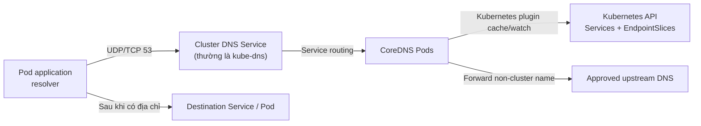
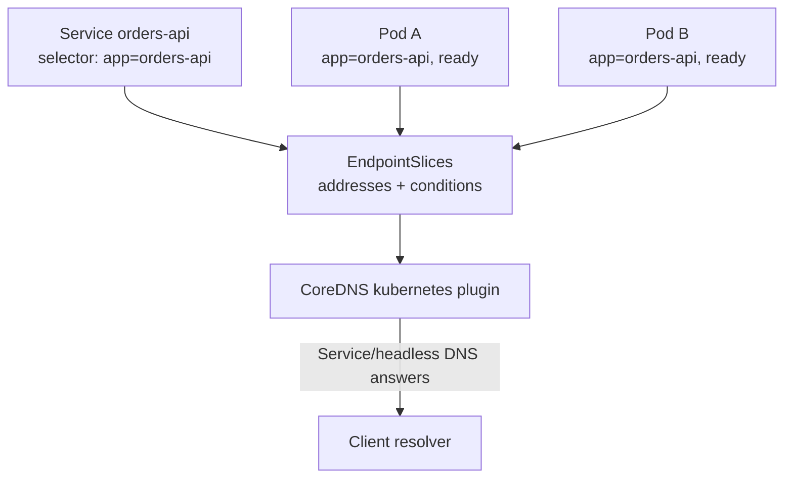
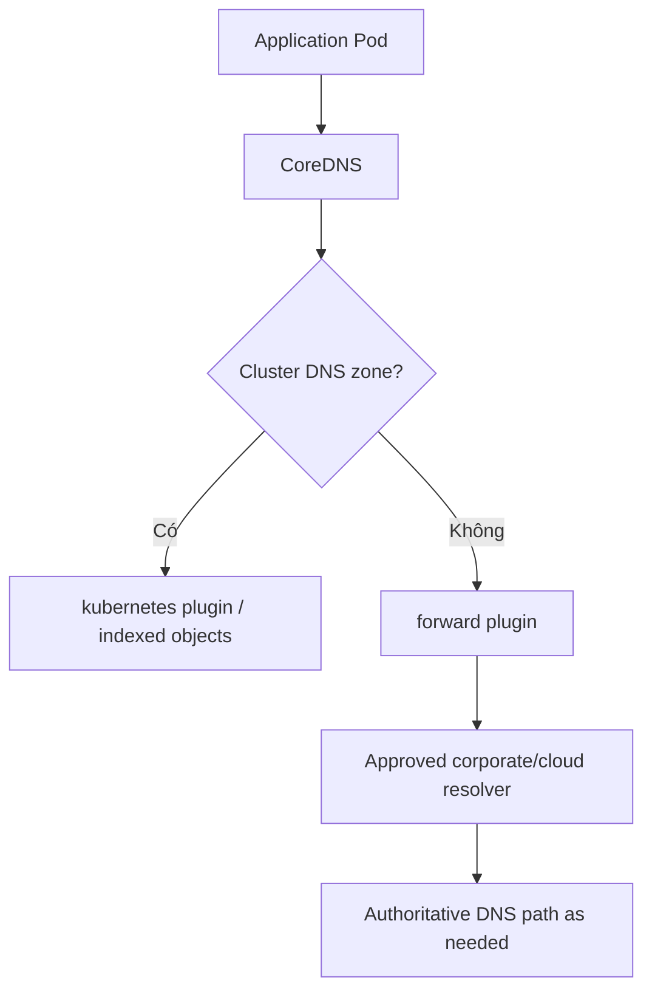
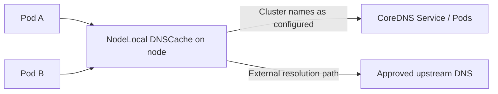
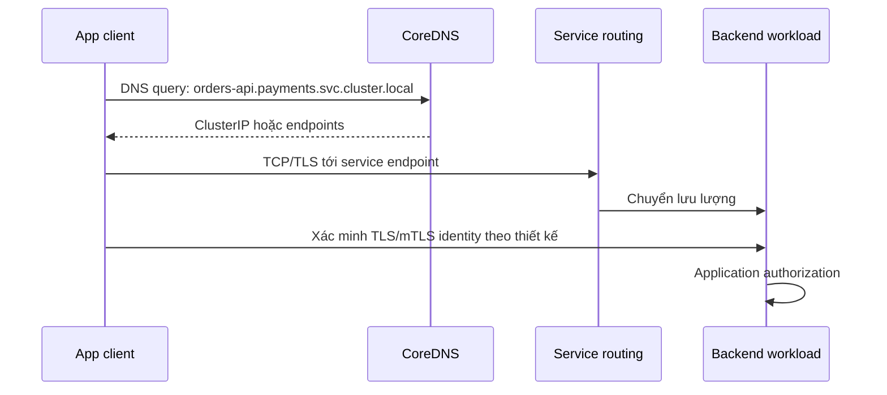
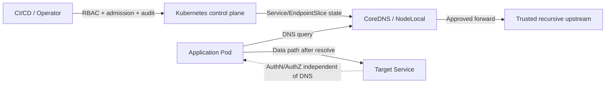

# DNS trong cluster và CoreDNS: service discovery, đường phân giải tên và bảo mật mạng Kubernetes

## 1. Vì sao DNS trong Kubernetes là thành phần bảo mật quan trọng?

Trong Kubernetes, các Pod có thể bị tạo lại, chuyển node, thay địa chỉ IP sau khi rollout hoặc autoscale. Một API không nên buộc phải lưu IP tĩnh của từng Pod database, queue hoặc backend. Thay vào đó, ứng dụng thường truy cập **tên DNS của Service**:

```text
orders-api.payments.svc.cluster.local
postgres.data.svc.cluster.local
kubernetes.default.svc.cluster.local
```

Ở đây, `cluster.local` là **ví dụ tên miền cluster phổ biến**, không phải giá trị bắt buộc của mọi Kubernetes cluster. Các nhãn `payments`, `data` và Service names cũng chỉ minh họa. Với Kubernetes DNS, client phân giải tên thành địa chỉ phù hợp thông qua **CoreDNS hoặc triển khai DNS cluster tương đương**. Sau phân giải, **network dataplane và chính sách truy cập** mới quyết định có kết nối tới đích được hay không.

Nếu DNS bị cấu hình sai hoặc bị điều khiển trái phép:

- API không tìm thấy database hoặc gọi nhầm service.
- Các truy vấn lộ tên namespace, workload, dịch vụ nhạy cảm hoặc hành vi ứng dụng.
- Ứng dụng mất kết nối theo chu kỳ do cache cũ hoặc EndpointSlices thay đổi.
- DNS forwarding bị vòng lặp, timeout hoặc quá tải.
- Pod bị chiếm quyền dùng DNS để tìm nội bộ, thử truy vấn tên nhạy cảm hoặc vận chuyển dữ liệu trái chính sách.
- Một thay đổi `ExternalName`/service discovery có thể dẫn client sang hostname ngoài dự kiến nếu application không kiểm tra TLS identity.

Vì vậy, trong mô-đun **SECURITY_NETWORK_SECURITY**, DNS cluster là lớp quan trọng bên cạnh **network segmentation, firewall, VPN, Kubernetes NetworkPolicy, IDS/IPS, mTLS, IAM/RBAC và giám sát lưu lượng**.

> **Nguyên tắc:** DNS trả lời **“tên này có thể ánh xạ đến đích nào?”**, không trả lời **“ai được truy cập đích?”**. Không dùng sự tồn tại của một bản ghi DNS hoặc địa chỉ private như chứng nhận ứng dụng đã được xác thực hoặc cấp quyền.

### Mục tiêu bài học

Sau bài này, người học có thể:

1. Mô tả Pod DNS resolution, kube-dns Service và luồng CoreDNS → Kubernetes API/cache → upstream.
2. Giải thích tên DNS của **ClusterIP, headless Service, EndpointSlices, SRV và ExternalName**.
3. Phân tích `/etc/resolv.conf`, search domains, `ndots`, `dnsPolicy`, `dnsConfig` và `hostNetwork`.
4. Đọc hiểu các plugin quan trọng trong **Corefile**, phân biệt authoritative cluster lookups với DNS forwarding.
5. Giảm rủi ro từ **DNS spoofing, unauthorized service changes, upstream misrouting, DNS tunneling, exfiltration và denial of service**.
6. Thiết kế **NetworkPolicy, RBAC, egress rules, TLS/mTLS, cache và observability** cho đường DNS.
7. Xử lý sự cố bằng **lệnh kiểm tra ít xâm nhập**, ma trận test và playbook có bằng chứng.

## 2. DNS trong cluster gồm những đối tượng nào?

| Đối tượng | Vai trò | Bề mặt rủi ro |
|---|---|---|
| **Pod application** | dùng resolver để hỏi tên Service hoặc hostname ngoài | thay đổi `dnsPolicy`, app bỏ TLS verification, egress tùy ý |
| **Pod `/etc/resolv.conf`** | chứa nameserver, search domains, options theo chính sách DNS | nameserver/search path khác dự kiến, query amplification |
| **Service `kube-dns`** | tên Service thường dùng để đưa Pod đến endpoint DNS trong cluster | ClusterIP/service routing, endpoint không sẵn sàng |
| **CoreDNS** | DNS server thường được Kubernetes triển khai để trả lời vùng cluster và forward truy vấn khác | Corefile, plugins, resource exhaustion, RBAC, upstream |
| **Kubernetes API** | nguồn dữ liệu cho Services, EndpointSlices, Namespaces và tài nguyên liên quan | quyền thay đổi Service/Endpoints/EndpointSlices, quyền đọc của CoreDNS |
| **kubelet** | cấu hình DNS cho Pods dựa vào cluster DNS/domain và Pod DNS policy | kubelet/node resolver cấu hình sai |
| **CNI/dataplane** | chuyển traffic Pod→DNS Service/endpoint | NetworkPolicy/NAT/Service routing khác kỳ vọng |
| **NodeLocal DNSCache** | cache DNS gần Pod/node khi được triển khai | địa chỉ listener node-local và bypass assumptions |
| **Upstream DNS resolvers** | trả lời tên nằm ngoài zone được CoreDNS quản lý | trust, transport, latency, dữ liệu truy vấn rời cluster |
| **Client DNS library** | cache và xử lý response trong ứng dụng | cache TTL âm/dương, search/timeout, khác nhau giữa runtime |

**CoreDNS không phải bắt buộc là DNS engine duy nhất.** Một cụm có thể dùng triển khai DNS khác, DNS provider-managed, NodeLocal caching hoặc resolver của mesh/ứng dụng; nhiều hướng dẫn mặc định tên `kube-dns` nhưng cần kiểm tra cluster thật.

### 2.1. Đường đi điển hình



Sơ đồ tách **DNS query path** khỏi **application data path**. Client không gửi toàn bộ HTTP request qua CoreDNS. CoreDNS xử lý truy vấn phân giải tên; kết nối HTTPS/gRPC/DB diễn ra theo network routing và bảo mật riêng.

### 2.2. Ai trả lời bản ghi nội bộ?

Trong cấu hình phổ biến, **CoreDNS `kubernetes` plugin** có dữ liệu Service/Pod-related records thông qua việc theo dõi tài nguyên Kubernetes theo quyền được cấp. Nó không nhất thiết **gọi API server trực tiếp cho từng DNS query**; bộ nhớ/cache và các cơ chế watch được dùng để đáp ứng truy vấn.

Đối với hostname ngoài vùng do `kubernetes` plugin xử lý, truy vấn có thể tiếp tục tới **forward plugin hoặc resolver khác** theo thứ tự cấu hình Corefile. Không suy mọi truy vấn DNS đều được gửi ra Internet: việc chuyển tiếp phụ thuộc zone, plugin chain và upstream.

## 3. Kubernetes Service DNS: tên ổn định, địa chỉ có thể thay

Một Service tên `orders-api` trong namespace `payments` thường được truy vấn dưới dạng:

```text
orders-api.payments.svc.cluster.local
```

Quy tắc tên điển hình:

```text
<service-name>.<namespace>.svc.<cluster-domain>
```

**Cluster domain thực có thể khác `cluster.local`.** Phải đọc cấu hình DNS của cluster và Pod, không hard-code giả định ở application library nếu nền tảng cho phép chọn domain.

### 3.1. Tên ngắn trong cùng namespace

Pod ở namespace `payments` có thể gọi:

```text
http://orders-api:8080
```

Resolver Pod thường có search domain cho namespace hiện tại, nên `orders-api` có thể được mở rộng thành tên Service cùng namespace. Nhưng Pod ở `reporting` gọi cùng short name có thể tìm **Service khác** hoặc không tìm thấy.

**Dùng FQDN phù hợp cho phụ thuộc cross-namespace hoặc security-sensitive**, thay vì phụ thuộc vào tên ngắn dễ nhầm.

### 3.2. DNS answer của Service không đồng nghĩa danh sách Pods

Với Service dạng **ClusterIP thông thường**, DNS trả về Service virtual IP (IPv4 `A`, IPv6 `AAAA` trong môi trường hỗ trợ); **kube-proxy, eBPF hoặc dataplane khác** mới xử lý việc đưa traffic tới backend endpoints.

Do đó:

```text
getent hosts orders-api.payments.svc.cluster.local
  -> 10.96.18.42  (Service VIP ví dụ)

Client TCP tới 10.96.18.42:8080
  -> Service routing chọn một backend Pod phù hợp
```

Địa chỉ ví dụ dùng dải private; **không có nghĩa mọi cluster đều dùng 10.96.0.0/12**. DNS không phải load balancer L7 và không tự áp application authorization.

### 3.3. Service không có endpoint sẵn sàng

Một Service có thể vẫn tồn tại và tên DNS vẫn phân giải được **ClusterIP**, nhưng **không có backend endpoint healthy/ready**. Kết quả: DNS lookup thành công song request kết nối thất bại hoặc timeout.

**Phải phân biệt sự cố phân giải tên và sự cố chuyển tiếp traffic tới Pods.**

## 4. Headless Service: DNS trả endpoints thay vì virtual IP

Với `clusterIP: None`, Service dạng **headless** thường dùng để khám phá trực tiếp các endpoint IP phù hợp. Đây là lựa chọn thường gặp cho StatefulSet, databases/replication và một số hệ thống cần biết từng thành viên.

Ví dụ:

```yaml
apiVersion: v1
kind: Service
metadata:
  name: ledger-headless
  namespace: data
spec:
  clusterIP: None
  selector:
    app: ledger
  ports:
    - name: grpc
      port: 9090
      targetPort: 9090
      protocol: TCP
```

Khi có endpoint phù hợp, truy vấn:

```text
ledger-headless.data.svc.cluster.local
```

có thể trả **nhiều A/AAAA records** tương ứng với endpoint addresses. Số lượng/địa chỉ đáp án tùy trạng thái endpoints, address families, DNS/cache và cấu hình.

### 4.1. Sự khác biệt quan trọng

| Thuộc tính | ClusterIP Service thông thường | Headless Service |
|---|---|---|
| DNS trả về | virtual IP của Service theo address families | endpoint addresses đủ điều kiện |
| Chọn backend | dataplane/service load balancing | client/library thường xử lý danh sách IP |
| Tác động của Pod thay IP | Service VIP thường ổn định | response addresses có thể thay khi endpoints thay |
| Dùng cho | phần lớn application-to-service | StatefulSet hoặc peer discovery cần địa chỉ từng thành viên |
| Network controls | policy trên Pods/Service path theo dataplane | policy tới endpoint/POD IP theo cơ chế nền tảng |

**Headless không phải "bỏ bảo mật".** Nó thay đổi service discovery, nhưng vẫn cần **NetworkPolicy, authentication, TLS identity validation và client resilience**. Người vận hành cần kiểm soát thời gian cache/re-resolve vì DNS answer có thể thay nhanh.

### 4.2. Readiness và publish-not-ready

CoreDNS/Kubernetes thông thường dựa vào các endpoints đủ điều kiện để công bố dữ liệu DNS. Một Service có `publishNotReadyAddresses: true` có thể dùng cho discovery khi thành viên chưa ready (ví dụ một số giao thức bootstrap), nhưng **không nên bật mặc định**.

Nếu client tự dùng address của Pod chưa ready, nó có thể kết nối thất bại hoặc gửi yêu cầu đến một instance chưa phục vụ an toàn. Cần hiểu **EndpointSlice conditions** và logic client.

## 5. EndpointSlices, selectors và quyền thay đổi đích

**EndpointSlice** là tài nguyên Kubernetes biểu diễn nhóm network endpoints gắn với một Service và các điều kiện/metadata liên quan. Trong môi trường hiện đại, CoreDNS và dataplane có thể sử dụng EndpointSlices để xác định địa chỉ cho các bản ghi cần endpoint data.

Luồng logic:



**Selector-based Service** và **Service không có selector** có thể có cách quản lý endpoints khác nhau. Việc chỉnh **Service selector, Pod labels, EndpointSlices hoặc đối tượng quản lý tương ứng** có thể làm client kết nối tới workload không như dự kiến.

### 5.1. Tấn công/rủi ro qua control plane

Ví dụ một principal quá quyền có thể:

- Thay `spec.selector` của Service để chọn Pod khác.
- Tạo Pod cùng label mà Service cho phép; endpoint controller có thể đưa Pod vào tập endpoints.
- Thay EndpointSlice của Service selectorless hoặc sửa các đối tượng liên quan nếu được cấp quyền.
- Tạo Service trùng short name ở namespace khác khiến client dựa tên ngắn đi sai đích.

**Biện pháp:** Kubernetes RBAC tối thiểu, admission controls cho selectors/labels, GitOps review, workload identity, audit log và TLS/mTLS ở application hop. DNS chỉ phản ánh state được cluster quản lý; **DNS data đúng theo API nhưng Service selector bị sửa sai vẫn gây rủi ro**.

## 6. DNS records A, AAAA, SRV và hành vi thực tế

| Record | Trường hợp dùng | Ví dụ minh họa | Điều cần hiểu |
|---|---|---|---|
| **A** | IPv4 address | `orders-api.payments.svc.cluster.local` | ClusterIP VIP hoặc endpoint IP tùy loại Service |
| **AAAA** | IPv6 address | cùng hostname trong dual-stack cluster | chỉ có khi cơ chế address family/service phù hợp |
| **SRV** | khám phá hostname + port cho **named Service port** | `_grpc._tcp.orders-api.payments.svc.cluster.local` | Service phải khai báo named port/protocol; kết quả phụ thuộc loại Service |
| **CNAME** | alias tới tên khác, thường với ExternalName | `billing-proxy.payments.svc.cluster.local` | không tự mở tunnel hoặc xác minh TLS |
| **PTR** | reverse DNS trong các vùng hỗ trợ/cấu hình | reverse lookup địa chỉ | không được xem là chứng cứ danh tính |

### 6.1. Tại sao SRV cần tên port?

Nếu Service định nghĩa:

```yaml
ports:
  - name: grpc
    port: 9090
    targetPort: 9090
    protocol: TCP
```

thì client phù hợp có thể truy vấn record dạng:

```text
_grpc._tcp.ledger-headless.data.svc.cluster.local
```

Không phải mọi client gRPC tự dùng SRV discovery. Java HTTP/gRPC SDK thường có resolver/service discovery behavior riêng. **Có SRV record không có nghĩa ứng dụng sẽ tự đọc nó**.

### 6.2. Dual-stack: IPv4 và IPv6

Một Service dual-stack có thể có địa chỉ thuộc hai families theo cấu hình `ipFamilies`/`ipFamilyPolicy` và khả năng cluster. DNS library có thể ưu tiên IPv4/IPv6 khác nhau. NetworkPolicy, cloud firewall, TLS SNI và routing phải nhất quán cho cả hai paths.

Không suy rằng “truy vấn A thành công” bảo đảm các Pod IPv6-only/dual-stack sẽ truy cập được Service.

## 7. DNS tên Pod: đừng dựa vào record không được bảo đảm

Kubernetes hỗ trợ một số cách đặt hostname/subdomain cho Pods, nhưng **không nên tự suy tên DNS cho mọi Pod IP**.

### 7.1. Hostname/subdomain với governing headless Service

Trong trường hợp phù hợp, Pod có `hostname` và `subdomain` và tồn tại headless Service tương ứng trong namespace, có thể có tên dạng:

```text
<hostname>.<subdomain>.<namespace>.svc.<cluster-domain>
```

Ví dụ một Pod StatefulSet `ledger-0` được quản lý qua headless Service `ledger-headless` trong namespace `data`:

```text
ledger-0.ledger-headless.data.svc.cluster.local
```

Khả năng record xuất hiện còn tùy **pod readiness, Service configuration, EndpointSlice conditions và DNS implementation**. Đừng dùng tên Pod FQDN không có governing service/contract rồi coi nó luôn tồn tại.

### 7.2. Legacy Pod-IP-style DNS

CoreDNS `kubernetes` plugin có tùy chọn liên quan `pods`, chẳng hạn các chế độ xử lý record theo Pod IP. **Không nên bật chế độ không kiểm chứng tùy nhu cầu**: một số cách sinh record có thể tạo alias cho địa chỉ không thực sự thuộc Pod trong namespace đó. Cần đọc chính sách/plugin hiện hành và chỉ bật tính năng khi có use case rõ.

**Khuyến nghị:** ứng dụng thường nên kết nối qua **Service DNS** hoặc workload identity đã được quản lý, không phụ thuộc Pod IP-style names tự dựng. Nếu cần peer identities trong StatefulSet, dùng governing headless Service và xác minh TLS identity thích hợp.

## 8. Namespace và phạm vi DNS tên ngắn

Một namespace tạo vùng tên cho Services:

```text
orders-api.team-a.svc.cluster.local
orders-api.team-b.svc.cluster.local
```

Hai Service có cùng short name nhưng nằm ở namespace khác nhau không nhất thiết trỏ cùng workload.

### 8.1. Namespace là vùng tên, không phải tường lửa

Một Pod ở `team-a` vẫn có thể hỏi DNS của `orders-api.team-b.svc.cluster.local` nếu resolver/service phục vụ truy vấn đó. Việc tên phân giải thành IP **không chứng minh** Pod được phép kết nối:

- NetworkPolicy/CNI có thể chặn đường traffic.
- Service mesh hoặc mTLS server có thể từ chối peer.
- Backend authorization có thể từ chối user/tenant.

Ngược lại, **“giấu tên DNS” không phải network isolation**: client có thể biết IP bằng cách khác, hoặc tìm qua metadata nếu control-plane permissions quá rộng.

### 8.2. Rủi ro nhầm namespace

Ứng dụng chạy ở `dev`, gọi tên ngắn `payments` và bất ngờ kết nối một service `payments.dev` thay vì `payments.prod`. Tình huống này có thể gây sai dữ liệu, đặc biệt nếu ứng dụng tin bất kỳ response nào có cùng HTTP path.

Nên dùng **cross-namespace FQDN chính xác**, TLS hostname verification hoặc workload identity và **explicit authorization**. Với service có cùng short name ở nhiều namespace, CI/tests cần phát hiện thay đổi nhầm đích.

## 9. Tập tin `/etc/resolv.conf` của Pod: nameserver, search, ndots

Trong nhiều Pod dùng `dnsPolicy: ClusterFirst`, nội dung có thể tương tự:

```text
nameserver 10.96.0.10
search payments.svc.cluster.local svc.cluster.local cluster.local
options ndots:5
```

**Đây là ví dụ**, không bảo đảm mọi cluster đều dùng cùng IP, search suffixes, `ndots` hoặc cùng resolver. Cụm có custom cluster domain, node-local DNS cache, IPv6 hoặc pod-specific `dnsConfig` có thể khác.

### 9.1. `nameserver`

Địa chỉ `nameserver` là nơi resolver của Pod gửi DNS queries theo cấu hình. Trong Kubernetes tiêu chuẩn, nó có thể là **ClusterIP của DNS Service**; khi dùng NodeLocal DNSCache, địa chỉ mà Pod hỏi có thể là **node-local listener** theo mode triển khai.

### 9.2. `search`

Search domains hỗ trợ sử dụng short name:

```text
Input: orders-api
Possible expanded names in a payments Pod:
  orders-api.payments.svc.cluster.local
  orders-api.svc.cluster.local
  orders-api.cluster.local
  orders-api
```

Thứ tự và số lượng thử nghiệm thực tế phụ thuộc resolver implementation, `ndots`, cache và chính sách. Ví dụ không mô tả chính xác từng packet của mọi glibc, musl, Go, Java hoặc Windows-based container.

### 9.3. `ndots:5` và chi phí DNS

`ndots` là một tham số ảnh hưởng thứ tự resolver thử **tên nguyên dạng** so với **tên gắn search suffix**. Khi hostname có ít dấu chấm hơn ngưỡng, resolver thường ưu tiên thử các biến thể search trước; kết quả là:

- Ứng dụng gọi nhiều hostname ngoài cluster có thể tạo **nhiều DNS queries** hơn dự đoán.
- DNS latency/negative response tăng khi upstream kém.
- Một phần metadata hostname có thể đi qua các vùng DNS không mong muốn theo forwarding/search behavior.
- CoreDNS/NodeLocal DNSCache chịu tải tăng, nhất là khi ứng dụng retry quá nhanh.

**Không có một giá trị `ndots` tối ưu toàn cục.** Hạ xuống 1 có thể giảm truy vấn cho public FQDN nhưng làm thay đổi hành vi tìm short names của ứng dụng. Cần đo và test theo application client/resolver.

### 9.4. Dấu chấm cuối của FQDN

Trong DNS, tên kết thúc bằng dấu chấm biểu thị **tên tuyệt đối**:

```text
orders-api.payments.svc.cluster.local.
```

Một số công cụ resolver dùng nó để tránh search expansion. Tuy nhiên **không tự thêm dấu chấm vào mọi URL HTTPS** vì client TLS hostname validation, HTTP Host, cookies hoặc ứng dụng có thể xử lý hostname có dấu chấm cuối khác nhau. Cần test **resolver và application semantics**.

## 10. `dnsPolicy` và `dnsConfig` trên Pod

PodSpec có thể chọn cách kubelet cấu hình DNS. Các giá trị thường được hỗ trợ:

| `dnsPolicy` | Ý định sử dụng | Điều cần kiểm |
|---|---|---|
| **ClusterFirst** | dùng cluster DNS cho tên cluster, forward những tên khác theo cấu hình | chính sách phổ biến cho Pod không hostNetwork |
| **Default** | kế thừa DNS settings của node theo kubelet/runtime | có thể không phân giải Service names như ClusterFirst nếu node resolver không hỗ trợ |
| **None** | cấu hình DNS riêng bằng `dnsConfig` | phải cung cấp nameservers/search/options hợp lệ và kiểm soát upstream |
| **ClusterFirstWithHostNet** | cluster DNS cho Pod dùng `hostNetwork: true` | cần xét host network exposure và node-level policy |

Với `hostNetwork: true`, dùng `ClusterFirstWithHostNet` khi muốn bảo đảm cluster DNS resolution theo thiết kế; nếu không, Pod có thể theo hành vi DNS khác dự kiến tùy kubelet/runtime.

### 10.1. Ví dụ custom DNS có giới hạn

```yaml
apiVersion: v1
kind: Pod
metadata:
  name: dns-client-demo
  namespace: lab
spec:
  dnsPolicy: ClusterFirst
  dnsConfig:
    options:
      - name: ndots
        value: "2"
      - name: timeout
        value: "2"
      - name: attempts
        value: "2"
  containers:
    - name: app
      image: registry.example.com/lab/dns-client@sha256:<approved-digest>
      command: ["sleep", "3600"]
```

**Chỉ để minh họa**, digest là placeholder và Pod name/namespace phải tồn tại đúng policy; không áp dụng trực tiếp. Giá trị `ndots:2` hoặc timeout/attempts này **không phải khuyến nghị production universal**. Chúng cần tương thích với resolver của image, cluster DNS và app retry budget.

### 10.2. Rủi ro của `dnsPolicy: None`

Một Pod đặt nameserver ra ngoài tổ chức có thể:

- Bỏ qua CoreDNS/cluster monitoring.
- Không phân giải Service names.
- Gửi tên internal services ra external DNS server.
- Gây đường egress trái chính sách nếu NetworkPolicy/cloud firewall mở.

**Chỉ dùng custom DNS cho trường hợp có owner và chính sách**, kèm admission/IaC review và network egress enforcement. Đừng chỉ dựa vào Kubernetes PodSpec để khẳng định nameserver bên ngoài sẽ thực sự reachable.

## 11. CoreDNS chạy ở đâu? Service kube-dns, Deployment và dữ liệu cấu hình

Trong cluster phổ biến, CoreDNS chạy trong namespace `kube-system` và được truy cập qua một Service tên `kube-dns`. Tên Deployment/Pods/labels có thể khác theo phiên bản và managed provider.

```text
Namespace: kube-system
Service: kube-dns (ClusterIP, UDP/TCP 53)
Deployment: coredns (nhiều replicas theo cấu hình)
ConfigMap: coredns (có trường Corefile trong nhiều cluster)
Pod -> DNS Service -> ready CoreDNS endpoint
```

Không nên tự kết luận cấu hình production có đúng những tên này. Từ cluster được cấp quyền, cần **inventory bằng API**, đọc Service, endpoints, deployment và ConfigMap theo đúng naming thực tế.

### 11.1. Vì sao DNS Service có tên kube-dns dù dùng CoreDNS?

Nhiều cluster giữ tên Service `kube-dns` để **các Pod và thành phần khác sử dụng cùng endpoint chuẩn**, trong khi implementation là CoreDNS. Tên Service mang tính tương thích; nó **không chứng minh implementation là kube-dns legacy**.

### 11.2. Tách availability của DNS khỏi app service

Nếu CoreDNS Pods không ready, Service không có endpoints hoặc DNS service routing lỗi, nhiều workloads có thể vẫn chạy nhưng **không tạo được kết nối mới theo hostname**. Đây là **shared dependency có blast radius lớn**: không được chỉ đặt một replica không có HA/monitoring khi cluster và availability requirements đòi hỏi cao hơn.

### 11.3. DNS port và protocol

DNS truyền thống dùng **UDP/53 và TCP/53**. TCP có thể cần khi response không phù hợp UDP hoặc với các hành vi protocol khác. Chỉ allow UDP/53 có thể tạo lỗi phân giải tên khó tái hiện khi kích thước câu trả lời lớn hoặc resolver chuyển sang TCP.

**Port 53 không có nghĩa “mọi DNS”**: DNS over HTTPS (DoH) thường đi qua HTTPS, DNS over TLS (DoT) dùng transport khác và có thể bypass policy chỉ dựa trên cổng 53.

## 12. Corefile là gì? Plugin chain quyết định cách xử lý query

CoreDNS được cấu hình bằng **Corefile**, mô tả server blocks, zones, ports và các plugins. Một ví dụ mang tính học thuật:

```caddyfile
.:53 {
    errors
    health {
        lameduck 5s
    }
    ready
    kubernetes cluster.local in-addr.arpa ip6.arpa {
        fallthrough in-addr.arpa ip6.arpa
        ttl 30
    }
    prometheus :9153
    forward . /etc/resolv.conf {
        max_concurrent 1000
    }
    cache 30
    loop
    reload
    loadbalance
}
```

**Ví dụ không phải cấu hình bắt buộc** của mọi Kubernetes version/CoreDNS build và không nên áp vào cluster mà không có review. Plugin availability, cú pháp và default settings phụ thuộc bản CoreDNS và provider.

### 12.1. Vai trò từng plugin

| Plugin/chỉ thị | Vai trò thông thường | Lưu ý an ninh/vận hành |
|---|---|---|
| **`kubernetes`** | phục vụ vùng Service/Pod DNS từ cluster resources | quyền API, zone/sync, service/endpoint integrity |
| **`forward`** | chuyển truy vấn không được xử lý sang upstream | upstream trust, timeout, DNS loop và metadata rò ra ngoài |
| **`cache`** | lưu positive/negative answers theo cấu hình | TTL/staleness, cache poisoning và behavior sau rollout |
| **`errors`** | log lỗi DNS server theo plugin | chống log flooding, bảo vệ dữ liệu |
| **`health`** | expose endpoint phục vụ health check | listener/port và source cần kiểm |
| **`ready`** | báo trạng thái readiness theo plugins hỗ trợ | cần phân biệt Pod ready và dependency thực |
| **`prometheus`** | expose metrics | bảo vệ metrics endpoint và collector identity |
| **`loop`** | phát hiện một số tình huống forward loop | không bảo đảm phát hiện mọi loại loop |
| **`reload`** | reload Corefile khi thay đổi được hỗ trợ | phải giám sát reload success/failure |
| **`loadbalance`** | điều chỉnh thứ tự các bản ghi A/AAAA trong response theo cơ chế plugin | không phải một L7 balancer hay DB failover manager |

### 12.2. Plugin order và zone

**Thứ tự xử lý trong CoreDNS không đơn giản bằng thứ tự các dòng người dùng viết.** Plugins có thứ tự chain theo CoreDNS build/runtime. Khi troubleshooting cần xem tài liệu và effective config của bản triển khai, không suy “dòng `forward` đứng trước thì luôn chạy trước”.

`kubernetes cluster.local in-addr.arpa ip6.arpa` cho phép plugin xử lý các zones đã định; `fallthrough` trong ví dụ liên quan reverse zones, **không có nghĩa mọi tên không tồn tại trong `cluster.local` đều được chuyển sang public DNS**.

### 12.3. `pods` directive

Một số Corefile mẫu cũ/cluster-specific có `pods insecure` hoặc `pods verified` trong `kubernetes` plugin. **Không bật `pods insecure` chỉ để khắc phục một ứng dụng dùng tên Pod-IP-style** nếu không hiểu cơ chế tạo records; cách này có thể tạo câu trả lời mà không kiểm tra Pod thật theo những giới hạn của mode đó.

Ưu tiên **Service discovery được quản lý**, và chỉ dùng Pod records tùy chọn khi use case, RBAC và trust model rõ ràng.

## 13. CoreDNS và Kubernetes API: data source có thể bị sửa qua RBAC

CoreDNS cần **đọc các Kubernetes objects liên quan** để trả lời service discovery. Quyền đọc thường được cấp qua ServiceAccount và ClusterRole/RoleBinding của deployment tương ứng; quyền chính xác phụ thuộc phiên bản và plugin features.

### 13.1. RBAC tối thiểu

Phạm vi đọc phổ biến cần đánh giá gồm:

- `services`.
- `endpointslices.discovery.k8s.io` hoặc `endpoints` theo phiên bản/chế độ.
- `namespaces`.
- `pods` trong những cấu hình/plugin features cần.

**Không cấp `*:*` hoặc write permissions cho CoreDNS** chỉ vì muốn DNS hoạt động. Hãy đối chiếu quyền cần thiết với bản Kubernetes/CoreDNS thực và managed-provider policy.

### 13.2. Các kiểu rủi ro quyền thay đổi

Một attacker không cần tấn công daemon CoreDNS nếu họ đã có quyền:

- Thay Service `ExternalName` sang tên attacker-controlled.
- Thay Pod labels/Service selector để trỏ sang workload của họ.
- Tạo/sửa EndpointSlices của Service không có selector theo phạm vi được phép.
- Chỉnh ConfigMap `Corefile` để thêm forward zone hoặc resolver không được phê duyệt.
- Patch deployment/Service của CoreDNS, thay image hoặc chỉnh DNS Service endpoints.

Biện pháp là **Kubernetes RBAC, admission policy, GitOps review, image provenance, audit events và segregation of duties**; CoreDNS không có cách tự biết một thay đổi API được cấp quyền nhưng trái nghiệp vụ là độc hại.

## 14. Forwarding ra upstream: đường DNS rời cluster

CoreDNS thường trả lời nội bộ cho các zones Kubernetes và **forward những hostname khác** đến resolver theo `forward` (ví dụ resolver của node hoặc một DNS nội bộ đã được phê duyệt).



### 14.1. Những rủi ro cần phân tích

1. **Upstream sai nguồn:** tổ chức dự kiến private resolver nhưng CoreDNS lại dùng public resolver không phê duyệt.
2. **DNS query leakage:** tên service/nội bộ hoặc hostname chứa metadata xuất khỏi boundary mong muốn qua forwarding/search.
3. **Recursive loop:** upstream trỏ trở lại cluster DNS, gây vòng lặp SERVFAIL/crash.
4. **Timeout/latency:** upstream không reachable từ CoreDNS egress, khiến mọi external lookups chậm.
5. **Trả lời không tin cậy:** forged/poisoned answers theo threat model, tác động kết nối sau phân giải.
6. **Single upstream dependency:** DNS outage lan rộng khi upstream/resolver nội bộ hỏng.

### 14.2. `/etc/resolv.conf` của CoreDNS Pod

Nếu Corefile dùng `forward . /etc/resolv.conf`, nội dung file resolver **bên trong CoreDNS Pod** ảnh hưởng đích forward. Tùy cluster, kubelet cấu hình `dnsPolicy` cho CoreDNS đặc biệt để tránh vòng lặp. Không sửa ngẫu nhiên `dnsPolicy`/Corefile khi chưa hiểu đường upstream.

`loop` plugin có thể phát hiện một số vòng lặp forward đơn giản và khiến CoreDNS từ chối vận hành hoặc crash để tránh tệ hơn; **không coi xóa `loop` là cách sửa nguyên nhân**. Phải sửa nguồn DNS/upstream.

### 14.3. Split-horizon và private zones

Doanh nghiệp có thể muốn:

```text
*.svc.cluster.local    → CoreDNS kubernetes plugin
*.corp.example.com     → approved internal recursive resolver
other public domains   → approved recursive upstream path
```

Các zone và hostname ở đây chỉ là tài liệu mẫu. CoreDNS có thể dùng **server blocks/forwarding theo zone** hoặc tích hợp resolver phù hợp để đạt yêu cầu. Khi triển khai cần kiểm thử **thứ tự xử lý, DNS search paths, split horizon, TTL và failover**, nhất là khi nhiều upstreams phục vụ các views khác nhau.

**Không forward mọi query cho vùng Kubernetes ra external resolver để “chữa NXDOMAIN”**; có thể làm rò internal names, che giấu lỗi Service configuration và tạo kết quả không dự đoán được.

## 15. NodeLocal DNSCache: tăng hiệu năng nhưng thêm điểm cần kiểm soát

**NodeLocal DNSCache** là một lựa chọn triển khai để có DNS cache ở gần workload/node, giảm một số vấn đề latency, conntrack load hoặc truy vấn lặp qua cluster DNS Service. Cách áp dụng khác nhau theo **kube-proxy/IPVS/iptables/eBPF mode, CNI và managed provider**.



### 15.1. Những gì NodeLocal thay đổi

- Pod có thể nhìn `nameserver` là **node-local IP** thay vì ClusterIP; một số modes dùng địa chỉ/dịch vụ với intercept behavior khác.
- Truy vấn có thể được trả lời từ **cache trên node**.
- NetworkPolicy rule “chỉ cho Pod egress tới CoreDNS Pod labels” có thể **không mô tả đúng** đường DNS thực.
- Sự cố một node-local cache có thể ảnh hưởng Pods trên node đó dù CoreDNS cluster-wide vẫn khỏe.
- Logging/metrics thu ở CoreDNS trung tâm có thể **không thấy từng query** vì cache hit tại node.

### 15.2. An ninh NodeLocal

Kiểm soát image/privileges của DNS cache daemon, node networking, ConfigMap, RBAC, upstream destinations và network policy. Một DaemonSet dùng host networking hoặc có quyền chỉnh packet routing có **blast radius lớn**; không cấp quyền đó cho application container thông thường.

### 15.3. Đừng áp policy theo IP ví dụ

Một số tài liệu minh họa node-local DNS ở `169.254.x.x`, nhưng **không được dùng địa chỉ mẫu làm cấu hình cứng**. Phải đọc cấu hình thực tế của cluster và provider; địa chỉ node-local có thể thuộc link-local hoặc range khác.

## 16. DNS không đồng nghĩa Service routing, load balancing hay health check

Đường gọi API:

```text
App resolves orders-api.payments.svc.cluster.local
  ↓
DNS returns Service ClusterIP
  ↓
App opens TCP to ClusterIP:8080
  ↓
Service dataplane routes to a selected endpoint
  ↓
Backend TLS/application authenticates and authorizes
```

Những sự cố riêng biệt:

| Hiện tượng | Có thể là | Không nên vội kết luận |
|---|---|---|
| `NXDOMAIN` cho một Service name | sai namespace/name/domain, Service không có, cache/zone config | firewall đang chặn backend |
| DNS trả ClusterIP nhưng TCP timeout | endpoint không có, CNI/NetworkPolicy, upstream app, node path | CoreDNS đang trả sai |
| DNS trả headless endpoint cũ | TTL/client cache/EndpointSlice readiness/drift | luôn là lỗi CoreDNS |
| TLS hostname mismatch | client dùng tên không khớp SAN, cert sai/rogue endpoint | DNS record không tồn tại |
| HTTP 403 sau DNS thành công | service nhận request nhưng authorization từ chối | DNS hoặc routing bị chặn |
| gRPC `UNAVAILABLE` | nhiều nguyên nhân: DNS, connect, TLS, deadline, server unavailable | chắc chắn là DNS |

**Phân tích theo thứ tự:** phân giải tên → địa chỉ/endpoint → network reachability → TLS identity → application protocol → authorization.

## 17. DNS là metadata chưa đủ cho workload identity

CoreDNS có thể trả đúng địa chỉ của Service, nhưng **DNS response không tự chứng minh workload ở đích là service được phép nhận dữ liệu**. Điều này đặc biệt quan trọng trong môi trường multi-tenant, shared cluster hoặc nơi Kubernetes RBAC/admission chưa chặt.

### 17.1. Server authentication

Khi client gọi `https://orders-api.payments.svc.cluster.local` qua TLS:

- Client cần xác minh **certificate chain hoặc trust anchor phù hợp**.
- Danh tính trong **SAN** phải đáp ứng policy của ứng dụng; không chỉ là “IP nằm trong cluster”.
- Một số service mesh sử dụng **URI-based workload identity (ví dụ SPIFFE ID)**, với verifier phù hợp.
- Application vẫn kiểm tra **authorization theo principal/tenant/action**.

### 17.2. Service DNS và mTLS



Đây là **sơ đồ khái niệm**, không phải từng message của TLS/Envoy hoặc đường data path bắt buộc. Trong service mesh, proxy có thể thay ứng dụng xử lý phần TLS và service identity; policies phải được kiểm chứng trên **đường đi thực**.

### 17.3. DNSSEC không tự thay mTLS

**DNSSEC** nhằm xác thực tính toàn vẹn/nguồn gốc dữ liệu DNS trong một chuỗi DNSSEC trust phù hợp, **không phải cơ chế xác thực người dùng hoặc workload**. Không tự giả định CoreDNS `kubernetes` plugin đã ký/validate toàn bộ private cluster zone theo DNSSEC. Với tên Service nội bộ, **RBAC/cluster API integrity, network controls và TLS/mTLS** vẫn cần thiết.

## 18. Kubernetes NetworkPolicy cho DNS egress của application Pods

Khi áp **default-deny egress**, Pod có thể đột ngột mất khả năng phân giải tên vì không được gửi UDP/TCP 53 tới DNS resolver. Ngược lại, mở `0.0.0.0/0:53` hoặc `::/0:53` cho mọi Pod có thể để chúng truy vấn **resolver trái chính sách** nếu dataplane/route cho phép.

Một chính sách thường cần:

1. Xác định **DNS endpoint mà Pod thật sự dùng**, ClusterIP/NodeLocal hay resolver tùy biến.
2. Xác định **nguồn đích được NetworkPolicy/CNI đánh giá** trước hay sau Service DNAT/NAT.
3. Cho phép UDP/TCP 53 **chỉ đến resolver được phép** theo selector/IP/policy hỗ trợ.
4. Tách **allow DNS egress** khỏi những flows ứng dụng khác.
5. Kiểm tra DNS resolver thực sự phục vụ truy vấn và không có đường DoH/DoT bypass nếu threat model yêu cầu.

### 18.1. Ví dụ NetworkPolicy chỉ cho một nhóm Pod hỏi CoreDNS

```yaml
# Chỉ dùng trong staging/lab; phụ thuộc nhãn, CNI và topology thật.
apiVersion: networking.k8s.io/v1
kind: NetworkPolicy
metadata:
  name: orders-api-dns-egress
  namespace: payments
spec:
  podSelector:
    matchLabels:
      app: orders-api
  policyTypes:
    - Egress
  egress:
    - to:
        - namespaceSelector:
            matchLabels:
              kubernetes.io/metadata.name: kube-system
          podSelector:
            matchLabels:
              k8s-app: kube-dns
      ports:
        - protocol: UDP
          port: 53
        - protocol: TCP
          port: 53
```

Ở đây, **`namespaceSelector` và `podSelector` cùng nằm trong một peer** nên chỉ chọn các Pod có label `k8s-app=kube-dns` trong namespace `kube-system`. Nếu tách làm hai peers, rule có thể mở rộng thành **hai tập đích** thay vì giao nhau.

**Quan trọng:**

- Nhãn CoreDNS không phải lúc nào là `k8s-app=kube-dns`. Đọc labels của DNS Pod thực tế trước khi viết.
- Đường từ app tới **Service ClusterIP** có thể bị dịch địa chỉ trước/sau enforcement theo CNI. Rule dựa Pod selectors cần kiểm thử trên dataplane thật.
- Với **NodeLocal DNSCache**, DNS đích có thể là **node-local IP/host-network daemon**, không thuộc Pods được selector trong ví dụ. Policy này có thể chặn DNS hợp lệ.
- Policy **chỉ cho DNS** trong direction Egress đối với các Pods được chọn nếu không có policy khác bổ sung allow. Muốn app gọi DB/IdP, cần rules hoặc policies tương ứng.
- Kubernetes NetworkPolicies **cộng dồn các allow rules**; một rule egress rộng ở policy khác vẫn có thể mở đường không mong muốn.

### 18.2. Giới hạn của standard NetworkPolicy

Standard NetworkPolicy **không cho phép trực tiếp** kiểu “Pod được hỏi `*.svc.cluster.local` nhưng không được hỏi tên khác”. Nó kiểm soát kết nối L3/L4 tới resolver, không kiểm tra từng DNS question/answer. Muốn policy theo **FQDN/domain**, cần DNS security gateway/proxy, CNI extensions hoặc công cụ tương đương có khả năng thực thi và quản trị được kiểm chứng.

### 18.3. DNS query không nên trở thành service authorization

Cho Pod hỏi DNS về Service `database.prod` không có nghĩa Pod được phép truy cập database. Cần **ingress NetworkPolicy tại DB, egress policy tại caller, TLS/mTLS identity, database credentials và per-object authorization**.

## 19. Bảo vệ chính CoreDNS Pods và đường DNS Service

CoreDNS là một **shared network service**; nếu bị quá tải hoặc bị thay cấu hình, nhiều namespaces có thể bị ảnh hưởng. Hardening cần cân bằng giữa an ninh và độ sẵn sàng.

### 19.1. Các lớp nên đánh giá

| Lớp | Kiểm soát | Lưu ý |
|---|---|---|
| Image/supply chain | registry/digest phê duyệt, SBOM/CVE scanning, ký artifact nếu dùng | managed cluster có cơ chế cập nhật riêng; không sửa image tùy ý |
| Container runtime | non-root nếu phù hợp, drop capabilities, seccomp, read-only FS nếu sản phẩm hỗ trợ | phải kiểm tra quyền bind port 53, writable paths và networking |
| Kubernetes RBAC | chỉ đọc API resources cần thiết | tránh cấp write/admin không cần |
| Corefile ConfigMap | GitOps/review/audit, không cho tự ý forward hoặc bật query logging | thay một field có thể ảnh hưởng mọi Pod |
| Service/EndpointSlice | bảo vệ selector/metadata, readiness, health checks | không cho namespace user tùy ý điều khiển DNS Service |
| Network ingress | cho UDP/TCP 53 từ các nguồn cần thiết; hạn chế health/metrics/admin ports | cluster DNS phải phục vụ rộng theo topology; tránh block node-local |
| Network egress | API server/upstream resolvers và dependencies đã duyệt | không mở unrestricted egress nếu không cần |
| Availability | replicas, resource limits, topology spread/anti-affinity, scaling và PDB theo yêu cầu | kiểm tra provider constraints, HPA, admission |
| Observability | metrics, errors, saturation, cache/forward health | log DNS queries có thể nhạy cảm |

### 19.2. Không áp một NetworkPolicy mẫu lên CoreDNS một cách mù quáng

Nếu CoreDNS Pods cũng bị **ingress/egress isolation**, cần cho:

- DNS queries từ các **Pod/node/network sources** mà DNS Service thật sự phục vụ.
- Kết nối tới **Kubernetes API server** nếu plugin yêu cầu dữ liệu từ API/watch.
- DNS forwarding tới resolvers được phê duyệt.
- Health/readiness probes theo kiểu kubelet/cluster đang dùng.
- Metrics scraping và management được cho phép, nếu có.

Một policy chỉ allow UDP/53 ở CoreDNS egress nhưng **chặn TCP/443 tới API server** có thể khiến `kubernetes` plugin không sync được Service/EndpointSlice data. Ngược lại, mở toàn bộ kube-system egress có thể rộng quá mức. **Cần xem effective routes/policies của platform**, không suy theo port name.

### 19.3. Bảo vệ metrics/admin endpoints

CoreDNS có thể có health/ready/Prometheus listeners **khác UDP/TCP 53**. Chúng phục vụ quản trị/observability nhưng không phải API công khai cho mọi tenant. Áp hạn chế nguồn, xác thực nếu nền tảng hỗ trợ và giới hạn thông tin/log retention. Không mở metrics endpoints ra Internet để “test nhanh”.

## 20. ExternalName Service: CNAME có thể đổi hướng kết nối

Một Service dạng **`ExternalName`** khai báo alias tới hostname khác:

```yaml
apiVersion: v1
kind: Service
metadata:
  name: partner-api
  namespace: payments
spec:
  type: ExternalName
  externalName: api.partner.example.com
```

DNS query tới tên Service có thể trả **CNAME** dẫn đến `api.partner.example.com`, thay vì ClusterIP/EndpointSlice như Service thông thường.

### 20.1. Vì sao ExternalName cần review bảo mật?

- Người có quyền sửa Service có thể thay `externalName`, khiến client resolve sang tên khác.
- Client có thể gửi request theo **hostname nội bộ** trong khi endpoint thật là đối tác; TLS certificate identity/SNI/HTTP Host phải phù hợp theo application contract.
- ExternalName **không tự proxy traffic**, không tự sửa HTTP Host hoặc TLS SNI và không tự giới hạn egress.
- Một số phần mềm có thể coi CNAME và redirect khác nhau; cần xác minh client thực sự kết nối tới đâu.
- Nếu alias trỏ tới domain hết quyền sở hữu, nguy cơ **dangling hostname/domain takeover** phải được đánh giá trong inventory.

### 20.2. Không sửa lỗi TLS bằng bỏ xác minh

Giả sử client mở `https://partner-api.payments.svc.cluster.local`, trong khi endpoint bên ngoài dùng cert cho `api.partner.example.com`. Tùy client và cấu hình, **hostname verification có thể thất bại** vì peer certificate không khớp hostname mà client cần kiểm.

Giải pháp phải xác định **canonical origin/service identity** và mô hình gateway/TLS tương ứng, không bật `insecureSkipVerify` hoặc `verify=False` để bỏ qua mâu thuẫn tên.

### 20.3. Quyền tạo Service có thể mở rủi ro vượt namespace

Một namespace user có quyền tạo ExternalName Service chưa chắc có quyền sửa một Service Production; nhưng họ có thể làm các ứng dụng trong namespace mình truy cập một hostname ngoài mong muốn. Với môi trường multi-tenant, cần đánh giá **RBAC, admission policy, allowed external destinations và egress enforcement**.

## 21. DNS spoofing, poisoning và kiểm soát nguồn câu trả lời

DNS trả lời có thể bị sai vì **config drift, upstream compromise, thay records có quyền, resolver hijack, cache issues hoặc attack**. Để đánh giá, cần biết nguồn câu trả lời:

1. Service record do Kubernetes plugin suy từ **Kubernetes API objects**.
2. Record đến từ **headless endpoints** theo EndpointSlice state.
3. Record `ExternalName` mang một CNAME do Service author khai.
4. Record public/internal domain do **forwarded recursive resolver** trả.
5. Record do **NodeLocal/CoreDNS/application cache** trả từ lần truy vấn trước.

### 21.1. Defense in depth

- Khóa quyền thay **Service selectors, EndpointSlices, Corefile, DNS Service và forwarders**.
- Quản lý **upstream resolver trust**, network path và DNSSEC validation **khi hỗ trợ và phù hợp**.
- Hạn chế Pod tự đổi DNS endpoint và egress tới resolver lạ.
- Dùng TLS hostname verification/mTLS cho dữ liệu nhạy cảm, không tin DNS answer là danh tính.
- Quan sát anomalies: record thay đột ngột, CNAME trỏ ra ngoài, NXDOMAIN/SERVFAIL spike, query domains không hợp đồng.
- Có alert và review với **change approval**, tránh coi mọi IP đổi do autoscale là dấu hiệu tấn công.

### 21.2. Cache poisoning không đồng nghĩa mọi cache hit nguy hiểm

Caching là cần thiết cho performance. Rủi ro phát sinh khi dữ liệu **không còn phù hợp, bị sửa ngoài quyền hoặc resolver tin upstream không đúng**. Tham số cache TTL/negative cache phải cân bằng giữa latency và tốc độ phát hiện endpoint change; không cần vô hiệu hóa cache toàn cluster để tăng an ninh.

## 22. DNS tunneling, exfiltration và lọc egress

Một Pod bị xâm nhập có thể cố dùng các truy vấn DNS làm kênh truyền dữ liệu bằng cách đưa thông tin vào **các nhãn hostname do nó tạo**, hoặc gửi nhiều queries tới domain attacker-controlled.

Đây là mối đe dọa **DNS-based exfiltration**; không nên đánh đồng với mọi DNS query dài hoặc lạ vì các CDN/telemetry/verification workflows cũng có thể dùng tên phức tạp.

### 22.1. Các dấu hiệu điều tra

- Số query cao bất thường từ một Pod/namespace so với baseline.
- Nhiều subdomains **độc nhất và có độ dài lớn** dưới cùng một registered domain.
- Bất thường về entropy/tần suất nhãn, nhiều NXDOMAIN/NOERROR ít tái sử dụng.
- Workload vốn chỉ gọi nội bộ nhưng phát sinh nhiều queries public mới.
- DNS queries tới resolver ngoài approved path hoặc DoH/DoT endpoint không có contract.
- Mối tương quan với process mới, credential access, HTTP egress hoặc Kubernetes RBAC events.

**Không dùng một heuristic đơn lẻ để kết luận exfiltration.** Phải xem asset owner, release, ứng dụng, destination/domain và traffic thực.

### 22.2. Những lớp kiểm soát

1. **Network egress** chỉ cho DNS tới resolver được kiểm soát khi topology hỗ trợ.
2. **DNS security gateway** có khả năng logging/policy tên miền nếu doanh nghiệp yêu cầu.
3. **Cloud IAM/resource restrictions** giảm dữ liệu mà Pod bị chiếm có thể đọc.
4. **Runtime monitoring** process/connect activity.
5. **Outbound HTTPS policy** với DoH/DoT nếu muốn tránh bypass DNS controls; chỉ chặn cổng 53 là không đủ.
6. **Rate limits/quotas** cho resolver/tenant hoặc detection controls nếu platform có hỗ trợ và không gây false positive.
7. **DLP/secret protection** theo lớp ứng dụng và hệ thống lưu trữ.

### 22.3. DNS query privacy

Tên nội bộ có thể tiết lộ **service names, project codes, namespace, environment và sự tồn tại của hệ thống**. Không bật full DNS query logs ở cluster Production vô thời hạn mà chưa có **mục đích rõ, phân quyền, redaction, retention, privacy review và giới hạn tải**.

## 23. DNS performance: cache, TTL và truy vấn lặp

Kubernetes vận hành nhiều Pods, request retries và autoscaling có thể làm DNS QPS tăng mạnh. CoreDNS không chỉ cần đúng chức năng mà còn phải **chịu tải dự đoán**.

### 23.1. Nguồn tạo tải

- Ứng dụng resolve FQDN mỗi request thay vì dùng connection pools.
- `ndots` và search paths khiến một logical lookup tạo nhiều queries.
- Client libraries có **negative caching** rất ngắn hoặc không có.
- DNS timeouts khiến retry ở app, proxy và runtime **nhân tải**.
- Pods liên tục restart/rollout làm cache lạnh.
- Headless Service thay endpoints thường xuyên, client re-resolve dày.
- Upstream resolver chậm gây **concurrency pile-up** ở forward plugin.

### 23.2. Các mức cache

```text
Application/JVM/OS resolver cache
     ↓
NodeLocal DNSCache (nếu có)
     ↓
CoreDNS cache
     ↓
Upstream recursive resolver cache
     ↓
Authoritative DNS servers
```

**TTL hiệu lực không đơn giản là TTL DNS response gốc.** Từng lớp cache có configuration, negative cache, expiry/retry và behavior riêng. Khi Service endpoints đổi nhanh, một JVM cache dài có thể giữ địa chỉ headless cũ dù CoreDNS đã cập nhật.

### 23.3. Đặc thù Java DNS caching

Java có cơ chế DNS address caching riêng theo Java runtime/security properties và các thư viện/network stacks đang dùng. Một service Java dùng HTTP client connection pool còn có **socket connections mở lâu** không phụ thuộc việc DNS được re-resolve thường xuyên.

Khi troubleshoot, phải hỏi:

- JVM/JDK version và DNS cache policy thực tế.
- HTTP/gRPC/DB client resolver, connection pooling, TTL và reconnect behavior.
- DNS response ngay tại Pod hiện tại so với address app đang dùng.
- Có dùng **headless endpoint IP** hay **ClusterIP ổn định**?

**Không chỉnh global JVM DNS TTL một cách mù quáng** để “sửa DNS”, vì có thể gây QPS spike hoặc làm client giữ endpoint cũ lâu hơn trong một số luồng.

### 23.4. Cache và availability

Cache giảm tải nhưng có thể làm thay đổi thời gian phát hiện endpoint mới/cũ. Việc bật `serve_stale` hoặc tính năng tương tự trong CoreDNS/upstream, nếu sử dụng, cần hiểu hành vi trả record cũ khi upstream gặp lỗi; **không phù hợp mọi security-sensitive workload**.

## 24. Observability: nhìn gì ở CoreDNS và các resolver khác?

Nên kết hợp **CoreDNS metrics, kube-dns Service status, Kubernetes API events, CNI flows, NodeLocal metrics và application telemetry**.

| Nhóm tín hiệu | Câu hỏi |
|---|---|
| DNS request rate/QPS | tải tăng do autoscale, search path hay abuse? |
| RCODE distribution: NOERROR/NXDOMAIN/SERVFAIL/REFUSED | tên không tồn tại, upstream lỗi hay policy đang từ chối? |
| Query latency histogram | CoreDNS xử lý chậm hay forward upstream chậm? |
| Forward plugin health/latency/failures | upstream nào gây timeout? |
| Cache hits/misses/evictions | cache có giảm tải hay đang quá nhỏ? |
| CoreDNS Pod restarts/OOM/CPU | process/server có bất ổn hoặc quá tải? |
| DNS Service endpoints/ready replicas | Service có trỏ tới DNS Pods sẵn sàng không? |
| Kubernetes API sync/read errors | CoreDNS có theo dõi được Service/EndpointSlice state? |
| NodeLocal cache per-node errors | sự cố cục bộ trên một node hay toàn cluster? |
| Application DNS lookup duration/failures | user experience thực tế có bị ảnh hưởng? |
| NetworkPolicy/firewall deny events | Pod bị chặn UDP/TCP 53 hay upstream/API? |
| Control-plane audit | ai sửa Corefile, Service, EndpointSlice, RBAC? |

### 24.1. Metrics names có thể thay theo phiên bản

CoreDNS `prometheus` plugin có các bộ đếm/histogram cho DNS requests/responses, cache, forward, errors theo plugin/build. **Không hard-code mọi dashboard theo một tên metric đã thấy ở blog cũ**: kiểm tra metrics endpoint và tài liệu CoreDNS version thực. Một số plugin chỉ phát metrics khi được bật.

### 24.2. Cẩn trọng với full query logging

`log` plugin có thể hữu ích khi điều tra nhưng sinh **log volume lớn** và mang metadata tên miền nhạy cảm. Nên ưu tiên:

- Mẫu thống kê aggregate về RCODE, latency, source/workload theo khả năng.
- Query logs trong **cửa sổ có thời hạn**, với approval và privacy controls.
- Redact/mask dữ liệu cần thiết; không ghi secrets vào DNS labels.
- Alert gắn **namespace/Pod identity** bằng correlation ở CNI/cluster telemetry, không chỉ source IP đã NAT.

### 24.3. DNS availability SLO

SLO không chỉ là “CoreDNS Deployment có replicas Ready”. Cần **synthetic lookup từ workload/namespace đại diện**, độ trễ resolver, tỷ lệ thành công nội bộ/external, egress path, và ảnh hưởng tới ứng dụng. CoreDNS Pods có thể Healthy nhưng **upstream DNS thất bại**, hoặc NodeLocal cache trên vài nodes bị lỗi.

## 25. Bộ lệnh đọc thông tin cluster: kiểm tra không sửa tài nguyên

Chỉ chạy trên **cluster/context và namespace được cấp quyền**. Các lệnh `get`/`describe` là đọc trạng thái Kubernetes API, **không sửa objects**; output có thể chứa internal names/IPs/annotations nên phải bảo vệ theo chính sách.

### 25.1. Xác định DNS service và CoreDNS deployment

```bash
# Chỉ trên cluster đã được cấp phép.
kubectl config current-context
kubectl -n kube-system get services
kubectl -n kube-system get deployments
kubectl -n kube-system get pods -o wide

# Thường có tên kube-dns/coredns; kiểm tra sự tồn tại trước.
kubectl -n kube-system get service kube-dns -o wide
kubectl -n kube-system get endpointslices \
  -l kubernetes.io/service-name=kube-dns
```

Nếu `kube-dns` không tồn tại, **không tự kết luận cluster không có DNS**. Managed provider hoặc cấu hình custom có thể dùng tên/namespace khác.

### 25.2. Kiểm tra Corefile và trạng thái rollout

```bash
# Với cluster dùng ConfigMap/Deployment tên coredns.
kubectl -n kube-system get configmap coredns -o yaml
kubectl -n kube-system describe deployment coredns
kubectl -n kube-system get deployment coredns -o yaml

# Theo dõi logs trong giới hạn cho phép; có thể chứa thông tin nội bộ.
kubectl -n kube-system logs deployment/coredns --tail=150
```

Một số deployment có nhiều containers/replicas; `kubectl logs deployment/coredns` không nhất thiết thể hiện đầy đủ **tất cả Pods/nodes**. Sự cố xảy ra ở một replica cần điều tra theo Pod/node.

### 25.3. Kiểm tra Service và EndpointSlice của ứng dụng

```bash
kubectl -n payments get service orders-api -o wide
kubectl -n payments get service orders-api -o yaml
kubectl -n payments get endpointslices \
  -l kubernetes.io/service-name=orders-api
kubectl -n payments get pods -o wide
kubectl -n payments get networkpolicy
```

Đối chiếu **Service selector, Pod labels, EndpointSlice address/ready conditions và Pod readiness**. Đừng chỉ nhìn `ClusterIP`.

### 25.4. Xem Pod DNS policy qua Kubernetes API

```bash
kubectl -n payments get pod <approved-pod-name> -o yaml
```

`<approved-pod-name>` là placeholder. Trong PodSpec, kiểm tra `dnsPolicy`, `dnsConfig`, `hostNetwork`, containers/sidecars và deployment labels. Tên trường phải được đối chiếu với API Kubernetes trên cluster đang dùng.

### 25.5. Khi cần xem resolver trong running container

```bash
# Chỉ sau khi đã được phép chạy exec trên workload phù hợp.
kubectl -n payments exec <approved-pod-name> -c app -- cat /etc/resolv.conf
```

Lệnh `kubectl exec` **tạo một process mới trong container**, nên **không hoàn toàn read-only ở runtime** dù `cat` chỉ đọc file. Với production forensic hoặc image không có shell/cat, ưu tiên platform telemetry, PodSpec/kubelet config và debug workflow được phê duyệt.

## 26. Dùng `dig`/`nslookup` để phân loại sự cố trong lab được cấp phép

Những ví dụ dưới dùng resolver tools **đã có trong một debug Pod/lab được phê duyệt**, không yêu cầu thêm packages vào production application image.

### 26.1. So sánh short name và FQDN

```bash
# Từ một lab Pod thuộc namespace payments:
nslookup orders-api
nslookup orders-api.payments.svc.cluster.local
nslookup kubernetes.default.svc.cluster.local

# Nếu dig có sẵn:
dig orders-api.payments.svc.cluster.local. A +time=2 +tries=1
dig orders-api.payments.svc.cluster.local. AAAA +time=2 +tries=1
```

**Không kỳ vọng AAAA luôn có**; điều đó phụ thuộc Service IP families/cluster IPv6 support. Nếu short name thành công còn FQDN thất bại, cần xem **search path, cluster domain thực và cách công cụ resolver xử lý input**.

### 26.2. Query tới một resolver xác định

```bash
# DNS_SERVER_IP là IP đã xác minh từ Pod /etc/resolv.conf.
# Không dùng IP đoán hoặc gửi query tới DNS của bên thứ ba ngoài phạm vi.
dig @DNS_SERVER_IP orders-api.payments.svc.cluster.local. A \
  +time=2 +tries=1

# Test TCP nếu resolver và policy cho phép.
dig @DNS_SERVER_IP orders-api.payments.svc.cluster.local. A \
  +tcp +time=2 +tries=1
```

Ở đây `DNS_SERVER_IP` là placeholder không phải literal hostname để chạy. Dùng đúng resolver của cluster; so sánh UDP/TCP để phát hiện firewall/MTU/framing/buffering differences theo bằng chứng.

### 26.3. Quan sát SRV cho named Service port

```bash
dig _grpc._tcp.ledger-headless.data.svc.cluster.local. SRV \
  +time=2 +tries=1
```

Kết quả cần được diễn giải theo **Service tồn tại thật, named port, headless/ClusterIP mode và EndpointSlices**. Không nên tạo Services hoặc sửa production chỉ để thử một truy vấn.

### 26.4. Đọc RCODE đúng cách

| Kết quả | Ý nghĩa thường gặp | Hướng điều tra |
|---|---|---|
| **NOERROR + answer** | resolver có dữ liệu trả | kiểm tra record type, address, TTL, service/endpoint thật |
| **NOERROR nhưng không có record type hỏi** | có thể là NODATA hoặc behavior tương ứng | hỏi đúng A/AAAA/SRV, xem dual-stack và records |
| **NXDOMAIN** | tên được hỏi không tồn tại theo resolver/zone tại thời điểm đó | namespace, tên, search suffix, cache âm |
| **SERVFAIL** | server gặp lỗi xử lý/forwarding/validation theo tình huống | CoreDNS logs, upstream, API sync, loop |
| **REFUSED** | DNS server từ chối xử lý query theo policy/context | DNS ACL, query source, plugin behavior |
| **timeout** | không nhận phản hồi kịp trong thời gian test | network path, UDP/TCP, DNS Pod health, upstream latency |

**Timeout khác NXDOMAIN; NXDOMAIN khác TCP connection refused tới application.** Không gộp mọi lỗi thành “DNS đang chết”.

## 27. Troubleshooting theo lớp: từ Pod tới DNS và backend

### 27.1. Checklist theo thứ tự

1. **Xác định client Pod/namespace/node** bị lỗi, thời điểm và hostname thực nó hỏi.
2. **Xem dnsPolicy/dnsConfig**, nameserver/search/ndots và hostNetwork/NodeLocal mode.
3. Kiểm tra **Service DNS ClusterIP, DNS endpoints, CoreDNS/NodeLocal readiness**.
4. Kiểm tra **UDP/TCP 53 reachability** theo CNI/NetworkPolicy/cloud firewall.
5. Phân biệt query **cluster zone** và **external forwarded zone**.
6. Kiểm tra Service/EndpointSlice/selectors/readiness của **tên đích**.
7. So sánh **DNS answer từ resolver** và **hostname/IP mà application thực dùng**.
8. Kiểm tra TLS hostname, SNI, service mesh authorization và application errors.
9. Xem DNS retries/cache/timeout và các thay đổi vừa deploy.
10. Xác định blocker ở **DNS, routing, TLS, API authorization hay application availability** trước khi chỉnh cấu hình.

### 27.2. Bảng nguyên nhân thường gặp

| Biểu hiện | Khả năng | Cách kiểm |
|---|---|---|
| Tất cả namespaces có SERVFAIL external names | upstream/forward/CoreDNS egress lỗi | Corefile, forward health, CNI egress và upstream status |
| Service nội bộ NXDOMAIN sau rollout | sai namespace/name/cluster domain, Service chưa tồn tại, cache | Service inventory, query FQDN, TTL |
| Chỉ Pods trên một node timeout | NodeLocal cache, node DNS route hoặc CNI issue | so node, daemon, local cache metrics |
| Chỉ một namespace lỗi | NetworkPolicy, dnsConfig override hoặc names trùng | namespace PodSpec và policy |
| DNS query thành công, HTTP request fail | endpoint/route/TLS/app hoặc RBAC/AuthZ | curl/gRPC logs, EndpointSlice, auth logs |
| CoreDNS CrashLoop với loop detection | CoreDNS forwarding quay lại chính resolver | resolv.conf/upstream, Corefile, kubelet DNS settings |
| Một vài client Java dùng IP cũ | JVM DNS cache hoặc connection pool | app runtime config, headless endpoints, restart/reconnect evidence |
| CORS/UI bị lỗi sau DNS đổi | HTTP/TLS/Host/Origin mismatch, không chỉ DNS | browser/app/proxy logs |
| SRV không có nhưng A có | missing named port hoặc plugin/record conditions | Service ports và target record type |
| UDP works, TCP DNS fails | TCP/53 policy, resolver listen/route differences | TCP test + effective firewall |
| Truy vấn external hostname chậm | ndots/search expansion, forward/upstream latency | dig timing, resolver logs, CoreDNS metrics |
| Metrics healthy nhưng user DNS fail | NodeLocal, namespace policy, app cache hoặc path khác | synthetic tests từ đúng affected Pod |

### 27.3. Đừng sửa bằng cách bật public DNS tùy ý

Khi CoreDNS không trả lời, đổi Pod sang public resolver ngẫu nhiên có thể:

- Làm mất khả năng tìm Service nội bộ.
- Gửi internal names ra ngoài.
- Bỏ qua DNS monitoring/security policies.
- Che khuất nguyên nhân upstream/NetworkPolicy thực.

Giải pháp cần khôi phục **cluster DNS chain được phê duyệt**, không tạo bypass tạm thời thiếu owner.

## 28. Multi-cluster, hybrid DNS và service discovery vượt ranh giới

Một doanh nghiệp có thể chạy nhiều Kubernetes clusters, nhiều VPC/VNet và dịch vụ on-premises. Tên `orders-api.payments.svc.cluster.local` **chỉ có ý nghĩa trong DNS scope được triển khai**, không mặc nhiên chỉ cùng Service trên cluster khác.

### 28.1. Các mô hình có thể gặp

- **Independent cluster domains:** mỗi cluster phân giải Services của chính mình; cross-cluster gọi qua API gateway hoặc ingress/egress gateway.
- **Multi-cluster Services (MCS):** API/implementation hỗ trợ service discovery liên cluster theo các cơ chế và tên miền riêng, ví dụ `clusterset.local` trong triển khai MCS tương ứng.
- **Service mesh multi-cluster:** workload identity, DNS capture, service registry hoặc gateway routing theo nền tảng.
- **Private DNS zones/split-horizon:** CoreDNS forward một số suffix sang resolver của doanh nghiệp hoặc network khác.
- **Hybrid DNS:** Pod cần phân giải cả Service trong cluster và hostname của database/on-premises.

### 28.2. Rủi ro an ninh

1. Hai clusters dùng tên ngắn giống nhau nhưng thuộc **trust domains khác nhau**.
2. Forwarding zone trỏ sai network hoặc public DNS, làm lộ metadata nội bộ.
3. Cross-cluster routing cho phép một Service chưa được phê duyệt tiếp cận sensitive backend.
4. Client TLS validation dựa trên tên không tương ứng với backend service identity.
5. NetworkPolicy trong **cluster A** không tự thực thi policies ở **cluster B**.
6. Quyền sửa một ConfigMap DNS của cluster không được bảo vệ chặt như quyền sửa cross-cluster routes.

### 28.3. Cần một hợp đồng rõ cho mỗi liên kết

| Thành phần | Hợp đồng cần ghi |
|---|---|
| Nguồn tên | zone nào authoritative, ai quản lý record/service |
| Resolver path | Pod → CoreDNS/NodeLocal → resolver/upstream/gateway nào |
| Network | VPN/peering/transit/gateway path, firewall và egress |
| Identity | TLS/mTLS server/client identities, trust anchors và authorization |
| Data classification | có cho phép dữ liệu/tên dịch vụ vượt cluster boundary không |
| Availability | fallback/timeout/cache behavior, dependency khi một cluster mất |
| Change governance | owner, cross-team approval, logging và rollback |

**DNS service discovery không biến một kết nối liên cluster thành an toàn**. Cần kiểm soát kết nối, identity và data access như với mọi biên tin cậy khác.

## 29. STRIDE threat modeling cho DNS Kubernetes

### 29.1. Tài sản và trust boundaries

**Tài sản:** Kubernetes API Service/EndpointSlice records, CoreDNS Corefile, DNS Service, CoreDNS/NodeLocal images, upstream resolvers, DNS query metadata, workload TLS identities, DNS-related logs và ứng dụng phụ thuộc.

**Biên tin cậy:**



### 29.2. STRIDE matrix

| Nhóm | Kịch bản | Điều kiện tạo rủi ro | Kiểm soát |
|---|---|---|---|
| **Spoofing** | client kết nối endpoint giả sau DNS lookup | upstream/record thay sai, app bỏ hostname verification | resolver trust, TLS/mTLS, service identity |
| **Spoofing** | Pod giả được Service selector chọn | quyền tạo Pod/labels rộng | RBAC, admission, workload attestation |
| **Tampering** | thay Corefile forward sang resolver lạ | ConfigMap change không được review | GitOps, immutable policy, audit, approval |
| **Tampering** | sửa ExternalName sang domain ngoài | quyền mutate Service không được giới hạn | admission/allowed external domains, ownership |
| **Repudiation** | không biết ai sửa DNS Service hoặc EndpointSlice | thiếu API audit/CI identity | cloud/Kubernetes audit logs, request IDs, policy version |
| **Information disclosure** | internal query names rời cluster | upstream/search path sai | split DNS, restricted forward, privacy-aware logs |
| **Information disclosure** | DNS tunneling gửi dữ liệu trái phép | unrestricted DNS/DoH egress, workload compromise | egress controls, detection, IAM/DLP |
| **Denial of Service** | CoreDNS bị quá tải bởi search-path amplification | ndots, retries, thiếu cache/limits | caching, QPS metrics, scaling, retry budgets |
| **Denial of Service** | CoreDNS crash/loop do forwarding | upstream trỏ lại chính resolver | review Corefile/resolv.conf, loop detection, fallback design |
| **Denial of Service** | NetworkPolicy chặn UDP/TCP 53 | default deny triển khai không có DNS allow | dependency inventory, canary, DNS positive tests |
| **Elevation of Privilege** | dev đổi selector để tiếp cận backend nhạy cảm | thiếu policy trên resource mutation | RBAC/admission, NetworkPolicy, mTLS/AuthZ |
| **Elevation of Privilege** | trust một DNS name như user identity | app bỏ AuthN/AuthZ | workload/user identity, per-object authorization |

### 29.3. Rủi ro còn lại

Ngay khi DNS response đúng và resolver không bị xâm nhập, kẻ tấn công có thể khai thác **ứng dụng, credential, network policy, service mesh hoặc cloud IAM**. CoreDNS chỉ là một lớp trong hệ thống. **Không coi bảo mật DNS thay thế bảo mật request và dữ liệu**.

## 30. Case study: sau khi áp default-deny, chỉ một số Pods mất DNS

### 30.1. Bối cảnh giả định

Một nhóm vận hành đã triển khai:

```text
orders-api namespace payments
  dnsPolicy: ClusterFirst
  NetworkPolicy: default-deny egress
  NetworkPolicy: allow UDP/TCP 53 tới Pods label k8s-app=kube-dns

Cluster:
  CoreDNS có nhiều replicas, Service kube-dns hoạt động
  Một số nodes dùng NodeLocal DNSCache
```

Sau canary, Pods trên một nhóm nodes nhận **DNS timeout**, trong khi Pods khác resolve thành công. Dashboard CoreDNS ở cluster-wide có ít lỗi và Service `kube-dns` vẫn Ready.

### 30.2. Những giả thuyết cần kiểm tra

1. Các Pod gặp lỗi có `nameserver` trỏ tới **node-local IP**, không tới DNS Service path được policy cho phép.
2. CNI áp egress policy trên địa chỉ đích **trước/sau NAT** khác assumptions.
3. DNSCache daemon lỗi hoặc không ready trên các nodes đó.
4. NetworkPolicy có một allow rule khác trên những Pods hoạt động, khiến kết quả không đồng nhất.
5. Cấu hình `dnsPolicy`/`dnsConfig` hoặc Pod labels khác nhau giữa replicas.
6. Chỉ UDP/53 được phép trong một path nhưng TCP/53 bị chặn theo một điều kiện.
7. Pod DNS resolver hoặc Java application cache gây khác biệt giữa requests mới và connections cũ.

### 30.3. Phân tích có bằng chứng

Thực hiện trong **staging/cluster được cấp quyền**:

- So sánh PodSpec, `/etc/resolv.conf` và effective policy của Pod bị lỗi/không lỗi.
- Đối chiếu NodeLocal DaemonSet/network mode, CoreDNS endpoints, CNI logs và node metrics.
- Test một hostname cluster FQDN bằng UDP/TCP tới **resolver được cấu hình thực**.
- Dùng Service/EndpointSlice data để loại trừ nguyên nhân target Service không tồn tại.
- So sánh DNS query latency/error theo node và application request IDs.

### 30.4. Sửa đúng

Điều chỉnh **DNS egress contract** theo dataplane thực được hỗ trợ, ví dụ cho đúng đường tới NodeLocal DNSCache và CoreDNS/upstream khi cần; kiểm tra host-level policy và CNI implementation. Không mở toàn bộ egress `0.0.0.0/0` để chữa timeout nếu có thể xác định endpoint cụ thể.

Sau sửa, xác minh:

1. Cluster-internal names phân giải ổn định từ mọi nhóm nodes.
2. External names được forward theo policy, không sang resolver lạ.
3. TCP/UDP DNS hoạt động đúng khi cần.
4. API connections và TLS/auth tiếp tục đạt SLO.
5. Những Pods ngoài chính sách **không có DNS egress bypass** hoặc đường ra trái phép.

### 30.5. Bài học

**NetworkPolicy mẫu đúng về cú pháp không chứng minh nó đúng với NodeLocal DNSCache và CNI thật.** DNS failure có thể nằm ở Pod→node-local path dù CoreDNS trung tâm hoàn toàn khỏe.

## 31. Case study: ExternalName bị đổi đích và ứng dụng báo lỗi TLS

### 31.1. Bối cảnh

Một namespace có Service:

```text
partner-api.payments.svc.cluster.local
    CNAME api.partner.example.com
```

Sau một thay đổi không qua review, `externalName` chuyển sang hostname khác. Ứng dụng bắt đầu gặp TLS hostname mismatch và HTTP errors.

### 31.2. Không đổ lỗi cho TLS

Việc TLS từ chối endpoint **có thể là một kiểm soát đúng**. Nếu operator sửa bằng `verify=False`, application sẽ bỏ qua ranh giới xác thực máy chủ và có thể trao đổi dữ liệu với đích không được ủy quyền.

### 31.3. Hướng xử lý

1. Xác nhận Service spec/last change actor và Kubernetes audit.
2. Kiểm tra owner/allowlist của ExternalName.
3. Truy vấn CNAME theo cluster resolver và kiểm tra cached answers.
4. Đối chiếu đích theo **egress network policy, proxy policy và TLS expected identity**.
5. Khôi phục Service definition đã duyệt qua GitOps/IaC và khóa quyền sửa.
6. Kiểm tra secrets/data có thể đã được gửi ra ngoài hay không bằng logs có quyền và telemetry.
7. Thêm admission/CI rule để cảnh báo Service `ExternalName` đổi tới domains ngoài policy.

**Không chỉ sửa CNAME:** xác định vì sao một actor có thể thay hostname và liệu còn route/secret nào bị ảnh hưởng.

## 32. Playbook ứng phó sự cố CoreDNS hoặc DNS exfiltration

### Giai đoạn A — Triage

1. Xác định **cluster, namespace, affected Pods/nodes, time window, error pattern và FQDN**.
2. Phân biệt **availability incident** (timeout/SERVFAIL/loop) và **security incident** (forward sai, Service mutation, exfil suspicion); cả hai có thể cùng xảy ra.
3. Lập đường đi query: Pod resolver → NodeLocal (nếu có) → CoreDNS Service/Pods → Kubernetes plugin/upstream.
4. Thu thập **Corefile/deployment revisions, endpoints, Service/EndpointSlice changes, NodeLocal config, CNI verdicts, API audit**.
5. Kiểm tra application TLS/network/auth logs để biết có **kết nối sai đích hoặc đọc dữ liệu trái phép** không.

### Giai đoạn B — Containment

- Nếu bị sửa ConfigMap/Service/EndpointSlice trái quyền, khóa quyền thay đổi và khôi phục config theo incident authority.
- Nếu upstream resolver bị nghi compromise, điều chỉnh DNS forwarding và egress theo **đường thay thế được phê duyệt**, tránh public resolver ngẫu nhiên.
- Nếu DNS tunneling có bằng chứng, giới hạn workload/namespace egress, bảo vệ secrets/IAM, không xóa log cần điều tra.
- Nếu CoreDNS bị quá tải, giảm retry/query load từ source phù hợp và scale/restore service theo SLO, không chỉ restart Pods liên tục.
- Nếu có network policy lỗi, rollback/canary hẹp đủ khôi phục DNS mà không mở toàn bộ Production egress.

### Giai đoạn C — Phục hồi

1. Xác minh **kubernetes plugin sync**, cluster DNS resolution và upstream forwarding.
2. Kiểm tra external/internal names từ representative namespaces/nodes.
3. Xác minh HTTP/gRPC/DB endpoints và TLS identity ở các luồng nghiệp vụ.
4. Kiểm tra cache/TTL/JVM client behavior sau đổi Service/endpoints.
5. Rà soát NetworkPolicy, RBAC/admission, ConfigMap access và GitOps drift.
6. Giám sát NXDOMAIN/SERVFAIL/timeout/QPS, NodeLocal errors và app SLO sau recovery.

### Giai đoạn D — Hậu kiểm

- Ghi timeline, chủ sở hữu thay đổi, impacted workloads và phạm vi dữ liệu.
- Bổ sung kiểm tra DNS trong CI/CD/staging, policy test cases và alert.
- Chỉnh resource limits/scaling/backoff/forwarding theo tải thực tế.
- Đặt expiry cho exception DNS egress tạm.
- Diễn tập tình huống node DNS cache lỗi, upstream timeout hoặc misconfigured Service selector.

**Không tuyên bố “DNS đã bình thường” chỉ vì CoreDNS Pods Ready**: phải chứng minh client thật phân giải tên và ứng dụng hoàn thành tác vụ.

## 33. Thiết kế thay đổi CoreDNS và NetworkPolicy an toàn

### 33.1. Trước thay đổi

- Inventory CoreDNS/NodeLocal versions, Service/EndpointSlice paths, upstreams, zones, Corefile, DNS policies và owners.
- Xác định dependency của **kube-system controllers, admission webhooks, identity services, observability, CI/CD và business workloads**.
- Đo baseline metrics: QPS, latency, RCODE, cache hit ratio, CPU/memory, restart count, application DNS failures.
- Chuẩn bị **rollback artifact/ConfigMap** và người có quyền, kiểm thử plan trong staging.

### 33.2. Thay đổi có kiểm soát

1. Sửa Corefile/NodeLocal settings thông qua **versioned IaC/GitOps hoặc provider-supported mechanism**.
2. Review zone/plugin order và forwarding targets, tránh loop/accidental external leakage.
3. Kiểm tra CoreDNS/plugin config syntax bằng công cụ phù hợp phiên bản.
4. Cập nhật NetworkPolicy/CNI egress theo dependency.
5. Chạy canary nếu cluster architecture cho phép; không ép một ConfigMap chung vào toàn bộ environment khi thiếu khả năng rollback.
6. Quan sát rollout/reload health, readiness, errors, cache behavior và user-facing SLO.

### 33.3. Sau thay đổi

- Query các Service FQDN trong **nhiều namespaces**, headless và external zone.
- Test **UDP và TCP 53**, NodeLocal/cluster DNS paths, IPv4/IPv6 khi có.
- Kiểm thử TLS/mTLS ở ứng dụng, không chỉ DNS answers.
- Test mạng bị deny và egress không được phép.
- Xác nhận logs/metrics/audit không bị mất và không ghi dữ liệu nhạy cảm ngoài quy định.

### 33.4. Không sửa nhà cung cấp managed DNS theo cách unsupported

Một số managed Kubernetes dịch vụ kiểm soát deployment/add-on CoreDNS qua hệ thống của họ. Sửa trực tiếp một Deployment/ConfigMap có thể bị ghi đè khi nâng cấp hoặc làm mất hỗ trợ. Hãy dùng **đường cấu hình chính thức** của môi trường thật, lưu diff/audit và kiểm tra version compatibility.

## 34. Ma trận kiểm thử nghiệm thu DNS security

| Test case | Kỳ vọng | Bằng chứng |
|---|---|---|
| Pod cùng namespace gọi short Service name | phân giải đúng Service theo search path | Pod resolver info + DNS query |
| Pod khác namespace dùng FQDN | phân giải đúng Service đã nêu | answer, namespace, Service spec |
| Truy vấn `kubernetes.default.svc` theo domain thật | thành công khi DNS cluster hoạt động | DNS response và Service |
| Service ClusterIP có Ready backend | DNS trả VIP, application kết nối thành công | A/AAAA + CNI + app health |
| Service ClusterIP không có endpoints | DNS VIP có thể tồn tại nhưng kết nối app fail | Service/EndpointSlice/ready checks |
| Headless Service có nhiều endpoints | trả các địa chỉ đủ điều kiện | EndpointSlice conditions + DNS A/AAAA |
| Headless Service member chưa ready | answer theo readiness/publishNotReady policy | Service settings + records |
| SRV của named port | trả SRV khi cấu hình phù hợp | Service ports + dig SRV |
| ExternalName trỏ allowed domain | CNAME phù hợp, TLS identity kiểm đúng | Service spec, DNS/TLS checks |
| ExternalName trỏ domain ngoài policy | reject hoặc alert từ admission/review | policy/audit evidence |
| Pod `dnsPolicy: Default` | behavior phù hợp node DNS policy | PodSpec/resolver + known names |
| Pod `dnsPolicy: None` trái policy | bị admission/review phát hiện | PodSpec + admission log |
| Pod hostNetwork dùng cluster DNS | có DNS policy phù hợp và traffic path rõ | PodSpec + resolver test |
| CoreDNS forwarding external zone | chỉ gửi tới upstream được duyệt | Corefile, egress logs, response |
| CoreDNS upstream mất kết nối | lỗi được quan sát, fallback đúng policy | forward errors + synthetic DNS |
| CoreDNS recursive loop trong staging | được phát hiện, không làm mất toàn cluster | test môi trường cô lập + logs |
| DNS `UDP/53` bị chặn trong lab | DNS client fail theo kỳ vọng | NetworkPolicy/CNI verdict |
| DNS `TCP/53` được cho khi cần | query TCP thành công | dig +tcp + firewall logs |
| Application Pod bị default-deny | DNS vẫn hoạt động qua policy approved | app+DNS positive test |
| App chỉ được hỏi approved resolver | unknown resolver bị network deny | egress negative test |
| NodeLocal cache trên một node lỗi | phát hiện theo node, fallback/recovery policy | NodeLocal metrics + Pod tests |
| CoreDNS deployment không có ready endpoints | alert và ứng dụng báo ảnh hưởng | Service endpoints + SLO |
| CoreDNS ConfigMap sửa trái phép | detection/deny và rollback mechanism | API audit, GitOps drift |
| RBAC requester không được đổi Service selector | Kubernetes API deny | RBAC decision/audit |
| IPv6-only/dual-stack DNS query | records/transport theo address families | AAAA, IPv6 route/policy |
| DNS name hợp lệ nhưng TLS identity sai | client từ chối peer | TLS validation logs |
| DNS NXDOMAIN nhiều do search path | phát hiện và có kế hoạch tối ưu | RCODE metrics + ndots evidence |
| DNS query log chứa thông tin nhạy cảm | redaction/retention/access đúng | log access review |
| Exfil-like queries trong lab | alert có triage, không tạo kết luận sai | detection rule + analyst review |
| Java client cache endpoint cũ | được phát hiện/khôi phục theo cache policy | JVM/client + EndpointSlice records |
| Multi-cluster name resolution | chỉ đúng trust domain và network path | DNS route + mTLS/service identity |

### 34.1. Mẫu record test có thể audit

```yaml
# Test record minh họa, không phải Kubernetes API object.
test_id: K8S-DNS-011-RESOLUTION-PATH
environment: authorized-staging
source:
  namespace: payments
  workload: orders-api
  node_group: canary
query:
  name: orders-api.payments.svc.cluster.local
  type: A
expected:
  resolver: approved-cluster-dns
  query_succeeds: true
  endpoint_identity_verified_by_tls: true
  unapproved_dns_egress_blocked: true
evidence:
  - pod_dns_policy_snapshot
  - core_dns_service_and_endpoint_snapshot
  - DNS_query_result
  - network_policy_verdict
  - application_tls_and_health_log
result: PENDING
owner: platform-security
```

**Không nhầm kết quả:** một bản ghi DNS hợp lệ không chứng minh endpoint TLS đã được xác minh; cần kiểm tra riêng trường `endpoint_identity_verified_by_tls` tại application/service mesh.

## 35. Những hiểu lầm phổ biến

1. **“CoreDNS là proxy nhận toàn bộ HTTP.”** Nó xử lý DNS; application data đi bằng network path riêng.
2. **“Mọi Kubernetes cluster dùng `cluster.local`.”** Cluster domain có thể tùy chỉnh.
3. **“Pod DNS luôn trả Pod IP cho Service.”** ClusterIP Service thường trả virtual IP; headless trả endpoints.
4. **“Service DNS có record nghĩa backend đang ready.”** ClusterIP record có thể tồn tại dù không có ready endpoint.
5. **“Headless Service là bypass authorization.”** Nó thay service discovery; network/TLS/AuthZ vẫn cần.
6. **“Mọi Pod IP đều có DNS record theo công thức giống nhau.”** Phụ thuộc plugin/Service/hostname/subdomain.
7. **“DNS namespace đồng nghĩa network isolation.”** DNS namespacing không chặn kết nối cross-namespace.
8. **“Tên ngắn luôn trỏ cùng Service ở mọi namespace.”** Search path thay đổi tên được phân giải.
9. **“`/etc/resolv.conf` của mọi Pod giống nhau.”** dnsPolicy, dnsConfig, node-local và hostNetwork làm khác.
10. **“`ndots:5` luôn là cấu hình tối ưu.”** Cần đo search amplification và compatibility.
11. **“Thêm dấu chấm cuối cho mọi HTTPS URL sẽ không ảnh hưởng gì.”** Resolver và TLS/HTTP semantics cần test.
12. **“`dnsPolicy: None` an toàn vì cluster vẫn có CoreDNS.”** Pod có thể dùng resolver khác, bỏ DNS zone nội bộ.
13. **“Service tên kube-dns nghĩa cluster vẫn chạy kube-dns legacy.”** Service name có thể là compatibility layer cho CoreDNS.
14. **“CoreDNS gọi Kubernetes API cho từng query.”** Plugin có thể theo dõi và cache object state.
15. **“Corefile chạy plugin theo đúng thứ tự dòng viết.”** CoreDNS plugin order phụ thuộc build/chain.
16. **“`forward . /etc/resolv.conf` luôn dùng resolver đáng tin.”** Phải kiểm tra file/upstream thực.
17. **“Xóa `loop` plugin là sửa DNS recursive loop.”** Phải sửa nguyên nhân forwarding.
18. **“NodeLocal DNSCache chỉ là bản CoreDNS thứ hai nên network path không đổi.”** Địa chỉ/caching/enforcement có thể khác.
19. **“Chỉ allow UDP/53 là đủ.”** Một số DNS workloads cần TCP/53.
20. **“NetworkPolicy allow DNS theo CoreDNS Pod labels chạy trên mọi CNI.”** Cần kiểm tra Service NAT và NodeLocal.
21. **“Standard NetworkPolicy giới hạn được hostname queried.”** Nó không lọc DNS QNAME/FQDN theo mặc định.
22. **“Có DNS answer là user được quyền gọi service.”** Cần AuthN/AuthZ và network policy.
23. **“DNSSEC thay được mTLS trong cluster.”** Chúng bảo vệ những thuộc tính khác nhau.
24. **“ExternalName hoạt động như reverse proxy và tự đổi TLS certificate.”** Nó là DNS alias/CNAME, không proxy.
25. **“DNS chỉ dùng port 53 nên chặn port 53 ngoài là hết exfil.”** DoH/DoT và các egress paths khác vẫn tồn tại.
26. **“Mọi NXDOMAIN spike đều là tấn công.”** Search paths/SDK changes cũng có thể tạo nhiều NXDOMAIN.
27. **“CoreDNS Pods Ready nghĩa DNS luôn hoạt động.”** Upstream, NodeLocal hoặc CNI path có thể lỗi.
28. **“Không thấy query trong CoreDNS logs nghĩa Pod không hỏi DNS.”** NodeLocal/app cache, sampling/log settings có thể che.
29. **“DNS timeout và NXDOMAIN là một.”** Một lỗi transport/thời gian, một là response về tên không tồn tại.
30. **“Service DNS đúng mà API fail thì chắc chắn CoreDNS sai.”** Xem endpoint/route/TLS/authorization.
31. **“Kubernetes namespace user không ảnh hưởng DNS của ai.”** Quyền sửa Service/EndpointSlice/ExternalName có thể ảnh hưởng client.
32. **“Một cloud network policy tự chặn mọi custom resolver trong Pod.”** Phải kiểm tra egress path và thực thi trên platform.

## 36. Câu hỏi tự kiểm tra và bài tập

**Câu 1.** Vẽ đường đi của một DNS query từ Pod `orders-api` tới CoreDNS và một truy vấn public hostname được forward tới upstream. Phân biệt DNS traffic với data traffic tới backend.

**Câu 2.** So sánh DNS records trả về bởi **ClusterIP Service** và **headless Service**. EndpointSlice/readiness ảnh hưởng như thế nào?

**Câu 3.** Khi nào cần SRV record? Tại sao một Service có TCP/9090 chưa chắc có SRV `_grpc._tcp`?

**Câu 4.** Namespace ảnh hưởng short name resolution như thế nào? Vì sao nó không thay network isolation?

**Câu 5.** Phân tích `nameserver`, `search`, `options ndots:5` trong `/etc/resolv.conf` của một Pod. Tại sao external hostname có thể phát sinh nhiều queries?

**Câu 6.** So sánh `ClusterFirst`, `Default`, `None` và `ClusterFirstWithHostNet`. Rủi ro nào phát sinh nếu Pod tự chọn public nameserver?

**Câu 7.** Vai trò của `kubernetes`, `forward`, `cache`, `loop`, `ready` và `prometheus` CoreDNS plugins là gì?

**Câu 8.** Một CoreDNS Deployment báo Ready nhưng ứng dụng chỉ fail khi resolve external domains. Hãy phân tích nguồn lỗi khả dĩ.

**Câu 9.** Giải thích vì sao tạo NetworkPolicy chỉ allow DNS tới Pod label `k8s-app=kube-dns` có thể không hoạt động trong cluster dùng NodeLocal DNSCache.

**Câu 10.** Vì sao Standard Kubernetes NetworkPolicy không tự giới hạn được query name `*.corp.example.com`?

**Câu 11.** Service `ExternalName` có CNAME trỏ external hostname. Những điểm nào cần kiểm tra về TLS SNI, hostname verification, network egress và IAM?

**Câu 12.** Điều gì có thể xảy ra nếu một actor có quyền sửa Service selector/Pod labels nhưng không có quyền truy cập trực tiếp DB?

**Câu 13.** Vì sao một DNS response A thành công không chứng minh TCP connection và application authorization sẽ thành công?

**Câu 14.** Khi thấy nhiều NXDOMAIN, làm sao phân biệt search-path amplification với DNS tunneling dựa trên nhiều tín hiệu?

**Câu 15.** Một Java gRPC client vẫn dùng endpoint cũ sau khi Pod được thay. Hãy nêu cách phân biệt JVM cache, connection pooling, CoreDNS cache và EndpointSlice.

**Câu 16.** Phân biệt DNSSEC với TLS/mTLS trong việc bảo vệ danh tính của một Service.

**Câu 17.** Nếu cluster sử dụng multi-cluster services, vì sao không được giả định `cluster.local` có cùng ý nghĩa ở mọi cluster?

**Bài tập A — sơ đồ phân giải:** thiết kế namespace `payments` và `data` với ClusterIP Service, headless Service và external hostname. Vẽ DNS query/data path, RBAC và NetworkPolicy boundaries.

**Bài tập B — Corefile review:** phân tích Corefile mẫu, liệt kê authoritative zones, upstream forwarding, cache/loop/metrics và những cấu hình cần kiểm tra trước khi deploy; không sửa CoreDNS production.

**Bài tập C — Pod resolver lab:** tạo một debug Pod trong **cluster staging được cấp phép**, so sánh short name/FQDN, `ndots`, `dnsPolicy`, A/AAAA/SRV queries và quyền egress. Ghi expected/actual.

**Bài tập D — NodeLocal migration:** lập kế hoạch triển khai NodeLocal DNSCache trên một nhóm nodes canary; xác định địa chỉ resolver thực, CNI policy, metrics, failover và negative tests. Không mở all-egress làm workaround.

**Bài tập E — Security controls:** thiết kế RBAC/admission ngăn người không có quyền sửa Corefile, ExternalName và Service selectors; kết hợp TLS/mTLS và NetworkPolicy để bảo vệ API dữ liệu nhạy cảm.

**Bài tập F — Incident simulation:** giả lập mất upstream DNS trong lab; ghi RCODE, latency, CoreDNS/NodeLocal errors và ảnh hưởng tới Java client. Kiểm tra retry/timeout budget và hồi phục.

**Bài tập G — DNS exfil threat model:** xây STRIDE table cho một Pod bị chiếm, DNS gateway, DoH egress, cloud IAM và DLP. Đưa ra dấu hiệu quan sát và false-positive scenarios, không truyền dữ liệu nhạy cảm thật.

**Bài tập H — Migration/test matrix:** viết ít nhất 15 checks cho internal Service DNS, headless, ExternalName, TCP/UDP 53, IPv6, TLS verification, default-deny egress và audit trail; yêu cầu bằng chứng về **network policy enforcement**, không chỉ ping/lookup.

## 37. Tổng kết

**DNS trong Kubernetes và CoreDNS** tạo nền tảng service discovery khi Pod IP và workloads thay đổi liên tục. **ClusterIP Service** thường có DNS trả virtual IP, **headless Service** trả endpoint addresses đủ điều kiện; SRV/ExternalName, EndpointSlices, namespaces và Pod DNS policies làm thay đổi cách client tìm đích. Việc hiểu **`/etc/resolv.conf`, `ndots`, search paths, Corefile plugins, forwarding, caching và NodeLocal DNSCache** là điều kiện để vừa vận hành ổn định vừa nhận diện ranh giới tin cậy.

Về an ninh, tổ chức cần bảo vệ **Kubernetes RBAC/admission, CoreDNS Corefile, DNS Service/EndpointSlices, upstream resolvers, egress paths và logs**, đồng thời kiểm tra **NetworkPolicy/CNI hiệu lực**, giới hạn DNS tunneling/exfiltration và giám sát QPS/RCODE/latency theo namespace/node. **DNS không cấp quyền truy cập**: TLS/mTLS, firewall/segmentation, service identity, IAM và application authorization vẫn cần bảo vệ các kết nối sau phân giải.

Một hệ thống được đánh giá đúng không chỉ trả `NOERROR` cho vài tên mẫu, mà phải chứng minh **tên đúng được phân giải qua resolver được phê duyệt, đích thực được xác minh, ứng dụng hoạt động, đường không được phép bị chặn và các sự cố có thể truy vết/khôi phục**. Đó là cách gắn DNS cluster với mục tiêu phòng vệ mạng nhiều lớp.

**Tài liệu tham khảo để đọc sâu:** Kubernetes documentation (*DNS for Services and Pods*, *Customizing DNS Service*, *Debugging DNS Resolution*, *NetworkPolicy*, *Service*, *EndpointSlice*, *Pod DNS Policy*, *Multi-Cluster Services* khi được hỗ trợ); CoreDNS documentation (*Corefile*, *kubernetes*, *forward*, *cache*, *loop*, *health*, *ready*, *prometheus*, *reload*, *loadbalance*, *errors* plugins); Kubernetes NodeLocal DNSCache documentation; RFC 1034/1035 (*Domain Names*); RFC 2308 (*Negative Caching of DNS Queries*); RFC 2782 (*DNS SRV*); RFC 4033–4035 (*DNSSEC*); RFC 8446 (*TLS 1.3*); RFC 9525 (*Service Identity in TLS*); NIST SP 800-207 (*Zero Trust Architecture*); NIST SP 800-190 (*Application Container Security Guide*); tài liệu CNI/CoreDNS/Kubernetes của nhà cung cấp cluster đang dùng; OWASP guidance về SSRF, service authentication và logging.
