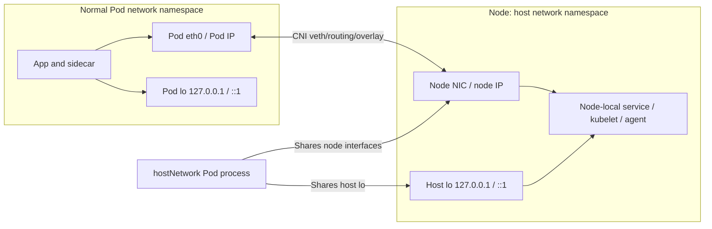
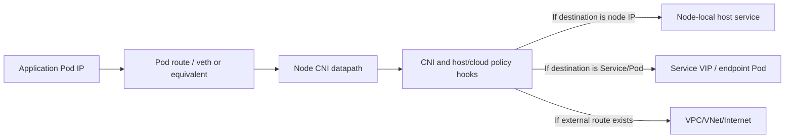
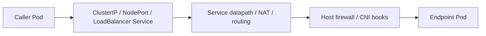
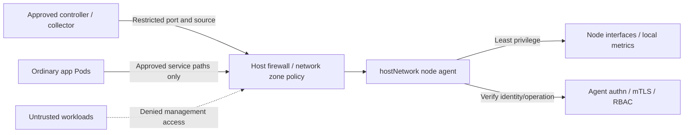
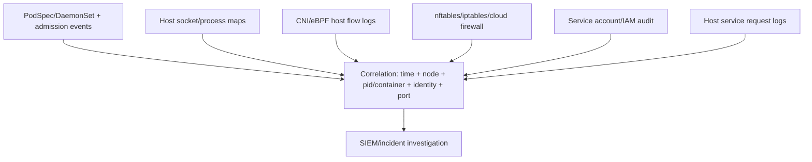

# Node network và hostNetwork

> **Học phần:** `SECURITY_NETWORK_SECURITY`  
> **Chương:** Bảo mật mạng Kubernetes  
> **Bài học:** Phân tích **mạng của Kubernetes node** và lựa chọn `hostNetwork` dưới góc nhìn vận hành, định tuyến, cô lập, tường lửa, xác thực kết nối và phòng vệ nhiều lớp. Kết nối các kiến thức về segmentation, firewall, VPN, IDS/IPS, DNS, TLS/mTLS, bảo mật container và kiến trúc cloud.

## Mục tiêu học tập

Sau bài học, người đọc có thể:

1. Phân biệt **node network namespace**, **Pod network namespace**, **Pod IP**, **node IP**, **Service ClusterIP**, **host port** và **node-local endpoint**.
2. Diễn giải đường đi gói tin từ Pod bình thường tới node, Pod khác, Service hoặc Internet, cùng vai trò của CNI, route, NAT và host firewall.
3. Giải thích chính xác hệ quả của `hostNetwork: true` về `localhost`, IP, socket/port namespace, DNS và khả năng quan sát traffic.
4. Phân biệt `hostNetwork` với `hostPort`, Service `NodePort`, `LoadBalancer`, `HostPath`, `hostPID` và `privileged`.
5. Nhận diện trường hợp dùng host networking hợp lệ cho node agents, CNI/observability, DNS hoặc thành phần hạ tầng; đánh giá lựa chọn ít quyền hơn.
6. Thiết kế các lớp bảo vệ phù hợp khi **NetworkPolicy thông thường không bao phủ đường node/host như kỳ vọng**.
7. Phân tích rủi ro tới kubelet, runtime socket, host-local admin API, cloud metadata, internal networks và endpoint exposed trên interface node.
8. Quan sát và kiểm thử các tuyến mạng, DNS, TLS và authorization bằng lab được cấp quyền; xây dựng rollout, incident playbook và checklist.

## 1. Vì sao node network và hostNetwork là ranh giới bảo mật?

Kubernetes node là máy tính vật lý hoặc máy ảo chạy kubelet, container runtime và các thành phần hỗ trợ mạng. Nó có các interface mạng, địa chỉ IP, routing table, listening sockets, hệ thống firewall và những dịch vụ có quyền đối với **toàn bộ node**. Pod thông thường sử dụng **network namespace riêng**, nhờ đó có địa chỉ và loopback riêng biệt so với node.

Khi bật `hostNetwork`, một Pod dùng **network namespace của node** thay vì network namespace Pod tách riêng theo mô hình thông thường. Điều này có thể cần thiết cho một số node agents, nhưng cũng tạo thay đổi quan trọng:

- Pod có thể kết nối tới các listener trên `127.0.0.1`/`::1` của node.
- Pod sử dụng **không gian cổng** chung với các process/node agents khác.
- Một listener của Pod bind vào `0.0.0.0` có thể trở nên reachable qua các interface node mà policy cho phép.
- Một số kiểm soát **Pod-level CNI/NetworkPolicy** không còn có cùng hiệu quả như đối với Pod có network namespace riêng.
- Traffic có thể mang **node IP** thay vì Pod IP đặc trưng, làm thay đổi logging, source allowlist và cách gắn attribution.
- Nếu kết hợp `hostNetwork` với nhiều Linux capabilities, mount hoặc service account quyền cao, blast radius có thể tăng đáng kể.

**Thông điệp chính:** `hostNetwork` **không mặc định là container escape**, không tự cấp quyền root, host filesystem hay Kubernetes admin. Nó **thay đổi bề mặt mạng và trust boundary**, nên phải xem cùng authentication, kernel capabilities, host firewall, IAM, workload role và các đường network thực tế.

## 2. Hệ thuật ngữ: IP và namespace nào thuộc về ai?

| Đối tượng | Ý nghĩa | Câu hỏi bảo mật |
|---|---|---|
| **Node IP** | Địa chỉ node trên interface nội bộ/ngoài theo topology | Port trên node có reachable từ Pod, VPC, VPN, Internet không? |
| **Host network namespace** | Network interfaces, routes, sockets và loopback của node | Pod nào được phép chia sẻ không gian này? |
| **Pod IP** | Địa chỉ được cấp cho Pod trong Pod network thông thường | Pod thuộc namespace/identity nào? |
| **Service ClusterIP** | IP ảo của Kubernetes Service được datapath chuyển tới endpoints | Có route/service policy khác ngoài Pod IP không? |
| **NodePort** | Cổng trên node dùng để expose Kubernetes Service | Có bypass Ingress/WAF nếu node address reachable? |
| **hostPort** | Mapping cổng node vào một container port của Pod theo implementation | Có tạo listener/exposure ngoài ý định? |
| **hostNetwork** | Pod chia sẻ network namespace của node | Có đụng port hoặc thấy node loopback services? |
| **hostPath** | Mount đường dẫn host filesystem vào container | Không tương đương hostNetwork, nhưng có thể tăng rủi ro khi kết hợp |
| **hostPID/hostIPC** | Chia sẻ namespace process hoặc IPC theo cấu hình | Không tự được bật cùng hostNetwork |
| **CNI plugin** | Thiết lập Pod network và có thể thực thi policy | Host traffic và hostNetwork có được policy engine bao phủ không? |
| **Host firewall** | Rules áp tại node network stack/hook | Có bảo vệ cả IPv4/IPv6, interfaces và node-local flows? |
| **mTLS/service identity** | Xác minh endpoint và workload bằng credentials | Người gọi được làm gì, không chỉ kết nối tới đâu? |

### Ba hướng cần phân biệt

**Pod → node:** một Pod bình thường gọi IP của node hoặc node-local service. Node có thể **chỉ làm forwarding** hoặc trở thành **đích cuối**.

**Node → Pod:** kubelet, monitoring agent hoặc process host kết nối tới Pod. NetworkPolicy cho node-local/host traffic có thể có ngoại lệ theo semantics Kubernetes và CNI.

**hostNetwork Pod → node service:** tiến trình trong Pod chia sẻ node network namespace, có thể gọi host `localhost` trực tiếp. Đây **không** phải cùng datapath với Pod thông thường đi qua veth/overlay.

## 3. Linux network namespace quyết định localhost

Một network namespace trên Linux có các network devices, routes, sockets, firewall-related state và loopback interface. Container/Pod có thể chia sẻ hoặc tách network namespace tùy cấu hình.



### Quy tắc `localhost`

- Pod bình thường: `localhost` trỏ tới **network namespace của Pod đó**. Các containers cùng Pod thường chia sẻ loopback và Pod IP.
- Pod khác, kể cả trên cùng node: có **network namespace khác** nếu không dùng host networking.
- Node host process: `localhost` trỏ tới node loopback.
- `hostNetwork: true`: `localhost` của Pod trỏ tới **node loopback**, theo cơ chế chia sẻ host network namespace.
- Trong môi trường Windows/container runtime khác, cách cấu hình namespace/network có thể khác; phải xác nhận hệ điều hành và plugin hỗ trợ.

**Không nên dùng** một bài kiểm tra `curl localhost` trong Pod thông thường để kết luận node-local kubelet hoặc agent có thể bị truy cập. Cần nhận diện process/namespace và đích thực trước.

## 4. Đường gói tin của Pod bình thường

Kubernetes thường triển khai mô hình Pod có network namespace riêng và mỗi Pod có thể gửi/nhận traffic trong cluster nhờ CNI. Plugin có thể sử dụng veth, bridge, overlay, route trực tiếp hoặc eBPF. Không có một sơ đồ datapath cố định cho tất cả clusters.



### Một luồng cần được phân loại theo đích cuối

| Ví dụ | Node là gì trong luồng? | Kiểm soát |
|---|---|---|
| Pod A → Pod B cùng node | Node có thể xử lý forwarding/datapath | CNI policy cho hai Pods nếu được enforce |
| Pod A → Pod B khác node | Node chuyển gói đến node đích | Route/overlay, CNI policy, node network |
| Pod → ClusterIP | Node/datapath có thể DNAT tới endpoint | Service routing, CNI policy và app authz |
| Pod → node-private-IP:port | **Đích cuối có thể là node socket** | Host firewall, CNI host policy, service auth |
| Pod → SaaS Internet | Node là gateway/forwarder | Pod egress + cloud firewall/proxy + IAM |
| Pod → cloud metadata | Endpoint provider-specific, thường qua đường nội bộ | Metadata control, host/CNI/firewall và least-privilege IAM |

Một packet đi qua node kernel không đồng nghĩa nó được process node nhận; phân biệt **local delivery** và **forwarding** trước khi chọn firewall rule.

## 5. Node có nhiều network interfaces và nhiều vùng tin cậy

Một node có thể đồng thời có:

- Interface quản trị và địa chỉ IP để điều khiển nội bộ.
- Interface workload hoặc primary VPC subnet.
- Loopback `lo` với `127.0.0.1`/`::1`.
- Interface overlay/CNI/bridge, tunnel hoặc veth.
- Kết nối tới service mesh node agent hoặc egress proxy.
- Route VPN/peering/transit tới mạng khác.
- IPv6 interface song song IPv4.
- Địa chỉ public/LoadBalancer/secondary NIC nếu kiến trúc cấp phát.

### Điều này ảnh hưởng tới việc bind cổng

Một service bind `0.0.0.0:9443` lắng nghe tất cả **IPv4 addresses phù hợp** trong namespace; nếu node có địa chỉ reachable từ mạng khác, service có thể bị mở rộng exposure. Một listener `[::]:9443` dùng IPv6 wildcard với cách xử lý dual-stack tùy OS/socket, cũng cần được xem riêng.

**Không dùng** “node IP” như một principal duy nhất. Cùng node có thể có nhiều tenants và nhiều interfaces. Nên map đường đi theo **source zone, destination interface, port, workload identity và policy thực thi**.

## 6. Normal Pod và hostNetwork Pod khác nhau thế nào?

| Thuộc tính | Pod network thông thường | Pod `hostNetwork: true` |
|---|---|---|
| Network namespace | Riêng cho Pod (thường chia sẻ giữa containers trong Pod) | Dùng node/host namespace |
| IP của workload | Pod IP qua CNI | Thường phản ánh node IP; không có Pod address độc lập kiểu thông thường |
| `localhost` | Loopback của Pod | Loopback của node |
| Port namespace | Độc lập giữa Pods | Dùng chung với node processes và các hostNetwork Pods |
| Bật listener `0.0.0.0` | Theo interfaces trong Pod namespace | Theo các interfaces node; có thể exposed rộng |
| CNI virtual interface | Thường có Pod veth/overlay interface | Không theo cùng đường Pod veth thông thường |
| NetworkPolicy chuẩn | Thường được CNI thực thi với các giới hạn đã nêu | Không thể giả định cùng semantics/coverage |
| Node process reachability | Qua route và host firewall | Có thể qua node loopback ngay lập tức |
| DNS profile | Phụ thuộc `dnsPolicy`/kubelet config | Cần chú ý `ClusterFirstWithHostNet` |
| Cách log source IP | Có thể gắn Pod IP với identity | Nhiều flow xuất hiện là node IP, cần thêm workload attribution |

**Từ “thường” là có chủ đích:** IPv4/IPv6, Windows node, container runtime, CNI, datapath và cơ chế identity khác nhau theo phiên bản. Xác minh **thông tin thực** từ PodSpec, node runtime và flow logs.

## 7. `hostNetwork: true` làm gì trong PodSpec?

Ví dụ tối giản để **đọc cấu hình**, không phải khuyến nghị tự triển khai vào production:

```yaml
apiVersion: v1
kind: Pod
metadata:
  name: hostnet-observer
  namespace: lab-only
  labels:
    app: hostnet-observer
spec:
  hostNetwork: true
  dnsPolicy: ClusterFirstWithHostNet
  containers:
    - name: observer
      image: busybox:1.36
      command: ["sh", "-c", "sleep 3600"]
      securityContext:
        allowPrivilegeEscalation: false
        capabilities:
          drop: ["ALL"]
        runAsNonRoot: true
        runAsUser: 10001
```

### Giải thích chính xác

- `hostNetwork: true` là thiết lập chia sẻ **host network namespace**.
- `dnsPolicy: ClusterFirstWithHostNet` được chọn để hỗ trợ Kubernetes cluster DNS cho hostNetwork Pods trong các tình huống phù hợp.
- `capabilities.drop: ["ALL"]` và `runAsNonRoot` giảm một phần quyền process, **không khôi phục network namespace isolation**.
- Image BusyBox chỉ chạy `sleep` trong ví dụ; **không cấp endpoint quản trị**.
- Cluster áp **Pod Security Admission Restricted/Baseline** có thể từ chối PodSpec vì `hostNetwork`, dù phần securityContext được hạn chế.
- Không có `hostPID`, `hostIPC` hoặc `hostPath` trong manifest; những trường đó không tự bật khi dùng hostNetwork.

**Đừng dùng manifest trong cluster production** nếu không có nhu cầu và exemption được duyệt. Với nhiệm vụ đọc cấu hình, có thể dùng `kubectl get pod -o yaml/jsonpath` mà không tạo Pod mới.

## 8. `localhost` của hostNetwork Pod có thể thấy dịch vụ node

Giả định một node có service lắng nghe `127.0.0.1:9100` để phục vụ metric riêng.

- Pod thường: `127.0.0.1:9100` là **Pod loopback**; không trực tiếp tới node metric service.
- hostNetwork Pod: `127.0.0.1:9100` là **node loopback**; nếu socket/listener và credential cho phép, process trong Pod có thể kết nối.

### Rủi ro đi kèm

- Host service có thể từng được thiết kế với giả định “localhost là trusted caller”.
- Một ứng dụng bị SSRF và chạy hostNetwork có thể chạm tới node-local HTTP endpoints khác hẳn khi chạy trong Pod namespace riêng.
- Một debug API không xác thực hoặc có operation nhạy cảm có thể bị gọi từ workload đáng lẽ không được phép.
- Trên node có nhiều hostNetwork Pods, port và loopback được chia sẻ; việc lộ một listener ảnh hưởng nhiều process.

**Chặn bằng authn/authz tại host service, host-level policy và quyền workloads**, không chỉ dựa vào bind loopback khi đã có untrusted hostNetwork Pods.

### Loopback isolation không phải authorization

Ngay cả khi listener node chỉ bind `127.0.0.1`, nếu Pod được phép chia sẻ namespace đó, nó có thể trở thành caller. Do đó host-local control endpoints cần thiết kế cho **tập callers thực tế**, không phải giả định “chỉ có host admin”.

## 9. DNS dành cho hostNetwork Pods

Kubernetes có các lựa chọn `dnsPolicy` trong PodSpec. Một số giá trị thường dùng:

| Giá trị | Ý nghĩa cơ bản | Lưu ý với hostNetwork |
|---|---|---|
| `ClusterFirst` | Ưu tiên DNS cluster cho tên Service theo môi trường thông thường | Với hostNetwork, hành vi có thể không giống Pod bình thường; xem `ClusterFirstWithHostNet` |
| `ClusterFirstWithHostNet` | Kiểu cluster-first DNS hỗ trợ Pod dùng hostNetwork | Chỉ áp khi có nhu cầu cluster DNS trong host namespace |
| `Default` | Kế thừa DNS settings theo node/kubelet configuration | Không bảo đảm resolve tên `*.svc.cluster.local` nếu node resolver không được cấu hình |
| `None` | Dùng cấu hình DNS được khai báo trong `dnsConfig` | Phải khai báo và quản lý DNS chính xác |

### Tình huống hay gặp

Node agent chạy hostNetwork cần gọi Kubernetes Service bằng tên `telemetry.monitoring.svc.cluster.local`. Nếu Pod dùng DNS policy không phù hợp, truy vấn có thể đi tới resolver của node không biết Kubernetes service domain.

**Hướng xử lý:** Kiểm `dnsPolicy`, `/etc/resolv.conf` trong container theo quyền, cấu hình kubelet/CoreDNS/NodeLocal DNSCache, namespace search domains và network path tới DNS. **Không bật hostNetwork chỉ để sửa một lỗi DNS** cho Pod vốn không cần dùng node network namespace.

### Bảo mật DNS

- Kiểm soát DNS resolver được phép; không coi tên nội bộ là access control.
- HostNetwork Pod có thể dùng network route/resolver của node tùy cấu hình.
- CNI Pod egress policy có thể không bao phủ đường DNS đó như với Pod thường.
- Nếu dùng TLS cho service qua DNS, phải xác minh expected hostname/SAN; không tắt certificate verification để xử lý DNS mismatch.
- Giám sát DNS anomalies ở node/hostNetwork agent và bảo vệ node-local DNS cache.

## 10. `hostNetwork` khác `hostPort`, `NodePort` và `LoadBalancer`

| Cơ chế | Mục đích | Network namespace của application Pod | Nguy cơ chính |
|---|---|---|---|
| **hostNetwork** | Pod dùng host network namespace | **Chia sẻ host** | Node loopback access, port collision, host exposure |
| **hostPort** | Ánh xạ một cổng node tới container port | **Thường vẫn riêng** | Host-facing port exposure, scheduling hạn chế |
| **Service NodePort** | Expose Service qua port trên nodes | **Thông thường vẫn riêng** | Direct node IP path có thể bypass L7 gateway |
| **Service LoadBalancer** | Expose Service qua external/internal cloud LB | **Thường riêng** | Public/private exposure do cloud và Service config |
| **Service ClusterIP** | IP ảo tới Pod endpoints trong cluster | **Riêng** | Reachability nội bộ quá rộng nếu thiếu policy |
| **Ingress / Gateway API** | L7/L4 routing theo implementation | **Riêng cho app Pod** | Auth/WAF policy drift, bypass qua service khác |

Một hostNetwork Pod không cần `hostPort` để nghe trên node ports vì **nó đã sử dụng port namespace của node**. Trong Kubernetes, các trường `hostPort` và `containerPort` có quy tắc validation/consistency khi dùng `hostNetwork`; **không nên tự tạo mapping giả tưởng**.

### Ba câu hỏi

1. **Ai mở socket?** Pod process, kube-proxy, CNI data plane, cloud LB hay host process?
2. **Namespace/network scope ở đâu?** Pod IP riêng hay node namespace?
3. **Source nào reachable?** localhost node, cluster, VPC, VPN, public Internet?

Chỉ trả lời “cổng 8443 mở” là chưa đủ để đánh giá bảo mật.

## 11. Port collisions và lịch trình chạy Pods

Khi hai hostNetwork processes trên cùng node cố bind **cùng port/protocol/address** không tương thích, một process có thể thất bại với lỗi bind. Ví dụ hai DaemonSet hoặc Deployment replicas cùng muốn nghe TCP 9443 trên mọi interfaces của node.

### Điều cần nhớ

- Pod khác nhau có namespace mạng riêng có thể dùng **cùng số port** mà không xung đột.
- hostNetwork Pods chia sẻ port space với node processes và nhau.
- Scheduler có các cơ chế hiểu `hostPort` đã khai báo, nhưng **không thể suy hoàn toàn những socket mà chương trình sẽ bind trong runtime** khi Pod không mô tả đầy đủ.
- Một Pod chạy được trên node A nhưng không trên node B vì node B đã có listener cùng cổng.
- Scale-out cần xét node placement, DaemonSet scheduling và port allocation.
- Một UDP listener và TCP listener cùng số port không nhất thiết xung đột; **protocol và bind address** là yếu tố.
- IPv4 wildcard và IPv6 wildcard có thể tương tác tùy kernel/socket dual-stack settings.

### Triệu chứng

- `bind: address already in use`.
- Pod ở trạng thái Running nhưng container restart loop vì ứng dụng không mở được port.
- Health check lỗi chỉ trên một số nodes.
- Sau rolling update, một replica cũ chưa giải phóng socket thì replica mới start thất bại.
- Một process node agent bị gián đoạn vì một workload mới vô tình chiếm port.

### Vận hành

- Inventory port của node agents và hostNetwork workloads.
- Dùng **node labels, affinity, DaemonSet** hoặc quy hoạch cổng phù hợp.
- Cấu hình rollout để tránh hai bản cùng claim port khi không hỗ trợ.
- Không dùng `kill -9` hoặc stop system agents để giải quyết collision khi chưa đánh giá tác động.
- Thu service logs và socket ownership, không chỉ kết luận do NetworkPolicy.

## 12. DaemonSet và những trường hợp hợp lệ cần node network

Một số node-level workloads có thể cần host networking vì nhiệm vụ gắn với chính node:

- DNS caching hoặc node-local network service chuyên dụng.
- CNI datapath/host network agent theo thiết kế plugin.
- Network observability/IDS sensor có quyền quan sát interface cụ thể.
- Host metrics/log collectors lắng nghe endpoint trên node.
- BGP/route speakers hoặc LB node agent trong kiến trúc bare-metal/private cloud.
- Network troubleshooting DaemonSet trong **môi trường vận hành được kiểm soát**.

**Không phải mọi DaemonSet đều cần hostNetwork**. Một agent chỉ gửi logs về collector có thể dùng Pod network bình thường; một network sensor cần host interfaces có thể đòi hỏi quyền khác hoặc kiến trúc khác. Phải xác minh nhu cầu thực, chọn **ít đặc quyền nhất**.

### Checklist phê duyệt use case

1. Vì sao Pod network bình thường không đáp ứng? Có thể expose service node qua gateway đã xác thực?
2. Network namespace host có cần cho **inbound listener**, **packet visibility** hay chỉ DNS?
3. Agent có cần `NET_ADMIN`, `NET_RAW`, hostPath hoặc privileged? Nếu có, lý do từng quyền?
4. Port nào nghe trên interface nào? Có thể bind IP hạn chế/localhost không?
5. Có bị Pod Security Admission từ chối? Ai phê duyệt exemption?
6. Logs/telemetry chứng minh agent không chạm metadata/kubelet ngoài nhiệm vụ?
7. CNI host policy và host firewall bảo vệ node agent thế nào?
8. Thay node/rolling update có giữ nguyên policies và không gây port collision?

## 13. Node network services là những tài sản có mức độ nhạy cảm khác nhau

| Dịch vụ/điểm truy cập | Rủi ro nếu reachable không kiểm soát | Kiểm soát |
|---|---|---|
| **Kubelet API** | Node/pod management, thông tin workload tùy quyền | Authn/authz, host firewall, least privilege, audit |
| **Container runtime API/socket** | Quản lý containers, image, mounts và runtime | Không expose TCP rộng; Unix socket ACL và proxy giới hạn |
| **Node admin/SSH** | Lateral movement hoặc quản trị hệ điều hành | Bastion, MFA/PAM, firewall management zone |
| **Cloud metadata/identity service** | Credential hoặc cấu hình host/workload theo môi trường | Provider metadata protections, workload IAM scope |
| **NodeLocal DNSCache** | Service discovery, DNS visibility/abuse | Chỉ callers cần, resolver policy, quotas |
| **Metrics/log agent** | Topology/telemetry lộ và nguy cơ DoS | Auth, endpoint scope, rate limit, redact secrets |
| **CNI/mesh control endpoint** | Thay policy, tunnel hoặc service routing | Chặn admin interfaces, workload separation |
| **Host database/cache** | Rò rỉ dữ liệu hoặc state change | Bind hẹp, TLS, ACL, app authz |
| **Debug/profiling endpoint** | Lộ process state hoặc tác vụ quản trị | Disable production hoặc management-only |
| **Node port listener chung** | Service reachability từ ngoài thiết kế | Host/cloud firewall và admission |

**Đường mạng tới một endpoint không chứng minh caller đã có quyền.** Kết luận nguy cơ nên phân biệt reachability, server authentication, client authorization và operations được thực hiện.

## 14. Socket bind ở host namespace: điểm mở rộng exposure

Một Pod chạy hostNetwork dùng các interfaces và routes của node để bind socket:

```text
Host network namespace (ví dụ):
  lo       127.0.0.1 / ::1
  eth0     10.20.0.12
  eth1     192.0.2.10 (chỉ ví dụ address documentation)
  cni0     địa chỉ CNI do plugin quản lý

Server bind:
  127.0.0.1:9443  -> host loopback IPv4
  10.20.0.12:9443 -> một host interface cụ thể
  0.0.0.0:9443    -> mọi host IPv4 addresses phù hợp
  [::]:9443       -> IPv6 wildcard, dual-stack tùy socket settings
```

**Dải `192.0.2.0/24` là TEST-NET-1 chỉ dùng cho tài liệu**, không phải public IP production.

### Host service exposure review

- Listener dự kiến chỉ cho local agent hay cả remote Pods/VPC?
- Bind `127.0.0.1` có đủ nếu có hostNetwork Pods khác không tin cậy?
- Nếu dùng `0.0.0.0`, cloud security group/host firewall đã chặn nguồn ngoài chưa?
- IPv6 có wildcard listener đi song song IPv4 hay không?
- Node addresses có reachable từ VPN, peering hoặc partner networks?
- Có authentication mạnh tại service, hay dựa vào IP source?
- Có NodePort/LoadBalancer/ingress path mở thêm tới cùng process?

**Không sửa một lỗi reachability bằng việc chuyển mọi listener sang `0.0.0.0`** mà không review traffic sources và firewall.

## 15. Host networking và Kubernetes NetworkPolicy

Kubernetes `NetworkPolicy` chuẩn chủ yếu mô tả việc cô lập **ingress/egress của Pods** theo labels, namespace, IP blocks và ports; **CNI cụ thể** là nơi thực thi.

### Một giới hạn quan trọng

Khi Pod dùng host network namespace, traffic có thể không đi qua **cùng datapath Pod-veth** và cách thực thi NetworkPolicy của Pod thường. Một số plugin có cơ chế riêng cho host policies hoặc có thể nhận diện hostNetwork traffic; không nên giả định **mọi CNI luôn áp cùng NetworkPolicy** cho hostNetwork Pods.

Ngoài ra, theo mô hình Kubernetes, kết nối giữa một Pod và **node mà nó chạy** là trường hợp đặc biệt, nên **default-deny Pod NetworkPolicy không phải bằng chứng portable chặn được mọi Pod↔local-node traffic**.

### Ma trận coverage cần kiểm

| Flow | NetworkPolicy chuẩn | Lớp nên kiểm thêm |
|---|---|---|
| Normal Pod A → Pod B | Có thể quản lý ingress/egress khi CNI hỗ trợ | mTLS và app authorization |
| Normal Pod → Service backend Pod | Thường có thể quản lý, xét NAT | Service path tests và CNI flow logs |
| Normal Pod → local node service | Có đặc thù/ngoại lệ; không suy chặn hoàn toàn | Host firewall/CNI host policy, service auth |
| hostNetwork Pod → node loopback | Không thể giả định NP Pod-level bảo vệ | Host firewall/endpoint permissions/auth |
| hostNetwork Pod → Pod bình thường | Phụ thuộc CNI identity/node traffic semantics | Host controls, app authz, effective-flow test |
| Pod → metadata/peered VPC | Phụ thuộc route/CNI/cloud | Cloud firewall, node policy, workload IAM |
| Internet → node listener | Ngoài phạm vi NP Pod như firewall tổng quát | Cloud SG/NACL, host firewall, WAF/gateway |

**Một YAML `NetworkPolicy` hợp lệ không phải giấy chứng nhận an toàn của node network.** Cần test thực tế khi sử dụng hostNetwork.

## 16. Host firewall, netfilter và eBPF

Trên Linux, network filtering có thể xảy ra tại nhiều hook và lớp:

- **INPUT:** local delivery đến sockets trong host network namespace theo đường netfilter thường gặp.
- **FORWARD:** host chuyển gói giữa interfaces/network khác nhau.
- **OUTPUT:** gói phát ra từ host network namespace theo netfilter path.
- **PREROUTING/POSTROUTING:** routing/NAT-related processing theo kernel configuration.
- **Bridge netfilter, tc/eBPF, XDP và CNI hooks:** có thể chặn ở tầng khác với iptables chain mà người quản trị nghĩ đang xử lý.

**Không được kết luận “Pod-to-host luôn đi INPUT” hoặc “hostNetwork Pod-to-Pod luôn đi OUTPUT” cho mọi plugin**. CNI, NAT, overlay, eBPF, node-local redirection và dịch vụ mesh có thể ảnh hưởng đường gói. Hãy dựa vào **flow tracing/counters của chính datapath**.

### Mô hình triển khai an toàn

- Hạn chế management ports theo node zones và source identities.
- Cho phép đúng agent/service ports cần thiết, không mở inbound broad.
- Chặn direct access tới runtime/kubelet debug/admin từ application zones.
- Bật cả IPv4 và IPv6 policies.
- Giữ stateful return flow được phép cho traffic hợp lệ.
- Áp các policy bảo vệ node **ngoài lớp Pod NetworkPolicy** khi có hostNetwork.
- Không để rule do agent/Docker/CNI tự sinh vượt hoặc ghi đè nhầm host firewall policy.
- Dùng IaC/versioning/rollback và canary trước khi thay rule cluster-wide.

### Thực thi không đồng nghĩa source IP

Một allow rule `src=10.244.0.0/16` có thể cho phép quá nhiều Pods trong cluster; source IP có thể bị NAT. Với endpoint quản trị, nên bổ sung **credential/service identity và authorization** thay vì coi subnet là quyền truy cập.

## 17. Service routing, kube-proxy, eBPF và node-local traffic

Một Service ClusterIP thường được datapath đưa tới Pod endpoints. Cơ chế thực thi có thể gồm kube-proxy kiểu iptables/IPVS hoặc giải pháp eBPF/CNI thay thế, tùy cluster.



**Sơ đồ minh họa, không khẳng định thứ tự chính xác** của NAT và security checks trong mọi CNI.

### Khi hostNetwork thay đổi quan sát

- Source IP của hostNetwork caller có thể là node IP, không phải Pod IP riêng.
- Một hostNetwork listener có thể nhận request trực tiếp qua node interface, không cần Kubernetes Service.
- Một Service trỏ tới hostNetwork Pod có thể có semantics endpoint khác thông thường.
- Kube-proxy/Service routing có thể đưa traffic từ remote Pod tới node service theo một đường cần kiểm soát riêng.
- NodePort/LoadBalancer source IP có thể bị biến đổi bởi SNAT hoặc cloud LB; đừng dựa vào IP trong HTTP header như bằng chứng L3.
- Conntrack/firewall state có thể ảnh hưởng khi route đổi trong rolling updates/HA.

### Không được nhầm dữ liệu control plane với data plane

Kubernetes API object `Service`/`EndpointSlice` cho biết ý định phân phối traffic; **flow logs** mới cho thấy đường packet thực, còn application logs/identity mới cho thấy ai được phép thực hiện thao tác.

## 18. Kubelet, runtime API và quyền node

Kubelet và container runtime là thành phần có ảnh hưởng lớn đến node/workloads. Các interface quản trị phải được hạn chế ở network boundary và service authorization.

### Kubelet

- Không expose kubelet API tới Pod/Internet ngoài nhu cầu được quản trị.
- Sử dụng cơ chế authentication/authorization đã bật, TLS và RBAC/node authorization thích hợp.
- Chặn read-only/insecure legacy endpoints khi tồn tại hoặc cấu hình cũ còn bật.
- Không coi một port kubelet mặc định là bất biến ở mọi cluster; lấy port/listener từ **configuration thực**.
- Ghi audit và theo dõi kết nối nguồn bất thường.

### Container runtime socket

Socket như `/run/containerd/containerd.sock` hoặc Docker socket là **control interface nhạy cảm**, tùy runtime. Đưa socket vào container bằng hostPath hoặc expose network API có thể trao quyền rất cao so với một HTTP metrics endpoint.

**Đừng mount runtime socket vào Pod không tin cậy** chỉ để “kiểm container nào chạy”. Dùng agent/API có scope đọc tối thiểu và authorization thật nếu nghiệp vụ cần.

### Mối quan hệ hostNetwork và hostPath

- `hostNetwork` không tự mount filesystem host.
- `hostPath` không tự đặt Pod vào host network namespace.
- **Kết hợp** chúng hoặc cộng `privileged`/`NET_ADMIN`/`NET_RAW` có thể làm tăng rủi ro đáng kể.
- Xét cả **Pod Security Admission, RBAC, workload identity, host firewall và kernel permissions**.

## 19. Cloud metadata, IAM và container-to-node reachability

Một Pod có thể tiếp cận cloud metadata service thông qua đường provider-specific, node-local/link-local hoặc cơ chế identity proxy, tùy cloud. Điều này không phải lúc nào cũng là kết nối tới một process đang listen trên node.

### Threat model cho hostNetwork Pod

Nếu Pod có thể gửi request tới metadata hoặc local identity agent, một lỗi SSRF/HTTP client misconfiguration có thể làm nó gọi endpoint không mong muốn. Tác động phụ thuộc:

- Workload/node IAM role có quyền gì?
- Metadata protections/token/session/hop-limit đã bật chưa?
- Có route và endpoint cho IPv4/IPv6 theo provider không?
- Pod có token/service-account credentials trong filesystem không?
- Host/CNI/firewall có chặn đường không cần thiết không?
- API/metadata có đòi credential, session token và authorization không?

### Phòng vệ

1. Tách node instance roles và Pod identities theo least privilege.
2. Không gắn credential cloud quyền cao cho URL fetcher, renderer hoặc public API.
3. Sử dụng provider metadata security mechanisms theo thiết kế.
4. Áp host/CNI/cloud network restrictions cho vùng metadata khi khả thi.
5. Cô lập untrusted workloads và không cấp hostNetwork nếu không thật sự cần.
6. Theo dõi unusual access/identity usage từ node/network sensors.
7. Duy trì playbook revoke/rotate credentials nếu có bằng chứng lộ.

**Không gửi request kiểm thử tới metadata production ngoài phạm vi được phê duyệt.** Dùng stub/mock endpoint hoặc chính sách kiểm từ control plane trong lab.

## 20. Service mesh, mTLS và khả năng bypass của hostNetwork

Service mesh thường cung cấp mTLS/workload identity, traffic routing và application-layer authorization qua proxy/sidecar hoặc ambient datapath.

### Một vấn đề cần xác minh

hostNetwork Pods có thể không bị áp cùng cơ chế **traffic interception, sidecar redirection hoặc identity attachment** như Pod với namespace riêng. Mỗi mesh có điều kiện hỗ trợ và loại trừ riêng.

| Câu hỏi | Tại sao quan trọng |
|---|---|
| HostNetwork Pod có được mesh nhận diện/cấp identity không? | Không được suy từ label injection alone |
| Traffic outbound có đi qua proxy/ambient datapath không? | Bypass có thể làm mất mTLS, policy và audit |
| Host-bound listener có yêu cầu client mTLS không? | Node network reachability không chứng minh peer đáng tin |
| Mesh authorization áp trên node-local/loopback flows không? | Nhiều cơ chế chỉ áp trong phạm vi traffic được intercept |
| CNI NetworkPolicy bao phủ direct node-IP route không? | Một lớp có thể thiếu nên cần lớp khác bù |
| Proxy failover có fail-open ra direct path không? | Mất PEP khi agent/proxy lỗi |

**mTLS không tự cấp quyền nghiệp vụ.** Service đích vẫn cần kiểm principal và operation/resource được phép; NetworkPolicy và host firewall hạn chế những nơi có thể kết nối.

## 21. Threat modeling STRIDE cho node network

Một Pod có quyền hostNetwork làm thay đổi attacker preconditions: kẻ chiếm workload có thể ở cùng network namespace với node agents. **Khả năng kết nối chưa có nghĩa thực thi hành động**, nhưng nó gia tăng số endpoint có thể thử tương tác.

| STRIDE | Rủi ro thực tế | Kiểm soát |
|---|---|---|
| **Spoofing** | Process trong hostNetwork Pod giả danh local agent hoặc gửi spoofable identity header | mTLS/workload identity, xác minh principal tại host service |
| **Tampering** | Khi có `NET_ADMIN`/privileged, workload có thể tìm cách sửa route/firewall/network settings | Giảm Linux capabilities, admission, host integrity monitoring |
| **Repudiation** | Host logs chỉ thấy node IP, không biết Pod/process nào gọi | Per-Pod/process identity, eBPF audit, runtime metadata correlation |
| **Information Disclosure** | Host debug/metrics, metadata hoặc API nội bộ tiết lộ thông tin | Host firewall, isolate listeners, authz, secret redaction |
| **Denial of Service** | Pod chiếm cổng node, flood node agent, cạn conntrack hoặc băng thông | Port governance, quotas, rate limiting, resource isolation |
| **Elevation of Privilege** | Lạm dụng kubelet/runtime socket hoặc API cấu hình yếu | Không expose admin interface, least privilege, authentication/authorization |

### Threat statement

> Một Pod xử lý URL/HTML của người dùng được triển khai với `hostNetwork: true` để “khắc phục DNS”. Node có debug API chỉ lắng nghe loopback mà không xác thực vì giả định chỉ admin có thể gọi. Khi Pod bị SSRF, request do worker gửi có thể tiếp cận node loopback service. Giảm thiểu bằng loại bỏ hostNetwork khỏi workload, kiểm soát DNS đúng cách, tắt debug endpoint hoặc yêu cầu authz, host firewall/host policy và giám sát socket events.

**Không kết luận có host compromise chỉ vì Pod dùng hostNetwork.** Cần bằng chứng về đường kết nối, ứng dụng nhận request, quyền caller và tác động thực.

## 22. Pod Security Standards và Pod Security Admission

**Pod Security Standards (PSS)** cung cấp các mức kiểm soát quy tắc cấu hình Pod thường gọi là Privileged, Baseline và Restricted. **Pod Security Admission (PSA)** có thể dùng nhãn namespace để enforce/warn/audit theo level và phiên bản được cấu hình.

### Vì sao liên quan hostNetwork?

Các chính sách Baseline và Restricted theo chuẩn Kubernetes nhằm ngăn host namespace sharing không được phép, bao gồm `spec.hostNetwork: true`, trừ các ngoại lệ được quản trị bằng cơ chế khác. Namespace enforce nghiêm có thể từ chối một node agent hợp lệ nếu nó cần hostNetwork.

| Cấp/chính sách | Ý định | Với hostNetwork |
|---|---|---|
| **Privileged** | Ít ràng buộc Pod Security | Có thể cho nếu các kiểm soát khác cho phép |
| **Baseline** | Chặn những thiết lập nguy hiểm đã biết | Host namespace sharing như hostNetwork không được chấp nhận theo profile |
| **Restricted** | Hạn chế mạnh hơn cho workloads thông thường | HostNetwork không được chấp nhận |
| **Policy exception** | Một agent hạ tầng đã được phê duyệt | Phải quản lý ngoại lệ riêng, không bỏ giám sát |

### Namespace labels minh họa

```yaml
apiVersion: v1
kind: Namespace
metadata:
  name: applications
  labels:
    pod-security.kubernetes.io/enforce: "restricted"
    pod-security.kubernetes.io/audit: "restricted"
    pod-security.kubernetes.io/warn: "restricted"
```

**Không áp mẫu lên mọi namespace hệ thống một cách máy móc.** Một số CNI, DNS hay node agents có yêu cầu host network/host mounts nên cần phạm vi và exemption theo thiết kế.

### Admission policy nên kiểm những gì?

- Ai được tạo Pod/DaemonSet hostNetwork?
- Namespace nào được ngoại lệ, workloads/Images/ServiceAccounts nào được phép?
- Có cấm `privileged`, hostPID/hostIPC, hostPath ngoài nhu cầu?
- Có hạn chế Linux capabilities, seccomp/AppArmor/SELinux theo OS/plugin?
- Có kiểm owner, reason, expiry, change ticket cho ngoại lệ không?
- Có chặn việc một tenant chuyển Pod sang namespace đặc quyền không?
- Có log sự kiện admission allow/deny để triage không?

**Pod Security Admission khác NetworkPolicy.** PSA kiểm **manifest khi được tạo/sửa**; nó không thay việc chặn packets ở datapath.

## 23. RBAC, node affinity và quyền quản lý node agents

Một namespace multi-tenant có thể có hàng trăm workloads. Nếu tenants có quyền tự tạo hostNetwork Pods, họ có thể thử sử dụng host loopback và nhiều node interfaces, tăng rủi ro với host services.

### Phòng vệ phân tầng

1. **RBAC:** Giới hạn tạo/sửa workloads và các subresources liên quan.
2. **Admission/PSA:** Chặn hostNetwork ngoài namespace và use case được duyệt.
3. **Trusted controllers:** Node-level DaemonSets được quản lý bằng GitOps/IaC, image provenance và approval.
4. **Node placement:** Dùng nodeSelector/affinity/tolerations phù hợp để workloads đặc quyền chỉ chạy trên node pools được phê duyệt.
5. **Host firewall:** Chặn app/tenant callers tới node management dù same cluster/VPC.
6. **Workload identity:** Mỗi agent có ServiceAccount/credential riêng, chỉ scope cần.
7. **Observability:** Ghi lại hostNetwork Pod count, image, owner, node placement và config drift.

### Không đặt toàn bộ lòng tin vào nhãn Pod

Một Pod có label `role=node-agent` chưa tự là node agent đáng tin. Label có thể được sửa bởi controller hoặc người có quyền; nếu dùng label để quyết định network/auth, phải bảo vệ quyền gắn và thay đổi label.

**Trusted hostNetwork use case** cần gắn với **service account, namespace policy, image/signature và node placement** như một gói kiểm soát chứ không chỉ với một field YAML.

## 24. Phân đoạn theo node pool và các môi trường đặc biệt

Trong một cluster, node pools có thể dành riêng cho:

- **System nodes** chạy CNI, DNS, kubelet và control-plane-adjacent agents.
- **General application nodes** chạy workloads tiêu chuẩn.
- **Untrusted rendering/build nodes** chạy tác vụ xử lý input không tin cậy.
- **Data-intensive nodes** có route tới private database/storage.
- **Edge nodes** chạy ingress/LB hoặc network agents.
- **GPU/compute nodes** có đường mạng khác và resources riêng.

### Khi tách node pool có ích?

- HostNetwork agent cần quyền đặc biệt nhưng workload cùng node không đáng tin.
- Một node có nhiều private routes và metadata/management endpoints.
- Một nhóm workload không thể đảm bảo host networking isolation phù hợp.
- CNI/node host policy khác nhau giữa Linux/Windows hoặc environment.
- Tổ chức cần giảm blast radius khi một workload hoặc node bị xâm nhập.

### Các lớp cần đồng bộ

**Node placement là một control bổ sung**, không phải access control tuyệt đối. Kubernetes scheduling không tự thay host firewall hoặc kernel isolation. Kết hợp:

- Admission cấm hostNetwork ngoài use case.
- Taints/tolerations và node affinity để đặt workload vào đúng pool.
- Cloud security groups/host firewall hạn chế north-south và east-west traffic.
- IAM/service accounts và metadata controls.
- Cluster autoscaling/node replacement bảo đảm policies không mất trên node mới.
- Continuous drift detection và negative connectivity tests.

**Không lạm dụng tolerations:** Một namespace user được phép tự đặt tolerations/nodeselector có thể tìm cách đến node pools ngoài mục đích nếu admission/RBAC không ràng buộc.

## 25. IPv4, IPv6 và những listener dễ bị quên

Đối với hostNetwork Pod, v6 listener và node dual-stack là một **bề mặt node trực tiếp**, không chỉ một Pod egress rule.

### Ví dụ phân tích

| Địa chỉ/loại | Nhận diện | Rủi ro/thao tác |
|---|---|---|
| `127.0.0.0/8` | IPv4 host loopback | HostNetwork callers có thể chạm node-local listeners |
| `::1/128` | IPv6 loopback | Đừng quên bảo vệ IPv6 local services |
| Node private IPv4 | VPC/LAN node interface | Kiểm security group, host firewall và VPN routes |
| Node global/private IPv6 | Interface IPv6 của node | Kiểm exposure không phụ thuộc rule IPv4 |
| `0.0.0.0`/`::` bind wildcard | Listener mọi interface trong address family | Có thể lộ thêm node network paths |
| PodCIDRs/ServiceCIDRs | Địa chỉ được quản lý bởi CNI/Service | Không tự là identity của người gọi |
| Link-local/metadata paths | Local/provider-specific | Kiểm provider và host route đặc biệt |

### Checklist dual-stack

- Node IP addresses nào được cấp, có IPv6 public hay không?
- HostNetwork listener bind IPv4, IPv6 hay cả hai?
- Node security group/firewall hỗ trợ và áp rule v6 đúng chưa?
- DNS có trả AAAA cho host agent hoặc Service không?
- mTLS certificate SAN/hostname còn đúng trên cả hai đường?
- IPv6 route qua VPN/peering có mở zone ngoài dự kiến không?
- CNI/host firewall telemetry có capture address family thực không?

**Không coi policy chỉ chặn IPv4 là đã chặn toàn bộ node listener** trong cluster dual-stack.

## 26. VPN, VPC peering và đường quản trị mở rộng reachability

Kubernetes node có thể ở VPC/private subnet nhưng vẫn có routes tới:

- Khu vực khác qua VPN site-to-site.
- Peered VPC/VNet hoặc transit/hub network.
- Bare-metal management interfaces.
- Private cloud-managed services hoặc metadata.
- Đối tác qua private link.
- Bastion/SSH hoặc network monitoring collectors.

### hostNetwork tăng phạm vi ra sao?

Một Pod thường cũng có thể egress qua node gateway nếu policy cho phép. hostNetwork Pod có thể dùng node network namespace, route/interfaces và source IP trực tiếp hơn; một số CNI egress restrictions theo Pod identity có thể không bao phủ nó. Vì vậy **route có sẵn trên node là một phần threat model của hostNetwork Pod**.

### Nguyên tắc

- Không coi “không có public IP” là đồng nghĩa với “mạng riêng an toàn”.
- Hạn chế route reachability tới management/data zones, kiểm default routes.
- Firewall theo source **và** destination, không chỉ IP của node khi nhiều workloads dùng chung IP.
- Yêu cầu mTLS/authorization ở dịch vụ phía đối tác hoặc nội bộ.
- Ghi source process/workload identity khi NAT làm mất Pod attribution.
- Kiểm IPv4/IPv6 và cả đường hồi đáp/asymmetric routing khi failover.

## 27. Egress và SSRF khi workload dùng hostNetwork

Một ứng dụng nhận URL, webhook hoặc tải nội dung ngoài có thể bị lỗi **Server-Side Request Forgery (SSRF)**. Với hostNetwork, một số đích trước kia không reachable từ Pod loopback có thể trở thành **host-local endpoints**.

### Thiết kế an toàn

- **Không cho public URL fetcher chạy hostNetwork** trừ khi có lý do bắt buộc và kiểm soát bù trừ.
- Đặt URL fetcher trong isolated Pod/node pool, IAM ít quyền.
- Chặn egress tới host administration, metadata, data zones và private endpoints ngoài nhu cầu.
- Dùng authenticated egress proxy khi cần tải URL công khai; chặn direct socket fallback.
- Xác minh scheme, host, port, DNS resolution, IP đích thực, redirects và IPv6.
- Host-local services phải có authn/authz, không tin nguồn loopback tuyệt đối.
- Không tự cấp AWS/GCP/Azure node role quyền cao cho public-facing workloads.
- Log request/job identity và connected endpoint nhưng redact URLs/query credentials.
- Kiểm thử với **mock node services** thay vì kubelet/metadata production.

### Hai lớp phòng vệ khác nhau

- **Egress control:** Ngăn request được gửi tới địa chỉ không được phép.
- **Host service authorization:** Nếu request vẫn đến, server phải xác minh workload/principal và resource scope.

Thực thi cả hai giúp giảm xác suất và hậu quả của SSRF. **TLS tới node không tự có nghĩa caller có quyền thao tác node**.

## 28. Ingress tới hostNetwork Pod và nguy cơ bypass gateway

Một Pod thường có thể nhận traffic thông qua Service/Ingress/Gateway theo topology; hostNetwork Pod có thể **listen trực tiếp trên node address**.

### Kịch bản rủi ro

- API dự kiến được đặt sau Ingress/WAF, nhưng bản hostNetwork mới cũng bind `0.0.0.0:8080`.
- Node IP reachable từ VPC/peering/VPN; clients có thể kết nối node port **không qua Ingress**.
- WAF/rate-limit/OIDC đang cấu hình ở gateway nên request trực tiếp không có cùng chính sách.
- Application handler tin X-Forwarded-For hoặc internal headers, bị nhầm source/identity.
- Thay đổi node security group vô tình mở port; ở một node mới firewall baseline thiếu.

### Phòng vệ

1. Chỉ mở listener hostNetwork khi thật cần; bind interface/port hẹp.
2. Cloud SG/NACL/host firewall chỉ cho approved sources.
3. Không dựa vào “node private IP ít ai biết” như kiểm soát.
4. Giữ API authentication/authorization **tại dịch vụ**, không chỉ gateway.
5. Nếu dùng mTLS, xác minh peer và trust domain phù hợp.
6. Admission/GitOps ngăn workload internet-facing bật hostNetwork bất ngờ.
7. Test negative cho direct-to-node-IP/IPv6/alternate port trong môi trường có quyền.
8. So sánh WAF/gateway logs với host/service flow logs để phát hiện đường bypass.

**HostNetwork không tự là lỗ hổng WAF bypass.** Rủi ro chỉ xuất hiện khi một listener/route có thể đi ngoài PEP bắt buộc; xác minh topology thực trước khi kết luận.

## 29. Mẫu kiến trúc bảo vệ node-level agent



### Security invariants

- Chỉ đúng DaemonSet/service account được triển khai hostNetwork.
- Agent chỉ lắng nghe trên endpoints cần thiết.
- Host firewall có rule chặn callers không được duyệt trên **mọi địa chỉ node**.
- Agent xác thực client hoặc mTLS nếu nhận request có ảnh hưởng.
- Dữ liệu/operations nhạy cảm yêu cầu authorization, không chỉ TCP connect.
- Không mount runtime socket hoặc host filesystem toàn quyền nếu không cần.
- DNS/PKI/credential rotation hoạt động khi node mới tham gia.
- Logs cho thấy node + process/Pod identity và policy decision.

### Policy mục tiêu (không phải Kubernetes manifest)

```yaml
policyId: HOST-NETWORK-NODE-013
module: SECURITY_NETWORK_SECURITY
scope: approved-node-agents
defaultDecision: deny
admission:
  hostNetwork:
    allowedNamespaces: ["system-agents"]
    requireApprovedServiceAccount: true
    requireReviewedOwner: true
    restrictPrivilegedAndHostMounts: true
network:
  permit:
    - source: "approved-monitoring-gateway"
      destination: "node-agent"
      protocol: TCP
      port: 9443
      requireMtls: true
  denyUntrustedToNodeManagement: true
  applyToIpv4AndIpv6: true
identity:
  nodeAgentLeastPrivilege: true
  authorizePerOperation: true
  rotateCredentials: true
observability:
  recordSourceWorkload: true
  recordNodeIdentity: true
  auditPolicyChanges: true
failover:
  requireEquivalentNodeFirewall: true
  doNotFailOpen: true
```

**Lưu ý:** YAML trên mô tả **intent và kiểm soát**, không phải `NetworkPolicy`, Gatekeeper, Kyverno, Cilium, Calico, nftables hoặc cloud SG manifest chạy trực tiếp. Mỗi lớp phải được triển khai bằng công cụ phù hợp và kiểm tra thực.

## 30. Ví dụ cấu hình: ordinary Pod vs hostNetwork Pod

### Ordinary Pod: không host network

```yaml
apiVersion: v1
kind: Pod
metadata:
  name: normal-network-demo
  namespace: lab-only
spec:
  hostNetwork: false
  containers:
    - name: app
      image: busybox:1.36
      command: ["sh", "-c", "sleep 3600"]
      securityContext:
        allowPrivilegeEscalation: false
        runAsNonRoot: true
        runAsUser: 10001
        capabilities:
          drop: ["ALL"]
```

### HostNetwork Pod: dùng để **đọc khác biệt** trong lab

```yaml
apiVersion: v1
kind: Pod
metadata:
  name: hostnet-demo
  namespace: lab-only
spec:
  hostNetwork: true
  dnsPolicy: ClusterFirstWithHostNet
  containers:
    - name: app
      image: busybox:1.36
      command: ["sh", "-c", "sleep 3600"]
      securityContext:
        allowPrivilegeEscalation: false
        runAsNonRoot: true
        runAsUser: 10001
        capabilities:
          drop: ["ALL"]
```

**Các file YAML là ví dụ PodSpec về mặt cú pháp**. Namespace `lab-only` phải tồn tại, image phải khả dụng và admission có thể từ chối Pod hostNetwork theo PSS. Không tự chạy những ví dụ có hostNetwork trên cluster production; **đọc manifest là đủ** khi chỉ muốn học semantics.

### So sánh mong đợi ở lab

| Kiểm thử | Ordinary Pod | HostNetwork Pod |
|---|---|---|
| Pod IP/host IP | Thường có Pod IP riêng | Thường node IP theo môi trường |
| `localhost` | Pod namespace | Host/node namespace |
| Node loopback mock service | Không cùng loopback | Có thể tới nếu listener/auth cho phép |
| Bind cùng port với node listener | Thường không xung đột vì namespace riêng | Có thể xung đột |
| Pod NetworkPolicy selectors | CNI có thể enforce theo Pod scope | Kiểm CNI riêng; không suy bao phủ |
| DNS `*.svc.cluster.local` | ClusterFirst theo cấu hình thông thường | Cần `ClusterFirstWithHostNet` khi cần cluster DNS |
| Log source IP ở host service | Pod IP/NAT tùy đường | Node IP/loopback thường gặp; attribution khó hơn |

### Admission là một test quan trọng

Một Pod hostNetwork bị từ chối bởi namespace `enforce=restricted` là **hành vi bảo vệ kỳ vọng**, không phải “Kubernetes bị lỗi mạng”. Nếu node agent thật sự cần ngoại lệ, làm quy trình approval và isolation riêng.

## 31. Điều tra sự cố theo tầng: route, binding, policy, TLS

Nếu một hostNetwork Pod không kết nối được node-local service hoặc service khác, đừng vội kết luận “NetworkPolicy đã chặn”.

### Thứ tự kiểm tra

1. **PodSpec:** `hostNetwork` có đúng giá trị không? `dnsPolicy` gì?
2. **Node placement:** Pod chạy node nào? Có nhiều nodes với network config khác nhau không?
3. **Address scope:** URL `localhost` đang trỏ namespace nào? IP đích có phải node IP?
4. **DNS:** Resolver có resolve name tới đúng A/AAAA? Có cần `ClusterFirstWithHostNet`?
5. **Listener:** Host/Pod process có bind đúng address family/port?
6. **Routing/NAT:** Lưu lượng đang local delivery, Service VIP, overlay hay peering?
7. **Host firewall/CNI:** Có rule deny? Flow logs cho thấy hook/verdict nào?
8. **Protocol:** TCP/UDP port và return route đúng không?
9. **TLS:** CA trust, expected SNI/hostname, peer certificate và mTLS client identity đúng?
10. **Authorization:** API trả 401/403 hay application permission denied?
11. **Lifecycle:** Pod/DaemonSet rollout, port collision hoặc node replacement mới xảy ra?
12. **Observability:** Có thiếu attribution vì source IP trở thành node IP không?

### Triệu chứng

| Triệu chứng | Nguyên nhân có thể | Kiểm nhanh |
|---|---|---|
| `localhost` hoạt động ở hostNetwork nhưng không ở ordinary Pod | Network namespace khác | PodSpec và test mock loopback |
| DNS service name không resolve ở hostNetwork Pod | DNS policy/host resolver khác | `dnsPolicy`, `resolv.conf` |
| `address already in use` | Node/hostNetwork processes cùng bind | Socket listeners và port ownership |
| TCP refused | Listener không tồn tại/không bind đúng | `ss -lnt` ở node theo quyền |
| TCP timeout | Route/firewall/CNI drop hoặc target không phản hồi | Flow verdict + return path |
| TLS hostname mismatch | Kết nối bằng IP/alias ngoài SAN | Expected FQDN, certificate |
| HTTP 401/403 | Đã tới server nhưng credential/quyền không phù hợp | Server auth logs và principal |
| Một node thành công, node khác thất bại | Node policy/listeners/route/labels drift | So effective configs theo node |
| IPv4 chạy, IPv6 thất bại | v6 bind/routes/firewall | Lắng nghe v6 và dual-stack tests |
| Pod NetworkPolicy có nhưng traffic node-local vẫn đi | Host/node exception hoặc CNI semantics | Host firewall/CNI host policy tests |

**Một timeout hoặc connection refused không đủ để chứng minh policy deny đúng.** Phải có control: listener mock được xác nhận healthy, routing đúng và policy verdict cụ thể.

## 32. Lệnh quan sát chỉ đọc trong môi trường được phép

Các lệnh dưới đây dùng để xem PodSpec và host network state, không thay firewall hoặc khai thác node. Chỉ chạy trong namespace/cluster mà bạn có quyền kiểm tra.

```bash
# Đọc Pod networking settings và node placement.
kubectl get pod hostnet-demo -n lab-only \
  -o jsonpath='{.spec.hostNetwork}{"\n"}{.spec.dnsPolicy}{"\n"}{.spec.nodeName}{"\n"}{.status.podIP}{"\n"}{.status.hostIP}{"\n"}'

# Xem Pods có network mode được khai báo trong namespace test.
kubectl get pods -n lab-only -o wide

# Xem Pod Security Admission labels (nếu có).
kubectl get namespace lab-only --show-labels

# Xem NetworkPolicies trong namespace có quyền.
kubectl get networkpolicy -n lab-only

# Xem Services cần phân biệt Pod IP/Service VIP/NodePort.
kubectl get services -n lab-only
```

Nếu có quyền kiểm tra node Linux, có thể đọc trạng thái sau **qua kênh quản trị được phê duyệt**:

```bash
# Đọc địa chỉ node, routes và listener sockets, không thay đổi hệ thống.
ip address show
ip route show
ip -6 route show
ss -lnt
ss -lnu

# Khi được quyền và thực sự cần kiểm firewall effective:
sudo nft list ruleset
```

### Cảnh báo

- Không dùng SSH/privileged debug Pod để truy cập node ngoài quyền của bạn.
- Không chạy lệnh thay đổi/flush firewall hoặc `nsenter` vào host chỉ để xem DNS nếu có con đường read-only đơn giản hơn.
- Host firewall ruleset có thể lộ topology và internal IPs; chỉ chia sẻ với người có quyền và redact khi cần.
- Không lấy full environment variables, service account tokens hoặc runtime secrets vào logs/ticket.
- Trong cluster dùng CNI eBPF, `nft list ruleset` **không hiển thị tất cả enforcement hooks**; cần CNI-specific telemetry.

## 33. Lab an toàn: kiểm tra namespace và port-binding

### Mục tiêu

- Chứng minh ordinary Pod và hostNetwork Pod có phạm vi `localhost` khác nhau.
- Xác minh DNS cluster ở hostNetwork khi cấu hình đúng.
- Quan sát host port conflict trên **mock listener trong node lab**, không chạm services production.
- Kiểm một yêu cầu được phép và một yêu cầu bị từ chối theo host firewall và application auth.

### Điều kiện

- Cluster lab hoặc minikube/kind/test nodes do tổ chức sở hữu.
- Namespace test có chính sách cho phép tạo hostNetwork Pod **với sự chấp thuận rõ ràng**.
- Một mock HTTP/TLS service vô hại trên node được thiết kế chỉ cho lab.
- Không sử dụng kubelet, runtime socket, SSH admin hoặc cloud metadata thật làm target.
- Giới hạn bandwidth, concurrency và số requests để tránh gián đoạn.

### Ma trận thử

| Trường hợp | Dự đoán | Bằng chứng |
|---|---|---|
| Ordinary Pod gọi localhost mock trong Pod khác | Không cùng namespace nên không tới qua loopback | PodSpec và app logs |
| hostNetwork Pod gọi node-local mock | Có thể tới nếu listener và firewall cho phép | Node mock access log |
| Ordinary Pod gọi node IP mock | Phụ thuộc route/host policy, không phải cùng loopback | Flow logs và listener |
| hostNetwork Pod nghe trên port đã có node process bind | Có thể thất bại `address in use` | Process logs và socket inventory |
| HostNetwork Pod dùng DNS policy không phù hợp | Cluster service DNS có thể thất bại | `resolv.conf`/DNS logs |
| HostNetwork Pod dùng `ClusterFirstWithHostNet` | Có thể resolve Service DNS khi cluster DNS healthy | DNS query thành công trong lab |
| Caller thiếu mTLS/client token tới node mock | Service deny privileged operation | HTTP/TLS auth logs |
| Caller không được phê duyệt tới node admin mock | Host firewall/node policy deny | Firewall/CNI verdict |
| IPv6 listener ngoài scope | Bị chặn như IPv4 theo policy tương ứng | v6 flow verdict |
| Service account/namespace không đủ quyền hostNetwork | Admission reject | Kubernetes admission event |

### Cách kết luận

Một **positive test** chứng minh đường hợp lệ hoạt động (DNS, TCP, TLS, authorization). Một **negative test** chứng minh đường không được duyệt bị chặn **bởi chính lớp thiết kế**. Hai kết quả phải được thu từ **đúng source namespace/Pod/node**; giả định từ một vị trí không đủ.

## 34. Kiểm thử Gherkin cho node network và hostNetwork

```gherkin
Feature: Kubernetes host networking retains node security boundaries

  Scenario: Normal Pod localhost remains its own namespace
    Given an application Pod uses an ordinary Pod network namespace
    And a harmless node mock service listens only on host loopback
    When the Pod calls localhost at the node mock port
    Then the request is evaluated in the Pod loopback namespace
    And it does not reach the node mock merely because the names match

  Scenario: HostNetwork workload shares node loopback by design
    Given an explicitly approved hostNetwork Pod runs on a lab node
    And the node exposes a harmless localhost mock service
    When that Pod calls localhost at the mock service port
    Then the request reaches the node-local listener when permitted
    And application authorization is still enforced

  Scenario: Admission rejects unapproved host networking
    Given a namespace enforces an appropriate Pod Security profile
    When an unauthorized workload requests hostNetwork true
    Then the admission policy denies the Pod
    And the rejection is auditable

  Scenario: Node agent requires a reviewed exception
    Given a system node agent has a documented hostNetwork requirement
    When its deployment is reviewed
    Then its namespace, service account, image and node placement are approved
    And only the needed host interface, port and capabilities are granted

  Scenario: HostNetwork Pod cannot claim node admin rights
    Given a host service requires authenticated principal and resource scope
    When an untrusted Pod reaches the mock host service without credentials
    Then the protected operation is denied
    And network reachability does not grant administrative permission

  Scenario: Node listener is not exposed through unexpected IPv6 path
    Given host firewall rules restrict a node mock API
    When an unapproved caller connects over IPv4 and IPv6
    Then both address families apply the intended restrictions
    And no alternate node interface bypasses the policy

  Scenario: Port collision is detected before rollout
    Given a lab node already has a listener on a reserved port
    When a new hostNetwork Pod attempts the same conflicting bind
    Then the container reports a bind failure
    And the rollout is stopped or rescheduled without killing the node service

  Scenario: Cluster DNS is configured for hostNetwork workload
    Given a hostNetwork Pod needs Kubernetes Service discovery
    And cluster DNS is healthy
    When the Pod is configured with ClusterFirstWithHostNet
    Then it resolves the intended Service name
    And DNS follows the approved cluster resolver path

  Scenario: Ordinary NetworkPolicy is not assumed to block local node services
    Given a workload is isolated by a standard NetworkPolicy
    When it attempts to reach a mock service on its own node
    Then actual CNI and host policy behavior is inspected
    And success of Pod policy creation is not counted as host isolation proof

  Scenario: SSRF input cannot reach node admin mock
    Given an isolated public URL fetcher cannot use host networking
    And its egress is restricted from node management destinations
    When untrusted content attempts an outbound request toward a node mock
    Then the approved network enforcement boundary denies the request
    And the event is logged without secrets

  Scenario: Direct node listener cannot bypass the required API gateway
    Given a production API must pass an approved gateway
    When a proposed hostNetwork listener would expose a direct route
    Then admission, network and application policy checks prevent the bypass
    And public traffic remains on the approved path

  Scenario: Node migration preserves network and identity controls
    Given a node agent is moved to a replacement node
    When it starts on the new node under approved configuration
    Then port availability, firewall, DNS and TLS identity are verified
    And protected host services remain restricted to authorized principals
```

## 35. Case study A — Giải quyết sai DNS bằng hostNetwork

**Bối cảnh giả định:** Một API Deployment không resolve được `internal-api.default.svc.cluster.local`. Nhóm vận hành đổi `hostNetwork: true` để thử “gọi host DNS”, khiến một số Pods thay đổi `localhost` và bắt đầu nhìn thấy node-local ports.

### Vì sao sửa sai?

- DNS có thể lỗi do egress NetworkPolicy, CoreDNS, NodeLocal DNSCache, resolver config hoặc Service endpoint.
- hostNetwork đổi trust boundary rộng hơn yêu cầu chữa DNS.
- DNS của hostNetwork Pod có thể vẫn không phù hợp nếu `dnsPolicy` không đúng.
- Một số network policies và logging attribution không còn có cùng hiệu quả.

### Xử lý đúng

1. Xác minh Service/DNS hiện có, CNI policy và resolver thực trong ordinary Pod.
2. Khắc phục DNS egress/Service/dnsPolicy cho **ordinary Pod**.
3. Giữ Pod không hostNetwork nếu nghiệp vụ không cần node interfaces.
4. Test DNS, HTTPS/TLS, app authorization và negative host access.
5. Audit mọi Deployment đã đổi network mode vì troubleshooting trước đây.

**Bài học:** Một lỗi DNS không phải bằng chứng cần chia sẻ host network namespace.

## 36. Case study B — Node agent chiếm port của dịch vụ host

**Bối cảnh giả định:** Một DaemonSet quan sát mạng dùng hostNetwork và bind TCP 9443. Sau khi rollout phiên bản mới, hai bản agent cùng xuất hiện ngắn trên một node hoặc một host process khác đang dùng port.

### Dấu hiệu

- Một số containers lỗi `bind: address already in use`.
- Lỗi chỉ xảy ra trên node có listener trùng cổng.
- Traffic hoặc monitoring bị gián đoạn trong khoảng rollout.
- Readiness failure có thể bị nhầm là Pod NetworkPolicy deny.

### Cải thiện

- Quản lý node agent port inventory và cấu hình bind address.
- Thiết kế update policy/port release/drain phù hợp để không có hai listeners conflict.
- Theo dõi scheduler placement và DaemonSet state theo node.
- Kiểm trước bằng static policy/convention nếu có.
- Không sửa bằng privileged permissions hoặc mở port khác ngẫu nhiên.
- Giữ rollback và audit khi node agent bị gián đoạn.

**Bài học:** hostNetwork tạo **shared socket namespace**, là vấn đề khả dụng lẫn bảo mật.

## 37. Case study C — Pod bypass gateway bằng node listener

**Bối cảnh giả định:** Một service API được bảo vệ qua Ingress có JWT verification và WAF. Một bản test dùng hostNetwork được triển khai và lắng nghe trên node address. Cloud security group cho phép một mạng nội bộ rộng kết nối node port.

### Nguyên nhân

- Service được expose thêm đường **node-IP:port** ngoài Ingress.
- Authentication policy chỉ đặt ở gateway; backend không xác minh principal ở một số endpoints.
- Node firewall/host listener inventory thiếu.
- Admission không chặn hostNetwork cho application namespace.

### Kế hoạch sửa

1. Bỏ hostNetwork khỏi application Pod và trả lại đường Ingress/Gateway khi khả thi.
2. Chặn node listener không được phê duyệt ở host/cloud firewall.
3. Đưa API authn/authz tới backend hoặc thiết lập identity-aware gateway không thể bypass.
4. Kiểm IPv4/IPv6/alternate interfaces, VPN/peering routes.
5. Cấu hình admission và CI phát hiện app workload đề xuất hostNetwork.
6. Correlate gateway/WAF logs với node/service traffic và đánh giá tác động dựa trên bằng chứng.

**Bài học:** Sự hiện diện của WAF không bảo vệ request đi một **đường chưa qua WAF**.

## 38. Case study D — HostNetwork agent và cloud identity quá rộng

**Bối cảnh giả định:** Một monitoring agent chạy hostNetwork có route tới metadata/identity service và dùng node instance role quyền rộng. Agent nhận một số input/plugin jobs từ nhiều teams.

### Rủi ro

- Agent có quyền mạng và cloud identity lớn hơn nhu cầu thu thập metric.
- Một input/plugin bị lỗi SSRF có thể khiến network request tới endpoint nội bộ.
- Node IP dùng chung làm attribution khó hơn khi chỉ xem VPC flow logs.
- Nếu management API nhận từ node loopback mà không xác thực, ranh giới càng yếu.

### Giảm thiểu

- Tách service account/workload identity và thu hẹp cloud role.
- Không để agent thực thi user-controlled remote URL/plugin code ngoài sandbox.
- Host firewall/metadata protections và authn/authz cho local service.
- Thu process/Pod attribution, CNI/host telemetry và IAM audit.
- Revoke/rotate credentials và xem business impact khi có bằng chứng lạm dụng.

**Bài học:** hostNetwork không trực tiếp tạo credential leak, nhưng có thể **nâng tác động** khi kết hợp network reachability và quyền identity quá rộng.

## 39. Vận hành nhiều node, nâng cấp và failover

hostNetwork Pods thường gắn với node lifecycle. Node rotation, upgrades, autoscaling và DaemonSet updates có thể tạo cấu hình khác nhau.

### Khi node thay đổi

- IP/IPv6 interfaces, route và management zones có thể khác.
- Host firewall/node CNI policy có thể chưa được đồng bộ khi node mới join.
- Node agent certificate/secret chưa được cấp hoặc hết hạn.
- Host port conflict xuất hiện do system process phiên bản khác.
- DNS `ClusterFirstWithHostNet` và node-local DNS path có thể sai.
- IAM role hoặc metadata controls có thể khác node pools.
- Observability mất attribution nếu agent gắn với node ID cũ.
- Một số traffic cần return route/conntrack khi chuyển node.

### Checklist rollout/failover

1. Định nghĩa **security invariants** trước: chỉ approved hostNetwork agents, cổng hẹp, host admin protected, IAM scoped.
2. Xác minh node pool có firewall/PSA/GitOps policy đúng.
3. Kiểm port reservations, existing sockets và DaemonSet rollout behavior.
4. Xác minh TLS certificate/hostname, credential rotation và node identity.
5. Chạy smoke tests cho DNS, approved agent API và deny ở management/metadata mock.
6. Kiểm flow logs, host firewall counters, app authorization và business error rate.
7. Có rollback về configuration đã chứng minh an toàn, không mở `0.0.0.0/0` hoặc nâng privileged mặc định.
8. Rà soát port listeners và network routes trên node đã thay/được tháo khỏi cluster.

**Không hiểu failover “thành công” chỉ là Pod Running hoặc HTTP 200.** Đường quản trị và nguyên tắc cô lập phải còn đúng.

## 40. Observability: thấy hostNetwork traffic ở đâu?

Một hostNetwork process có thể gửi traffic trực tiếp qua host stack và dùng node IP. **VPC flow logs chỉ thấy node source/destination trong một số trường hợp**, khiến việc xác định Pod nguồn khó nếu không có node process telemetry.



### Log schema minh họa

```json
{
  "eventTime": "2026-11-28T06:30:00Z",
  "cluster": "training-lab",
  "node": "node-02",
  "namespace": "system-agents",
  "pod": "hostnet-agent-demo",
  "hostNetwork": true,
  "processAttribution": "runtime-or-host-agent",
  "sourceIp": "10.20.0.12",
  "destinationIp": "10.20.0.15",
  "destinationPort": 9443,
  "protocol": "TCP",
  "policyBoundary": "host-firewall",
  "decision": "deny",
  "reason": "not-approved-client",
  "traceId": "hostnet-lab-013"
}
```

**Dữ liệu giả lập**, không phải schema chuẩn của Kubernetes hay CNI. Một số trường chỉ khả dụng nếu có endpoint agent, eBPF socket attribution hoặc ứng dụng ghi principal; không tự gán workload identity từ mỗi node IP.

### Các chỉ số cần theo dõi

| Chỉ số | Ý nghĩa |
|---|---|
| Số hostNetwork Pods theo namespace/node/owner | Kiểm phạm vi quyền ngoại lệ |
| Số host listeners mới theo node | Phát hiện port exposure hoặc debug listener |
| Port collision/restart loops | Availability và xung đột giữa agents |
| Denied flows tới kubelet/runtime/metadata mock | Tín hiệu ngăn đường quản trị |
| mTLS/authn failures ở node service | Tính đúng đắn của identity control |
| CNI/host firewall policy drift | Phát hiện node khác baseline |
| IPv4/IPv6 direct-node traffic | Đảm bảo address-family parity |
| HostNetwork DNS failure rate | Phát hiện resolver policy sai |
| Node IAM actions theo workload | Điều tra lạm dụng identity |
| Direct host API requests không qua gateway | Phát hiện security path bypass |

**Không có proxy log không chứng minh không có traffic.** Flow có thể bỏ qua gateway hoặc nằm nội bộ node. Dùng nhiều nguồn và đánh giá log coverage.

## 41. Những hiểu nhầm thường gặp

**“hostNetwork tự cho Pod root host.”** Không. Nó chia sẻ network namespace; các quyền hệ điều hành và mounts khác vẫn có giới hạn riêng. Tuy nhiên đường mạng mới có thể tăng rủi ro đáng kể.

**“hostNetwork tương đương hostPort.”** Không. hostPort chủ yếu mapping cổng node tới Pod namespace, còn hostNetwork chia sẻ host network namespace.

**“HostNetwork và NodePort là một.”** Không. NodePort là Service exposure mechanism, thường không đòi app Pod hostNetwork.

**“Pod có hostNetwork luôn cần privileged.”** Không. Một số tác vụ có thể chạy không privileged; quyền thực cần do use case quyết định.

**“Pod không hostNetwork thì không thể gọi node IP.”** Không đúng. Nó có thể kết nối node qua route nếu các controls cho phép; khác với việc cùng loopback namespace.

**“localhost trong mọi Pod luôn là host localhost.”** Sai. Ordinary Pod có loopback riêng; hostNetwork Pod chia sẻ node loopback.

**“Service chỉ bind host localhost chắc chắn không bị gọi bởi Pod.”** Sai nếu có hostNetwork Pod cùng namespace mạng và không có authorization.

**“NetworkPolicy default-deny luôn chặn hostNetwork/node-local.”** Không được giả định; cần CNI/host-specific enforcement và test.

**“Có NetworkPolicy object là chắc chắn datapath đã chặn.”** Không. API storage không phải network enforcement.

**“Pod Security Admission restricted chỉ là cảnh báo.”** Không. Chế độ `enforce` có thể từ chối Pod; `warn/audit` có hành vi khác.

**“ClusterFirst luôn có DNS service discovery đúng với hostNetwork.”** Đừng giả định; xem `ClusterFirstWithHostNet` và resolver thực.

**“Node IP private nghĩa hostNetwork Pod không thể bị truy cập từ Internet.”** Không tự động. NAT/LB/VPN/peering và firewall quyết định reachability.

**“Bind 0.0.0.0 chỉ mở cho một Pod.”** Với host network namespace, wildcard thường bind trên các node IPv4 interfaces phù hợp, có thể exposed rộng.

**“Một port không bị xung đột nếu Pods khác tên.”** HostNetwork Pods chia sẻ port namespace với node process.

**“Có TLS là host API đã được phân quyền.”** TLS xác minh peer/channel; authorization theo operation vẫn phải tồn tại.

**“Pod với hostNetwork sẽ luôn được service mesh bảo vệ.”** Tùy cách interception/ambient datapath và hỗ trợ plugin; cần xác minh.

**“VPC flow logs luôn cho biết Pod nào gọi.”** HostNetwork có thể mang node IP, cần process/Pod identity correlation.

**“Không có firewall drop log nghĩa không có bypass.”** Có thể đường không đi qua sensor hoặc logging thiếu; cần đánh giá coverage.

**“Cứ dùng hostNetwork để debug DNS/network khi khó.”** Đó là thay đổi security boundary lớn; nên chẩn đoán DNS, route, policy và listener trước.

## 42. Checklist triển khai hostNetwork an toàn

- [ ] Inventory mọi Pod/DaemonSet có `hostNetwork: true` theo namespace, owner, node và mục đích.
- [ ] Phân biệt Pod network namespace, node network namespace và Pod→node path bình thường.
- [ ] Không dùng hostNetwork chỉ để chữa DNS, localhost hoặc latency không có bằng chứng.
- [ ] Áp Pod Security Standards/Baseline/Restricted hoặc admission policy chặn use case không được duyệt.
- [ ] Ngoại lệ hostNetwork có owner, lý do, scope, expiry và approval rõ.
- [ ] RBAC/admission hạn chế tenant tự tạo privileged/hostNetwork/hostPID/hostPath tùy ý.
- [ ] Node agents dùng ServiceAccount/identity ít quyền, không nhận credentials rộng không cần.
- [ ] Chỉ yêu cầu Linux capabilities/host mounts khi có lý do cụ thể; dùng drop ALL/seccomp khi phù hợp.
- [ ] Kiểm `dnsPolicy: ClusterFirstWithHostNet` khi hostNetwork workload cần cluster Service DNS.
- [ ] Không giả định `localhost` là cùng target giữa ordinary và hostNetwork Pods.
- [ ] Inventory node listeners theo IP, address family, protocol, port và process owner.
- [ ] Đặt host service bindings hẹp, tránh `0.0.0.0`/`[::]` khi không cần.
- [ ] Host firewall/CNI host policy và cloud firewall chặn nguồn không được duyệt tới node admin/service.
- [ ] Không expose kubelet/runtime API/debug endpoints ra network ứng dụng.
- [ ] Runtime management sockets không mount vào untrusted workloads.
- [ ] NodeLocal DNS/metrics agents có authentication, quotas và restricted operations.
- [ ] Cloud metadata controls/IAM least privilege có hiệu lực với hostNetwork workloads.
- [ ] CNI Pod NetworkPolicy host exceptions được hiểu và test trực tiếp.
- [ ] HostNetwork traffic không bị bỏ qua trong flow telemetry/IDS/IPS.
- [ ] HostPort/NodePort/LoadBalancer/Ingress paths được inventory, không có gateway bypass.
- [ ] Ngăn direct node listener bypass WAF/OIDC/rate-limiting bắt buộc.
- [ ] TLS server hostname/certificate và client identity được kiểm khi cần.
- [ ] API trên host luôn authorization theo principal/resource, không tin mỗi loopback/node IP.
- [ ] Áp IPv4/IPv6/firewall đồng nhất; kiểm route VPN/peering/transit.
- [ ] Không giả định Pod label hoặc node IP tự là cryptographic identity.
- [ ] Quy hoạch port cho DaemonSets, tránh collisions khi rolling updates.
- [ ] Kiểm node affinity/tolerations/taints với node pools có quyền đặc biệt.
- [ ] Chạy positive tests cho approved node-agent calls và negative tests cho management/metadata mocks.
- [ ] Không dùng kubelet, Docker socket hoặc cloud metadata production làm mục tiêu lab không được phép.
- [ ] Logs nối được Pod/process/node IP/port/decision mà không lộ secrets.
- [ ] Giám sát changes hostNetwork, new host listeners, node firewall drift và auth failures.
- [ ] Khi node replacement/cluster upgrade, re-test DNS, mTLS, port, firewall, dual-stack và CNI enforcement.
- [ ] Có playbook response khi phát hiện Pod không phê duyệt dùng hostNetwork hoặc node service bị gọi bất thường.
- [ ] RTO/availability tests không đánh đổi security invariants để giữ uptime.
- [ ] Tài liệu threat model cập nhật khi thêm node agents, VPN/peering và external traffic.

## 43. Kết luận

**Node network và hostNetwork** là một trong những điểm quan trọng nhất khi đánh giá ranh giới container network trong Kubernetes. Một Pod thông thường thường có network namespace riêng, trong khi hostNetwork Pod **chia sẻ network namespace của node**, bao gồm loopback, các interface, routing context và port space. Điều này hữu ích cho một số node agents và hạ tầng mạng, nhưng có thể tăng đường tiếp cận **host-local services**, tạo port collisions và làm thay đổi hành vi NetworkPolicy, mesh interception, firewall, DNS và giám sát.

Kiến trúc an toàn cần đồng thời trả lời: **ai được phép dùng hostNetwork**, **node listener nào reachable qua địa chỉ nào**, **cơ chế nào thực thi policy ở host**, và **dịch vụ đích xác thực/phân quyền caller thế nào**. Phải kết hợp **Pod Security Admission, RBAC, node segregation, host/CNI/cloud firewall, TLS/mTLS, IAM và application authorization**, đồng thời kiểm thử bằng cả đường hợp lệ lẫn đường bị chặn.

Node networking phải là một **quyết định có quyền hạn và bằng chứng**, không phải tùy chọn troubleshooting ngẫu nhiên. Sau mỗi thay đổi CNI, node image, DNS, VPN hoặc cloud routing, hãy xác minh lại **localhost semantics, port exposure, actual connected IP, IPv4/IPv6 coverage và security invariants**. Bảo vệ theo nhiều lớp vừa giảm blast radius vừa giúp vận hành ổn định.

### Tài liệu tham khảo và tự học

- **Kubernetes documentation:** *Pod and Node Networking*, *DNS for Services and Pods*, *PodSpec hostNetwork*, *Network Policies*, *Services and NodePort*, *EndpointSlices*, *DaemonSets*.
- **Kubernetes Pod Security Standards / Pod Security Admission:** các level Baseline/Restricted, host namespaces và cơ chế audit/warn/enforce.
- **Kubernetes RBAC, Admission Controllers, Security Context:** quản lý quyền workload và policy changes.
- **Linux man-pages:** `network_namespaces(7)`, `veth(4)`, `ip-netns(8)`, socket binding và nftables/netfilter reference.
- **CNI specification và tài liệu plugin đang vận hành:** effective host policies, eBPF/iptables hooks, NodeLocal DNSCache, route/NAT semantics và flow logging.
- **NIST SP 800-190 — Application Container Security Guide:** host/container isolation và network segmentation.
- **NIST SP 800-207 — Zero Trust Architecture:** service identity và authorization không dựa vào địa chỉ mạng.
- **OWASP Kubernetes Security Cheat Sheet, SSRF Prevention Cheat Sheet:** hardened workloads và host/network egress control.
- **RFC 1918, RFC 4193, IANA Special-Purpose Address Registries:** hiểu địa chỉ private/IPv6; **RFC 8446 TLS 1.3** cho peer authentication/channel protection.
- Tài liệu nhà cung cấp **cloud/VPC, service mesh, container runtime và CNI** theo **đúng phiên bản** đang chạy, đặc biệt về hostNetwork, IPv6, firewall và metadata.

**Giới hạn chung:** Mô tả Linux-host networking trong bài là cơ sở suy luận, không thay cho thử nghiệm implementation cụ thể. Một kết quả cấu hình thành công hoặc một TCP timeout đơn lẻ **không đủ** để chứng minh một trust boundary an toàn; cần kiểm cả CNI/host firewall policy verdict, app authorization, danh tính workload và đường mạng thực.
