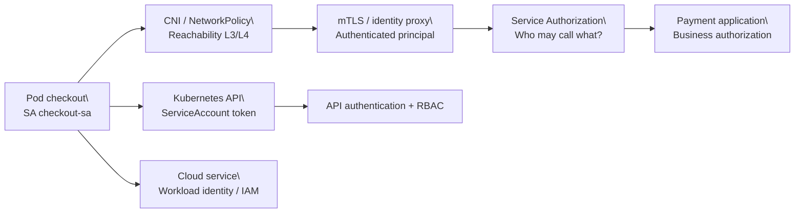
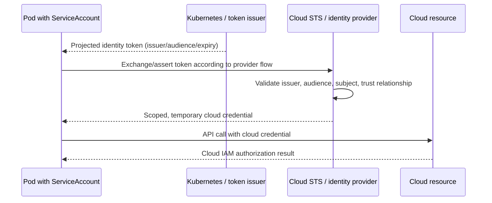
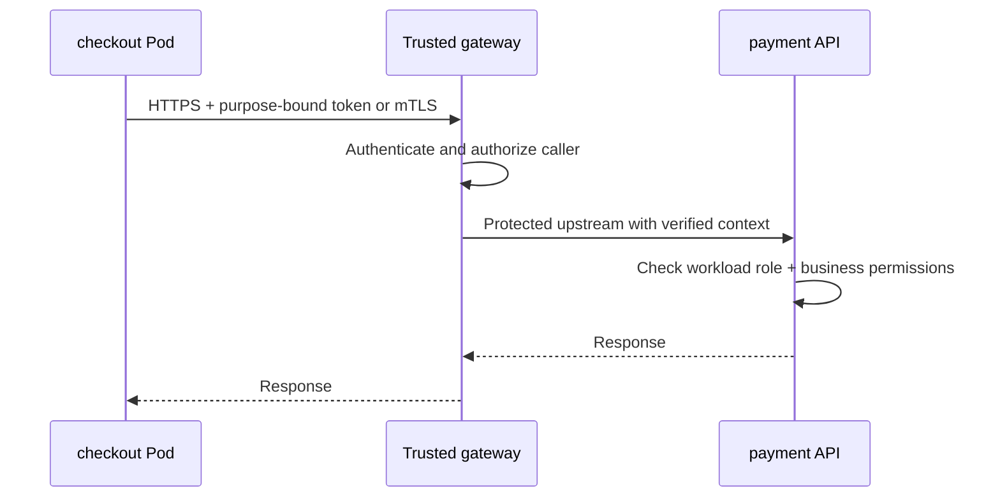

# Kiểm soát service account khi truy cập service trong Kubernetes

## Mục tiêu học tập

Sau bài học này, bạn có thể:

1. Phân biệt **Kubernetes ServiceAccount**, đối tượng **Service** (ClusterIP/NodePort/LoadBalancer), **Kubernetes API server**, **workload identity**, **authentication**, **authorization** và **network policy**.
2. Giải thích Kubernetes xác thực ServiceAccount khi Pod gọi **Kubernetes API** và vì sao **RBAC không tự quyết định Pod A có được gọi HTTP API của Service B**.
3. Thiết kế ServiceAccount theo workload/namespace với **least privilege**, tránh phụ thuộc ServiceAccount `default` và giới hạn quyền gắn token.
4. Hiểu **projected bound ServiceAccount token**, `audience`, `issuer`, `subject`, `expiration`, `TokenRequest`, `TokenReview`, vòng đời token và cách không làm rò credential.
5. Bảo vệ service-to-service traffic bằng **network segmentation + service identity + mTLS hoặc xác thực token phù hợp + authorization theo tài nguyên/tác vụ**, không nhầm label/IP với danh tính đã được xác thực.
6. Áp dụng các mẫu **Kubernetes RBAC, ServiceAccount, projected token volume, NetworkPolicy và service-mesh AuthorizationPolicy** một cách có kiểm soát.
7. Hiểu tích hợp cloud workload identity, ranh giới giữa token Kubernetes và credential cloud, các nguy cơ **token theft, confused deputy, privilege escalation và cross-namespace/cross-cluster**.
8. Lập ma trận kiểm thử **allow/deny**, quan sát audit/telemetry, điều tra lỗi 401/403/TLS/network và thực hành mô hình Python ngoại tuyến.

## 1. Đặt vấn đề: “Service account truy cập service” có thể mang nhiều nghĩa

Giả sử trong một cluster có hai workloads:

- `checkout-api` thuộc namespace `shop`, chạy với ServiceAccount `checkout-sa`.
- `payment-api` thuộc namespace `billing`, được truy cập qua Kubernetes Service `payment-api.billing.svc.cluster.local`.

Đội vận hành muốn: **chỉ workload checkout đáng tin được phép gọi API thanh toán**, trong khi Pod bất kỳ khác, ngay cả trong cluster, phải bị từ chối.

Cần tránh ba kết luận sai:

1. **Pod có ServiceAccount thì mặc định được phép gọi mọi Service** — sai. ServiceAccount chủ yếu là danh tính workload cho Kubernetes API và các cơ chế identity dựa trên token; đường mạng và application authorization là các lớp riêng.
2. **Đã tạo RoleBinding cho ServiceAccount thì HTTP Service sẽ tự chặn caller không đúng role** — sai. Kubernetes RBAC điều khiển yêu cầu gửi đến **Kubernetes API server**, không tự áp RBAC cho ứng dụng chạy sau Service `payment-api`.
3. **Có NetworkPolicy cho nguồn `checkout` là đã xác thực ServiceAccount `checkout-sa`** — sai theo Kubernetes NetworkPolicy tiêu chuẩn: selectors là **pod/namespace/IP**, không phải cơ chế xác thực ServiceAccount ở application layer.

Khi nói “kiểm soát service account khi truy cập service”, cần xác định **service nào**:

- **Kubernetes API:** yêu cầu tới API server để đọc ConfigMap, tạo Pod, cập nhật Service, xem Secret, v.v. → Kubernetes authentication + RBAC/admission.
- **Application service trong cluster:** HTTPS/gRPC/DB API phía sau Service hoặc Pod → network policy + TLS/mTLS/JWT + ứng dụng hoặc service mesh thực thi authorization.
- **Cloud managed service:** object storage, secrets manager, queue, cloud API → cloud workload identity/IAM, OIDC federation/agent của provider và endpoint/network controls.
- **Control/observability service:** Envoy admin, metrics, cert manager, service discovery → identity và quyền riêng, tránh dùng quyền admin chỉ để đọc số liệu.

Bài thuộc chương **Bảo mật mạng Kubernetes**, trong module `SECURITY_NETWORK_SECURITY` về phân đoạn, firewall, VPN, IDS/IPS, xác thực kết nối, DNS, wireless, cloud và kiến trúc mạng an toàn. Chủ đề nối kết **Kubernetes RBAC** với **security policy ở tầng network và service identity**.

> **Nguyên tắc:** **ServiceAccount giúp xác định workload theo cơ chế Kubernetes; việc một workload được phép kết nối hoặc thực thi hành động trên service phải được kiểm soát ở đúng điểm thực thi.** Không biến “có token” thành quyền truy cập toàn bộ mạng.

### 1.1. Thuật ngữ cần phân biệt

| Thuật ngữ | Vai trò | Không tự cung cấp |
|---|---|---|
| **ServiceAccount (SA)** | Đối tượng danh tính namespaced cho workloads | Firewall; quyền HTTP business API |
| **`spec.serviceAccountName`** | Chỉ định SA được Pod sử dụng | Chứng nhận Pod không bị compromise |
| **Service `ClusterIP`** | Cung cấp stable virtual address/DNS cho backend endpoints | Authorization dựa trên SA caller |
| **Kubernetes API server** | API quản lý cluster, xác thực caller và kiểm soát RBAC/admission | Tự kiểm soát từng HTTP request đến application Service |
| **Role/RoleBinding** | Cấp quyền với tài nguyên Kubernetes API trong scope phù hợp | Quyền gọi một ứng dụng qua `/payments` |
| **NetworkPolicy** | Giới hạn lưu lượng L3/L4 vào/ra các Pods được chọn, nếu CNI thực thi | Xác thực user, JWT hoặc SA nguyên bản |
| **Service mesh identity** | Danh tính workload được chứng thực qua CA/mTLS theo sản phẩm | Mặc định cho phép mọi API method |
| **mTLS** | Xác thực hai phía TLS bằng chứng thư | Authorization theo bản ghi thanh toán |
| **OIDC/JWT token** | Chứa claims để verifier chứng thực theo issuer/audience/signature/lifetime | Không tự chống replay hoặc quyền trái scope |
| **Workload Identity Federation** | Liên kết danh tính workload với cloud identity theo cấu hình provider | Mặc định cho quyền cloud nhỏ nhất |
| **AuthorizationPolicy** | Chính sách do mesh/gateway thực thi cho traffic có ngữ cảnh danh tính | Chứng minh backend code không có bug |
| **Admission policy** | Kiểm soát khai báo tài nguyên được chấp nhận khi tạo/sửa | Tự bảo vệ API ở runtime |

## 2. Danh tính ServiceAccount và ranh giới tin cậy

### 2.1. ServiceAccount là tài nguyên namespaced

Kubernetes ServiceAccount có tên theo namespace. Về nguyên tắc, một workload có thể được nhận diện trong Kubernetes API theo dạng:

```text
system:serviceaccount:<namespace>:<serviceaccount-name>

Ví dụ:
system:serviceaccount:shop:checkout-sa
system:serviceaccount:billing:payment-sa
```

Tên `checkout-sa` **không độc nhất trên mọi namespace**, và một namespace cùng tên ở **cluster khác** không mặc định cùng danh tính hoặc cùng trust domain.

Một Pod khai:

```yaml
spec:
  serviceAccountName: checkout-sa
```

Khi được tạo, nó sử dụng ServiceAccount `checkout-sa` trong **namespace của Pod** nếu đối tượng này có sẵn và các quy tắc admission liên quan cho phép.

### 2.2. “Được xác thực là SA” có nghĩa ở đâu?

Một **ServiceAccount bearer token** được Kubernetes hoặc verifier được cấu hình xác minh có thể chứng minh token gắn với danh tính SA, với giới hạn về **issuer, audience, thời hạn và binding**.

Tuy nhiên:

- Một token có thể bị đánh cắp và sử dụng lại cho tới khi hết hiệu lực hoặc bị vô hiệu hóa theo cơ chế tương ứng.
- SA identity cho biết **tài khoản workload** được cấp token, không tự chứng minh process/caller đang chạy mã đáng tin hoặc request đã được business user phê duyệt.
- Một backend chỉ đọc header `X-Service-Account: checkout-sa` **không** có bằng chứng danh tính; client có thể tự điền header.
- Một Pod thuộc namespace `shop` không tự được hưởng quyền của mọi SA trong namespace. Quyền phụ thuộc token/credentials và cách service xác thực.
- Một ứng dụng có thể chạy bằng SA bị cấp quyền quá rộng, tạo rủi ro nếu token bị lộ.

### 2.3. Identity khác IP, tag và label

Một network policy chọn:

```yaml
podSelector:
  matchLabels:
    app: checkout
```

Nó chọn **Pods có label** `app=checkout` trong phạm vi namespace thích hợp. Điều đó **không bảo đảm Pod thực sự dùng** `serviceAccountName=checkout-sa`, càng không xác minh cryptographic identity.

Các labels thường được điều khiển bởi người/controller có quyền tạo/sửa Pods. Quyền thay labels hoặc chọn ServiceAccount cần được quản lý bằng RBAC/admission; nếu không, attacker có quyền deploy Pod có thể tự đưa mình vào nhóm được phép theo network selectors.

## 3. Bốn lớp chính sách cần phối hợp



### 3.1. Lớp 1 — Kubernetes API authorization

Khi `checkout-api` gọi Kubernetes API để đọc một ConfigMap cụ thể, API server xác thực token rồi kiểm tra **RBAC**. RoleBinding chỉ quyết định các verb/resource nằm trong scope của role.

### 3.2. Lớp 2 — Network reachability

Khi `checkout-api` gọi `payment-api.billing.svc.cluster.local:8443`, CNI/network gateway/cloud firewall quyết định gói tin có thể đến đích hay không dựa trên policy và data path.

**NetworkPolicy tiêu chuẩn không có field `serviceAccountName` để quyết định luồng**. Một số CNI/vendor extension có thể cung cấp identity selectors dựa trên ServiceAccount; phải đọc khả năng của sản phẩm và xác minh enforcement, không suy rằng Kubernetes NetworkPolicy API chung hỗ trợ.

### 3.3. Lớp 3 — Service identity và mTLS/token

Một sidecar/gateway hoặc chính ứng dụng có thể xác minh:

- Client mang chứng thư mTLS do CA tin cậy cấp cho workload identity nào?
- Hoặc client trình token có **issuer/audience/signature/expiry/binding** hợp lệ?
- Các claims có được lấy từ **verifier đã kiểm chứng**, không phải header do client tùy ý khai?
- Có trust domain hoặc federation khi gọi qua nhiều cluster không?

Đây là nơi kết nối **SA identity với quyền gọi service** khi dùng mesh hoặc identity broker phù hợp.

### 3.4. Lớp 4 — Application/business authorization

Dù `checkout-sa` được phép gọi `payment-api`, ứng dụng còn phải xác minh:

- API method/path nào được phép (`POST /charges` khác `GET /admin/export`).
- Tenant/order/customer nào caller được thao tác.
- Scope, rate limit, idempotency và dữ liệu đầu vào.
- End-user identity khi hành động được thực hiện thay người dùng.
- Audit trail và quyết định deny.

**Workload identity không thay thế end-user authorization**. Một service đáng tin có thể bị compromise hoặc bị lợi dụng làm **confused deputy**.

## 4. ServiceAccount của Pod: tạo, dùng và giới hạn

### 4.1. Không dùng mặc định một tài khoản cho mọi workload

Mỗi namespace thường có ServiceAccount tên `default`. Nếu Pod không khai `serviceAccountName`, nó thường sử dụng SA `default` của namespace đó.

Một nguyên tắc tốt:

- Dùng **ServiceAccount riêng cho mỗi workload hoặc nhóm workload có cùng trust requirements**.
- Đặt tên theo chức năng: `checkout-sa`, `payment-sa`, `metrics-reader-sa`.
- Không dùng `default` cho workload quan trọng nếu tổ chức yêu cầu định danh cụ thể.
- Không cấp quyền cao cho `default` ở một namespace đông workloads.
- Gắn ownership và admission guardrails để ngăn Pod tùy ý chọn SA đặc quyền.
- Không tạo một SA chung toàn công ty rồi bind quyền cluster-admin.

### 4.2. ServiceAccount bản thân không tương đương API token lâu dài

ServiceAccount là **đối tượng danh tính**, còn token là **một credential** có thể được cấp theo cơ chế khác nhau. Trên Kubernetes hiện đại, token được mount mặc định cho Pod thường là **projected, có thời hạn và được kubelet xoay vòng**, không phải Secret-based token tĩnh tự tạo vô hạn.

Các trường hợp legacy hoặc tạo token Secret thủ công vẫn có thể tồn tại. Không duy trì long-lived ServiceAccount token làm mật khẩu dùng chung nếu có lựa chọn **short-lived bound token, workload identity hoặc mTLS** an toàn hơn.

### 4.3. Không cần Kubernetes API thì không cần tự động mount API token

Ví dụ một ứng dụng chỉ phục vụ HTTP và gọi dịch vụ nội bộ qua mTLS, không cần truy cập Kubernetes API:

```yaml
apiVersion: v1
kind: ServiceAccount
metadata:
  name: catalog-sa
  namespace: shop
automountServiceAccountToken: false
---
apiVersion: apps/v1
kind: Deployment
metadata:
  name: catalog
  namespace: shop
spec:
  replicas: 2
  selector:
    matchLabels:
      app: catalog
  template:
    metadata:
      labels:
        app: catalog
    spec:
      serviceAccountName: catalog-sa
      automountServiceAccountToken: false
      containers:
        - name: catalog
          image: registry.example.test/catalog@sha256:REPLACE_WITH_REAL_DIGEST
          ports:
            - name: http
              containerPort: 8080
```

**Chỉ là manifest minh họa**: digest chưa hợp lệ, namespace/registry/app phải do tổ chức cấp. Không deploy nguyên xi.

Ý nghĩa:

- `serviceAccountName` cho Pod một danh tính SA ổn định về mặt cấu hình.
- `automountServiceAccountToken: false` tránh Kubernetes API token được mount tự động ở những workload không cần.
- Một **service mesh có thể cấp credential workload qua cơ chế riêng**; không giả định việc tắt mount token sẽ phá hoặc luôn không ảnh hưởng mọi mesh/identity integration.
- SA vẫn tồn tại và vẫn có thể là subject của RBAC; không mount token chỉ giảm một đường truy cập credential, không tự xóa mọi quyền.
- Pod có quyền tạo **explicit projected token volume** theo thiết kế khác vẫn có thể nhận token, nên phải review mọi volumes.

### 4.4. Precedence của automount

PodSpec và ServiceAccount cùng có thuộc tính `automountServiceAccountToken`. Khi được đặt ở **PodSpec**, giá trị tại Pod thường có ưu tiên so với thuộc tính ở SA.

Do đó, một tổ chức không nên chỉ bật `automountServiceAccountToken: false` ở SA rồi mặc định mọi Pod được bảo vệ: cần xét **manifest thực, admission policy và những projected volumes được khai báo**.

## 5. RBAC: cấp quyền Kubernetes API với phạm vi nhỏ nhất

### 5.1. Ví dụ: chỉ đọc một ConfigMap theo tên

Một workload cần đọc ConfigMap `checkout-public-config` trong namespace `shop`. Có thể dùng namespaced Role:

```yaml
apiVersion: v1
kind: ServiceAccount
metadata:
  name: checkout-sa
  namespace: shop
---
apiVersion: rbac.authorization.k8s.io/v1
kind: Role
metadata:
  name: checkout-config-reader
  namespace: shop
rules:
  - apiGroups: [""]
    resources: ["configmaps"]
    resourceNames: ["checkout-public-config"]
    verbs: ["get"]
---
apiVersion: rbac.authorization.k8s.io/v1
kind: RoleBinding
metadata:
  name: checkout-read-config
  namespace: shop
subjects:
  - kind: ServiceAccount
    name: checkout-sa
    namespace: shop
roleRef:
  kind: Role
  name: checkout-config-reader
  apiGroup: rbac.authorization.k8s.io
```

Điều này **chỉ cấp quyền GET ConfigMap với đúng tên**, không cấp quyền `list` hoặc `watch` tùy tiện, không cho đọc Secrets và không cấp quyền truy cập business API của `payment-api`.

### 5.2. Tránh các quyền quá rộng

| Sai lầm | Tác động | Cách đúng |
|---|---|---|
| `cluster-admin` cho SA ứng dụng | Có thể quản trị gần như toàn cluster | Role nhỏ theo resource/verb |
| `secrets get/list` toàn namespace | Lộ credential các workloads khác | Hạn chế access; tốt nhất không cho nếu không cần |
| `pods create` hoặc quyền thay controllers tùy ý | Có thể deploy workload dùng SA/volumes có quyền khác | Admission, policy và tách namespace/roles |
| `roles/rolebindings bind/escalate` không được kiểm soát | Có thể nâng quyền API | Chặn quyền RBAC escalation |
| Một SA dùng chung tất cả microservices | Khó phân biệt audit, blast radius lớn | SA riêng theo service |
| Tự cấp `impersonate` rộng | Giả danh subject khác tại API | Phân quyền đặc biệt, audit |
| Public-facing app có quyền mutate Service/NetworkPolicy | Có thể thay network boundary sau compromise | Không cấp quyền không cần |
| Namespace admin tự do mount token SA đặc quyền | Token theft/misuse | Admission và ownership policy |

**“Least privilege” không chỉ là quyền `get` thay vì `list`**. Quyền tạo workload, exec, đọc Secret, thay RoleBinding hay gán SA có thể gián tiếp tạo access lớn hơn.

### 5.3. RoleBinding và ClusterRoleBinding

- `Role` xác định permissions trong namespace.
- `RoleBinding` gắn subject với Role hoặc ClusterRole để cấp quyền trong **namespace của binding**, theo phạm vi tài nguyên.
- `ClusterRole` có thể mô tả quyền trên cluster-scoped resources hoặc tập permissions tái sử dụng.
- `ClusterRoleBinding` thường có phạm vi cluster, đặc biệt nhạy cảm.
- ServiceAccount subject phải ghi đúng **namespace** trong binding.

**Không dùng ClusterRoleBinding chỉ vì workload sống trong nhiều namespaces**; cân nhắc bindings rõ theo namespace và scope cần thiết.

### 5.4. RBAC không phải chính sách HTTP của Service

Nếu `checkout-sa` có Role `get configmaps`, nó không được Kubernetes API server “phê duyệt” riêng khi mở kết nối TCP tới `payment-api:8443`. K8s Service routing vẫn có thể cho packet đến destination nếu network path cho phép.

Muốn payment chỉ chấp nhận checkout, phải cấu hình thêm **identity verification và authorization** tại payment app, API gateway hoặc mesh.

## 6. ServiceAccount token: cấu trúc và rủi ro

### 6.1. Khái niệm token hiện đại

Một token dành cho ServiceAccount thường là JWT có một số claims chính:

| Claim/thuộc tính | Ý nghĩa khi xác minh |
|---|---|
| `iss` | Token issuer: ai phát hành |
| `sub` | Subject, thường biểu diễn ServiceAccount identity |
| `aud` | Audience: những relying parties mà token dành cho |
| `exp` | Thời điểm hết hạn |
| `nbf`/`iat` | Thời điểm chưa có hiệu lực / được phát hành khi có |
| Kubernetes private claims | Thông tin SA/namespace/Pod binding tùy phiên bản và loại token |
| Signature/`kid` | Giúp verifier chọn khóa phù hợp và kiểm tra tính xác thực |
| Bound object | Có thể liên kết token với Pod/đối tượng cụ thể, hạn chế lifetime theo object |

**Không phải mọi token đều chứa đúng cùng tập claims**: version, issuer và cơ chế cấp token quan trọng. JWT có thể *decode* công khai nhưng chưa được *verify*; chỉ đọc payload Base64 **không** chứng minh token hợp lệ.

### 6.2. TokenRequest và projected bound token

Kubernetes `TokenRequest` API có thể cấp token ngắn hạn theo `audiences`, `expirationSeconds` và tùy cơ chế binding. Kubelet có thể quản lý việc refresh **projected ServiceAccount token** trong Pod.

Lợi ích so với token tĩnh:

- Giới hạn **thời gian hiệu lực**.
- Giới hạn **audience** nếu verifier thực thi.
- Có thể gắn với vòng đời Pod/ServiceAccount và thông tin binding phù hợp.
- Giảm nhu cầu sao chép token lâu dài vào Secret hoặc repo.
- Tạo danh tính workload để tích hợp token federation/identity gateway khi được cấu hình.

**Token ngắn hạn không tự là token một lần dùng**. Nếu bị đánh cắp, attacker có thể sử dụng lại trong phạm vi issuer/audience/expiry và khả năng revoke/binding được verifier thực thi.

### 6.3. Một token cho Kubernetes API khác token cho application service

Một Pod có thể có:

- Token với audience dành cho **Kubernetes API** (nếu workload cần).
- Token **projected riêng** với audience `payments-api` dành cho một relying party được cấu hình xác minh audience đó.
- Credential do mesh cấp (chứng thư mTLS/workload identity) theo trust domain.

**Không gửi token Kubernetes API mặc định tới mọi service**. Relying party có thể không nên chấp nhận token dành cho API server, và việc gửi bearer token sang nơi không tin cậy tăng rủi ro bị lộ.

## 7. Projected token dùng cho một service cụ thể

### 7.1. Mẫu triển khai với audience riêng

Ứng dụng cần trình ServiceAccount token cho một identity-aware gateway được kiểm soát, với audience `payments-api`.

```yaml
# ILLUSTRATIVE DEPLOYMENT: không có app thực để chạy và không
# thay thế thiết kế TokenReview/OIDC validator phía payment.
apiVersion: v1
kind: ServiceAccount
metadata:
  name: checkout-sa
  namespace: shop
automountServiceAccountToken: false
---
apiVersion: apps/v1
kind: Deployment
metadata:
  name: checkout
  namespace: shop
spec:
  replicas: 1
  selector:
    matchLabels:
      app: checkout
  template:
    metadata:
      labels:
        app: checkout
    spec:
      serviceAccountName: checkout-sa
      automountServiceAccountToken: false
      containers:
        - name: checkout
          image: registry.example.test/checkout@sha256:REPLACE_WITH_REAL_DIGEST
          volumeMounts:
            - name: payment-identity
              mountPath: /var/run/identity
              readOnly: true
      volumes:
        - name: payment-identity
          projected:
            sources:
              - serviceAccountToken:
                  path: payment-token
                  audience: payments-api
                  expirationSeconds: 3600
```

Với cấu hình phù hợp, kubelet quản lý tệp token tại `/var/run/identity/payment-token`. Giới hạn cần hiểu:

1. `automountServiceAccountToken: false` chặn **mount mặc định**; `projected` volume được khai **tường minh** vẫn có thể nhận token.
2. Token phải được đọc qua **file**, tránh in vào logs, environment hoặc trace.
3. Ứng dụng cần đọc lại token sau khi kubelet thay tệp, không cache bearer token mãi.
4. `expirationSeconds` là yêu cầu có thể chịu giới hạn/chính sách của API server; không coi đúng 3600 giây là bảo đảm trên mọi cluster.
5. `audience: payments-api` chỉ hữu ích nếu relying party **thực sự kiểm tra audience** và issuer; đây không phải secret.
6. Token cho payment **không nên** được dùng làm Kubernetes API credential nếu audience không phù hợp.
7. Không mount cùng credential vào sidecar/init container không cần; thực tế volumes của Pod có thể được mount theo từng container nên cần review cụ thể.
8. Không tin một Pod **tự khai** `serviceAccountName` làm chứng cứ danh tính trong HTTP; phải verify token/credential.

### 7.2. Caller gửi token thế nào?

Ví dụ logic ở phía application client:

```text
1. Đọc /var/run/identity/payment-token tại thời điểm dùng.
2. Kết nối HTTPS tới payment gateway với certificate verification.
3. Gửi Authorization: Bearer <short-lived-token> qua kênh bảo vệ.
4. Gateway xác minh token và gắn verified identity vào context nội bộ.
5. Authorization policy quyết định SA checkout-sa có được gọi action này?
6. Backend còn kiểm tra tenant, order ID, end-user context và nghiệp vụ.
```

**Không ghi token thực vào tài liệu, command-line lịch sử shell, proxy access logs hoặc SIEM**. Payload JWT có thể chứa thông tin nội bộ và token bearer là credential.

## 8. Xác minh token ở phía service: không chỉ decode JWT

### 8.1. Hai nhóm cách xác minh

**Cách A — Kubernetes TokenReview:** một verifier đáng tin gọi Kubernetes API `TokenReview` để kiểm tra token và audience theo API server. Phù hợp những hệ muốn để Kubernetes xác nhận credential và các ràng buộc của nó.

**Cách B — OIDC/JWT validation:** một relying party tự kiểm tra chữ ký từ issuer/JWKS được tin, issuer, audience, expiry và claims, cộng thêm những kiểm tra vòng đời/binding/revocation cần thiết theo threat model.

Khác biệt quan trọng:

- Offline signature/claim validation **không nhất thiết phát hiện kịp token đã mất hiệu lực do Pod/ServiceAccount bị xóa**, vì có thể không biết trạng thái object hiện tại.
- TokenReview có thể cung cấp kiểm tra ngữ cảnh Kubernetes theo API server và phù hợp việc xác thực token cấp bởi cluster, nhưng tạo dependency lên API server cùng quyền verifier.
- Relying party không được tự chấp nhận token từ issuer bất kỳ chỉ vì có một JWT hình thức đúng.
- Phải áp **audience allowlist**, không lấy `aud` từ token làm một lý do tự động chấp nhận.
- Một identity có thể tồn tại ở nhiều cluster với cùng namespace/name; cần **cluster issuer/trust domain** trong identity policy.

### 8.2. Mẫu TokenReview request mang tính minh họa

```yaml
# Kubernetes authentication.k8s.io/v1 TokenReview example.
# Không điền token thực vào tài liệu hoặc file không được bảo vệ.
apiVersion: authentication.k8s.io/v1
kind: TokenReview
spec:
  token: "REPLACE_ONLY_IN_TRUSTED_VERIFIER"
  audiences:
    - payments-api
```

Sau khi API server trả kết quả, verifier phải kiểm tra **`status.authenticated`, identity, audience và lỗi**, không suy mỗi HTTP 200 từ TokenReview API nghĩa là credential hợp lệ.

Bản thân verifier muốn tạo TokenReview thường cần quyền API thích hợp; **không cấp quyền tạo TokenReview rộng cho mọi workload hoặc client**. Khả năng xác thực token nên nằm ở một **gateway/identity service được bảo vệ**.

### 8.3. Các bước xác minh tối thiểu của relying party

1. Chỉ lấy token qua TLS channel đã xác thực hoặc kênh được bảo vệ tương đương.
2. Kiểm tra **issuer/trust domain** thuộc allowlist.
3. Kiểm tra signature theo thuật toán/keys được cấu hình tin cậy; không tin thuật toán theo đề xuất tự do từ token.
4. Kiểm tra `aud` phù hợp resource verifier.
5. Kiểm tra `exp`, `nbf`, clock skew hợp lý và token binding/lifecycle cần thiết.
6. Kiểm tra `sub`, namespace, ServiceAccount và cluster identity hợp lệ.
7. Map verified identity thành **roles/actions** theo policy được duyệt.
8. Reject claims thiếu, token lỗi, token hết hạn hoặc policy không match.
9. Log **decision và identity**, tuyệt đối không log raw token.
10. Thử cả positive/negative/replay/expired/wrong audience/wrong issuer ở môi trường được phép.

**Token signature hợp lệ nhưng sai audience vẫn phải bị từ chối.** Không dùng `decode` hoặc việc thấy `sub=checkout-sa` làm phép thử authn.

## 9. Chính sách “ai được gọi service nào?” dưới góc workload identity

### 9.1. Ma trận quyền mẫu

| Caller identity đã verify | Destination | Action | Expected |
|---|---|---|---|
| `shop/checkout-sa` | `billing/payment-api` | `POST /charges` | ALLOW theo business policy |
| `shop/checkout-sa` | `billing/payment-api` | `GET /admin/export` | DENY |
| `shop/catalog-sa` | `billing/payment-api` | `POST /charges` | DENY |
| `billing/payment-sa` | `billing/payment-api` | `GET /health` | Có thể ALLOW theo health design |
| `monitoring/metrics-sa` | `billing/payment-api` | `GET /metrics` | ALLOW read-only nếu được duyệt |
| `monitoring/metrics-sa` | `billing/payment-api` | `POST /charges` | DENY |
| Anonymous/unknown | `billing/payment-api` | Any sensitive action | DENY |
| Wrong issuer/audience token | `billing/payment-api` | Any | DENY trước authorization |

**Danh tính caller là kết quả đã verify**, không phải tên trong một request header tự khai.

### 9.2. Authorization nên nằm ở đâu?

- **Ứng dụng đích:** quyền theo resource, business tenant, giao dịch; dễ hiểu context nghiệp vụ nhất.
- **API gateway/identity proxy:** tiền kiểm token/mTLS, rate limits, allowlist theo route; cần chặn đường bypass gateway.
- **Service mesh:** chính sách L4/L7 dựa trên mTLS workload principal khi traffic thực qua data plane của mesh.
- **Cloud IAM:** API của cloud managed service thường dùng federation/role; không dùng RoleBinding Kubernetes để cấp quyền cloud.

Phối hợp theo mô hình **deny by default ở điểm nhạy cảm**. Nếu gateway là policy enforcement point nhưng PodIP/NodePort cho caller gọi thẳng backend, authorization có thể bị bypass trừ khi backend cũng bảo vệ.

### 9.3. Workload identity không phải end-user identity

Một payment API nhận request từ `checkout-sa` vẫn cần biết hành động đang thực hiện thay **user/tenant/order nào**; quyền workload chỉ cho phép hệ thống checkout gọi API, không mặc định tất cả đơn hàng đều được xử lý.

Nếu một service thay mặt người dùng gọi tiếp service khác, phải kiểm soát **delegation**, token exchange hoặc end-user claims theo kiến trúc, tránh gửi một bearer token đặc quyền chung qua mọi hop.

## 10. Service mesh mTLS và identity xuất phát từ ServiceAccount

### 10.1. SPIFFE-style identity

Một số service mesh dùng danh tính dạng SPIFFE URI dựa trên cluster trust domain, namespace và ServiceAccount, ví dụ:

```text
spiffe://cluster.local/ns/shop/sa/checkout-sa
spiffe://cluster.local/ns/billing/sa/payment-sa
```

Đây là ví dụ theo kiểu danh tính của các mesh tương thích, **không phải định dạng bắt buộc của mọi Kubernetes cluster**. `cluster.local` là trust domain ví dụ; cần kiểm tra cấu hình thực và quy tắc federation.

Trong mesh phù hợp:

1. Control plane xác minh workload đủ điều kiện nhận identity.
2. Certificate/credential ngắn hạn được cấp cho proxy/workload tương ứng.
3. Client proxy và server proxy thực hiện **mTLS** và xác minh chain/workload identity.
4. Authorization policy kiểm tra **authenticated principal** và hành động.
5. Ứng dụng nhận traffic đã qua policy, nhưng vẫn cần bảo vệ nghiệp vụ.

**Đừng coi một header `X-SPIFFE-ID` do client gửi là bằng chứng mTLS.** Chỉ tin identity do proxy/PEP đã xác thực và có kênh bảo vệ tới backend.

### 10.2. Istio: buộc mTLS cho payment workloads

Ví dụ **phụ thuộc Istio và cấu hình mesh đã cài**, không phải Kubernetes Native NetworkPolicy:

```yaml
apiVersion: security.istio.io/v1
kind: PeerAuthentication
metadata:
  name: payment-strict-mtls
  namespace: billing
spec:
  selector:
    matchLabels:
      app: payment-api
  mtls:
    mode: STRICT
```

`STRICT` nhằm yêu cầu mTLS tại workload được chọn trong data path Istio tương ứng. Nó không tự thay NetworkPolicy, và cần xác minh traffic thực được mesh tiếp nhận (không có bypass do sidecar exclusion/hostNetwork/ambient enrollment hay cấu hình khác).

### 10.3. Istio: chỉ cho checkout principal gọi payment

```yaml
apiVersion: security.istio.io/v1
kind: AuthorizationPolicy
metadata:
  name: payment-allow-checkout
  namespace: billing
spec:
  selector:
    matchLabels:
      app: payment-api
  action: ALLOW
  rules:
    - from:
        - source:
            principals:
              - "cluster.local/ns/shop/sa/checkout-sa"
      to:
        - operation:
            methods: ["POST"]
            paths: ["/charges"]
            ports: ["8443"]
```

Các điểm cần hiểu:

- `principals` ở ví dụ là **workload principal có mTLS xác minh**, không phải một chuỗi tự khai.
- Với workload được policy chọn, khi có ALLOW policies áp dụng, những requests không match các quy tắc ALLOW sẽ bị từ chối theo ngữ nghĩa authorization của Istio; **các chính sách khác, DENY/CUSTOM và thứ tự xử lý vẫn có thể tác động**.
- `methods`/`paths` cần HTTP parsing trong mesh; với TCP thuần chỉ có thể áp điều kiện L4 thích hợp.
- `ports` là **cổng đích mà policy engine quan sát** ở điểm phù hợp, cần kiểm tra container/service target port và proxy.
- `/charges` là path ví dụ; xử lý path normalization, query strings, gRPC method naming và route thực theo sản phẩm.
- Nếu ingress gateway kết thúc mTLS rồi tự mở connection tới payment, principal mà payment thấy có thể là **identity của gateway**, không phải end-user hoặc client trước gateway. Cần thiết kế propagation/delegation riêng.
- Một SA khác có cùng tên ở cluster khác không tự được tin nếu trust domain/issuer không được federation đúng.
- **No-policy behavior** của mesh có thể cho phép traffic; policy phải được áp và xác minh deny từ caller khác.

### 10.4. Không phải mọi cluster đều dùng Istio

Alternative implementations gồm service proxies, service mesh khác, API gateway và application-native mTLS. Không áp mẫu Istio AuthorizationPolicy lên một cluster chỉ có Calico/Cilium NetworkPolicy và kỳ vọng nó tự chạy.

Nếu CNI/vendor policy hỗ trợ ServiceAccount identity matching riêng, cần **xem CRD/API và enforcement cụ thể**. Đây **không** phải thuộc tính chung của `networking.k8s.io/v1 NetworkPolicy`.

## 11. NetworkPolicy: giới hạn “ai reach được” trước service identity

### 11.1. Topology hai namespaces

Giả sử:

```text
Namespace shop
  Pod checkout(app=checkout, SA=checkout-sa)
        |
        | TCP/8443
        v
Namespace billing
  Service payment-api -> Pods(app=payment-api, SA=payment-sa)
```

Một ingress NetworkPolicy chọn payment Pods và chỉ cho Pods checkout từ namespace `shop`:

```yaml
apiVersion: networking.k8s.io/v1
kind: NetworkPolicy
metadata:
  name: payment-ingress
  namespace: billing
spec:
  podSelector:
    matchLabels:
      app: payment-api
  policyTypes:
    - Ingress
  ingress:
    - from:
        - namespaceSelector:
            matchLabels:
              kubernetes.io/metadata.name: shop
          podSelector:
            matchLabels:
              app: checkout
      ports:
        - protocol: TCP
          port: 8443
```

Điều này chỉ **lọc theo namespace/pod labels + destination port**, không kiểm tra SA cryptographically.

### 11.2. Tương tác với authorization

Ngay cả khi network policy ở trên cho traffic từ một Pod có `app=checkout`, payment vẫn nên yêu cầu **workload identity `checkout-sa`** qua token/mTLS và kiểm tra action.

Nếu attacker có quyền tạo Pod gắn label `app=checkout` nhưng dùng SA khác, NetworkPolicy tiêu chuẩn có thể vẫn cho **kết nối mạng**; mesh/application authorization sẽ từ chối nếu identity khác.

Ngược lại, một Pod thật sự mang SA checkout nhưng không có label/network access phù hợp có thể bị chặn trước khi tới điểm xác thực. **Cả network selectors và identity policy phải được triển khai nhất quán**.

### 11.3. Egress của checkout cũng cần cho phép

Nếu namespace `shop` có egress isolation, cần policy cho checkout đi tới payment TCP/8443; nếu không, dù payment ingress cho phép thì kết nối vẫn có thể timeout.

Các dependencies khác cần đánh giá:

- DNS resolver để resolve `payment-api.billing.svc.cluster.local`.
- Workload certificate/mesh control plane khi cấp identity.
- Secrets/identity token federation service nếu dùng.
- Telemetry/logging và time sync theo kiến trúc.

Đừng mở egress `0.0.0.0/0` cho toàn namespace chỉ để sửa một luồng cần thiết.

### 11.4. Giới hạn của Kubernetes NetworkPolicy tiêu chuẩn

1. Các rules **additive allow**; policy khác chọn cùng Pod có thể mở thêm flow.
2. Không có built-in `serviceAccountName` selector trong schema NetworkPolicy chuẩn.
3. Không lọc HTTP method/path hoặc JWT claims.
4. Cần **CNI hỗ trợ thực thi**; manifest thành công không tự bảo đảm.
5. Traffic node/hostNetwork, Service VIP DNAT, NAT/gateway và NetworkPolicy order có thể có ngoại lệ/khác biệt theo datapath.
6. IP/CIDR rules không tự tương đương FQDN/URL policy.
7. NetworkPolicy không bảo vệ trực tiếp **Kubernetes API RBAC** hoặc quyền IAM cloud.

## 12. API gateway và application-native identity

### 12.1. Khi không có service mesh

Một API gateway có thể nhận request HTTPS từ caller mang projected token dành cho audience payment, dùng **TokenReview** hoặc OIDC validator được tin để xác minh SA. Gateway sau đó áp allowlist:

```text
verified subject: system:serviceaccount:shop:checkout-sa
verified issuer: cluster-issuer-A
verified audience: payments-api
requested action: POST /charges
decision: ALLOW
```

Tất cả thành phần này phải do gateway lấy từ **verified token/authn context**, không từ client-supplied headers.

### 12.2. Ngăn bypass gateway

Nếu Payment Pod/Service vẫn mở cho mọi namespace gọi trực tiếp, một caller có thể né gateway. Cần:

- NetworkPolicy chỉ cho phép nguồn gateway được duyệt tới payment service, hoặc payment application **tự verify identity**.
- TLS/mTLS cho hop gateway→backend.
- Authorization ở backend đối với hành động nhạy cảm.
- Giới hạn direct PodIP/NodePort/Ingress paths, IPv4/IPv6.
- Không trust `X-Authenticated-User` hay `X-Service-Account` đến từ nguồn chưa chứng thực; gateway phải strip/overwrite theo trust boundary.

### 12.3. Dùng JWT đúng mục đích

Trước khi chọn token Kubernetes làm app credential, cân nhắc:

- App có thể nên dùng **purpose-built OAuth2 access token** từ identity provider/STS với scopes phù hợp thay vì SA token trực tiếp.
- Relying party có hiểu issuer/audience và binding với cluster không?
- Token có rủi ro lộ qua debug logs, URL query hoặc proxy headers không?
- Token TTL/rotation có tương thích connection pooling, retries và offline service không?
- Cross-cluster trust và revocation được xử lý như thế nào?
- Có nguy cơ token dùng cho API server bị một service không đáng tin nhận rồi tái sử dụng không?

**Kubernetes SA token là credential có scope cụ thể**, không phải chìa khóa chung để vượt qua mọi service authorization.

## 13. Cloud workload identity và truy cập dịch vụ bên ngoài

### 13.1. Kubernetes RBAC không thay cloud IAM

Một workload có thể không cần Kubernetes API quyền nào, nhưng cần gọi cloud object storage/secrets/queue. Nếu copy cloud access key vào Pod Secret, một compromise có thể làm lộ credential lâu dài.

Các provider hỗ trợ các mô hình **federation/identity agent** khác nhau để chuyển từ danh tính workload thành cloud permissions với credential ngắn hạn:

- **AWS EKS IRSA**: liên kết Kubernetes ServiceAccount với IAM role thông qua OIDC trust; cần kiểm issuer/audience/subject trong trust policy và permissions role.
- **AWS EKS Pod Identity**: dùng thành phần/agent và trust flow khác IRSA; không mặc định áp chính xác cơ chế IRSA cho mọi EKS setup.
- **GKE Workload Identity Federation for GKE**: liên kết Kubernetes workloads với Google Cloud IAM theo cơ chế/provider hiện hành.
- **Azure Workload Identity trên AKS**: sử dụng identity federation theo cấu hình Azure/Kubernetes service account, token audience và application identity phù hợp.

Chi tiết annotation, webhook, agent, token path và trust claim phụ thuộc **dịch vụ/phiên bản**. Luôn đối chiếu tài liệu provider đang dùng.

### 13.2. Mô hình trust federation



Sơ đồ minh họa federation. EKS Pod Identity/mesh có thể sử dụng **local agent, socket hoặc metadata service** thay vì trực tiếp trao đổi token từ ứng dụng theo mọi bước. Không giả định một đường data flow chung.

### 13.3. Rủi ro khi trust policy quá rộng

- Tin mọi SA trong namespace chỉ vì prefix wildcard.
- Cho SA trong cluster staging assumable production role.
- Cho IAM role quyền `*` trên bucket/secret resources.
- Cho developer tùy ý thay ServiceAccount annotations hoặc IAM binding.
- Không giới hạn audience/issuer trong federation trust.
- Sử dụng một shared SA cho tất cả Pods ở nhiều môi trường.
- Không có cloud audit về workload identity/STS role assumption.

**Quyền cloud phải được cấp theo danh tính và resource cloud**, không chỉ do Pod có thể reach HTTPS endpoint của cloud API.

## 14. Token theft, replay và confused deputy

### 14.1. Những cách token có thể bị lộ

- Application log hoặc debug endpoint in header `Authorization`.
- Đưa token vào environment variable rồi in crash dump.
- ServiceAccount token volume được mount vào container/sidecar không cần.
- Container bị RCE và process đọc được volume token.
- Secret/backup/repo chứa token lâu hạn.
- CI/job copy token ra artifact hoặc gửi qua chat.
- API gateway forward token sang upstream không đáng tin.
- Khả năng `exec`/debug/privileged container quá rộng giúp đọc filesystem/credential.
- Admission/Pod creation privilege cho phép dùng SA quyền cao trong namespace.

### 14.2. Những biện pháp chính

1. **Không automount** API token nếu workload không cần.
2. Dùng **short-lived, audience-restricted, bound tokens** nơi áp dụng.
3. Phân tách SA theo workload và tenant; không cấp RBAC/cloud role rộng.
4. Hạn chế ai có quyền **tạo Pod hoặc chỉ định SA** trong namespace nhạy cảm.
5. Hạn chế `pods/exec`, `pods/ephemeralcontainers`, Secret access và mount permissions.
6. Không log raw token; redact Authorization/Cookie headers ở proxy, traces, SIEM.
7. Dùng mTLS/workload identity hoặc gateway authentication có kiểm chứng.
8. Áp network policy/egress restriction để giảm nơi attacker có thể gửi token.
9. Theo dõi unusual API verbs, TokenReview/federation issuance và cross-service requests.
10. Có quy trình revoke/replace identity, delete/rotate Pods và credentials khi compromise.

### 14.3. Confused deputy

Giả sử `checkout-sa` được phép gọi `payment-api`, nhưng một người dùng chỉ có quyền xem giỏ hàng có thể gửi request khiến checkout lập lệnh thanh toán cho **đơn hàng của người khác**.

Dù mesh mTLS xác minh đúng `checkout-sa`, đây vẫn là vấn đề **application-level authorization/delegation**. Payment cần kiểm tra end-user/tenant/order context được truyền an toàn và bảo đảm checkout không dùng quyền workload để vượt quyền người dùng.

### 14.4. Token bị đánh cắp: không mặc định chỉ xóa file

Xóa một tệp token trong Pod không chứng minh bản sao ở nơi khác đã bị vô hiệu hóa. Cần kiểm tra:

- Credential là short-lived bound token hay Secret/static token?
- Token còn hạn, còn Pod/SA binding và audience nào?
- TokenReview/issuer có ghi nhận token còn valid không?
- RBAC/roles/cloud federation có bị dùng trái phép không?
- Có cần xóa/recreate Pod, revoke IAM role/session hoặc đổi trust policy?
- Có long-lived caches hoặc credential đã được đổi sang cloud token độc lập không?

**Revocation thực tế phụ thuộc credential type và verifier**; thay token Pod có thể không thu hồi ngay cloud temporary credentials đã cấp qua STS.

## 15. RBAC, admission và chính sách lựa chọn ServiceAccount

### 15.1. Ai được gán ServiceAccount đặc quyền?

Một Pod có thể khai `spec.serviceAccountName` trong namespace. Nếu người dùng/controller có quyền tạo Pod, cần đánh giá liệu họ có thể **gán SA đặc quyền** hay khai volumes/containers gây rò token.

Kubernetes RBAC chuẩn không cung cấp một quyền “use ServiceAccount” độc lập áp dụng tự động như một cơ chế authorization cho Pod selection ở mọi cluster. Vì vậy, tổ chức thường dùng:

- Tách namespace và workload owners theo trust boundary.
- Admission controllers (ValidatingAdmissionPolicy, Kyverno, Gatekeeper hoặc công cụ phù hợp).
- Quy định allowed ServiceAccounts theo owner/deployment.
- Giới hạn ai được sửa SA, Role/RoleBinding, Deployments và Pods.
- Không cho user thường tạo workloads trong namespace chứa SA quyền cao.
- Audit Pod/Deployment changes và unexpected serviceAccountName.

**Admission là lớp bổ sung**; không thay workload runtime security hoặc đánh giá quyền indirect escalation qua controller.

### 15.2. Quy tắc admission gợi ý

| Chính sách | Lý do |
|---|---|
| Workloads production phải khai `serviceAccountName` cụ thể | Tránh dùng default chung |
| Default ServiceAccount không có cluster-scoped privileges | Giảm blast radius |
| Automount Kubernetes API token tắt khi không cần | Giảm credential exposure |
| Chỉ workloads được duyệt dùng SA có quyền Secrets/Pod mutation | Giảm privilege escalation |
| Pod không được chuyển sang SA khác qua override trái phép | Bảo vệ identity binding |
| Namespaces nhạy cảm hạn quyền tạo Pod/Job/ephemeral container | Tránh trích xuất token |
| Không dùng hostNetwork/privileged/capabilities không cần | Giảm bypass/isolation risk |
| SA dùng cloud federation phải match approved workload/subject | Ngăn assumable cloud role |
| Sidecar được cấp token riêng theo nhu cầu | Giảm lộ token chéo container |
| Policy thay đổi đều có review/audit và rollout | Chống drift |

### 15.3. Mẫu pseudo policy-as-code

```yaml
# PSEUDOCODE minh họa security intent, không phải Kyverno/OPA
# policy có thể triển khai trực tiếp.
policy: workload-service-identity-v1
namespace: billing
requirements:
  service_account_explicit: true
  block_default_sa_for_sensitive_workloads: true
  block_automount_kube_api_token_if_not_needed: true
  restrict_pod_sa_selection_to_workload_owner: true
  require_verified_client_identity_for_payment_api: true
  allowed_callers:
    - issuer: trusted-cluster-issuer-A
      namespace: shop
      service_account: checkout-sa
      actions: ["POST /charges"]
  deny_unknown_principals: true
  log_authorization_decision: true
```

Một CI/admission service phải biến các điều kiện này thành **kiểm soát có thể thực thi**. Không coi file YAML pseudo là chính sách đang chạy.

## 16. Kiểm soát quyền truy cập giữa namespace và cluster

### 16.1. Namespace là ranh giới quản trị tương đối

Namespace giúp nhóm tài nguyên và RBAC scope, nhưng **không tự là firewall**. Theo cấu hình mặc định của nhiều clusters, Pod trong namespace A vẫn có thể mở kết nối tới Service namespace B nếu network routing cho phép.

Cần phối hợp:

- NetworkPolicy hoặc kiểm soát network thực thi để giới hạn source/destination.
- Service authentication và authorization theo verified principal.
- RBAC/admission để không dễ tạo Pod mang SA/label đáng tin.
- Mesh trust domain và certificate/key rotation nếu dùng mTLS.
- Secrets isolation và per-tenant credentials.

### 16.2. Cross-cluster collision và trust domain

`shop/checkout-sa` có thể tồn tại ở cluster staging và production. Nếu payment service chỉ so `sub=system:serviceaccount:shop:checkout-sa` mà không kiểm **issuer/trust domain**, có nguy cơ chấp nhận token/identity từ cluster không được tin.

Trong multi-cluster:

1. Xác định mỗi cluster có **issuer/trust domain** thế nào.
2. Lập danh sách federation/cross-cluster identities được phép.
3. Không cho production chấp nhận tất cả staging identities mặc định.
4. Kiểm tra certificate trust chain và signed JWT issuer/aud.
5. Test wrong-cluster identity phải **DENY**.
6. Ghi cluster origin trong audit, tránh chỉ lưu SA name.

### 16.3. Service DNS và routing không xác thực identity

`payment-api.billing.svc.cluster.local` là tên DNS/service discovery, không chứng minh server đáng tin nếu client bỏ TLS verification. Ingress/Gateway cần xác định FQDN/SNI đúng; internal client phải xác minh certificate/trust hoặc bảo vệ kênh theo kiến trúc.

**ServiceAccount của caller và TLS identity của destination là hai thành phần khác nhau**, đều cần thiết trong mô hình mutual trust phù hợp.

## 17. Gắn workload identity với ingress, egress và gateway

### 17.1. Không xác thực source chỉ bằng IP hoặc label

Một backend có thể nhìn thấy:

```text
Client Pod checkout
  -> Kubernetes Service
  -> payment Pod

Hoặc:
Client Pod checkout
  -> shared ingress gateway
  -> Kubernetes Service
  -> payment Pod
```

Trường hợp qua gateway, payment Pod có thể thấy **địa chỉ IP và mTLS principal của gateway**, không phải checkout trực tiếp. Nếu payment policy chỉ cho source principal `checkout-sa` trong khi kiến trúc kết thúc mTLS tại gateway, legitimate request có thể bị deny.

Cần thiết kế rõ:

- **Điểm xác minh caller identity**: sidecar, gateway hay chính payment app?
- **Identity nào được xác minh ở từng hop**: caller, gateway, mesh service account?
- **Dữ liệu identity nào được chuyển tiếp**: signed assertion/token exchange hay header?
- **Ai được tin để phát hành identity assertion**: IdP/STS/proxy nào?
- **Đường bypass**: caller có thể gửi request thẳng PodIP/NodePort mà không qua gateway không?
- **Service authorization cuối**: backend có kiểm business tenant/role hay chỉ tin gateway?

### 17.2. Mô hình gateway đáng tin



Khi gateway xác minh client rồi truyền thông tin tới backend:

1. Gateway phải loại bỏ/ghi đè những headers identity do client tự đưa tới.
2. Backend phải xác thực **kết nối từ gateway** và chỉ tin những identity attributes được truyền qua kênh có bảo vệ.
3. Không để Pod/Service backend trực tiếp được caller không tin cậy truy cập.
4. Nếu có signed token/identity assertion nội bộ, kiểm issuer, audience và lifetime.
5. Chỉ chuyển tiếp claims cần thiết, tránh log bearer token hoặc thông tin riêng không cần.

### 17.3. Authorization cho HTTP và TCP không giống nhau

- HTTP/gRPC có thể xác định method, path, headers và thậm chí resource ID ở application layer.
- TCP raw database protocol thường không thể lọc “POST /charges” vì không có HTTP request.
- Một số mesh chỉ thấy traffic mã hóa mà không terminate/inspect L7 được; policy khi đó có thể chỉ dựa trên L4/identity.
- Một Service có nhiều ports (app, metrics, admin) cần policy riêng từng port; **allow một SA tới app port** không tự cấp quyền debug/admin.
- TLS với serverAuth và clientAuth phải được xác minh theo certificate profile phù hợp.

Vì vậy, không dùng chung một rule “SA-A gọi được Service-B” cho mọi endpoint và mọi tác vụ nếu mức nhạy cảm khác nhau.

## 18. Egress và service identity: chặn đi đâu, không chỉ chặn ai

### 18.1. Một workload có identity tốt vẫn có thể egress sai

ServiceAccount `checkout-sa` có thể được phép gọi payment, nhưng nếu Pod bị compromise và egress mở toàn bộ Internet, attacker có thể cố:

- Gửi token/credential tới endpoint không được duyệt.
- Gọi dịch vụ nội bộ khác ngoài danh mục nghiệp vụ.
- Truy cập metadata/control plane theo những đường đang reachable.
- Sử dụng DNS/HTTPS làm kênh truyền dữ liệu ra ngoài.
- Gọi API cloud bằng credential được cấp cho workload ngoài mục đích.

**Authorization ở payment không ngăn token bị gửi đến bên khác**. Giải pháp là egress segmentation kết hợp token scope, IAM, secret hygiene và telemetry.

### 18.2. Danh mục egress của checkout

| Đích | Purpose | Network policy | Service identity/auth |
|---|---|---|---|
| `payment-api:8443` | Tạo giao dịch | Cho checkout Pods tới payment | mTLS/token, allow `POST /charges` |
| Cluster DNS UDP/TCP 53 | Resolve service name | Chỉ tới resolver được duyệt | DNS security policy theo tổ chức |
| Identity/mesh controller | Lấy/đổi credential | Chỉ endpoint cần thiết | TLS và workload identity |
| Approved audit collector | Ghi log giao dịch | Chỉ telemetry endpoints | Auth/secure transport |
| Unknown Internet host | Không có nhu cầu | Deny | Không dùng “auth app” để bù egress |
| Kubernetes API | Không cần cho checkout nếu dùng projected payment token | Không cấp network/API quyền không cần | Kubernetes RBAC tối thiểu |
| Cloud secret manager | Chỉ khi nghiệp vụ cần | Private endpoint/egress gateway | Federated cloud IAM role hẹp |

**Kubernetes API traffic qua Pod network** có thể được xử lý đặc biệt theo CNI/provider và cluster configuration; cần xác minh nơi policy thực sự enforce, thay vì chỉ ghi deny trên giấy.

### 18.3. Destination-side isolation

Ở payment:

- NetworkPolicy chỉ cho payment traffic từ nguồn hợp lệ hoặc trusted gateway.
- Mesh AuthorizationPolicy xác minh client identity.
- App kiểm tra business action và resource.
- Metrics/admin/cert debug endpoints tách port và permission.
- Cloud SG/host firewall chỉ cho traffic qua đường được phê duyệt.
- Monitoring ghi cả **network denies** và **application auth denies**.

Dùng defense-in-depth nhưng không tạo mạng policy quá rộng chỉ vì payment đã dùng mTLS.

## 19. ServiceAccount cho Job, CronJob, controller và monitoring

### 19.1. Batch Jobs có danh tính riêng

Một Job chạy migration database không nên dùng cùng SA production web API nếu nó có quyền schema migration hoặc đọc secrets khác.

- Tạo SA riêng `db-migration-sa` với thời gian/quyền phù hợp.
- Giới hạn ai có quyền tạo Job sử dụng SA đó.
- Mạng egress chỉ tới DB và các dependencies cần.
- RoleBinding/Cloud IAM không giữ admin quyền sau khi migration kết thúc.
- Ghi audit run ID, ticket, SA, target và result.
- Không để Pod lâu dài dùng credential của Job đã kết thúc.

### 19.2. Controller có quyền cluster-scoped

Ingress controller, cert manager, CNI/controller và operator thường cần quyền Kubernetes API mạnh hơn ứng dụng business bình thường.

Giảm rủi ro:

- SA controller riêng, không dùng để chạy ứng dụng khác.
- Quyền `get/list/watch` hoặc mutate đúng resources và namespaces theo thiết kế.
- Không dùng quyền cluster-admin mặc định nếu controller có bộ role hẹp chính thức.
- Admission/namespace isolation cho control-plane Pods.
- Restrict controller admin ports và egress tới API server/cert issuer.
- Audit controller-origin API calls, secret reads và config changes.
- Không dựa vào tên ServiceAccount `controller` để phân biệt hàng loạt controller khác nhau.

### 19.3. Monitoring reader

Monitoring có thể cần hai loại quyền khác nhau:

1. **Kubernetes API read:** xem Pods/Endpoints/metrics metadata bằng SA với RBAC đọc hạn chế.
2. **Application metrics:** scrape `/metrics` của workloads bằng mTLS/HTTP auth/network policy riêng.

Nếu metrics endpoint là read-only nhưng exporter được cấp service account quyền tạo Pod/đọc Secrets toàn namespace, quyền đã quá rộng. **Không dùng admin token cho monitoring nếu chỉ cần counters**.

### 19.4. Debug và ephemeral containers

Người có quyền debug/exec có thể tiếp cận tiến trình, volumes hoặc networking trong Pod tùy security context và khả năng runtime. Không giả định ephemeral container luôn nhận cùng mount/token, nhưng cũng không xem debug access vô hại.

Kiểm soát:

- RBAC `pods/exec`, `pods/attach`, `pods/ephemeralcontainers`.
- Audit ai sử dụng quyền và khi nào.
- Không để debug logs/shell history vô tình in token.
- Không tạo Pod privileged/hostNetwork trong namespace nhạy cảm để “test network” ngoài quy trình.
- Nếu cần forensics, dùng quy trình incident đã phê duyệt để bảo toàn chứng cứ.

## 20. Cổng Kubernetes Service, RBAC và NetworkPolicy: ví dụ end-to-end

### 20.1. Giả định

Hệ thống checkout gọi payment:

```text
shop namespace:
  Deployment checkout: serviceAccountName=checkout-sa, app=checkout
  Service checkout (optional): HTTP 8080

billing namespace:
  Deployment payment: serviceAccountName=payment-sa, app=payment-api
  Service payment-api: TCP/8443 -> targetPort 8443
  Istio mTLS STRICT + allow checkout principal only
  Kubernetes NetworkPolicy: allow shop/checkout Pods -> billing/payment Pods 8443
```

Cấu trúc này tạo **ba điều kiện độc lập**:

- **Network:** caller có route và được CNI cho phép đến Pod 8443.
- **Authentication:** payment mesh/gateway xác minh principal của caller.
- **Authorization:** principal có quyền gọi operation mục tiêu; app kiểm tenant/order.

### 20.2. Kubernetes Service không có field allowServiceAccount

```yaml
apiVersion: v1
kind: Service
metadata:
  name: payment-api
  namespace: billing
spec:
  type: ClusterIP
  selector:
    app: payment-api
  ports:
    - name: https
      port: 8443
      targetPort: 8443
      protocol: TCP
```

Service này định nghĩa **routing/port selection**; nó **không chứa allowlist service account** và không bật auth chỉ vì tên port là `https`.

Ứng dụng/mesh vẫn phải thật sự terminate TLS ở listener phù hợp. Tên `https` không tự khiến ứng dụng phục vụ HTTPS.

### 20.3. NetworkPolicy + mesh policy vẫn cần test

Ở staging, thực hiện positive/negative cases:

| Caller | Đường | Expected |
|---|---|---|
| `shop/checkout-sa` + label checkout | payment TCP/8443, `POST /charges` | Network allow, identity allow, app policy allow |
| `shop/checkout-sa` + label checkout | payment `GET /admin/export` | Network allow, L7 deny |
| `shop/catalog-sa` với Pod label checkout | payment TCP/8443 | Network có thể allow, identity deny |
| `shop/checkout-sa` nhưng label không match CNI selector | payment TCP/8443 | Network deny nếu không có policy khác |
| `marketing/campaign-sa` | payment TCP/8443 | Network deny |
| Unauthenticated Pod | payment TCP/8443 | Network/mesh deny tùy path |
| Gateway with verified checkout assertion | payment upstream | Allow nếu gateway architecture phê duyệt |
| Wrong-cluster checkout identity | payment TCP/8443 | Identity deny |
| Expired/mismatched token | payment | Authentication deny |
| Monitoring SA | payment `/metrics` | Theo metrics-only policy, không được `POST /charges` |

Nếu một caller có đúng SA nhưng CNI deny, đó là lỗi **network path/policy** chứ không chứng minh SA token sai. Ngược lại, network allow mà app trả 403 có thể là **authorization hoạt động đúng**.

## 21. Kiểm tra trước phát hành: declared, observed, enforced

### 21.1. Trạng thái khai báo

Đọc manifests/IaC và ghi:

- `serviceAccountName` của từng Deployment/Job/Pod.
- ServiceAccounts nào tự động mount token.
- Explicit projected token volumes, `audience` và hạn token.
- Roles, ClusterRoles, RoleBindings, ClusterRoleBindings.
- IAM role/cloud workload federation mapping.
- NetworkPolicy/CNI vendor policies, Ingress/Gateway, cloud firewall.
- Mesh mTLS/AuthorizationPolicy và trust-domain configuration.
- App gateway token validator, issuer/audience allowlists, application roles.
- Sidecar/agent/telemetry access và secret handling.

### 21.2. Trạng thái thực thi

Kiểm tra ở runtime:

- Pod **thực sự dùng SA nào** sau admission/mutation và rollout?
- Policy selectors có chọn đúng Pods không?
- Container có mount token mặc định hoặc explicit token volume ngoài dự kiến?
- RoleBinding effective rights có vượt so với thiết kế không?
- Cloud role có được assume bởi SA không được phép không?
- CNI data path có enforce và service mesh có thực sự bật mTLS?
- Có gateway/NodePort/PodIP/direct route bypass auth?
- Token/cert issuer, audience, trust domain có khớp intent?
- Logs có principal và deny reasons thay vì chỉ source IP?

### 21.3. Xác minh bằng kiểm thử

- **Positive:** checkout được phép gọi đúng payment operation.
- **Negative workload identity:** catalog dùng SA khác nhưng cùng network/label, request bị identity policy deny.
- **Negative network:** Pod ngoài trust zone không reach payment.
- **Negative action:** checkout không được gọi admin/export operation.
- **Negative token:** wrong audience/expired/wrong issuer bị authn deny.
- **Kubernetes API:** checkout chỉ GET ConfigMap tên cho phép, không đọc secrets.
- **Cloud:** checkout chỉ dùng cloud role được duyệt, không đọc dữ liệu tài khoản khác.
- **Resilience:** token rotation/mTLS cert renewal không phá legitimate traffic.
- **Audit:** identity và authorization decisions hiện trên telemetry phù hợp.

## 22. Lệnh quan sát chỉ đọc trong cluster được cấp quyền

### 22.1. Xem ServiceAccount được gán thật

```bash
# Chỉ chạy trên cluster/namespace mà bạn được cấp quyền đọc.
kubectl get serviceaccounts -n shop

# Xem tài khoản gắn với các Pod, tránh in token hay Secrets.
kubectl get pods -n shop \
  -o custom-columns=NAME:.metadata.name,SA:.spec.serviceAccountName,PHASE:.status.phase

# Xem cấu hình Deployment theo tên cụ thể.
kubectl get deployment checkout -n shop -o yaml
```

Output deployment YAML có thể chứa thông tin environment/Secret references; không đưa nguyên file ra log công khai. Kiểm tra **effective Pod spec** nếu admission webhook thay cấu hình giữa khai báo và thực chạy.

### 22.2. Xem RBAC ở scope cần thiết

```bash
kubectl get roles,rolebindings -n shop
kubectl describe role checkout-config-reader -n shop
kubectl describe rolebinding checkout-read-config -n shop

# Kiểm tra quyền của identity hiện tại.
kubectl auth can-i get configmaps -n shop
```

**`kubectl auth can-i` mặc định kiểm tra identity của kubeconfig đang dùng**, không tự chuyển sang identity của `checkout-sa`.

Trong môi trường quản trị được cấp **impersonation privilege**, có thể kiểm tra giả lập authorization API cho một SA:

```bash
# CHỈ với quyền quản trị/impersonate đã được phê duyệt:
kubectl auth can-i get configmaps \
  --resource-name=checkout-public-config \
  --as=system:serviceaccount:shop:checkout-sa \
  -n shop

kubectl auth can-i get secrets \
  --as=system:serviceaccount:shop:checkout-sa \
  -n shop
```

Mong đợi: truy vấn ConfigMap được cấp **yes**, truy vấn Secrets trả **no** theo ví dụ Role/RoleBinding ở mục 5, **nếu không có role khác cấp thêm quyền**.

**Lưu ý:** `--as` cần caller có quyền impersonate; thiếu quyền đó có thể báo lỗi, không chứng minh SA bị deny. Kết quả authorization cũng không tự chứng minh network path đến application Service.

### 22.3. Xem traffic policies

```bash
kubectl get services -n billing
kubectl get endpointslices -n billing \
  -l kubernetes.io/service-name=payment-api
kubectl get networkpolicies -n billing
kubectl describe networkpolicy payment-ingress -n billing
```

Cần kiểm tra cả policies **ở namespace nguồn** và CNI đang dùng. `kubectl get` trả về resource không đồng nghĩa CNI đã enforce packet filtering.

Nếu sử dụng Istio hoặc mesh khác, xem custom policy resource với quyền read-only tương ứng; không suy từ tồn tại CRD rằng mọi Pods được enroll vào mesh.

### 22.4. Những lệnh không nên dùng làm bài kiểm tra mặc định

- Không in token thật bằng `cat /var/run/secrets/.../token` vào terminal/log.
- Không `kubectl get secrets -o yaml` rồi copy lên ticket để “xem SA đã có token chưa”.
- Không tự phát token lâu hạn hay tạo TokenRequest mới nếu chỉ cần kiểm quyền cấu hình.
- Không tạo Pod đặc quyền/hostNetwork hoặc dùng `exec` vào Pod production ngoài quy trình.
- Không dùng request với `--insecure` để tuyên bố TLS/mTLS đúng.
- Không chạy port scanner trên toàn cluster để chứng minh network isolation; dùng **đúng nguồn và đích lab được duyệt**.

## 23. Quan sát telemetry và audit danh tính

### 23.1. Nguồn tín hiệu theo lớp

| Nguồn | Câu hỏi có thể trả lời | Giới hạn |
|---|---|---|
| **Kubernetes API audit** | SA identity nào gọi verb/resource API nào, kết quả ra sao? | Không theo dõi HTTP business API nếu không qua API server |
| **RBAC inventory** | SA được bind quyền gì? | Không chứng minh Pod có token hoặc app service reach |
| **TokenReview verifier log** | Token có xác thực/audience/subject không? | Không log raw token; không tự là business authorization |
| **Mesh/gateway auth telemetry** | mTLS principal nào gọi service/method/route, allow/deny? | Phụ thuộc data plane enrollment và log coverage |
| **CNI/network flow logs** | IP/port/pod/namespace nào được allow/deny? | Có thể không có cryptographic SA identity |
| **Application audit log** | Tenant/user/resource nào được xử lý? | Thiếu context network policy và cluster identity nếu không correlate |
| **Cloud IAM/STS logs** | Workload/role/federation nào dùng credential cloud? | Độ chi tiết phụ thuộc provider và cách liên kết |
| **Admission audit** | Ai tạo Pod dùng SA đặc quyền hoặc thay policy? | Cấu hình accepted không bảo đảm runtime enforce |
| **Secrets/endpoint logs** | Có hành vi truy cập credential bất thường không? | Logging raw secrets là nguy cơ mới |

### 23.2. Event authorization mẫu

```json
{
  "event_type": "k8s.workload_service_authorization",
  "observed_at": "2026-11-28T13:00:00Z",
  "source_cluster": "training-cluster-a",
  "source_namespace": "shop",
  "source_service_account": "checkout-sa",
  "authenticated_principal": "cluster.local/ns/shop/sa/checkout-sa",
  "identity_verified_by": "mesh-mtls",
  "destination_namespace": "billing",
  "destination_service": "payment-api",
  "method": "POST",
  "path_template": "/charges",
  "decision": "ALLOW",
  "policy_id": "payment-allow-checkout",
  "trace_id": "synthetic-trace-014",
  "environment": "lab"
}
```

Đây là sự kiện giả lập; không phải log schema mặc định của Kubernetes/Istio. **Chỉ lưu `authenticated_principal` khi thực sự được xác minh**; không biến một client-supplied string thành field verified.

### 23.3. Những cảnh báo đáng ưu tiên

- Pod production đột ngột đổi sang SA có RBAC mạnh hơn.
- Tạo RoleBinding/ClusterRoleBinding cấp quyền Secrets, Pod mutation, impersonation hoặc cluster-admin bất thường.
- SA ứng dụng chưa từng dùng Kubernetes API nay liên tục gọi token/Secret/resource management endpoints.
- Một token sai audience/wrong issuer được gửi tới payment nhiều lần.
- Một SA identity bắt đầu gọi API methods ngoài allowlist.
- Mesh traffic tới workload nhạy cảm không có mTLS dù yêu cầu STRICT.
- Unknown principal truy cập cross-namespace hoặc cross-cluster.
- ServiceAccount từ staging assume cloud role production.
- Nhiều TokenReview requests bất thường từ verifier mới/không tin cậy.
- Pod sử dụng token/cert quá thời hạn hoặc identity rotation thất bại.
- Token/raw Authorization header xuất hiện trong logs hoặc bug reports.
- NetworkPolicy cho permit traffic nhưng service authentication repeatedly denies, gợi ý policy rộng hoặc abuse.

Không xem mọi 403 là attack: credential hết hạn, service rollout hoặc policy drift có thể gây nhiều legitimate denies. Cần tương quan với change events và cluster status.

## 24. Lab Python ngoại tuyến: quyết định service authorization

Lab dùng **dữ liệu mô phỏng đã giả định được identity verifier chứng thực**. Mã không mở network, không gọi TokenReview, không thực hiện xác minh chữ ký JWT, không đọc token thật và không tương tác Kubernetes API.

### 24.1. Bài toán

Policy thanh toán:

- Chỉ trusted issuer `cluster-a`.
- Chỉ audience `payments-api`.
- Chỉ SA `shop/checkout-sa` được gọi `POST /charges`.
- `monitoring/metrics-sa` chỉ có `GET /metrics`.
- Token hết hạn hoặc `verified=false` → DENY.
- `shop/catalog-sa` dù có cùng namespace vẫn bị DENY.
- `checkout-sa` không được `GET /admin/export`.

### 24.2. Mã Python mô phỏng

```python
from dataclasses import dataclass
from typing import Tuple

TRUSTED_ISSUERS = frozenset({"cluster-a"})
REQUIRED_AUDIENCE = "payments-api"

ALLOW = frozenset({
    ("shop", "checkout-sa", "POST", "/charges"),
    ("monitoring", "metrics-sa", "GET", "/metrics"),
})

@dataclass(frozen=True)
class AuthenticatedContext:
    verified: bool
    issuer: str
    audiences: Tuple[str, ...]
    namespace: str
    service_account: str
    expires_at: int
    # Ngữ cảnh này PHẢI đến từ trusted verifier trong hệ thống thật,
    # không nhận thẳng từ HTTP client dưới dạng JSON/header.

def authorize(ctx, method, path, now):
    if not ctx.verified:
        return "DENY_UNVERIFIED"
    if ctx.issuer not in TRUSTED_ISSUERS:
        return "DENY_ISSUER"
    if REQUIRED_AUDIENCE not in ctx.audiences:
        return "DENY_AUDIENCE"
    if now >= ctx.expires_at:
        return "DENY_EXPIRED"
    requested = (
        ctx.namespace, ctx.service_account, method, path
    )
    if requested not in ALLOW:
        return "DENY_ACTION"
    return "ALLOW"

def principal(ns, sa, *, issuer="cluster-a",
              audiences=("payments-api",),
              verified=True, expiry=2000):
    return AuthenticatedContext(
        verified=verified,
        issuer=issuer,
        audiences=audiences,
        namespace=ns,
        service_account=sa,
        expires_at=expiry,
    )

cases = [
    (principal("shop", "checkout-sa"),
     "POST", "/charges", 1000, "ALLOW"),
    (principal("shop", "checkout-sa"),
     "GET", "/admin/export", 1000, "DENY_ACTION"),
    (principal("shop", "catalog-sa"),
     "POST", "/charges", 1000, "DENY_ACTION"),
    (principal("monitoring", "metrics-sa"),
     "GET", "/metrics", 1000, "ALLOW"),
    (principal("monitoring", "metrics-sa"),
     "POST", "/charges", 1000, "DENY_ACTION"),
    (principal("shop", "checkout-sa", issuer="cluster-b"),
     "POST", "/charges", 1000, "DENY_ISSUER"),
    (principal("shop", "checkout-sa", audiences=("kubernetes",)),
     "POST", "/charges", 1000, "DENY_AUDIENCE"),
    (principal("shop", "checkout-sa", verified=False),
     "POST", "/charges", 1000, "DENY_UNVERIFIED"),
    (principal("shop", "checkout-sa", expiry=900),
     "POST", "/charges", 1000, "DENY_EXPIRED"),
]

for ctx, method, path, now, expected in cases:
    result = authorize(ctx, method, path, now)
    assert result == expected, (ctx, result, expected)
    print(ctx.namespace + "/" + ctx.service_account, result)
```

Kỳ vọng: **9 assertions đạt** nếu chạy mã này trong môi trường Python phù hợp. Đây là kiểm tra **logic quyết định**; không chứng minh TLS, token signature, Kubernetes SA binding, Cloud IAM, network reachability hoặc mesh policy thực tế.

### 24.3. Vì sao không tự viết JWT verifier từ đầu?

Vì JWT validation đòi kiểm soát **issuer/JWKS/key rotation, signature algorithm, audience, expiry/clock skew, binding, replay và trust boundaries**. Một đoạn mã tự decode JWT rồi tin `sub` rất dễ tạo lỗ hổng.

Trong production, ưu tiên **thư viện xác minh tiêu chuẩn, TokenReview được kiểm soát hoặc identity-aware gateway/service mesh**, cùng positive/negative tests.

### 24.4. Bài tập mở rộng

1. Thêm `cluster_id` vào trusted identity, không chỉ `issuer` text.
2. Thêm `trust_domain` khi dùng mTLS principal.
3. Thêm điều kiện `tenant_id` của request phải khớp authorized tenant.
4. Thêm JWT `nbf`/clock skew khi mô hình input đã verify.
5. Thêm policy cho `checkout-sa` chỉ được gọi một nhóm operations ngoài giờ bảo trì.
6. Thêm monitoring-only service không nhận token dành cho `payments-api`.
7. Thêm giả định Pod đã bị xóa nhưng token signature còn cryptographically valid: cần TokenReview/binding check nào?
8. Thêm cloud role mapping chỉ đọc bucket theo resource name.
9. Thêm network policy source Pod label trái với SA identity và phân biệt deny layers.
10. Thêm role “incident-read-only” có expiry được phê duyệt.
11. Thêm hai SA cùng tên từ cluster A/B: vì sao chỉ so subject là lỗi?
12. Thêm audit log quyết định **không chứa raw token**.

## 25. Troubleshooting theo lớp: network, identity và authorization

### 25.1. Quy trình chẩn đoán

Giả sử checkout không gọi được payment:

1. Xác định đúng **caller Pod, namespace, SA thực tế, image/config revision**.
2. Xác định **Service DNS, endpoints, targetPort, TLS listener** của payment.
3. Xác minh caller có đường mạng tới service theo CNI/NetworkPolicy/cloud rules.
4. Kiểm tra DNS A/AAAA, Service routing, IPv4/IPv6 và mesh path.
5. Xác minh TLS server identity, mTLS handshake nếu bắt buộc.
6. Kiểm tra token audience/issuer/lifetime hoặc mTLS principal theo verifier.
7. Kiểm tra AuthorizationPolicy/gateway/app allow rule và method/path.
8. Kiểm tra business auth (tenant/order/user), không chỉ workload principal.
9. Xem logs/audit ở **CNI, mesh, gateway, app, Kubernetes API** đúng lớp.
10. Sửa rule tối thiểu, chạy lại tests allow/deny, ghi change evidence.

### 25.2. Bảng triệu chứng

| Triệu chứng | Giải thích có thể | Điều cần kiểm |
|---|---|---|
| DNS resolve fail | Egress policy chặn DNS, resolver/service không khỏe | DNS UDP/TCP 53, NodeLocalDNS, CoreDNS |
| TCP timeout | CNI deny, Service endpoints, route/cloud firewall | Pod/source network, NetworkPolicy, flow logs |
| TCP connection refused | App không listen, targetPort sai, backend restart | Process/Service endpoints/readiness |
| TLS handshake failure | CA/trust/clock/algorithm/SNI sai hoặc client cert thiếu | TLS/mTLS config và certificate lifecycle |
| HTTP 401 | Token thiếu, hết hạn, issuer/audience sai, validator fail | Authn logs, TokenReview, key rotation |
| HTTP 403 | Authenticated nhưng role/action/tenant bị từ chối | AuthorizationPolicy, app RBAC và request |
| Kubernetes API `Forbidden` | SA không có RBAC API verb/resource | Role/RoleBinding và effective rights |
| Cloud API `AccessDenied` | Federation/cloud IAM trust hoặc role policy sai | Cloud STS, resource policy, mapping |
| SA name đúng nhưng request deny | Principal khác do gateway hop, cert/trust-domain | Verified identity at enforcement point |
| SA name đúng nhưng network timeout | Network policy chọn label khác, egress deny | CNI/NetworkPolicy/route |
| SA label match nhưng app deny | Label không phải verified identity | mTLS/token subject, expected auth deny |
| Sidecar không inject | Mesh enrollment/injection config sai | Namespace labels/ambient enrollment, proxy health |
| Token rotated, client 401 | Ứng dụng cache token cũ | Đọc projected file mới, retry logic |
| Sai environment | Prod/staging issuer/trust domain lẫn nhau | Expected issuer/audience, cluster identity |
| Policy YAML tồn tại nhưng traffic vẫn qua | CNI không enforce, policy khác allow, bypass | Datapath, additive policies, hostNetwork |
| Metrics thiếu sau policy | Egress collector, cert hoặc monitoring SA sai | Read-only role, scrape auth và route |
| Access denied chỉ một endpoint | Method/path/business auth | API authorization, không mở network rộng |

### 25.3. Những hành động không nên dùng để “sửa”

- Không tự đổi sang `default` SA có quyền cao hơn.
- Không bind `cluster-admin` để thử rồi quên gỡ.
- Không bật wildcard `AuthorizationPolicy` ALLOW toàn bộ vì một API 403.
- Không tắt mTLS/hostname verification để che lỗi chứng thư.
- Không copy token production sang Postman/chat/log.
- Không mở NetworkPolicy egress `0.0.0.0/0` để tránh DNS timeout.
- Không tăng quyền Pod privileged/hostNetwork ngoài yêu cầu được duyệt.
- Không tin header `X-Service-Account` do client gửi.
- Không kết luận SA bị deny chỉ vì `kubectl auth can-i --as` thất bại khi caller thiếu quyền impersonate.

## 26. Runbook khi ServiceAccount credential hoặc quyền bị lộ

### Giai đoạn A — Xác nhận phạm vi

1. Xác định namespace, SA, Pods/Jobs/Deployments gắn SA đó.
2. Phân loại credential: **bound projected token, legacy Secret token, mesh certificate, cloud temporary credential**.
3. Thu thập audit events, RoleBindings, cloud federation trust và service auth logs; **không đưa raw token vào ticket**.
4. Kiểm tra issued issuer/aud/expiry/binding và nơi token có thể đã bị sao chép.
5. Tìm quyền trực tiếp/gián tiếp: Secrets, Pod creation/exec, RoleBinding, cloud roles, service-to-service actions.
6. Đánh giá traffic từ SA, cross-namespace/cross-cluster và những dịch vụ bị chạm tới.
7. Phân biệt **suspicious use, confirmed credential exposure và confirmed compromise**.

### Giai đoạn B — Containment có kiểm soát

8. Hạn khả năng credential được dùng bằng **RBAC/authorization/cloud IAM/network restrictions đúng scope**.
9. Với compromised workload, cô lập/recreate Pods hoặc đổi workload identity theo quy trình incident; kiểm tra Pod binding.
10. Với long-lived token, revoke/delete credential theo loại token và policy; không coi xóa một Pod là đủ cho mọi loại credential.
11. Revoke/limit cloud roles hoặc STS sessions khi provider hỗ trợ; kiểm tra credential cloud đã phát hành còn hạn.
12. Thu hẹp service authorization policy, chặn unwanted calls nhưng giữ service critical theo plan.
13. Kiểm tra các trust policies wildcard issuer/audience/subject quá rộng.
14. Bảo toàn evidence và logs, thông báo owners bị ảnh hưởng.
15. Không rotate tất cả credentials ngẫu nhiên nếu việc đó làm mất telemetry/khả năng khôi phục và chưa có kế hoạch.

### Giai đoạn C — Khôi phục và hậu kiểm

16. Cấp lại credential/token theo cơ chế ngắn hạn và least privilege.
17. Khôi phục chính xác luồng network và service roles hợp lệ.
18. Test Kubernetes API RBAC deny, app service allow/deny, wrong audience/issuer, TLS.
19. Test cloud IAM/STS permissions và kiểm tra các tokens cũ không còn usable theo cơ chế thực.
20. Rà CI/admission policy, rò token qua logs/sidecars, image/container mounts.
21. Ghi timeline, root cause, owners, lessons learned, alert improvements và evidence.
22. Đưa vào kiểm tra định kỳ các SA mồ côi, RBAC bindings rộng và credential exceptions lâu hạn.

**Không có một nút “revoke ServiceAccount” duy nhất ngắt được mọi Kubernetes API token, mesh certificate và cloud temporary credential ngay lập tức.** Incident response phải nhận diện từng verifier và hệ cấp phát.

## 27. Ma trận nghiệm thu kỹ thuật

| Test ID | Tình huống | Kết quả mong đợi |
|---|---|---|
| T01 | Pod không khai SA trong workload nhạy cảm | Admission reject hoặc explicit exception |
| T02 | Workload chỉ phục vụ HTTP, không cần API token | `automountServiceAccountToken: false` và không có token mặc định |
| T03 | Workload cần projected audience token | Volume đúng audience/TTL và không lộ token |
| T04 | Pod dùng SA khác manifest do mutation | Phát hiện drift, xác minh owner |
| T05 | SA `default` được bind role đặc quyền ngoài policy | BLOCK |
| T06 | Checkout SA GET ConfigMap đúng tên | API RBAC ALLOW |
| T07 | Checkout SA LIST tất cả ConfigMaps | API RBAC DENY nếu không có quyền khác |
| T08 | Checkout SA GET Secrets | API RBAC DENY |
| T09 | Checkout SA CREATE Pods | API RBAC DENY nếu không cần |
| T10 | Checkout SA CREATE RoleBinding | API RBAC DENY |
| T11 | Untrusted user cố tạo Pod gắn SA privileged | Admission/RBAC DENY |
| T12 | TokenRequest token ngắn hạn | Xác minh expiry/binding phù hợp |
| T13 | Relying party nhận wrong-audience token | Authentication DENY |
| T14 | Relying party nhận wrong-issuer token | Authentication DENY |
| T15 | Relying party nhận expired token | Authentication DENY |
| T16 | Relying party nhận malformed/unsigned token | Authentication DENY |
| T17 | TokenReview trả authenticated=false | Reject request |
| T18 | Offline JWT validation gặp token từ Pod đã xóa | Không suy token vẫn hợp lệ; xử lý binding/revocation |
| T19 | App cố log raw bearer token | Security logging test FAIL / redact |
| T20 | Checkout SA→payment `POST /charges` | Network + mTLS + business policy ALLOW |
| T21 | Checkout SA→payment `GET /admin/export` | Authorization DENY |
| T22 | Catalog SA có cùng network label checkout | Network có thể reach, workload identity DENY |
| T23 | Wrong namespace SA cùng tên checkout-sa | Authorization DENY |
| T24 | Wrong-cluster SA cùng namespace/name | Issuer/trust-domain DENY |
| T25 | Untrusted namespace→payment | NetworkPolicy DENY theo path |
| T26 | Checkout Pods→payment TCP/8443 | NetworkPolicy ALLOW |
| T27 | Checkout Pods→DB direct | Network deny nếu không có business need |
| T28 | Checkout egress tới approved DNS UDP/TCP 53 | ALLOW theo DNS policy |
| T29 | Checkout egress tới Internet không phê duyệt | DENY |
| T30 | App dùng bearer token dành cho Kubernetes API ở payment gateway | DENY nếu sai audience |
| T31 | Mesh payment mTLS STRICT | Plaintext caller bị từ chối ở datapath được bảo vệ |
| T32 | Mesh AuthorizationPolicy chọn payment Pods | Deny/allow khớp principal và method |
| T33 | Mesh không inject vào một payment Pod | Phát hiện unprotected workload, BLOCK release |
| T34 | Gateway terminate mTLS rồi gọi payment | Principal thực được hiểu và auth context được truyền an toàn |
| T35 | Client giả `X-Service-Account` | Không nâng quyền |
| T36 | Direct PodIP/NodePort bypass gateway | DENY hoặc app tự authenticate |
| T37 | Monitoring SA→metrics | Read-only ALLOW |
| T38 | Monitoring SA→mutation API | DENY |
| T39 | Migration Job có SA riêng | Scope/time đúng, audit |
| T40 | Kubernetes exec/debug access trái policy | RBAC DENY |
| T41 | Stage SA thử assume prod cloud role | Cloud IAM/STS DENY |
| T42 | Approved cloud SA federation | Nhận role/permission tối thiểu |
| T43 | Token cache sau kubelet rotation | Client reload/retry thành công |
| T44 | SA token hết hạn mà service cần renew | Không mất traffic ngoài SLO; alert nếu lỗi |
| T45 | DNS A/AAAA và IPv4/IPv6 traffic | Security policy tương đương |
| T46 | CNI policy file có nhưng engine không enforce | BLOCK |
| T47 | Policy khác mở toàn ingress theo additive rule | Phát hiện và khắc phục |
| T48 | Certificate renewal/trust root change | mTLS handshake và identity validation PASS |
| T49 | API authorization theo tenant/order | Caller không được thao tác tenant khác |
| T50 | Namespace/SA bị xóa, cleanup | Token/role/metrics inventory được đối chiếu |
| T51 | Token theft incident drill | Revoke/contain theo loại credential và kiểm chứng |
| T52 | HA/DR và second cluster | Trust domain/roles/policies nhất quán nhưng không mở quá mức |
| T53 | Telemetry/Audit | Có identity, action, policy, decision, UTC mà không log secrets |
| T54 | IaC/admission review | Desired và runtime SA/RBAC/mesh/CNI phù hợp |
| T55 | Deny test timeout nhưng payment unhealthy | INCONCLUSIVE, không PASS giả |
| T56 | Canary rollout policy mới | SLO, errors, identity rotation và negative tests PASS |

Ma trận là **bộ test tham khảo**, không bắt buộc mọi sản phẩm có cùng 56 use cases. Những mục không áp dụng phải ghi **N/A có lý do**, không tự đánh PASS.

## 28. Những sai lầm thường gặp

| Sai lầm | Rủi ro | Cách sửa |
|---|---|---|
| Cho rằng ServiceAccount là Kubernetes firewall identity mặc định | Pod bất kỳ có thể reach Service nếu policy mạng cho | NetworkPolicy/CNI + service identity |
| Dùng RoleBinding để bảo vệ `POST /charges` | RBAC không được app Service tự đọc | Mesh/gateway/app authz |
| Chỉ dùng Pod label làm authentication | Label có thể bị gán sai/mạo danh theo quyền deploy | Cryptographic token/mTLS identity |
| Cấp cluster-admin cho mọi app SA | Cluster compromise nếu token lộ | Least-privilege Role/Binding |
| Gắn quyền rộng cho `default` SA | Pods trong namespace hưởng identity/quyền không cần | SA riêng và admission |
| Cho mọi Pod tự chọn SA đặc quyền | Workload privilege escalation | Quyền tạo Pod/admission restrictions |
| Tự động mount token dù app không cần | Tăng bề mặt đánh cắp token | Disable automount, explicit minimal token |
| Dùng token Secret tĩnh lâu hạn cho nhiều service | Khó revoke, blast radius lớn | Bound short-lived tokens/federation |
| Chỉ Base64 decode JWT | Không xác minh chữ ký/issuer/aud/exp | Trusted validator/TokenReview |
| Bỏ kiểm tra audience | Token dùng nhầm service | Exact audience validation |
| Chỉ so ServiceAccount name | Sai namespace/cluster issuer | Full verified identity và trust domain |
| Log token để debug 401 | Credential leakage | Log error codes, claims tối thiểu, redact |
| Dùng token Kubernetes API gửi đến đối tác | Lộ token sai purpose | Purpose-built credential hoặc federation |
| Xem mTLS success là business authorization | Caller có cert vẫn có thể vượt quyền | Per-resource action/tenant checks |
| Cho payment tin user header do client khai | Spoof identity | Trusted proxy/verified context |
| Chỉ apply NetworkPolicy ingress | Egress caller hoặc DNS có thể sai | Kiểm tra hai hướng và dependencies |
| Tin NetworkPolicy tự match SA | API chuẩn chỉ có selectors L3/L4 | Mesh app auth hoặc vendor policy |
| Quên policy additive | Một policy khác mở rộng mạng | Effective policies + negative tests |
| Quên NodePort/PodIP/hostNetwork | Bypass gateway authn | Endpoint inventory + CNI/cloud controls |
| Quên gateway tạo identity ở hop mới | Backend thấy gateway principal | Explicit delegation/propagation |
| Federation wildcard SA subject | Staging có thể assume prod role | Tight issuer/aud/subject IAM trust |
| Thay SA token nhưng không thu hồi cloud credential | STS tokens còn sử dụng được | Revoke/expire theo provider |
| Quá tin HTTP 403 là “mạng chặn” | App deny khác CNI deny | Correlate layer-specific logs |
| Dùng `kubectl auth can-i --as` không đủ quyền rồi suy SA deny | Sai kết luận impersonation | Xem lỗi/permissions chính xác |
| Dùng `curl -k` làm mTLS test | Bỏ kiểm danh tính server | CA/hostname verification |
| Chỉ test một cluster | Cross-cluster issuer collision | Multi-cluster trust tests |
| Đóng incident sau khi xóa Pod | Bound/static/cloud tokens có lifecycle khác | Credential-specific response |

## 29. Câu hỏi ôn tập và đáp án

**Câu 1 — Kubernetes API hay ứng dụng?** `checkout-sa` có RoleBinding cho `get configmaps`. Liệu điều này cho phép tự động `POST /charges` ở payment API?

**Đáp án:** Không. Kubernetes RBAC điều khiển **Kubernetes API**; payment HTTP authorization cần gateway/mesh/app policy độc lập.

**Câu 2 — Default SA.** Pod không khai `serviceAccountName` thì thường dùng account nào?

**Đáp án:** ServiceAccount `default` trong namespace tương ứng. Không nên bind quyền rộng cho account chung này.

**Câu 3 — Pod identity.** Pod khai `serviceAccountName: checkout-sa`. Có chắc client thực sử dụng token đúng SA chưa?

**Đáp án:** Chưa. Phải kiểm runtime/admission, token/cert verification và ngữ cảnh caller, không chỉ đọc YAML.

**Câu 4 — Automount.** Nếu tắt `automountServiceAccountToken`, Pod còn có thể nhận projected token explicit không?

**Đáp án:** Có thể. Thuộc tính đó kiểm soát mount mặc định; volumes `projected.serviceAccountToken` khai tường minh cần được rà riêng.

**Câu 5 — Service routing.** Kubernetes Service `payment-api` có `ClusterIP`. Liệu Kubernetes tự cho phép chỉ SA checkout kết nối?

**Đáp án:** Không. Service định tuyến traffic; không có allowlist SA chuẩn trong ServiceSpec.

**Câu 6 — Standard NetworkPolicy.** Có field `serviceAccountName` để chọn caller trong API `networking.k8s.io/v1 NetworkPolicy` không?

**Đáp án:** Không. Chọn Pods/namespaces/IP/ports; vendor CRD hoặc service mesh có thể bổ sung identity-based policy ngoài API chuẩn.

**Câu 7 — Label spoofing.** Pod với SA catalog nhưng label `app=checkout` gọi payment. Điều gì có thể xảy ra?

**Đáp án:** NetworkPolicy chọn labels có thể cho traffic, nhưng mTLS/token identity-based authorization phải **deny SA catalog** nếu không được phép.

**Câu 8 — Role scope.** Role cho phép `get` một ConfigMap theo `resourceNames` có tự cho phép `list secrets` không?

**Đáp án:** Không. Quyền phụ thuộc resource, verb, namespace, name và mọi bindings khác.

**Câu 9 — Token audience.** Token ký đúng nhưng `aud=kubernetes` được gửi tới relying party `payments-api`. Có nên chấp nhận?

**Đáp án:** Không, nếu audience không khớp policy được cấu hình.

**Câu 10 — Decode JWT.** Việc đọc được `sub=system:serviceaccount:shop:checkout-sa` chứng minh token hợp lệ không?

**Đáp án:** Không. JWT có thể decode không cần chữ ký hợp lệ; phải verify issuer/keys/aud/expiry và binding cần thiết.

**Câu 11 — TokenReview.** HTTP 200 từ API khi tạo TokenReview có nghĩa token được kiểm hợp lệ chưa?

**Đáp án:** Chưa. Phải xem `status.authenticated`, xác minh audiences/identity, errors và mapping quyền.

**Câu 12 — JWT offline.** Signature vẫn valid sau khi Pod bị xóa. Có chắc token vẫn được dùng không?

**Đáp án:** Không thể suy. Token binding/lifecycle có thể cần TokenReview hoặc cơ chế revocation/validation tương ứng; offline signature check có giới hạn.

**Câu 13 — mTLS.** Mesh xác minh principal checkout. Có đủ để checkout cập nhật giao dịch của bất kỳ tenant nào không?

**Đáp án:** Không. Payment vẫn phải kiểm business authorization/tenant/role của request.

**Câu 14 — Gateway.** Khi ingress gateway dùng mTLS tới payment, payment nhìn thấy principal nào?

**Đáp án:** Có thể là **gateway workload identity**, không phải checkout; cần thiết kế delegation/verified assertion và policy theo hop.

**Câu 15 — AuthorizationPolicy.** Istio ALLOW rule theo principal/method có giống Kubernetes RBAC RoleBinding không?

**Đáp án:** Không. AuthorizationPolicy là chính sách dịch vụ do mesh thực thi; RBAC là quyền Kubernetes API.

**Câu 16 — ServiceAccount và cloud.** Có thể chỉ dùng RoleBinding để truy cập cloud object storage không?

**Đáp án:** Không. Cloud API cần cloud IAM/federation hoặc credential được quản lý, ngoài Kubernetes RBAC.

**Câu 17 — Cross-cluster.** Hai clusters có `shop/checkout-sa`. Chỉ so namespace/name đã đủ chưa?

**Đáp án:** Chưa. Cần issuer/trust domain và chính sách federation, để staging không giả làm production.

**Câu 18 — Network deny.** Checkout có token hợp lệ nhưng kết nối payment TCP timeout. Có chứng minh token sai không?

**Đáp án:** Không. Kiểm tra Service endpoints, DNS, NetworkPolicy, cloud firewall và routing trước khi kết luận authn.

**Câu 19 — 403.** Payment trả HTTP 403 cho `GET /admin/export` từ checkout. Đây có thể là kết quả đúng không?

**Đáp án:** Có, nếu payment đã xác thực checkout và business/mesh authorization cố ý từ chối operation đó.

**Câu 20 — Token lifecycle.** Kubelet xoay projected token nhưng ứng dụng giữ token cũ trong RAM mãi. Hậu quả?

**Đáp án:** Sau khi token hết hạn, request có thể bị 401; ứng dụng cần đọc lại tệp token hoặc tích hợp client library xử lý refresh.

**Câu 21 — Egress.** Payment chỉ xác thực checkout, vậy checkout có thể mở Internet egress toàn bộ không?

**Đáp án:** Không mặc định. Egress nên theo dependencies, giảm rủi ro C2/exfiltration và gửi token sai đích.

**Câu 22 — Default deny.** NetworkPolicy ingress default-deny của payment có chặn tuyệt đối mọi traffic nếu policy khác allow không?

**Đáp án:** Không. Standard NetworkPolicy có additive allow semantics; cần xem tập policies hiệu lực.

**Câu 23 — Monitoring.** SA metrics có Kubernetes API read-only nhưng có thể gọi payment mutation endpoint vì chung bridge. Sửa ở đâu?

**Đáp án:** Network policy/mesh/app authorization phải chặn mutation; Kubernetes API RBAC read-only không tự bảo vệ payment business API.

**Câu 24 — Incident.** Xóa checkout Pod sau khi token bị lộ đã đủ đóng sự cố không?

**Đáp án:** Chưa thể khẳng định. Xác định token type, binding, cloud STS credentials, logs, authorizations và verifier behavior rồi kiểm chứng revoke/contain.

## 30. Checklist triển khai và nghiệm thu

- [ ] Biết rõ **service là Kubernetes API, application API, cloud service hay admin interface**.
- [ ] Mỗi workload có ServiceAccount/namespace/owner rõ ràng, không dùng chung quyền vô tội vạ.
- [ ] Workloads nhạy cảm khai `serviceAccountName` cụ thể; SA `default` không có quyền rộng.
- [ ] Pod chỉ dùng Kubernetes API token khi thật sự cần; automount được kiểm soát.
- [ ] Explicit projected tokens được kiểm audience, TTL, binding và quyền mount.
- [ ] Không tồn tại long-lived static tokens không có owner/justification.
- [ ] Role/RoleBinding cấp **verbs/resources/resourceNames** tối thiểu.
- [ ] ClusterRoleBinding/cluster-admin, Secrets access, Pod/RoleBinding mutation được rà đặc biệt.
- [ ] Quyền tạo Pod, exec, debug, gán ServiceAccount có admission/RBAC kiểm soát.
- [ ] Kubernetes Service/Endpoint/Ingress không bị nhầm là lớp xác thực danh tính SA.
- [ ] NetworkPolicy/CNI thực thi ingress/egress cho caller/destination đúng scope.
- [ ] Standard NetworkPolicy không bị dùng như thể có native ServiceAccount selector.
- [ ] Pod/namespace labels do principal có quyền quản lý, không cho gán nhãn tin cậy tùy ý.
- [ ] Service mesh/gateway/app xác minh **caller identity bằng token/mTLS**.
- [ ] Verifier kiểm issuer, signature/trust, audience, expiry, binding/revocation theo yêu cầu.
- [ ] TokenReview gateway có API quyền riêng, không cấp đại trà cho Pods.
- [ ] Client không gửi default API server token đến unrelated services.
- [ ] RBAC Kubernetes và service authorization có test độc lập.
- [ ] App kiểm business method, tenant, resource và end-user delegation sau workload authn.
- [ ] Istio/mesh policies được xác minh theo version, mTLS/data-plane enrollment và trust domain.
- [ ] Gateway strip/overwrite untrusted identity headers; backend không bypass auth.
- [ ] Không có đường PodIP/NodePort/hostNetwork/direct route bỏ qua enforcement.
- [ ] Cloud workload identity/STS trust policy match đúng SA/issuer/audience/environment.
- [ ] Cloud IAM resource/role least privilege, không rộng vì SA có thể assume role.
- [ ] Cross-cluster trust domain/federation chỉ cho identities được duyệt.
- [ ] DNS, telemetry, secrets, token refresh và cert renewal vẫn có network access cần thiết.
- [ ] Egress Internet/private/metadata có hạn chế theo threat model.
- [ ] TLS server hostname/trust và mTLS client identity được verify; không dùng trust-all.
- [ ] Không log raw JWT, secret token, Authorization headers hoặc private key.
- [ ] Auditing có verified principal, policy, action, decision, resource và UTC.
- [ ] Kiểm tra actual Pod SA, effective RBAC, NetworkPolicy và mesh/ingress runtime.
- [ ] Negative tests bao gồm wrong SA, namespace, cluster, issuer, audience, expiry và action.
- [ ] Positive tests đảm bảo legitimate service flow, authentication và app SLO.
- [ ] Token/cert rotation được kiểm thử, không cache credential quá hạn.
- [ ] Incident runbook xử lý SA token, mesh cert và cloud temporary credential theo từng lifecycle.
- [ ] Không đóng một finding quan trọng chỉ dựa timeout/HTTP 200 hoặc một file YAML PASS.
- [ ] Mọi thay đổi có owner, change ticket, revision, review và rollback plan.
- [ ] Content QA chuyên môn được thực hiện ở giai đoạn riêng trước khi xuất bản.

## 31. Tài liệu tham khảo

- [Kubernetes — Service Accounts](https://kubernetes.io/docs/concepts/security/service-accounts/): khái niệm ServiceAccount, Pod identity và token.
- [Kubernetes — Configure Service Accounts for Pods](https://kubernetes.io/docs/tasks/configure-pod-container/configure-service-account/): `serviceAccountName`, automount, projected service account tokens.
- [Kubernetes — ServiceAccount Token Volume Projection](https://kubernetes.io/docs/tasks/configure-pod-container/configure-service-account/#serviceaccount-token-volume-projection): audience, expiration và token volume.
- [Kubernetes — TokenRequest API](https://kubernetes.io/docs/reference/kubernetes-api/authentication-resources/token-request-v1/): yêu cầu cấp ServiceAccount token.
- [Kubernetes — TokenReview API](https://kubernetes.io/docs/reference/kubernetes-api/authentication-resources/token-review-v1/): xác minh token qua API server.
- [Kubernetes — RBAC Authorization](https://kubernetes.io/docs/reference/access-authn-authz/rbac/): Roles, RoleBindings, ClusterRoles và least privilege.
- [Kubernetes — Authentication](https://kubernetes.io/docs/reference/access-authn-authz/authentication/): người dùng/service accounts, JWT và authentication.
- [Kubernetes — Admission Controllers](https://kubernetes.io/docs/reference/access-authn-authz/admission-controllers/): enforcement khi tài nguyên được tạo/sửa.
- [Kubernetes — Network Policies](https://kubernetes.io/docs/concepts/services-networking/network-policies/): selectors, additive rules, ingress/egress và CNI limitations.
- [Kubernetes — Service](https://kubernetes.io/docs/concepts/services-networking/service/): định tuyến Service và endpoints.
- [SPIFFE — Overview](https://spiffe.io/docs/latest/spiffe-about/overview/): workload identity và SPIFFE IDs.
- [SPIRE — Concepts](https://spiffe.io/docs/latest/spire-about/spire-concepts/): cấp SVID/workload attestation.
- [Istio — Security Authorization](https://istio.io/latest/docs/concepts/security/#authorization): thực thi policy theo mTLS identity.
- [Istio — PeerAuthentication](https://istio.io/latest/docs/reference/config/security/peer_authentication/): mTLS mode và workload selector.
- [Istio — AuthorizationPolicy](https://istio.io/latest/docs/reference/config/security/authorization-policy/): principals, operations và policy matching.
- [AWS EKS — IAM roles for service accounts](https://docs.aws.amazon.com/eks/latest/userguide/iam-roles-for-service-accounts.html): IRSA và trust từ ServiceAccount.
- [AWS EKS — Pod Identities](https://docs.aws.amazon.com/eks/latest/userguide/pod-identities.html): mô hình EKS Pod Identity.
- [Google Cloud — Workload Identity Federation for GKE](https://cloud.google.com/kubernetes-engine/docs/concepts/workload-identity): workload federation với Google Cloud IAM.
- [Microsoft Learn — Microsoft Entra Workload ID for AKS](https://learn.microsoft.com/en-us/azure/aks/workload-identity-overview): identity federation cho AKS.
- [NIST SP 800-207 — Zero Trust Architecture](https://csrc.nist.gov/pubs/sp/800/207/final): authentication/authorization theo tài nguyên, không mặc định tin vì vị trí mạng.
- [NIST SP 800-190 — Application Container Security Guide](https://csrc.nist.gov/pubs/sp/800/190/final): bảo mật workload/orchestration/container networks.
- [RFC 7519 — JSON Web Token (JWT)](https://www.rfc-editor.org/rfc/rfc7519): claims, issuer, audience và expiration.
- [RFC 8414 — OAuth 2.0 Authorization Server Metadata](https://www.rfc-editor.org/rfc/rfc8414): metadata của authorization server khi áp dụng.
- [RFC 8446 — TLS 1.3](https://www.rfc-editor.org/rfc/rfc8446): xác thực kênh và TLS.
- **Tài liệu về CNI, service mesh, cloud IAM/STS, API gateway và Kubernetes phiên bản tổ chức đang sử dụng:** kiểm tra hành vi thực tế, default, CRDs và trust config trước khi áp ví dụ lên production.

**Ghi nhớ:** **ServiceAccount là danh tính namespaced của Kubernetes workload, không phải bộ lọc HTTP hay firewall tự động cho mọi Service.** Quyền truy cập **Kubernetes API** dựa vào API authentication và RBAC; quyền gọi **application Service** cần network reachability được giới hạn, **xác thực workload identity đã kiểm chứng** bằng mTLS/token phù hợp và **authorization theo hành động/dữ liệu**; cloud service còn cần federation/IAM. Bảo vệ token, issuer/audience, admission, multi-cluster trust, log/audit và kiểm thử cả allow/deny mới tạo thành một ranh giới an ninh tin cậy.
