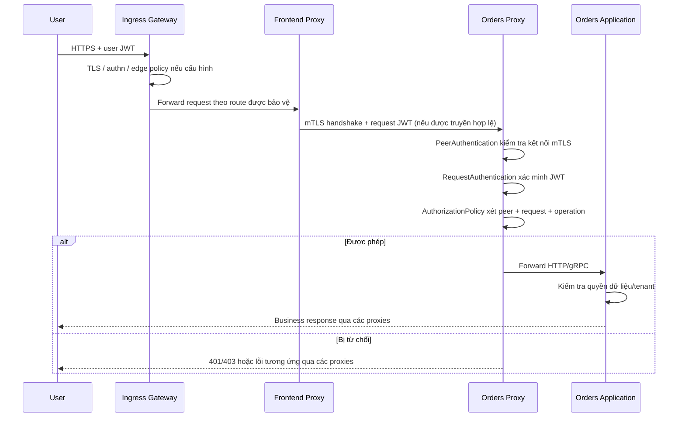
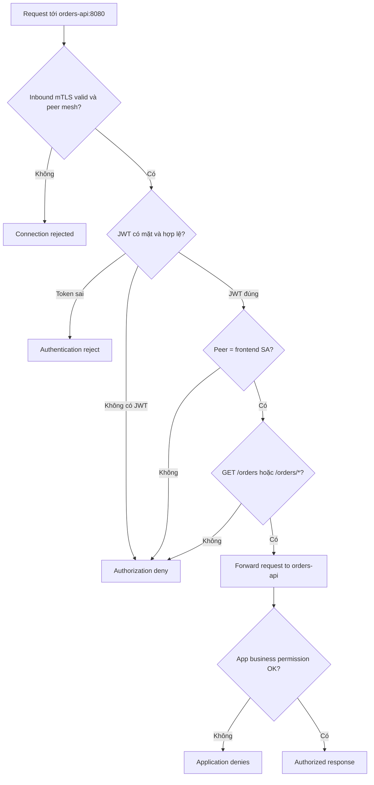
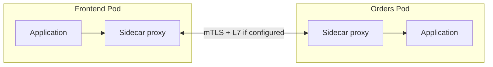
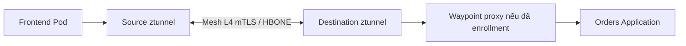
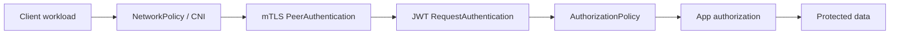
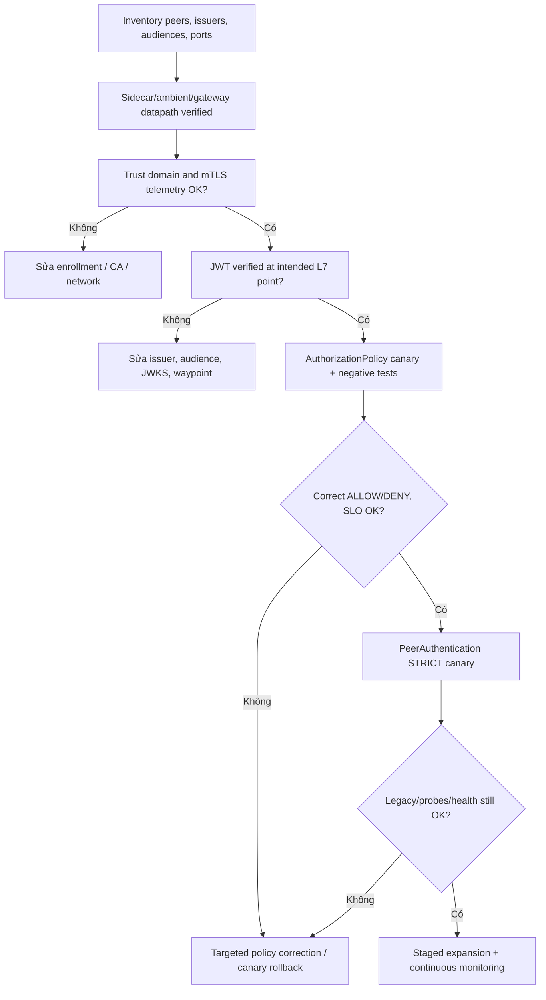
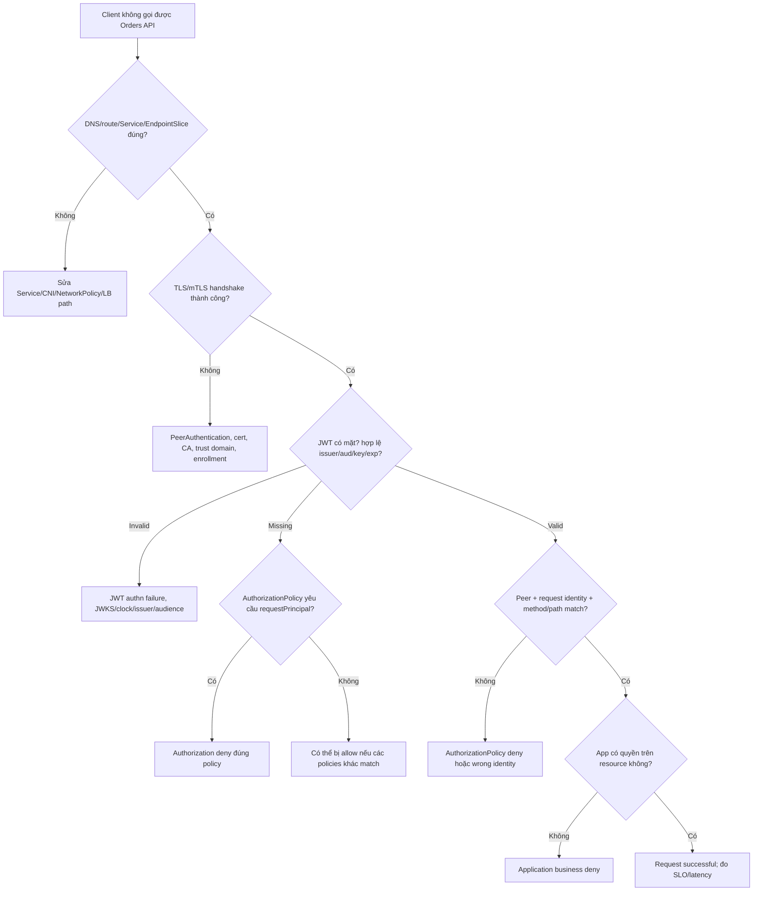

# Peer authentication và request authentication trong Service Mesh: danh tính workload, JWT và quyền truy cập

Một hệ thống microservices chạy trên Kubernetes gồm `frontend`, `orders-api`, `payment-api` và `database`. `frontend` gọi `orders-api` qua mạng nội bộ. Người dùng đã đăng nhập gửi access token trong HTTP request, còn `frontend` là một workload có danh tính riêng do service mesh cấp và xác minh. Khi `orders-api` nhận request, có **hai câu hỏi khác nhau**:

1. **Peer authentication:** *Kết nối này thực sự đến từ workload/service nào?* Ví dụ từ service account của `frontend`, được xác minh qua **mutual TLS (mTLS)**.
2. **Request authentication:** *Request mang danh tính người dùng/client nào và token có hợp lệ không?* Ví dụ access token dạng **JWT** do identity provider tin cậy phát hành.

Và còn câu hỏi thứ ba, không được bỏ qua: **Authorization:** *Workload đó, đại diện cho người dùng đó, có quyền thực hiện thao tác này trên dữ liệu này không?*

Kết nối có mTLS thành công **không chứng minh** người dùng được phép đặt hàng. JWT hợp lệ **không chứng minh** request đến từ frontend đáng tin. Một peer và một JWT đều được xác thực vẫn **không mặc nhiên** có quyền đọc mọi đơn hàng. Các lớp này cần phối hợp với segmentation, NetworkPolicy, firewall, ingress gateway, IAM và kiểm soát ở tầng ứng dụng.

Trong chương **Service mesh và mTLS** của module **SECURITY_NETWORK_SECURITY**, bài học đi sâu vào cách xây dựng ranh giới tin cậy này bằng những khái niệm chung của service mesh, đồng thời minh họa cụ thể các tài nguyên của **Istio**: `PeerAuthentication`, `RequestAuthentication` và `AuthorizationPolicy`. Cú pháp và phạm vi hiệu lực có thể thay đổi theo phiên bản Istio, datapath sidecar/ambient và loại đối tượng đích; mọi ví dụ cần được kiểm tra trên môi trường thật trước khi triển khai.

Sau bài học, bạn có thể:

1. Giải thích khác biệt giữa **peer identity** và **request identity**, cũng như xác thực và phân quyền.
2. Mô tả mTLS handshake, certificate chain, trust domain và workload identity kiểu SPIFFE.
3. Đọc/viết Istio `PeerAuthentication` với các chế độ `STRICT`, `PERMISSIVE`, `DISABLE` trong phạm vi được hỗ trợ.
4. Đọc/viết Istio `RequestAuthentication` để kiểm tra JWT issuer, audience, JWKS, chữ ký, thời hạn và nguồn token.
5. Kết hợp với `AuthorizationPolicy` để **yêu cầu JWT thật sự**, giới hạn theo peer principal và phương thức/đường dẫn HTTP.
6. Dự đoán kết quả khi **thiếu JWT**, **JWT không hợp lệ**, **mTLS sai**, **peer hợp lệ nhưng không có quyền**, hoặc nhiều policies cùng áp dụng.
7. Giải thích đặc điểm triển khai ở ingress gateway, sidecar và ambient mesh/waypoint, kể cả những traffic không được proxy xử lý.
8. Thiết kế rollout từ chế độ tương thích sang strict, quan sát lỗi, chẩn đoán và rollback có kiểm soát.
9. Xây dựng lab positive/negative, threat model và checklist cho kết nối service-to-service an toàn.

> **Quy ước:** `commerce`, `frontend`, `orders-api`, `issuer.example.test`, `api.example.test` và các token/subject trong tài liệu đều là dữ liệu ví dụ. Các hostname thuộc miền `.test` **không có identity provider thực để truy cập**; người học phải thay bằng issuer, JWKS và CA trong lab được cấp phép. Các manifest minh họa yêu cầu Istio và khả năng tương ứng; không được áp nguyên văn lên production.

## 1. Phân biệt rõ ba quyết định: peer, request và authorization

### 1.1. Peer authentication xác minh đầu kia của kết nối

Trong một service mesh dùng mTLS, proxy hoặc thành phần datapath xác thực **certificate của bên kết nối**. Certificate có thể gắn với danh tính workload, ví dụ:

```text
spiffe://cluster.local/ns/commerce/sa/frontend
```

Đây là **SPIFFE URI minh họa**, biểu thị workload service account `frontend` ở namespace `commerce` trong trust domain `cluster.local`. **Không phải** tên DNS hay Kubernetes label `app=frontend`.

Khi proxy của `orders-api` xác minh kết nối mTLS, nó có thể thiết lập rằng peer đã trình diện một certificate hợp lệ thuộc danh tính ấy, với điều kiện PKI và cấu hình mesh được tin cậy. Điều đó **không chứng minh người dùng cuối** gửi request là ai.

### 1.2. Request authentication xác minh token của request

Trong HTTP/gRPC, request có thể chứa:

```http
GET /orders/123 HTTP/1.1
Host: orders-api.commerce.svc.cluster.local
Authorization: Bearer <signed-access-token>
```

JWT access token có thể chứa các claims:

```json
{
  "iss": "https://issuer.example.test",
  "sub": "user-123",
  "aud": ["orders-api"],
  "iat": 1795800000,
  "exp": 1795803600,
  "scope": "orders:read"
}
```

Đây là **payload ví dụ**, không phải JWT được ký hay token có thể sử dụng; timestamp cũng chỉ minh họa. Một JWT hợp lệ cần được xác minh bằng **chữ ký, khóa tin cậy, issuer, audience, các claims liên quan và thời hạn** theo policy. Chỉ Base64URL-decode token không phải xác thực.

Khi xác thực request, mesh có thể biết request khai báo subject `user-123` và do issuer tin cậy ký. Điều đó **không tự đảm bảo** user này được xem đơn hàng `123`: ứng dụng còn phải kiểm tra quyền sở hữu/tenant/role theo dữ liệu nghiệp vụ.

### 1.3. Authorization quyết định quyền truy cập

Với hai danh tính đã xác thực:

```text
Peer identity:       frontend workload
Request identity:    user-123
Operation:           GET /orders/123
Resource owner:      user-987
```

Kết quả hợp lý thường là **DENY**, dù mTLS và JWT đều hợp lệ, vì người dùng `user-123` có thể không được phép đọc đơn hàng của `user-987`.

Service mesh `AuthorizationPolicy` có thể giới hạn **đường dẫn, HTTP method, peer principal, request principal và một số claims**, nhưng những kiểm tra nghiệp vụ động như chủ sở hữu đơn hàng/ABAC chi tiết thường phải được thực hiện ở **ứng dụng hoặc hệ thống authorization có thông tin nghiệp vụ**.

### 1.4. Bảng so sánh

| Câu hỏi | Peer authentication | Request authentication | Authorization |
|---|---|---|---|
| Xác minh ai? | Workload/service peer | User/client hoặc subject trong token request | Caller/subject có quyền gì |
| Cơ chế phổ biến | mTLS + X.509 + SPIFFE ID | JWT + JWKS + issuer/audience | RBAC/ABAC/policy + business rules |
| Tầng thường xử lý | TLS transport ở proxy/mesh | HTTP/gRPC L7 tại proxy/gateway | L4/L7 proxy và ứng dụng |
| Danh tính ví dụ | `cluster.local/ns/commerce/sa/frontend` | `https://issuer.example.test/user-123` (dạng principal logic) | Cho phép `GET /orders` nhưng từ chối `/admin` |
| Mất/không hợp lệ | mTLS handshake fail hoặc policy không đạt | JWT bị từ chối nếu token không hợp lệ và policy áp dụng | Request nhận deny khi không match quyền |
| Không tự giải quyết | User/tenant identity, URL-level authorization | Kết nối có mTLS hay không, peer thực sự là workload nào | Khóa/certificate/token có hợp lệ không nếu thiếu authentication |

**Nguyên tắc:** *Authentication thiết lập danh tính; authorization quyết định hành động*. Đừng dùng một tín hiệu authentication làm bằng chứng quyền truy cập.

## 2. Đường đi request: từ socket đến quyết định nghiệp vụ

### 2.1. Trong service mesh sidecar



**Lưu ý:** sơ đồ mô tả chức năng, không cam kết thứ tự/filter implementation chính xác cho mọi phiên bản hoặc nơi TLS terminate. Phản hồi lỗi có thể do ingress, mesh proxy hoặc ứng dụng tạo ra và có mã HTTP khác nhau theo lý do.

Trong sidecar mesh, mTLS thường được **proxy ↔ proxy** thực hiện. Đoạn **app ↔ sidecar cục bộ** có thể là plaintext trong cùng Pod netns, tùy cấu hình. Vì vậy khi viết tài liệu tuân thủ, phải ghi rõ **điểm bắt đầu/kết thúc mã hóa và điểm kiểm tra danh tính**, tránh tuyên bố sai rằng mọi bytes đều được app-to-app end-to-end encrypted.

### 2.2. Một request có nhiều hop và nhiều identities

```text
User
  → Public TLS → Gateway
  → Internal mTLS → Frontend
  → Internal mTLS → Orders API
  → TLS → Database
```

Ở mỗi hop, **peer identity** có thể khác:

- Gateway nhìn thấy TLS client phía Internet; client có thể chỉ xác thực bằng bearer token, không trình diện client certificate.
- Frontend nhận kết nối từ gateway (peer = gateway).
- Orders nhận kết nối từ frontend (peer = frontend).
- Database nhận kết nối từ orders workload hoặc database proxy/connector.

**User JWT không tự được chuyển nguyên trạng qua từng hop**. Ứng dụng/gateway phải có chính sách truyền token, đổi token (token exchange), kiểm soát audience, ủy quyền và tránh logging/leak. Nếu gateway bỏ token trước khi gọi backend, `RequestAuthentication` tại backend không thể suy ra subject từ không khí.

### 2.3. TLS handshake và HTTP token là hai giai đoạn khác nhau

```text
1. TCP/transport được thiết lập theo mạng và policy.
2. TLS handshake:
      server certificate verified
      client certificate verified nếu mTLS
      session key established
3. HTTP request được truyền trên kênh đã thiết lập:
      Authorization: Bearer JWT
4. L7 proxy kiểm tra JWT và áp request authorization.
5. Application kiểm tra business authorization.
```

Nếu mTLS handshake thất bại ở bước 2, backend HTTP handler **có thể không nhận được request**; do đó không nhất thiết có HTTP `401`. Nếu JWT sai ở bước 4, TLS đã thành công nhưng proxy có thể trả `401`. Nếu danh tính hợp lệ nhưng không có quyền, proxy hoặc ứng dụng thường trả `403`, tùy policy.

### 2.4. Danh tính được xác thực không đồng nghĩa danh tính được ủy quyền

Ví dụ:

```text
Trusted workload certificate: frontend
JWT: valid, issuer=corporate IdP, audience=orders-api
Request: DELETE /orders/123
```

Mesh vẫn phải có authorization policy quyết định `frontend` **có được phép** gọi `DELETE` không. Ứng dụng còn phải xem user/role có quyền xóa đơn hàng. Đây là lý do một hệ thống chỉ bật `STRICT` mTLS hoặc chỉ bật JWT validation chưa đủ để đạt least privilege.

## 3. Workload identity và PKI của service mesh

### 3.1. Certificate X.509 được dùng để chứng minh peer

Ở mô hình mesh phổ biến, workload/proxy nhận certificate ngắn hạn từ một CA hoặc control plane đáng tin. Certificate chứa **Subject Alternative Name** biểu diễn workload identity theo định dạng mà mesh hỗ trợ (chẳng hạn SPIFFE URI).

Khi mTLS handshake:

1. Bên kết nối trình diện certificate và chứng minh sở hữu private key.
2. Peer xác minh certificate chain tới trust anchor, thời hạn, mục đích sử dụng và identity theo cấu hình.
3. Control plane và data plane liên kết certificate identity với workload/service account được cấp phát.
4. Những policies L4/L7 dùng identity đã xác minh để quyết định quyền.

**Một certificate hợp lệ theo CA không đủ** nếu mọi service dùng chung danh tính hoặc policy cho phép cả trust domain. Rủi ro nằm ở phạm vi **issuer trust**, quá trình cấp certificate, quyền tạo workload/service account và rule authorization.

### 3.2. SPIFFE ID và Istio principal

Ví dụ URI:

```text
spiffe://cluster.local/ns/commerce/sa/frontend
```

Trong Istio authorization, định danh principal thường được biểu diễn theo dạng:

```text
cluster.local/ns/commerce/sa/frontend
```

Đừng nhầm với:

- Kubernetes `metadata.name` của Pod.
- Label `app: frontend`.
- Service DNS `frontend.commerce.svc.cluster.local`.
- JWT user `sub: user-123`.

Các thực thể trên có mục đích khác nhau. Workload identity an toàn cần gắn với một service account và cơ chế cấp cert được kiểm soát; một workload có thể đổi Pod IP/names nhưng vẫn giữ service identity khi được triển khai hợp lệ.

### 3.3. Chứng chỉ không tự xác minh quyền người dùng

Để ngăn `frontend` gọi endpoint nhạy cảm của `payment-api`, chỉ mTLS là chưa đủ. Nếu policy mesh cho **mọi certificate tin cậy** được gọi, attacker chiếm frontend vẫn có thể gọi payment như một workload hợp lệ.

Giới hạn bằng `AuthorizationPolicy` dựa trên:

- Source principal/service account.
- Namespace và các thuộc tính đáng tin có sẵn.
- Destination workload/port.
- HTTP method/path khi L7 enforcement thật sự hoạt động.
- Valid request principal hoặc JWT claims khi cần.

### 3.4. Kênh xoay vòng khóa và sự cố CA

Service mesh có thể tự cấp và xoay vòng workload certificates. Cần vận hành:

- Giới hạn thời hạn chứng chỉ, bảo vệ private keys.
- Xác minh thời gian hệ thống, certificate `NotBefore`/`NotAfter`.
- Theo dõi thất bại CSR, CA/control-plane và secret distribution.
- Không tắt verification để che lỗi CA.
- Dự phòng và quy trình xoay trust anchors/issuer.
- Kiểm thử mTLS và service authorization sau thay đổi CA, namespace, service account hoặc trust domain.

**mTLS phụ thuộc trust domain.** Với multi-cluster, phải thiết kế federation hoặc trust-domain aliases phù hợp; không mở wildcard principals chỉ vì hai cluster có tên service giống nhau.

## 4. Istio `PeerAuthentication`: xác thực kết nối inbound bằng mTLS

`PeerAuthentication` là một tài nguyên cấu hình bảo mật của Istio điều khiển việc **chấp nhận kết nối inbound có mTLS** tại workload thuộc phạm vi policy. Nó không phải Kubernetes `NetworkPolicy` và không tự đặt quyền theo user/HTTP method.

### 4.1. Ba chế độ cần biết

| `mtls.mode` | Ý nghĩa trong mô hình sidecar phù hợp | Rủi ro và mục đích |
|---|---|---|
| `STRICT` | Yêu cầu mTLS đối với kết nối inbound được policy áp dụng | Giảm đường plaintext hoặc peer không có mesh identity; legacy clients có thể bị gián đoạn |
| `PERMISSIVE` | Chấp nhận cả mTLS và plaintext trên đường xử lý được hỗ trợ | Hữu ích khi chuyển đổi; **không** bảo đảm mọi kết nối mã hóa |
| `DISABLE` | Không thực hiện xác thực mTLS tại endpoint/port theo chế độ được hỗ trợ | Chỉ dùng có lý do và phạm vi chặt; dễ tạo đường không được xác thực |
| `UNSET` | Kế thừa từ policy/config có phạm vi cao hơn | Phải kiểm tra effective policy, không tự diễn giải là strict |

**Không đồng nhất các chế độ với cấu hình outbound của client.** `PeerAuthentication STRICT` yêu cầu inbound mTLS ở đích; phía nguồn cũng cần thiết lập đúng chế độ kết nối, TLS settings và identity. Trong mesh có auto mTLS, proxy có thể chọn mTLS cho mesh destinations; nhưng phải kiểm tra chứ không mặc định mọi peer đều hỗ trợ.

**Đặc biệt với ambient mesh:** các chế độ/ngoại lệ không giống hoàn toàn sidecar; `DISABLE` không phải một cơ chế được hỗ trợ để tắt mTLS trong ambient theo mô hình Istio phổ biến. Thẩm định phiên bản và datapath thực tế, không sao chép cấu hình port-level của sidecar sang ztunnel mà không kiểm tra.

### 4.2. Bật `STRICT` cho toàn bộ namespace

```yaml
apiVersion: security.istio.io/v1
kind: PeerAuthentication
metadata:
  name: namespace-strict-mtls
  namespace: commerce
spec:
  mtls:
    mode: STRICT
```

Không có `selector` nên chính sách nhắm tới **phạm vi namespace** theo quy tắc Istio. Khi data plane thật sự áp dụng và nguồn dùng plain HTTP/TCP qua đường bị bảo vệ, kết nối có thể bị từ chối **trước khi HTTP request được xử lý**.

**Thận trọng:** Namespace có thể chứa workloads chưa được mesh quản lý, legacy jobs, probes, gateways hoặc traffic từ node. Không áp strict toàn namespace mà chưa lập danh sách luồng và test từng peer.

### 4.3. Bật `STRICT` cho một workload bằng label

```yaml
apiVersion: security.istio.io/v1
kind: PeerAuthentication
metadata:
  name: orders-peer-strict
  namespace: commerce
spec:
  selector:
    matchLabels:
      app: orders-api
  mtls:
    mode: STRICT
```

Ví dụ này chọn workloads `app=orders-api` trong namespace `commerce` ở mô hình được Istio hỗ trợ. Nó **không tự ảnh hưởng tất cả services hoặc Pods khác** chỉ vì cùng namespace.

Phải xác minh:

- Pod labels hiện tại và labels sau rolling update.
- Workload đã được sidecar/ambient datapath quản lý chưa?
- Namespace/root policy hoặc workload-specific policy nào khác có hiệu lực?
- Có một chính sách mâu thuẫn ở cùng scope không?
- Traffic vào từ gateway/ingress/service mesh ngoài cluster có mTLS không?

### 4.4. `PERMISSIVE` hỗ trợ migration, không phải trạng thái bảo mật cuối mặc định

```yaml
apiVersion: security.istio.io/v1
kind: PeerAuthentication
metadata:
  name: orders-transition
  namespace: commerce
spec:
  selector:
    matchLabels:
      app: orders-api
  mtls:
    mode: PERMISSIVE
```

Khi workload đang phục vụ cả mesh-enabled và legacy clients, `PERMISSIVE` giúp đo **client nào vẫn dùng plaintext** trước khi chuyển sang strict. Nhưng:

- Trong giai đoạn permissive, người kết nối plaintext có thể **không có peer principal xác thực**.
- Không được gắn quyền dựa trên **source IP/headers không đáng tin** rồi coi ngang principal mTLS.
- Có thể cần `AuthorizationPolicy` để chỉ cho một số nguồn/operations, song policy mTLS-aware phải hiểu rằng plaintext không có cùng tín hiệu identity.
- Cần có **thời điểm kết thúc migration**, inventory legacy clients và negative tests.

### 4.5. Tùy chỉnh theo port khi thực sự cần

Với mô hình sidecar Istio hỗ trợ port-level config, có thể gặp:

```yaml
# CHỈ MINH HỌA CÚ PHÁP, KHÔNG KHUYẾN NGHỊ DÙNG ĐỂ MỞ CỔNG MẶC ĐỊNH.
apiVersion: security.istio.io/v1
kind: PeerAuthentication
metadata:
  name: app-port-exception-example
  namespace: commerce
spec:
  selector:
    matchLabels:
      app: orders-api
  mtls:
    mode: STRICT
  portLevelMtls:
    8081:
      mode: DISABLE
```

Đây là ví dụ về **ngữ nghĩa ngoại lệ nhạy cảm**, không phải baseline đề xuất. `portLevelMtls` trong Istio nhắm tới **workload port** mà traffic được proxy xử lý, không mặc định là Service port; không thể suy từ một `Service port: 80` rằng phải cấu hình key `80` khi `targetPort: 8080`.

Nếu tạo port plaintext phải có:

1. Business justification, owner, thời hạn, audit.
2. Giới hạn nguồn bằng NetworkPolicy/host firewall trong phạm vi thực thi.
3. Đảm bảo không lộ dữ liệu/secrets, không chấp nhận JWT/identity headers bị giả mạo vô điều kiện.
4. Kịch bản TLS/probe tương ứng và test direct paths.
5. Kế hoạch loại bỏ ngoại lệ sau migration.

**Không dùng port-level `DISABLE` trong ambient mesh như một bản sao cấu hình sidecar.** Khả năng/giới hạn thực thi phụ thuộc data plane.

### 4.6. Không có `PeerAuthentication` không đồng nghĩa không có mTLS

Istio có các cấu hình mesh/global/namespace defaults, tự động lựa chọn mTLS khi hai bên thuộc mesh, và có thể có các `PeerAuthentication` từ phạm vi rộng hơn. Vì vậy **không thấy resource trong namespace không đủ để kết luận traffic đang plaintext hoặc đã strict**.

Cần kiểm tra **effective configuration** tại proxy/workload, metadata kết nối, peer certificate/identity, cùng negative test từ nguồn không có mTLS.

## 5. Istio `RequestAuthentication`: xác minh JWT trên từng request

`RequestAuthentication` mô tả cách workload/proxy **xác minh JSON Web Token** trên những request thuộc phạm vi áp dụng, thường với HTTP/HTTP2/gRPC mà proxy có khả năng xử lý ở L7.

### 5.1. Ví dụ cấu hình JWT

```yaml
apiVersion: security.istio.io/v1
kind: RequestAuthentication
metadata:
  name: orders-jwt-validation
  namespace: commerce
spec:
  selector:
    matchLabels:
      app: orders-api
  jwtRules:
    - issuer: "https://issuer.example.test"
      jwksUri: "https://issuer.example.test/.well-known/jwks.json"
      audiences:
        - "orders-api"
      fromHeaders:
        - name: Authorization
          prefix: "Bearer "
```

**Các URL `.test` chỉ là placeholders**, không có JWKS server thật. Không triển khai y nguyên. Trong lab phải dùng issuer có khả năng phát hành signed JWTs, JWKS endpoint đáng tin có thể được data plane/control plane truy xuất theo cơ chế triển khai, và audience của chính `orders-api`.

Ý nghĩa:

- `selector` chọn workload đích theo labels ở namespace `commerce` trong mô hình sidecar phù hợp.
- `issuer` phải khớp **chính xác** với `iss` trong JWT theo quy tắc xác minh, kể cả dấu `/` nếu issuer thực có.
- `jwksUri` cung cấp bộ **public keys** phù hợp để xác minh chữ ký JWT; private signing keys không được công bố.
- `audiences` giới hạn token được phát hành **cho API nào**.
- `fromHeaders` mô tả cách lấy token từ `Authorization: Bearer ...`.

Ngoài rule trên, hệ thống phải có TLS transport, token issuance/rotation và authorization policy đúng.

### 5.2. Hành vi cốt lõi: “xác minh token khi có” khác “bắt buộc phải có token”

Đây là điểm dễ mắc lỗi nhất khi mới dùng Istio:

| JWT trong request | Chỉ có `RequestAuthentication` | Có thêm `AuthorizationPolicy` bắt buộc `requestPrincipals: ["*"]` |
|---|---|---|
| **Không có token** | Thường **không bị từ chối chỉ vì thiếu token** | **DENY** nếu không khớp một allow rule khác |
| JWT hợp lệ, issuer/audience đúng | Được xác thực, có request principal | Có thể **ALLOW** nếu các điều kiện khác cũng khớp |
| JWT sai chữ ký/issuer/audience/hết hạn | Thường bị proxy **từ chối xác thực** | Tiếp tục bị từ chối; không tới bước cấp quyền thông thường |
| Token hợp lệ, request không có quyền | JWT xác thực thành công | **DENY** theo method/path/peer/claims |

**Điểm mấu chốt:** `RequestAuthentication` **không tự đặt yêu cầu mọi request phải có JWT**. Muốn bắt buộc token, cần `AuthorizationPolicy` hoặc kiểm tra ứng dụng thích hợp.

Các trạng thái HTTP cụ thể như `401`/`403` tùy điểm từ chối và phiên bản proxy. Khi debug, phân biệt **authentication failure** với **authorization failure** bằng logs và filter response flags.

### 5.3. JWT được xác minh như thế nào?

Với một JWT dạng `header.payload.signature`, phần xác minh bao gồm:

1. Parse token theo định dạng được hỗ trợ; không chỉ decode Base64URL.
2. Đọc header, xác định thuật toán/chỉ số khóa `kid` theo policy.
3. Lấy **khóa xác minh** từ JWKS tin cậy và kiểm tra chữ ký.
4. Xác minh `iss` thuộc issuer đã định cấu hình.
5. Xác minh `aud` khớp API đích khi policy yêu cầu.
6. Kiểm tra `exp`, `nbf` và các ràng buộc thời gian liên quan; có thể cần giới hạn clock skew theo cơ chế.
7. Đưa request principal/claims đã kiểm chứng tới authorization logic.

**Không tự lấy public key từ một URL do token tự khai mà không có chính sách issuer/JWKS tin cậy.** JWT header và payload trước khi xác minh là dữ liệu không đáng tin. Không chấp nhận `alg=none` hoặc thuật toán ngoài allowlist của verifier.

### 5.4. `aud` quan trọng không kém `iss`

Giả sử IdP phát hành token cho `reports-api`, nhưng `orders-api` chỉ kiểm tra issuer. Một token hoàn toàn hợp lệ về chữ ký và issuer có thể bị **nhầm mục đích sử dụng** nếu audience không được xác minh đúng.

```text
JWT:
  iss = https://issuer.example.test
  aud = reports-api

orders-api expects:
  aud = orders-api

Expected: REJECT
```

Audience giúp hạn chế **token substitution** giữa các services. Không để một backend chỉ dựa trên việc token “do cùng IdP cấp” để cho truy cập mọi API.

### 5.5. Nhiều JWT rules, nhiều token locations

Một policy có thể phục vụ hơn một trusted issuer hoặc vị trí token trong những trường hợp phù hợp. Điều này tăng độ phức tạp:

- Cần giới hạn issuer/audience theo tenant/service.
- Tránh cấu hình cho phép một token từ issuer khác quyền ngang với issuer chính.
- Không giả định gửi **nhiều JWT đồng thời ở nhiều vị trí** sẽ luôn được phân giải/ưu tiên theo cách ứng dụng muốn; Istio có những hành vi chưa được định nghĩa rõ với nhiều tokens trong cùng request.
- Token trong **URL query parameter** dễ lộ qua browser history/proxy/access logs; không dùng làm mặc định.
- Cookie/token headers cần phối hợp với CSRF/browser behavior nếu ứng dụng có web frontend.

Ưu tiên **một nguồn token rõ ràng**, issuer và audience chặt, cùng contract với clients.

### 5.6. Khi nào `RequestAuthentication` không thể áp đúng?

JWT request authentication theo HTTP semantics **không thể tự kiểm tra payload của mọi kết nối TCP mù hoặc gói UDP**. Nếu workload dùng database protocol, custom binary protocol hoặc mesh datapath chỉ ở L4, cần cơ chế identity/protocol authorization khác.

Trong **ambient mesh**, ztunnel tập trung bảo vệ **L4/mTLS**; request-level JWT/L7 rules cần một thành phần hỗ trợ L7 như **waypoint proxy hoặc ingress gateway** được cấu hình đúng và workload/Service được enrollment. Không mặc định `RequestAuthentication` workload-selector từ sidecar sẽ hoạt động y hệt tại ztunnel.

## 6. `AuthorizationPolicy`: ghép peer identity và JWT thành quyền truy cập

Trong Istio, `PeerAuthentication` và `RequestAuthentication` tạo ra các tín hiệu danh tính đã xác minh. `AuthorizationPolicy` sử dụng các tín hiệu đó để xác định request có được phép tiếp tục hay không.

### 6.1. Chỉ yêu cầu JWT hợp lệ cho một workload

```yaml
apiVersion: security.istio.io/v1
kind: AuthorizationPolicy
metadata:
  name: orders-require-jwt
  namespace: commerce
spec:
  selector:
    matchLabels:
      app: orders-api
  action: ALLOW
  rules:
    - from:
        - source:
            requestPrincipals: ["*"]
```

`requestPrincipals: ["*"]` trong rule trên yêu cầu **request principal đã được xác thực**, thường được tạo khi JWT validation thành công. Khi một ALLOW policy áp dụng cho workload, requests không match **bất kỳ ALLOW rule phù hợp nào** sẽ bị từ chối theo semantics Istio, sau khi xét các nhóm policies có mức ưu tiên khác.

**Điều kiện:** phải có `RequestAuthentication` phù hợp để xác minh JWT và tạo request principal. Nếu không có cơ chế xác thực request, một allow rule đòi `requestPrincipals` sẽ khiến traffic cần quyền này không khớp.

**Không triển khai rule chỉ yêu cầu JWT như giải pháp cuối** nếu muốn giới hạn workload peer, method/path, tenant và resource owner. Nó có thể cho mọi caller có token hợp lệ gọi những endpoints vốn không dành cho họ.

### 6.2. Giới hạn peer service account bằng mTLS

```yaml
apiVersion: security.istio.io/v1
kind: AuthorizationPolicy
metadata:
  name: orders-allow-frontend-peer
  namespace: commerce
spec:
  selector:
    matchLabels:
      app: orders-api
  action: ALLOW
  rules:
    - from:
        - source:
            principals:
              - "cluster.local/ns/commerce/sa/frontend"
      to:
        - operation:
            ports: ["8080"]
```

`source.principals` kiểm tra peer principal từ **mTLS**. Một client plaintext **không có một peer principal mTLS đáng tin** tương đương. Ví dụ chỉ cho frontend service account tới workload `orders-api` cổng `8080` theo chính sách được hỗ trợ.

Nhưng rule này **chưa buộc JWT**, cũng chưa giới hạn HTTP method hoặc path. Nó còn mang giới hạn: frontend workload bị compromise vẫn có thể gọi những chức năng được phép qua kết nối đó.

### 6.3. Ghép cả peer và request principal trong một rule

```yaml
apiVersion: security.istio.io/v1
kind: AuthorizationPolicy
metadata:
  name: orders-allow-frontend-with-jwt
  namespace: commerce
spec:
  selector:
    matchLabels:
      app: orders-api
  action: ALLOW
  rules:
    - from:
        - source:
            principals:
              - "cluster.local/ns/commerce/sa/frontend"
            requestPrincipals:
              - "*"
      to:
        - operation:
            methods: ["GET"]
            paths: ["/orders", "/orders/*"]
            ports: ["8080"]
```

Khi `orders-api` được chọn và Istio L7 datapath áp dụng đúng:

- `source.principals` kiểm tra **workload peer là frontend**;
- `source.requestPrincipals` yêu cầu **request có danh tính JWT đã được xác thực**;
- `to.operation.methods/paths/ports` chỉ mở **GET /orders** và các subpaths phù hợp trên port `8080`.

Các điều kiện **trong cùng rule** phải khớp theo mô hình policy. Hai loại identity thuộc hai miền tin cậy khác nhau, và cả hai cần đúng.

**Không dùng phép hợp của hai ALLOW rules** để diễn đạt một yêu cầu AND:

```yaml
# Ví dụ SAI nếu mong muốn "peer là frontend VÀ JWT hợp lệ".
rules:
  - from:
      - source:
          principals:
            - "cluster.local/ns/commerce/sa/frontend"
  - from:
      - source:
          requestPrincipals:
            - "*"
```

Hai items `rules` được hiểu là **OR giữa các lựa chọn**, khiến một request match **một trong hai** điều kiện có thể được allow. Muốn yêu cầu cả hai, đặt chúng **trong cùng `source` object** như ví dụ đúng.

### 6.4. AuthorizationPolicy ALLOW không thay mọi lớp kiểm soát

Nếu đã có một AuthorizationPolicy `ALLOW` rộng hơn chọn cùng workload, tập requests được phép có thể mở rộng theo semantics tổng hợp. Hãy **review tất cả policies hiệu lực**, không chỉ một manifest vừa viết.

Istio còn hỗ trợ các hành động như `DENY`, `CUSTOM`, `AUDIT` với evaluation semantics riêng theo phiên bản/extension; một số DENY rules có precedence so với ALLOW. **Không coi chúng tương đương các rule trong Kubernetes NetworkPolicy chuẩn.**

Những điểm cần nhớ:

- `DENY` policy sai phạm vi có thể ngắt cả health checks.
- L4 traffic không có HTTP method/path, nên dùng L7 condition tại sai datapath có thể không được xử lý như mong đợi.
- Khi viết DENY dựa trên thuộc tính HTTP bị thiếu, một số matcher có ngữ nghĩa có thể **match rộng hơn** mức dự kiến. Cần đọc tài liệu phiên bản và test.
- `CUSTOM` có external authorization dependency/latency/failure modes, cần policy khi verifier unavailable.
- App vẫn phải enforce business-level RBAC/ABAC và object authorization.

### 6.5. Authorization của user khác authorization của service

Một request hợp lệ:

```text
service: cluster.local/ns/commerce/sa/frontend
user:    user-123
HTTP:    GET /orders/123
```

Mesh có thể quyết định:

```text
Frontend service principal được phép gọi GET /orders/*
AND JWT user principal tồn tại và hợp lệ
→ Forward vào ứng dụng
```

Ứng dụng tiếp tục quyết định:

```text
owner(order-123) == user-123 ?
tenant(order-123) == tenant(token) ?
role(token) đủ để đọc dữ liệu ?
→ ALLOW hoặc DENY theo nghiệp vụ
```

**Không cho phép một user đọc mọi đơn hàng chỉ vì họ có JWT hợp lệ.** Khi phân quyền theo claims do IdP phát hành, cần kiểm tra provenance, issuer, audience, claims semantics và sự thay đổi role/tenant theo thời gian.

## 7. Bộ chính sách mẫu cho `orders-api` trong sidecar mesh

Mục tiêu minh họa:

```text
Namespace: commerce
Destination workload: app=orders-api
Pod/service account của frontend: frontend
Application workload port: TCP/8080

Peer authentication:
  STRICT mTLS

Request authentication:
  JWT từ issuer tin cậy, aud=orders-api

Authorization:
  Chỉ frontend workload, JWT hợp lệ, GET /orders hoặc /orders/*
  Các request còn lại bị từ chối trừ khi có ALLOW policy khác.
```

### 7.1. Manifest đầy đủ theo ba lớp

```yaml
# 1. Require mTLS for orders-api inbound traffic.
apiVersion: security.istio.io/v1
kind: PeerAuthentication
metadata:
  name: orders-peer-strict
  namespace: commerce
spec:
  selector:
    matchLabels:
      app: orders-api
  mtls:
    mode: STRICT
---
# 2. Validate JWT when an HTTP request presents a token.
apiVersion: security.istio.io/v1
kind: RequestAuthentication
metadata:
  name: orders-jwt
  namespace: commerce
spec:
  selector:
    matchLabels:
      app: orders-api
  jwtRules:
    - issuer: "https://issuer.example.test"
      jwksUri: "https://issuer.example.test/.well-known/jwks.json"
      audiences: ["orders-api"]
      fromHeaders:
        - name: Authorization
          prefix: "Bearer "
---
# 3. Require BOTH authenticated workload peer and JWT subject.
apiVersion: security.istio.io/v1
kind: AuthorizationPolicy
metadata:
  name: orders-restrict-reads
  namespace: commerce
spec:
  selector:
    matchLabels:
      app: orders-api
  action: ALLOW
  rules:
    - from:
        - source:
            principals:
              - "cluster.local/ns/commerce/sa/frontend"
            requestPrincipals:
              - "*"
      to:
        - operation:
            methods: ["GET"]
            paths: ["/orders", "/orders/*"]
            ports: ["8080"]
```

Các manifest này **chưa đủ để chạy thành một hệ thống lab hoàn chỉnh**:

- Không tạo Namespace/Deployment/Service/ServiceAccount, gateway hoặc issuer/JWKS thật.
- Không cấu hình Kubernetes NetworkPolicy, cloud firewall hoặc mesh enrollment.
- Không định nghĩa endpoint health, metrics, token exchange, DB authentication.
- Không xử lý sẵn quy trình cấp và xoay vòng chứng chỉ.
- Không quyết định đầy đủ authorization cho từng order/tenant.
- Có thể không phù hợp ambient datapath nếu không chuyển policy sang `targetRefs`/waypoint/gateway theo phiên bản.

### 7.2. Sơ đồ quyết định của bộ policy



**Giới hạn của sơ đồ:** request có JWT không hợp lệ có thể bị reject ở L7 trước khi authorization rules xét; thứ tự các bước được vẽ để dễ học. Một request bị từ chối cũng có thể do **policy khác cùng áp dụng**, routing/NetworkPolicy hoặc TLS verification chứ không chỉ ba manifests ở trên.

### 7.3. Bảng trường hợp thử nghiệm

| Peer mTLS | JWT | HTTP operation | Kết quả mong đợi với ba policies minh họa |
|---|---|---|---|
| Frontend SA hợp lệ | Valid, `aud=orders-api` | `GET /orders` | **ALLOW** vào app; app có thể tiếp tục DENY theo business rule |
| Frontend SA hợp lệ | Không có | `GET /orders` | **DENY** bởi authorization |
| Frontend SA hợp lệ | Expired | `GET /orders` | **REJECT** JWT authentication |
| Frontend SA hợp lệ | Signed by untrusted issuer | `GET /orders` | **REJECT** JWT authentication |
| Frontend SA hợp lệ | Wrong audience | `GET /orders` | **REJECT** JWT authentication |
| Other workload SA | Valid JWT | `GET /orders` | **DENY** vì peer không đúng |
| Frontend SA hợp lệ | Valid JWT | `POST /orders` | **DENY** vì method không được allow |
| Frontend SA hợp lệ | Valid JWT | `GET /admin` | **DENY** vì path không được allow |
| Plaintext/legacy client | Valid JWT | `GET /orders` | **REJECT** mTLS khi STRICT có hiệu lực |
| Frontend SA hợp lệ | Valid JWT | TCP tới port khác | **Không được allow** theo L7 policy minh họa, nhưng phải test đúng datapath |

Đây là kết quả **theo giả định chỉ các policies minh họa đang áp dụng** và proxy đã nhận cấu hình đầy đủ. Nếu có thêm `AuthorizationPolicy` `ALLOW` rộng hoặc gateway khác, hiệu lực có thể khác; phải thực hiện negative tests.

### 7.4. Tránh vô tình khóa health endpoint

Bộ policy chỉ cho `GET /orders*` từ frontend có JWT. Nếu kubelet/ingress health checker gọi `GET /ready` không có JWT, nó có thể không vượt qua policy như application requests, hoặc một số probe bị xử lý qua cơ chế probe rewrite khác.

Phải xác định rõ:

- Probe tới **Pod IP, app port, sidecar status port hay gateway**?
- Kubelet/monitoring/mesh có dùng probe rewrite/host network không?
- Health checker có mTLS/JWT và identity như app clients không?
- Có cần tách health listener/port và giới hạn bằng **node/host/cloud controls**?
- Làm sao tránh public client giả mạo một đường health exception?

Không viết rule `GET /ready` allow từ **mọi peer trên mọi port** chỉ để giảm lỗi health checks. Đặt ngoại lệ theo đúng đường probe và kiểm chứng negative tests.

## 8. JWT security: issuer, JWKS, audience, thời hạn và replay

JWT có thể được dùng làm access token trong nhiều hệ thống, nhưng **JWT là một định dạng token**, không bảo đảm mọi token đều đủ điều kiện làm **access token cho API này**. Request authentication phải được thiết kế theo hợp đồng identity provider và ứng dụng.

### 8.1. Bốn nhóm điều kiện phải xác minh

| Nhóm | Kiểm tra | Nếu bỏ qua |
|---|---|---|
| **Chữ ký/thuật toán** | Signature hợp lệ, algorithm được cho phép, đúng public key/`kid` | Giả mạo claims hoặc algorithm confusion |
| **Nguồn phát hành** | `iss` đúng issuer được tin cậy, JWKS đến từ nguồn được quản lý | Nhận token từ tenant/issuer không được phép |
| **Mục tiêu sử dụng** | `aud` khớp service API, token type/scope theo thiết kế | Token của app khác bị dùng lại |
| **Thời gian/trạng thái** | `exp`, `nbf`, clock skew, revocation/rotation strategy | Chấp nhận token hết hạn hoặc bị thu hồi chưa phản ánh |

Khi hệ thống kiểm tra thêm `azp`, `client_id`, tenant ID hoặc token type, phải dựa trên **semantics thực của issuer**; không đặt giả định mọi IdP dùng các claims giống nhau.

### 8.2. JWT header và JWKS rotation

Ví dụ header logic:

```json
{
  "alg": "RS256",
  "kid": "key-2026-11",
  "typ": "JWT"
}
```

Đây là **JSON minh họa**, không phải một header đủ để tin cậy. `kid` chỉ chọn public key tương ứng **bên trong JWKS đã được trust**; nó không cho phép client tùy ý định nghĩa server tải khóa từ đâu.

Khi IdP xoay signing keys:

1. Publish key mới trên JWKS đủ sớm theo kế hoạch.
2. Bảo đảm proxy/control plane fetch hoặc refresh được JWKS đúng chu kỳ.
3. Bắt đầu ký token mới bằng key mới.
4. Giữ key cũ trong cửa sổ đủ để các token cũ hợp lệ hết hạn, theo chính sách.
5. Loại key cũ sau khi hoàn tất migration/revocation.
6. Theo dõi signature failures, JWKS fetch errors và key IDs ngoài dự kiến.

Nếu JWKS bị mất kết nối hoặc control plane không đồng bộ keys, requests chứa token hợp lệ có thể bị từ chối tùy cache/retry/failure semantics của proxy. Đừng chữa lỗi bằng việc **tắt JWT verification** hoặc bỏ issuer validation.

### 8.3. JWT `exp` không đồng nghĩa thu hồi tức thì

Một bearer JWT tự chứa có thể còn hiệu lực đến `exp` dù tài khoản vừa bị khóa, nếu verifier không kiểm tra revocation/state bổ sung. Để giảm window:

- Dùng access tokens ngắn hạn, refresh tokens được bảo vệ ở IdP.
- Thực hiện các nghiệp vụ nhạy cảm với session/revocation checks khi phù hợp.
- Xoay/revoke signing keys trong trường hợp khẩn cấp theo threat model và blast radius.
- Ràng buộc token với audience, scope, tenant và client identity khi có cơ chế chuẩn hỗ trợ.
- Không cấp token “vĩnh viễn” chỉ để tiện gọi giữa services.

**JWT signature hợp lệ không có nghĩa tài khoản chưa bị thu hồi trong thời gian thực.** Mesh chỉ kiểm tra những claims/policies nó được cấu hình để kiểm tra.

### 8.4. Bearer token có thể bị replay

Ai sở hữu bearer token hợp lệ có thể thử sử dụng lại token trong phạm vi quyền và thời hạn. Peer mTLS ở hop nội bộ giảm nguy cơ giả mạo workload khi proxy policy chặt, nhưng **không tự biến bearer JWT thành proof-of-possession token**.

Giảm rủi ro bằng:

- TLS trên các đường token được truyền.
- Không log `Authorization` headers/cookies/token query params.
- Giới hạn token audience/scope và thời hạn.
- Rate limits, anomaly detection, idempotency cho các thao tác nhạy cảm.
- Cân nhắc sender-constrained tokens/DPoP hoặc mTLS-bound tokens khi hệ thống hỗ trợ thực sự, với validation ở điểm phù hợp.
- Bảo vệ người cấp token và nơi lưu token trên browser/clients.

### 8.5. Request principal và claims không phải tất cả thông tin phân quyền

Trong Istio, request principal thường được hình thành từ issuer/subject sau xác thực. Một số JWT claims có thể truy cập qua thuộc tính policy tùy phiên bản như `request.auth.claims[...]`.

Nhưng:

- `sub=user-123` có thể chưa đủ phân biệt tenants.
- Claim `scope=orders:read` không tự xác minh quyền đối với `order-123`.
- Các user roles có thể thay đổi sau khi JWT được phát hành.
- Không nên lấy JWT `sub` từ một header do client tự khai thay vì dữ liệu đã qua verifier.

**Ứng dụng nên giữ quyền kiểm tra tài nguyên cụ thể**, đặc biệt khi dữ liệu thuộc nhiều tenants hoặc có logic ownership.

## 9. Chia trách nhiệm xác thực giữa API Gateway và mesh

Một kiến trúc có thể có **gateway ở biên** và **sidecars/waypoints trong mạng nội bộ**. Câu hỏi không chỉ là “JWT được kiểm tra ở đâu”, mà là **backend có thể bị gọi bằng đường khác vượt qua điểm kiểm tra ấy không?**

### 9.1. Ba mô hình

| Mô hình | Điểm mạnh | Điều cần bảo vệ |
|---|---|---|
| JWT tại ingress gateway | Centralize authn cho public API entry | Backend không được bypass gateway; propagation danh tính có trust boundary |
| JWT tại từng service/sidecar L7 | Service tự bảo vệ ngay cả khi có internal callers | JWKS/policy rollout, latency, proxy coverage, workload selectors |
| JWT tại gateway **và** kiểm tra thích hợp ở backend | Defense in depth; hạn chế đường vòng | Audience/token forwarding/exchange, tránh inconsistency và token exposure |

Không có một mô hình phù hợp mọi ứng dụng. API chỉ public read có thể khác hệ thống tài chính đa tenant. Thực tế thường cần **ứng dụng tự phân quyền nghiệp vụ** ở mọi mô hình.

### 9.2. Rủi ro tin các `X-User-*` headers

Ví dụ gateway sau khi verify JWT gửi:

```http
X-Authenticated-User: user-123
X-Authenticated-Tenant: tenant-a
```

Nếu backend **tin mọi request có các headers này** mà không đảm bảo chỉ gateway đáng tin mới gọi được và headers được xóa/ghi đè từ nguồn không tin cậy, attacker có thể tự giả mạo danh tính.

Một thiết kế mạnh hơn:

1. Gateway xóa mọi identity headers do client gửi và tạo/ghi đè từ kết quả verification đã tin.
2. Backend chỉ nhận từ gateway/workloads đã xác minh mTLS identity và được `AuthorizationPolicy` allow.
3. Nếu cần truyền danh tính qua nhiều hops, dùng **signed identity context hoặc token exchange** theo hợp đồng được kiểm chứng.
4. Ứng dụng tự kiểm tra authorization và không bỏ qua ACL nghiệp vụ.
5. Phát hiện direct backend access, NodePort hoặc alternate ingress bypass.

### 9.3. Token forwarding giữa microservices

Khi `frontend` gọi `orders-api` thay mặt user, có hai mô hình thường gặp:

- **Token propagation:** chuyển user token tới backend nếu `aud` và scope phù hợp, với policy ngăn token leak.
- **Token exchange / on-behalf-of:** frontend nhận token mới được cấp riêng cho `orders-api`, gắn actor/delegation theo chuẩn/tính năng IdP.

Không thể mặc định một token phát hành cho `frontend` luôn hợp lệ để gọi `orders-api`: đó có thể là **audience mismatch** và cần thiết kế lại luồng ủy quyền, **không** tắt audience check.

### 9.4. Ingress mTLS và internal mTLS là những kết nối khác nhau

```text
External user -- HTTPS/TLS --> Ingress gateway
Ingress gateway -- mTLS --> Frontend proxy
Frontend proxy -- mTLS --> Orders proxy
```

Người dùng Internet có thể không có SPIFFE workload certificate. Điều đó không mâu thuẫn với việc các internal hops phải dùng mTLS. Peer identity ở Orders có thể là **frontend service account**, còn request identity là user JWT. Đừng cố map user `sub` thành service account của gateway.

### 9.5. mTLS giữa gateways không chứng minh app authn đã chạy

Nếu gateway A chuyển request mTLS tới gateway B, nó chỉ cho thấy **hai gateways đã xác thực lẫn nhau**. User JWT có thể đã bị bỏ, hết hạn hoặc không có audience của B. Cần kiểm tra request identity tại điểm có đủ context L7 và authorization ở backend.

## 10. Sidecar, ambient và gateway: policy nằm ở đâu mới có hiệu lực?

Service mesh có nhiều kiểu datapath. Một tài nguyên YAML đúng cú pháp nhưng được đặt tại **điểm không có L7 processing** sẽ không đem lại tác dụng như kỳ vọng.

### 10.1. Sidecar mode



Ở mô hình này:

- `PeerAuthentication` được thực thi theo effective inbound config tại destination proxy.
- `RequestAuthentication` và `AuthorizationPolicy` dùng L7 proxy khi traffic là HTTP/gRPC được xử lý đúng.
- App ↔ local sidecar thường không có một kênh mTLS end-to-end riêng.
- Nếu Pod không được inject vào mesh hoặc traffic bypass sidecar, một policy chỉ ở sidecar có thể **không được áp trên đường đó**.

Kiểm tra sidecar injection status, port exclusions, protocol detection, listener configuration và network capture path trước khi khẳng định mọi requests đều qua Envoy.

### 10.2. Ambient mesh: ztunnel và waypoint

Một mô hình logic:



Đây là **sơ đồ vai trò**, không phải sequence chính xác cho mọi routing topology hoặc waypoint placement.

- **ztunnel** cung cấp bảo vệ ở L4/identity-aware tunneling theo khả năng ambient.
- **Waypoints** có thể xử lý HTTP/gRPC/L7 policies khi service/workload được gắn và traffic đi qua.
- `RequestAuthentication` muốn kiểm tra JWT cần một **L7 enforcement point** (waypoint/gateway) được cấu hình đúng.
- Những policy dùng `selector` từ sidecar có thể không cùng ngữ nghĩa với policies dùng `targetRefs` tới Service/Gateway trong ambient; hỗ trợ thay đổi theo Istio version.
- `PeerAuthentication` và policy modes trong ambient có giới hạn riêng. Không dựa vào `DISABLE` port exception kiểu sidecar.

Nếu team chỉ bật ambient enrollment/ztunnel mà tuyên bố “JWT bắt buộc ở mọi request của `orders-api`”, đó có thể là **false sense of security** nếu không có waypoint/gateway chịu trách nhiệm L7 authentication và policy thực sự match đích.

### 10.3. Ví dụ gắn RequestAuthentication vào L7 waypoint (mang tính khái niệm)

Trong Istio có hỗ trợ `targetRefs` tương ứng, một policy có thể được gắn vào Service ở ambient:

```yaml
# Chỉ áp khi phiên bản Istio và waypoint enrollment hỗ trợ semantics này.
apiVersion: security.istio.io/v1
kind: RequestAuthentication
metadata:
  name: orders-jwt-at-waypoint-example
  namespace: commerce
spec:
  targetRefs:
    - group: ""
      kind: Service
      name: orders-api
  jwtRules:
    - issuer: "https://issuer.example.test"
      jwksUri: "https://issuer.example.test/.well-known/jwks.json"
      audiences: ["orders-api"]
```

**Không áp cả selector và targetRefs tùy tiện**. Đây không phải manifest đầy đủ để chứng minh waypoint đang được dùng; cần kiểm tra:

1. Istio control plane và dataplane versions hỗ trợ `targetRefs` cho loại policy này.
2. Service `orders-api` tồn tại và được gắn tới waypoint phù hợp.
3. Traffic tới Service/Pod/alternate address nào được waypoint intercept?
4. Đã có `AuthorizationPolicy` tương ứng để yêu cầu token hay chưa?
5. Nếu mixed-version control plane, có cần `istio.io/rev` pin policy tới revision hỗ trợ?
6. Có đường bypass waypoint qua direct Pod IP, host networking hoặc service-specific path không?

Không sao chép ví dụ sidecar vào ambient rồi cho rằng **request authn đã được thực thi** chỉ vì Kubernetes chấp nhận YAML.

### 10.4. Ingress/Egress gateway

Gateway thường là điểm phù hợp để kiểm tra public JWT và TLS. Nhưng một Gateway resource/Ingress controller khác nhau có semantics khác; policy phải nhắm đúng gateway workload hoặc Gateway target theo phiên bản, route và listener.

Phải kiểm tra:

- Public client → gateway TLS endpoint: cert, hostname, protocols.
- Gateway JWT authentication và audience; invalid/missing token behavior.
- Gateway → backend mesh mTLS identity và AuthorizationPolicy ở backend.
- Alternative origins, bypass qua NodePort/LoadBalancer/service-to-service internal paths.
- Health checks, CORS/preflight behavior và WebSockets/gRPC.

### 10.5. Mesh trust domain và cross-cluster

Với hai clusters dùng trust domains khác nhau, peer identity của cùng service name có thể khác. Chỉ dựa trên `namespace=commerce` hoặc label `app=frontend` để allow cross-cluster traffic có thể rộng quá mức.

Đánh giá federation/trustDomainAliases, CA roots, multi-cluster routing, gateway identities, service account namespace scope và source principal sau hop gateway. Bảo đảm JWT issuer/audience không bị lẫn giữa **tenant**, **environment** và **cluster**.

## 11. Kết hợp với Kubernetes NetworkPolicy và cloud firewall

PeerAuthentication và RequestAuthentication hoạt động trong phạm vi **mesh traffic interception**. Kubernetes NetworkPolicy và cloud firewalls xử lý **reachability ở tầng mạng** trước hoặc song song.



**Sơ đồ là chuỗi trách nhiệm logic**, không định nghĩa thứ tự thực thi chính xác trên tất cả datapaths.

### 11.1. Mỗi lớp giải quyết câu hỏi khác nhau

| Lớp | Quyết định | Không giải quyết |
|---|---|---|
| Namespace default-deny `NetworkPolicy` | Source/Pod nào có thể gửi tới destination/port | TLS peer cert, user JWT, object ownership |
| SG/NSG/host firewall | Route/port ở node/VPC/VNet/network | User authorization hoặc ServiceAccount token |
| `PeerAuthentication STRICT` | Chấp nhận kết nối inbound mTLS hợp lệ | Mặc định không giới hạn **peer nào** có quyền vào mỗi API |
| `RequestAuthentication` | JWT có hợp lệ với issuer/audience không | **Không tự bắt buộc** token hiện diện |
| `AuthorizationPolicy` | Identity/claims/operations nào được allow | Không nhất thiết có business data ownership |
| Application/DB auth | Quyền nghiệp vụ, row/resource/tenant | Không thay network isolation và mTLS |

### 11.2. Ví dụ một nguồn bị compromise

Nếu attacker chiếm `frontend`:

- NetworkPolicy có thể ngăn frontend gọi thẳng database.
- mTLS gắn kết nối với **frontend workload identity hợp lệ** — attacker ở bên trong frontend vẫn sử dụng kênh được cấp.
- AuthorizationPolicy có thể chỉ cho frontend gọi `GET /orders*`.
- User JWT validation và business authorization có thể từ chối truy cập đơn hàng của user khác.
- Runtime security, IAM, app patches và anomaly detection xử lý nguy cơ attacker mở rộng quyền.

Không lớp nào đơn lẻ bảo đảm không có data breach; **sự phối hợp** mới giới hạn blast radius.

## 12. Legacy clients, health probes và đường traffic chưa vào mesh

Một tổ chức thường có nhiều nhóm ứng dụng: một số Pods dùng Istio sidecar, số khác là batch jobs cũ, VM on-prem qua VPN hoặc ứng dụng có health check từ cloud LB. Nếu bật strict quá sớm, có thể xảy ra **mTLS handshake errors** và outage.

### 12.1. Kiểm kê caller trước khi STRICT

| Caller | Có mesh identity? | Đường kết nối | Việc cần xác minh |
|---|---|---|---|
| Frontend sidecar → Orders sidecar | Thông thường có, nếu enrollment và cert đúng | Mesh mTLS | Source principal và authorization |
| CronJob/Pod chưa inject | Có thể không | Plain TCP/HTTP hoặc custom TLS | Có bị strict reject? Cách onboard an toàn? |
| External VM/on-prem client | Không tự có | VPN/HTTPS/gateway | Gateway authentication, mTLS bridging/service identity |
| Kubernetes kubelet probe | Không mặc định là workload mTLS client | Node → app/status port | Probe rewrite, endpoint path, CNI/mesh exceptions |
| Ingress gateway | Có thể có mesh service identity | Gateway → backend | TLS/mTLS mode, destination routing, principal |
| Service mesh telemetry agent | Tùy mode | Control plane/metrics path | Port identity và scope, không mở toàn hệ thống |
| Ambient Pod → sidecar Pod | Tùy enrollment/trust domain | L4 mesh tunneling/sidecar | Interoperability, encryption enforcement |

**Không coi nguồn nằm trong VPC hay cùng Kubernetes cluster là peer mTLS đáng tin** nếu chưa được mesh cấp certificate/identity đúng.

### 12.2. Probes bị chặn

Khi workload bắt buộc mTLS, liveness/readiness probe từ kubelet có thể không trình diện mesh client certificate. Một số bản Istio sidecar có **probe rewrite** để kubelet gọi agent/status port rồi agent thực hiện kiểm tra phù hợp; hành vi này phụ thuộc injection, annotations và triển khai.

Quy trình an toàn:

1. Xác định `httpGet`/`tcpSocket`/`grpc` probes trong Pod spec.
2. Kiểm tra admission injection đã rewrite hay chưa, và probes đang gọi **đúng port/path**.
3. Đọc Pod events, probe response codes, sidecar/ztunnel/waypoint logs.
4. Test rollout canary trước khi bật namespace-wide strict.
5. Tránh dùng public unauthenticated `/health/details` hoặc plaintext admin port để xử lý vấn đề.

### 12.3. Chuyển legacy client qua gateway

Nếu client không thể có mesh workload certificate:

```text
Legacy client -- HTTPS + explicit auth --> Internal gateway
Internal gateway -- mesh mTLS --> Orders API
```

Đây có thể là kiến trúc hợp lý hơn việc để `orders-api` `PERMISSIVE` mãi mãi. Gateway cần:

- Authentication của legacy client (mTLS/token/API identity phù hợp).
- Authorization theo route/method/tenant.
- Cấp/forward identity context đáng tin, không giả `frontend` principal.
- Downstream mTLS và logging.
- Hạn chế client → backend direct access.

**Peer identity tại Orders lúc này là gateway**, không tự là legacy client's identity. Nếu Orders cần biết user/actor gốc, cần token/identity propagation được ký hoặc delegation model phù hợp.

### 12.4. Outbound không tự được bảo vệ chỉ nhờ inbound strict

`PeerAuthentication STRICT` ở Orders yêu cầu inbound mTLS. Nó **không mặc nhiên mã hóa** Orders → external payment provider, database hay arbitrary Internet destinations. Những đường này cần TLS/client auth riêng, `DestinationRule`/service mesh outbound policy phù hợp (nếu sử dụng), egress gateway, firewall và app credentials.

**mTLS ở mesh là một hop-specific guarantee**, không phải kết luận mọi byte qua toàn hệ thống đã mã hóa và xác thực.

## 13. Triển khai dần: từ kiểm kê tới mTLS strict và JWT bắt buộc

Quy trình triển khai phải cân bằng **security** và **availability**, đặc biệt khi dịch vụ còn callers chưa được nâng cấp hoặc có các token audiences không nhất quán.

### 13.1. Giai đoạn 0 — Xác nhận sơ đồ danh tính và traffic

Lập bảng:

```text
Source workload principal:
Destination workload/service:
Transport encryption & mesh enrollment:
User/client JWT issuer:
Expected JWT audience:
HTTP/gRPC methods, paths:
Business authorization at app:
Health/metrics dependencies:
Owner / SLO / rollback:
```

Nếu không biết **ai gọi vào** và cần identity gì, không nên bật strict hoặc require JWT ở toàn namespace bằng một thay đổi đột ngột.

### 13.2. Giai đoạn 1 — Bật mesh identity và đo traffic thực tế

- Xác minh workload service accounts và Pod labels.
- Kiểm tra sidecar/ambient enrollment, certificate issuance và trust domain.
- Theo dõi tỷ lệ mTLS/plaintext giữa services theo telemetry có thật.
- Đọc PeerAuthentication namespace/root defaults, DestinationRules/outbound TLS settings và AuthorizationPolicies hiện có.
- Kiểm tra ingress/egress gateways, probes và cross-cluster traffic.
- Thu baseline error rates, latency, TLS handshake errors và user-facing SLI.

**Mục đích:** biết kết nối nào còn không có peer identity và nguyên nhân.

### 13.3. Giai đoạn 2 — Migration bằng PERMISSIVE nếu phù hợp

Trong **sidecar mode** phù hợp, có thể để `PERMISSIVE` cho một workload/namespace trong khi nâng cấp clients sang mTLS. Nhưng phải:

1. Theo dõi nguồn plaintext, không xem nó là tín hiệu “đáng tin vì private”.
2. Ưu tiên onboard các service-to-service clients chính.
3. Cấp identity cho VM/legacy clients qua gateway hoặc cơ chế hỗ trợ.
4. Giữ application authorization; không chỉ dựa vào permissive transport.
5. Có kế hoạch hết hạn chế độ permissive.

Trong ambient mesh, không áp nguyên lộ trình/tùy chọn bên sidecar nếu data plane không hỗ trợ cùng semantics.

### 13.4. Giai đoạn 3 — JWT validation và audience discipline

Trước khi buộc JWT:

- Phát hành token từ issuer thực, `aud` đúng từng backend.
- Xác định token propagation hoặc token exchange giữa services.
- Bảo đảm JWKS retrieval/rotation và certificate trust chain.
- Xác minh `RequestAuthentication` có hiệu lực trên đúng **L7 proxy**.
- Kiểm thử JWT valid/invalid/missing/wrong audience/expired.
- Ghi rõ endpoint nào được gọi không cần token (nếu có) và bảo vệ bằng peer/network/route.

**Đừng chuyển thẳng sang policy yêu cầu JWT khi tất cả callers chưa được cấp token phù hợp.** Một số internal cronjobs, health checks hoặc service callbacks có thể mất khả dụng.

### 13.5. Giai đoạn 4 — Bật AuthorizationPolicy restrictive

Ví dụ:

```text
Only frontend service account
AND JWT authenticated request principal
AND GET /orders/*
on orders workload port 8080
```

Thử đầy đủ:

- Frontend + valid JWT = allow.
- Frontend + missing/expired/wrong audience JWT = deny.
- Wrong service account + valid JWT = deny.
- Frontend + valid JWT + disallowed method/path = deny.
- External/plaintext caller = deny khi strict bật.
- Health/metrics/monitoring traffic theo đường được phê duyệt vẫn chạy.

**Tất cả ALLOW policies hiệu lực phải được review** để tránh một rule cũ mở rộng quyền ngoài dự kiến.

### 13.6. Giai đoạn 5 — Chuyển sang STRICT

Chỉ khi xác minh mọi inbound flows dự kiến có thể dùng mTLS, chuyển workload/namespace phù hợp sang `STRICT`. Theo dõi:

- Workload mTLS handshakes, certificate errors.
- Request JWT verification failures và authorization rejects.
- HTTP 4xx/5xx, gRPC statuses, latency p95/p99.
- Probe/readiness, EndpointSlices và egress/gateway connection health.
- CNI/NetworkPolicy denies và ingress errors.
- Phần trăm endpoints/data plane versions đã nhận policy mới.

Một lần `kubectl apply` thành công không đồng nghĩa toàn bộ proxies/nodes **đã nhận cùng policy**.

### 13.7. Rollback chính xác thay vì tháo mọi bảo vệ

Nếu có sự cố sau bật strict:

- Phân biệt **TLS handshake failure**, **JWT reject** và **authorization deny** trước khi rollback.
- Tránh chuyển toàn namespace thành `DISABLE` hoặc xóa tất cả AuthorizationPolicies.
- Có thể rollback **workload canary** hoặc sửa JWT audience/peer principal cụ thể.
- Ngoại lệ plaintext phải giới hạn **nguồn/port/thời hạn**, với phương án xác thực thay thế.
- Giữ logging/tracing để điều tra; không che lỗi bằng `401`/`403` retry vô hạn.

Quy trình rollback phải được kiểm thử **trước** khi áp strict, có approval, owner và tiêu chí dừng theo SLO.

### 13.8. Sơ đồ quyết định rollout



**Lưu ý:** đây là mẫu chuyển đổi, không phải bắt buộc đổi JWT trước mTLS trong mọi tổ chức. Thứ tự có thể thay đổi theo threat model, nhưng mỗi cột mốc phải xác minh được **chính xác danh tính và quyền truy cập**.

## 14. Quan sát: biết reject là TLS, JWT hay authorization

Khi người dùng báo lỗi truy cập, có thể xuất hiện từ nhiều lớp. Một dashboard chỉ đếm `403` không đủ vì cả gateway, mesh và ứng dụng có thể từ chối.

### 14.1. Các nguồn dữ liệu

| Nguồn | Thông tin có ích | Giới hạn |
|---|---|---|
| Istio/Envoy access logs | Response code, response flags, upstream peer info, request path | Cần cấu hình log, không phải mọi field có sẵn |
| Envoy metrics | TLS failures, authz rejects, JWT validation errors theo bộ lọc | Tên counter khác theo version/filter |
| Istio control plane | Config push, certificate/secret delivery, proxy synchronization | Không thay traffic tests |
| Kubernetes events | Sidecar readiness, injection, Pod restarts, probes | Không phản ánh mọi packet |
| Application logs | User identity sau auth, business `403`, object-level rules | Có thể không thấy request bị mesh chặn trước app |
| IdP/JWKS logs | Token issuance, key rotation, JWKS fetch outage | Không tự map từng connection mTLS |
| CNI/network logs | Source/destination IP/port, route/NetworkPolicy verdict | Không xác nhận JWT chữ ký |
| Certificate/PKI telemetry | NotAfter, CA chain, issuance/renewal failures | Không thay kiểm thử trust domain |

### 14.2. SLI về identity và access

| Chỉ số | Cần đo |
|---|---|
| `authenticated_mtls_connection_ratio` | Tỷ lệ inbound connection có peer mTLS identity theo data plane |
| `mtls_handshake_failure_rate` | Thất bại TLS theo target/namespace/trust domain |
| `jwt_validation_failure_rate` | Token sai chữ ký/issuer/audience/expired/JWKS unavailable |
| `authorization_deny_rate` | Request hợp lệ về transport nhưng không được cấp quyền |
| `policy_push_lag` | Độ trễ policy/control plane sync tới proxies |
| `certificate_expiry_time` | Thời gian còn lại trước khi cert/CA hết hạn |
| `jwks_refresh_failure` | Khả năng fetch/refresh signing keys |
| `user_facing_request_success` | Request thành công theo SLO, không chỉ mesh signals |

Tên trong bảng là **tên logic**, không khẳng định tồn tại nguyên văn trong Prometheus/Envoy/Istio. Phải map tới metrics thực tế, units, labels, sampling và retention.

### 14.3. Log một quyết định bị từ chối

```json
{
  "timestamp": "2026-11-28T08:30:00Z",
  "destination_service": "orders-api",
  "destination_namespace": "commerce",
  "workload_peer_principal": "cluster.local/ns/commerce/sa/frontend",
  "request_principal": "https://issuer.example.test/user-123",
  "method": "POST",
  "path": "/orders",
  "decision": "DENY",
  "reason": "OPERATION_NOT_ALLOWED",
  "policy_version": "orders-restrict-reads-v3",
  "request_id": "req-demo-001"
}
```

**Đây là schema do tài liệu minh họa**, không phải Istio access log mặc định. Nếu JWT chưa được xác minh, không được log token's raw `sub` như một **verified request principal**. Không phải mọi Envoy filters hoặc policies đều có `policy_version`/`reason` chính xác như ví dụ.

### 14.4. Bảo vệ dữ liệu nhật ký

**Không log:** bearer JWTs, refresh tokens, session cookies, private keys, full Authorization headers hoặc user PII không cần thiết.

Chỉ log thông tin vừa đủ cho điều tra: timestamp, workload ID, issuer ID, request principal đã xác minh khi có, outcome, source/destination, error class và correlation ID. Áp RBAC, encryption, log retention và audit exports.

### 14.5. Liên kết nguồn từ nhiều hops

```text
client request ID
  → ingress gateway access log
  → frontend trace/span
  → orders sidecar/waypoint authn/authz log
  → orders application audit
```

Tránh khẳng định một `x-request-id` do client gửi là không thể giả mạo. Hãy chuẩn hóa/generate ID ở trusted gateway và liên kết với trace context đã xử lý theo chính sách.

## 15. Troubleshooting: xác định nơi quyết định bị từ chối

Mục tiêu chẩn đoán là tách bạch:

- **Network failure:** không tới được proxy/Pod/service.
- **TLS/mTLS failure:** kết nối không xác minh được peer/trust.
- **JWT authentication failure:** token invalid hoặc JWKS/issuer/audience mismatch.
- **Authorization failure:** peer/JWT đã được xác thực nhưng không có quyền theo policy.
- **Application failure:** API logic, object-level authorization hoặc dependency.

### 15.1. Sơ đồ quyết định



**Quy trình này không xác nhận một request đã đi qua các bộ lọc theo thứ tự tuyệt đối**, mà giúp xác định bằng chứng cần tìm ở mỗi lớp.

### 15.2. Kiểm tra tài nguyên policy và Pod identity

Trong namespace lab có quyền:

```bash
# Chỉ xem trạng thái, không thay đổi cluster.
kubectl config current-context
kubectl get pods -n commerce --show-labels -o wide
kubectl get serviceaccounts -n commerce
kubectl get peerauthentications.security.istio.io -n commerce
kubectl get requestauthentications.security.istio.io -n commerce
kubectl get authorizationpolicies.security.istio.io -n commerce

# Đọc manifest của từng chính sách.
kubectl get peerauthentication orders-peer-strict -n commerce -o yaml
kubectl get requestauthentication orders-jwt -n commerce -o yaml
kubectl get authorizationpolicy orders-restrict-reads -n commerce -o yaml
```

Đảm bảo các policies **đúng namespace** và workload có labels/service account dự kiến. Cần xem thêm **mesh root namespace** và các namespace-level/parent policies có hiệu lực theo kiến trúc, không chỉ `kubectl get` trong namespace.

### 15.3. Đọc cấu hình Istio đang có hiệu lực

Các lệnh minh họa, tùy version/tools:

```bash
# Quan sát proxy synchronization.
istioctl proxy-status

# Kiểm tra cấu hình đã đẩy tới một Pod.
istioctl proxy-config listener <orders-pod> -n commerce
istioctl proxy-config cluster <orders-pod> -n commerce

# Chỉ khi được phép; output có thể chứa thông tin nhạy cảm
# về certificates/secrets và kết nối mesh.
istioctl proxy-config secret <orders-pod> -n commerce

# Kiểm tra cấu hình/policies ở mức mô tả.
istioctl analyze -n commerce
```

Những lệnh này **có thể không áp dụng nguyên văn cho ambient ztunnel/waypoint**; phải dùng chính công cụ được phiên bản Istio/data plane hỗ trợ và Pod/gateway target đúng. `<orders-pod>` là placeholder; không chạy nguyên văn.

`proxy-status` synced không chứng minh **policy đúng logic** hoặc mọi traffic đi qua đúng proxy. Để xác nhận, phải thực hiện positive/negative tests từ caller và điểm L7 thực tế.

### 15.4. Phân biệt HTTP status và network failures

| Quan sát | Khả năng | Bằng chứng tiếp theo |
|---|---|---|
| TCP timeout/connection refused | DNS/route, NetworkPolicy, listener, endpoint, CNI | EndpointSlice, network logs, listener port |
| TLS alert/handshake reset | CA/SAN/trust domain, wrong TLS mode, strict/permissive | Envoy TLS logs, peer certificate/config |
| HTTP `401` từ proxy | JWT sai, thiếu token trong một cơ chế authn cụ thể | Response flags, JWT filter logs, issuer/aud/JWKS |
| HTTP `403` từ proxy | AuthorizationPolicy không match, peer principal sai | Effective policies, source & request principals |
| HTTP `403` từ app | User/tenant/object permission bị từ chối | App request ID, business audit |
| HTTP `503` | No healthy upstream, mTLS upstream failure, proxy route, dependency | Envoy upstream metrics và backend health |
| Chỉ một AZ/node lỗi | Proxy policy/CA sync, route, CNI, time skew | So data plane config, DNS, clock và node logs |
| Thiếu JWT vẫn được `200` | `RequestAuthentication` không bắt token hoặc allow rule khác | AuthorizationPolicy ALLOW rules và proxy path |
| JWT hợp lệ nhưng bị từ chối | Audience mismatch, source principal sai, method/path không match | Verified claims, peer identity, effective policies |
| HTTP succeeds nhưng dữ liệu lộ trái quyền | App object authorization yếu | Business audit, ABAC/IDOR review |

Không quy mọi `401` cho RequestAuthentication hoặc mọi `403` cho Istio: **gateway/ứng dụng khác cũng có thể trả cùng mã**. Trace/logs phải chỉ ra component tạo response.

### 15.5. Kiểm tra token không làm lộ bearer credentials

Trong môi trường lab:

```bash
# Ví dụ từ nguồn được phép với hostname/certificate thật của lab.
curl --fail-with-body --max-time 8 \
  --cacert ./lab-trusted-ca.pem \
  -H "Authorization: Bearer ${LAB_ACCESS_TOKEN}" \
  https://api.example.test/orders
```

`LAB_ACCESS_TOKEN` phải là **token thử**, không chứa quyền thật và không được xuất vào log/script public. Lưu ý đưa bearer token trực tiếp vào command-line arguments có thể để lộ trong process listings/shell debugging tùy môi trường. Dùng cơ chế secret handling được tổ chức phê duyệt; không echo token, không paste vào tickets và không chạy `-k`/`--insecure`.

Một phép thử từ máy client public qua gateway **không chứng minh** backend `PeerAuthentication` kiểm tra trực tiếp client mTLS: nó có thể chỉ nhìn thấy **gateway as peer**. Để kiểm tra service-to-service mesh policy, phải thử đúng internal caller identity.

### 15.6. Xác định principal nào thực sự đến đích

Ví dụ `frontend → internal gateway → orders`:

```text
Expected by developer:
  orders sees peer = frontend

Actual at orders:
  orders sees peer = internal-gateway
```

Đây có thể là hoạt động **đúng** nếu gateway terminate/re-originate mTLS. Khi đó rule `principals: ["cluster.local/ns/commerce/sa/frontend"]` có thể **không match**.

Không “sửa” bằng cách allow `*` tất cả mesh workloads. Hãy:

- Xác định service identity của hop cuối.
- Thiết kế gateway authorization/delegation và backend policy tương ứng.
- Truyền user identity qua JWT hoặc signed context đúng audience.
- Giữ app authorization, logs và trust boundary.

### 15.7. `RequestAuthentication` áp sai endpoint

Một policy có selector `app=orders-api` sẽ không kiểm tra token tại ingress gateway nếu gateway không phải target. Ngược lại, policy tại gateway không bảo đảm direct internal calls tới `orders-api` đều đi qua gateway.

Khi debug:

1. Tracing toàn bộ route client → gateway → service → backend.
2. Đối chiếu policy namespace, labels, `targetRefs` và waypoint/gateway enrollment.
3. Kiểm tra `RequestAuthentication` có filter ở actual L7 proxy chưa?
4. Thử **token invalid** để quan sát authentication reject tại đúng nơi.
5. Thử **missing token** cùng AuthorizationPolicy để xác minh mandatory behavior.

Nếu token invalid/missing đều đi qua nhưng endpoint vẫn trả `200`, cần điều tra **policy coverage hoặc một allow rộng khác**, không tự kết luận JWT plugin “chỉ ghi log”.

## 16. Threat modeling: xác thực không đúng chỗ dẫn đến những lỗi nào?

### 16.1. Tài sản và các ranh giới

| Tài sản cần bảo vệ | Mối đe dọa | Phòng vệ |
|---|---|---|
| Workload private key/certificate | Bị đánh cắp, giả peer trong trust domain | Key isolation, short-lived certs, issuance controls |
| Mesh CA và trust roots | Cấp cert sai danh tính hoặc root bị compromise | CA hardening, rotation/federation policies |
| JWT signing keys/JWKS | Forged tokens hoặc verifier outage | KMS/HSM, key rotation, issuer config, JWKS monitoring |
| Bearer access token | Theft/replay trong logs, traces, browser/sidecars | TLS, token hygiene, short TTL, audience/scope |
| `RequestAuthentication` config | Chấp nhận issuer/audience sai, không match workloads | Policy review, negative tests |
| `AuthorizationPolicy` rules | Wildcard allow/OR lỗi, bypass | Least privilege, GitOps, rule linting |
| Gateway identity headers | Client tự giả mạo user qua header | Trusted header sanitation, signed propagation |
| Workload K8s service accounts | Không tương ứng với quyền app, bị gắn nhầm | RBAC/admission, SA ownership, cert issuance |
| Mesh waypoint/sidecar coverage | Một đường không qua L7 filter | Datapath inventory, enrollment tests |
| Business data | IDOR/tenant breach trong allowed flow | App-side object authorization |

### 16.2. Kịch bản: RequestAuthentication có mà không bắt JWT

```text
Orders proxy has RequestAuthentication
BUT no restrictive AuthorizationPolicy

Request GET /orders without Authorization header
   → No JWT to validate
   → May pass mesh request-authn stage
   → App receives request
```

Nếu ứng dụng cũng không kiểm tra authentication, dữ liệu có thể lộ. Đây là **misconfiguration phổ biến** khi cho rằng `RequestAuthentication` tương đương “JWT required”.

### 16.3. Kịch bản: JWT bị chấp nhận ở nhầm audience

```text
Token aud=reports-api
Orders validates only trusted issuer, does not constrain audience properly
   → Token intended for Reports may be accepted at Orders
```

Ngăn bằng audience validation theo API và signed/token exchange design. Không chỉ dựa vào `iss` hoặc `sub`.

### 16.4. Kịch bản: PeerAuthentication permissive và source headers giả mạo

```text
Legacy/plaintext client → Orders API
X-Forwarded-Client-Cert: frontend
X-Authenticated-User: admin
```

Nếu Orders tin những headers do client tự tạo, một client không có workload cert có thể **giả danh**. Không sử dụng `X-Forwarded-Client-Cert`, `X-User` hoặc custom headers từ mạng không tin cậy làm nguồn authentication nếu thiếu proxy sanitation và đường được xác thực.

### 16.5. Kịch bản: allow rules độc lập gây OR thay vì AND

```text
Rule A allows frontend peer without JWT
Rule B allows any JWT-valid client
```

Khi cả hai nằm trong một ALLOW policy, một request **thỏa A hoặc B** có thể được chấp nhận; nó không nhất thiết phải thỏa cả frontend identity **và** JWT. Đặt conditions trong **cùng rule** và kiểm tra không có policy khác mở rộng.

### 16.6. Kịch bản: host-level/direct Pod path bypass

Một attacker có thể thử:

- Gọi Pod IP qua đường không được sidecar/waypoint intercept.
- Dùng hostNetwork/NodePort hoặc một alternate load balancer.
- Truy cập debug listener bị exclude khỏi interception.
- Gọi service không mesh-enabled từ một nguồn có route.

Phòng vệ là **mesh coverage verification**, Kubernetes NetworkPolicy, cloud firewall, workload hardening và application auth. `PeerAuthentication STRICT` áp ở proxy không thể tự chặn packet đi theo một đường **không hề được proxy đó xử lý**.

### 16.7. Kịch bản: CA/JWKS rotation đồng loạt làm outage

Nếu CA certificates hết hạn, mTLS fail diện rộng. Nếu JWKS signing key thay trước khi proxies cập nhật, JWT bắt đầu bị từ chối. Đây là sự cố **availability và security**.

Biện pháp:

- Có cảnh báo trước hạn CA/JWKS rotation.
- Kiểm thử rollover với canary tokens/workloads.
- Giám sát sự khác nhau giữa authn rejects và network errors.
- Có rollback/overlap keys/controlled revocation theo policy.
- Không bỏ verification để “giải quyết tạm” mà không đánh giá hậu quả.

### 16.8. Kịch bản: frontend có quyền nhưng người dùng không có

Frontend có cert hợp lệ và chuyển một JWT hợp lệ của user; backend quên kiểm tra quyền sở hữu đơn hàng nên trả dữ liệu tenant khác. **Không phải lỗi mTLS/JWT signature**, mà là lỗi authorization nghiệp vụ (ví dụ IDOR/BOLA).

Các lớp mesh giảm số sources/requests được đi vào, nhưng vẫn cần ứng dụng xác nhận user được phép xem **đúng object**.

## 17. Mười hai tình huống sự cố thường gặp

### Tình huống A — Thiếu JWT nhưng Orders vẫn trả 200

**Triệu chứng:** Team đã tạo `RequestAuthentication` với `issuer` và `jwksUri`, sau đó gọi `GET /orders` mà không gửi JWT vẫn thành công.

**Nguyên nhân khả dĩ:** `RequestAuthentication` thường chỉ xác minh **JWT được trình diện**, không tự bắt buộc token. Có thể chưa có `AuthorizationPolicy` với `requestPrincipals: ["*"]`, hoặc một ALLOW policy khác đang mở đường.

**Xử lý:** Kiểm tra policies hiệu lực, thêm ALLOW rule đòi request principal ở đúng L7 point và phương thức/path phù hợp. Test request thiếu token và token hợp lệ.

### Tình huống B — JWT hợp lệ từ IdP nhưng bị reject

**Triệu chứng:** JWT có chữ ký đúng nhưng proxy trả authentication error.

**Nguyên nhân khả dĩ:** `iss` không khớp chính xác, `aud` sai, JWKS không có `kid`, token hết hạn, clock skew, issuer rotation hoặc token được gửi ở vị trí không được cấu hình.

**Xử lý:** Đối chiếu verified issuer, audience, `kid`, JWKS refresh, token lifetime, header format và proxy logs. Không tắt signature/audience verification để request pass.

### Tình huống C — Frontend mTLS thành công nhưng bị 403

**Triệu chứng:** Traffic được mã hóa, workload `frontend` có cert hợp lệ, nhưng Orders sidecar trả `403`.

**Nguyên nhân khả dĩ:** Thiếu JWT, JWT principal không match, `method/path/port` không được allow hoặc source principal thực tế không phải frontend.

**Xử lý:** Đọc cả peer principal và request principal **đã xác minh**, effective AuthorizationPolicies và HTTP operation. Phân biệt mesh `403` với app `403`.

### Tình huống D — Bật STRICT khiến liveness probe fail

**Triệu chứng:** Pods restart liên tục sau khi áp namespace PeerAuthentication strict.

**Nguyên nhân khả dĩ:** Probe bị mTLS handshake reject hoặc probe rewrite/port không được setup; cũng có thể sidecar chưa ready, port exclusion.

**Xử lý:** Kiểm tra kubelet events, actual probe path, sidecar status port, injection, logs; sửa cơ chế probe có bảo vệ. Không tự mở plaintext public admin port.

### Tình huống E — JWT còn hạn nhưng thất bại sau IdP key rotation

**Triệu chứng:** Token mới liên tục `401`, token cũ vẫn hoạt động ở một số proxies.

**Nguyên nhân:** JWKS cache/push chưa cập nhật signing key, `kid` khác, key publication quá muộn hoặc JWKS fetch unreachable.

**Xử lý:** Kiểm tra `kid`, JWKS content/cache/fetch errors và mức độ lan truyền tới proxies, rollback key switch có kiểm soát hoặc phục hồi JWKS. Không publish private signing keys.

### Tình huống F — Một API Gateway kiểm JWT nhưng backend nội bộ bị gọi trực tiếp

**Triệu chứng:** Public requests không có token bị chặn, nhưng một Pod nội bộ gọi trực tiếp Orders không có JWT lại được phản hồi.

**Nguyên nhân:** JWT chỉ enforced tại gateway, backend không có policy mandatory hoặc direct path bypass gateway.

**Xử lý:** Chặn direct paths bằng NetworkPolicy/mesh peer authorization hoặc enforce request authn tại backend L7; cân nhắc token forwarding/exchange và app authorization.

### Tình huống G — Chính sách tưởng là AND nhưng thực tế là OR

**Triệu chứng:** Một workload không phải frontend nhưng mang JWT hợp lệ vẫn được gọi Orders, hoặc frontend không có JWT vẫn gọi được.

**Nguyên nhân:** Hai ALLOW rules riêng: một cho frontend peer, một cho mọi JWT principal.

**Xử lý:** Đặt peer và request principal trong **cùng `from.source`**, kết hợp method/path/port và review các policies khác.

### Tình huống H — Ambient có ztunnel mTLS nhưng JWT policy không chặn

**Triệu chứng:** Mesh telemetry xác nhận L4 mTLS, song request thiếu JWT vẫn qua Orders.

**Nguyên nhân khả dĩ:** Service chưa dùng waypoint L7, RequestAuthentication có selector không được đúng datapath hỗ trợ hoặc policy `targetRefs` không áp vào Service/Gateway thực.

**Xử lý:** Xác định Istio version, ambient enrollment, waypoint attachment, effective targetRefs và JWT filter tại L7. Không xem ztunnel mTLS là JWT authorization.

### Tình huống I — Multi-cluster gọi service cùng tên nhưng peer principal sai

**Triệu chứng:** Frontend ở cluster B được cấp cert hợp lệ nhưng bị Orders ở cluster A từ chối.

**Nguyên nhân khả dĩ:** trust domain, root CA/federation, principal naming, intermediate gateway mTLS identity hoặc service account khác.

**Xử lý:** Xác minh peer SPIFFE ID/trust, gateway identity, expected principal. Không thay rule thành wildcard trust domain nếu không có review.

### Tình huống J — Server trả `403` với user hợp lệ

**Triệu chứng:** Cùng JWT và peer gọi `GET /orders/123` được nhưng `GET /orders/456` bị `403`.

**Giải thích có thể đúng:** Application thực thi **object-level authorization**. Dữ liệu thứ hai thuộc user/tenant khác; đây là quyết định bảo mật đúng chứ không phải lỗi mTLS.

**Xử lý:** Kiểm tra app audit (đã che PII), business ACL và user context; không mở rộng mesh policy để bỏ qua application permissions.

### Tình huống K — Proxy thấy peer là gateway chứ không phải frontend

**Triệu chứng:** Orders không match `principals: ["cluster.local/ns/commerce/sa/frontend"]` dù frontend được proxy gateway chuyển tiếp.

**Nguyên nhân:** Gateway terminate/re-originate mTLS; identity peer ở hop cuối là **gateway**.

**Xử lý:** Sửa model authorization/delegation theo đúng hop; không giả original peer bằng unauthenticated headers. Duy trì user identity qua token hợp lệ.

### Tình huống L — Mọi service bị handshake failure sau thay mesh CA

**Triệu chứng:** Các services có Pod IP/route bình thường, nhưng TLS resets tăng ở nhiều namespaces.

**Nguyên nhân khả dĩ:** Trust root rotation sai, certificates hết hạn, issuer không được trust, config push chưa hội tụ, time skew hoặc mixed-version incompatibility.

**Xử lý:** Xem certificate chain/expiration, trust bundles, policy distribution và rollout history; khôi phục trust chain có kiểm soát, không tắt mTLS toàn cluster.

## 18. Lab: xác minh đồng thời mTLS peer và JWT request

Mục tiêu lab là chứng minh ba điều:

1. **Kênh transport phải có peer identity hợp lệ** theo `PeerAuthentication STRICT`.
2. **Request phải mang JWT hợp lệ cho đúng audience** theo `RequestAuthentication` kết hợp `AuthorizationPolicy`.
3. **Dù peer và JWT đều hợp lệ, method/path/permissions trái quyền vẫn bị chặn**.

### 18.1. Môi trường và điều kiện

```text
Cluster: approved isolated Kubernetes lab
Mesh: Istio sidecar mode (một phiên bản được xác minh hỗ trợ API mẫu)
Namespace: commerce-lab

Source workload:
  name: frontend
  serviceAccountName: frontend
  sidecar injected

Destination workload:
  name: orders-api
  serviceAccountName: orders-api
  sidecar injected
  HTTP listener TCP/8080

IdP:
  issuer: HTTPS issuer thuộc lab
  JWKS endpoint: TLS được xác minh
  audience: orders-api

Other test callers:
  unauthorized workload service account
  approved gateway with explicitly mapped identity (optional)
```

Nếu dùng ambient, **không áp nguyên lab sidecar** mà chưa thiết kế waypoint/targetRefs và kết nối qua L7; có thể tạo lab riêng cho ambient sau khi đã xác minh phiên bản.

### 18.2. Thành phần cần chuẩn bị

Người thực hành cần có:

- Namespace/service accounts/Deployment/Service mock với labels đã định.
- Có quyền **đọc và áp policies trong lab**, không phải trong production.
- Một IdP test phát signed JWTs đúng issuer/audience, có ít nhất hai keys hoặc token variants để thử rotation.
- Tokens test **ngắn hạn, không chứa dữ liệu thật**, cách lưu an toàn.
- Công cụ đọc Pod, proxy status, CNI/Envoy telemetry và request logs.
- Một HTTP test app phân biệt `/orders`, `/orders/123`, `/admin`, `/ready`.
- Baseline metrics, thời điểm test và rollback policy.

**Quan trọng:** tài liệu **không cung cấp private signing key hay token thật**. Không phát hành JWT bằng cách sửa payload JSON trần hoặc tự ký với khóa public.

### 18.3. Policy bundle cho lab

Ví dụ dùng `app=orders-api`, namespace `commerce-lab`, service account `frontend`. Thay `issuer.example.test` bằng issuer/JWKS thực của lab và đảm bảo chứng chỉ TLS:

```yaml
apiVersion: security.istio.io/v1
kind: PeerAuthentication
metadata:
  name: orders-strict
  namespace: commerce-lab
spec:
  selector:
    matchLabels:
      app: orders-api
  mtls:
    mode: STRICT
---
apiVersion: security.istio.io/v1
kind: RequestAuthentication
metadata:
  name: orders-jwt
  namespace: commerce-lab
spec:
  selector:
    matchLabels:
      app: orders-api
  jwtRules:
    - issuer: "https://issuer.example.test"
      jwksUri: "https://issuer.example.test/.well-known/jwks.json"
      audiences: ["orders-api"]
---
apiVersion: security.istio.io/v1
kind: AuthorizationPolicy
metadata:
  name: orders-allow-frontend-read
  namespace: commerce-lab
spec:
  selector:
    matchLabels:
      app: orders-api
  action: ALLOW
  rules:
    - from:
        - source:
            principals:
              - "cluster.local/ns/commerce-lab/sa/frontend"
            requestPrincipals:
              - "*"
      to:
        - operation:
            methods: ["GET"]
            paths: ["/orders", "/orders/*"]
            ports: ["8080"]
```

**Những giả định cần xác minh trước khi chạy:**

- Mesh trust domain là `cluster.local`, không bị đổi/alias.
- JWT rule mặc định lấy `Authorization: Bearer ...` theo khả năng Istio của phiên bản; có thể cấu hình `fromHeaders` tường minh như mục 5.
- Workload `orders-api` nhận traffic qua mesh L7 proxy.
- Frontend Pod thực sự dùng Kubernetes ServiceAccount `frontend`.
- Không có broad `ALLOW` policies khác hoặc root policies làm thay đổi kết quả.
- Kubelet probes/metrics được xử lý riêng mà không cần vô hiệu hóa xác thực.

### 18.4. Chạy kiểm thử từ đúng danh tính workload

Một request được phép cần xuất phát **bên trong frontend Pod đã mesh-enrolled** (hoặc một source có cùng identity được cấp phát hợp lệ), không phải một debug Pod tùy ý có label giống frontend.

Ví dụ trong lab với application container có HTTP client:

```bash
# Lệnh minh họa; Pod name, hostname và token phải có thật trong lab.
# Token được inject qua secret handling dành riêng cho lab.
kubectl exec -n commerce-lab <frontend-pod> -- \
  sh -c 'curl --max-time 5 --fail-with-body \
    -H "Authorization: Bearer ${LAB_ACCESS_TOKEN}" \
    http://orders-api.commerce-lab.svc.cluster.local:8080/orders'
```

`LAB_ACCESS_TOKEN` phải được cung cấp an toàn **trong môi trường process thử nghiệm**, không được đưa vào user-visible logs hoặc repository. Nếu biến không có trong container, lệnh sẽ gửi token rỗng và phép thử không đại diện trường hợp valid JWT. Cần chuẩn bị rõ **token injection** trước, tránh tự kết luận từ status HTTP.

**Đường app → sidecar có thể là HTTP plaintext**, trong khi sidecar → destination sidecar dùng mTLS. Không dùng URL HTTP phía app để kết luận mesh connection không mã hóa.

### 18.5. Ma trận kiểm thử 20 trường hợp

| Mã | Điều kiện | Kỳ vọng |
|---|---|---|
| **PA-01** | Frontend mTLS + valid JWT, `GET /orders` | **ALLOW** tới ứng dụng |
| **PA-02** | Frontend mTLS + không JWT | **DENY** do request principal bắt buộc |
| **PA-03** | Frontend mTLS + token expired | **REJECT** JWT |
| **PA-04** | Frontend mTLS + invalid signature | **REJECT** JWT |
| **PA-05** | Frontend mTLS + issuer không tin | **REJECT** JWT |
| **PA-06** | Frontend mTLS + audience sai | **REJECT** JWT |
| **PA-07** | Workload khác mTLS + valid JWT | **DENY** source principal |
| **PA-08** | Frontend mTLS + valid JWT + `POST /orders` | **DENY** method |
| **PA-09** | Frontend mTLS + valid JWT + `GET /admin` | **DENY** path |
| **PA-10** | Plaintext client + valid JWT → strict Orders | **REJECT** peer TLS |
| **PA-11** | Frontend valid peer + JWT, nhưng `aud=frontend` | **REJECT** khi Orders yêu cầu `aud=orders-api` |
| **PA-12** | Frontend valid peer + wrong tenant token, app kiểm quyền đúng | App **DENY** resource/tenant |
| **PA-13** | Healthy JWKS được rotate theo kế hoạch | Token signed key mới tiếp tục được verify |
| **PA-14** | JWKS endpoint unavailable trong controlled lab | Quan sát verifier cache/failure behavior; **không giả định fail-open** |
| **PA-15** | Workload khác không có cert/identity hợp lệ | **REJECT** hoặc không thiết lập mTLS |
| **PA-16** | Liveness/readiness probe sau bật strict | Chạy theo đường đã phê duyệt, không tạo restart storm |
| **PA-17** | Gọi backend bằng đường alternate/direct không được phép | Bị chặn bằng mesh/network/app controls |
| **PA-18** | Khi thêm một `ALLOW` rule rộng trong lab được giám sát | Regression test phát hiện **quyền bị mở rộng** |
| **PA-19** | Sidecar proxy chưa sync policy mới trong lab | Báo INCONCLUSIVE/FAIL, không coi API apply là đủ |
| **PA-20** | Ambient waypoint/L7 lab riêng nếu hỗ trợ | JWT validation/authorization enforcement trên waypoint; ztunnel L4 không bị nhầm là L7 |

**PA-14, PA-18–PA-20** có thể ảnh hưởng authentication/control plane; chỉ thực hiện trong môi trường thử được phê duyệt, có rollback và không sử dụng traffic người dùng thật. Nếu không có điều kiện, ghi **NOT RUN**, không tự phá JWKS hoặc mesh production.

### 18.6. Bằng chứng cho từng phép thử

```text
Test ID: PA-07 — Wrong workload with valid JWT must be denied
Environment: isolated commerce-lab
Source:
  Kubernetes ServiceAccount: unexpected-client
  Verified mesh peer principal:
    cluster.local/ns/commerce-lab/sa/unexpected-client
Destination:
  orders-api, workload port TCP/8080
Request:
  GET /orders, valid JWT aud=orders-api

Expected:
  Transport mTLS valid
  JWT valid
  AuthorizationPolicy DENY (peer principal mismatch)

Evidence:
  [ ] Pod UID + service account + mesh identity
  [ ] Effective PeerAuthentication & RequestAuthentication
  [ ] Effective AuthorizationPolicy and policy version
  [ ] Proxy access log response/flag
  [ ] No application handler invocation

Result: PASS / FAIL / INCONCLUSIVE
Owner: ...
Rollback/Cleanup: only lab resources
```

**Nếu không có xác nhận mTLS + JWT cùng hợp lệ**, một kết quả bị từ chối không chứng minh `AuthorizationPolicy` đã giới hạn đúng caller. Ví dụ token sai audience có thể bị reject trước khi rule peer được xét. Luôn có **positive control** cùng endpoint/issuer với peer đúng để chứng minh.

### 18.7. Không để lab tạo lỗ hổng mới

- Không dùng user thật, token thật hoặc private signing key công ty trong tài liệu/lab public.
- Không bật public NodePort hoặc LoadBalancer chỉ để thử nội bộ nếu không cần.
- Không tắt cert verification hoặc tạo hardcoded admin secrets.
- Không ghi JWT toàn phần vào shell history, CI logs hoặc snapshots.
- Không thay trust root/JWKS của production.
- Dọn policy ngoại lệ, test credentials và debug endpoints khi hoàn thành.

## 19. Runbook ứng phó khi mesh authentication/authorization gây outage

### 19.1. Phân loại trước khi sửa

Nếu các requests bắt đầu lỗi sau thay policy:

1. **Xác nhận phạm vi:** một workload, namespace, gateway, cluster hay tất cả clusters?
2. **Đo trải nghiệm thực tế:** 5xx/4xx, request success, latency, gRPC status và synthetic checks.
3. **Xem thời gian thay đổi:** `PeerAuthentication`, `RequestAuthentication`, `AuthorizationPolicy`, CA/JWKS rotation, sidecar/waypoint/ingress rollout.
4. **Phân biệt layers:** network route, mTLS handshake, JWT verifier, authz policy và app.
5. **Kiểm tra actual identities:** workload peer principal ở hop cuối, JWT issuer/audience/subject (đã verify).
6. **Kiểm tra mọi policies hiệu lực:** namespace/root, selectors, targetRefs và other ALLOW/DENY policies.
7. **Xem control-plane/data-plane sync:** policy config đã được proxy/waypoint nhận chưa?
8. **So sánh với baseline và canary:** release nào đầu tiên lỗi và thay đổi gì?
9. **Chọn remediation nhỏ nhất:** sửa audience/issuer/labels, restore JWKS availability hoặc rollback canary policy.
10. **Xác minh sau sửa:** cả ALLOW và DENY tests, user SLO, telemetry/health.

### 19.2. Các phản ứng cần tránh

**Không mặc định:**

- Đổi toàn namespace từ `STRICT` sang `DISABLE` vì một client cũ thất bại.
- Bỏ JWT signature/audience verification để làm token đi qua.
- Tạo `AuthorizationPolicy` allow all hoặc `principals: ["*"]` khi chưa đánh giá.
- Tin `X-Authenticated-User` do client tự gửi làm danh tính thật.
- Tắt access logs, trace hoặc bỏ các evidence của certificate/JWKS incidents.
- Restart toàn cluster vì một `targetRefs`/selector sai.
- Copy token thật vào ticket để điều tra `401`.
- Thay TLS verification bằng IP allowlist.

Một emergency exception phải có **phạm vi, TTL, owner, approval, monitoring, rollback và hậu kiểm**, không được trở thành một backdoor dài hạn.

### 19.3. Sự cố A — Mất mTLS hàng loạt sau CA rotation

```text
Symptoms:
  TLS handshakes fail across workloads.
  DNS/network routes remain healthy.
  Envoy reports trust/certificate issues.

Actions:
  1. Identify affected trust domain / CA rollout.
  2. Compare certificates, root trust bundles and policy versions.
  3. Restore supported trust overlap / rollback per PKI plan.
  4. Re-test peer identities and strict negative tests.
  5. Review certificate issuance, revocation and monitoring.
```

Không công khai private keys hoặc trust roots nhạy cảm vào nơi không được phép.

### 19.4. Sự cố B — Token valid ở IdP nhưng bị mesh từ chối

1. Kiểm tra token chưa bị log/tiết lộ, chỉ xác minh claim metadata qua công cụ được cấp quyền.
2. Đối chiếu `iss`/`aud`/`exp`/`kid` với `RequestAuthentication`.
3. Xác nhận JWKS endpoint trust/reachability/cache, và key rotation timeline.
4. Kiểm tra request token location/header format cùng proxy L7.
5. Đảm bảo `AuthorizationPolicy` cũng match identity/operation sau authn.
6. Chạy token lab valid và invalid để xác minh ranh giới.

**Một HTTP `403` sau JWT valid có thể là authorization đúng**; không mở token scopes nếu app đang chặn người không có quyền.

### 19.5. Sự cố C — Backend nhận request thiếu JWT sau mở một route mới

1. Xác định route mới có bỏ qua gateway/waypoint không.
2. Xác minh RequestAuthentication/AuthorizationPolicy ở **điểm backend thực**.
3. Kiểm tra mọi `ALLOW` rules có mở mặc dù thiếu `requestPrincipal` không.
4. Đóng đường bypass bằng CNI/network/mesh policies hoặc yêu cầu backend auth.
5. Kiểm tra tất cả alternate hosts, ports, NodePort/public LB, IPv4/IPv6 paths.
6. Đánh giá logs xem request đã truy cập dữ liệu trái quyền không.

### 19.6. Sự cố D — Nghi compromised workload identity/token

Nếu frontend Pod/service account hoặc user JWT bị lộ:

1. **Contain:** giới hạn workload network và IAM, bảo toàn IR/telemetry path.
2. **Identify:** Pod UID, service account, certificate ID, JWT issuer/audience/subject và các data accesses.
3. **Revoke:** credentials/token/session phù hợp, cấp lại workload identity nếu cần.
4. **Inspect:** chính sách mesh ALLOW thực tế, mTLS peers, app business logs, object-level access.
5. **Remediate:** vá source vulnerability, tránh token forwarding/logging không cần, khôi phục từ image tin cậy.
6. **Verify:** unauthorized peer/JWT bị từ chối, allowed business flows còn chạy.
7. **Review:** policy least privilege, cert/token TTL, alert và postmortem.

**Một `PeerAuthentication STRICT` không thu hồi một JWT bị đánh cắp, và một JWT rotation không tự thu hồi một workload certificate bị compromise**. Cần xử lý từng identity domain.

### 19.7. Mẫu biên bản sự cố

```text
Incident:
Start time / first bad request:
Scope: namespace / workloads / gateway / clusters
User impact (SLI/SLO):
Recent policy / CA / JWKS / rollout changes:
Observed peer principal:
Observed request principal / issuer / audience (redacted):
Actual enforcement point: sidecar / waypoint / gateway / app
Root cause: network / mTLS / JWT / authz / business auth
Containment / rollback:
Positive tests:
Negative tests:
Outstanding exceptions and expiration:
Owner / peer review / prevention:
```

## 20. Câu hỏi ôn tập và đáp án định hướng

### Câu 1. Peer authentication khác request authentication ra sao?

**Gợi ý:** Peer authentication xác minh danh tính đầu kia của kết nối (thường workload cert qua mTLS); request authentication xác minh danh tính user/client/token gắn với từng HTTP/gRPC request.

### Câu 2. Mọi mTLS connection hợp lệ đều có quyền gọi mọi API trong mesh không?

**Gợi ý:** Không. mTLS xác minh peer và bảo vệ transport. Phải có authorization theo service principal, method/path, request identity và business rules.

### Câu 3. Istio `PeerAuthentication STRICT` giải quyết điều gì?

**Gợi ý:** Yêu cầu inbound mesh mTLS ở destination workload/phạm vi áp dụng. Nó không tự xác minh JWT user hay cấp quyền nghiệp vụ.

### Câu 4. `PERMISSIVE` được dùng để làm gì và có rủi ro nào?

**Gợi ý:** Migration khi còn legacy/plaintext callers. Rủi ro là traffic không mTLS vẫn có thể được chấp nhận theo đường hỗ trợ và thiếu authenticated peer principal.

### Câu 5. Có nên dùng `DISABLE` cho một port health của mọi workloads không?

**Gợi ý:** Không mặc định. Xem probe rewrite/status port, source restrictions, risk, và sidecar/ambient differences; ngoại lệ phải nhỏ và không public.

### Câu 6. `RequestAuthentication` có tự bắt tất cả requests phải có JWT?

**Gợi ý:** Không. Token vắng mặt có thể được phép qua stage authn; cần `AuthorizationPolicy` yêu cầu request principal hoặc app auth.

### Câu 7. Token sai chữ ký và token không có là một trường hợp không?

**Gợi ý:** Không. Token có nhưng invalid thường bị JWT verifier reject; không có token có thể pass RequestAuthentication và bị AuthorizationPolicy deny nếu bắt buộc.

### Câu 8. Vì sao cần `audiences: ["orders-api"]`?

**Gợi ý:** Để ngăn token được cấp cho một API khác bị dùng ở Orders, dù issuer/signature hợp lệ.

### Câu 9. `iss` và `sub` có cùng ý nghĩa không?

**Gợi ý:** `iss` là issuer, `sub` là subject do issuer khai báo. Subject cần được diễn giải trong phạm vi issuer/tenant và chỉ sau signature/issuer validation.

### Câu 10. `jwksUri` dùng private keys hay public keys?

**Gợi ý:** JWKS để verifier lấy public keys theo trust policy; private signing keys phải giữ kín ở IdP/KMS.

### Câu 11. Nếu gửi hai JWT cùng lúc ở nhiều nguồn header/query, kết quả luôn xác định không?

**Gợi ý:** Không nên giả định. Istio có hạn chế với multiple tokens; nên chuẩn hóa một nguồn, issuer và audience.

### Câu 12. Tại sao hai AuthorizationPolicy ALLOW rules riêng không thể tự diễn đạt “peer A AND JWT valid”?

**Gợi ý:** Các rules cho phép theo OR. Đặt peer `principals` và `requestPrincipals` trong cùng điều kiện của một rule, bảo đảm không có ALLOW policy khác mở rộng.

### Câu 13. Peer principal `cluster.local/ns/commerce/sa/frontend` là user JWT subject không?

**Gợi ý:** Không. Đó là mesh workload identity theo namespace/service account/trust domain, khác `iss/sub` của JWT.

### Câu 14. Khi Frontend gọi Orders qua internal gateway, Orders có nhất thiết thấy frontend peer identity không?

**Gợi ý:** Không. Nếu gateway terminate/re-originate mTLS, peer ở hop cuối có thể là gateway.

### Câu 15. Vì sao user có JWT hợp lệ vẫn không được xem đơn hàng của người khác?

**Gợi ý:** JWT authn không tự cấp object-level authorization. App phải kiểm tra owner/tenant/role.

### Câu 16. Sidecar mTLS có nghĩa app-to-app TLS mã hóa xuyên suốt không?

**Gợi ý:** Không nhất thiết. App ↔ local sidecar có thể plaintext; sidecar ↔ sidecar mới mTLS.

### Câu 17. Trong ambient mesh, chỉ có ztunnel đã đủ kiểm JWT chưa?

**Gợi ý:** Chưa. ztunnel tập trung L4; cần L7 waypoint/gateway được enroll và có policy JWT thực thi đúng.

### Câu 18. `RequestAuthentication` ở gateway có bảo đảm direct Pod access đều kiểm JWT không?

**Gợi ý:** Không nếu direct paths bypass gateway. Cần backend enforcement hoặc network policy ngăn bypass.

### Câu 19. Nếu JWT hợp lệ nhưng mesh trả `403`, nên xem ở đâu?

**Gợi ý:** Effective AuthorizationPolicies, source principal, request principal, method/path/port, namespace/waypoint scope; cũng có thể `403` từ app.

### Câu 20. JWT key rotation có thể gây outage thế nào?

**Gợi ý:** JWKS cache/push chưa biết key mới hoặc JWKS unreachable, khiến valid tokens bị reject; cần overlap keys và canary.

### Câu 21. Một request qua mTLS và JWT có thể bị attacker replay không?

**Gợi ý:** Bearer token vẫn có thể bị sao chép/replay nếu lộ; mTLS transport không tự biến JWT thành proof-of-possession. Cần TTL, audience, token handling và sender-constrained mechanisms nếu hỗ trợ.

### Câu 22. Vì sao một HTTP 401/403 không tự nói lỗi nằm ở Istio?

**Gợi ý:** Gateway, JWT filter, AuthorizationPolicy hoặc ứng dụng đều có thể trả lỗi tương ứng. Phải dùng request ID, access logs và response flags để xác định nguồn.

### Câu 23. Liveness probe hỏng ngay sau bật STRICT có bắt buộc bỏ mTLS không?

**Gợi ý:** Không. Kiểm tra kubelet probe path, sidecar probe rewrite, status port và data plane; sửa một ngoại lệ thật sự cần và giới hạn.

### Câu 24. Vì sao không dùng label `app=frontend` như cryptographic identity?

**Gợi ý:** Label là metadata có thể thay đổi qua RBAC; mesh peer identity cần cert/service account binding và issuance policy.

### Câu 25. Cần điều kiện gì để kết luận mTLS/JWT policy triển khai thành công?

**Gợi ý:** Có evidence of actual enforcement và nhiều positive/negative tests: đúng peer+token được allow, sai peer hoặc thiếu/sai JWT bị deny, disallowed operations bị deny, health/SLO vẫn đạt.

## 21. Checklist peer/request authentication an toàn

### 21.1. Phạm vi và PKI

- [ ] Đã xác định đúng workload/namespace/gateway/Service cần bảo vệ cùng mode sidecar hoặc ambient.
- [ ] Có sơ đồ client → ingress → workload → downstream, đánh dấu **mỗi điểm TLS termination và identity verification**.
- [ ] Mesh trust domain, SPIFFE identities, CA roots, signing/issuance permissions và certificate rotation được xác minh.
- [ ] Service accounts có owner, Kubernetes RBAC/admission giới hạn quyền tạo workloads hoặc thay service accounts.
- [ ] Không xem Pod IP/label/Service DNS như peer identity đã xác thực.
- [ ] Có alerts cho certificate/JWKS expiration/rotation, CA errors và proxy config sync lag.
- [ ] Multi-cluster identity/trustDomainAliases/federation được review thay vì wildcard trust cho mọi cluster.

### 21.2. PeerAuthentication

- [ ] `PeerAuthentication` có đúng namespace, selector và workload port theo effective policy.
- [ ] `STRICT` được bật sau khi đo các clients thật và có canary/rollback; không cắt legacy/probes bất ngờ.
- [ ] Nếu còn `PERMISSIVE`, đã ghi owner, nguồn plaintext, deadline chuyển đổi và alternative authentication.
- [ ] `DISABLE`/port exceptions chỉ dùng ở phạm vi được sidecar mode hỗ trợ, được phê duyệt và không mở public/admin port.
- [ ] Không sao chép sidecar `DISABLE`/port-level exceptions vào ambient khi unsupported.
- [ ] TLS trust chain, peer certificate SAN/identity và cert rotation được kiểm chứng qua telemetry và negative tests.
- [ ] Outbound external TLS/egress không bị ngộ nhận là được bảo vệ chỉ nhờ inbound strict.

### 21.3. RequestAuthentication và JWT

- [ ] JWT verifier hoạt động ở **L7 enforcement point thực**; selector/targetRefs/waypoint/gateway đúng phiên bản.
- [ ] `issuer` khớp chính xác `iss`; JWKS được lấy từ nguồn tin cậy, public key rotation có kiểm soát.
- [ ] `audiences` giới hạn token cho đúng API; không chỉ tin signature/issuer.
- [ ] `exp`/`nbf`, clock skew, algorithm allowlist và token type/claims semantics được kiểm tra theo policy.
- [ ] JWT hợp lệ, expired, invalid signature, untrusted issuer, wrong audience và missing token được thử riêng.
- [ ] Không truyền raw JWT qua URL query khi không có lý do/risk review; không gửi token vào logs.
- [ ] Có phương án token forwarding/exchange đúng audience và delegation, không tự giả mạo user headers.
- [ ] Bearer replay/revocation/credential compromise có biện pháp TTL, scope, monitoring và runbook.
- [ ] Đã xác nhận rõ `RequestAuthentication` **không tự bắt token hiện diện**.

### 21.4. AuthorizationPolicy và ứng dụng

- [ ] Có `AuthorizationPolicy` bắt buộc `requestPrincipals` tại endpoint yêu cầu JWT.
- [ ] Khi cần cả workload mTLS và JWT, `source.principals` và `requestPrincipals` nằm trong **cùng rule/condition**.
- [ ] Không có broad ALLOW rule/policy khác làm mất tác dụng hạn chế.
- [ ] Policies xét đúng method/path/port và không dùng L7 matching tại nơi chỉ có L4.
- [ ] Source principal được xác định ở **hop cuối**, đặc biệt nếu traffic qua gateway.
- [ ] Health/metrics exceptions được giới hạn đúng nguồn/port/path, không mở tất cả traffic.
- [ ] Application thực hiện object/tenant/role authorization ngay cả khi peer/JWT đều hợp lệ.
- [ ] Direct Pod IP, NodePort, hostNetwork, alternate gateways, IPv6 và non-mesh bypass paths đã được đánh giá.

### 21.5. Rollout, quan sát và sự cố

- [ ] Có bản đồ callers legacy/mesh, TLS mode hiện tại và token audience trước triển khai.
- [ ] Có canary và negative test matrix; không chỉ kiểm tra status `200` từ một frontend.
- [ ] Monitoring phân biệt TLS handshake, JWT validation, AuthorizationPolicy deny và app business deny.
- [ ] CNI NetworkPolicy/cloud firewall giảm reachability ngoài các đường mesh đã bảo vệ.
- [ ] Theo dõi JWKS fetch, cert expiry, mTLS handshake, 401/403/503, latency/SLO và probe/readiness.
- [ ] Audit policy/labels/ServiceAccount changes, policy versions và nguồn thay đổi cấu hình.
- [ ] Không lộ bearer tokens, private keys, JWKS secrets hoặc PII trong logs/PCAP.
- [ ] Incident runbook có cách xử lý CA outage, JWKS rotation, missing JWT bypass, wrong peer principal và token compromise.
- [ ] Rollback chỉ giới hạn workload/policy lỗi; emergency exceptions có owner, scope, TTL và hậu kiểm.
- [ ] Sau mọi thay đổi đã test cả **ALLOW** và **DENY**, đúng source principal và đúng L7 route thực.

**Ghi nhớ:** **Peer authentication** trả lời “kết nối đến từ workload nào?” bằng danh tính mTLS; **request authentication** trả lời “request mang danh tính token nào và token có hợp lệ không?”; còn **authorization** mới trả lời “ai được làm gì?”. Trong Istio, `PeerAuthentication STRICT`, `RequestAuthentication` và `AuthorizationPolicy` cần được cấu hình **cùng phạm vi đúng và đúng điểm thực thi**, rồi kiểm chứng bằng những trường hợp hợp lệ *và* trái quyền. Một thiết kế an toàn không chỉ có TLS và JWT xuất hiện trong cấu hình, mà còn phải ngăn thiếu JWT, sai peer, sai audience, sai method/path và những đường bypass — trong khi vẫn duy trì health probes, SLO và quyền nghiệp vụ.
