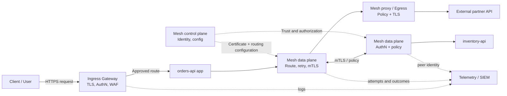
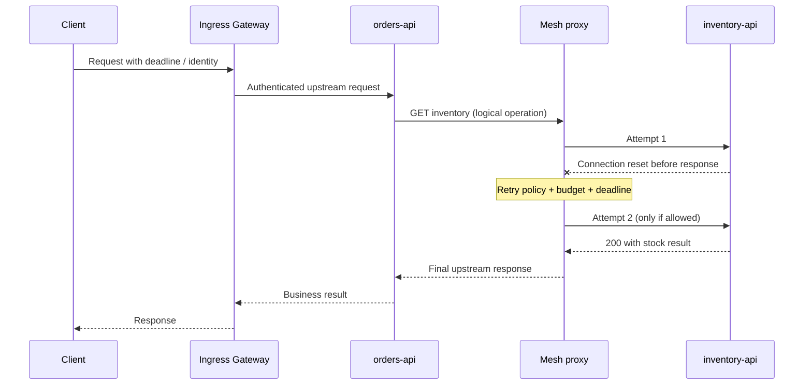
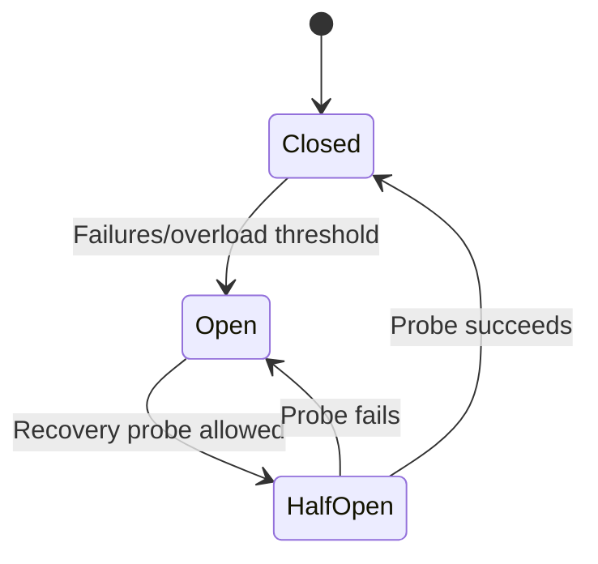
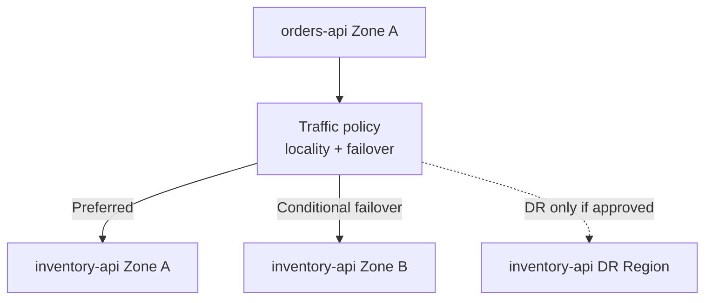
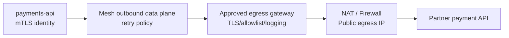
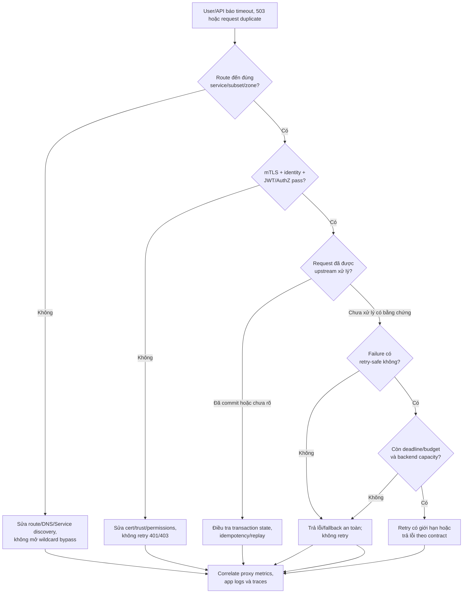

# Traffic policy và retry an toàn trong service mesh và mTLS

**Traffic policy** là tập quy tắc điều khiển cách một yêu cầu được định tuyến, cân bằng tải, giới hạn thời gian, thử lại, chuyển vùng, giới hạn tốc độ và xử lý khi dịch vụ đích gặp lỗi. **Retry an toàn** là việc thử lại một yêu cầu theo điều kiện đã được đánh giá về **ngữ nghĩa nghiệp vụ, trạng thái giao dịch, ngân sách thời gian, tải hệ thống và ranh giới bảo mật**, thay vì lặp lại vô điều kiện mỗi khi gặp HTTP 5xx hoặc timeout.

Trong một **service mesh**, các proxy ở cạnh workload, trên node hoặc tại gateway có thể thực thi một phần traffic policy tập trung. **mTLS** giúp xác thực peer và bảo vệ dữ liệu trên chặng kết nối do mesh quản lý; **NetworkPolicy/firewall** giới hạn đường mạng; **OAuth/workload identity và ứng dụng** tiếp tục quyết định quyền truy cập tài nguyên. Không lớp nào trong số đó tự biến một lệnh thanh toán hoặc cập nhật dữ liệu thành thao tác có thể retry tùy ý.

Bài học thuộc chương **Service mesh và mTLS**, trong mô-đun **SECURITY_NETWORK_SECURITY**. Người học sẽ liên hệ traffic policy với **phân đoạn mạng, firewall, VPN, IDS/IPS, TLS/PKI, DNS security, cloud/Kubernetes networking, phân tích lưu lượng và threat modeling**, sau đó áp dụng để thiết kế hệ thống vừa **an toàn, có khả năng phục hồi, có khả năng quan sát**, vừa tránh làm một sự cố nhỏ lan rộng.

Ví dụ sử dụng các dịch vụ giả định **orders-api**, **inventory-api**, **payments-api**, **recommendation-api** và **external-partner-api**. Một số cấu hình mang dáng dấp Istio/Envoy để minh họa; **CRD, trường và ngữ nghĩa mặc định phụ thuộc phiên bản/triển khai**. Chỉ áp dụng sau khi xác minh cấu hình mesh đang chạy, chính sách tổ chức và kết quả kiểm thử ở môi trường được phép.

## 1. Mục tiêu học tập

Sau bài học, người học có thể:

1. Phân biệt **routing, load balancing, traffic splitting, timeout, deadline, retry, rate limit, circuit breaking, outlier detection và failover**.
2. Phân tích luồng **client → ingress → proxy → service → downstream** và xác định chính sách nào tác động ở mỗi hop.
3. Giải thích tại sao **mTLS xác thực kênh và workload** nhưng không bảo đảm một retry an toàn về nghiệp vụ.
4. Chọn **những lỗi có thể retry** theo HTTP/gRPC, ngữ cảnh request, tình trạng kết nối và trạng thái commit.
5. Thiết kế **overall deadline**, **per-try timeout**, **maximum attempts**, **backoff, jitter và retry budget**.
6. Ngăn **retry amplification**, retry storm, thác lỗi giữa nhiều service và phân phối tải sai khi upstream đã quá tải.
7. Giới hạn retry đối với **POST/PUT/PATCH/DELETE, thao tác chuyển tiền, ghi dữ liệu, tạo tài nguyên và event processing**, sử dụng idempotency khi thích hợp.
8. Phối hợp retry với **circuit breaker, connection pool, bulkhead, overload protection và rate limits**.
9. Dùng **workload identity/mTLS, JWT/AuthorizationPolicy, egress gateway và NetworkPolicy** mà không cho phép retry vượt qua trust boundary.
10. Hiểu tính chất **traffic policy ở sidecar, ambient/sidecarless mesh, ingress và egress proxy**, cũng như rủi ro đường bypass.
11. Đọc ví dụ policy mang phong cách **Istio VirtualService, DestinationRule và PeerAuthentication**, phân biệt quy tắc minh họa và manifest dùng thật.
12. Xây dựng **metrics, traces, audit logs, failure-injection tests và runbook** để chứng minh policy hoạt động khi lỗi xảy ra.

## 2. Traffic policy gồm những gì?

Một service mesh thường cung cấp nhiều nhóm tính năng liên quan nhưng khác bản chất:

| Nhóm | Quyết định chính | Ví dụ |
| --- | --- | --- |
| **Routing** | Request được đưa tới phiên bản/destination nào? | orders-api gọi inventory-v2 |
| **Load balancing** | Instance nào nhận request hợp lệ? | Round robin, least requests, consistent hash |
| **Traffic splitting** | Tỷ lệ request tới từng subset? | 95% stable, 5% canary |
| **Timeout / deadline** | Chờ một request/attempt tối đa bao lâu? | 800 ms tổng, 300 ms mỗi attempt |
| **Retry** | Khi nào thử lại, thử bao nhiêu lần? | Chỉ khi connect failure trước khi upstream xử lý |
| **Backoff / jitter** | Khoảng cách các lần thử? | Exponential backoff có độ ngẫu nhiên |
| **Circuit breaking** | Khi nào ngừng gửi thêm tải vào dependency lỗi/quá tải? | Giới hạn connection và pending requests |
| **Outlier detection** | Loại endpoint bất thường khỏi tập nhận traffic khi đủ bằng chứng? | Endpoint liên tiếp báo lỗi |
| **Rate limiting / quotas** | Ai được sử dụng bao nhiêu năng lực? | Theo caller/tenant/API |
| **Locality / failover** | Vùng hoặc zone nào nhận traffic khi zone khác lỗi? | Prefer same zone, failover có điều kiện |
| **Mirroring / shadowing** | Sao chép request đến nhánh quan sát? | Chỉ khi dữ liệu và side effect an toàn |
| **Security policy** | Danh tính/kênh và quyền nào được chấp nhận? | Strict mTLS, service identity allowlist |
| **Observability** | Đo và truy vết quyết định nào? | attempt count, timeout, retry reason, authz deny |

**Không đặt mọi trách nhiệm vào một policy.** Ví dụ một route rule chọn canary không thay Kubelet/Pod network isolation; mTLS không đặt deadline; circuit breaker không đảm bảo chính xác-một-lần với request thanh toán.

## 3. Sơ đồ kiến trúc: chính sách được thực thi ở đâu?



Sơ đồ lược bớt việc traffic ingress cũng có thể qua data-plane proxy riêng, và mỗi mô hình mesh có cách chặn traffic khác nhau. **Điểm đặt policy** là yếu tố sống còn:

- **Client library** có thể retry trước khi proxy biết đến request mới.
- **Ingress gateway** có thể retry đến orders-api.
- **Outbound proxy của orders-api** có thể retry đến inventory-api.
- **Inventory-api** có thể retry truy vấn database.
- **External API client** có thể có retry mặc định riêng.

Nếu mỗi tầng đều thử lại, tổng số request có thể tăng mạnh dù từng tầng chỉ đặt một số nhỏ.

### 3.1. Data plane không phải control plane

**Data plane** xử lý những connection/packets/HTTP streams thực tế. **Control plane** phân phối route, certificate, trust bundles và policy. Control plane mất liên lạc có thể làm thay đổi khả năng rollout/renewal, nhưng **không mặc định đồng nghĩa mọi connection data plane lập tức thất bại**; hành vi phụ thuộc cấu hình cache, certificate TTL và triển khai mesh.

Không nên “khắc phục outage control plane” bằng cách **tắt mTLS hoặc mở route bypass không kiểm soát**.

## 4. Luồng request và những điểm có thể phát sinh retry

Một lời gọi tưởng đơn giản có thể chứa nhiều bước:



Cần phân biệt **logical operation** với **transport attempt**:

- Một user tạo **1 yêu cầu nghiệp vụ**.
- Proxy có thể tạo **2 hoặc nhiều upstream attempts**.
- Service đích có thể **đã xử lý một phần hoặc hoàn toàn** attempt trước, ngay cả khi proxy chưa thấy response.
- Log ở caller và server có thể khác số lượng do retry, hedging hoặc connection failure.

**Mất response không đồng nghĩa server chưa thực hiện hành động.** Đây là nguyên tắc quan trọng nhất khi quyết định retry writes.

## 5. mTLS là lớp nhận diện peer, không phải bảo đảm retry

**Mutual TLS** cho phép hai đầu được hỗ trợ xác thực peer qua chứng chỉ workload và bảo vệ transport. Trong mesh, identity có thể gắn với service account, workload certificate hoặc SPIFFE-compatible identity.

### 5.1. Các điều mTLS làm được

- Xác minh **peer certificate chain, validity, expected identity và trust domain** khi policy đúng.
- Bảo vệ tính bí mật/toàn vẹn của dữ liệu trên chặng TLS do mesh quản lý.
- Hỗ trợ **identity-based authorization** ở proxy hoặc dịch vụ.
- Giảm khả năng spoof một service chỉ bằng địa chỉ IP/Pod labels.
- Giúp audit caller identity cho từng connection/request theo khả năng telemetry.

### 5.2. Các điều mTLS không tự làm

- Xác định **POST /charge** đã commit hay chưa sau khi timeout.
- Kiểm tra người dùng cuối được phép chuyển tiền hay không.
- Chọn số lần retry tối ưu khi backend quá tải.
- Đảm bảo dịch vụ dùng certificate hợp lệ không có lỗi business logic.
- Tự bảo vệ đường **sidecar bypass, hostNetwork, egress bên ngoài mesh hoặc plaintext local hop**.
- Tự loại trừ lỗ hổng application SSRF, token forwarding hoặc SQL injection.

Vì vậy chính sách **Strict mTLS + AuthZ + safe retry** là ba lớp khác nhau, cần kiểm tra độc lập.

## 6. Phân biệt timeout, deadline, retry và cancellation

| Khái niệm | Định nghĩa | Điểm cần lưu ý |
| --- | --- | --- |
| **Connection timeout** | Giới hạn thời gian thiết lập kết nối TCP/TLS hoặc connection tới upstream | Không nhất thiết là timeout của toàn request |
| **Request timeout** | Thời gian tối đa chờ một request theo proxy/service | Tùy điểm bắt đầu và cách tính |
| **Per-try timeout** | Thời gian tối đa cho một attempt | Phải nhỏ hơn hoặc phù hợp tổng budget |
| **End-to-end deadline** | Thời điểm cuối cùng toàn thao tác còn có ích | Bao gồm nhiều hops, retries và thời gian xử lý |
| **Idle timeout** | Đóng kết nối/stream khi không có hoạt động trong khoảng giới hạn | Đặc biệt quan trọng với HTTP/2/gRPC/streaming |
| **Retry** | Tạo attempt mới sau một thất bại đủ điều kiện | Có thể nhân tải/side effects |
| **Cancellation** | Tín hiệu caller không còn cần xử lý | Backend có thể vẫn commit nếu không hỗ trợ hủy |
| **Hedging** | Gửi attempt song song khi request quá chậm | Không tương đương retry tuần tự; tăng tải mạnh |

### 6.1. Deadline phải đi từ nhu cầu nghiệp vụ

Nếu endpoint ở frontend có ngân sách phục vụ **1 giây**, không thể để:

- Ingress chờ 3 giây.
- orders-api chờ inventory-api 2 giây.
- inventory-api tiếp tục chờ database 5 giây.

Ngay cả khi mỗi tầng cục bộ “hợp lý”, tổng thời gian vượt **SLO của người dùng**. Cần đặt deadline từ tầng ngoài và truyền/bảo toàn ngữ cảnh hạn chót ở các thư viện/giao thức hỗ trợ.

### 6.2. Deadline không phải nút undo

Caller hủy request hoặc proxy timeout **không có nghĩa transaction trên backend bị rollback**. Nếu backend đã commit ghi dữ liệu, một attempt sau phải dùng **idempotency/deduplication hoặc query trạng thái giao dịch**.

## 7. Lỗi nào nên retry và lỗi nào không?

Một policy an toàn cần phân biệt **nguyên nhân thất bại** và **tính an toàn của thao tác**.

| Loại lỗi | Retry mặc định? | Lý do |
| --- | --- | --- |
| **DNS NXDOMAIN cho hostname sai** | Thường không | Sai cấu hình hoặc tên không tồn tại |
| **TCP connect failure trước khi request được chuyển đến upstream** | Có thể, có giới hạn | Chưa chắc có side effect; cần xác minh vị trí lỗi |
| **TLS certificate invalid / mTLS identity mismatch** | Không để chữa bằng retry | Vấn đề trust/configuration cần sửa |
| **HTTP 401** | Không tự retry bằng cùng credential | AuthN không hợp lệ; cần xử lý token lifecycle riêng |
| **HTTP 403** | Không | AuthZ từ chối; thử lại có thể tạo abuse |
| **HTTP 400/422** | Thường không | Input/schema/nghiệp vụ sai |
| **HTTP 404** | Thường không | Không phải tín hiệu transient chung |
| **HTTP 409** | Tùy protocol nghiệp vụ | Có thể cần điều phối trạng thái, không blind retry |
| **HTTP 408** | Có thể trong tình huống an toàn | Cần xem server đã xử lý gì |
| **HTTP 429** | Chỉ theo quota và Retry-After/budget | Retry ngay có thể làm rate limit tệ hơn |
| **HTTP 500** | Không tự áp mọi request | Backend có thể đã thực hiện side effect rồi lỗi khi phản hồi |
| **HTTP 502/503/504 từ proxy** | Có thể cho operation an toàn và trong budget | Phải xác định upstream đã nhận request chưa |
| **gRPC UNAVAILABLE** | Có thể cho call retryable, có budget | Không đủ chỉ nhìn status |
| **gRPC DEADLINE_EXCEEDED** | Thận trọng | Deadline có thể đã hết và server vẫn đang xử lý |
| **gRPC PERMISSION_DENIED / UNAUTHENTICATED** | Không retry vô điều kiện | Lỗi identity/authorization |
| **Backend overload / circuit open** | Thường giảm retries | Tăng attempt làm sập hệ thống nhanh hơn |

Đây là **ma trận hướng dẫn**, không phải quy tắc chung bắt buộc. Quyết định cuối cùng dựa trên **HTTP semantics, business idempotency, request body, response lifecycle, hop visibility, SLO và dependency contract**.

## 8. HTTP methods và idempotency

**Idempotent** có nghĩa một thao tác được lặp lại cùng điều kiện không làm thay đổi tác động dự kiến so với một lần thực hiện; không đồng nghĩa request luôn không có side effects nhỏ như log hoặc metrics.

### 8.1. Những nhóm phương thức

| Method | HTTP semantics thông thường | Hành vi cần kiểm tra |
| --- | --- | --- |
| **GET** | Safe/read-oriented, idempotent theo giao ước HTTP | Không retry nếu API vi phạm chuẩn và GET gây side effect quan trọng |
| **HEAD** | Safe/read-oriented | Cần backend thực sự hỗ trợ |
| **PUT** | Idempotent về trạng thái resource theo semantics chuẩn | Phải xác định concurrency, version/ETag và workflow |
| **DELETE** | Idempotent về tác động dự kiến theo semantics chuẩn | Response lần 2 có thể khác; vẫn kiểm tra nghiệp vụ |
| **POST** | Thường không idempotent | Không retry tự động khi chưa có idempotency contract |
| **PATCH** | Không mặc định idempotent | Tùy patch document và concurrency logic |

**Không chỉ xem method rồi cấu hình mesh retry.** Ví dụ một API đặt “GET /send-email” là sai thiết kế nhưng vẫn có side effect. Ngược lại, **POST /payments** có thể được thiết kế retry-safe nếu sử dụng idempotency key và server-side deduplication chính xác.

### 8.2. Các yêu cầu đọc cũng có nguy cơ

Retry GET đọc dữ liệu có thể làm:

- Vượt rate limit hoặc quota đối tác.
- Đẩy dữ liệu lên hệ thống logging quá mức.
- Tạo truy vấn nặng tới database vốn đang quá tải.
- Nhận kết quả từ **replica stale** hoặc tenant khác nếu route sai.
- Vi phạm deadline và gây timeout dây chuyền.

Do đó **idempotency là điều kiện cần nhưng chưa đủ**.

## 9. Idempotency key cho thao tác ghi

Khi một thao tác có side effect cần retry, ứng dụng nên cung cấp **idempotency contract** rõ ràng, không phó mặc cho proxy.

Ví dụ một yêu cầu tạo giao dịch:

```http
POST /v1/payments HTTP/1.1
Host: payments.internal.example
Content-Type: application/json
Idempotency-Key: 8c61f833-demo-unique-operation

{"order_id":"order-001","amount_minor":25000,"currency":"VND"}
```

Đây là ví dụ cấu trúc, không phải giao dịch thật. **Idempotency-Key** là một cơ chế API phổ biến, nhưng cách đặt header, kích thước, TTL, phạm vi và cách thực thi phụ thuộc hợp đồng của service.

### 9.1. Server cần làm gì?

1. Ràng buộc key với **authenticated caller/tenant/operation**.
2. Lưu **key + fingerprint của request + trạng thái xử lý** tại kho có tính nhất quán phù hợp.
3. Bảo đảm **concurrent requests cùng key** không tạo hai thao tác.
4. Khi request hoàn thành, trả lại kết quả đã ghi nhận theo policy.
5. Nếu cùng key nhưng body khác, **từ chối** thay vì coi là một tác vụ khác.
6. TTL đủ cho retry window và thời gian khôi phục, nhưng không kéo dài vô hạn thiếu lý do.
7. Có audit và quan sát số deduplicated requests.

### 9.2. Điều kiện quyết định nằm ở transaction

Nếu server commit thanh toán rồi mất response, proxy tạo attempt thứ hai với cùng key có thể nhận kết quả đã thực hiện **mà không charge lại**. Nếu idempotency chỉ nằm trong memory của một replica, failover sang replica khác vẫn có thể tạo double-charge. Vì vậy cần **persistent/concurrent-safe semantics**, không chỉ thêm header.

### 9.3. Retry key khác trace ID

**Trace ID** dùng theo dõi một luồng; **idempotency key** nhận diện thao tác nghiệp vụ cần chống lặp. Chúng có thể tương quan nhưng không nên coi mọi trace ID là khóa idempotency, vì trace ID có thể thay qua retry/caller context.

## 10. Thiết kế ngân sách thời gian: overall timeout và per-try timeout

Giả sử API dành tối đa **900 ms** để lấy tồn kho. Sau khi trừ thời gian network, parsing và business logic, proxy chỉ có một phần để gọi inventory.

Một mô hình ngân sách minh họa:

```text
User-facing deadline:                  1200 ms
  Gateway processing + AuthN:           120 ms
  orders-api business handling:         180 ms
  inventory dependency total budget:    800 ms
  final response encoding/margin:       100 ms

inventory call:
  attempt 1: 250 ms
  backoff:    50 ms
  attempt 2: 250 ms
  backoff:    90 ms
  attempt 3: 160 ms (remaining useful budget)
  <= total 800 ms
```

Các số trên chỉ là **mô hình minh họa**, không phải recommended defaults. Trong thiết kế thật phải đo **p50/p95/p99 latency, SLO, phương sai theo zone, authentication overhead và connection reuse**.

### 10.1. Quy tắc điều kiện

- **Per-try timeout** không được khiến tổng attempts vượt **remaining deadline**.
- Thử tiếp chỉ khi còn **đủ thời gian có ích**, không vì bộ đếm retries chưa hết.
- Retry policy cần cân nhắc **elapsed time + backoff + queueing + upstream response time**.
- Deadline từ client cần được xử lý an toàn, không cho client không đáng tin đặt **timeout vô hạn** hoặc buộc tài nguyên tồn tại quá lâu.
- Khi deadline đã hết, **đừng bắt đầu attempt mới**.

### 10.2. Timeout quá ngắn cũng không an toàn

Nếu đặt timeout thấp hơn latency p99 bình thường, các request hợp lệ bị retry hàng loạt, khiến upstream quá tải và làm latency càng tăng. **Timeout là công cụ bảo vệ ngân sách**, không phải cách ép backend xử lý nhanh hơn.

## 11. Backoff và jitter chống đồng bộ retry

Một service có 10.000 clients nhận lỗi 503 cùng thời điểm. Nếu tất cả retry ngay sau **100 ms cố định**, hệ thống có thể nhận một đỉnh tải lớn ngay sau đó.

**Exponential backoff** tăng khoảng cách theo số lần thất bại. **Jitter** thêm ngẫu nhiên có kiểm soát để các clients không cùng đồng bộ.

### 11.1. Mô hình tính toán

```text
base_delay = 50 ms
max_delay = 2 s

exponential_cap(attempt) = min(max_delay, base_delay * (2 ** attempt))
next_delay = random_between(0, exponential_cap(attempt))

Stop retrying if:
  - retry budget exhausted, OR
  - remaining deadline insufficient, OR
  - failure is not retryable, OR
  - operation is not retry-safe
```

Đây là **pseudocode minh họa**, không phải thuật toán ngẫu nhiên bắt buộc của mọi service mesh. Cần xem implementation hỗ trợ backoff/jitter thế nào, đặc biệt nếu app và proxy cùng retry.

### 11.2. Retry-After và rate limit

Khi server trả **429 Too Many Requests** hoặc **503 Service Unavailable** có **Retry-After**, client có thể dùng thông tin này theo giao thức khi phù hợp. Nhưng cần:

- Chỉ tin **header từ server/gateway đáng tin** và giới hạn giá trị hợp lý.
- Không vượt **client deadline**.
- Không dùng Retry-After để cho phép retry **non-idempotent request** nếu chưa có contract.
- Áp tổng quota retry để tránh request chờ hàng loạt chiếm memory/connection.
- Tôn trọng policy **tenant fairness** và có observability.

Một lỗi 429 thường là tín hiệu **giảm tải**, không phải lời mời thử lại liên tục.

## 12. Retry budget: giới hạn bằng năng lực hệ thống

Chỉ đặt **maxAttempts = 3** chưa đủ. Nếu base traffic là 20.000 requests/s và 80% request bị retry 2 lần, tổng upstream load có thể tăng rất mạnh trong lúc backend suy yếu.

### 12.1. Hai loại giới hạn

1. **Per-request limit:** mỗi logical operation có tối đa bao nhiêu attempts và deadline.
2. **Global/rolling retry budget:** trong một khoảng thời gian, retries chỉ chiếm một tỷ lệ/giới hạn so với original requests hoặc tổng năng lực.

Ví dụ chủ trương:

```text
logical_request:
  attempts_total_upper_bound: 3
  deadline_ms: 800
  retry_on: transient_transport_errors_only

service_retry_budget:
  retry_attempts_must_be_bounded: true
  abort_retry_when_overloaded: true
  do_not_retry_for_authn_or_authz_failure: true
  monitor_retry_to_original_request_ratio: true
```

Đây là **policy intent**, không phải file cấu hình chuẩn Envoy/Istio/Linkerd. Các sản phẩm hỗ trợ retry budgets theo cách khác nhau, có thể cần SDK hoặc gateway bổ sung.

### 12.2. Retry budget và fairness

Một tenant hoặc client lỗi không nên chiếm hết retry capacity của cả dịch vụ. Tách **budgets theo caller/service/tenant hoặc priority class** khi yêu cầu đa tenant. Khi ngân sách cạn, nên trả lỗi có thể quan sát và bảo vệ upstream thay vì tiếp tục retry ẩn dưới proxy.

## 13. Retry amplification trong kiến trúc nhiều tầng

Giả sử mỗi tầng retry thêm hai lần, tức tối đa **3 attempts** cho một request ở tầng đó:

```text
Gateway -> orders-api:     up to 3 attempts
orders-api -> inventory:   up to 3 attempts per orders attempt
inventory -> database:    up to 3 attempts per inventory attempt

Worst-case downstream database attempts:
  3 * 3 * 3 = 27
for 1 original logical user request.
```

**27 là trường hợp xấu nhất nếu các attempts thực sự đi tới các tầng và cùng gặp lỗi retryable**, không phải số liệu đo hoặc chắc chắn mọi request sẽ tạo 27 thao tác.

### 13.1. Chọn một tầng chủ sở hữu retry

Một chiến lược hữu ích là xác định **một tầng chính chịu trách nhiệm retry cho mỗi dependency**:

- Gateway có thể retry khi **connection tới upstream fail trước khi dispatch**, với chính sách chặt.
- Service client library có thể biết **idempotency và deadline** rõ hơn mesh.
- Mesh proxy có thể xử lý **transport retries** nếu ứng dụng không thể tự giải quyết, với giới hạn.
- DB driver có thể có retry logic riêng cho transaction errors; không cộng vô hạn với tầng trên.

Phải document **retry ownership**, không để mỗi đội tự bật defaults mà không biết tầng khác đang retry.

### 13.2. Một request có thể hoàn tất nhiều lần

Nếu orders-api nhận cùng user request từ gateway retry và tự thực hiện side effect, chỉ chặn retry ở inventory vẫn **không đủ**. **Idempotency ở entrypoint của operation** và transaction boundary cần được xét xuyên mọi hops.

## 14. Circuit breaker và retry không đối nghịch nhưng phải phối hợp

**Circuit breaker** giúp giảm gửi requests tới dependency liên tục lỗi hoặc quá tải theo ngưỡng và trạng thái. Các biến thể có thể dùng **max active connections, pending requests, concurrency, ejection hoặc adaptive concurrency**.

### 14.1. Mô hình trạng thái khái niệm



Sơ đồ là **mẫu circuit breaker cổ điển**; một số triển khai Envoy/mesh áp **resource limits và outlier ejection** thay vì cung cấp đúng state machine ba trạng thái cho mọi policy. Không coi mọi tính năng có tên “circuit breaker” là cùng semantics.

### 14.2. Khi circuit breaker mở

Đừng tiếp tục retry cùng dependency theo cách đẩy thêm tải vào nó. Cần:

- Trả lỗi nhanh hoặc fallback được kiểm soát nếu nghiệp vụ cho phép.
- Chặn request mới khi đã chạm concurrency/queue thresholds.
- Cho **recovery probes** ở tần suất giới hạn khi có cơ chế tương ứng.
- Bảo vệ **critical traffic priority** nếu service có ưu tiên.
- Ghi rõ **circuit open/overflow/outlier ejected** thay vì chỉ log “503”.

### 14.3. Tránh fallback không an toàn

Không được chuyển payment call sang **test processor**, khác tenant/region hoặc endpoint không có mTLS chỉ để tránh circuit breaker. **Fallback destination phải nằm trong cùng chính sách trust, dữ liệu và nghiệp vụ**.

## 15. Connection pool, queue và giới hạn đồng thời

Một service mesh proxy có thể giữ **TCP connection pools** và multiplex **HTTP/2 streams**. Điều này ảnh hưởng latency, capacity và behavior khi retry.

| Tham số ý niệm | Rủi ro nếu quá thấp | Rủi ro nếu quá cao |
| --- | --- | --- |
| **Max connections** | Hàng đợi và connect timeout | Tốn file descriptors/socket/memory |
| **Max pending requests** | Reject sớm khi service chưa quá tải | Queue tích lũy, latency vượt deadline |
| **Max active HTTP requests/streams** | Không dùng hết năng lực | Quá tải backend, memory/CPU |
| **Requests per connection** | Tạo connections mới quá nhiều | Giữ connection lâu, imbalance tới instances |
| **Idle connection timeout** | Connection churn, SNAT pressure | Socket rảnh tốn tài nguyên |
| **Max request duration** | Cắt request hợp lệ | Giữ tài nguyên ngoài deadline |

### 15.1. Queueing trước retry

Một request mất 400 ms trong queue rồi bị retry thêm 400 ms không thể đạt user-facing deadline 500 ms. **Retry policy cần nhìn tổng thời gian**. Nếu overload đang tạo hàng đợi, ưu tiên **reject sớm có kiểm soát** thay vì gom thêm yêu cầu vào hàng chờ.

### 15.2. HTTP/2 không miễn nhiễm overload

HTTP/2 cho phép multiplex nhiều streams trên connection, giúp giảm TCP churn nhưng tăng **concurrency trên cùng upstream**. Cần giới hạn streams/requests theo năng lực thật; khi một connection bị reset, số streams bị ảnh hưởng và retry behavior cũng cần đánh giá.

## 16. Outlier detection: tránh endpoint lỗi mà không tạo cô lập giả

**Outlier detection** nhận diện một endpoint có nhiều lỗi bất thường và **tạm loại khỏi tập load balancing** theo chính sách.

Ví dụ:

- inventory-v2 replica-1 liên tiếp trả 503 vì kết nối DB lỗi.
- Các replicas khác bình thường.
- Data plane có thể ngừng chọn replica-1 trong một khoảng thời gian và kiểm tra khả năng phục hồi.

### 16.1. Những nguy cơ

- Ngưỡng quá thấp dẫn tới **eject hàng loạt** khi backend đồng loạt chậm.
- Số replicas ít → eject một replica làm giảm capacity đáng kể.
- Một lỗi **RBAC/mTLS policy** ở mọi replica có thể bị chẩn đoán nhầm thành endpoint unhealthy.
- Nếu tất cả endpoints bị loại, một số implementations có thể **panic mode hoặc fallback behavior**; phải biết chính xác sản phẩm xử lý thế nào.
- Metric dựa trên 5xx từ application không đủ phân biệt **bug của client**, overload và server failure.

### 16.2. Kết hợp readiness

Kubernetes **readiness probes** nói Pod có nên nằm trong endpoint set theo tiêu chí kiểm tra. Outlier detection là **nhận định của proxy dựa trên traffic**. Chúng bổ trợ nhưng không thay nhau. Nếu một endpoint không Ready do sai dependency, không cố bù bằng retry vô hạn.

## 17. Rate limiting, quotas và load shedding

**Rate limit** kiểm soát tốc độ request, **concurrency limit** kiểm soát số request chạy đồng thời, và **load shedding** từ chối bớt khi hệ thống quá tải.

### 17.1. Đặt limit theo đâu?

- **Public ingress:** client/user/IP/credential, ngăn abuse và giữ công bằng.
- **Service-to-service:** workload identity, namespace, tenant, API route, priority.
- **External partner egress:** giới hạn theo contract/quota của đối tác.
- **Sensitive operations:** amount/transaction velocity hoặc business-specific guardrails.
- **Dependency concurrency:** tối đa số request đồng thời có ích với DB/API.

### 17.2. 429, 503 và phản ứng của retry

Khi rate limit trả **429**, một client có thể giảm request rate và retry có điều kiện theo budget. Khi overload trả **503**, retry storm từ proxy có thể làm tình hình tồi hơn. Nên:

1. Duy trì **retry budget**.
2. Chọn lỗi retryable theo **ngữ nghĩa**.
3. Tôn trọng **Retry-After** khi đáng tin và còn thời gian.
4. Thực hiện **backpressure** upstream; không gom request chờ vô hạn.
5. Giữ **fairness** giữa tenants/critical traffic.
6. Quan sát **original request rate so với attempt rate**.

## 18. Load balancing và retries thay đổi phân phối tải

Thuật toán chọn endpoint thường gặp: **round robin, least requests, random, locality-aware, consistent hashing** hoặc những tùy chọn khác. Mỗi thuật toán có lợi ích và giới hạn.

### 18.1. Retry có thể đi cùng hoặc sang endpoint khác

Một attempt retry có thể được gửi tới **endpoint khác** nếu policy/upstream LB cho phép. Điều này giúp tránh replica lỗi nhưng không đảm bảo dữ liệu nhất quán nếu:

- Các replicas có **local state** không đồng bộ.
- Application dùng **session affinity** mà state không được lưu chung.
- Request có tenant pinning hoặc data residency restriction.
- Outlier detection/traffic split đưa retry sang subset khác.

**Retry routing phải giữ đúng trust domain, tenant, dữ liệu và side-effect semantics.** Không cho attempt thứ hai bỏ qua AuthZ hoặc đi tới cluster khác không được cấp quyền.

### 18.2. Consistent hashing không phải identity policy

Một cookie/header được dùng để chọn backend trong sticky session có thể đến từ client. Nếu không kiểm soát, nó có thể bị thao túng hoặc làm lệch tải. **Không dùng consistent hash key như bằng chứng người dùng có quyền**.

## 19. Locality, zone-aware routing và failover

Định tuyến ưu tiên cùng zone có thể giảm latency và cross-zone cost, nhưng khi một zone lỗi phải có kế hoạch **failover**.



### 19.1. Trước khi bật cross-region failover

- Dữ liệu/tenant có được xử lý ở region dự phòng không?
- **mTLS trust bundles và service identities** có hợp lệ xuyên vùng?
- JWT **issuer/audience/tenant** có còn đúng?
- Route, NetworkPolicy, cloud SG, firewall và DNS có cho phép đường dự phòng?
- Có yêu cầu **data residency, privacy hoặc compliance**?
- Giao dịch có cần **idempotency store/DB state đồng bộ giữa regions**?
- Chi phí và latency có còn trong SLO?

**Failover không được biến thành quyền truy cập mặc định tới bất cứ endpoint nào có thể trả 200.**

## 20. Traffic splitting, canary và chính sách retry

Service mesh thường cho phép chia traffic giữa **stable và canary**. Ví dụ 95% đi stable, 5% đi canary.

### 20.1. Đọc đúng con số

- Tỷ lệ 95/5 thường áp trên **routing decisions** do proxy thực hiện theo quy tắc.
- Nếu request bị retry, có thể phát sinh **attempts bổ sung** làm tỷ lệ upstream attempts lệch tỷ lệ logical requests.
- Nếu canary trả nhiều lỗi hơn, retries có thể làm nó nhận thêm tải không dự kiến hoặc đẩy tải sang stable.
- Phân phối quan sát ở số lượng mẫu nhỏ có thể không chính xác 95/5.

### 20.2. Chính sách canary

1. Xác định **logical request** hay **upstream attempt** là đơn vị đo tỷ lệ.
2. Giữ **safe retry rules** giống nhau hoặc có tài liệu riêng cho canary.
3. Không dùng retries để che toàn bộ 5xx của canary khi đánh giá chất lượng.
4. Quan sát metrics theo **subset, destination workload, attempt number và final user response**.
5. Có stop/rollback thresholds rõ, không chỉ nhìn tỷ lệ error sau retries.
6. Kiểm tra authz/mTLS với mỗi subset.
7. Tránh mirror các thao tác **có side effects** nếu không cô lập dữ liệu và thiết kế shadow-safe.

### 20.3. Request mirroring là thao tác mới

Mirroring có thể gửi **bản sao request** đến một service khác để quan sát; nếu backend đó ghi database/gửi email/thanh toán, tác động nghiệp vụ có thể bị lặp dù response bị bỏ. Chỉ mirror request khi hệ thống đích được thiết kế **không thực hiện side effect thật** hoặc có sandbox/policy phù hợp.

## 21. gRPC: retry còn tùy trạng thái stream

gRPC thường dùng HTTP/2 và có các **status codes** riêng như UNAVAILABLE, DEADLINE_EXCEEDED, RESOURCE_EXHAUSTED, INTERNAL, PERMISSION_DENIED.

### 21.1. Unary RPC so với streaming

- **Unary RPC:** một request, một response; có thể retry nếu phương thức được định nghĩa **idempotent/retry-safe**.
- **Client streaming:** caller đã gửi một phần dữ liệu; tự retry có nguy cơ gửi lại hoặc lặp side effect.
- **Server streaming:** đã nhận một phần response; restart từ đầu có thể tạo duplicate records.
- **Bidirectional streaming:** trạng thái hai chiều có thể phức tạp, thường cần **resume protocol/application semantics**.

### 21.2. Commitment và transparent retries

Một số gRPC client có khả năng retry theo cấu hình hoặc thực hiện transparent retry trong những điều kiện nhất định. Nhưng **không áp cùng một quy tắc retry cho mọi gRPC method**, và không cho rằng proxy hiểu nội dung stream/business commit.

**Stream đã có response một phần** cần đặc biệt thận trọng. Nếu muốn phục hồi, ứng dụng thường cần **sequence number, offset, checkpoint, deduplication hoặc resume token**.

### 21.3. gRPC deadline

gRPC hỗ trợ deadline và propagation theo ngôn ngữ/runtime. Cần phối hợp **caller deadline, proxy timeout và server cancellation** để tránh backend tiếp tục xử lý công việc vô ích. Một thông báo **DEADLINE_EXCEEDED** không chứng minh server chưa commit tác động.

## 22. WebSocket, SSE và long-lived connections

Các luồng như **WebSocket**, **Server-Sent Events (SSE)**, gRPC streaming hoặc long polling không giống HTTP request ngắn.

### 22.1. Vấn đề với retry ở proxy

- Kết nối đã upgrade/streaming có **state và dữ liệu trao đổi**.
- Proxy không thể tạo lại toàn bộ stream với cùng semantics bằng retry một TCP connection tùy ý.
- Idle timeout và connection lifetime ảnh hưởng heartbeat/reconnect.
- Một client reconnect có thể nhận **duplicate messages** hoặc bỏ sót sự kiện nếu không có offset.
- Load balancing với sticky sessions và draining khi rollout cần kiểm thử.

### 22.2. Phương án đúng thường ở ứng dụng

Thiết kế **reconnect protocol, resume token, last-event ID, idempotent handling và bounded backoff**, thay vì bật retry HTTP chung trên mọi route streaming.

### 22.3. HTTP/3/QUIC

Nếu ingress hỗ trợ HTTP/3/QUIC, retry và connection migration ở transport có semantics khác với HTTP/1.1 TCP. Mesh có thể kết thúc QUIC ở gateway rồi dùng HTTP/2/TCP ở upstream. Cần xác định **protocol termination** và những giới hạn retry thực tế của từng hop.

## 23. Security traffic policy: không retry sai danh tính

Một service mesh có thể kiểm tra **mTLS peer identity** và **JWT/authz policies** ở ingress/sidecar/ztunnel/waypoint tùy kiến trúc.

### 23.1. Những lỗi tuyệt đối không nên “chữa” bằng retry

- **TLS certificate unknown CA / expired / SAN mismatch**.
- **mTLS principal không được policy cho phép**.
- **JWT invalid signature, issuer/audience mismatch hoặc token hết hạn**.
- **HTTP 401/403** do thiếu quyền.
- **Tenant mismatch** hoặc user chưa được phép.
- **Destination khác trust domain** hoặc backup region không được duyệt.

Nếu retry vào endpoint khác và nhận 200, cần bảo đảm **endpoint đó áp cùng mô hình xác thực, quyền và ranh giới dữ liệu**. Không dùng “fallback insecure” kiểu chuyển sang plaintext khi mTLS lỗi.

### 23.2. Token forwarding

Một access token được phát cho **inventory-api** không được tự động gửi đến **external-partner-api** trong retry hoặc failover. Kiểm tra **audience, issuer, scope, holder-of-key/sender constraint** và outbound header sanitation tại proxy.

### 23.3. Host/SNI và certificate identity

Khi route nhiều upstream dưới cùng service, phải biết **SNI/Host/authority, TLS server certificate và expected destination identity**. Retry sang IP khác nhưng không xác minh đúng hostname/identity có thể tạo nguy cơ MITM hoặc gửi dữ liệu sang sai ứng dụng.

## 24. NetworkPolicy, firewall và traffic policy phối hợp

**Kubernetes NetworkPolicy** thường thực thi L3/L4 theo Pod/namespace selectors. **Mesh route/retry policy** có thể thực thi L7 trong data plane được bảo vệ. Chúng cần phối hợp.

| Lớp | Quyết định | Ví dụ |
| --- | --- | --- |
| **Cloud network firewall/SG** | Cluster/node/subnet có đường đến nhau? | Chỉ gateway → private node/service path |
| **Kubernetes NetworkPolicy** | Pod nào được kết nối tới Pod nào/cổng nào? | orders-api → inventory-api TCP/8080 |
| **mTLS** | Peer có phải workload identity đáng tin? | orders/prod principal |
| **Mesh authorization** | Service identity có được gọi route? | orders được GET stock |
| **Traffic routing/retry** | Chọn endpoint, số attempts, deadline | Không retry POST /charge thiếu idempotency |
| **App AuthZ** | Request có quyền với tài nguyên/tenant? | order belongs to user |
| **DB/transaction protection** | Có chống double commit khi retries? | Unique operation key + transactional state |

### 24.1. Không dùng NetworkPolicy làm L7 retry policy

NetworkPolicy chuẩn không định nghĩa retry attempts, HTTP statuses hoặc per-try timeout. Ngược lại, traffic policy của mesh không tự chặn **hostNetwork, unmanaged workloads, NodePort, secondary interfaces** hoặc mọi đường bypass.

### 24.2. Cổng và Service routing

Khi Pod gọi Kubernetes Service **port: 80** và backend dùng **targetPort: 8080**, điểm enforcement có thể thấy các ports/IP khác nhau do proxy/service NAT. Cần kiểm tra **actual CNI dataplane, sidecar interception, endpoint discovery và Service port mapping** trước khi kết luận một rule là đúng.

## 25. Egress gateway và kết nối đối tác

Một tổ chức có thể yêu cầu tất cả traffic tới đối tác đi qua **egress gateway** để áp DNS/TLS, service identity, audit và source-IP chính sách.



### 25.1. Retry ở egress cần thêm điều kiện

- Đối tác có **rate limit/quota** và Retry-After không?
- Có **idempotency contract** cho POST/charge không?
- Có **source IP allowlist** áp cho toàn bộ HA/DR gateways không?
- Credential gửi đi có đúng **audience và trust** của đối tác?
- DNS/CDN IP thay đổi có được policy hỗ trợ không?
- Route qua egress gateway có thật sự **bắt buộc**, hay Pod vẫn có đường direct Internet?
- Logging ở gateway có vô tình ghi **Bearer tokens, API keys hoặc PII** không?

### 25.2. Egress gateway không tự là Internet firewall hoàn chỉnh

Nếu NetworkPolicy/cloud route còn cho Pods truy cập Internet trực tiếp, ứng dụng bị chiếm có thể bỏ qua gateway. Cần **chặn bypass bằng dataplane và network policy**, kiểm thử bằng test workload đã được cấp phép.

## 26. Istio VirtualService: minh họa routing, timeout và retry

Ví dụ dưới đây dùng **cấu trúc mang tính minh họa theo Istio VirtualService**, không đảm bảo các trường, phiên bản API và mặc định áp nguyên trạng trên mọi cụm. Hãy xác nhận **CRD có sẵn, API version, destination host, service ports, traffic policy và mesh visibility** của bản đang dùng.

Mục tiêu: requests tới inventory-api qua namespace orders được định tuyến đến Kubernetes Service tương ứng, có timeout có giới hạn và chỉ thử lại trên một số lỗi transport.

```yaml
apiVersion: networking.istio.io/v1
kind: VirtualService
metadata:
  name: inventory-route
  namespace: inventory
spec:
  hosts:
    - inventory-api.inventory.svc.cluster.local
  http:
    - match:
        - uri:
            prefix: /v1/stock
      route:
        - destination:
            host: inventory-api.inventory.svc.cluster.local
            port:
              number: 8080
      timeout: 800ms
      retries:
        attempts: 2
        perTryTimeout: 300ms
        retryOn: connect-failure,refused-stream
```

**Đọc kỹ:**

- Trong ví dụ, **attempts** được hiểu theo cấu hình retry của sản phẩm/phiên bản tương ứng; đừng tự suy nó luôn là tổng số network attempts giữa mọi tầng.
- **timeout** là giới hạn do route policy áp, cần phối hợp **caller deadline** và các hops khác.
- **connect-failure/refused-stream** vẫn cần xem **upstream đã nhận request chưa** trong từng giao thức/tình huống.
- Rule match **prefix: /v1/stock** có thể bao gồm những phương thức/đường khác nhau; **không áp blindly cho POST/PATCH/DELETE có side effects**. Trong triển khai thật phải tách rõ **method và route retry-safe**; nếu policy không đủ biểu đạt hãy để application chịu trách nhiệm.
- Policy không thay **PeerAuthentication, AuthorizationPolicy hoặc API resource authorization**.
- Chỉ dùng cho endpoints mà business contract đã xác nhận retry an toàn.

### 26.1. Cần tách method/route

Nếu /v1/stock có cả GET và PATCH, một retry rule chung theo prefix có thể khiến PATCH bị thử lại ngoài ý định. Nên thiết kế:

- Route **GET /v1/stock** với retry bounded.
- Route **PATCH /v1/stock** không có proxy auto-retry trừ khi hệ thống đã thiết kế idempotency và điều kiện lỗi rõ.
- Catch-all route có **timeout hữu hạn**, không mặc định áp cùng retry rule.

### 26.2. Đừng chỉ nhìn YAML

Khi test, phải xem **config đã được push tới đúng proxy, route có match và mesh workload thực đi qua proxy hay không**, không chỉ Kubernetes chấp nhận CRD.

## 27. Istio DestinationRule: connection limits và outlier detection

Một **DestinationRule** có thể mô tả traffic policy ở cấp destination như load balancing, connection pool và outlier detection, tùy phiên bản/cấu hình Istio.

```yaml
apiVersion: networking.istio.io/v1
kind: DestinationRule
metadata:
  name: inventory-destination
  namespace: inventory
spec:
  host: inventory-api.inventory.svc.cluster.local
  trafficPolicy:
    loadBalancer:
      simple: LEAST_REQUEST
    connectionPool:
      tcp:
        maxConnections: 100
      http:
        http1MaxPendingRequests: 100
        http2MaxRequests: 200
    outlierDetection:
      consecutive5xxErrors: 5
      interval: 10s
      baseEjectionTime: 30s
      maxEjectionPercent: 50
```

**Các con số là giả định học thuật**, không phải ngưỡng tốt cho production. Từng tham số cần được benchmark và kiểm thử với số replicas, connections/streams, SLO và hành vi outlier của Envoy phiên bản triển khai.

### 27.1. Khi nào cần suy nghĩ lại?

- Inventory chỉ có **1 replica**: eject endpoint có thể làm service mất backend.
- Các replicas cùng bị lỗi authorization: outlier ejection không chữa policy sai.
- Upstream có **long-running gRPC streams**: max requests/streams phải tương thích.
- Retry load đang tăng: cần **retry budgets** và giảm concurrency chứ không chỉ ejection.
- Cluster nhiều zone: locality/outlier có thể chuyển traffic sang zone khác, gây chi phí và vấn đề data residency.

## 28. Istio PeerAuthentication và AuthorizationPolicy: độc lập với retry

Một policy mTLS chặt cho namespace theo mô hình Istio:

```yaml
apiVersion: security.istio.io/v1
kind: PeerAuthentication
metadata:
  name: require-mtls
  namespace: inventory
spec:
  mtls:
    mode: STRICT
```

Một ví dụ authorization theo workload identity cho endpoint đọc tồn kho:

```yaml
apiVersion: security.istio.io/v1
kind: AuthorizationPolicy
metadata:
  name: allow-orders-read-stock
  namespace: inventory
spec:
  selector:
    matchLabels:
      app: inventory-api
  action: ALLOW
  rules:
    - from:
        - source:
            principals:
              - cluster.local/ns/orders/sa/orders-api
      to:
        - operation:
            methods: ["GET"]
            paths: ["/v1/stock/*"]
            ports: ["8080"]
```

**Không copy hai manifests mà chưa kiểm chứng.** Phải xác minh:

- Workload identity format/trust domain thực (không mặc định mọi mesh là **cluster.local**).
- App/ServiceAccount/labels/ports/path match thực.
- Sidecar/ambient/waypoint enforcement hỗ trợ các kiểm tra L7 **methods/paths** ở vị trí dự kiến.
- Rule **ALLOW** có tác động gì khi nhiều policy cùng chọn workload.
- Plaintext/bypass network có bị ngăn ở các đường khác.
- Các đường DNS/metrics/health cần thiết không bị ảnh hưởng.
- **Request retry không được lấy một danh tính khác hoặc gửi token sang đích khác**.

### 28.1. L7 AuthZ không thay business AuthZ

Một proxy có thể cho orders-api gọi GET /v1/stock/***, nhưng inventory-api vẫn phải kiểm tra **SKU/tenant/resource ownership** nếu nghiệp vụ yêu cầu. Retry một request đã được mesh cho phép không tự cấp quyền cao hơn.

## 29. Linkerd, Envoy và các mô hình mesh khác

Không phải mọi service mesh dùng cùng CRD hoặc cùng mặc định retry:

| Chủ đề | Điều cần xác minh ở sản phẩm |
| --- | --- |
| **Istio/Envoy** | VirtualService/HTTPRoute, DestinationRule, proxy route config, retry predicates, stats, outlier |
| **Linkerd** | Retry policy được triển khai ở bản và API nào, route matching, timeout, mTLS identity, policy enforcement |
| **Gateway API/service mesh integrations** | HTTPRoute/GRPCRoute và retry/filter support của implementation/version |
| **Ambient/sidecarless mesh** | L4 identity ở node-level proxy và L7 enforcement tại waypoint/gateway |
| **Client-side SDK** | Built-in retries/deadlines, gRPC retry service config, backoff |
| **Cloud API gateway/LB** | Upstream retry defaults, timeout behavior, rate limits và logs |
| **External egress firewall/proxy** | TLS origination/passthrough, route restrictions, retries ở chặng ngoài |

**Tên tính năng không chứng minh semantics tương đương.** Một sản phẩm có thể không hỗ trợ retry budget/native FQDN hoặc không áp per-route L7 policy trong mọi dataplane mode. Cần kiểm tra tài liệu/khả năng của **phiên bản đang dùng** và positive/negative tests.

### 29.1. Không chồng retry policies mà không kiểm toán

Khi chuyển từ sidecar sang ambient hoặc đổi gateway, một policy tưởng còn hiệu lực có thể **không được áp vào đường traffic mới**. Phải xác minh thực hiện ở **data plane** và quan sát attempts/latency, không chỉ tồn tại CRD.

## 30. Security: retry, replay và dấu vết bất thường

Retry tự động là một dạng lặp request có chủ đích. Trong bảo mật, cần phân biệt nó với **malicious replay**, dù cả hai có thể tạo request trùng nhau.

### 30.1. Replay protection và idempotency

- **Idempotency key:** chống tạo lại một thao tác nghiệp vụ khi request được gửi lại.
- **Nonce/jti/replay cache:** giúp hạn chế tái sử dụng một assertion/request đã ký theo protocol.
- **Token expiry/audience/sender binding:** bảo vệ credential ở chặng đã định.
- **Trace/request IDs:** hỗ trợ tương quan và điều tra, không tự chặn replay.
- **Rate/concurrency limits:** giảm khả năng bị abuse hoặc retry storm.

Những cơ chế này có thể kết hợp, nhưng **không thay thế nhau**. Một token bearer hợp lệ có thể bị replay trong thời gian sống nếu bị lộ và hệ thống không có sender constraint hoặc biện pháp tương ứng.

### 30.2. Không retry AuthN/AuthZ denial

Nếu lần đầu bị **401/403**, cùng request/token gửi lại nhiều lần thường không tăng khả năng thành công, chỉ tăng tải và che lỗi identity. Nếu token hết hạn, client có thể **refresh token bằng cơ chế riêng được bảo vệ** rồi tạo request mới khi nghiệp vụ cho phép; không để proxy tự bỏ qua authentication hoặc thay token cho caller.

### 30.3. Audit logical request và attempts

Log nên có **operation ID** và **attempt number**. Nếu một POST được xử lý hai lần, phải biết đó là retry hợp lệ, client duplicate, proxy double-dispatch, asynchronous redelivery hay hành vi gian lận.

## 31. Bảo vệ dữ liệu và chính sách failover

Retry và chuyển upstream có thể làm **dữ liệu đi sang endpoint khác**. Một service mesh có thể được tin cậy trong cùng cluster nhưng policy có route dự phòng sang môi trường khác.

Các câu hỏi an toàn:

1. Mọi endpoints được chọn có cùng **data classification và tenant boundary** không?
2. Tất cả đều thực thi **mTLS identity verification và API AuthZ**?
3. Credentials chỉ được dùng với **audience/destination** phù hợp?
4. Có khác biệt **DNS, certificate SAN, SNI hoặc trust bundle** giữa vùng?
5. Dữ liệu user/payment có được phép qua region đó?
6. Log/trace ở vùng dự phòng có tuân thủ **retention và privacy**?
7. Idempotency store có đồng bộ đủ để tránh double commit sau failover?
8. Có kiểm soát **fallback plaintext hoặc direct IP** ngoài gateway không?

**Không coi failover sang destination yếu an ninh hơn là một kỹ thuật phục hồi hợp lệ.**

## 32. Pseudopolicy: định nghĩa ranh giới cho một API an toàn

Cấu hình dưới đây là **mẫu thiết kế độc lập vendor**, không phải Kubernetes/Istio manifest thực thi:

```yaml
policy_id: INVENTORY-READ-RETRY-SAFE
source_identity: spiffe://corp.example/ns/orders/sa/orders-api
destination_identity: spiffe://corp.example/ns/inventory/sa/inventory-api
route:
  method: GET
  path_prefix: /v1/stock/
transport:
  require_verified_mtls: true
  prohibit_plaintext_fallback: true
authentication:
  validate_expected_peer_identity: true
authorization:
  enforce_resource_access_at_application: true
  deny_cross_tenant_access: true
retry:
  enabled: true
  only_on_transient_transport_errors: true
  no_retry_on_401_403: true
  max_additional_attempts: 2
  per_try_timeout_ms: 250
  overall_deadline_ms: 800
  bounded_backoff_with_jitter: true
  retry_budget_policy: inventory-backend-budget
  stop_when_circuit_open: true
failover:
  allowed_localities: ["zone-a", "zone-b"]
  require_same_trust_and_data_policy: true
observability:
  log_logical_operation_id: true
  log_attempt_count_and_error_class: true
  redact_tokens_and_sensitive_payloads: true
```

Đối với **POST /charge**, phải có policy riêng; không thể chỉ đổi method trong mẫu trên. Thiết kế thường ưu tiên **application-level idempotency + server-side transaction state** và kiểm soát chính xác thời điểm retry sau mất response.

## 33. Observability: đo logical operation khác upstream attempt

Một dashboard có thể báo **99,9% requests thành công** sau retry, trong khi backend đang nhận gấp đôi traffic. Nếu chỉ đo final result, hệ thống có thể che giấu một sự cố âm ỉ.

### 33.1. Metrics tối thiểu

| Metric | Mục đích |
| --- | --- |
| **Logical request rate** | Số thao tác từ caller/người dùng |
| **Upstream attempt rate** | Tổng số lần proxy gửi upstream, gồm retries |
| **Retry attempts / original requests** | Mức khuếch đại và retry budget |
| **Retry success rate** | Retry đã phục hồi lỗi transient thực sự? |
| **Retry reason distribution** | connect failure, reset, 503, timeout, gRPC status |
| **End-to-end latency p50/p95/p99** | User experience, không chỉ proxy per-attempt |
| **Per-attempt latency** | Chậm ở lần nào/hop nào? |
| **Timeout and deadline exceeded** | Ngân sách bị tiêu ở đâu? |
| **Circuit breaker overflow/open** | Dependency bị bảo vệ hay đang quá tải? |
| **Outlier ejections** | Replica nào bị loại và tại sao? |
| **Pending requests / active connections** | Queueing và concurrency |
| **Rate limited / rejected counts** | Backpressure và fairness |
| **mTLS handshake/identity failures** | Lỗi trust, certificate hoặc mesh |
| **AuthN/AuthZ deny per caller and route** | Traffic bị từ chối đúng hay sai? |
| **Locality/subset distribution** | Canary/failover có lệch mục tiêu? |
| **Resource/tenant duplicate operations** | Side effect có bị thực hiện nhiều lần? |

### 33.2. Metrics cần nhãn nhưng tránh cardinality nổ

Nên dùng **service, route template, status class, source identity đã chuẩn hóa, locality, policy ID**. Không đẩy **raw user ID, arbitrary URL, request ID hoặc idempotency key** vào metric labels có cardinality cao. Dùng logs/traces cho correlation theo request riêng.

### 33.3. Đừng chỉ xem HTTP 200

Một proxy có thể chuyển request từ canary lỗi sang stable rồi trả 200. User không thấy lỗi nhưng **canary vẫn không khỏe**. Theo dõi **attempt-level errors**, không chỉ final HTTP status.

## 34. Event log minh họa

```json
{
  "event_time": "2026-11-28T08:15:00Z",
  "logical_operation_id": "inventory-read-demo-001",
  "trace_id": "trace-demo-001",
  "caller_identity": "spiffe://corp.example/ns/orders/sa/orders-api",
  "destination_identity": "spiffe://corp.example/ns/inventory/sa/inventory-api",
  "method": "GET",
  "route_template": "/v1/stock/{sku}",
  "policy_id": "INVENTORY-READ-RETRY-SAFE",
  "mtls_peer_verified": true,
  "authorization_decision": "allow",
  "overall_deadline_ms": 800,
  "upstream_attempts": 2,
  "retry_reasons": ["connect_failure"],
  "retry_budget_allowed": true,
  "first_attempt_result": "connect_failure",
  "final_http_status": 200,
  "final_elapsed_ms": 412,
  "raw_token_logged": false,
  "request_body_logged": false
}
```

Đây là **schema ví dụ tự dựng**, không phải định dạng log mặc định của Envoy/Istio. Thực tế có thể cần **tracing spans per attempt, proxy access log, application operation log, service identity và business transaction state** để xác định chính xác điều gì đã xảy ra.

### 34.1. Không log credentials

Không ghi nguyên **JWT/access token, API key, mTLS private key, idempotency key nếu nhạy cảm, full payment payload hoặc PII** vào log/trace. Nếu cần tương quan, dùng hash/ID đã quản lý theo chính sách và kiểm soát retention/access.

## 35. Chẩn đoán lỗi route, mTLS hay retry?



**Nhánh “chưa xử lý có bằng chứng” là tiêu chuẩn rất chặt**. Trong nhiều lỗi mạng, proxy **không biết chắc** backend đã commit hay chưa. Khi bất định, chỉ retry nếu thao tác có **idempotency contract** hoặc điều kiện không có side effect được chứng minh.

### 35.1. Phân biệt theo triệu chứng

| Triệu chứng | Khả năng | Điều cần xem |
| --- | --- | --- |
| **503 từ sidecar ngay lập tức** | Không có endpoint, circuit overflow hoặc route lỗi | Proxy response flags, endpoint discovery |
| **TLS handshake failure** | CA/SAN/trust domain, cert expired | mTLS peer identity/trust bundle |
| **401/403 sau network connect thành công** | AuthN/AuthZ policy | JWT issuer/aud, mesh policy, app RBAC |
| **504 hoặc DEADLINE_EXCEEDED** | Overall/per-try timeout, slow backend | Deadline propagation, attempts, queue time |
| **Retry attempts tăng khi 5xx tăng** | Retry storm | Original vs attempt rate và budgets |
| **200 cuối nhưng DB tăng tải** | Hidden retries hoặc retry nhiều tầng | Trace spans/connection counts |
| **POST bị xử lý hai lần** | Missing idempotency/double dispatch | Operation ID, DB transaction journal |
| **Chỉ lỗi canary** | Canary config hoặc dependency | Subset metrics, mTLS/AuthZ |
| **Chỉ lỗi một AZ** | Locality/route/cert/firewall/health | Zone endpoints, failover rules |
| **Sau rollout mất gRPC streams** | Timeout/connection draining/retry mismatch | Stream lifecycle, gRPC status |
| **429 từ partner API** | Rate limit/quota | Retry-After, allowed rate, egress logs |
| **Connection pool overflow** | Queue/concurrency/capacity | Pending/active requests, circuit metrics |

## 36. Kiểm tra cấu hình/quan sát chỉ đọc

Các ví dụ dùng cluster hoặc mesh được **cấp quyền quản trị**. Mục đích quan sát, không sửa policy hoặc tạo traffic ngoài phạm vi. Tên tài nguyên và lệnh phụ thuộc phiên bản công cụ.

### 36.1. Kubernetes: xem các policy và endpoints

```bash
# Kiểm kê resources có liên quan tới traffic policy ở cụm có CRDs tương ứng.
kubectl -n inventory get virtualservices
kubectl -n inventory get destinationrules
kubectl -n inventory get peerauthentications
kubectl -n inventory get authorizationpolicies

# Xem YAML cấu hình được lưu, không thay đổi cluster state.
kubectl -n inventory get virtualservice inventory-route -o yaml
kubectl -n inventory get destinationrule inventory-destination -o yaml

# Kiểm tra Pods và service endpoints để đối chiếu route.
kubectl -n inventory get pods -o wide --show-labels
kubectl -n inventory get services -o wide
kubectl -n inventory get endpointslices
```

**Các CRDs chỉ tồn tại nếu mesh hỗ trợ/đã cài.** Một resource CRD tồn tại không chứng minh policy đã được push hoặc match traffic; cần quan sát proxy data plane.

### 36.2. Istio-specific inspection khi có công cụ được cấp phép

```bash
# Ví dụ lệnh quan sát; cú pháp và khả năng có thể thay đổi theo phiên bản.
istioctl proxy-status

# Đọc route config được push tới proxy đã chọn trong môi trường được phép.
istioctl proxy-config routes deploy/orders-api -n orders

# Xem clusters/endpoints để đối chiếu destination và locality.
istioctl proxy-config clusters deploy/orders-api -n orders
istioctl proxy-config endpoints deploy/orders-api -n orders
```

Lệnh **istioctl proxy-config** có thể yêu cầu tham số Pod thay vì workload theo phiên bản/cách dùng. Nếu command không chấp nhận tên deployment, chọn **tên Pod cụ thể** theo hướng dẫn của công cụ; không suy ra route không tồn tại chỉ vì cú pháp CLI bị lỗi.

### 36.3. Kiểm tra ứng dụng đích trong lab

```bash
# Request đọc trạng thái từ endpoint lab đã được phê duyệt.
curl -I -v https://inventory.lab.example/health

# Kiểm tra TLS server identity với hostname/SNI được phê duyệt.
openssl s_client \
  -connect inventory.lab.example:443 \
  -servername inventory.lab.example \
  -verify_hostname inventory.lab.example \
  -verify_return_error
```

- **curl -I** gửi HEAD; endpoint không hỗ trợ HEAD có thể trả 405.
- Cần trusted CA bundle phù hợp với private PKI để verify đầy đủ.
- Không bật **insecure TLS verification** để làm cho phép thử “pass”.
- Không gửi real payment POST hoặc cố gây outage để đo retries.

## 37. Runbook khi retry storm hoặc lỗi phục hồi

### Bước 1 — Xác định bản chất

- User-facing error rate/latency tăng hay chỉ backend attempts tăng?
- Có deployment, route policy, gateway version hoặc certificate rotation vừa thay?
- Lỗi ở **một destination, subset, zone, tenant hay toàn mesh**?
- Backend đang **overload**, còn capacity, hay bị TLS/AuthZ deny?
- Có duplicate side effects cần xử lý sự cố nghiệp vụ không?

### Bước 2 — Giữ bằng chứng

Thu thập **logical request IDs, traces per attempt, proxy response flags, mTLS peer identities, retry reason, route version, circuit/connection limits, endpoint health, application commit status và timestamps**.

Không sao chép tokens, private keys hay full sensitive bodies vào ticket.

### Bước 3 — Giảm khuếch đại tải

Khi được phê duyệt theo incident runbook:

1. **Giảm hoặc tắt retries gây khuếch đại**, ưu tiên giữ nguyên mTLS/AuthZ.
2. Kiểm soát upstream concurrency/queue và request rate.
3. Chặn caller/tenant gây traffic bất thường nếu policy và impact cho phép.
4. Sửa dependency lỗi thực sự, không chỉ retry để giấu 503.
5. Kiểm tra circuit breaker/outlier behavior và năng lực endpoints còn lại.
6. Giữ **deadline hữu hạn**; không bỏ timeout hoàn toàn.
7. Không chuyển traffic tới insecure/different-tenant endpoint để “phục hồi”.

### Bước 4 — Xử lý side effects

Nếu request thanh toán/ghi dữ liệu có nguy cơ chạy lặp:

- Tạm dừng những **automatic retries không có idempotency contract**.
- Kiểm tra **transaction journal và deduplication store**.
- Phân biệt double request, double charge, double event và duplicate response.
- Xác định phương án **reconciliation/compensation** theo nghiệp vụ, không tự phát gửi lại hoặc rollback tài chính.
- Thông báo incident owner và giữ audit trail.

### Bước 5 — Khôi phục có kiểm soát

- Test route/mTLS/AuthZ với caller hợp lệ và caller phải bị deny.
- Xác minh original rate, attempt rate, p95/p99 latency, 5xx/429, backend CPU/DB connections.
- Test canary hoặc workload subset trước khi rollout toàn bộ.
- Xác minh idempotency/deduplication với request trùng trong lab.
- Ghi policy/incident timeline, thresholds, owner, rollback và follow-up actions.

## 38. Tám tình huống thực tế

### 38.1. Case A — Retry GET giúp vượt lỗi connect transient

**Bối cảnh:** một inventory-api replica restart; request GET bị connect failure trước khi upstream nhận request. Mesh có policy retry giới hạn vào endpoint khác.

**Phân tích:** thao tác đọc có contract an toàn, còn budget/deadline, endpoint khác cùng trust domain/tenant.

**Kết quả mong đợi:** người dùng nhận response hợp lệ, metrics ghi **original operation=1, upstream attempts=2**, không có side effect ngoài ý định. Theo dõi lỗi replica thật và không coi retry success là đã sửa gốc.

### 38.2. Case B — POST thanh toán bị charge hai lần

**Bối cảnh:** payments-api commit giao dịch rồi timeout lúc trả response; proxy retry POST vì một policy toàn namespace.

**Nguyên nhân:** không có idempotency key/deduplication hoặc route matcher quá rộng.

**Khắc phục:** ngừng auto-retry POST không idempotent, tách route theo method/operation; triển khai **idempotency transaction-safe** và reconciliation. Không đánh đồng HTTP 504 với “request chưa xử lý”.

### 38.3. Case C — 503 làm retry storm giữa ba tầng

**Bối cảnh:** gateway retry 2 lần, orders-api retry 2 lần, inventory client retry 2 lần; inventory bị quá tải và response latency tăng.

**Nguyên nhân:** retry ownership không rõ, tổng attempts khuếch đại.

**Khắc phục:** chọn một tầng owner, global budget, backoff/jitter, concurrency limits, overload shedding, dashboard original-vs-attempt rate. Kiểm tra không mở catch-all fallback chỉ vì muốn giảm lỗi.

### 38.4. Case D — mTLS lỗi nhưng proxy liên tục retry

**Bối cảnh:** inventory-api vừa rotate certificate và một số callers gặp **unknown_ca**; retry policy áp rộng khiến nhiều TLS handshakes thất bại.

**Nguyên nhân:** trust bundle/issuer propagation sai, retry không chữa credential mismatch.

**Khắc phục:** phục hồi **CA/trust bundle, certificate SAN và identity**; không bỏ TLS verification và không đổi sang plaintext. Exclude mTLS failures khỏi retry predicates theo cơ chế phù hợp.

### 38.5. Case E — Canary 5% che lỗi bởi retries

**Bối cảnh:** canary trả nhiều 503; mesh thử lại về stable, final response 200. Dashboard chỉ nhìn end-user 200 nên đánh giá canary đạt chất lượng.

**Nguyên nhân:** thiếu **attempt-level/subset telemetry**.

**Khắc phục:** theo dõi lỗi và attempts theo subset, quy định criteria rollback, tránh cho retry làm sai kết luận release.

### 38.6. Case F — Partner trả 429 nhưng egress retry liên tục

**Bối cảnh:** external partner giới hạn request/s, gateway retry ngay 429 theo chính sách broad 5xx/429.

**Phân tích:** retry lặp tạo thêm quota pressure và có thể bị chặn lâu hơn.

**Khắc phục:** thực hiện client-side quota, tôn trọng Retry-After có giới hạn, rate/fairness/retry budget và dừng khi deadline không còn. Không gửi token sang endpoint thay thế ngoài hợp đồng.

### 38.7. Case G — Failover sang region không được phép

**Bối cảnh:** region chính quá tải; destination failover vào DR region có database chưa đồng bộ idempotency hoặc không được xử lý dữ liệu tenant đó.

**Rủi ro:** duplicate transaction, data residency và authorization violation.

**Khắc phục:** ràng buộc allowed locality/trust domains/tenant data policy; test DR với **idempotency store consistency, cert trust và IAM** trước khi bật.

### 38.8. Case H — gRPC stream bị cắt sau timeout rollout

**Bối cảnh:** nhóm triển khai một HTTP route timeout chung cho cả unary và streaming RPC, làm gRPC stream dài bị đóng; clients reconnect đồng loạt.

**Nguyên nhân:** không tách semantics long-lived streams và per-request deadlines.

**Khắc phục:** route-specific timeout/stream handling, reconnect budget có jitter, resume tokens/checkpoint; test connection draining và tránh nhân messages khi replay.

## 39. Ma trận kiểm thử traffic policy và retry an toàn

| ID | Điều kiện thử ở lab/phạm vi được phép | Kết quả mong đợi |
| --- | --- | --- |
| **T01** | Một GET inventory bình thường | Một logical request, một upstream attempt |
| **T02** | Connect failure trước khi upstream nhận GET | Retry có giới hạn, result/trace đúng |
| **T03** | GET liên tục bị connection failures | Dừng ở max attempts/budget, không loop vô hạn |
| **T04** | Overall deadline rất ngắn so với per-try timeout | Không khởi tạo attempt vượt remaining deadline |
| **T05** | Per-try timeout xảy ra | Retry chỉ khi business semantics và budget cho phép |
| **T06** | Upstream trả 401 | Không retry cùng token; AuthN logs rõ |
| **T07** | Upstream trả 403 | Không retry/fallback qua endpoint thiếu AuthZ |
| **T08** | Upstream certificate sai CA/SAN | TLS reject, không bỏ verification |
| **T09** | Client không đúng mTLS principal | Mesh policy deny, retry không thay identity |
| **T10** | POST charge không có idempotency contract | Không bật mesh automatic retry |
| **T11** | POST charge có idempotency key trùng | Backend chỉ thực hiện side effect một lần |
| **T12** | Key trùng nhưng body khác | Backend từ chối theo contract |
| **T13** | Hai concurrent requests cùng idempotency key | Transaction-safe deduplication |
| **T14** | Backend đã commit rồi response bị mất | Caller có cơ chế truy trạng thái/replay an toàn |
| **T15** | Gateway và application cùng retry trong lab | Phát hiện và giới hạn amplification |
| **T16** | Hàng loạt clients nhận 503 đồng thời | Jitter/budget tránh synchronized retry storm |
| **T17** | Backend trả 429 với Retry-After phù hợp | Giảm tốc, không vượt budget/deadline |
| **T18** | Backend overload và circuit limits chạm | Load shedding thay vì tăng retries |
| **T19** | Outlier endpoint lỗi liên tiếp | Eject theo policy nhưng giữ năng lực còn lại |
| **T20** | Toàn bộ endpoints cùng lỗi | Không failover sang insecure/unapproved destination |
| **T21** | Request qua canary stable split | Phân biệt logical ratio và attempt distribution |
| **T22** | Canary 5xx cao nhưng final 200 sau retry | Canary attempt-level errors vẫn được cảnh báo |
| **T23** | Retried request chuyển sang zone khác | Tenant, data residency và mTLS đều hợp lệ |
| **T24** | Cross-region DR route thiếu idempotency state | Block/guardrail hoặc an toàn theo contract |
| **T25** | Client token có audience chỉ cho service A | Không forward token sang service B khi fallback |
| **T26** | Gateway egress policy, Pod thử direct outbound | Không bypass được theo network restrictions |
| **T27** | Kubernetes NetworkPolicy deny destination | Mesh retry không vượt được L3/L4 deny |
| **T28** | gRPC UNAVAILABLE với unary read-only RPC | Retry bounded khi còn deadline |
| **T29** | gRPC DEADLINE_EXCEEDED sau potential commit | Không blind retry non-idempotent RPC |
| **T30** | Streaming RPC bị ngắt giữa dữ liệu | Resume/dedup thay vì vô điều kiện replay stream |
| **T31** | WebSocket idle/connection draining | Reconnect có budget/jitter, không duplicate events |
| **T32** | Connection pool overflow | Proxy trả đúng lỗi, không giữ queue vô hạn |
| **T33** | Một zone giảm capacity | Locality/failover metrics, SLO và trust đúng |
| **T34** | CNI/mesh sidecar bị bypass theo topology test | Đường không được kiểm soát bị phát hiện/chặn |
| **T35** | Certificate rotation của mesh | Retry/AuthZ/requests không lỗi ngoài SLO |
| **T36** | Mesh control plane unavailable tạm thời | Policy/cache/renewal theo thiết kế, không fail-open trái ý |
| **T37** | Policy được apply nhưng proxy config chưa nhận | Detection và reconcile data plane |
| **T38** | Tracing một request có 3 upstream attempts | Correlate cùng logical operation + attempt count |
| **T39** | Request bị rate limited theo tenant | Tenant khác không bị chiếm retry capacity |
| **T40** | Rollback retry policy lỗi | Phục hồi đường hợp lệ mà vẫn giữ mTLS/AuthZ |

**Thử nghiệm lỗi và tải cần được phê duyệt**, giới hạn phạm vi/cường độ, có rollback. Không dùng API đối tác thật để tạo retry storm, không gửi giao dịch tài chính thật lặp lại để chứng minh idempotency.

## 40. Quy trình triển khai traffic policy an toàn

### 40.1. Thu thập dữ liệu trước khi đặt ngưỡng

1. Lập sơ đồ dependency và trust boundary.
2. Ghi SLO/deadline của **logical operation** ở cấp người dùng.
3. Xác định HTTP methods/gRPC calls nào thật sự idempotent.
4. Kiểm kê **mọi tầng đang retry**: SDK, ingress, mesh, service, DB, queue.
5. Đo baseline latency p50/p95/p99, error classes, request concurrency, resource utilization.
6. Định nghĩa **rate limits, quotas, retry budget và failure policy**.
7. Kiểm tra mTLS/workload identity/AuthZ và allowed failover localities.
8. Ghi rõ owner từng route/policy và điều kiện rollback.

### 40.2. Thiết kế policy theo loại API

- **Read-only short HTTP:** có thể bounded retry cho transient transport errors.
- **Write with idempotency:** chỉ retry theo contract và có transaction-safe server-side key.
- **Non-idempotent write:** ưu tiên **no automatic retry** ở proxy; ứng dụng xử lý kết quả bất định.
- **Streaming:** dùng reconnect/resume protocol thay vì generic HTTP retry.
- **External partner:** theo quota/deadline, credentials, public egress IP và Retry-After contract.
- **Critical low-latency APIs:** ít attempts, deadline chặt, ưu tiên fail fast hoặc fallback an toàn.
- **Batch/queue consumer:** retry thuộc workflow queue với backoff, dead-letter và dedup, không mở retry vô hạn ở mesh.

### 40.3. Deploy an toàn

1. Chạy staging **positive/negative tests**.
2. Kiểm tra mesh data-plane config đã nhận, route match đúng và không có bypass.
3. Canary một subset/namespace/route.
4. Theo dõi **original requests so với upstream attempts**, latency và errors.
5. Đánh giá circuit breaker/outlier ejection cùng capacity.
6. Đo mTLS/AuthZ deny, certificate rotation và failover.
7. Rollout theo approval; không đẩy policy retry rộng tới mọi service.
8. Lưu policy version, dashboards, alert thresholds, owner và runbook.

## 41. Những hiểu lầm phổ biến

| Hiểu lầm | Vì sao sai | Cách hiểu đúng |
| --- | --- | --- |
| “Retry luôn tăng độ tin cậy” | Có thể nhân tải và side effects | Retry có điều kiện và budget |
| “HTTP 500 nghĩa server chưa commit” | Có thể commit rồi lỗi response | Xác minh operation state/idempotency |
| “Timeout nghĩa request bị rollback” | Server có thể tiếp tục xử lý | Deadline/cancellation không là undo |
| “POST không bao giờ retry được” | Có thể nếu API có contract idempotency | Server-side dedup có tính nhất quán |
| “PUT luôn an toàn để retry vô hạn” | Concurrency/quota và SLO vẫn bị ảnh hưởng | Idempotency + deadline/budget |
| “GET luôn rẻ” | Một GET có thể truy vấn rất nặng | Rate/latency/capacity limits |
| “Ba retries ở mỗi tầng nghĩa ba requests” | Nhiều tầng có thể nhân attempts | Retry ownership toàn chuỗi |
| “Tăng timeout sẽ sửa backend chậm” | Chỉ tăng queueing và hold resources | Đo bottleneck và deadline |
| “Cứ retry 503 ngay sẽ hồi phục” | Backend quá tải có thể sập hơn | Backoff/jitter/load shedding |
| “Retry-After là quyền thử lại vô hạn” | Có quota/deadline/idempotency | Giới hạn ngữ cảnh |
| “Circuit breaker luôn có ba trạng thái” | Product implementation có resource limits khác | Xác minh semantics sản phẩm |
| “Outlier detection luôn cải thiện HA” | Có thể eject hết capacity | Đặt threshold và test |
| “Traffic split 5% nghĩa 5% mọi attempts” | Retries/mirroring làm lệch attempt counts | Theo dõi logical/attempt metrics |
| “mTLS giúp retry payment an toàn” | mTLS xác thực/kênh, không chống double charge | Idempotency/transaction state |
| “403 có thể retry sang endpoint khác” | Là policy denial, không lỗi transient | Sửa AuthZ/identity |
| “Mesh tự động bảo vệ mọi cổng” | Có bypass/hostNetwork/egress ngoài mesh | Kiểm thử dataplane và network firewall |
| “Sidecar policy luôn còn hiệu lực khi sang ambient” | Điểm thực thi L7 có thể thay đổi | Xác nhận waypoint/gateway policy |
| “ServiceAccount label là proof of identity” | Label có thể bị sửa bởi principal có quyền | mTLS/workload identity attestation |
| “Một JWT dùng được cho mọi downstream” | Audience/issuer/tenant khác | Per-resource tokens và authz |
| “Retry có thể chuyển request sang DR bất kỳ” | Data residency và trust boundary | Failover allowlist |
| “Hedging không tạo thêm tải” | Requests chạy song song | Cân nhắc capacity và business semantics |
| “Streaming tự hồi phục nếu proxy retry” | Stream state/offset không được bảo toàn | Reconnect + resume/dedup |
| “Chỉ HTTP 200 là đủ theo dõi canary” | 5xx có thể bị retry che | Attempt-level metrics |
| “Có VirtualService nghĩa route đã áp” | Data plane có thể không nhận hoặc match | Proxy config và flow tests |
| “Một retry policy chung cho mọi HTTP route là tiện và an toàn” | Methods và business semantics khác | Route-specific policies |
| “Gặp outage thì tắt mTLS” | Mất identity/trust, mở đường lạm dụng | Sửa CA/policy/route đúng lớp |
| “Mở NetworkPolicy all egress để retries hoạt động” | Bỏ phân đoạn và tăng blast radius | Allow dependencies tối thiểu |
| “Rate limit 429 là dấu hiệu phải retry ngay” | Server đang báo giảm tải | Backoff/Retry-After/budget |
| “Trace ID là idempotency key” | Tracing khác transaction dedup | Tách hai khái niệm |
| “Số retry thành công cao là tốt” | Có thể che backend suy yếu | Đo failure cause, attempt amplification |

## 42. Checklist trước khi đưa traffic policy vào production

- [ ] Có dependency graph nguồn–đích, route, service/tenant identity và owner.
- [ ] Biết tất cả các tầng đang retry (SDK, ingress, mesh, app, DB, queue).
- [ ] Có deadline của logical user operation; timeout/per-try timeout được lập ngân sách.
- [ ] Có maximum attempts và global/per-service retry budget có giám sát.
- [ ] Retry chỉ áp cho lỗi **đủ điều kiện**; không retry 401/403/TLS identity failures.
- [ ] Phân loại HTTP methods và gRPC calls theo **ngữ nghĩa nghiệp vụ**.
- [ ] POST/charge/write có idempotency contract nếu cần thử lại.
- [ ] Idempotency key ràng buộc tenant/caller, body fingerprint và transaction state.
- [ ] Có concurrency-safe dedup và TTL phù hợp qua failover.
- [ ] Không bắt đầu attempts mới khi hết deadline.
- [ ] Có backoff/jitter, tôn trọng Retry-After trong phạm vi budget.
- [ ] Không retry vô hạn khi backend overload/circuit open.
- [ ] Có connection/concurrency/pending request limits phù hợp SLO.
- [ ] Outlier detection được test khi ít replicas hoặc lỗi toàn cluster.
- [ ] Load balancing/locality/failover chỉ đến endpoints trong trust/data policy.
- [ ] Retry không đẩy token/header sang sai audience/destination.
- [ ] mTLS peer certificates và trust domain được verify, không plaintext fallback.
- [ ] Mesh authorization và application resource-level AuthZ độc lập vẫn hoạt động.
- [ ] NetworkPolicy/cloud firewall chặn đường bypass và egress không được phê duyệt.
- [ ] Gateway/sidecar/ambient/waypoint thực sự áp policy ở đường request cần thiết.
- [ ] Có DNS/Service discovery/endpoint health đủ bằng chứng trước khi failover.
- [ ] Không mirror writes/transactions thật vào canary thiếu cô lập side effects.
- [ ] Có route-specific policy cho streaming/WebSocket/SSE/gRPC.
- [ ] Có owner cho external partner quota và egress IP/certificate.
- [ ] Metrics tách **logical request** khỏi **upstream attempts**.
- [ ] Theo dõi retry reasons, timeout, p95/p99 latency, circuit, outlier, rate limit.
- [ ] Canary dashboards không giấu attempt-level errors bởi retries.
- [ ] Logs có operation ID/attempt count/policy version/peer identity, không log credentials.
- [ ] Có positive/negative tests cho transient network, 401/403, mTLS, expired cert và writes.
- [ ] Có load/failure-injection tests được phê duyệt với giới hạn rõ ràng.
- [ ] Có test canary/failover cross-zone, idempotency state và data residency.
- [ ] Có runbook ngăn retry storm, xử lý duplicate transactions và khôi phục policy.
- [ ] Có GitOps/IaC policy review, chủ sở hữu, môi trường, thời hạn exception.
- [ ] Có rollback đã xác minh và không phụ thuộc vào tắt AuthZ/mTLS.
- [ ] Đã đối chiếu CRD và retry semantics với đúng mesh/product version.
- [ ] Mọi bài test chỉ chạy trên endpoints/tài sản được phép, không gây ảnh hưởng đối tác.

## 43. Tổng kết

**Traffic policy** trong service mesh quyết định cách lưu lượng được định tuyến, cân bằng, giới hạn thời gian, thử lại và xử lý khi dependency suy giảm. **Retry an toàn** không phải “lặp request cho đến khi thành công”, mà là lựa chọn **lỗi thật sự có thể phục hồi**, bảo đảm **ngữ nghĩa/idempotency**, giới hạn **thời gian, số attempts và tổng năng lực**, đồng thời tránh retry storm và double commit.

**mTLS, NetworkPolicy và authorization** giải quyết các ranh giới tin cậy khác với retry. Một connection được mesh xác thực đúng vẫn có thể thực hiện **thao tác nghiệp vụ nguy hiểm khi bị lặp**, còn một retry sang endpoint khác phải giữ nguyên **trusted identity, audience, tenant, data residency và API permissions**. Với sự cố TLS/AuthZ, phải sửa đúng certificate/trust/policy thay vì retry vô hạn hoặc fallback insecure.

Trong mô-đun **SECURITY_NETWORK_SECURITY**, traffic policy đạt yêu cầu khi được thiết kế cùng **TLS/PKI, phân đoạn mạng, cloud/Kubernetes routing, firewall, workload identity, egress controls, giám sát và threat modeling**. Tiêu chí thành công là **yêu cầu hợp lệ có khả năng phục hồi khi lỗi transient, backend không bị khuếch đại tải, giao dịch không bị lặp ngoài ý định, đường không có quyền luôn bị từ chối và mọi attempt đều có bằng chứng để điều tra**.
