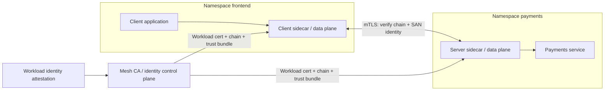
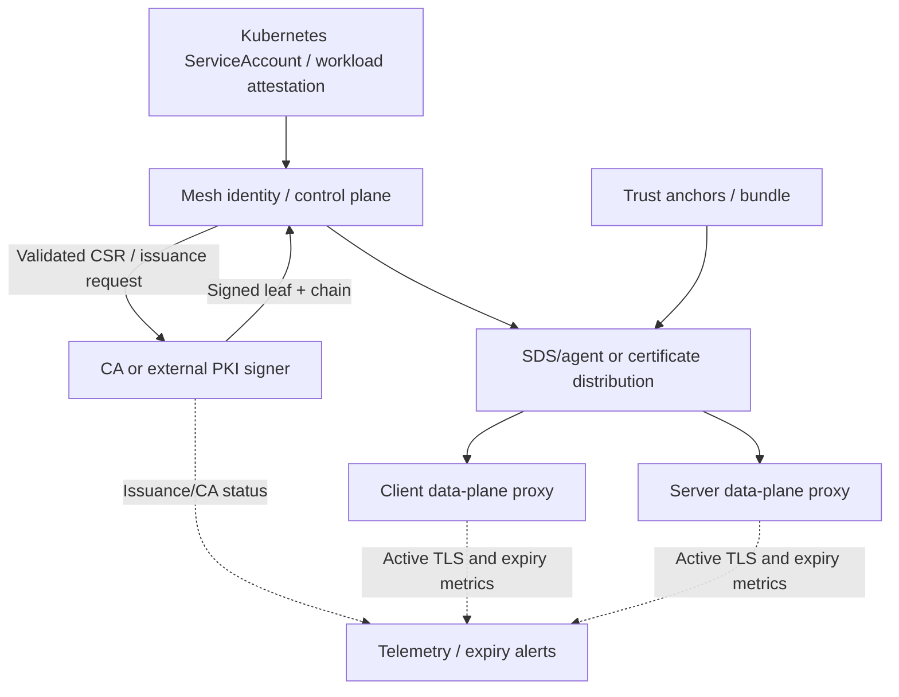
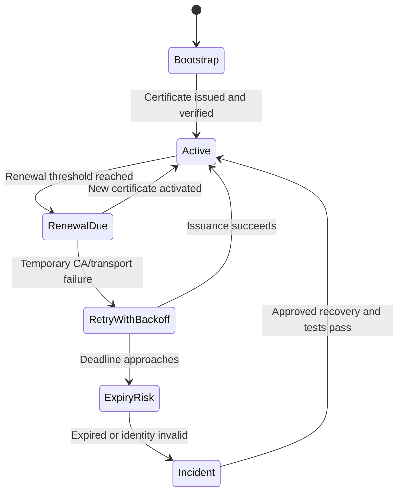
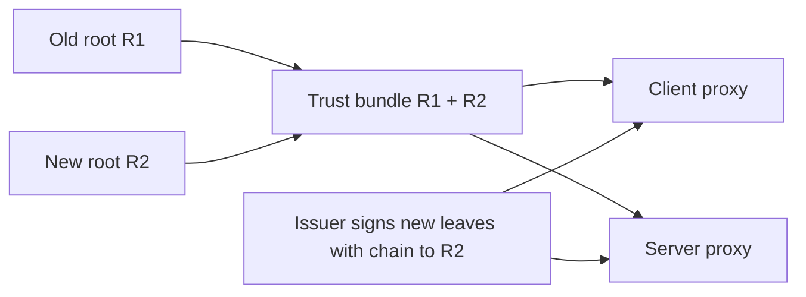
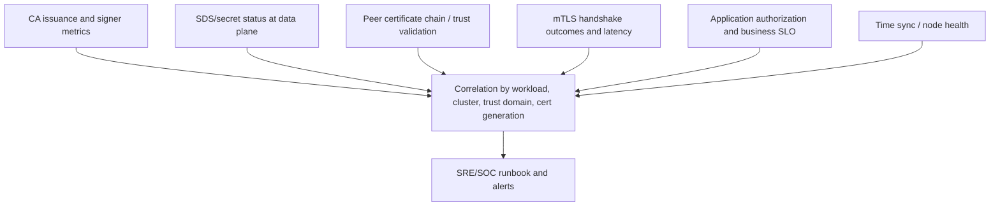

# Certificate rotation trong service mesh

> **Học phần:** `SECURITY_NETWORK_SECURITY`  
> **Chương:** Service mesh và mTLS  
> **Mục tiêu:** Hiểu, thiết kế và vận hành **luân chuyển chứng thư số (certificate rotation)** trong service mesh để duy trì xác thực workload, mã hóa kết nối và tính sẵn sàng của hệ thống. Nội dung liên hệ với network segmentation, firewall, VPN, DNS, IDS/IPS, PKI, Kubernetes và cloud networking.

## Mục tiêu học tập

Sau bài này, người học có thể:

1. Phân biệt chứng thư **workload/leaf**, chứng thư **intermediate CA/issuer**, **root CA/trust anchor** và **trust bundle**; hiểu vì sao mỗi nhóm cần kế hoạch rotation khác nhau.
2. Diễn giải mTLS handshake, TLS identity validation, X.509 SAN/SPIFFE và vòng đời khóa bí mật.
3. Giải thích vai trò của control plane, CA, identity provider, service account, xDS/SDS, sidecar proxy và ambient datapath trong phát hành, phân phối và làm mới chứng thư.
4. Thiết kế **leaf certificate renewal tự động**, sớm hơn thời hạn hết hạn và có buffer cho lỗi, lệch đồng hồ, kết nối tồn tại lâu.
5. Lập quy trình **root/issuer rotation không gián đoạn** bằng phân phối trust bundle trước, chuyển đổi signer, giữ overlap và thu hồi trust cũ sau khi chứng minh không còn phụ thuộc.
6. Xử lý những trường hợp cross-cluster/multi-mesh, ingress/egress gateway, workload restart, mạng phân đoạn và control plane/CA outage.
7. Xây dựng metrics, cảnh báo, runbook và kiểm thử chứng minh mTLS vẫn hoạt động, vẫn xác thực đúng peer và không fail-open thành plaintext.
8. Phân biệt rotation bình thường với **key compromise/credential incident**, hiểu giới hạn của revocation và kết nối đã bắt tay từ trước.

## 1. Vì sao certificate rotation là một vấn đề network security?

Service mesh thường đặt proxy/data plane giữa các workloads để thực thi **mutual TLS (mTLS)**, identity-aware access và telemetry. Khác với một kết nối HTTPS public chỉ xác thực server, mTLS đòi hỏi **cả client và server chứng minh danh tính** bằng vật liệu mật mã phù hợp với chính sách.

Chứng thư không tồn tại vĩnh viễn. Chúng có các trường thời hạn, có thể gắn với CA chain, trust domain và private key. Nếu không được đổi mới đúng lúc:

- Proxy từ chối bắt tay mTLS vì **chứng thư hết hạn**.
- Workload đã đổi issuer nhưng peer **chưa trust CA mới**.
- Proxy đã nhận chứng thư mới nhưng **chưa nhận trust bundle mới**, hoặc ngược lại.
- Gateway, sidecar hoặc control plane chỉ tải cert khi khởi động, nên gặp lỗi sau thời gian chạy dài.
- Một identity đã không còn được phép vẫn có chứng thư chưa hết hạn; policy cần xử lý riêng.
- Khi CA private key bị lộ, giữ CA cũ trong trust bundle quá lâu tạo rủi ro lớn.
- Một mạng phân đoạn bị cắt khỏi CA/control plane sẽ không thể renew dù data-plane connections cũ vẫn có thể đang hoạt động.

**Certificate rotation** là quá trình thay đổi có kiểm soát **chứng thư, khóa và/hoặc trust material** trước khi cũ hết hiệu lực hoặc khi có rủi ro, trong khi duy trì **đúng danh tính, đúng quyền và đúng trạng thái mã hóa**.

Khác với “thay file PEM”, rotation là một bài toán **phân phối cấu hình, đồng bộ trust, thời gian, thất bại từng phần và quan sát datapath**.

## 2. Mô hình mTLS trong service mesh



Đường dữ liệu có thể là:

1. Ứng dụng frontend gửi request đến service payments.
2. Data plane/proxy thiết lập kênh TLS được xác thực hai phía.
3. Mỗi peer kiểm chứng chuỗi chứng thư, hạn dùng, ràng buộc CA và **danh tính peer** được phép.
4. Chính sách authorization quyết định identity của caller có được gọi service/operation không.
5. Control plane/CA quản lý cấp và làm mới chứng thư theo identity của từng workload.

**TLS handshake thành công ≠ business authorization thành công.** Một chứng thư hợp lệ chứng minh một danh tính đã được CA xác nhận; quyền gọi API phải đến từ policy riêng, không phải “có cert = được gọi tất cả services”.

### NetworkPolicy/Firewall vẫn có vai trò

mTLS không biến một subnet thành an toàn nếu proxy bị bypass. **Firewall, Kubernetes NetworkPolicy, VPN segmentation và egress gateway** giới hạn nơi workload có thể kết nối. mTLS bảo vệ **identity/channel** trên đường được phép. IDS/IPS/NDR cần được đặt đúng vị trí để quan sát metadata và tình trạng mTLS mà không giả định luôn đọc được payload đã mã hóa.

## 3. Phân biệt bốn loại vật liệu tin cậy

| Loại | Vai trò | Rotation thường gặp | Rủi ro riêng |
|---|---|---|---|
| **Workload leaf certificate** | Đại diện danh tính Pod/service/proxy, dùng trong handshake | Ngắn hạn, tự gia hạn thường xuyên | Hết hạn, đổi identity sai, mất private key |
| **Issuing/intermediate CA** | Ký leaf cert theo chain được root tin | Theo kế hoạch issuer rollover | Peer có chain không khớp, signer cũ vẫn hoạt động |
| **Root CA/trust anchor** | Điểm neo trust để xác minh chain | Ít thường xuyên, độ rủi ro cao | Trust split toàn mesh, root bị lộ |
| **Trust bundle** | Tập root/intermediate được client chấp nhận theo triển khai | Có thể chứa **cũ và mới** trong giai đoạn overlap | Trust mở rộng không kiểm soát; loại CA cũ quá sớm |

### Hai hướng luân chuyển độc lập

- **Cấp chứng thư mới:** thay cert/khóa được proxy dùng để **trình ra** với peer.
- **Cập nhật danh sách CA đáng tin:** thay vật liệu mà proxy dùng để **xác minh** chứng thư peer.

Một proxy có thể **trình cert mới** nhưng vẫn **trust root cũ**, hoặc **trust cả hai roots** nhưng vẫn trình cert cũ. Vì vậy không thể mô tả rotation chỉ là “restart toàn bộ Pods”.

### Leaf vs CA signing key

Thay leaf key không đồng nghĩa thay root key. Một CA vẫn có thể ký nhiều thế hệ leaf. Khi **issuer key** bị compromise, việc đổi leaf của một vài workloads dưới chính issuer bị lộ có thể **không xử lý hết rủi ro** vì attacker còn khả năng ký giả mạo. Khi **root key** bị compromise, cần kế hoạch migration và loại root trust theo quy trình sự cố.

## 4. Chứng thư X.509 và các trường phải đọc

Một chứng thư X.509 thường chứa:

- **Subject / SAN:** danh tính được xác nhận. Trong service mesh có thể dùng URI SAN dạng SPIFFE ID.
- **Issuer:** CA ký chứng thư.
- **Serial number:** định danh chứng thư do issuer cấp; không phải workload identity.
- **Not Before / Not After:** khoảng thời gian sử dụng được.
- **Public key / signature algorithm:** vật liệu khóa công khai và cách CA ký.
- **Key Usage / Extended Key Usage (EKU):** những mục đích dùng cert được phép theo profile/validator; mTLS client và server roles cần cấu hình tương thích.
- **Basic Constraints / path length:** phân biệt CA và end-entity cùng giới hạn chain.
- **Authority Key Identifier / Subject Key Identifier:** trợ giúp liên kết chain tùy profile.
- **Certificate chain:** leaf → intermediate(s) → root/trust anchor theo cách trust engine xây dựng path.

**Không phải mọi mesh cùng certificate profile.** Một số mesh dùng URI SAN/SPIFFE, một số có trust domain/certificate policy và identity scheme khác. Hãy lấy schema từ CA/trust domain hiện hành, không ép CN hoặc DNS SAN làm nguồn danh tính duy nhất.

### Ba phép kiểm tách biệt

| Kiểm tra | Mục đích | Ví dụ thất bại |
|---|---|---|
| **Cryptographic chain** | Chứng thư được ký bởi CA chain đáng tin | Unknown authority / missing intermediate |
| **Time validity** | Thời gian hiện tại nằm trong khoảng chứng thư hợp lệ | Expired / not yet valid |
| **Peer identity & authorization** | SAN/URI/identity đúng service được phép | Cert hợp lệ nhưng sai namespace/service account |

**Không sửa lỗi hết hạn bằng cách tắt verify hoặc chấp nhận mọi cert.** Làm vậy có thể biến sự cố availability thành rủi ro giả mạo service.

## 5. SPIFFE ID, trust domain và chính sách danh tính

Trong nhiều thiết kế service mesh, workload identity có thể biểu diễn bằng SPIFFE ID:

```text
spiffe://cluster.local/ns/payments/sa/payments-api
spiffe://cluster.local/ns/storefront/sa/frontend
```

Các chuỗi trên là **ví dụ**, không khẳng định mọi mesh luôn dùng trust domain `cluster.local` hoặc format path giống nhau. Một SPIFFE ID thường là URI dùng để mô tả một workload principal thuộc trust domain cụ thể.

### Những câu hỏi xác thực

1. **Ai cấp identity?** Control plane/identity provider dựa trên Kubernetes ServiceAccount, token và workload attestation thế nào?
2. **Ai được phép ký cert cho identity này?** CA có giới hạn tenant/trust domain không?
3. **Peer chấp nhận trust domain nào?** Local mesh, remote cluster, partner mesh?
4. **Authorization có phân biệt ServiceAccount/namespace không?** Chỉ tin root CA không bảo đảm caller đúng quyền.
5. **Có replay/identity reuse trong quá trình rollout không?** Old workloads có thể vẫn có cert valid.
6. **Khi ServiceAccount bị xóa hoặc đổi tên, cert cũ xử lý thế nào?** Cần TTL ngắn, policy cập nhật và incident process; không kỳ vọng certificate tự biến mất.

### Trust domain thay đổi có thể giống identity migration

Nếu đổi `spiffe://old-domain/...` sang `spiffe://new-domain/...`, dù CA/trust bundle đã đúng, **authorization policy** có thể vẫn từ chối identity mới. Vì vậy trust-domain rotation cần kiểm **cả cert chain và policy principal matching**.

## 6. Handshake mTLS khi có chứng thư mới

```mermaid
sequenceDiagram
    autonumber
    participant A as Client proxy
    participant B as Server proxy
    participant CA as Mesh CA/control plane
    A->>CA: Obtain/renew workload certificate
    CA-->>A: New leaf + key material or signing response + trust bundle
    B->>CA: Obtain/renew workload certificate
    CA-->>B: New leaf + trust bundle
    A->>B: TLS ClientHello
    B-->>A: Server certificate chain
    A->>A: Verify CA, validity, SAN/peer identity
    B->>A: Request client certificate (mTLS)
    A-->>B: Client certificate/proof of private key possession
    B->>B: Verify CA, validity, client identity
    A<-->>B: Encrypted application traffic
```

Đây là mô hình **khái niệm** của mTLS, không phải bản tin TLS 1.3 chi tiết. Thứ tự bắt tay thực khác theo phiên bản/protocol; cert cấp bằng cách CA **ký CSR** hoặc control plane phân phối key/cert tùy mesh. Không suy control plane luôn nhìn thấy private key nếu thiết kế dùng khóa sinh cục bộ.

### Phép kiểm khi rotation

- Client trình leaf mới, server có trust chain để xác minh?
- Server trình leaf mới, client có trust chain để xác minh?
- Chứng thư chứa SAN/URI identity hợp lệ?
- mTLS policy có thực sự ở chế độ nghiêm ngặt và không chấp nhận plaintext fallback?
- Kết nối mới đã dùng cert mới hay connection pool vẫn reuse TLS sessions/connections cũ?
- Nếu có SNI/TLS origination ở egress gateway, certificate trust store nào được dùng?

**Test phải tạo kết nối TLS mới** (không chỉ đọc HTTP response qua connection cũ) và xem peer certificate/identity từ datapath có quyền quan sát.

## 7. Kiến trúc cấp phát và phân phối chứng thư

Một service mesh có thể dùng:

- **CA/root/issuer:** ký CSR hoặc cấp chứng thư cho workload.
- **Identity attestation:** xác nhận Pod/service account/token/namespace hay workload selector.
- **Control plane:** phân phối cấu hình và identity-related settings.
- **xDS/SDS (Secret Discovery Service):** trong một số kiến trúc Envoy, proxy nhận TLS secrets/certificates động qua control plane; cơ chế và tên resource phụ thuộc sản phẩm.
- **Filesystem/Secret watch:** trong triển khai khác, sidecar/agent đọc cert và key từ filesystem rồi reload.
- **Agent-based issuance:** node/Pod agent yêu cầu và cấp phát workload identity theo giao thức phù hợp.
- **Trust-bundle distribution:** đảm bảo peers nhận CA/trust domains mà policy cho phép.



### Đừng đánh đồng control-plane health với certificate health

Control plane có thể **Running/Ready** nhưng proxy không nhận được cert mới do network policy, certificate errors, SDS subscription, thiếu quyền service account hoặc clock skew. Ngược lại, một số **data-plane connections đang tồn tại** có thể tiếp tục truyền dữ liệu khi CA tạm unavailable; nhưng không được suy rằng **kết nối mới và workload restart** vẫn thành công.

## 8. Vòng đời leaf certificate

Một vòng đời leaf điển hình:

1. **Bootstrap:** Pod/sidecar xác thực được identity để yêu cầu chứng thư.
2. **Issuance:** CA cấp leaf và chain với hạn dùng.
3. **Active:** proxy sử dụng leaf làm peer identity cho các TLS handshakes.
4. **Renewal window:** trước khi hết hạn, agent yêu cầu chứng thư mới.
5. **Validation & activation:** proxy nhận cert mới, xác minh key pair và sử dụng cho **handshakes mới**.
6. **Overlap:** có thể tồn tại connections/TLS sessions được lập bằng cert cũ; kế hoạch nên xử lý theo TTL/drain.
7. **Expiry / retirement:** cert cũ không được dùng để khởi tạo handshakes sau `NotAfter`.
8. **Incident rotation:** nếu key compromise, cần đổi ngay, hạn chế trust/identity và xử lý các sessions hiện có theo policy.



**Không có thời điểm renewal duy nhất áp cho mọi mesh.** Interval, jitter và thao tác khi cert/key đổi phụ thuộc vendor/configuration; đo từ chứng thư thực tế thay vì suy từ một giá trị mặc định cũ.

## 9. Leaf rotation tự động: điều kiện thiết kế

Một hệ thống renewal an toàn nên:

- Bắt đầu renew **sớm đáng kể** trước khi cert hết hạn.
- Có **retry với backoff và jitter**, tránh mọi workloads gọi CA đồng thời.
- Theo dõi clock skew giữa node/CA, không chờ sát `NotAfter`.
- Đảm bảo identity attestation và CSR được cấp đúng ServiceAccount/trust domain.
- Sinh hoặc quản lý private key theo profile và nơi lưu được phê duyệt.
- Kiểm chứng cert mới **khớp key**, chain, SAN, EKU, validity, algorithm policy.
- Phân phối leaf/cert bundle bằng kênh có authentication và access control.
- Kích hoạt material mới một cách nhất quán; tránh cert/key **mismatch** khi cập nhật file tách biệt.
- Giữ policy STRICT và không fallback sang plaintext khi cấp phát lỗi.
- Có metrics cho **thời điểm đã nhận cert**, **thời điểm có hiệu lực trên proxy**, và **handshake success**.

### Lưu ý với kết nối dài

TLS thường xác minh chứng thư ở **thời điểm handshake**. Một HTTP/2/gRPC connection có thể sống lâu, sử dụng session đã tạo trước cert rotation. Việc đổi file/cert trong proxy **không tự chấm dứt tất cả connection hiện tại hoặc làm peer xác minh lại**.

Nếu cần thu hồi nhanh một identity/key bị lộ, phải cân nhắc **drain/terminate connections, policy deny và service account containment** theo tác động, không chỉ đợi chứng thư hết hạn.

## 10. Root CA rotation khác leaf rotation ở điểm nào?

Root CA rotation là thay đổi **trust anchor** hoặc root signing key được những proxies dùng để xác minh chains. Đây là thao tác rủi ro cao vì mọi workload có thể đang tin cùng một root cũ.

Sai lầm nghiêm trọng: **bật issuer mới ký leaf dưới root mới trước khi peers biết/trust root mới**. Các handshakes sẽ lỗi theo hướng phụ thuộc ai đã nhận trust bundle.

### Quy trình tư duy an toàn

1. Chuẩn bị root mới `R2` và trust bundle cho phép `R1 + R2` trong giai đoạn migration.
2. **Phân phối trust bundle trước** cho mọi xác minh liên quan; đo coverage.
3. Khi peers đều có thể validate chain mới, chuyển issuer/signer để cấp cert mới dưới `R2`.
4. Renew/rollover leaf ở các workloads/gateways phù hợp; kiểm traffic **mTLS mới**.
5. Đợi/điều khiển hết vòng đời cert cũ và drain những connections liên quan theo policy.
6. Khi **không còn chuỗi chứng thư hợp lệ phụ thuộc R1**, loại `R1` khỏi bundle và ngừng issuer cũ.
7. Kiểm tra không còn authn, TLS error hoặc trust-bundle split; giám sát sau rollout.



**Trust overlap không phải lý do giữ R1 vĩnh viễn.** Mỗi root được thêm làm tăng tập issuer có thể được chấp nhận. Có owner, deadline và bằng chứng trước khi loại root cũ.

### Về cross-signing

Một số PKI dùng **cross-signing/alternate chain** để hỗ trợ chuyển root; đây là kỹ thuật riêng có điều kiện và không thay thế yêu cầu hiểu **trust path thực**. Không giả định cert dưới R2 tự nhiên được trusted bởi những peers chỉ có R1.

## 11. Intermediate/issuer rotation và root rotation

Nếu root CA giữ nguyên `R1`, nhưng intermediate issuer đổi từ `I1` sang `I2`, cả hai chain có thể cùng xác minh dưới `R1` **nếu** chain, key usage, name constraints, certificate policies và các điều kiện PKI tương ứng hợp lệ.

### Có thể đơn giản hơn root rotation, nhưng không tự động an toàn

- Workloads cần **đúng intermediate chain** khi trình cert mới.
- Nếu proxy dùng pin intermediate/issuer identity hoặc custom bundle, cần cập nhật đó trước.
- Control plane phải có quyền ký/cấu hình với `I2` và ngăn ký leaf không đúng profile.
- Leaf theo `I1` đang hoạt động có thể còn hợp lệ đến khi hết hạn; issuer bị compromise là trường hợp riêng cần thay khẩn.
- Không xóa private key/issuer I1 ngay nếu vẫn cần hoạt động khôi phục hoặc chứng minh; nhưng cũng **không để issuer cũ cấp cert mới trái mục tiêu**.
- Mesh nhiều cluster có thể có issuer I1/I2 khác nhau dù share root; cần kiểm acceptance theo từng trust domain.

**So sánh:** Leaf rotation thay danh tính/chứng thư workload; issuer rotation thay hệ thống ký; root rotation thay nền tảng trust. Độ rộng tác động và kế hoạch rollback khác nhau.

## 12. Trust bundle overlap: tại sao thứ tự là điều kiện sống còn?

Trong Root CA migration bình thường, trust bundle có thể chuyển:

```text
T0: trust = {R1}; signer = issuer dưới R1
T1: trust = {R1, R2}; signer vẫn dưới R1
T2: trust = {R1, R2}; signer chuyển dần sang R2
T3: trust = {R2}; mọi chains đang phục vụ đã chuyển sang R2
```

### Khi migration đi sai thứ tự

| Thứ tự sai | Hệ quả có thể |
|---|---|
| Sign leaf mới bằng R2 trước khi trust bundle R2 được phân phối | Peer chỉ tin R1 từ chối cert mới |
| Gỡ R1 khi workloads vẫn trình leaf/chain R1 | Các TLS handshakes mới lỗi |
| Tin bundle R1+R2 nhưng quên policy identities | Chain OK nhưng authorization vẫn deny |
| Roll cert mới nhưng proxy không reload | Workload tiếp tục trình cert cũ và có nguy cơ expire |
| Có hai trust domains không ánh xạ đúng | Federation/multi-cluster bắt tay hoặc identity check lỗi |
| Chỉ kiểm một phía TLS | Client kiểm server OK nhưng server không trust client, hoặc ngược lại |
| Chỉ kiểm connection cũ | New TLS handshakes có thể thất bại mà health endpoint vẫn báo OK |

### Đo trạng thái chuyển đổi

Theo dõi **số proxy đã nhận bundle R2**, **số proxy đang trình cert dưới R2**, **số luồng còn dùng R1** (nếu có telemetry đủ), và **mTLS handshake failures** ở cả hai chiều. Không chỉ dùng “ConfigMap đã apply” làm bằng chứng.

## 13. Cửa sổ thời gian: tính renewal buffer

Đặt:

- `T`: tổng tuổi thọ leaf certificate.
- `R`: khoảng thời gian **trước expiry** mà hệ thống bắt đầu renewal.
- `D`: độ trễ phân phối/activation tệ nhất đã đo được.
- `O`: độ lệch đồng hồ lớn nhất được chấp nhận giữa các node/CA.
- `F`: dự phòng cho lỗi control plane/network/retries.
- `M`: biên an toàn còn lại sau khi renewal.

Một điều kiện thiết kế hữu ích:

```text
R > D + O + F + M
```

**Đây là bất đẳng thức planning**, không phải guarantee từ RFC hoặc công thức vendor. Thực tế cần safety factor và phân phối xác suất: các sự cố lớn có thể làm `D/F` tăng mạnh.

### Ví dụ số học

Giả định leaf có lifetime `T=24h`. Muốn bắt đầu renew trước expiry `R=8h`. Thời gian dự phòng:

- Propagation/reload deadline dự kiến: `D=20 phút`.
- Clock skew budget: `O=5 phút`.
- CA/network outage + retry budget: `F=3 giờ`.
- Biên dự phòng khác: `M=1 giờ`.

Tổng: `20 phút + 5 phút + 3 giờ + 1 giờ = 4 giờ 25 phút`. Vì `8 giờ > 4 giờ 25 phút`, bài toán **đạt budget giả định**, nhưng không có nghĩa sẽ an toàn trước outage dài hơn 3 giờ. Cần xác minh thời gian thực, percentile latency và các thiết lập rotation mà mesh đang áp.

### Renewal jitter

Nếu hàng nghìn Pods renew đúng một mốc, CA có thể bị tải đột ngột. Phân tán requests bằng jitter và capacity planning, **không đồng bộ tất cả Pod restarts** trong một khoảng ngắn mà không có nhu cầu.

## 14. Thời gian hệ thống, NotBefore và NotAfter

Certificate validity phụ thuộc đồng hồ của phía xác minh:

- **Clock skew phía trước:** có thể coi cert hết hạn sớm.
- **Clock skew phía sau:** có thể coi cert mới `NotBefore` chưa có hiệu lực.
- **CA issue-time khác node time:** tạo các lỗi không xảy ra đồng đều giữa nodes.
- **NTP/chrony lỗi trong mạng cô lập:** khiến một số node báo mTLS certificate errors dù cert thực còn hạn.
- **Host clock** thường ảnh hưởng các containers trên cùng kernel; một container image không có NTP client không nhất thiết có clock độc lập.

### Điều tra

1. So thời gian UTC trên node/control plane/CA, không lấy log timezone mơ hồ.
2. Kiểm chứng thực tế `NotBefore`, `NotAfter` và thời điểm proxy activation.
3. Phân biệt lỗi `certificate expired` với `certificate not yet valid`.
4. Không “sửa” clock bằng thao tác tùy tiện trên production node; xử lý time synchronization theo change process.
5. Giám sát mức lệch đồng hồ trước khi có sự cố PKI.

**Không đặt renewal sát expiry rồi hy vọng mọi đồng hồ khớp tuyệt đối.** Thời gian và khả năng phục hồi phải là một phần của thiết kế rotation.

## 15. Trust-bundle update và workload-certificate update có thể lệch nhau

Một mesh có thể phân phối các loại TLS secrets độc lập, ví dụ:

- Workload certificate/chain + private key;
- validation context/trusted CA bundle;
- authorization identities và peer matching policy.

Nếu cập nhật trust bundle và cert trong hai transactions khác nhau, có **khoảng chuyển tiếp**. Điều đó không nhất thiết là lỗi, nếu rollout được thiết kế đúng như root overlap.

### Cần bảo đảm điều gì?

- Proxy không đọc **cert mới nhưng key cũ** hoặc ngược lại.
- Certificate validation context không mất CA cũ trước khi migration hoàn tất.
- Secret distribution channel có authentication và access controls.
- Khi update lỗi, proxy không dùng “trust-all” hoặc plaintext fallback.
- Có signal về **last successful SDS/secret update**, không chỉ last attempted update.
- Cert thực sử dụng tại **handshake mới** được đo thay vì giả định file đã được đọc.
- If some proxies missed bundle update, migration **phải dừng ở bước trước signer switch**.

**Phân biệt policy intent và applied state.** Một CRD/ConfigMap mới không bảo đảm mọi proxy đã thay validation context.

## 16. Kết nối lâu sống, session reuse và cert rotation

HTTP/2/gRPC thường duy trì connection lâu. TLS certificate được kiểm tại handshake; một connection đã mở không **tự xác minh lại peer cert mỗi request**. Một ứng dụng có thể tiếp tục hoạt động trên pool connection cũ dù chứng thư hiện trình cho kết nối mới đã lỗi.

### Kiểm thử chính xác

- Tạo một TLS connection **mới** sau rotation.
- Tạo connection từ **cả client và server** đại diện các trust domains.
- Xác minh **peer identity** đang được kiểm đúng; không chỉ HTTP 200.
- Sau khi rollout R2, drain/close các connections cũ khi cần bảo đảm cắt reliance vào R1.
- Với cert compromise, cân nhắc terminate sessions và thay keys ngay theo containment policy.
- Đo sự gia tăng handshake rate khi drain, tránh gây CPU spike hoặc thundering herd.

### Session resumption

TLS session resumption và proxy implementation có thể khiến một số connections không trải qua đầy đủ việc trao đổi certificate giống fresh handshake. Chi tiết tùy TLS stack. Nếu cần bằng chứng strict identity sau rotation, sử dụng **test harness thực hiện fresh full handshake** hoặc chế độ kiểm thử phù hợp, không chỉ reuse client session cache.

## 17. Revocation: certificate rotation không tự xóa quyền ngay

Có nhiều cách quản lý việc một cert không còn được chấp nhận:

- **Expiry tự nhiên:** leaf sống ngắn, không cần indefinite trust.
- **Authorization deny:** chặn principal/operation trong policy dù cert chưa hết hạn.
- **Revocation bằng CRL/OCSP:** phụ thuộc profile, CA và TLS implementation; không giả định mesh tự kiểm revocation endpoint.
- **Remove trust anchor/issuer:** phạm vi rộng, cần xử lý rollout và tác động hệ thống.
- **Terminate active connections:** cần nếu phải cắt channel đã thiết lập.
- **Revoke attestation/ServiceAccount/issuer rights:** ngăn cấp cert mới dưới identity không còn hợp lệ.

### Khi key compromise

Chỉ đợi cert hết hạn có thể không phù hợp. Quy trình thường cần **rotate private key, deny identity/service path, revoke credentials/roles, ngừng issuer bị lộ khi cần, đóng sessions**, và đánh giá ảnh hưởng dữ liệu. Mức độ khẩn phụ thuộc evidence và quyền thực.

**Đừng tuyên bố có cơ chế revoke tức mọi kết nối đã tồn tại tự bị hủy.** Điều đó phải được kiểm thử với mesh/TLS stack cụ thể.

## 18. Bảo vệ private key trong quá trình rotation

Private key là tài sản nhạy cảm nhất của peer identity. Một CA có thể xác minh public key của workload, nhưng nếu private key bị lộ thì attacker có khả năng giả danh trong phạm vi cert/identity và policy cho phép.

### Nguyên tắc

- Sinh key trong workload/agent khi thiết kế cho phép, tránh di chuyển private key qua mạng không cần thiết.
- Nếu mesh/control plane cấp cả key, cần kênh phân phối đã xác thực, TLS, authorization và audit.
- Hạn chế quyền đọc key file/Secret/memory; không mount vào sidecar/application khác ngoài nhu cầu.
- Không đưa private keys vào log, support ticket, telemetry, core dump hoặc job artifacts.
- Không tái sử dụng một private key cho nhiều workload identities.
- Cân nhắc **key rotation cùng certificate rotation**, tuân thủ CA profile/mesh support; không chỉ thay NotAfter bằng khóa cũ vô hạn.
- Xác minh thuật toán/kích thước khóa theo chính sách; không downgrade crypto để tăng compatibility ngoài approval.
- Hủy/thu hồi key cũ sau khi đã hoàn tất migration và không cần khả năng rollback bằng key bị lộ.

### Cert rollover và key rollover

**Reissuing cert với cùng key** làm thay metadata/thời hạn nhưng không xử lý nguy cơ private key cũ đã bị lộ. **New key pair** giảm thời gian sử dụng cùng khóa; với incident, cần điều tra cả issuer và credential path. Hãy phân biệt cả hai khi báo cáo “rotated successfully”.

## 19. Identity attestation: Kubernetes ServiceAccount có liên quan gì?

Trong mesh tích hợp Kubernetes, CA/identity controller thường dựa vào thông tin workload do API server/token/agent xác nhận để phát hành cert cho đúng identity.

### Điều gì cần kiểm?

- ServiceAccount được phép đại diện identity nào?
- Token được bound theo audience/expiration/Pod khi nền tảng hỗ trợ?
- CA/controller xác thực token và Kubernetes namespace/serviceAccount thật, không tin user-supplied header?
- Workload có thể giả mạo identity từ namespace khác nếu có Kubernetes API/RBAC quá rộng không?
- Xóa ServiceAccount hoặc revoke quyền có ngăn **cấp mới** không?
- Cert cũ còn sống đến khi hết hạn, nên có cần authorization deny/connection drain không?
- Agent có quyền truy cập CA/control plane qua network segmentation cho phép không?

### Điểm giới hạn

NetworkPolicy hạn chế traffic nhưng không xác minh Kubernetes ServiceAccount đúng danh tính. Ngược lại, identity hợp lệ không tự có quyền truy cập mọi service. **Service mesh mTLS + workload RBAC/IAM + namespace policies + application authorization** là các lớp khác nhau.

## 20. Istio/Envoy: khái niệm áp dụng để hiểu rotation

Trong một số triển khai Istio dựa trên Envoy, proxy có thể nhận workload cert và trusted CA information động thông qua cơ chế SDS/xDS. Control plane/CA có trách nhiệm xác minh identity và cấp chứng thư theo cấu hình mesh. Tên endpoint/resource, credential provider và certificate TTL **phụ thuộc phiên bản và deployment profile**.

### Bốn câu hỏi quan trọng khi vận hành

1. Proxy đã nhận leaf mới qua SDS/secret mechanism chưa?
2. Proxy đã nhận trust bundle mới chưa?
3. Những TLS handshakes mới dùng certificate chain nào?
4. AuthorizationPolicy/PeerAuthentication/DestinationRule có giữ đúng STRICT/mTLS identities không?

**Không nên suy “Istiod running” = toàn bộ certificates vừa renew**. Đo proxy secret status, cert expiry, last update, handshake errors và chain/identity tại từng nhóm workloads.

### Tại sao cấu hình TLS traffic quan trọng?

Nếu một workload nhận cả mTLS và plaintext trong quá trình rollout, hệ thống có thể vẫn “healthy” dù **mTLS security invariant đã bị hạ cấp**. Với vùng nhạy cảm, cần chính sách mTLS nghiêm ngặt theo mesh capabilities và kiểm tra negative plaintext traffic.

## 21. Khác biệt hệ sinh thái: Istio, Linkerd, Consul, SPIRE

Các triển khai service mesh khác nhau về **identity issuer**, cơ chế root distribution và certificate renewal:

| Hệ sinh thái | Mô hình ở mức khái niệm | Điều cần kiểm theo phiên bản |
|---|---|---|
| **Istio/Envoy** | Workload identity, mesh CA hoặc external CA, SDS/secret delivery, authorization policies | CA provider, root bundle rollout, cert TTL, proxy status, ambient/sidecar |
| **Linkerd** | Identity trust anchor và issuer certificates, proxies nhận workload identity | Issuer lifetime, trust anchors, renewal automation, proxy identity metrics |
| **Consul service mesh** | Connect CA, intentions/identity và sidecar/native integrations | CA provider, root rollover procedures, intentions/peer trust |
| **SPIFFE/SPIRE** | Workload attestation và SVID issuance, trust bundles cho trust domains | X.509-SVID TTL, Workload API, bundle federation, agent/server renewal |
| **Cloud-managed mesh** | Provider control plane/CA integration và managed data plane | Ai có quyền thay trust anchor/issuer, SLA, logging, rollback |

**Không sao chép tài liệu rotation của sản phẩm A sang sản phẩm B.** Ví dụ `istioctl` không áp cho Linkerd, và cách cập nhật issuer Secret trong Linkerd khác secret delivery của Istio. Khi triển khai, đọc **tài liệu chính thức của phiên bản đang chạy** và xác nhận actual certificates/trust bundles.

### Workload identity tiêu chuẩn vs sản phẩm

SPIFFE/SVID mô tả các khái niệm identity, nhưng một mesh cụ thể có thể dùng CA/controller riêng. Một service mesh có thể dùng URI SAN hoặc identity theo phong cách SPIFFE mà không phải mọi API của SPIRE đều sẵn có. Kiểm **khả năng interop thực** thay vì giả định cùng chuỗi SAN nghĩa đã trust nhau.

## 22. Multi-cluster, multi-mesh và trust-domain federation

Trong một cluster duy nhất, mọi workloads có thể chia sẻ một trust anchor và trust domain. Nhưng khi kết nối **nhiều Kubernetes clusters, vùng địa lý, VPC, đối tác hoặc meshes khác nhau**, hệ thống phải xác định **ai tin ai, ở phạm vi nào và bằng chứng nào**.

### Những hình thức kết nối

- **Một root CA, nhiều issuers:** các clusters dùng issuing CA riêng nhưng chain lên root chung.
- **Nhiều roots trong một bundle:** một cluster chấp nhận identity được cấp dưới các roots đã phê duyệt.
- **Trust-domain federation:** mỗi domain quản lý PKI/identity riêng; peers trao đổi trust bundles và chính sách nhận diện theo trust domain.
- **Cross-mesh gateway:** traffic đi qua gateway có mTLS ở từng chặng; identity end-to-end có thể bị chuyển đổi/ủy quyền tại gateway.
- **Third-party API:** client có thể sử dụng TLS public PKI hoặc private enterprise CA khác mesh CA; phải tách trust store/policy.

### Rủi ro khi rotation

| Kịch bản | Hệ quả |
|---|---|
| Cluster A đã trust R2, cluster B chưa | Kết nối A↔B lỗi theo hướng/role cert được trình |
| Root R2 được chấp nhận nhưng authz chỉ nhận identity từ old trust domain | Chain OK, request vẫn 403/deny |
| Gateway A dùng cert mới, gateway B giữ validation context cũ | mTLS handshake failure trên đường liên cluster |
| Offline cluster bỏ lỡ trust bundle update | Split-brain trust; partial outage |
| Federation trust bundle nhận thêm CA không đủ giới hạn | Tăng tập issuers/principals có thể được công nhận |
| Trên Internet dùng public TLS cert nhưng nhầm với workload mesh cert | Sai kỳ vọng về SAN, CA, key usage và policy |

### Thực hành đúng

1. Inventory **trust domains**, CA roots/issuers, workload identities và cross-cluster traffic flows.
2. Xây ma trận **trình cert/verify cert** ở từng chặng (source sidecar, local gateway, remote gateway, remote sidecar).
3. Phân phối trust bundles theo từng domain trước signer migration.
4. Kiểm namespace/ServiceAccount principal mappings, policy federation, SAN và authorization rules.
5. Test kết nối **hai chiều**, tạo **fresh handshakes** qua representative paths.
6. Giám sát mạng phân đoạn, VPN/peering route và kết nối control plane/CA cho mỗi cluster.
7. Remove roots cũ từ **tất cả clusters và gateways** sau khi có bằng chứng leaf cũ không còn được dùng.

**Không xem federation là “tin mọi identity thuộc CA đối tác”.** Trust chain chứng minh nguồn cấp identity; policy phải giới hạn caller/service/action phù hợp.

## 23. Ingress, egress và certificate rotation là các miền khác nhau

Một mesh có thể đồng thời xử lý nhiều TLS contexts:

1. **Service-to-service mTLS nội bộ:** workload certs do mesh CA cấp.
2. **Ingress edge TLS:** cert cho hostname public của ứng dụng, có thể do public CA/cert-manager/external secret manager cấp.
3. **Egress origination TLS:** outbound HTTPS tới SaaS, có thể dùng public trust store hoặc client certificate riêng.
4. **Gateway-to-gateway mTLS:** kết nối giữa clusters hoặc mạng/VPN có chain và authorization riêng.
5. **Control-plane/webhook serving TLS:** cert cho API/Webhook/control-plane endpoints, có vòng đời khác.

### Ma trận nơi cần cập nhật

| Đường | Cert trình ra | Trust store kiểm | Ai thực thi policy? |
|---|---|---|---|
| Client sidecar → server sidecar | Workload mesh leaf hai phía | Mesh trust roots/identity policy | Mesh data plane + authz |
| Browser → ingress gateway | Ingress server certificate | Browser/public CA store | Ingress/LB/WAF và app auth |
| Ingress gateway → backend sidecar | Gateway workload leaf và backend leaf | Mesh trust store | Mesh mTLS + app authz |
| Egress gateway → external SaaS | External server cert; client cert nếu cần mTLS | External/webPKI/private partner CA | Egress proxy + SaaS |
| API server → admission webhook | Webhook server cert | Kubernetes webhook CA bundle | Kubernetes API client/extension |
| Control plane → data plane config channel | Control-plane serving identity/certs | Mesh-specific mutual trust | xDS/SDS authenticated channel |

**Một chứng thư hết hạn tại ingress** không nhất thiết có liên quan đến mesh leaf CA. Ngược lại, client thấy TLS public endpoint tốt vẫn có thể gặp lỗi mesh-to-backend do root trust mismatch. Phải xác định **chặng bị lỗi**, không đổi CA hàng loạt theo cảm tính.

## 24. Rotation của control plane, webhook và CA API

Ngoài workload certs, các thành phần điều khiển thường có các chứng thư khác:

- **Control-plane serving certificate** cho các kênh cấu hình/TLS tùy implementation.
- **Admission/injection webhook certificate** và `caBundle` mà Kubernetes API server sử dụng để trust webhook.
- **CA signing certificate/key** để cấp workload certs.
- **Agent-to-server mutual authentication credentials**.
- **Kubernetes API server/etcd certificates** do control plane của nền tảng quản lý, không phải mặc nhiên cùng lifecycle với mesh PKI.

### Rủi ro riêng của webhook rotation

Nếu webhook server trình cert mới nhưng `caBundle` phía API server chưa chứa CA chain tương ứng, admission có thể thất bại. Nếu cluster cấu hình failure policy nghiêm, workload deployments/updates có thể bị gián đoạn; nếu cấu hình quá mở, có thể phát sinh bypass admission/security guarantees.

**Đây là hai quyết định cần tách**: service mesh workload mTLS rotation và Kubernetes webhook serving certificate rotation. Tuy cùng dùng X.509, chúng có **client/server khác, CA stores khác, owner khác, blast radius khác**.

### Nguyên tắc

- Inventory certificate purpose, owner, issuer, trust consumer và reload mechanism.
- Cập nhật trust material tại **consumer** trước khi signer/server chuyển khi cần.
- Kiểm application protocol, webhook admission và rollout workloads ngoài datapath mTLS.
- Không “sửa” webhook TLS bằng cách tắt verify hoặc tắt admission security policy mà không có phê duyệt.
- Có thể có automated controllers chuyên cập nhật webhook CA bundle, nhưng phải xác minh hoạt động/version thực tế.

## 25. External CA, cert-manager và quản lý issuer

Một tổ chức có thể sử dụng:

- Mesh built-in CA/issuer;
- Enterprise/private PKI;
- Kubernetes `cert-manager` cho một số đối tượng certificates/issuers;
- Cloud certificate management/managed CA;
- HSM/KMS-backed signing service;
- SPIRE server hoặc một identity control plane khác.

### Ranh giới cần làm rõ

`cert-manager` tạo/renew một Kubernetes `Certificate` resource và Secret theo cấu hình khi được dùng, nhưng **không có nghĩa mọi mesh tự động lấy workload mTLS keys từ Secret đó**. Mỗi mesh có **integration point** riêng với CA/external issuer và data-plane certificate distribution.

### Các câu hỏi khi tích hợp

1. Ai thực sự ký **workload leaf** và ai giữ private keys?
2. Issuer của cert-manager có được mesh dùng trực tiếp hay chỉ cấp cert cho gateway/issuer?
3. Root/trust bundle được cập nhật tới proxies bằng controller nào?
4. Ai kiểm tra CSR identity? External CA có biết Kubernetes ServiceAccount không?
5. Có giới hạn certificate templates, SAN, EKU, lifetime, path constraints và signer permissions?
6. CA keys có nằm trong Kubernetes Secret? Có encryption-at-rest, RBAC, backups phù hợp?
7. Nếu automation issuer lỗi, proxy có retry và expiration alert không?
8. Root rotation có cần thay `Issuer`, `ClusterIssuer`, CA Secret, workload chain hay cả ba?
9. Có nút rollback an toàn không, nếu cert mới đã được cấp dưới root mới?
10. Có control chống certificate issuance cho identity vượt namespace/trust domain không?

**Không đưa private key của root/issuer vào ConfigMap hoặc commit Git.** Khi muốn xem tình trạng, ưu tiên certificate metadata công khai hoặc issuer status; không in Secret data.

## 26. Cấu hình PKI/profile an toàn

Chất lượng certificate rotation phụ thuộc không chỉ thời gian mà còn **profile và quyền cấp phát**.

| Thuộc tính | Mục tiêu |
|---|---|
| Identity/SAN | Chứng thư chứa đúng workload principal và trust domain |
| CA constraints | Leaf không có quyền CA; intermediate/root được giới hạn phù hợp |
| Key Usage/EKU | Hỗ trợ đúng mTLS client/server roles theo verifier |
| Validity | TTL ngắn vừa đủ với khả năng renewal và outage budget |
| Key algorithm/size | Theo crypto policy, tương thích clients và CA |
| Randomness/key storage | Sinh/giữ khóa an toàn, ít quyền |
| CSR authorization | Không cho Pod yêu cầu identity của Pod khác |
| Issuer scope | Mỗi issuer chỉ có quyền ký phạm vi cần thiết |
| Trust distribution | Bundle được phân phối trước migration |
| Audit | Issuance logs có identity/serial/time nhưng không lộ key |

### TTL rất ngắn có luôn tốt hơn không?

TTL ngắn giảm thời gian một cert/key bị đánh cắp còn giá trị, nhưng làm tăng:

- Tần suất gọi CA và tải CPU/signing.
- Số phiên update SDS/secret.
- Khả năng outage nếu CA/control plane bị gián đoạn.
- Áp lực time synchronization.
- Nhu cầu alert và capacity planning.

Thiết kế **risk-based TTL**: xét blast radius, quyền identity, khả năng tự động renew, số workloads, thời gian gián đoạn CA cần chịu đựng và SLO. “TTL ngắn nhất có thể” không tự là lựa chọn tốt nhất nếu renewal không đáng tin.

## 27. Kịch bản root migration theo mốc thời gian

Giả định một mesh có root `R1`, muốn chuyển sang `R2` mà không ngắt mTLS cho workloads hiện tại. Đây là **runbook khái niệm**; những bước kỹ thuật cụ thể phải theo mesh/CA version.

```mermaid
sequenceDiagram
    autonumber
    participant O as Platform owner
    participant CA as Mesh CA / issuer
    participant A as Proxy in cluster A
    participant B as Proxy in cluster B
    participant V as Verification / SLO
    O->>CA: Prepare R2, signer, issuance policies
    O->>A: Distribute trust bundle R1 + R2
    O->>B: Distribute trust bundle R1 + R2
    A-->>V: Confirm active bundle includes R2
    B-->>V: Confirm active bundle includes R2
    V-->>O: Bundle coverage PASS
    O->>CA: Approve signer switch to R2
    CA-->>A: Renew leaf chaining to R2
    CA-->>B: Renew leaf chaining to R2
    A<->>B: Fresh mTLS handshake verifies both identities
    V-->>O: R2 new connections and authorization PASS
    O->>O: Wait for R1 leaf retirement and connection drain
    O->>A: Remove R1 from trust after evidence PASS
    O->>B: Remove R1 from trust after evidence PASS
    V-->>O: R2-only steady state verified
```

### Điều kiện chuyển giai đoạn

| Giai đoạn | Điều kiện vào | Điều kiện sang bước tiếp |
|---|---|---|
| **0. Baseline** | R1 healthy; inventory đầy đủ | Backup/config snapshot; owner & rollback approved |
| **1. Distribute** | R2 prepared; signer vẫn R1 | Mọi verifier có trust R2, không có significant update failures |
| **2. Signer switch** | Bundle overlap deployed | Leaf mới dưới R2 được cấp và validate thành công |
| **3. Workload rollover** | CA/issuance healthy | Các nhóm client/server/gateway đã trình R2, policy identity đúng |
| **4. Retire R1** | Không còn leaf/session cần R1 theo deadline | R1 removed, new handshakes PASS, no unexpected trust |
| **5. Steady state** | R2-only evidence OK | Audited closure và continuous monitoring |

### Rollback theo trạng thái

- **Trước signer switch:** Có thể dừng triển khai, vẫn dùng R1 nhưng cần kiểm trust bundle mới đã được phân phối an toàn.
- **Trong signer switch:** Rollback signer R1 khi bundle còn trust cả R1/R2 có thể khả thi nếu CA keys chưa bị compromise và policy cho phép; cần kiểm identity/TTL.
- **Sau khi remove R1:** Đưa R1 trở lại bundle làm **mở rộng trust**, không phải rollback vô hại; với R1 bị compromise đây có thể không chấp nhận được.
- **Sau key compromise:** Không rollback về khóa/issuer bị lộ chỉ để hồi phục traffic. Ưu tiên containment và danh tính đáng tin.

**Không có rollback “miễn phí” trong PKI.** Mỗi lần thêm root cũ làm thay đổi tập identities/chains được chấp nhận.

## 28. Khác biệt giữa planned rotation và emergency rotation

| Thuộc tính | Planned rotation | Compromise/emergency rotation |
|---|---|---|
| Mục tiêu | Tránh expiry, thay PKI/key theo định kỳ | Loại khả năng giả mạo hoặc truy cập trái phép |
| Overlap R1+R2 | Thường hữu ích để tránh outage | Có thể phải **rút ngắn hoặc loại bỏ** trust R1 bị lộ |
| Session draining | Theo migration và capacity | Có thể cần terminate nhanh |
| Issuer cũ | Có thể tạm giữ để cấp/verify theo phase | Ngừng ký ngay nếu issuer key bị compromise |
| Backward compatibility | Quan trọng trong giai đoạn chuyển đổi | Có thể ưu tiên security over availability |
| Monitoring | Expiry, handshake rates, rollout coverage | Misissuance, unauthorized identity, data access, abuse |
| Rollback | Có giới hạn nhưng thường có phương án | Không đưa key/root bị lộ trở lại |
| Governance | Change request, canary, planned window | Incident command, evidence preservation, containment |

**Nếu root CA đã bị lộ**, có thể phải loại root cũ trước khi tất cả services đã chuyển, dẫn tới gián đoạn chấp nhận được theo risk decision. Mô hình overlap chuẩn cho rotation định kỳ **không áp một cách máy móc** trong tình huống root compromise.

### Mô hình đe dọa STRIDE khi luân chuyển chứng thư

| Nhóm STRIDE | Kịch bản trong service mesh | Kiểm soát chính |
|---|---|---|
| **Spoofing** | CA/agent cấp nhầm SPIFFE ID hoặc khóa leaf bị lộ, cho phép giả danh workload | Attestation, CSR authorization, identity policy, key rotation và thu hồi quyền |
| **Tampering** | Trust bundle, CA chain hoặc SDS/secret được thay đổi ngoài quy trình | RBAC, authenticated distribution, integrity checks, GitOps audit |
| **Repudiation** | Không xác định ai chuyển signer, thêm root mới hoặc sửa policy mTLS | Issuance log, CA fingerprint, change ID, principal và timestamp |
| **Information Disclosure** | Private key xuất hiện trong logs, dumps hoặc Secret bị cấp quyền đọc rộng | Secret isolation, encryption-at-rest, access audit, redact telemetry |
| **Denial of Service** | Leaf hết hạn hàng loạt, trust split hoặc CA bị quá tải trong renewal storm | Early renewal, jitter, CA HA, trust-first rollout, synthetic probes |
| **Elevation of Privilege** | Workload không có quyền được cấp cert mang identity privileged hoặc trust-domain rộng | Least-privilege signers, workload attestation, authorization per principal/action |

**Threat statement mẫu:** Một node agent có quyền đọc service-account token của workload khác, trong khi issuer thiếu kiểm tra quyền ràng buộc CSR với namespace và service account thật. Agent có thể cố yêu cầu chứng thư mang identity không thuộc quyền; rotation bình thường sẽ không sửa được lỗi cấp phát đó. Phải bảo vệ attestation, issuer authorization và quyền đọc token, đồng thời kiểm principal ở dịch vụ đích.

## 29. Quan sát tình trạng chứng thư: ba nguồn bằng chứng

Để khẳng định rotation hoàn thành, cần ít nhất ba lớp:

1. **Issuer/CA:** đã cấp cert mới có identity/issuer/expiry đúng?
2. **Proxy/data plane:** cert và trust bundle mới đã được **nhận và áp dụng**?
3. **Network/application:** các **mTLS handshakes mới** với identity/authorization đúng có thành công qua routes thật?



### Metrics gợi ý

| Metric/điều cần đo | Ý nghĩa | Lưu ý |
|---|---|---|
| **Certificate expiry seconds** | Thời gian đến NotAfter của leaf đang active | Tách current leaf vs file đã lưu |
| **Trust bundle generation/version** | Proxy đã nhận R2 hay chưa | Không log private key |
| **Issuer/CA errors** | CSR bị từ chối, signing failure, hết capacity | Nhóm theo identity/cluster |
| **Certificate update success** | SDS/agent reload thành công | Update attempted ≠ applied |
| **TLS handshake failures** | Chain mismatch, expired, not yet valid, unknown CA | Xem lỗi cả client/server |
| **mTLS connection share** | Tỷ lệ kết nối dùng mutual TLS theo telemetry | Định nghĩa khác nhau theo mesh |
| **Plaintext fallback count** | Phát hiện bất kỳ đường không mã hóa ngoài policy | Có thể là sự cố bảo mật nghiêm trọng |
| **Peer principal mismatch** | Cert hợp lệ nhưng SAN/identity không đúng | Không bỏ qua vì 403 có thể bình thường ở policy mới |
| **Time synchronization drift** | Nguy cơ NotBefore/NotAfter sai | Theo node/CA |
| **Active long-lived connections** | Những connection cũ có thể tồn tại qua cert rollover | Đo drain và new-handshake validation |

Không sử dụng một metric do mesh/vendor cung cấp mà không đọc định nghĩa. Một số metrics đếm connections, một số đếm HTTP requests hoặc config updates; **cùng tên “mTLS success” chưa chắc cùng đơn vị**.

## 30. Cảnh báo theo thời hạn và renewal budget

Một chiến lược alert tốt phân biệt **sự cố sắp tới** với **đã xảy ra**:

- **Info:** Leaf sắp vào renewal window; renewal được khởi tạo.
- **Warning:** Nhiều proxy không renew sau một khoảng retry; cert sắp vượt safety buffer.
- **Critical:** Thời gian còn lại nhỏ hơn tổng thời gian phản ứng + renew + rollout dự kiến; hoặc trust bundle không đồng bộ khi signer migration đang chuẩn bị.
- **Incident:** Cert đã hết hạn, mTLS handshakes mới lỗi, service SLO ảnh hưởng hoặc xuất hiện plaintext bypass.

### Ví dụ định ngưỡng

Giả định:
- Các workloads dùng leaf có TTL khoảng `24h`.
- Renewal bắt đầu 8 giờ trước expiry.
- Alert warning nếu còn dưới 4 giờ mà cert active chưa đổi.
- Critical nếu còn dưới 2 giờ và issuance/activation vẫn lỗi.
- Root/issuer cần **ngưỡng thời gian dài hơn nhiều**, theo kế hoạch đổi trust toàn mesh, không dùng alert 2 giờ như leaf.

Đây chỉ là **ví dụ**, phải chỉnh theo TTL thực, CA incident recovery time, số cluster và rollout. Đối với leaf TTL rất ngắn, các con số trên có thể không phù hợp.

### Một quy tắc hữu ích

Nếu `remaining_validity < measured_recovery_time + required_safety_margin`, phát cảnh báo **trước khi** dựa vào SLO failure. Với root migration, cần đo **trust-bundle coverage** và **old-chain dependencies**, không chỉ số ngày còn hạn.

## 31. Synthetic mTLS probes và điều kiện PASS

Monitoring `/healthz` qua connection pool có thể báo OK dù cert trình cho **fresh handshake** đã lỗi. Vì vậy cần probes có kiểm soát:

- Tạo **fresh TLS connections** từ workload test có đúng identity.
- Kiểm xác nhận đúng peer SAN/trust domain/certificate generation.
- Kiểm **cả hai chiều mTLS** và service authorization.
- Test mixed generation: client R1 ↔ server R2 trong giai đoạn overlap.
- Test new connections khi R1 đã bị remove.
- Test invalid identity/unknown root/expired cert bị **deny**, không fallback.
- Test multi-cluster/VPN/egress gateway nếu đây là traffic quan trọng.
- Tạo test **không ảnh hưởng production security endpoints** và giới hạn request rate.

### Ba điều kiện “thành công”

| Cấp | Bằng chứng |
|---|---|
| **Configuration applied** | SDS/secret/trust bundle status trên proxy có generation đúng |
| **Cryptographic validity** | Fresh handshake xác minh peer cert/chain, identity và mTLS policy |
| **Business availability** | Service response hợp lệ, authorization đúng và latency/error SLO đạt |

Chỉ khi cả ba cấp phù hợp mới có thể xác nhận rollout thành công; một service response 200 qua cache/connection cũ là **không đủ**.

## 32. Runbook planned leaf rotation

### Trước thay đổi

- Xác nhận CA/control plane/agent/secret distribution healthy.
- Xác nhận workload inventory, identities, TTL và root chain.
- Kiểm time sync, network reachability từ proxies tới CA/identity control plane.
- Kiểm channel SDS/xDS và mTLS policy hiện tại có đúng strict expectations.
- Chuẩn bị test fresh handshake và rollback/incident owner.

### Khi tự động renew

1. Theo dõi request issuance, identity/CSR verification và signed cert chain.
2. Kiểm cert mới có valid NotBefore/NotAfter, đúng URI SAN/EKU/issuer.
3. Xác minh proxy đã **activate** cert mới và nếu chính sách yêu cầu, đã đổi private key.
4. Chạy fresh mTLS handshake với representative peers.
5. Theo dõi handshake errors, authz denials, latency, error budget.
6. Không restart toàn cluster chỉ để “chắc chắn reload”; xác minh dynamic reload trước.

### Sau thay đổi

- Số lượng proxy active với cert thế hệ mới đạt mục tiêu.
- Không còn cert quá hạn hoặc nhóm workload không được renew.
- Trust bundle vẫn đúng CA đã được phê duyệt.
- DNS, NetworkPolicy, cloud route, mesh routing và ingress/egress gateways vẫn hoạt động.
- Ghi policy version, time, owner, metrics snapshot và exceptions.

**Đối với tự động renewal theo giờ/ngày**, runbook nên được triển khai dưới dạng metrics/tests/alerts tự động; không yêu cầu vận hành thủ công từng Pod.

## 33. Runbook root/issuer rotation

### Phase A — Inventory và chuẩn bị

1. Xác định old/new CA fingerprint, subject/key IDs, issuer path, trust domains.
2. Inventory **tất cả consumers**: sidecars, ambient agents, gateways, cross-cluster peers, external integrations, webhook cert nếu liên quan.
3. Xác định chiến lược signer migration, trust bundle overlap, fallback và sunset deadline.
4. Kiểm owner phê duyệt, CA key handling, HSM/KMS, audit và backup phù hợp.
5. Thử root rollover trên staging với **cùng dạng cluster topology**.

### Phase B — Trust first

1. Phát hành R2 root/public certificate và trust distribution bundle R1+R2.
2. Cập nhật proxies/agents/gateways không có quyền trực tiếp đọc root signer.
3. Đợi telemetry chứng minh **effective trust context** có R2.
4. Chạy negative tests cho unauthorized roots/identities; đảm bảo thêm R2 không mở quyền ngoài ý muốn.
5. Dừng rollout nếu có cluster/agent chưa update thành công.

### Phase C — Signing shift

1. Chuyển issuer cấp cert mới theo chain R2 khi trust coverage đạt yêu cầu.
2. Renew leaf có kiểm soát; không dồn mọi workloads/CA requests cùng mốc.
3. Test fresh mTLS giữa old/new leaf generations, ở cả client/server roles.
4. Quan sát ServiceAccount identity, authorization policies, source/destination routing.
5. Nếu signer mới có lỗi, đánh giá rollback trong trust overlap **theo risk model**.

### Phase D — Sunset

1. Đảm bảo leaf dưới R1 không còn trong nhóm active cần được chấp nhận.
2. Drain hoặc terminate các connections cũ theo migration deadline/security requirement.
3. Loại R1 khỏi trust bundles tại mọi consumers và ngừng khả năng cấp cert mới từ issuer cũ.
4. Xác minh fresh handshake với R2-only ở tất cả representative paths.
5. Audit và tiêu hủy/quản lý CA key cũ theo quy định tổ chức; không vô tình giữ key trong backup truy cập rộng.
6. Cập nhật hồ sơ PKI và lịch certificate rotation tiếp theo.

**Chú ý:** Thứ tự cụ thể có thể khác nếu dùng cross-signed chains, federation hoặc provider-managed CA. Luôn kiểm thành phần nào **thực sự kiểm chứng trust path** và những điều kiện preflight trước signer switch.

## 34. Sự cố 1 — Leaf hết hạn vì CA/control plane unavailable

**Bối cảnh giả lập:** Mesh workload cert có lifetime ngắn. Do network policy mới chặn kết nối CA/SDS hoặc control plane outage, một số proxies không nhận leaf mới. Các mTLS connections cũ vẫn tiếp tục hoạt động, nhưng các kết nối mới bắt đầu thất bại.

### Tín hiệu

- Nhiều proxies có `NotAfter` quá gần hoặc đã qua.
- CA issuance errors, retries hoặc SDS update failures tăng.
- Error rate tăng khi deployment/connection pool churn.
- Fresh-handshake probes lỗi, trong khi một số long-lived gRPC streams vẫn sống.
- Errors phân bố theo node/namespace/network zone.

### Xử lý

1. Xác định đây là **leaf expiry** hay root/issuer trust mismatch.
2. Xác minh thời gian node/CA và signed certificate validity.
3. Kiểm network path từ affected proxies/agents tới CA/control plane, firewall/CNI policy và DNS.
4. Khôi phục issuance/reload đúng quyền; **không bật plaintext fallback**.
5. Kiểm proxy nhận cert mới và fresh handshakes có peer identity hợp lệ.
6. Quan sát business SLO; tránh restart cluster hàng loạt khi CA còn quá tải.
7. Review renewal buffer, alert và capacity để phòng lặp lại.

**Không kết luận CA đang bị compromise chỉ vì certificate expiry**; đó có thể là vấn đề reachability hoặc automation.

## 35. Sự cố 2 — Root rotation gây trust split

**Bối cảnh giả lập:** Một phần cluster A có bundle R1+R2; cluster B vẫn R1. Signer đã chuyển sang R2 và một số workloads trình leaf mới. Traffic A↔B thất bại không đối xứng.

### Chẩn đoán

- So signer chain của peer, active roots/trust bundle ở từng proxy/gateway.
- Tạo fresh handshakes cả A→B và B→A, không chỉ HTTP trên connection cũ.
- Phân biệt unknown authority từ server/client với SAN principal denied.
- Kiểm cluster offlining, SDS cache và cross-cluster trust domain federation.
- Kiểm SNI/ALPN/TLS context nếu có gateway nhiều listener.

### Khôi phục có kiểm soát

- Dừng signer migration và thay đổi leaf bổ sung nếu an toàn.
- Phân phối R2 tới peers còn thiếu, xác nhận applied state.
- Nếu R1 chưa bị compromise và policy đã phê duyệt rollback, cân nhắc tạm phát leaf dưới R1 trong thời gian cần; không tự kết luận.
- Chạy probes và theo dõi mTLS failures.
- Chỉ sau khi toàn bộ dependencies chuyển mới remove R1.

**Bài học:** “Đã publish R2 vào một ConfigMap” không chứng minh mọi proxies và clusters đã tin R2.

## 36. Sự cố 3 — Identity bị cấp sai hoặc private key bị lộ

**Bối cảnh giả lập:** Một issuing policy bị sai, khiến một workload nhận cert mang identity của service khác, hoặc private key của workload bị sao chép ra ngoài nơi được cấp.

### Phân biệt hai loại

- **Misissuance:** CA cấp cert có SAN/workload principal không đúng quyền. Có thể do attestation/CSR authorization sai.
- **Key compromise:** Cert có thể đúng profile, nhưng người khác giữ private key nên có thể giả mạo trong thời gian cert còn valid.

### Incident actions

1. Cô lập nguồn cấp sai, đóng kênh cấp chứng thư cho principal/issuer liên quan.
2. Giữ logs CA signing, CSR identity, ServiceAccount/RBAC, proxy session và chính sách.
3. Đánh giá quyền của identity, dịch vụ đã truy cập và dữ liệu có khả năng bị ảnh hưởng.
4. Deny affected principal/service paths và thu hẹp network reachability nếu cần.
5. Rotate leaf + **private key**, thu hồi/cắt quyền issuer nếu signing key cũng bị lộ.
6. Terminate/drain existing sessions theo security decision; không giả định expiry tự hủy connection.
7. Sửa attestation, namespaces/service account permissions và signing policies.
8. Chạy negative identity tests và khôi phục services theo phê duyệt.

**Không đưa root/issuer key bị compromise trở lại trust chain để phục hồi availability.** Phải đánh đổi có kiểm soát và ưu tiên trust mới.

## 37. Lệnh quan sát an toàn cho X.509 và Kubernetes

Các ví dụ sau chỉ đọc **certificate công khai** hoặc Pod metadata trong môi trường được phép. Không dùng để dump private keys, SDS secret payloads hoặc Kubernetes Secrets. Không thực thi trên hệ thống ngoài quyền.

### Xem metadata của file cert được cung cấp hợp lệ

```bash
# Chỉ xem cert công khai đã được phép xem; không truyền khóa bí mật.
openssl x509 -in workload.crt -noout -subject -issuer -dates -serial
openssl x509 -in workload.crt -noout -ext subjectAltName
openssl x509 -in issuer.crt -noout -text

# Xem fingerprint để đối chiếu root generations (public cert).
openssl x509 -in root-r1.crt -noout -fingerprint -sha256
openssl x509 -in root-r2.crt -noout -fingerprint -sha256
```

**Không nhầm certificate fingerprint với secret/token.** Fingerprint giúp xác định cert generation, nhưng không thay chain validation. Nếu file `issuer.crt` có nội dung nhạy cảm ngoài public certificate, xử lý theo policy.

### Kubernetes object inspection — không đụng Secrets

```bash
# Xem mesh workloads, namespace/service-account và trạng thái Pods.
kubectl get pods -n payments -o wide
kubectl get serviceaccounts -n payments
kubectl get networkpolicy -n payments

# Xem thông số identity liên quan PodSpec, không lấy tokens.
kubectl get pod payments-api-demo -n payments \
  -o jsonpath='{.spec.serviceAccountName}{"\n"}{.spec.nodeName}{"\n"}'

# Kiểm namespace có admission constraints theo policy nào.
kubectl get namespace payments --show-labels
```

**Chỉ dùng tên Pod/namespace thực tồn tại trong lab.** Không in toàn bộ YAML chứa env vars hoặc token projection paths nhạy cảm vào ticket public.

### Về các công cụ mesh chuyên dụng

Các sản phẩm có lệnh xem cert/SDS/proxy status khác nhau; một số lệnh admin có thể phơi **private key, CA bundles hoặc token**. Chỉ dùng lệnh/flags hiển thị metadata như expiry/issuer/SAN mà không xuất raw key, và theo RBAC. **Không chạy dump cấu hình secrets đầy đủ rồi dán vào chat/ticket**.

## 38. Policy mẫu cho rotation vận hành (trung lập sản phẩm)

Ví dụ này trình bày **mục tiêu kiểm soát**, không phải manifest nạp trực tiếp vào Istio, Linkerd, Consul, cert-manager, Cilium, Envoy hay Kubernetes.

```yaml
policyId: MESH-MTLS-ROTATION-010
service: SECURITY_NETWORK_SECURITY
moduleTopic: "Certificate rotation trong service mesh"
scope:
  namespaces: ["payments", "frontend"]
  trustDomains: ["cluster.local"]
identity:
  issuerAuthorization: "verify-bound-workload-identity"
  requireUriSanIdentity: true
  restrictCrossNamespaceImpersonation: true
crypto:
  requireMutualTls: true
  disallowPlaintextFallback: true
  privateKeyRotation: "follow-approved-mesh-profile"
lifecycle:
  leafTtlExample: "24h"
  renewalBeforeExpiryExample: "8h"
  retryWithJitter: true
  enforceClockSync: true
  alertBeforeExpiration: true
caRotation:
  mode: "trust-first"
  stages:
    - prepare-new-trust-anchor
    - distribute-old-and-new-trust-bundle
    - verify-active-trust-coverage
    - switch-issuing-chain
    - renew-leaf-certificates
    - verify-fresh-mtls-handshakes
    - retire-old-leaves-and-connections
    - remove-old-trust-anchor
  rollbackRequiresSecurityApproval: true
observability:
  monitorLeafAndRootExpiry: true
  monitorAppliedTrustGeneration: true
  monitorFreshHandshakeFailures: true
  monitorPeerIdentityAuthorization: true
  redactPrivateKeysAndTokens: true
failureHandling:
  noTrustAllOrInsecureSkipVerify: true
  doNotSwitchToPlaintext: true
  preserveEvidenceAndNotifyOwners: true
```

**Thời gian 24h/8h chỉ là ví dụ học tập.** Không dùng làm default vendor; cấu hình thật phải tương thích với CA scale, control-plane availability và incident recovery time.

## 39. Ví dụ Istio: chính sách STRICT mTLS là control riêng

Trong các triển khai Istio hỗ trợ APIs tương ứng, `PeerAuthentication` có thể dùng để yêu cầu inbound mTLS trong phạm vi namespace.

```yaml
apiVersion: security.istio.io/v1
kind: PeerAuthentication
metadata:
  name: default
  namespace: payments
spec:
  mtls:
    mode: STRICT
```

**Đây là ví dụ khái niệm cấu hình security**, không thực hiện root/leaf rotation và không bảo đảm mọi path của mesh/ambient/gateway đã được kiểm. Cần xác nhận mesh revision/version, chính sách traffic thực, workload injection/ambient membership và proxy reachability.

### Những sai lầm thường gặp

- Cho rằng STRICT tự phát hành hoặc renew certificates: **không**, đó là cấu hình peer TLS acceptance; renewal thuộc identity/CA lifecycle.
- Dùng chế độ PERMISSIVE lâu dài để “chữa” cert mismatch mà không có deadline: có thể chấp nhận plaintext ngoài policy.
- Chỉ kiểm client→server nhưng quên **server xác minh client identity**.
- Chỉ bật mTLS mà không có AuthorizationPolicy/app authz: CA-trusted identity có thể vẫn được phép kết nối rộng hơn business need.
- Cho direct service path bỏ qua proxy/PEP: TLS policy ở proxy không bảo vệ đường không được intercept.

### Ý nghĩa của test âm

Một client không có identity phù hợp hoặc dùng CA chưa được trust phải **không** có một con đường thay thế dưới dạng plaintext/direct Pod connection trong vùng được yêu cầu strict. Hãy kiểm bằng lab mock endpoint, không thực hiện probe vào service admin production.

## 40. Lab an toàn: mô phỏng hai thế hệ Root CA

Mục tiêu bài lab là hiểu thứ tự trust update, **không tạo certificate thật cho production**. Các roots, workloads và trust bundles là đối tượng mô phỏng hoặc chứng thư test do tổ chức quản lý.

### Bối cảnh

- Root cũ `R1`; root mới `R2`.
- Client proxy `C` và server proxy `S` trong cluster lab.
- Cả C và S có identity URI SAN khác nhau theo test trust domain.
- TLS strict; không có plaintext fallback.
- Test harness kiểm CA chain, expiry và principal đúng.

### Ma trận trạng thái

| Test | C trust | S trust | C trình cert | S trình cert | Kỳ vọng |
|---|---|---|---|---|---|
| A: Baseline | R1 | R1 | R1 | R1 | mTLS PASS nếu identity được phép |
| B: Trust update | R1+R2 | R1+R2 | R1 | R1 | PASS; chưa dùng R2 |
| C: New server cert | R1+R2 | R1+R2 | R1 | R2 | PASS nếu cả hai xác thực chain và identity |
| D: Both new | R1+R2 | R1+R2 | R2 | R2 | PASS |
| E: Remove R1 too soon | R2 | R1+R2 | R1 | R2 | FAIL một/both phía tùy TLS roles/peer validation |
| F: Correct retirement | R2 | R2 | R2 | R2 | PASS |
| G: Rogue CA | R2 | R2 | Không nằm trong R2 | R2 | FAIL; không có fallback |
| H: Wrong identity | R2 | R2 | R2 nhưng identity sai | R2 | **Authz DENY** dù chain có thể hợp lệ |

**Tách rõ “TLS verify fail” với “authorization deny”.** Ở test H, implementation có thể từ chối ngay trong identity-aware handshake/connection policy hoặc ở tầng authorization sau TLS; cần gắn bằng chứng đúng lớp.

### Thí nghiệm outage

1. Khi CA/control plane unavailable **trước renewal deadline**, các connections hiện tại có thể vẫn hoạt động.
2. Xác minh proxy retry và nhận alerts khi cert sắp expiry.
3. Nếu cert cũ hết hạn, fresh handshakes phải bị từ chối theo certificate validation.
4. Khi CA phục hồi, cert được renew và active mà **không tắt TLS verification**.
5. Test traffic SLO và số requests tới CA khi nhiều workloads renew đồng thời.
6. Rà soát source node time và policy/firewall nếu chỉ một nhóm cluster gặp lỗi.

**Không gửi requests vào cloud metadata, kubelet hoặc CA admin endpoint production** để thực hiện bài học. Sử dụng TLS mock service và test CA với identities giả lập.

## 41. Gherkin — kiểm thử certificate rotation trong service mesh

Các scenarios dưới đây dành cho **lab/staging được cấp quyền**, với CA/trust bundle mocks hoặc cấu hình mesh test.

```gherkin
Feature: Service mesh certificate rotation preserves mutual TLS and identity

  Scenario: Leaf renews before expiry without plaintext fallback
    Given a workload certificate is inside its configured renewal window
    And the identity CA is healthy
    When the mesh agent requests a new certificate
    Then the proxy activates a valid certificate before the old one expires
    And new connections still require mutual TLS

  Scenario: A new certificate retains the authorized workload identity
    Given a service account has an approved workload identity
    When its proxy receives a renewed certificate
    Then the certificate chain validates under approved trust anchors
    And its URI SAN matches the intended workload identity

  Scenario: Certificate and private key must match during reload
    Given a proxy has active TLS material
    When a certificate update is delivered
    Then the proxy does not activate a certificate with an unrelated private key
    And an invalid update does not disable TLS verification

  Scenario: Trust bundle is distributed before root signer migration
    Given mesh peers currently trust root R1
    And a new root R2 is prepared
    When the platform performs a planned root rotation
    Then all required verifying peers accept R2 before leaf issuance under R2 begins
    And the rollout blocks on incomplete trust coverage

  Scenario: Mixed leaf generations work only during approved trust overlap
    Given client and server trust R1 and R2
    When one peer presents an approved R1 leaf and the other an approved R2 leaf
    Then a fresh mutual TLS handshake succeeds if both identities are authorized
    And peer authorization remains unchanged

  Scenario: Removing a root before leaf retirement causes a detectable failure
    Given one peer still presents a certificate under root R1
    And another peer trusts only root R2
    When they initiate a fresh TLS connection
    Then trust-path verification fails as designed
    And the system does not retry with plaintext

  Scenario: Old root is removed after verified migration
    Given all required peers have valid certificates chaining to R2
    And old R1 sessions have been handled according to policy
    When the platform removes R1 from all trust bundles
    Then fresh mutual TLS handshakes continue to succeed
    And certificates under unauthorized R1 are rejected

  Scenario: A certificate can be trusted but not authorized
    Given a client holds a valid certificate under an approved CA
    And its workload principal is not allowed to call the protected API
    When the client requests the protected operation
    Then service authorization rejects the operation
    And network trust alone does not grant resource access

  Scenario: Long-lived connections do not replace fresh handshake tests
    Given an existing gRPC connection was created before certificate renewal
    And the proxy now presents a new certificate on new handshakes
    When a synthetic test opens a fresh TLS connection
    Then the new peer certificate and identity are validated
    And success of the old gRPC connection is not counted as renewal proof

  Scenario: Clock skew does not produce silent bypass
    Given a node clock is outside the allowed skew budget in a simulated environment
    When the proxy validates a not-yet-valid or expired certificate
    Then validation fails according to time constraints
    And an alert identifies the node or time synchronization issue

  Scenario: Issuer rotation remains compatible with approved root
    Given old and new issuing CAs chain to the approved root
    And both intermediates meet certificate profile requirements
    When workloads begin presenting new issuer certificates
    Then peer trust and identity validation remain successful
    And unsupported or incomplete certificate chains are rejected

  Scenario: Control plane interruption does not force insecure downgrade
    Given an isolated proxy temporarily cannot reach its certificate issuer
    When a certificate renewal attempt fails
    Then the proxy retries with policy-approved backoff and alerts
    And it does not disable verification or accept plaintext as a workaround

  Scenario: Multi-cluster federation maintains explicit trust-domain authorization
    Given two clusters have authorized cross-domain traffic
    When a root or issuer is rotated in one cluster
    Then the remote cluster receives required trust updates before signer change
    And service policies still reject unapproved principals

  Scenario: Sensitive key material is not revealed during diagnostics
    Given an operator needs to inspect proxy certificate expiry
    When a certificate rotation investigation is performed
    Then only approved public certificate metadata and status are collected
    And private keys, bearer tokens and raw TLS secrets are not logged

  Scenario: Compromised issuer does not reenter trust as a rollback
    Given an issuer signing key is confirmed compromised
    When the incident team migrates identities to a new trusted issuer
    Then the compromised signing path is disabled
    And recovery does not restore insecure issuer trust for availability

  Scenario: Egress and ingress gateway rotations are classified separately
    Given an application uses mesh mTLS and a public ingress TLS certificate
    When the public ingress certificate expires
    Then the incident is attributed to the ingress certificate lifecycle
    And unrelated mesh workload CAs are not rotated without evidence
```

### Điều kiện PASS

- Mỗi cert mới có đúng chain, URI SAN, EKU, time validity và key pair.
- Trust bundle được active ở **mọi verifier cần thiết** trước signer switch.
- Fresh handshakes ở cả hai hướng thành công với approved identities.
- Invalid/expired/untrusted certificates bị deny; không plaintext fallback.
- Không còn authorized business request bị lỗi sau rollout.
- Observability có đủ issuer/proxy/datapath/app evidence.
- No private key hoặc token exposure trong test artifacts.
- Rollback và emergency procedure không chấp nhận CA bị lộ.

## 42. Những hiểu nhầm thường gặp

**“Cert trong mesh được gia hạn thì không cần kiểm TLS.”** Sai. Renewal có thể bị kẹt ở control plane/SDS hoặc không active trên proxy.

**“Cứ tăng TTL lên thật dài là hết vấn đề.”** Sai. Điều này có thể kéo dài rủi ro khi key bị lộ và không sửa identity/authorization.

**“Root rotation chỉ cần thay root Secret một lần.”** Không. Phải cập nhật **trust consumers**, chuyển signer, renew leaves và loại trust cũ có kiểm chứng.

**“Cert trình ra và CA bundle dùng để verify là một thứ.”** Không. Đây là hai nhóm TLS material khác nhau.

**“Sau khi mọi Pod Ready, chắc chắn mesh trust R2.”** Không. Readiness có thể không kiểm fresh TLS handshake/trust generation.

**“Thêm R2 vào bundle rồi ký mới ngay là luôn an toàn.”** Chưa chắc. Phải xác nhận **effective distribution** tới mọi proxies/gateways.

**“Có R1+R2 mãi mãi thì an toàn hơn.”** Không. Trust rộng hơn có thể giữ khả năng chấp nhận issuer cũ không còn mong muốn.

**“Leaf rotation luôn tạo private key mới.”** Không mặc định. Hành vi phụ thuộc mesh/CA profile; phải kiểm.

**“Renew cert bằng key cũ xử lý key compromise.”** Không. Attacker còn có key đã lộ.

**“Hết hạn chứng thư sẽ đóng các gRPC connections đang chạy.”** Không nên giả định. TLS validation thường xảy ra lúc handshake; cần quản lý connection lifecycle.

**“CA root bị lộ thì dùng overlap migration bình thường.”** Không phù hợp mọi trường hợp. Emergency rotation có thể ưu tiên loại trust cũ nhanh dù làm gián đoạn.

**“CA của mesh cũng là CA TLS public cho browser.”** Không. Ingress TLS public và workload mTLS thường có trust stores, owners và lifecycle khác.

**“Cert-manager cài vào cluster nghĩa mọi sidecars dùng cert-manager.”** Không. Cần integration rõ ràng với mesh CA/identity subsystem.

**“Một trust anchor hợp lệ chứng minh caller có quyền gọi mọi API.”** Không. Principal authorization vẫn cần.

**“TLS error luôn là chứng thư hết hạn.”** Không. Có thể chain mismatch, thiếu intermediate, sai SAN, not-yet-valid, client authz, SNI hoặc CA trust.

**“Cứ restart hết Pods là sửa được certificate rotation.”** Không. Có thể tăng CA load và outage; phải xác định certificate distribution state trước.

**“Control plane Ready có nghĩa leaf rotation hoạt động.”** Không. Reachability, attestation, SDS và proxy activation cần được kiểm độc lập.

**“Mesh mTLS tự mã hóa mọi byte trong application process.”** Không chắc. Sidecar-based mTLS thường bảo vệ **proxy-to-proxy** chứ không mặc nhiên app-to-sidecar local hop; threat model cần tách.

**“mTLS thay firewall/NetworkPolicy.”** Không. mTLS xác thực channel/peer; firewall phân đoạn network reachability.

**“Một HTTPS 200 chứng minh cert mới được sử dụng.”** Không nếu HTTP client reuse TLS session/connection hoặc trả qua cache.

**“Một proxy log đủ cho mọi path.”** Không. Mesh bypass, direct node path hoặc external ingress/egress có thể nằm ngoài telemetry.

## 43. Checklist triển khai certificate rotation an toàn

- [ ] Inventory leaf, intermediate, root, trust bundle và control-plane/webhook/ingress/gateway certificates theo purpose.
- [ ] Xác định CA/issuer owner, signer key location, approval và recovery contacts.
- [ ] Mọi workload certificate có đúng URI SAN/identity, EKU/profile, issuer chain và TTL.
- [ ] CSR/attestation không cho ServiceAccount yêu cầu identity khác ngoài quyền.
- [ ] Private key được bảo vệ; không log, export bừa hoặc reuse giữa identities.
- [ ] Renewal start đủ sớm so với CA outage, network latency, clock skew, retry và rollout budget.
- [ ] Có jitter và backoff tránh CA signing storm.
- [ ] Clock synchronization của control plane/nodes/agents được giám sát.
- [ ] Secret/SDS reload có metrics **applied success**, không chỉ attempted.
- [ ] Cert/key activation atomic hoặc nhất quán theo implementation.
- [ ] Proxies không chuyển sang TLS verify disabled, trust-all hoặc plaintext fallback khi renew lỗi.
- [ ] Root rotation có **trust-first**, bundle overlap và signer switch có gate.
- [ ] Mỗi proxy/gateway/cluster consumer có bằng chứng đã nhận R2 trước khi R2 ký leaf production.
- [ ] Mixed leaf generations được kiểm thử fresh handshakes cả client/server trong overlap.
- [ ] Authorization principal mappings hoạt động sau đổi trust domain/issuer.
- [ ] Old-chain leaves và long-lived sessions được xử lý trước khi remove R1.
- [ ] Trust overlap có deadline; R1 bị loại khỏi mọi bundles sau migration được xác minh.
- [ ] Nếu root/issuer compromised, không rollback về signer hoặc trust bị lộ.
- [ ] Multi-cluster/federation policies có owner, trust scope và cross-cluster tests.
- [ ] Ingress TLS, egress SaaS TLS, mesh mTLS và webhook serving cert được phân biệt.
- [ ] External CA/cert-manager integration được xác minh thực sự cấp cho đúng consumer.
- [ ] mTLS strict và network segmentation/egress gateway policy vẫn được thực thi.
- [ ] Kubernetes RBAC, Pod Security, firewall và workload IAM giữ principle of least privilege.
- [ ] CA/control plane reachable qua DNS/VPN/NetworkPolicy cần thiết, không mở mọi destination.
- [ ] Synthetic probes luôn tạo fresh TLS handshake và kiểm peer identity.
- [ ] Có negative tests cho unknown CA, wrong identity, expired cert, NotBefore và plaintext.
- [ ] CNI/host/mesh telemetry quan sát được các đường có thể bypass.
- [ ] Alert dựa trên certificate **active**, renewal failures, trust bundle generation và handshake errors.
- [ ] Threshold có đủ thời gian để recovery trước NotAfter, không copy từ TTL khác.
- [ ] Phân biệt incident leaf expiry, root trust split, misissuance và private-key compromise.
- [ ] Có playbook CA outage, time drift, root migration failure và credential incident.
- [ ] Không thực hiện test với production root keys/metadata/kubelet ngoài quyền được duyệt.
- [ ] Mọi thay đổi CA/trust bundle qua versioned IaC/GitOps/change review và canary.
- [ ] Rollback có giới hạn và được security owner phê duyệt, không “mở trust” tùy tiện.
- [ ] Sau deploy/mesh upgrade, kiểm lại secret distribution, TLS stack, issuer và policy compatibility.
- [ ] Đánh giá latency, TLS handshake CPU, CA capacity và SLO trong planned rotation.
- [ ] Có evidence sau rotation: chain mới, root bundle R2-only, fresh handshake, authorization và business success.

## 44. Kết luận và tài liệu tham khảo

**Certificate rotation trong service mesh** là một bài toán đồng thời của **PKI trust, workload identity, TLS session lifecycle, distributed configuration và vận hành mạng**. Một chứng thư còn hạn không chứng minh tất cả các service đang có identity đúng, và một CA root mới được lưu trong cluster không chứng minh mọi proxies đã nhận trust mới.

Điểm khác biệt quyết định:

- **Leaf rotation** duy trì danh tính từng workload và thường cần automation với thời hạn ngắn, retry/jitter và secret activation an toàn.
- **Intermediate rotation** đổi issuer nhưng vẫn có thể chain về root cũ nếu chính sách và chain hợp lệ.
- **Root rotation** thay trust anchor toàn mesh, cần **phân phối trust bundle mới trước khi đổi signer**, giữ overlap hữu hạn, kiểm mixed generations và loại root cũ sau khi hết dependencies.
- **Compromise rotation** ưu tiên loại issuer/key bị lộ và cắt sessions/quyền thay vì rollback về vật liệu không còn đáng tin.
- **mTLS** xác thực peers và mã hóa kênh theo phạm vi datapath, nhưng **không thay firewall, Kubernetes NetworkPolicy, VPN segmentation, IDS/IPS, cloud IAM hoặc API authorization**.

Một quy trình thành công phải chứng minh **(1) certificate/trust đúng ở issuer**, **(2) material được áp trên proxy**, **(3) fresh TLS handshake và đúng peer identity**, và **(4) traffic nghiệp vụ vẫn bảo mật và đáp ứng SLO**.

### Tài liệu học sâu

- **RFC 5280 — Internet X.509 Public Key Infrastructure Certificate and CRL Profile:** validity, chain, extensions, revocation concepts.
- **RFC 8446 — TLS 1.3:** handshake, peer authentication, session semantics và bảo mật kênh.
- **SPIFFE standards:** workload identity, SPIFFE IDs, X.509-SVID, trust bundles/federation theo phiên bản spec tương ứng.
- **Envoy documentation:** Secret Discovery Service, dynamic TLS certificates, validation contexts và active connection behavior.
- **Istio documentation:** security architecture, workload identity, certificate management/CA integration, root CA rotation, PeerAuthentication và AuthorizationPolicy.
- **Linkerd documentation:** identity trust anchor/issuer lifecycle, certificates, automatic rotation và health checks theo version.
- **Consul service mesh documentation:** Connect CA providers, intentions và CA root rotation.
- **cert-manager documentation:** Certificate/Issuer/ClusterIssuer resources, renewals, trust manager integrations nếu được triển khai.
- **Kubernetes documentation:** Services, NetworkPolicy, ServiceAccounts, RBAC, Secrets, Pod Security và admission webhooks.
- **NIST SP 800-57:** key management lifecycle; **NIST SP 800-207:** zero trust workload identity; **NIST SP 800-190:** container security.
- **Cloud provider managed mesh/PKI documentation:** CA ownership, root rotation procedures, KMS/HSM và log audit cho môi trường sử dụng.

**Giới hạn áp dụng:** Tên tài nguyên, certificate TTL mặc định, cơ chế secret reload, xDS/SDS support, multi-cluster federation, cert-manager integration và rollback khả dụng **khác theo phiên bản mesh/CNI/cloud provider**. Hãy kiểm chứng trên phiên bản thực bằng staging, synthetic fresh handshakes và applied-state telemetry; không xem bất kỳ YAML hoặc runbook minh họa nào là công thức rollout universal.
