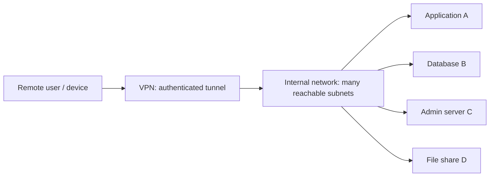
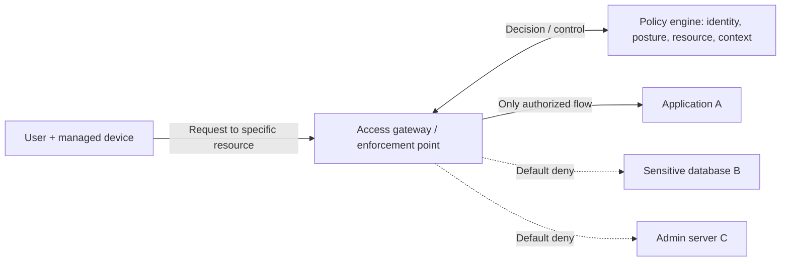
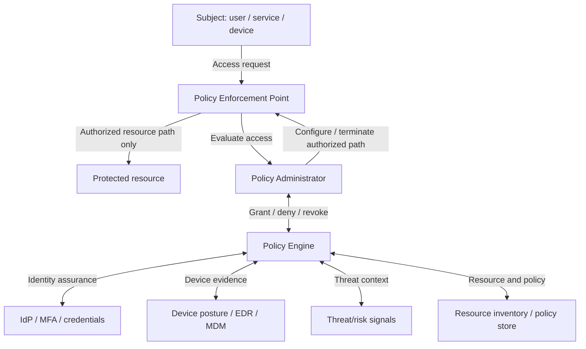
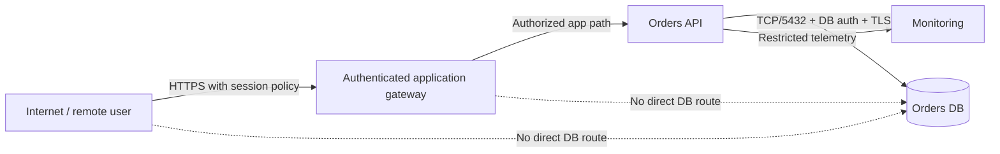
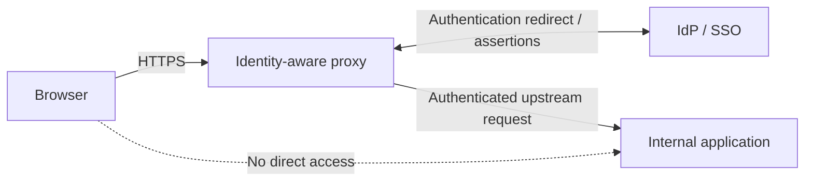

# Nguyên tắc không mặc định tin cậy vị trí mạng trong Zero Trust Network Access

## 1. Vì sao “đã ở trong mạng nội bộ” không còn đủ để tin cậy?

Trong mô hình bảo mật truyền thống, mạng doanh nghiệp thường có **vành đai**: Internet là vùng không đáng tin, LAN/VPN là vùng được tin hơn. Firewall đặt ở ranh giới và những thiết bị đã vào mạng trong có thể được phép kết nối rộng đến server nội bộ. Cách làm này có thể giảm một số rủi ro từ Internet, nhưng tạo giả định nguy hiểm: **một khi đã đi qua vành đai, nguồn kết nối mặc nhiên có quyền rộng**.

Hãy xét tình huống giả định:

```text
Nhân viên A đăng nhập VPN bằng tài khoản hợp lệ
  ↓
Máy tính của A đã bị cài malware từ trước
  ↓
VPN cấp route đến nhiều subnet nội bộ
  ↓
Máy bị chiếm thử kết nối SMB/RDP/SSH/DB đến các server không liên quan
  ↓
Một tài khoản hoặc dịch vụ cấu hình yếu có thể tạo đường lateral movement
```

Ngay cả khi VPN gateway xác thực người dùng đúng, **mạng không thể kết luận từng request là hợp lệ chỉ nhờ địa chỉ IP được cấp bởi VPN**. Tình huống tương tự xảy ra trong văn phòng, Wi-Fi doanh nghiệp, một VPC cloud, một Kubernetes namespace hoặc một subnet chỉ chứa VM “nội bộ”.

**Zero Trust (ZT)** đặt lại giả định: **không cấp niềm tin mặc định chỉ vì user, device hoặc workload đang ở một vị trí mạng được coi là nội bộ**. Muốn truy cập tài nguyên, chủ thể phải được **xác thực, đánh giá bối cảnh và cấp quyền tối thiểu** theo chính sách; các quyết định có thể được đánh giá lại khi điều kiện thay đổi.

Trong chương **Zero Trust Network Access**, bài này tập trung vào một nguyên tắc nền tảng, không đồng nhất Zero Trust với một sản phẩm hoặc giao thức cụ thể. Nó liên quan trực tiếp tới phạm vi **SECURITY_NETWORK_SECURITY**: phân đoạn, firewall, NAC, VPN, TLS/mTLS, IDS/IPS, DNS, mạng không dây, cloud, container, Kubernetes và kiến trúc phòng vệ nhiều lớp.

> **Luận điểm chính:** **Network location là tín hiệu bối cảnh, không phải bằng chứng đủ về danh tính, trạng thái an toàn hoặc quyền truy cập.** Được phép đi đến cổng TCP không đồng nghĩa được phép đọc dữ liệu hoặc thực hiện thao tác tại ứng dụng.

### Mục tiêu học tập

Sau bài này, người học có thể:

1. Giải thích vì sao **inside/outside, private IP, VPN, VLAN, VPC và namespace** không tạo ra niềm tin mặc định.
2. Mô tả các nguyên tắc Zero Trust theo tinh thần **NIST SP 800-207** và vai trò của **Policy Engine, Policy Administrator, Policy Enforcement Point**.
3. Phân biệt **authentication, device posture, network reachability, authorization và session security**.
4. Thiết kế quyết định truy cập theo **principal + thiết bị/workload + tài nguyên + hành động + ngữ cảnh/rủi ro**.
5. Kết hợp **ZTNA, segmentation, TLS/mTLS, IAM, application authorization, cloud/Kubernetes policies**.
6. Xây bảng chính sách, test matrix, telemetry, rollout, rollback và playbook sự cố có bằng chứng.

## 2. “Vị trí mạng” bao gồm những gì?

Trong thực tiễn, một hệ thống có thể gán nhãn **trusted network** dựa vào:

- Địa chỉ IP thuộc dải RFC1918 hoặc ULA IPv6.
- Máy đang cắm vào LAN hoặc corporate Wi-Fi.
- Nguồn ở một **VLAN** phòng ban hoặc subnet quản trị.
- Kết nối xuất phát từ **VPN gateway** hoặc được NAT thành IP doanh nghiệp.
- VM ở một **AWS VPC, Google Cloud VPC hoặc Azure VNet**.
- Pod nằm trong **Kubernetes namespace** được gọi là `production`.
- Request đi qua **reverse proxy, service mesh gateway, bastion** hoặc một network appliance.
- Thiết bị dùng một **DNS suffix**, hostname hay routing path nội bộ.

Mỗi dấu hiệu có thể hữu ích để **phân tích nguồn traffic và áp network policy**. Nhưng chúng **không tự chứng minh** ai đang điều khiển thiết bị, process nào gửi request, phần mềm có bị chiếm quyền không hoặc người đó được phép xem đối tượng nghiệp vụ nào.

### 2.1. Ví dụ các kết luận sai

| Thấy điều gì? | Kết luận sai | Điều còn phải xác minh |
|---|---|---|
| Source IP `10.20.1.42` | chắc chắn là nhân viên nội bộ | danh tính user/workload, thiết bị, phiên |
| Request đi qua VPN | client hoàn toàn an toàn | MFA, device posture, token/session, resource policy |
| Pod ở namespace `prod` | Pod được gọi mọi service Production | service identity, NetworkPolicy, AuthZ |
| VM không có public IP | attacker ngoài không thể tiếp cận | VPN/peering/transit, proxy, compromised internal workload |
| Kết nối xuất phát từ NAT gateway | mọi lưu lượng có cùng principal | nguồn thật sau NAT, correlation logs |
| Client resolve được DNS Service | client có quyền gọi Service | network reachability, TLS/mTLS, application AuthZ |
| Máy có certificate hợp lệ | mọi thao tác do user được phép | certificate identity/scope, user login, object-level permission |

**Không phải vứt bỏ IP/subnet rules:** chúng vẫn hữu ích để hạn chế reachability và DoS. Điểm cần bỏ là **suy luận “ở trong nên được tin toàn bộ”**.

## 3. Mô hình perimeter cũ và mô hình truy cập theo tài nguyên

### 3.1. Perimeter-centric



Đây là **mô hình rủi ro minh họa**, không phải mọi VPN đều cấp quyền rộng. VPN hiện đại có thể áp per-user ACL, posture, segmentation và application-aware access.

### 3.2. Resource-centric Zero Trust



Người dùng có quyền gọi **Application A** không tự có quyền mạng hoặc quyền dữ liệu đối với **B/C**. Nếu cần truy cập database/admin, hệ thống phải tạo **quyết định riêng** với điều kiện bổ sung phù hợp.

### 3.3. Không được nhầm PEP là một “hộp duy nhất”

Policy Enforcement Point có thể là **agent trên thiết bị, identity-aware proxy, access gateway, application middleware, service mesh proxy, cloud-native access layer hoặc thành phần khác**. Trong một hệ thống trưởng thành, **nhiều PEP** bảo vệ các tầng khác nhau: network, service, API và dữ liệu.

**ZTNA không đòi mọi byte đi qua một gateway duy nhất.** Điều cần chứng minh là **không có đường bypass hợp lệ về routing nhưng bỏ qua kiểm soát danh tính/quyền**.

## 4. Các nguyên tắc cốt lõi của Zero Trust theo NIST SP 800-207

NIST SP 800-207 mô tả kiến trúc Zero Trust với các nguyên tắc tổ chức có thể áp vào hạ tầng hiện tại. Diễn giải phù hợp với bài học:

1. **Mọi nguồn dữ liệu và dịch vụ tính toán đều là tài nguyên cần bảo vệ.** Không chỉ firewall perimeter; API, DB, message queue, SaaS và management endpoints đều có policy.
2. **Bảo vệ truyền thông bất kể vị trí mạng.** Đường LAN/VPC private cũng cần xác minh peer, tính toàn vẹn/bảo mật của kênh khi có yêu cầu.
3. **Cấp quyền truy cập từng tài nguyên trên cơ sở từng phiên.** Không vì một lần vào VPN mà có “vé tự do” cho cả subnet.
4. **Quyết định theo chính sách động:** danh tính, trạng thái thiết bị/workload, thuộc tính tài nguyên, hành động, yếu tố môi trường và tín hiệu rủi ro.
5. **Đo lường và theo dõi trạng thái tài sản.** Thiết bị đã đăng ký hôm qua chưa chắc còn an toàn hôm nay.
6. **Xác thực và ủy quyền được thực thi trước khi cho phép truy cập.** Cần cơ chế phù hợp để tiếp tục giám sát và điều chỉnh phiên khi điều kiện đổi.
7. **Thu thập telemetry** về tài sản, mạng, truy cập và quyết định để cải thiện chính sách, phát hiện nguy cơ và phản ứng.

### 4.1. “Never trust, always verify” không có nghĩa yêu cầu MFA mỗi packet

Khẩu hiệu này giúp nhớ nguyên tắc nhưng có thể gây hiểu nhầm:

- **Authentication** có thể dùng phiên/token/cryptographic binding có thời hạn và xác minh tại điểm thực thi.
- **Policy re-evaluation** có thể kích hoạt theo thời gian, tài nguyên, hành động hoặc sự kiện rủi ro.
- **Authorization** ở ứng dụng vẫn nên được kiểm tra theo request/object/action khi cần, không nhất thiết tương tác MFA với user mỗi API call.
- TCP/TLS session có thể tồn tại lâu, nhưng quyền truy cập cần có **expiration, revocation và monitoring** phù hợp.

**Continuous verification** nên được hiểu là khả năng **liên tục thu nhận tín hiệu, kiểm tra ở điểm có ý nghĩa và thay đổi quyết định**, không phải làm gián đoạn mọi request để người dùng nhấn xác nhận vô hạn.

### 4.2. Zero Trust là phương pháp, không phải thiết bị thay thế toàn hệ thống

Một ZTNA gateway có thể áp điều kiện truy cập tốt, nhưng nếu ứng dụng lưu mật khẩu yếu, backend có public origin không được bảo vệ hoặc admin IAM quá rộng, hệ thống **vẫn không đạt mục tiêu Zero Trust**.

## 5. Phân biệt network reachability, authentication và authorization

Một request chỉ được phục vụ hợp lệ nếu những điều kiện phù hợp đều thỏa:

```text
Source has an allowed network path to enforcement point
    AND enforcement point recognizes a protected resource
    AND user/workload is authenticated
    AND device or workload signals meet policy, when required
    AND session/token is valid for that resource/audience
    AND requested action is authorized
    AND target object/tenant/business constraints are satisfied
    AND secure channel and policy state remain acceptable
```

Đây là **mô hình logic**, không phải thứ tự byte-level cố định. Có thể xác thực trước khi thiết lập route, hoặc chặn network trước application. Quan trọng là **không bỏ qua các điều kiện bắt buộc**.

| Kiểm soát | Câu hỏi trả lời | Ví dụ |
|---|---|---|
| Routing/firewall | có đường tới endpoint không? | chỉ TCP/443 tới PEP |
| TLS server validation | client đang nói chuyện đúng server không? | CA/SAN/SNI/mTLS validation |
| Authentication | principal nào đang yêu cầu? | SSO/OIDC, Kerberos, mTLS workload ID |
| Device posture | thiết bị đáp ứng tiêu chí được đo không? | managed, EDR healthy, patch level |
| Session assurance | phiên/tài liệu chứng thực còn hợp lệ, bị thu hồi chưa? | expiry, token binding, revocation |
| Authorization | principal được thực hiện hành động này không? | `orders:read`, `admin:deploy` |
| Object-level policy | họ được phép với **đối tượng này** không? | đơn hàng thuộc tenant đúng |
| Context/risk | có thay đổi cần step-up hoặc deny? | thiết bị mất quản lý, sign-in rủi ro |
| Audit/response | quyết định có chứng minh và thu hồi được không? | policy version, request/session IDs |

**Ví dụ:** kết nối `TCP/5432` vào database được mở chưa có nghĩa user có quyền `SELECT` bảng dữ liệu nhạy cảm. Database role/policy và identity vẫn phải quyết định.

## 6. Identity là ai? User, thiết bị và workload không phải một

### 6.1. Danh tính người dùng

Thường đến từ IdP/SSO, có thể qua OIDC/SAML/Kerberos/LDAP integration tùy hệ thống. Các thuộc tính như user ID, group, role và MFA assurance có thể làm đầu vào quyết định.

Nhưng **membership trong nhóm `employees` không đủ để cấp mọi tài nguyên**. Cần scope, ứng dụng, hành động, quyền đối tượng và chính sách rủi ro.

### 6.2. Danh tính thiết bị

Một managed laptop có thể có:

- Enrollment vào MDM/endpoint management.
- Certificate thiết bị hoặc key không xuất được trong phần cứng theo khả năng.
- EDR agent báo trạng thái.
- Device inventory, OS version, patch/drive encryption/compliance data.

Điều này chứng minh **một số thuộc tính của thiết bị trong thời điểm và nguồn dữ liệu nhất định**, không chứng minh user tại bàn phím là người được phép. Device certificate đơn thuần cũng **không phải MFA của user**.

### 6.3. Danh tính workload/service

Trong cloud/Kubernetes, request có thể đến từ service, job hoặc Pod thay vì người dùng:

- Cloud IAM role/service account/managed identity.
- mTLS workload certificate/SPIFFE ID khi kiến trúc dùng.
- Kubernetes projected ServiceAccount tokens được cấp audience/lifetime phù hợp.
- Short-lived client credentials và workload attestation theo platform.

Không cấp một credential chung cho mọi container trong VPC. **Mỗi workload cần quyền và audience phù hợp**, có cơ chế quản lý lifecycle và bảo vệ khả năng impersonation.

### 6.4. Không suy identity từ IP

IP có thể thay vì **DHCP, NAT, VPN pool, container rescheduling, load balancing, dual-stack hoặc proxying**. Nhiều principal có thể cùng IP; một principal có thể thay IP giữa các request.

IP hữu ích cho **rate limiting, geolocation tương đối, access logs, network restrictions**, nhưng không phải identity duy nhất hoặc token ủy quyền.

## 7. Device posture: một tín hiệu có giới hạn, không phải chứng nhận vĩnh viễn

Một policy Zero Trust có thể yêu cầu thiết bị được quản lý và đạt mức an toàn:

| Tín hiệu | Có thể hỗ trợ đánh giá | Hạn chế |
|---|---|---|
| MDM enrollment | thiết bị thuộc inventory quản trị | record có thể stale, quyền admin bị chiếm |
| OS/security updates | mức bản vá theo yêu cầu | patch status không chứng minh không có zero-day |
| EDR health | agent đang hoạt động và có telemetry | agent có thể lỗi/không phát hiện mọi mối đe dọa |
| Disk encryption | giảm rủi ro dữ liệu khi mất thiết bị | không ngăn malware khi máy đang mở khóa |
| Screen lock/compliance | giảm một số rủi ro sử dụng trái phép | không chứng minh user luôn được ủy quyền |
| Device certificate | liên kết thiết bị với credential | bảo vệ khóa, vòng đời, revocation vẫn quan trọng |
| Jailbreak/root detection | nhận diện một số rủi ro integrity | bypass/false positives tùy nền tảng |
| Asset ownership | phân loại managed/BYOD/contractor | nguồn thông tin có thể thiếu hoặc cũ |

### 7.1. Xử lý tín hiệu thiếu hoặc đã cũ

Không nên mặc định “không có telemetry = an toàn”. Chính sách có thể:

- **Deny** với tài nguyên nhạy cảm nếu thiếu bằng chứng bắt buộc.
- **Restrict** chỉ vào cổng tự phục vụ/khắc phục thiết bị.
- **Step-up** hoặc yêu cầu kiểm chứng bổ sung.
- Dùng **ngoại lệ có owner, expiry, logging** khi nghiệp vụ buộc phải duy trì truy cập.

Không nên tự động “fail open toàn mạng” khi MDM/EDR API mất kết nối. Availability phải được xử lý bằng **HA, cache còn thời hạn, degraded mode có phạm vi** hoặc quy trình break-glass chặt.

### 7.2. Device posture không thay authorization

Một thiết bị compliant vẫn có thể bị phishing, malware chưa phát hiện hoặc user cố ý truy cập sai dữ liệu. Do vậy **resource authorization và monitoring không được bỏ** chỉ vì endpoint green status.

## 8. Ngữ cảnh động và quyết định truy cập

Một rule đơn giản theo IP:

```text
if source_ip in corporate_cidr:
    allow access to all internal web apps
```

không phù hợp nguyên tắc bài học. Một quyết định giàu ngữ cảnh hơn:

```text
principal = authenticated user or service identity
device    = verified posture state, if required
resource  = named application/API/database/admin operation
action    = read, write, deploy, manage, ...
context   = session assurance, risk, time, source network signal

allow only if:
    resource is approved for this principal and action
    AND assurance and posture meet resource policy
    AND session is valid and not revoked
    AND no higher-priority deny/risk condition applies
```

**Network location có thể được dùng làm thêm một tín hiệu** như “request tới từ quốc gia/vùng/IP bất thường”, nhưng **không được tự biến thành điều kiện đủ**.

### 8.1. Tránh hiểu sai về risk scoring

Không phải lúc nào cũng có một điểm rủi ro duy nhất từ 0–100 và ngưỡng chung:

- Quyền đọc tài liệu công khai có thể dùng policy đơn giản.
- Quyền xem payroll, production database hoặc deploy cần assurance cao hơn.
- Một **impossible travel alert** có thể là VPN egress thay đổi hoặc mobile network, cần phân tích.
- Tín hiệu từ geo-IP/NAT/proxy có độ tin cậy khác với **phishing-resistant MFA, token binding hoặc device attestation**.
- Cấu hình “risk score thấp ⇒ không cần AuthZ” là sai; rủi ro thấp chỉ là **một điều kiện**, không thay quyền.

### 8.2. Quyết định có thể là allow, deny hoặc yêu cầu điều kiện

| Decision | Ý nghĩa | Ví dụ |
|---|---|---|
| **Allow** | được truy cập đúng tài nguyên/hành động đã cấp | nhân viên dùng SSO + managed device truy cập portal |
| **Deny** | không đáp ứng policy hoặc bị thu hồi | tài khoản bị disable, client không hợp lệ |
| **Require step-up** | cần assurance bổ sung | thao tác thay firewall policy Production |
| **Restricted access** | chỉ vào remediation/self-service | máy thiếu patch, cho tải bản cập nhật |
| **Just-in-time grant** | quyền tạm thời sau approval | admin DB trong ca xử lý sự cố |
| **Revoke/terminate** | thu hồi phiên hiện tại khi tín hiệu rủi ro đổi | EDR phát hiện endpoint compromise |

Những lựa chọn này là **policy design**, không phải mọi nhà cung cấp ZTNA đều triển khai cùng giao diện. Quan trọng là logic được **thực thi và kiểm thử**.

## 9. Policy Engine, Policy Administrator và Policy Enforcement Point

NIST SP 800-207 mô tả các thành phần logic:

- **Policy Engine (PE):** ra quyết định **grant/deny/revoke** dựa trên policy và tín hiệu; có thể tích hợp thông tin từ identity, threat intelligence, posture và resource metadata.
- **Policy Administrator (PA):** thực thi quyết định của PE về việc thiết lập/đóng đường giao tiếp, truyền chỉ dẫn hoặc cấu hình tới PEP theo kiến trúc.
- **Policy Enforcement Point (PEP):** nơi **cho, giám sát hoặc chấm dứt kết nối/truy cập** giữa subject và resource theo quyết định.

PE và PA có thể được triển khai chung trong một sản phẩm/phần mềm; đây là **vai trò logic**, không bắt buộc là ba máy chủ hoặc dịch vụ độc lập.



Sơ đồ này chỉ minh họa **dòng quyết định/điều khiển**; API cụ thể và thứ tự giữa PEP–PA–PE phụ thuộc platform. Không suy rằng PEP luôn gửi từng packet tới PE để xin phép hoặc PE trực tiếp cầm network socket.

### 9.1. Policy Decision Point và Policy Information Point

Trong nhiều mô hình IAM/ABAC, **PDP** là thành phần quyết định, **PIP** cung cấp thuộc tính/tín hiệu; một policy store/administration component có thể quản lý chính sách. Thuật ngữ và ranh giới khác nhau giữa XACML, OPA, service mesh và ZTNA products. Nên đối chiếu **chức năng ra quyết định, thực thi và nguồn thuộc tính**, không dùng từ viết tắt như thể sản phẩm nào cũng giống nhau.

### 9.2. PEP phải nằm trên mọi đường truy cập được phép

Nếu ZTNA gateway kiểm tra SSO trước khi cho truy cập app nhưng app vẫn có **public origin IP**, peering, VPN route hoặc internal load balancer cho phép bỏ qua gateway, attacker có thể chọn đường bypass.

Biện pháp:

1. Chặn direct-origin access bằng **firewall/security group/NSG/NetworkPolicy**.
2. Nếu dùng **mTLS hoặc authenticated origin pull**, xác minh peer từ proxy/PEP hợp lệ theo cơ chế triển khai.
3. Backend vẫn kiểm **application identity/authorization**, không chỉ tin header do proxy điền.
4. Test mọi alternate hostname, region, DR endpoint và cloud private path có thể vào tài nguyên.

### 9.3. Không tin client-supplied identity headers

Một upstream application nhận `X-User: alice`, `X-Email` hoặc `X-Forwarded-User` không được coi đây là danh tính có quyền nếu **client có thể tự gửi**. Trusted gateway phải **loại bỏ/ghi đè các headers không đáng tin**, liên kết request với phiên xác thực và truyền assertion có **integrity/authentication** theo thiết kế. Backend kiểm tra provenance thay vì tin header text vì “đi từ mạng trong”.

## 10. Default deny và least privilege: cấp quyền nhỏ nhất có ý nghĩa

**Default deny** trong Zero Trust có nghĩa là request tới tài nguyên được bảo vệ **không được phép khi chưa có quyết định chính sách rõ ràng**. Điều này khác với cấu hình “deny all firewall rules” trên mọi interface mà không xét health/identity service dependencies.

### 10.1. Least privilege theo tài nguyên và hành động

| Principal | Tài nguyên | Hành động | Điều kiện | Mặc định với tài nguyên khác |
|---|---|---|---|---|
| Employee | HR self-service | đọc hồ sơ của chính mình | SSO; session hợp lệ | deny payroll admin |
| Finance operator | Payroll app | tạo batch | phishing-resistant MFA + managed device | deny DB direct |
| Support contractor | Ticket system | đọc tickets được giao | SSO + time-boxed role | deny developer/admin systems |
| API service | Orders DB | truy vấn chức năng được cấp | workload identity + TLS + DB role | deny other DBs |
| SRE on-call | Production diagnostics | scoped command/view logs | JIT approval + audit + session expiry | deny permanent broad admin |
| CI pipeline | Deployment API | deploy một service/environment | short-lived workload credentials | deny production secrets không liên quan |

**Least privilege không có nghĩa “ít rule nhất” mà là “quyền thực sự hẹp, có thể lý giải và thu hồi”**.

### 10.2. Reachability ít hơn giúp giảm lateral movement

Nếu user chỉ cần web payroll app, hãy cho họ truy cập **đúng service endpoint** thay vì route đến toàn `10.0.0.0/8`. Sau khi login vào payroll, **application vẫn kiểm tra tenant/user/role** cho từng request hoặc operation phù hợp.

### 10.3. Network deny và application deny là hai việc khác

| Lớp | Quyết định | Ví dụ |
|---|---|---|
| Network | không cho mở TCP tới DB | contractor → Production DB |
| Identity-aware gateway | không cấp phiên app | client thiếu MFA/posture |
| Application | không cho gọi API action | user có login nhưng thiếu `payroll:approve` |
| Object-level | không cho truy cập bản ghi này | employee A → hồ sơ employee B |
| Data platform | giới hạn câu lệnh/dữ liệu | app role read-only, row-level security |

**Không chỉ chặn private DB port rồi tự gọi đó là Zero Trust.** Một internal API proxy có thể vẫn thực hiện hành động không được cấp quyền nếu business authorization thiếu.

## 11. Per-resource, per-session access: không phải vé vào toàn mạng

Một phiên truy cập an toàn nên gắn với **resource đích và phạm vi quyền** đã xác định:

```text
Session: zt-session-demo-01
Subject: employee-123
Device: managed-laptop-abc
Resource: payroll-web
Action scope: portal user self-service
Assurance: SSO + approved MFA signal
Established: 09:00
Expires: 10:00 (policy example)
Revocation: enabled with bounded propagation delay
Other resources: NOT granted
```

Các mốc trên chỉ để minh họa. **Không phải mỗi ZTNA sản phẩm đều có cùng cách biểu diễn session, cấp token hoặc revocation**.

### 11.1. Per-session không thay per-request authorization

Khi PEP đã cho kết nối tới ứng dụng, user có thể thực hiện nhiều HTTP operations. Ứng dụng vẫn cần:

- Xác thực phiên/API access token tại đúng **audience** và issuer.
- Kiểm tra scope/role và **object-level authorization** mỗi hành động nhạy cảm.
- Chống replay, CSRF/session fixation khi dùng cookie authentication.
- Không tin `userId`, `tenantId` hoặc `isAdmin` trong body do client gửi như nguồn quyền.
- Bảo vệ API ngoài web UI path; kiểm tra REST/gRPC/WebSocket nghiệp vụ riêng.

### 11.2. Kết thúc một session khó hơn chỉ xóa cookie

Khi cần revoke, hệ thống có thể phải đồng bộ:

- ZTNA access tunnel/gateway session.
- IdP refresh token và app session.
- JWT/access token validation (có thể còn sống tới expiry nếu không có cơ chế thu hồi phù hợp).
- Long-lived WebSocket/gRPC connections.
- Cached authorization ở gateway/service mesh.
- Downstream database connection pool sử dụng service credentials.

**Không tuyên bố revoke user tại IdP khiến mọi kết nối đã mở trên tất cả tầng lập tức dừng**. Đặt expiry hợp lý, propagation SLO, event-driven invalidation hoặc token introspection/revocation khi kiến trúc cần.

## 12. Xác thực mạnh: MFA, phishing resistance và giới hạn

**MFA** bảo vệ quá trình xác thực bằng nhiều yếu tố thuộc các nhóm khác nhau (knowledge/possession/inherence), nhưng cách triển khai khác nhau về chống phishing:

| Cơ chế | Giá trị | Giới hạn cần biết |
|---|---|---|
| TOTP | yếu tố bổ sung có thời hạn | mã có thể bị phishing/replay trong cửa sổ |
| Push approval | trải nghiệm thuận tiện | push fatigue, phê duyệt nhầm |
| Push number matching | giảm một số nhầm lẫn | không tự chống mọi attacker-in-the-middle/phishing |
| FIDO2/WebAuthn | dựa vào khóa và binding với origin/RP ID | cần hỗ trợ đúng origin, lifecycle, account recovery |
| Smart card/certificate | cryptographic credential và assurance tùy hệ thống | certificate/device auth không tự là MFA người dùng |
| Device biometric unlock | có thể bảo vệ việc sử dụng authenticator | assurance phụ thuộc thiết bị và cách verify user |

**MFA chỉ chứng minh thêm về authentication event**, không chứng minh endpoint không nhiễm malware hoặc user được quyền xóa dữ liệu nhạy cảm.

### 12.1. Phishing-resistant MFA cho vai trò nhạy cảm

Tổ chức nên cân nhắc **FIDO2/WebAuthn hoặc cơ chế phishing-resistant tương đương** cho admin, finance, production access và hệ thống trọng yếu. Không để luồng **account recovery, helpdesk reset, thêm thiết bị MFA** dễ bị thao túng hơn login chính.

### 12.2. API token không tự là user session

Nếu dùng OIDC/OAuth:

- **ID token** phục vụ mục đích xác nhận đăng nhập cho client theo thiết kế OIDC; không mặc nhiên là bearer credential hợp lệ để gọi resource API.
- **Access token** cần được API kiểm đúng issuer, audience, expiry, signature/validation mechanism và các claims/policy cần thiết.
- Bearer token bị lấy cắp có thể được dùng bởi bên khác nếu không có bảo vệ bổ sung. DPoP/mTLS proof-of-possession có thể giảm một số replay theo chuẩn khi được triển khai đầy đủ.
- Gateway không nên đơn giản decode JWT mà **bỏ qua signature verification** hoặc cho audience sai.

## 13. Thiết bị đã vào VPN vẫn phải chịu cùng chính sách truy cập

Zero Trust **không nhất thiết loại bỏ VPN**. VPN có thể tiếp tục phục vụ network transport, private routing, administration hoặc ứng dụng legacy. Điểm thay đổi là **không coi VPN connection tự cấp mọi quyền**.

### 13.1. Ba mô hình khác nhau

| Mô hình | Quyền kết nối | Kiểm soát cần thêm |
|---|---|---|
| **VPN flat network** | user có route rộng vào mạng nội bộ | rủi ro lateral movement cao nếu ACL/AuthZ yếu |
| **VPN được phân đoạn** | per-user/per-group ACL, resource-specific routes | MFA, posture, service AuthZ, log correlation |
| **ZTNA per-app access** | access broker/PEP chỉ nối user tới các app/resources được cấp | identity, posture, policy, direct-origin isolation, app AuthZ |

Đây là **phân loại kiến trúc**, không phải một sản phẩm VPN chắc chắn kém hơn mọi ZTNA product. Một VPN được thiết kế theo nguyên tắc Zero Trust có thể cung cấp kiểm soát chặt; một ZTNA triển khai sai vẫn có thể bypass.

### 13.2. Thêm lớp kiểm soát trên VPN

Giả sử VPN user được phép tới **admin portal qua TCP/443**:

- Chỉ route/ACL tới portal hoặc gateway, không mở toàn subnet.
- IdP xác thực user và session assurance.
- PEP kiểm device posture/role/context và resource grant.
- Admin portal kiểm operation authorization.
- Database/backends không nhận direct VPN client connections ngoài exception.
- SIEM liên kết **user/session/device/assigned VPN IP/PEP decision/app actions**.

**Không dùng VPN-assigned IP làm identity duy nhất**, vì địa chỉ có thể tái sử dụng, NAT và bản thân endpoint có thể bị chiếm.

## 14. Mạng nội bộ, NAC/802.1X và Wi-Fi không tạo quyền ứng dụng

**Network Access Control (NAC)** hoặc **802.1X** có thể kiểm danh tính thiết bị/user lúc kết nối LAN/Wi-Fi và gán VLAN/dACL theo policy. Đây là lớp bảo vệ hữu ích, nhưng có ranh giới:

- Thiết bị được vào corporate SSID/VLAN vẫn có thể chạy process bị xâm nhập.
- Máy user chung VLAN với printer không có lý do được vào DB management port.
- Credential 802.1X/certificate của thiết bị không thay AuthZ của app user.
- “Quarantine VLAN” giúp hạn chế reachability nhưng cần **remediation path được phê duyệt**, không cho sẵn mọi kết nối nội bộ.

### 14.1. Kiến trúc hai lớp hợp lý

```text
Device joins LAN/Wi-Fi
  → NAC verifies network admission
  → per-device network segmentation applies
  → user/application requests a resource
  → ZTNA/IdP/context policy grants scoped access
  → application verifies resource-specific operation
```

Không cần bỏ firewall, Wi-Fi security hay NAC để “làm Zero Trust”; cần **không suy quyền ứng dụng từ việc qua được cổng mạng**.

## 15. Segmentation và microsegmentation: mạng là giới hạn, không là danh tính

**Segmentation** chia mạng thành vùng với quy tắc kết nối khác nhau. **Microsegmentation** hướng đến các luồng chi tiết theo workload/service. Chúng rất hợp với Zero Trust khi giảm cơ hội di chuyển ngang.

### 15.1. Mô hình ba tầng



### 15.2. Kiểm tra những thứ subnet không tự bảo vệ

- Hai workloads **cùng VPC/VNet** có thể route đến nhau nếu rules cho phép.
- Hai Pods **cùng namespace** không mặc định bị network-isolated.
- Pod có **hostNetwork** có đường đi khác Pod networking bình thường.
- SG/NSG/firewall allow một port không kiểm quyền trên từng HTTP method.
- Mạng Kubernetes NodeLocal DNS/metadata/cloud APIs có các đường đặc thù.
- Các dịch vụ shared proxy/bastion có thể trở thành **đường gián tiếp** bypass segmentation nếu quyền forwarding rộng.

### 15.3. Least privilege ở cả ingress và egress

Một API bị khai thác có thể **không mở listener mới** nhưng dùng quyền egress sẵn có để đọc service khác hoặc gửi dữ liệu ra ngoài. Thiết kế cần **egress allowlist, identity/resource policy và observability**, không chỉ ingress deny.

## 16. Workload-to-workload Zero Trust: cloud và Kubernetes

Khi các thành phần đều là services, Zero Trust không phụ thuộc việc con người đăng nhập UI.

```text
Service A (payments-api)
   identity: approved workload credential
   egress: only approved destinations
   request: charge.create
        ↓ mTLS/service mesh/gateway
Service B (payments-engine)
   verify peer identity and audience
   authorize action for Service A
   validate request schema/business rules
        ↓
Database
   independent service DB identity and least-privilege role
```

### 16.1. Không dùng “cùng Kubernetes namespace” làm authorization

Một namespace là **vùng tên và ranh giới quản trị tương đối**, không phải bảo đảm mỗi Pod trong namespace là đáng tin. Cần:

- **Kubernetes NetworkPolicy** với CNI thật sự enforce.
- **RBAC/admission** bảo vệ ai tạo Pod, labels, Services và ServiceAccounts.
- **Workload credentials** có lifetime/audience phù hợp.
- **Service mesh/gateway authorization** theo nguồn/dịch vụ/hành động khi cần.
- **API object-level authorization** trong backend.

### 16.2. ServiceAccount token và projected credentials

Một Pod có ServiceAccount không tự có quyền toàn cluster. Nhưng nếu ServiceAccount được cấp rộng, hoặc token được mount vào workload không cần Kubernetes API, lộ credential có thể làm tăng blast radius.

Hãy tắt **automountServiceAccountToken** cho workload không gọi Kubernetes API khi phù hợp; đối với workload cần, dùng **least-privilege RBAC, projected short-lived audience-bound tokens** và tránh truyền tokens vào sidecars không cần.

### 16.3. Service mesh mTLS không đồng nghĩa đã đủ Zero Trust

Một mesh mTLS tốt có thể xác thực **workload peer** và mã hóa traffic, nhưng nếu policy cho phép **mọi service gọi mọi method của payments API**, vẫn còn thiếu least-privilege authorization. Cần policy theo service identity/resource/API action và chống **direct bypass** khỏi proxy khi mô hình đòi hỏi.

## 17. Cloud private network và cloud IAM: hai biên độc lập

Trong AWS account, GCP project hoặc Azure subscription, “private resource” và “IAM identity” là hai yếu tố bổ sung:

| Thành phần | Mục đích | Điều không tự giải quyết |
|---|---|---|
| VPC/VNet/subnet | topology và reachability | principal nào được phép đọc dữ liệu |
| SG/NSG/VPC firewall | lọc kết nối L3/L4 | application user/object authorization |
| PrivateLink/Private Endpoint/PSC | truy cập service qua đường private theo dịch vụ | mọi resource của provider tự trở nên đúng đích |
| Cloud IAM role/service account/managed identity | quyền đối với cloud APIs/resources | TCP flow được chặn ở mọi VPC |
| WAF/API gateway | kiểm HTTP/identity/limits theo cấu hình | dữ liệu nghiệp vụ được bảo vệ nếu backend không AuthZ |
| mTLS | xác thực workload peer và kênh khi triển khai đúng | per-user business authorization |
| Cloud audit/flow logs | bằng chứng về IAM changes và traffic | ngăn tấn công nếu không có enforcement/response |

### 17.1. Private endpoint không phải giấy phép truy cập

Tạo private endpoint tới object storage chỉ thiết lập **đường kết nối** theo cơ chế provider. Cần thêm **IAM/resource/endpoint policies, encryption, logging và egress** để bảo đảm đúng principal truy cập **đúng bucket/container/object**.

### 17.2. VPC Peering/transit và direct-origin bypass

App được thiết kế để chỉ qua ZTNA PEP nhưng còn nhận traffic từ một VPC peered hoặc private ingress khác. Nếu backend tin nguồn là “nội bộ”, attacker với foothold ở VPC khác có thể bypass kiểm soát.

**Kiểm thử phải liệt kê mọi path tới resource**, không chỉ Internet hostname chính.

### 17.3. Control plane có thể sửa data-plane policy

Một developer có quyền cloud administrator rộng có thể **thay SG, route, firewall hoặc attach service account** để cấp connectivity ngoài quy định. Do đó Zero Trust cần bảo vệ **IAM permissions, CI/CD, approval, audit, just-in-time admin và drift detection** cho chính hệ thống thực thi policy.

## 18. Các mô hình triển khai ZTNA: client-based, agentless và service-to-service

Một nền tảng có thể áp nguyên tắc không tin vị trí mạng theo nhiều hình thức. Không có một kiến trúc duy nhất thích hợp cho mọi ứng dụng.

| Mô hình | Đường truy cập điển hình | Ưu điểm | Giới hạn cần xét |
|---|---|---|---|
| **Client/agent-based ZTNA** | agent trên thiết bị kết nối PEP/broker sau khi xác thực | hỗ trợ nhiều kiểu ứng dụng/protocol, có thể thu posture | agent trust, device platform, route scope, offline state |
| **Browser/agentless access proxy** | browser → identity-aware reverse proxy → web app | phù hợp HTTP/S, ít thay client | một số TCP/UDP/protocol legacy khó hỗ trợ; headers/cookies/TLS phải đúng |
| **Remote desktop/privileged access broker** | user → PAM/session gateway → RDP/SSH target | JIT, audit/recording, không cấp route rộng | gateway availability, session protocol, clipboard/file transfer policy |
| **Application gateway/API identity layer** | client → API gateway → backend | authn, rate limit, per-API policy | backend bypass, object-level AuthZ và token validation |
| **Service mesh/workload identity** | service A → mTLS sidecar/waypoint → service B | identity-aware east-west policies | Pod bypass, mesh policy drift, app-level authorization vẫn cần |
| **Cloud-native IAM + private endpoint** | approved workload → private path → managed API | least privilege tới tài nguyên cloud | private path không thay IAM, endpoint policy và resource scope |

### 18.1. “Agentless” không có nghĩa không cần bảo vệ thiết bị

Browser-based ZTNA có thể xác thực user tốt nhưng **thiếu một số tín hiệu device posture** nếu không có phương thức tích hợp đáng tin. Hệ thống có thể đặt assurance thấp hơn cho BYOD và chỉ cho tài nguyên rủi ro thấp; đối với tài nguyên nhạy cảm, yêu cầu managed device hoặc phiên cô lập.

### 18.2. “Có agent” không đồng nghĩa mọi ứng dụng đều được giám sát

Một client agent có thể dựng tunnel hoặc proxy connection nhưng **không biết** người dùng bên trong đã gọi REST API nào, đối tượng nào bị đọc hoặc token nào được dùng nếu không có tích hợp thêm. **Application authorization** vẫn phải tồn tại.

### 18.3. Một doanh nghiệp có thể cần nhiều PEP

Ví dụ:

```text
Remote employee  -> browser ZTNA -> HR web app
SRE              -> PAM broker   -> approved SSH session
Mobile app       -> API gateway  -> customer API
Payments service -> service mesh -> payments ledger
CI/CD pipeline   -> workload IAM -> deployment API
```

Mục tiêu chung: mỗi luồng có **identity, policy, giới hạn tài nguyên và audit**, không phải một gateway toàn năng.

## 19. Identity-aware proxy và ranh giới tin cậy của HTTP headers

Đối với web applications, một pattern phổ biến:



Proxy có thể cấp session và chuyển thông tin identity đến backend. Một vấn đề lớn là **header trust**:

```http
GET /admin HTTP/1.1
Host: internal.example.com
X-Authenticated-User: admin@example.com
```

Header trên có thể do **bất kỳ HTTP client** tự đặt nếu không có ranh giới. Backend không được tự tin nó chỉ vì request đi từ địa chỉ nội bộ. Cần:

- Proxy **xóa mọi identity headers do client cung cấp** trước khi thêm dữ liệu tin cậy.
- Backend chỉ nhận từ PEP có **authenticated channel**, mTLS, signed assertion hoặc biện pháp bảo vệ provenance tương đương theo thiết kế.
- Không để backend public/direct-origin/alternate hostname bỏ qua PEP.
- Kiểm tra **token/signature/audience/expiry** thay vì tin text nếu dùng identity JWT/assertion.
- Sử dụng authorization tại backend trên user/resource/action, không chỉ proxy identity.
- Bảo vệ **Forwarded/X-Forwarded-For/Host/Scheme** khỏi spoofing; IP thật có provenance và trust boundary.

### 19.1. TLS termination không kết thúc trách nhiệm xác thực

Một PEP có thể terminate client TLS rồi mở kết nối TLS mới tới backend. Cần thiết kế:

```text
Browser --TLS--> PEP --TLS/mTLS as required--> application
```

Nếu hop PEP→backend không được bảo vệ, attacker cùng mạng hoặc cấu hình proxy sai có thể ảnh hưởng. Nếu backend dùng client certificate của **PEP**, đó là **danh tính proxy**, không tự chứng minh user; user identity cần cơ chế truyền có integrity và mapping rõ.

### 19.2. Host/SNI và virtual host routing

Hostname người dùng gọi, `Host`/`:authority`, TLS SNI và certificate đích có thể khác giữa **public hostname** và **internal service hostname**. Proxy phải cấu hình mỗi hop với expected authority/peer identity phù hợp, không bỏ TLS verification để “kết nối được”.

**HTTP host routing sai có thể đưa request tới ứng dụng khác**, dù user đã xác thực thành công ở proxy.

### 19.3. Không coi redirect/login page là bảo vệ backend API

Một API có thể còn đường không qua browser login. Nếu request tới `/api/admin` có thể đi trực tiếp vào backend hoặc qua route không kiểm token, giao diện web có SSO vẫn **không bảo vệ API đó**. Dùng **deny-by-default resource routing và API-level checks**.

## 20. IP/subnet vẫn có giá trị, nhưng chỉ là một phần bối cảnh

Không tin vị trí mạng mặc định **không đồng nghĩa bỏ network telemetry hoặc firewall IP policies**.

### 20.1. Các trường hợp IP hữu ích

- Ngăn DB nhận kết nối trực tiếp từ Internet bằng security group/NSG.
- Chỉ cho phép admin gateway truy cập service management port.
- Phân loại request từ Tor/VPN exit hoặc địa điểm bất thường khi phù hợp pháp lý/chính sách.
- Áp rate limits và DoS controls theo nhiều tín hiệu.
- Tương quan session với VPN-assigned IP và NAT translation logs.
- Phát hiện lưu lượng giữa các zones không có dependency business.

### 20.2. Những kết luận không nên rút ra

| Tín hiệu | Không tự chứng minh |
|---|---|
| Private IPv4 `10.0.0.0/8` | user đã xác thực, máy không bị chiếm |
| Public IP doanh nghiệp | mọi request do cùng một nhân viên gửi |
| Cloud metadata location | app có quyền gọi mọi API của tài khoản/project |
| IPv6 ULA | mọi host cùng ULA prefix được tin nhau |
| DNS zone nội bộ | hostname không thể bị sửa sai |
| Proxy `X-Forwarded-For` | IP nguồn có provenance nếu chain chưa tin cậy |
| “VPN connected” | user/session/device đáp ứng policy tài nguyên |

### 20.3. Data minimization và tính chính xác

Geo-IP, device location, IP reputation và behavioral profiling có sai lệch. Chỉ thu thập thứ **cần để đưa ra quyết định phù hợp**, có retention, access control và quy trình khiếu nại/khắc phục false positive. Đừng biến Zero Trust thành giám sát tùy tiện không liên quan bảo mật.

## 21. Mô hình hóa chính sách Zero Trust bằng bảng và YAML khái niệm

Chính sách tốt cần nêu rõ **ai, tài nguyên nào, hành động gì, điều kiện nào, lý do và expiry**.

### 21.1. Ma trận quyết định mẫu

| ID | Principal | Tài nguyên/hành động | Điều kiện bổ sung | Quyết định |
|---|---|---|---|---|
| P-01 | authenticated employee | `hr-portal:self_read` | session hợp lệ | allow |
| P-02 | employee không thuộc finance | `payroll:approve` | bất kể IP | deny |
| P-03 | finance operator | `payroll:approve` | managed compliant device + strong MFA + role | allow có thời hạn |
| P-04 | contractor | `ticket-app:read_assigned` | contract còn hiệu lực + session policy | allow |
| P-05 | contractor | `prod-db:connect` | bất kể corporate Wi-Fi/VPN | deny |
| P-06 | payments-api workload | `ledger-api:charge` | mTLS peer identity + service permission | allow |
| P-07 | workload khác | `ledger-api:charge` | cùng Kubernetes namespace | deny |
| P-08 | SRE on-call | `prod-admin:diagnostics` | JIT approval, MFA, audit, TTL | allow scoped |
| P-09 | unknown principal | mọi protected resource | không có authentication | deny |
| P-10 | disabled account/session revoked | mọi protected resource | bất kể source IP | deny |

### 21.2. YAML chính sách mang tính minh họa

```yaml
# CONTRACT khái niệm, KHÔNG phải cấu hình chạy trực tiếp
# của OPA, Envoy, Kubernetes, IdP hay ZTNA vendor.
policy_id: zt-payroll-approval-v1
resource: payroll-approval-api
action: approve_batch
default: deny
requirements:
  principal:
    authenticated: true
    group: finance-operators
    employment_status: active
  assurance:
    phishing_resistant_mfa: true
    auth_age_max_minutes: 30
  device:
    managed: true
    compliant: true
    posture_max_age_minutes: 15
  session:
    not_expired: true
    not_revoked: true
  risk:
    active_high_severity_signal: false
  resource:
    environment: production
  audit:
    require_decision_log: true
    require_business_action_log: true
exceptions:
  owner_required: true
  expires_at_required: true
  approval_required: true
```

**Các keys này do bài học định nghĩa** để giải thích policy; không thể copy vào sản phẩm và mặc định được thực thi. Cần chuyển thành config/API đúng nền tảng, test fail mode, logging và time semantics.

### 21.3. Deny không phụ thuộc “đang ở trong văn phòng”

Trong chính sách trên, việc user có IP công ty hoặc VPN route **không bỏ qua** group, MFA, device posture, session validity hay risk decision. Có thể dùng network location để **tăng hoặc giảm yêu cầu**, nhưng chỉ trong policy được review, không cho bypass authentication/authorization.

### 21.4. Quy tắc deny precedence

Một mô hình chính sách an toàn thường cần thứ tự rõ:

```text
if principal.is_disabled or session.is_revoked:
    DENY
else if no authenticated principal:
    DENY
else if not entitled(resource, action, object):
    DENY
else if not sufficient_assurance(resource):
    REQUIRE_STEP_UP_OR_DENY
else if posture_required and not fresh_compliant_posture:
    RESTRICT_OR_DENY
else if high_risk_signal:
    RESTRICT_REAUTHENTICATE_OR_DENY
else:
    ALLOW according to resource/session policy
```

Pseudo-code thể hiện **thứ tự suy luận**; ứng dụng thực tế phải tránh race conditions, stale caching, unverified claims và policy conflicts. Chính sách đối với request **không xác định tài nguyên** nên mặc định từ chối, thay vì tự cho phép.

## 22. Phân tích quyết định: cùng IP, hai yêu cầu khác nhau

Một NAT gateway của văn phòng có public IP chung. Hai người dùng gửi request từ cùng địa chỉ đó:

```text
Request A
  source_ip: 203.0.113.20
  principal: finance-user-1
  device: compliant-managed-laptop
  resource/action: payroll.approve_batch
  MFA assurance: high
  entitlement: yes
  decision: allow if all policy checks pass

Request B
  source_ip: 203.0.113.20
  principal: contractor-user-2
  device: unknown
  resource/action: payroll.approve_batch
  MFA assurance: unknown
  entitlement: no
  decision: deny
```

`203.0.113.0/24` là **dải địa chỉ dành cho tài liệu**, không phải IP doanh nghiệp thực. Hai request có cùng source IP nhưng **quyền rất khác nhau**.

### 22.1. Cùng principal, hai tài nguyên khác nhau

Một developer có thể được cấp quyền **read-only metrics** nhưng không được **deploy Production**. Không tạo quy tắc “đã xác thực ZTNA = mọi API trong dashboard được gọi”.

### 22.2. Cùng principal và resource, nhưng risk khác nhau

Một finance operator đang sử dụng managed laptop compliant có thể được phép duyệt batch; khi hệ thống phát hiện thiết bị đã mất quản lý hoặc IdP đã khóa tài khoản, **access policy phải có khả năng giảm/thu hồi quyền**. Độ trễ thực tế phụ thuộc **cache TTL, session expiry và event propagation**.

### 22.3. Không dùng các thuộc tính client tự khai làm nguồn quyết định

Client có thể tự gửi:

```json
{
  "userRole": "finance-admin",
  "deviceCompliant": true,
  "sourceZone": "trusted-internal"
}
```

Những giá trị trong HTTP body **không phải claims đáng tin**. PEP/PDP cần lấy từ **verified IdP, device management/attestation, trusted telemetry và signed/validated assertions**, với nguồn và thời điểm rõ.

## 23. Đánh giá lại quyền và revocation: không cho một lần mãi mãi

Một hệ thống không mặc định tin vị trí mạng phải có khả năng **phản ứng khi trạng thái thay đổi**, ví dụ:

- User rời công ty hoặc contractor contract hết hạn.
- Device compliance trở thành noncompliant.
- EDR phát hiện một hành vi nghiêm trọng.
- Token hoặc khóa bị nghi lộ.
- Admin JIT window kết thúc.
- Resource chuyển từ internal-general sang sensitive.
- Session có dấu hiệu unusual use hoặc cần step-up.

### 23.1. Các điểm re-evaluation

| Điểm | Tín hiệu | Quyết định có thể có |
|---|---|---|
| Login/session establish | IdP, MFA, posture | allow/deny/step-up |
| Truy cập một resource khác | resource sensitivity/entitlement | tạo grant mới hoặc deny |
| Thao tác đặc quyền | fresh MFA, JIT approval | step-up, scoped grant |
| Token refresh/expiry | principal status, session risk | không cấp token mới |
| Continuous telemetry event | EDR, account disable, fraud signal | revoke, limit, alert |
| Long-lived connection checkpoint | session TTL, policy version | disconnect/re-auth |
| Application object request | object ownership/tenant | business deny |

### 23.2. Revocation không phải lúc nào ngay lập tức

Một gateway có thể cache chính sách hoặc xác nhận token trong thời gian ngắn để đáp ứng SLO. Service mesh cũng có policy updates và certificate lifetimes. Cần thiết kế:

1. **Maximum authorization age/TTL** theo độ nhạy của resource.
2. **Event-driven revocation** cho high-risk changes khi platform hỗ trợ.
3. Cơ chế disconnect long-lived sessions và invalidation của cache.
4. Kiểm thử **độ trễ thu hồi thực tế**, không chỉ API báo “revoked”.
5. **Audit trail** từ IdP event → PEP/session termination → application stop.

### 23.3. Không re-authent mọi request bằng thao tác thủ công

Với API gọi hàng nghìn requests/giây, chính sách có thể kết hợp **short-lived cryptographic tokens, audience binding, request authorization và risk-based step-up**. Mục tiêu là quyết định có hiệu lực, không gây MFA fatigue hoặc DoS do dependency trung tâm không thể scale.

## 24. Secure session binding: bearer token, mTLS và replay risk

**Bearer token** là credential mà ai giữ token có thể trình bày để được chấp nhận nếu server không có ràng buộc bổ sung. Khi token bị lộ từ logs, browser storage hoặc compromised device, attacker có thể tái sử dụng trong thời hạn còn hiệu lực.

### 24.1. Các lớp giảm replay

- Token có **audience/scope/issuer/expiry** đúng resource.
- TLS cho transport và certificate validation.
- Cookie `HttpOnly`, `Secure`, `SameSite` theo thiết kế browser, cùng CSRF controls khi áp dụng.
- Đối với bối cảnh phù hợp, **proof-of-possession** như mTLS-bound tokens hoặc DPoP theo giao thức/triển khai.
- Short-lived access tokens và refresh-token rotation/invalidations theo khả năng.
- Bảo vệ secret storage và không log `Authorization`/cookies.
- Detect unusual token use, với nhận thức rằng NAT/mobile networks có thể đổi source IP.

### 24.2. Cookie auth khác API auth

Một browser ZTNA web session có thể dùng secure cookies; backend API dùng access tokens; service-to-service dùng mTLS hoặc workload tokens. Không áp một checklist chung như “mọi endpoint bắt buộc cookie SameSite” cho **gRPC non-browser workload**. Chọn kiểm soát đúng threat model.

### 24.3. Chú ý TLS giữa các hop

```text
User browser --HTTPS--> ZTNA proxy
ZTNA proxy --mTLS or HTTPS with validation--> application
Application --TLS/DB auth--> database
```

**Mỗi hop có peer identity khác nhau**. Xác thực user ở first hop không tự xác thực app đối với database; internal network location cũng không bảo đảm chống traffic interception.

## 25. Legacy protocols và truy cập quản trị: RDP, SSH, SMB, database

Không phải mọi resource có giao thức HTTP. Mạng doanh nghiệp có thể cần SSH/RDP/SMB, thick-client database protocol, file transfer hoặc các dịch vụ không hỗ trợ OIDC.

### 25.1. Phương pháp bảo vệ theo tài nguyên

| Tài nguyên | Pattern có thể phù hợp | Chính sách bổ sung |
|---|---|---|
| SSH tới server Production | PAM/JIT broker hoặc SSH CA certificate ngắn hạn | MFA/approval, command restrictions, session audit |
| RDP desktop/admin server | session gateway/remote desktop broker | MFA, session recording, clipboard/file transfer policy |
| SMB file share | scoped network access + Kerberos/AD auth | file/folder ACL, SMB signing/encryption theo yêu cầu |
| Database admin | database access gateway/proxy, JIT DB credentials | query/role authorization, TLS, audit |
| Legacy TCP application | per-app tunnel/agent/connector | destination/port scope, backend AuthZ, credential lifecycle |
| OT/ICS hoặc hệ thống nhạy availability | identity-aware jump point và segmentation theo rủi ro | safety, latency, change windows, emergency access |

### 25.2. Không gắn “application” với toàn một subnet

Một ZTNA rule kiểu:

```text
resource = 10.0.0.0/8
protocol = any
allow all employees after SSO
```

có thể chỉ tái tạo “flat VPN” dưới nhãn mới. Nên định nghĩa **specific FQDN/IP+port/protocol hoặc application identity** cùng group/role/action phù hợp. Nếu một legacy app thật sự cần nhiều dynamic ports, cần hiểu các luồng cụ thể và dùng broker/segmentation phù hợp, không tự mở toàn nội bộ.

### 25.3. Quyền quản trị đặc biệt

Đối với admin, cần:

- Just-in-time grant, ticket/approval và thời hạn rõ.
- Phishing-resistant MFA hoặc assurance tương xứng.
- Gắn quyền với **specific servers/resources/operations**.
- Restrict lateral movement từ admin jump environment.
- Log session, commands và data access theo quy định; không lưu bí mật tùy tiện.
- Cơ chế **emergency access** có khóa bảo vệ, owner và hậu kiểm.

## 26. DNS và service discovery: biết tên không phải có quyền

Một tài nguyên có thể được phân giải qua:

```text
payroll.internal.example.com
orders-api.payments.svc.cluster.local
database.private.example.net
```

Việc client biết hoặc resolve được tên **không phải bằng chứng** rằng client được phép gọi API/database. DNS có thể phục vụ service discovery cho nhiều tenant/namespace; quyền truy cập nằm ở **network policy, identity và application layer**.

### 26.1. Bảo vệ nguồn đích và proxy origin

- DNS split-horizon có thể trỏ cùng hostname đến private/public endpoint khác nhau.
- Private DNS của cloud service có thể bị cấu hình lệch làm client đi public path.
- Service `ExternalName` hoặc CNAME có thể dẫn sang domain khác.
- Proxy routing theo `Host`/`SNI`/`:authority` phải tương ứng với expected resource.
- TLS client phải kiểm đúng **server hostname/workload identity**, không chấp nhận mọi private IP.
- Không dùng “DNS tên nội bộ” để bỏ qua AuthN/AuthZ.

### 26.2. SSRF và service-to-service proxy

Một backend có quyền mạng tới sensitive services có thể bị lợi dụng nếu API cho client nhập arbitrary URL và server fetch thay. Đây là **Server-Side Request Forgery (SSRF)**. Không tin một request “xuất phát từ API pod” là đã đúng business intent.

Phòng vệ gồm **destination allowlist, URL/DNS/IP canonical validation, redirect checks, egress restriction, cloud metadata protection, service identity và authorization**. Cần kiểm tra **DNS rebinding và address changes** khi xử lý hostname do người dùng nhập, không chỉ kiểm regex ban đầu.

### 26.3. DNS filtering không thay Zero Trust authorization

Ngay cả khi hệ thống chặn lookup domain ngoài danh sách cho phép, một ứng dụng có thể nhận IP từ cache, file config hoặc alternate resolver. DNS layer có vai trò của nó; các điểm thực thi **network/resource/identity** vẫn bắt buộc.

## 27. Quản trị policy, exceptions và break-glass

Để nguyên tắc “không mặc định tin vị trí” tồn tại trong vận hành, các thay đổi quyền không được trở thành một con đường khác để mở toàn mạng.

### 27.1. Policy lifecycle

```text
Inventory resource
    ↓
Assign owner and classification
    ↓
Define allowed subjects/actions/assurance
    ↓
Review threat model + dependencies
    ↓
Test policies (positive/negative)
    ↓
Enforce via IaC/GitOps/IdP/gateway
    ↓
Observe + periodically review
    ↓
Expire grants and remove unused access
```

### 27.2. Mỗi exception phải có thông tin đủ kiểm toán

| Field | Ví dụ/mục đích |
|---|---|
| `principal_id` | user/service được cấp |
| `resource_id` | app, database, server cụ thể |
| `allowed_actions` | read, troubleshoot, deploy |
| `reason` | incident/maintenance ticket |
| `approver` | người có quyền phê duyệt |
| `expires_at` | thời hạn tự hết |
| `assurance_requirements` | MFA/posture/secure session |
| `session_recording` | có/không theo policy |
| `rollback_owner` | người gỡ grant |
| `audit_reference` | bằng chứng của request/decision |

### 27.3. Break-glass không đồng nghĩa fail-open

Nếu IdP/PEP gặp sự cố, tổ chức có thể cần đường emergency cho khôi phục hệ thống. Đường này phải:

- Được **chuẩn bị và kiểm thử trước**, không tạo trong lúc căng thẳng bằng cách tắt toàn bộ firewall.
- Dùng danh tính/credential khẩn cấp được bảo vệ độc lập theo khả năng.
- Có scope nhỏ, thời hạn ngắn, MFA/hardware controls khi phù hợp.
- Ghi audit, giám sát và hậu kiểm bắt buộc.
- Có cách thu hồi và phục hồi chính sách chuẩn.

Không bật quy tắc **“nếu IdP timeout thì cho mọi user từ LAN vào”**. Đó là sử dụng network location để bypass chính nguyên tắc bài học.

### 27.4. Bảo vệ admin của ZTNA

Nếu một actor sửa policy engine, service registry hoặc connector groups, họ có thể cấp quyền truy cập mà user authentication vẫn trông hợp lệ. Phải bảo vệ **control plane** bằng least-privilege admin, JIT, approvals, signed policy changes, drift detection, audit trail và phân tách duties.

## 28. Availability, fail-closed và trạng thái khi IdP/PEP mất kết nối

Zero Trust thường đưa **identity providers, policy engines, device posture services, connectors và gateways** vào đường truy cập. Khi các thành phần này lỗi, nếu không có kiến trúc dự phòng, một hệ thống có thể ngừng phục vụ người dùng hợp lệ.

### 28.1. Failure mode phải được quyết định trước

| Sự cố | Hành vi nên thiết kế theo rủi ro | Tránh |
|---|---|---|
| User chưa đăng nhập, IdP unavailable | không cấp phiên mới cho tài nguyên nhạy cảm; có HA/fallback được phê duyệt | “nếu IdP lỗi, tin IP nội bộ” |
| PEP mất kết nối Policy Engine | policy về cache/TTL/degraded mode có phạm vi; deny khi không có quyết định hợp lệ | allow-any vô hạn |
| Device posture service lỗi | dựa chính sách tài nguyên: deny/restrict/short-lived previously validated evidence | coi missing posture = compliant |
| Một connector/region hỏng | route qua connector/region khác được bảo vệ tương đương | direct-origin bypass PEP |
| Revocation event pipeline chậm | token/session TTL giới hạn và monitor propagation | tuyên bố revoke tức thì khi thực tế không |
| DNS/private route thất bại | khôi phục trusted resolver/path | chuyển mọi traffic qua Internet không kiểm soát |
| Emergency access cần thiết | break-glass được phê duyệt và audit | tắt toàn bộ controls trong Production |

### 28.2. Cache policy là bài toán bảo mật

Caching làm giảm độ trễ và dependency, nhưng có thể giữ **quyết định allow cũ** sau khi tài khoản bị khóa hoặc posture chuyển xấu. Đối với tài nguyên nhạy cảm, cần định nghĩa:

- Grant được cache bao lâu, theo **principal + resource + action + device/session context** hay theo cách khác?
- Có thể invalidation khi IdP disable account hoặc EDR signal không?
- Tài nguyên nào bắt buộc **fresh check**?
- Khi mất nguồn thông tin, **grace period** có được phép hay không?
- Có cách đo **revocation latency SLO** không?

Không dùng **source IP như cache key cho người dùng**: nhiều người sau NAT/VPN có thể cùng IP hoặc IP được tái cấp.

### 28.3. HA không đồng nghĩa bypass policy

Hai PEP cùng bảo vệ một app phải chạy **cùng mức chính sách**; một fallback region dùng rules cũ/allow-any có thể biến thành đường yếu nhất. Test failover cần kiểm cả **positive access** và **forbidden paths**.

## 29. Observability: chứng minh tại sao một phiên được cho phép

Một hệ thống nói “đã triển khai Zero Trust” phải cung cấp bằng chứng hơn là dashboard có số user đăng nhập. Cần biết **ai yêu cầu tài nguyên nào, từ device/workload nào, chính sách nào đã quyết định, phiên nào được tạo và backend đã làm gì**.

### 29.1. Trường log khuyến nghị

| Trường | Mục đích |
|---|---|
| `timestamp_utc` | ghép sự kiện liên hệ thời gian và time zones |
| `request_id` / `trace_id` | tương quan PEP → app → services |
| `principal_id` / `workload_identity` | danh tính đã được xác minh |
| `device_id` / `posture_evidence_age` | đánh giá tín hiệu thiết bị không quá hạn |
| `idp_session_id` / `ztna_session_id` | liên kết đăng nhập và đường truy cập |
| `resource_id` / `action` / `object_scope` | truy cập cụ thể nào được yêu cầu |
| `policy_id` / `policy_version` | policy nào ra quyết định |
| `decision` / `reason_code` | allow, deny, restrict, step-up, revoke |
| `mfa_assurance` / `authentication_age` | độ mạnh và độ mới của auth |
| `risk_signal_refs` | nguồn tín hiệu rủi ro dùng trong decision |
| `source_ip` / `source_ip_provenance` | network context, không phải identity duy nhất |
| `connector_id` / `gateway_id` | đường kết nối và enforcement point |
| `token_audience` / `session_expiry` | tính đúng scope, tránh log token raw |
| `backend_authz_decision` | kết quả quyền tại ứng dụng |
| `revocation_timestamp` / `termination_timestamp` | độ trễ thu hồi thực |

Một network flow log thường **không tự chứa user identity, MFA hoặc business action**. Muốn correlation phải dùng **authenticated request/session IDs, workload metadata, NAT/VPN mapping và application logs** theo mức cần thiết.

### 29.2. Log mẫu

```json
{
  "time_utc": "2026-11-28T09:15:00Z",
  "event_id": "decision-example-001",
  "principal_id": "employee-123",
  "device_id": "managed-laptop-abc",
  "resource_id": "payroll-web",
  "action": "self_read",
  "policy_id": "zt-payroll-access-v2",
  "policy_version": "17",
  "mfa_assurance": "policy-accepted",
  "posture_status": "compliant",
  "source_ip": "203.0.113.20",
  "source_ip_role": "context-only",
  "decision": "allow",
  "session_expires_at_utc": "2026-11-28T10:15:00Z",
  "source": "illustrative-log"
}
```

**Đây là schema minh họa**, không phải output của một vendor cụ thể. Dùng test IDs/dữ liệu giả khi trình bày.

### 29.3. Privacy và bảo vệ log

Policy logs có thể chứa thông tin nhạy cảm về **người dùng, thiết bị, vị trí tương đối, hành động quản trị và tài nguyên**. Cần:

- Không ghi raw bearer token, cookie, password, private keys hoặc secrets.
- Bảo vệ quyền đọc/ghi và chống log tampering.
- Retention và data minimization theo mục đích/bảo mật/pháp lý.
- Phân quyền nhà phân tích SOC thay vì cho mọi developer xem mọi lịch sử user.
- Tương quan risk signals mà không suy diễn cá nhân từ một IP hoặc địa lý không chắc chắn.
- Alert nếu logging pipeline không hoạt động, vì thiếu log **không có nghĩa không có truy cập**.

## 30. IDS/IPS, EDR và threat intelligence: tín hiệu, không phải nguồn cho phép vô hạn

Các công cụ **NDR/IDS/IPS, EDR, SIEM, UEBA hoặc threat intelligence** có thể bổ sung tín hiệu rủi ro cho policy:

- EDR phát hiện malware hoặc process bất thường.
- IDS/IPS phát hiện exploit attempts hoặc traffic east-west ngoài baseline.
- SIEM thấy nhiều failed authentication, token reuse đáng ngờ hoặc grant thay đổi.
- Network flow logs cho thấy lateral movement từ một workload.
- Identity provider phát hiện account disabled, unusual login hoặc password reset.
- Cloud/Kubernetes audit ghi thay đổi security group/NetworkPolicy/IAM.

### 30.1. Phân biệt phát hiện và thực thi

Một IDS thấy traffic đáng ngờ **chưa chắc chặn** được request; IPS/PEP/firewall mới thực thi các hành động tương ứng theo policy. Khi dùng detection output để revoke session:

1. Kiểm tra tín hiệu có đủ độ tin cậy và đang **fresh** không.
2. Ánh xạ về đúng user/device/workload/session, tránh thu hồi nhầm mọi người dùng chung NAT IP.
3. Quy định severity, confidence và action (alert, step-up, quarantine, revoke).
4. Ghi decision reason code và đường khôi phục khi false positive.
5. Đo latency từ detection → policy update → enforcement.

### 30.2. Đừng tạo vòng phụ thuộc nguy hiểm

Nếu IdP, SIEM, device posture API và PEP đều phụ thuộc vào cùng một DNS/VPN/network connector, một sự cố networking có thể khiến **toàn bộ chính sách không cập nhật được**. Kiến trúc cần HA, out-of-band operations khi phù hợp và emergency access được kiểm soát.

### 30.3. Telemetry không được trở thành lối tắt quyền

Một EDR status “healthy” không thay user authentication; một IDS alert “none” không đủ cấp đặc quyền. Zero Trust yêu cầu **policy tổng hợp nhiều điều kiện**, không chỉ một màu xanh trên dashboard.

## 31. Test matrix: chứng minh không tin cậy dựa trên vị trí mạng

Giả định hệ thống có:

- **HR portal** cho nhân viên; protected bởi ZTNA PEP.
- **Payroll approve API** yêu cầu role finance và MFA mạnh.
- **Production DB** không được kết nối trực tiếp từ user LAN/VPN.
- **Managed devices, BYOD và contractors** có chính sách khác nhau.
- Backend chỉ cho PEP/origin-connector đã xác thực truy cập; application kiểm object-level AuthZ.

| Test case | Kỳ vọng | Bằng chứng |
|---|---|---|
| Unknown principal từ LAN nội bộ gọi HR | deny/redirect to auth, không cấp dữ liệu | PEP + app auth logs |
| Unknown principal từ VPN IP gọi payroll | deny | identity decision, not IP rule |
| Employee hợp lệ từ public Internet vào HR | allow nếu đạt toàn bộ policy | SSO/session/PEP logs |
| Employee hợp lệ từ LAN vào HR | same resource authorization policy | decision comparison |
| Employee thiếu payroll role | deny approve dù ở corporate Wi-Fi | policy reason, app AuthZ |
| Finance operator có đủ assurance | cho đúng approve operation | PEP + API action audit |
| Finance operator thiếu MFA mạnh | require step-up hoặc deny | IdP assurance check |
| Managed device nhưng user disabled | deny dù compliant | user status and decision |
| User hợp lệ, device noncompliant | restrict/deny theo policy | fresh device evidence |
| Device posture không có dữ liệu | không mặc định compliant | signal freshness and fallback policy |
| Contractor dùng VPN được vào ticket app | allow chỉ tickets được giao | PEP + object-level checks |
| Contractor gọi Production DB trực tiếp | deny | SG/NetworkPolicy/PEP negative test |
| Same VPN IP dùng bởi principal khác | không dùng lại quyền người trước | session identity separation |
| Token dành cho app A trình tới API B | reject incorrect audience | API validation log |
| Token hết hạn hoặc signature sai | reject | auth middleware event |
| Client gửi fake identity header | backend không tin | header sanitization + server logs |
| Backend public origin không qua PEP | deny | firewall/mTLS + negative test |
| Backend via alternate private route | không bypass | routes/ACL/PEP and app policy |
| User được access HR nhưng gọi payroll | deny new resource | per-resource authorization |
| User cố xem HR record của người khác | deny object-level | application audit |
| Long-lived WebSocket sau revoke | đóng phiên trong bounded SLO | session and connection logs |
| IdP disabled account sau login | revoke/expire theo policy | revocation propagation evidence |
| MDM provider timeout | không fail-open nhạy cảm | PEP degraded mode test |
| PEP connector failover | chính sách không bị nới | backup gateway tests |
| Admin JIT window hết hạn | access bị cắt | entitlement/session audit |
| IPv6 alternative route vào backend | bị chặn tương đương IPv4 | route and firewall evidence |
| Pod cùng namespace thiếu workload permission | deny API action | mesh/app authz logs |
| Service A đúng identity gọi Service B | allow đúng method/action | mTLS/authorization evidence |
| Cloud private endpoint gọi sai bucket | resource policy deny | IAM and storage audit |
| Token/session bị thu hồi khi EDR alert | thu hồi theo risk response policy | risk event → termination latency |
| NetworkPolicy/SG mới mở trái phép | alert/control-plane deny theo governance | audit, drift event |
| Policy rollback sau deploy lỗi | vẫn giữ deny cho tài nguyên nhạy cảm | canary/rollback validation |

### 31.1. Quan sát không được nhầm với kết luận

- “Không kết nối được DB” **chưa chắc** do authorization đúng; có thể DB đang tắt hoặc DNS sai.
- “HTTP 200” **chưa chắc** user có quyền; có thể trả trang login hoặc error HTML với status 200.
- “Đã revoke trên IdP UI” **chưa chắc** token JWT đã hết hiệu lực tại mọi API.
- “Dùng đúng IP corporate” **không đủ** chứng minh đúng user.

Test phải kiểm **tầng nào ra quyết định, policy nào và không có side effects**, không chỉ TCP connect thành công/thất bại.

### 31.2. Mẫu record kiểm thử

```yaml
# Test record KHÔNG phải cấu hình runtime.
test_id: ZT-NET-LOCATION-001
environment: authorized-staging
principal: contractor-test-user
device: compliant-test-device
source_network: corporate-vpn
resource: production-database
action: connect
expected:
  policy_decision: deny
  network_reachability: denied
  business_side_effects: false
evidence:
  - authenticated_session_id
  - policy_version_and_reason
  - vpn_or_connector_flow_id
  - firewall_verdict
  - target_database_connection_audit
result: PENDING
owner: access-security
```

**Chạy negative tests trên môi trường và tài khoản được cấp quyền**; không thực hiện các thao tác xóa/sửa production hoặc tìm bypass trên tài sản không thuộc phạm vi.

## 32. STRIDE threat modeling: tin nhầm vị trí mạng gây hậu quả gì?

| STRIDE | Kịch bản | Sai lầm gốc | Phòng vệ |
|---|---|---|---|
| **Spoofing** | attacker từ NAT/IP nội bộ được coi là employee | IP = identity | verified IdP/workload auth, session binding |
| **Spoofing** | client gửi `X-User: admin` qua proxy chain | tin client-supplied header | strip/replace, authenticated origin assertions |
| **Tampering** | policy rule bị sửa để mở DB cho toàn VPN pool | network exception không approval | RBAC/JIT admin, policy-as-code, audit |
| **Tampering** | Service selector/route đổi để bỏ PEP | direct-origin/alternate path | locked routes, private origin, app AuthZ |
| **Repudiation** | user phủ nhận truy cập do logs chỉ chứa NAT IP | thiếu principal/session correlation | end-to-end audit IDs |
| **Information Disclosure** | contractor trong LAN xem payroll data | internal subnet trusted | per-resource + object authorization |
| **Information Disclosure** | compromised workload gọi secrets API khác | VPC/namespace trusted | workload identity + egress/IAM scope |
| **Denial of Service** | posture/IdP outage làm ngưng mọi phiên | central dependency thiếu HA | fail-mode design, bounded cache, DR |
| **Denial of Service** | policy thắt chặt chặn DNS/IdP/telemetry | thiếu dependency inventory | canary, allow dependencies, rollback |
| **Elevation of Privilege** | admin từ jump host có quyền toàn subnet | “qua bastion” = privileged | JIT/PAM, per-target rights, session audit |
| **Elevation of Privilege** | user có access app A gọi API B | one login = all resources | correct audience + app AuthZ |
| **Elevation of Privilege** | bị lộ bearer token vẫn dùng được bên ngoài | thiếu replay/session control | short-lived tokens, PoP khi phù hợp, revocation |

### 32.1. Tài sản và ranh giới cần bảo vệ

**Tài sản:** user identities, device credentials, workload identities, ZTNA policy store, PEP connectors, private applications, DB/secrets, audit logs, CI/CD deploy credentials và khả năng duy trì dịch vụ.

**Ranh giới:** external→PEP; PEP→application origin; application→database; user session→application operation; Pod→service mesh; managed endpoint→cloud API; operator/CI→policy control plane.

### 32.2. Giả định kẻ tấn công đã vào nội bộ

Threat model đặc trưng của bài học không hỏi duy nhất “Internet có vào được LAN không?”, mà hỏi:

> Nếu một laptop hoặc VM đã có kết nối nội bộ bị chiếm, **những tài nguyên nào nó vẫn không thể truy cập**, và **bằng chứng nào chứng minh điều đó**?

Chính câu hỏi này buộc tổ chức xem lại **identity, segmentation, authorization, logging và policy revocation**, thay vì chỉ tin perimeter.

## 33. Lộ trình chuyển từ trust-by-network sang Zero Trust

Không nhất thiết phải thay toàn bộ VPN/firewall ngay một lần. Chuyển đổi có thể tiến hành theo **tài nguyên và mức rủi ro**.

### Giai đoạn 1 — Inventory

1. Liệt kê ứng dụng, database, admin endpoints, SaaS, APIs, shared services và owners.
2. Liệt kê đường vào: Internet, VPN, LAN, Wi-Fi, VPC/VNet peering, Kubernetes, private endpoints, bastion.
3. Xác định user/service identities, groups, device enrollment và quyền hiện tại.
4. Thu thập network flow logs, IdP logs, application authorization/audit và DNS dependencies.
5. Tìm ứng dụng đang tin source IP/subnet hoặc **X-Forwarded headers** làm quyền.

### Giai đoạn 2 — Classify và thiết kế policy

- Chia tài nguyên theo sensitivity và impact.
- Định nghĩa **principal + resource + action + conditions + duration**.
- Chọn PEP phù hợp HTTP/legacy protocols/workload access.
- Đặt minimum authentication assurance; không nhất thiết yêu cầu max assurance cho mọi tài nguyên.
- Tách **network reachability, user AuthN, app AuthZ và data permissions**.
- Định nghĩa break-glass/availability/exception process.

### Giai đoạn 3 — Pilot

Chọn một app có owner và rủi ro vừa phải. Dùng **monitor/shadow mode** nếu nền tảng hỗ trợ để đo chính sách mới sẽ chặn ai, route nào đang dùng và client nào không tương thích.

Thử các trường hợp **LAN/VPN/Internet**, managed/BYOD, đúng/sai role, device posture tốt/xấu, DNS/IdP down, origin bypass và session revoke.

### Giai đoạn 4 — Enforce và giảm legacy network trust

1. Bảo vệ ứng dụng qua PEP, giới hạn origin trực tiếp.
2. Giảm route rộng và ACL dành cho toàn VPN pool.
3. Bắt buộc AuthZ tại ứng dụng/API, nhất là object-level.
4. Bảo vệ workloads và cloud services với workload identity/mTLS/IAM khi phù hợp.
5. Đặt egress restrictions, segmentation và admin JIT.
6. Đưa policy vào IaC/GitOps, có review/expiry.

### Giai đoạn 5 — Vận hành liên tục

- Theo dõi granted/denied decisions, false positives, posture freshness và access SLO.
- Kiểm thử **direct-origin bypass, alternate routes và failover** định kỳ.
- Thu hồi stale grants, expired contractors, admin roles không còn dùng.
- Đo revocation latency và application authz correctness.
- Rà soát dependencies/SIEM/IdP/MDM/PEP và capacity/scaling.

### 33.1. Không đo thành công bằng “số lượng apps sau gateway” đơn lẻ

Một app đã gắn vào gateway nhưng **còn public origin bypass** hoặc tin user-supplied header vẫn rủi ro. Chỉ số thực phải nói được **đường cấm không đi được và tài nguyên đúng không bị truy cập trái phép**.

## 34. Case study: máy nhân viên nhiễm mã độc nhưng đang ở VPN

### 34.1. Bối cảnh giả định

Doanh nghiệp có:

```text
Remote worker → VPN gateway → corporate VPC
    ├── HR portal
    ├── Finance portal
    ├── File shares
    ├── Production DB
    └── Admin servers
```

Một laptop nhân viên đã đăng nhập VPN. VPN cấp route tới nhiều subnets và một số server tin source CIDR trong VPN pool. Laptop bị nhiễm mã độc qua một file không liên quan đến VPN.

### 34.2. Vấn đề với trust-by-network

Attacker có thể dùng network connectivity có sẵn để:

- Quan sát các dịch vụ reachable trong VPN scope.
- Thử sử dụng session/credential mà laptop đang giữ.
- Gọi API nội bộ có kiểm tra IP nhưng thiếu AuthZ.
- Dùng shared file services hoặc management ports mà tài khoản không cần.

Đây là phân tích threat model; **không giả định attacker chắc chắn thành công**. Khả năng tác động phụ thuộc authentication, permissions, vulnerabilities và monitoring của từng dịch vụ.

### 34.3. Thay đổi theo Zero Trust

1. Giới hạn VPN route/ACL tới các PEP/ứng dụng được cấp.
2. HR portal yêu cầu identity và kiểm **đúng hồ sơ người dùng**.
3. Finance portal yêu cầu **finance role + MFA assurance + compliant device**.
4. Production DB không nhận direct VPN client traffic.
5. File share kiểm quyền Kerberos/ACL, chỉ cấp path cần thiết.
6. EDR/network signals có thể giảm/thu hồi phiên nếu máy bị nghi compromise.
7. PAM/JIT bảo vệ admin sessions.
8. SIEM tương quan VPN IP, device, user session, PEP decisions và app logs.

### 34.4. Kết quả mong đợi

Ngay cả khi attacker chiếm một laptop **ở trong VPN**, nó không tự có quyền tới toàn mạng. **Đường truy cập hợp lệ** được thu hẹp theo tài nguyên và hành động; hành vi bất thường có thể bị phát hiện và grant có thể bị thu hồi theo policy.

**Rủi ro còn lại:** malware trên endpoint có thể chiếm session đang hoạt động hoặc thao tác dưới quyền user đã được xác thực. Do đó vẫn cần **EDR, session binding, short-lived grants, application safeguards, transaction controls và incident response**.

## 35. Case study: cloud service cùng VPC nhưng không được gọi API nhạy cảm

### 35.1. Bối cảnh

Trong một VPC, các workloads:

```text
payments-api
reporting-worker
ledger-api
ledger-database
```

ban đầu có security group mở TCP/8443 từ **toàn VPC CIDR** tới `ledger-api`. API ở backend kiểm tra “traffic nội bộ” và bỏ một số kiểm tra workload identity.

### 35.2. Rủi ro

Một `reporting-worker` bị compromise có thể **kết nối TCP/8443** dù không có nghiệp vụ nào cần gọi ledger charge operation. Nếu API tin IP nội bộ, nó có thể thực thi thao tác ngoài quyền.

### 35.3. Phòng vệ từng lớp

- Chỉ cho **payments-api identity/group** egress tới ledger API.
- Ledger ingress firewall hạn chế nguồn hợp lệ, không whole-VPC CIDR.
- mTLS/workload credential xác thực caller và server.
- API policy chỉ cho `payments-api` gọi `ledger.charge`, không cho `reporting-worker`.
- Backend kiểm business constraints, idempotency và data roles.
- Secrets/IAM không bị chia sẻ rộng giữa workers.
- Audit **source workload ID + action + policy version + transaction ID**.

### 35.4. Validation

Chạy trong staging được cấp quyền:

| Test | Expected |
|---|---|
| Payments API → Ledger API | allow sau mTLS + action AuthZ |
| Reporting worker → Ledger API | network deny hoặc service authorization deny theo kiến trúc |
| Payments API gửi token sai audience | deny |
| Reporting worker có cùng source NAT IP | vẫn deny |
| Caller hợp lệ yêu cầu action khác grant | deny |
| Kết nối qua private endpoint alternate route | không bypass identity/policy |

**Bài học:** **VPC membership không chứng minh workload identity** và **mTLS peer identity không tự chứng minh quyền business action**.

## 36. Playbook ứng phó khi nghi Zero Trust bị bypass

### A — Triage

1. Xác định resource/action, principal/device/workload, session ID, gateway/connector và timestamp.
2. Phân biệt **mất kiểm soát danh tính**, **origin bypass**, **policy misconfiguration**, **revocation latency** hoặc **compromised endpoint**.
3. Đối chiếu IdP, MFA, EDR/MDM, PEP policy decisions, cloud firewall/route, application AuthZ và data audit.
4. Kiểm tra những request đã **thành công thực sự** và side effects; không chỉ dựa HTTP 200 hay TCP SYN.
5. Tìm changes gần đây: gateway route, proxy headers, token validation, IdP groups, device posture policy, SG/NSG/NetworkPolicy.

### B — Containment

- Thu hồi/suspend **principal sessions và tokens** theo cơ chế có hiệu lực.
- Giới hạn quyền tài nguyên và chuyển workload/device bị nghi compromise sang restricted access.
- Chặn direct-origin/alternate route nếu đã xác minh bypass.
- Thu hồi leaked service credentials hoặc hạ quyền IAM/DB roles theo incident authority.
- Tạm dừng admin grant rộng/JIT exceptions nếu phù hợp.
- Bảo toàn decision logs, audit trails, network flows và timeline; tránh làm mất bằng chứng.

### C — Recovery

1. Vá root cause ở **identity, gateway, backend/AuthZ, network route hoặc workload**.
2. Đồng bộ policy và xác minh HA/backup PEP cũng có rule mới.
3. Chạy negative tests từ LAN/VPN/Internet, cùng/subnet khác, IPv4/IPv6 và cross-cloud paths.
4. Kiểm tra expired/revoked sessions và long-lived connections thực sự mất hiệu lực.
5. Kiểm tra business side effects và dữ liệu bị tác động.
6. Triển khai lại theo canary, theo dõi user SLO và false denies.

### D — Post-incident

- Điều chỉnh resource inventory, policy ownership/expiry và change approvals.
- Bổ sung regression tests cho đúng bypass class.
- Đo **time-to-detect và time-to-revoke**.
- Chỉnh log correlation, EDR/IdP/PEP signals và SOC runbook.
- Xác minh không còn quyền phụ thuộc “internal source only” ở các endpoints cùng nhóm.

**Không chữa một vụ bypass bằng cách mở rộng allowlist mạng để người dùng đỡ lỗi.** Phải khôi phục đường truy cập hợp lệ và giới hạn quyền; giải pháp availability không nên tạo trust-by-network mới.

## 37. Chỉ số hiệu quả và đánh giá trưởng thành

| KPI | Ý nghĩa | Tránh hiểu sai |
|---|---|---|
| **Protected-resource coverage** | tỷ lệ tài nguyên nhạy cảm có policy/PEP và app AuthZ | đếm app sau gateway nhưng còn origin bypass |
| **Direct-origin bypass rate** | số đường không qua enforcement còn truy cập được | chỉ thử public hostname mà bỏ private route |
| **Per-resource grant coverage** | quyền được cấp theo resource/action | role network-wide được gọi là “app grant” |
| **High-risk MFA coverage** | tài nguyên nhạy cảm yêu cầu assurance đúng | MFA bật nhưng recovery/legacy path yếu |
| **Device posture freshness** | bằng chứng còn mới theo policy | green status quá hạn được coi compliant |
| **Workload identity coverage** | service-to-service peer identity có kiểm chứng | cùng VPC/namespace được xem là identity |
| **Object-level authorization coverage** | API/resource actions được kiểm đúng data scope | SSO thành công được xem là đủ |
| **Revocation propagation latency** | thời gian từ tín hiệu revoke đến enforcement | chỉ đo admin UI báo revoke |
| **Denied-path validation coverage** | phần trăm đường cấm có negative tests | DNS fail bị tính là policy deny |
| **Unowned/expired exceptions** | quyền tạm không được review | permanent break-glass không audit |
| **Policy drift alerts** | thay đổi ngoài quy trình được phát hiện | chỉ check IaC file, bỏ trạng thái cloud thật |
| **False denial rate** | tỉ lệ user hợp lệ bị chặn nhầm | bảo mật tốt nhưng ngừng kinh doanh |
| **Connector/PEP availability** | khả năng bảo vệ và phục vụ request | chuyển failover về allow-all |
| **Incident containment time** | thời gian hạn chế blast radius | “đã disable user” khi token còn hiệu lực |
| **Session-to-app correlation** | audit truy cập từ IdP tới business action | chỉ lưu IP/NAT không có principal |

### 37.1. Đánh giá theo năng lực, không theo số sản phẩm

Một lộ trình trưởng thành có thể được xem theo các trục:

- **Identity:** verified users/workloads, strong MFA, lifecycle.
- **Devices:** inventory, posture/EDR signals có chất lượng.
- **Networks:** segmentation, egress, PEP path isolation.
- **Applications/workloads:** per-action authorization, mTLS/service identity.
- **Data:** object/tenant permissions, encryption, classification, audit.
- **Visibility & analytics:** correlation và risk detection.
- **Automation & orchestration:** revoke/JIT/policy sync có kiểm soát.
- **Governance:** owners, exceptions, drift, change management.

Đây là cách nhóm năng lực tham khảo tư duy **NIST ZTA/CISA Zero Trust Maturity Model**, không phải tuyên bố một tổ chức đạt chứng nhận Zero Trust chỉ nhờ bảng KPI.

## 38. Những hiểu lầm phổ biến

1. **“Private IP là bằng chứng user đáng tin.”** IP là network context, không phải verified identity.
2. **“Máy đã vào VPN nghĩa là được gọi mọi server.”** VPN transport không cấp toàn bộ quyền ứng dụng.
3. **“Zero Trust cấm sử dụng VPN.”** VPN có thể là transport trong kiến trúc có per-resource policy.
4. **“Có ZTNA gateway nghĩa đã triển khai Zero Trust hoàn chỉnh.”** Backend AuthZ/origin isolation/data security vẫn cần.
5. **“Corporate Wi-Fi hoặc 802.1X cấp quyền payroll.”** NAC xác định điều kiện tham gia mạng, không quyết định business action.
6. **“Một người dùng có MFA thì máy chắc chắn không nhiễm malware.”** MFA khác device integrity.
7. **“Device compliant nghĩa mọi request an toàn.”** Posture là một tín hiệu có thời hạn.
8. **“Always verify nghĩa user phải nhấn MFA cho mọi packet.”** Hãy dùng session assurance và dynamic evaluation phù hợp.
9. **“Mỗi Pod ở namespace prod đều là service được tin.”** Namespace/labels không thay workload identity.
10. **“Cùng VPC nên không cần mTLS.”** Private routing không xác minh peer identity.
11. **“mTLS identity tự đồng nghĩa authorization mọi API method.”** Cần per-action/resource policy.
12. **“ServiceAccount token là quyền cluster admin.”** Quyền phụ thuộc RBAC; phải tránh cấp quá rộng.
13. **“Gateway đã xác thực user, backend không cần kiểm quyền.”** Object-level/data authorization vẫn bắt buộc.
14. **“`X-Authenticated-User` từ client là đáng tin vì request có private IP.”** Phải xác minh header provenance.
15. **“ExternalName/private DNS trả đúng IP là bằng chứng ứng dụng đúng.”** Cần TLS server identity và authorization.
16. **“Policy quyết định allow một lần thì session phải tồn tại mãi.”** TTL/revoke/risk change cần được xử lý.
17. **“Disable IdP account lập tức dừng mọi JWT và WebSocket.”** Cần đo token/session revocation thực.
18. **“VPN IP đủ để correlate access logs với nhân viên.”** Có NAT/reuse; cần mapping/session/principal.
19. **“Risk score thấp đủ cho đặc quyền quản trị.”** Entitlement và authentication không được bỏ.
20. **“IDS không alert nghĩa workload đang đáng tin.”** Detection không bảo đảm vắng mặt nguy cơ.
21. **“Một firewall rule deny đã đảm bảo không có bypass.”** Kiểm tra alternate routes, cloud endpoints, IPv6.
22. **“Có Service TLS thì backend không cần object AuthZ.”** TLS chỉ giải quyết kênh/identity theo cấu hình.
23. **“Private endpoint tự khóa mọi public access.”** Service-specific public exposure và IAM phải kiểm.
24. **“Fail-open khi IdP lỗi là cách duy nhất giữ availability.”** Có HA, bounded cache và break-glass.
25. **“Một central PEP là đủ dù origin truy cập trực tiếp được.”** Origin bypass phải bị chặn.
26. **“Zero Trust là không tin bất kỳ thành phần nào, nên không cần trust anchors.”** Vẫn phải quản trị IdP, CA, keys và verified evidence.
27. **“Policy engine làm thay mọi network firewall/WAF.”** Các lớp có mục đích khác nhau.
28. **“Số PEP/agent càng nhiều thì trưởng thành càng cao.”** Quan trọng là enforcement coverage, correctness, usability.
29. **“Chỉ cần cho đúng API endpoint là đủ.”** Authorization còn theo method, object, tenant và business rule.
30. **“Đường admin qua bastion thì ai ở bastion cũng được root.”** PAM/JIT/per-target grants mới cấp quyền.
31. **“Bằng chứng không thấy traffic bằng chứng đã deny.”** Logs có sampling, coverage và pipeline errors.
32. **“Zero Trust thành công khi không còn request bị từ chối.”** Deny hợp lệ và false deny cần được phân biệt.

## 39. Câu hỏi tự kiểm tra và bài tập thực hành

**Câu 1.** Giải thích bằng lời của bạn: “không mặc định tin cậy vị trí mạng” khác gì với “cấm sử dụng mạng nội bộ”?

**Câu 2.** Một request có source IP thuộc LAN, VPN pool và cloud private subnet. Tại sao mỗi dấu hiệu đều không đủ để chứng minh user được phép đọc dữ liệu?

**Câu 3.** Tóm tắt bảy nguyên tắc NIST SP 800-207 và chọn ba nguyên tắc quan trọng nhất với một API SaaS multi-tenant.

**Câu 4.** Phân biệt **PE, PA, PEP** bằng cách mô tả một request vào HR portal. Tại sao ba vai trò không nhất thiết là ba máy chủ?

**Câu 5.** Xây policy cho một finance user muốn approve payroll batch: cần user role, MFA, device evidence, resource/action, session và audit gì?

**Câu 6.** Vì sao xác thực người dùng bằng MFA không thay việc xác thực **workload identity** của API khi gọi database?

**Câu 7.** Một thiết bị compliant nhưng tài khoản user đã bị disable. Quyết định đúng là gì? Vì sao không được để “device trust” vượt user revocation?

**Câu 8.** Một PEP forward `X-User: admin`. Backend cần những điều kiện gì để tin assertion này?

**Câu 9.** Giải thích **ID token vs access token**, audience validation và rủi ro bearer-token replay.

**Câu 10.** Một API có mTLS giữa services nhưng service A không có quyền thực hiện `approvePayment`. Lớp nào phải từ chối?

**Câu 11.** Vì sao `allow from VPN pool to 10.0.0.0/8 on any port` khó coi là per-resource least privilege?

**Câu 12.** Một legacy RDP server chỉ cho vào từ jump host. Vì sao vẫn cần PAM/JIT/session audit?

**Câu 13.** User đã được revoke tại IdP nhưng WebSocket còn mở. Các cơ chế nào có thể giải quyết và làm sao đo propagation SLO?

**Câu 14.** Cloud Private Endpoint và IAM resource policy bảo vệ những thuộc tính nào khác nhau?

**Câu 15.** Dấu hiệu nào giúp phân biệt DNS/TLS/routing failure với ZTNA policy deny?

**Câu 16.** Trong môi trường Kubernetes, cùng namespace có đủ để cấp quyền gọi payments ledger không? Thiết kế lớp kiểm soát thay thế.

**Câu 17.** Vì sao sự cố EDR/MDM API cần chính sách degraded mode thay vì tự động fail-open?

**Câu 18.** Đề xuất cách đo **direct-origin bypass coverage** và **revocation latency** bằng bằng chứng ở cả PEP và backend.

**Bài tập A — Inventory và trust boundaries:** vẽ luồng từ remote employee, IdP, ZTNA gateway tới HR/finance/DB; đánh dấu PEP và các đường vào alternate private/public. Liệt kê các quyết định phải theo user, device, resource và action.

**Bài tập B — Policy matrix:** lập ít nhất 15 quyết định **principal/device/workload, resource/action, authentication assurance, context, allow/deny/step-up, expiry, audit**. Có cases từ LAN, VPN, Wi-Fi và Internet với cùng principal để chứng minh vị trí mạng không phải điều kiện đủ.

**Bài tập C — HTTP proxy boundary:** thiết kế identity-aware reverse proxy bảo vệ một Java/Spring Boot web API. Mô tả header stripping, signed assertion/audience validation, TLS upstream, firewall chặn origin bypass và object-level authorization.

**Bài tập D — VPN migration:** một VPN hiện cho employees route tới nhiều subnets. Đề xuất quá trình đổi sang per-app/least-privilege routes, đi kèm test DNS, shared services, MFA, device posture, legacy protocols và rollback plan.

**Bài tập E — Cloud/Kubernetes:** cùng VPC/namespace có ba workloads payments, reporting và ledger. Lập network egress/ingress allowlist, mTLS identities, API-level RBAC và test trực tiếp/qua proxy.

**Bài tập F — Revocation:** mô phỏng trong staging một user bị disable sau khi đã đăng nhập portal và giữ một long-lived connection. Đo thời gian PEP và backend chặn requests mới, đóng phiên cũ; không dùng credentials Production.

**Bài tập G — Threat modeling:** dùng STRIDE để phân tích một contractor có corporate Wi-Fi, BYOD chưa managed, token bị rò và route riêng qua private endpoint. Chỉ ra nơi cần deny, step-up hoặc restricted access.

**Bài tập H — Availability:** xây bảng lỗi IdP/MDM/PEP/connector/DNS, nêu tài nguyên được phục vụ trong degraded mode, maximum grace TTL, break-glass policy và kiểm thử failover không tạo bypass.

**Bài tập I — SOC telemetry:** từ log giả, ghép IdP auth event, posture state, PEP policy grant, VPN/NAT IP mapping, backend AuthZ và database audit. Xác định một event bất thường nhưng tránh kết luận chỉ dựa IP.

**Bài tập J — Kiểm thử nghiệm thu:** chọn một ứng dụng có per-resource policy, chạy canary positive/negative tests và viết biên bản nêu **quyết định, policy version, response, network path, side effects và kết quả revoke**.

## 40. Tổng kết

**Không mặc định tin cậy vị trí mạng** là một nền tảng của **Zero Trust Network Access**: việc thiết bị kết nối LAN, Wi-Fi, VPN, một subnet private, VPC/VNet hay Kubernetes namespace **không tự tạo quyền truy cập**. Vị trí mạng có giá trị như một **tín hiệu và lớp giới hạn reachability**, nhưng quyết định truy cập phải dựa vào **danh tính được xác minh, trạng thái thiết bị/workload, tài nguyên, hành động, bối cảnh/rủi ro, thời hạn phiên và chính sách**.

Áp dụng Zero Trust cần phối hợp **Policy Engine, Policy Administrator, Policy Enforcement Points, IdP/MFA, device posture, segmentation, firewall, TLS/mTLS, IAM, application/object-level authorization, telemetry và revocation**. Quyền nên cấp **theo từng tài nguyên/phiên/hành động**, không dùng “đã qua VPN” hoặc “cùng VPC” như giấy phép vào toàn mạng. Hệ thống phải bảo vệ các **đường bypass trực tiếp tới origin**, quyền thay policy ở control plane và các luồng truy cập ứng dụng/legacy/cloud/Kubernetes.

Một chương trình Zero Trust đáng tin có thể trả lời bằng bằng chứng: **ai đã vào đúng tài nguyên nào, vì sao được cấp quyền, tại sao một người dùng/thiết bị/workload khác bị từ chối, quyền có được thu hồi khi tín hiệu thay đổi, và các đường không đi qua PEP có thực sự bị chặn không?** Khả năng giải thích, kiểm chứng, vận hành HA và thu hồi quyền quan trọng hơn tên sản phẩm hay số lượng gateways đã mua.

**Tài liệu tham khảo để đọc sâu:** NIST SP 800-207 (*Zero Trust Architecture*) và các tài liệu hướng dẫn triển khai Zero Trust của NIST; CISA *Zero Trust Maturity Model* (các trụ cột Identity, Devices, Networks, Applications and Workloads, Data cùng các năng lực liên ngành); NIST SP 800-63 series (*Digital Identity Guidelines*); NIST SP 800-53 (*Security and Privacy Controls*); NIST SP 800-41 (*Guidelines on Firewalls and Firewall Policy*); NIST SP 800-190 (*Application Container Security Guide*); RFC 8446 (*TLS 1.3*); RFC 8705 (*OAuth 2.0 Mutual-TLS Client Authentication and Certificate-Bound Access Tokens*); RFC 9449 (*OAuth 2.0 Demonstrating Proof of Possession, DPoP*); OpenID Connect Core và OAuth 2.0 Security Best Current Practice; SPIFFE/SPIRE documentation; Kubernetes NetworkPolicy, RBAC, ServiceAccount và admission documentation; OWASP *Authorization Cheat Sheet*, *API Security Top 10*, *Zero Trust Architecture* và secure session guidance; tài liệu chính thức của IdP, PAM, VPN, cloud IAM, gateway/PEP và service mesh đang được triển khai.
