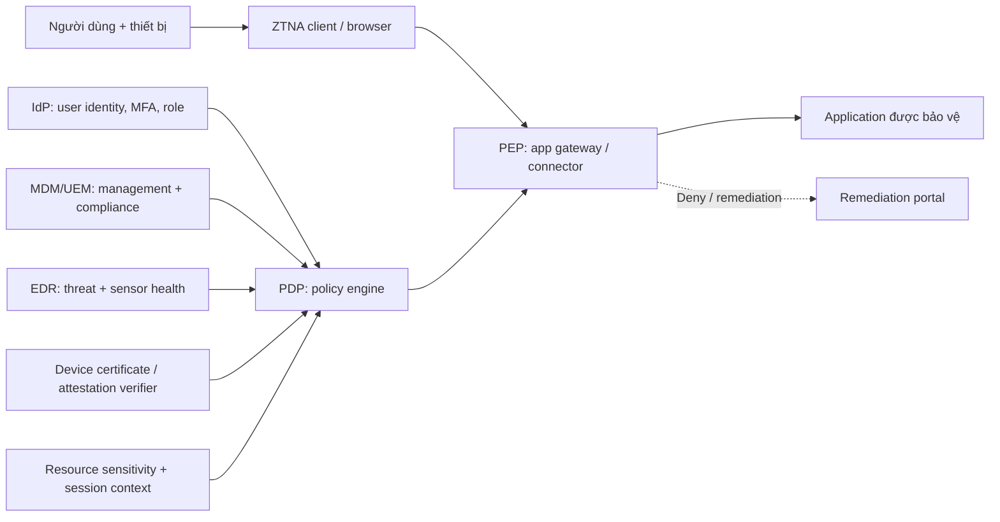
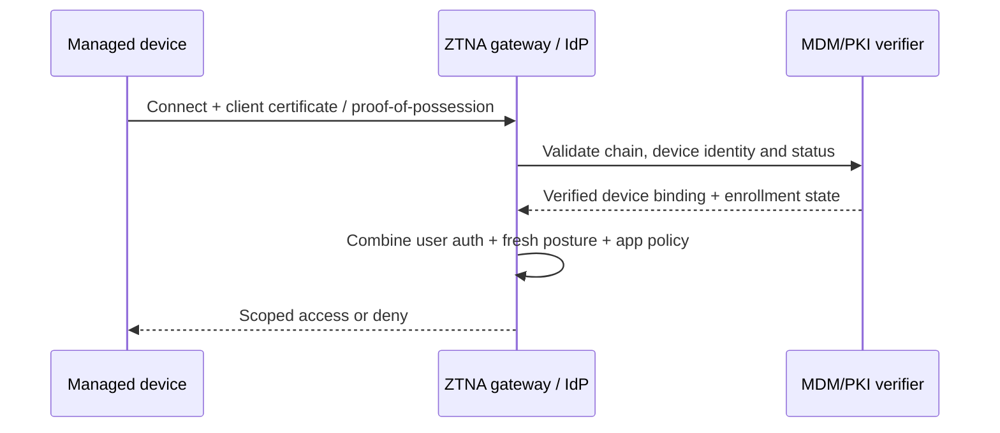

# Device posture và điều kiện thiết bị trong Zero Trust Network Access

## Mục tiêu học tập

Sau bài học, bạn có thể:

1. Giải thích **device posture** (trạng thái bảo mật thiết bị), **device compliance**, **device trust**, **device identity** và vì sao những khái niệm này không đồng nghĩa.
2. Đặt tín hiệu thiết bị vào mô hình **Zero Trust Network Access (ZTNA)**: danh tính người dùng, tài nguyên, thiết bị, hoàn cảnh, chính sách, điểm quyết định và điểm thực thi.
3. Xác định những tín hiệu có ích: đăng ký MDM/UEM, EDR/antimalware, bản vá, mã hóa ổ đĩa, khóa màn hình, Secure Boot, trạng thái tường lửa, thiết bị bị root/jailbreak, chứng thư, phần cứng và attestation.
4. Phân biệt **tín hiệu tự khai**, **tín hiệu được thu từ hệ thống quản trị**, **tín hiệu có xác thực bằng mật mã**; thiết kế cơ chế đánh giá độ mới, độ tin cậy và trường hợp thiếu dữ liệu.
5. Xây quy tắc **allow, deny, step-up authentication, limited access, remediation/quarantine và session revocation** theo mức nhạy cảm ứng dụng.
6. Thiết kế chính sách cho thiết bị **managed, BYOD/unmanaged, mobile, kiosk, VDI, thiết bị không thể cài agent** và các nhóm ngoại lệ có giới hạn.
7. Kiểm tra đường vào ứng dụng qua **IdP, ZTNA connector/gateway, VPN, cloud firewall, DNS, IPv4/IPv6 và split-tunnel** để tránh bypass posture.
8. Đánh giá trade-off **privacy, availability, false positives, offline behavior, kiểm tra liên tục và khả năng phục hồi**, xây logging/telemetry phù hợp.
9. Thực hành mô hình quyết định bằng **Python ngoại tuyến**, thiết kế ma trận positive/negative tests và runbook xử lý thiết bị không đạt posture.

## 1. Bài toán: đúng người dùng nhưng sai thiết bị

Một nhân viên có thể đăng nhập hợp lệ bằng SSO và MFA, nhưng thiết bị họ đang sử dụng có thể:

- Chưa đăng ký trong hệ thống quản trị thiết bị.
- Không cài hoặc đã tắt công cụ bảo vệ endpoint.
- Hệ điều hành quá hạn vá lỗ hổng nghiêm trọng.
- Ổ đĩa chưa mã hóa, khóa màn hình không đáp ứng chính sách.
- Bị root/jailbreak hoặc cấu hình khởi động không đáng tin.
- Không gửi báo cáo sức khỏe trong thời gian dài.
- Là máy cá nhân hoặc máy mượn chưa xác định chủ sở hữu.
- Đang bị cách ly do cảnh báo ransomware/phishing.

Nếu chỉ xem **tên người dùng và mật khẩu**, hệ thống có thể cho phép máy rủi ro truy cập source code, dữ liệu khách hàng hoặc trang quản trị. Nếu chỉ xem **địa chỉ IP nội bộ**, một thiết bị không được kiểm soát khi vào mạng công ty hoặc qua VPN có thể được tin quá mức.

**Device posture** là tập thông tin về trạng thái bảo mật, quản lý và tuân thủ của **thiết bị tại một thời điểm**, được sử dụng làm một đầu vào cho quyết định truy cập. Trong **Zero Trust Network Access**, quyền không được suy ra tự động từ vị trí mạng: mỗi phiên tới tài nguyên cụ thể cần được đánh giá theo **danh tính, trạng thái thiết bị, điều kiện truy cập và chính sách**.

Trong module `SECURITY_NETWORK_SECURITY` về phân đoạn mạng, firewall, VPN, IDS/IPS, xác thực kết nối, DNS và hạ tầng cloud, posture kết nối các lớp **endpoint security, identity và network access control**. Nó bổ sung cho segmentation, nhưng **không thay thế** authentication, authorization hoặc network enforcement.

> **Nguyên tắc:** Thiết bị “compliant” không có nghĩa chắc chắn sạch mã độc; thiết bị “managed” không tự động được phép mọi ứng dụng. Quyết định đúng phải dựa vào **tín hiệu đáng tin và còn mới**, cộng với danh tính, độ nhạy tài nguyên và cách thức truy cập.

### 1.1. Ví dụ chính sách theo tài nguyên

| Tình huống | Danh tính người dùng | Posture | Tài nguyên | Quyết định minh họa |
|---|---|---|---|---|
| Nhân viên máy công ty | SSO + MFA hợp lệ | Managed, EDR khỏe, bản vá phù hợp | Cổng thông tin nội bộ | **ALLOW** |
| Nhân viên máy công ty | SSO + MFA hợp lệ | EDR cảnh báo high severity | Hệ thống tài chính | **DENY/QUARANTINE** |
| Nhân viên laptop cá nhân | SSO + MFA hợp lệ | Unmanaged/không đủ attestation | Website hướng dẫn công khai | **ALLOW giới hạn** nếu policy cho |
| Nhân viên laptop cá nhân | SSO + MFA hợp lệ | Unmanaged | Database admin console | **DENY** hoặc chỉ qua VDI được bảo vệ |
| Nhà thầu thiết bị compliant | Danh tính đúng nhưng không có role | Source code repo | Dù posture đạt vẫn **DENY** |
| Admin managed device | SSO + phishing-resistant MFA | Posture đạt nhưng grant JIT hết hạn | Production control plane | **DENY** |
| Nhân viên máy managed | SSO + MFA hợp lệ | Telemetry quá cũ | Ứng dụng nhạy cảm | **INDETERMINATE → policy xử lý**, thường deny/limited |
| Endpoint được cách ly | Danh tính hợp lệ | EDR isolation active | Remediation portal | **ALLOW remediation-only** |

Bảng chỉ là **chính sách ví dụ**, không phải quy tắc bắt buộc của mọi tổ chức. Khả năng cho thiết bị không được quản lý vào một số ứng dụng phải được xác định bằng risk assessment, data classification và cơ chế bảo vệ của ứng dụng.

## 2. Các khái niệm phải phân biệt

| Thuật ngữ | Ý nghĩa | Điều không suy ra được |
|---|---|---|
| **Device identity** | Cách hệ thống nhận dạng thiết bị, ví dụ khóa/credential/certificate được quản lý | Không tự chứng minh máy đang khỏe |
| **Managed device** | Thiết bị được enrollment trong MDM/UEM hoặc nền tảng quản trị | Không tự bảo đảm bản vá, EDR, encryption đã đạt |
| **Registered device** | Có bản ghi đăng ký, liên kết user/device phù hợp | Không bảo đảm mọi phiên đến từ thiết bị vật lý đó |
| **Device posture** | Tập tín hiệu sức khỏe/an ninh tại một thời điểm | Không phải xác suất chính xác máy sạch mã độc |
| **Compliance** | Thiết bị thỏa một tập rule do tổ chức đặt | Có thể không bao phủ mọi loại tấn công |
| **Risk score** | Điểm hoặc mức nguy cơ dựa trên các tín hiệu | Không phải chân lý khách quan hoặc giấy phép truy cập |
| **Device certificate** | Credential có thể chứng minh quyền sở hữu khóa riêng tương ứng khi xác thực đúng | Không tự chứng minh EDR/patch đạt |
| **Attestation** | Bằng chứng có thể xác minh về một số trạng thái/phần tử nền tảng | Không tự xác minh mọi ứng dụng hoặc toàn bộ thiết bị |
| **Policy Decision Point (PDP)** | Thành phần đưa ra quyết định access dựa trên policy/context | Không tự chặn packet nếu PEP không thực thi |
| **Policy Enforcement Point (PEP)** | Gateway/agent/proxy/app thực thi allow/deny/conditional access | Không tạo ra tín hiệu posture đáng tin nếu thiếu PIP |
| **Policy Information Point (PIP)** | Nguồn dữ liệu/thuộc tính cung cấp cho policy engine | Chất lượng dữ liệu không mặc định cao |
| **Continuous evaluation** | Đánh giá lại theo sự kiện/chu kỳ/phiên | Không đồng nghĩa mọi packet bị xác minh ngay lập tức |
| **Remediation** | Hành động sửa posture: update, bật encryption, kiểm tra EDR | Không nên cấp quyền tài nguyên nhạy cảm trước khi đạt |
| **Quarantine** | Giới hạn thiết bị vào vùng/ứng dụng xử lý sự cố | Không phải chứng cứ thiết bị chắc chắn bị compromise |

### 2.1. “Device posture” không có một danh sách thuộc tính duy nhất

Các tổ chức và nhà cung cấp sử dụng tên gọi khác nhau: compliance, device trust, endpoint risk, healthy device, device assurance, conditional access. **Một nhãn “compliant” có nghĩa chính xác là gì phụ thuộc tập kiểm tra, nguồn tín hiệu và thời điểm đánh giá**.

Ví dụ nền tảng MDM có thể đánh dấu máy compliant vì mã hóa ổ đĩa và khóa màn hình đạt, trong khi EDR vẫn báo malware alert. Ngược lại, EDR báo “healthy” không chứng minh hệ điều hành đã cài bản vá mới nhất hoặc ổ đĩa đã mã hóa.

Khi thiết kế policy, **tách từng thuộc tính** hoặc dùng các kết quả tổng hợp có định nghĩa và provenance rõ ràng, tránh coi một cờ boolean do nhà cung cấp trả về là chứng nhận mọi rủi ro đã được xử lý.

## 3. Device posture nằm ở đâu trong kiến trúc Zero Trust?

### 3.1. Các thành phần



Luồng trong hình mang tính logic. Trong sản phẩm thực tế, IdP có thể đánh giá conditional access trước gateway; EDR/MDM gửi signal qua API hoặc broker; PEP có thể là cloud proxy, endpoint agent, gateway, application hoặc kết hợp nhiều điểm.

### 3.2. Các bước đánh giá một yêu cầu

1. Người dùng yêu cầu `finance.example.test` từ thiết bị đang dùng.
2. IdP xác thực **user** qua phương thức được duyệt (ví dụ passkey/FIDO2 và điều kiện MFA).
3. Client/agent hoặc phiên đăng nhập cung cấp khả năng liên kết yêu cầu với **device identity** có xác thực.
4. Policy engine lấy tín hiệu MDM, EDR, OS/patch, encryption và metadata phù hợp từ nguồn đáng tin.
5. Policy xét **user role, app classification, action, device posture, signal freshness, threat/risk events và điều kiện phiên**.
6. PDP trả quyết định như allow, deny, step-up, limited, remediation; PEP phải thực thi quyết định đó.
7. Với allow, client mở **kết nối được phép tới ứng dụng cụ thể**, không mặc định có route tới toàn bộ subnet.
8. Khi posture thay đổi hoặc kết thúc grant, hệ thống **đánh giá lại** và thực hiện revocation/step-up theo khả năng PEP.
9. Telemetry ghi policy version, signal age, quyết định, lý do và outcome mà không phát tán dữ liệu endpoint nhạy cảm.

### 3.3. “Never trust, always verify” không có nghĩa mỗi gói tin lại hỏi MDM

Liên tục gọi MDM/EDR cho từng packet có thể làm tăng độ trễ và phụ thuộc availability không cần thiết. Các kiến trúc thường dùng **snapshot có TTL**, event-driven updates, caching ngắn hạn, policy decision tại session setup và reevaluation có điều kiện.

Điều quan trọng là nêu rõ:

- **Lúc nào** posture được đọc và quyết định được tạo.
- **Dữ liệu có tuổi tối đa** bao nhiêu.
- **Sự kiện nào** khiến đánh giá lại: mất EDR heartbeat, malware alert, patch overdue, enrollment revoked, user role thay đổi.
- **Phiên/connection nào** có thể bị thu hồi thực tế; long-lived WebSocket/RDP/SSH có thể cần cơ chế riêng.
- **Trường hợp signal provider không hoạt động** được xử lý theo mức rủi ro nào.

## 4. Phân loại các nguồn device posture

### 4.1. Tín hiệu quản trị thiết bị

**Mobile Device Management (MDM)** hoặc **Unified Endpoint Management (UEM)** có thể cung cấp:

- Thiết bị có được enrollment, assigned owner và managed profile hợp lệ?
- Hệ điều hành/phiên bản và mức update policy được báo cáo.
- Có passcode/screen lock, disk encryption và một số cấu hình hệ thống?
- Enrollment có còn hiệu lực hay đã retired/wiped/blocked?
- MDM check-in cuối cùng là lúc nào?
- Compliance rule nào đạt/không đạt theo scope của nền tảng?
- Thiết bị thuộc nhóm công ty cấp, BYOD hoặc shared/kiosk?

**Nhược điểm:** MDM không mặc định cung cấp malware detection hoặc đo lường tính toàn vẹn toàn diện; một số tín hiệu phụ thuộc OS và mức quyền quản trị.

### 4.2. Endpoint Detection and Response (EDR)

EDR có thể cung cấp:

- Agent có cài đặt, được quản trị và có heartbeat?
- Sensor đang hoạt động hay bị tamper/disabled?
- Có alert high severity, active incident, malware hoặc behavior suspicious?
- Thiết bị có bị cách ly bởi EDR?
- Lần cập nhật signature/engine hoặc agent version có nằm trong policy?
- Device risk/risk disposition do nền tảng tính toán.

**Nhược điểm:** “Không có alert” **không chứng minh sạch mã độc**; EDR có coverage, latency, false negatives và bypass risks. Khi sensor ngừng báo, đừng coi đó là bằng chứng thiết bị khỏe.

### 4.3. Tín hiệu hệ điều hành và cấu hình

Các thuộc tính thường được đánh giá:

| Tín hiệu | Mục đích | Giới hạn |
|---|---|---|
| OS version/build | Chặn phiên bản hết hỗ trợ hoặc có rủi ro lớn | Version có thể không phản ánh hotfix cụ thể |
| Patch compliance | Giảm thời gian phơi lỗ hổng đã biết | “Latest” không phải chính sách phù hợp mọi deployment |
| Full disk encryption | Giảm rủi ro lộ dữ liệu khi mất thiết bị | Không ngăn trộm dữ liệu khi hệ thống đang mở và attacker có quyền |
| Screen lock / idle lock | Giảm truy cập vật lý khi người dùng rời thiết bị | Không thay MFA hoặc session management |
| Host firewall | Giảm network exposure ở endpoint | Một rule bật “on” không bảo đảm effective policy đúng |
| Secure Boot | Giúp kiểm soát chuỗi khởi động được ký trong phạm vi hỗ trợ | Không chứng nhận mọi process đang chạy |
| Root/jailbreak status | Giúp phát hiện thay đổi cơ chế bảo vệ OS | Không phải signal không thể qua mặt |
| Endpoint agent health | Phát hiện sensor/tamper/offline | Agent báo “running” không đồng nghĩa không bị compromise |
| Local admin exposure | Giảm đặc quyền không cần | Có thể cần exception trên máy quản trị hợp lệ |
| Device age / lifecycle | Hỗ trợ unsupported/retired decisions | Tuổi thiết bị không phải điểm rủi ro duy nhất |
| Disk health / backup state | Một số use case về resilience | Không luôn là điều kiện ZTNA phù hợp |

### 4.4. Tín hiệu ngữ cảnh khác với posture

Một số thuộc tính hữu ích cho quyết định truy cập nhưng **không phải sức khỏe của thiết bị**:

- User identity, vai trò và kết quả MFA.
- Mức nhạy ứng dụng, tenant và hành động cần làm.
- Vị trí mạng, địa chỉ IP, VPN status hoặc geolocation suy ra từ IP.
- Thời gian trong ngày và cửa sổ JIT.
- Tốc độ đăng nhập thất bại, user behavioral risk.
- Rủi ro phiên, impossible travel, phát hiện phishing.
- App audience, route/method và connection risk.

Không gộp tất cả thành “device trust”. Có thể dùng một **policy context** tổng hợp nhưng phải giữ **nguồn và ý nghĩa** từng thuộc tính để audit.

## 5. Độ tin cậy của tín hiệu: không phải cái gì client nói cũng đúng

### 5.1. Thang mức tin cậy tham khảo

| Cấp nguồn | Ví dụ | Cách diễn giải |
|---|---|---|
| Client tự khai | JavaScript gửi `osVersion=latest`, custom header `deviceManaged=true` | **Không đủ để cho quyền nhạy cảm** |
| Client agent được quản trị | Agent báo patch/encryption/status qua kênh xác thực | Có ích, cần chống tamper và kiểm soát freshness |
| MDM/UEM backend | Server-side compliance của device enrollment đã xác minh | Đáng tin hơn lời client tự khai nhưng còn phụ thuộc agent/OS |
| EDR backend | Sensor heartbeat, active threat verdict, isolation state | Cần correlation với device ID và timestamp |
| Certificate/key possession | mTLS challenge chứng minh quyền sở hữu private key | Chứng minh khóa, không tự chứng minh posture |
| Hardware-backed attestation | Bằng chứng có thể verify về một số thuộc tính hardware/boot/key | Mạnh hơn cho thuộc tính cụ thể; không xác minh toàn bộ trạng thái runtime |
| Trusted aggregation | Policy service hợp nhất MDM/EDR/attestation, signed decision | Chỉ mạnh bằng verification logic, provenance và TTL |

**Không có “độ tin cậy tuyệt đối”**: thiết bị compromised có thể vẫn trình một số chứng thư đúng; MDM/EDR còn lệ thuộc thời điểm quan sát. Hãy đánh giá **signal provenance, anti-replay, binding và coverage**.

### 5.2. Thiết bị nào đang phát signal?

Một trong các lỗi nghiêm trọng là **device binding mismatch**:

```text
Session:
  user = employee-A
  agent reports device = laptop-001
  certificate presented by browser = laptop-002
  MDM lookup returns compliant for laptop-001
  token issuer binds session only to employee-A
```

Nếu PDP lấy compliance của laptop-001 nhưng request thực từ laptop-002, quyết định allow có thể sai. Cần liên kết:

1. **Session** → device identity tại phương thức xác thực.
2. **Device identity** → bản ghi MDM/EDR và chủ sở hữu.
3. **Device key/certificate** → possession proof khi kiến trúc hỗ trợ.
4. **Policy decision** → đúng session/resource/PEP và thời hạn.
5. **Reevaluation** → đúng thiết bị khi token được refresh hoặc phiên được nối tiếp.

Không lấy tên hostname hoặc serial number do client tự gửi làm bằng chứng đủ cho resource nhạy cảm; chúng có thể thay đổi hoặc bị giả mạo.

### 5.3. Tín hiệu đã được ký vẫn cần kiểm thời gian và audience

Một posture assertion được ký có thể bị **replay** nếu bên xác minh không kiểm:

- Issuer/trust anchor của hệ phát assertion.
- Audience/resource mà assertion dành cho.
- Expiry, not-before, timestamp và maximum-age.
- Device/session binding.
- Nonce/challenge khi cơ chế attestation yêu cầu.
- Signature và key rotation.
- Quyền của issuer để phát ra chính loại claim đó.

Một assertion hợp lệ về **“máy compliant lúc 09:00”** không tự chứng minh máy compliant lúc 15:00.

## 6. Device identity: enrollment, certificate và key protection

### 6.1. Enrollment có ý nghĩa gì?

Một quá trình onboarding thiết bị thường gồm:

1. Xác định loại thiết bị và ownership (company-owned, BYOD, shared).
2. User/admin xác minh quyền đăng ký thiết bị.
3. MDM/UEM tạo bản ghi quản lý, chính sách tương ứng.
4. Cấp device credential/certificate hoặc thiết lập trusted agent theo nền tảng.
5. Kiểm tra agent/OS health ban đầu.
6. Đưa thiết bị vào nhóm compliance; chưa tự cấp quyền app nhạy cảm.
7. Theo dõi lifecycle: active, suspended, lost, retired, re-enrolled, wiped.

**Enrollment là bước khởi tạo trust, không phải chứng nhận vĩnh viễn**. Một thiết bị đã đăng ký từ nhiều tháng nhưng không check-in cần được đánh giá khác thiết bị được xác minh mới.

### 6.2. Device certificate và mutual TLS

Mô hình mTLS có thể giúp chứng minh client giữ **private key** tương ứng một certificate đã được cấp:



**Certificate hợp lệ không tự chứng minh thiết bị không nhiễm mã độc.** Muốn kết luận patch/EDR/encryption đạt, cần posture signals và (nếu yêu cầu) attestation có thể xác minh.

### 6.3. TPM, Secure Enclave và hardware-backed keys

Phần cứng bảo vệ khóa như **TPM/Secure Enclave** có thể giúp bảo vệ private key khỏi bị export trong một số thiết kế và hỗ trợ **key attestation hoặc platform attestation**.

Phải phân biệt:

- **Hardware-backed key**: private key tạo/lưu trong phần cứng theo khả năng nền tảng.
- **Proof of possession**: endpoint chứng minh có khả năng sử dụng khóa mà không xuất private key.
- **Attestation**: bên xác minh nhận bằng chứng về thuộc tính của key/platform/boot với trust chain/challenge.
- **Device posture**: vẫn cần kết quả đánh giá OS, EDR, bản vá, quản trị và nhiều tín hiệu khác.

Không suy “TPM present” đồng nghĩa “Secure Boot bật”, “EDR hoạt động” hoặc “kernel chưa bị compromise”.

### 6.4. Certificate lifecycle

- Cấp phát credential chỉ cho thiết bị đúng ownership/identity.
- Giới hạn issuer, EKU/SAN/claims và purpose theo thiết kế.
- Không dùng một device certificate chung cho nhiều máy.
- Private key phải được bảo vệ khỏi export/mount/log khi có thể.
- Có rotation/expiry/revocation và xử lý máy mất hoặc bị bán.
- Kiểm tra CRL/OCSP/status hoặc phương thức revoke tương ứng với PKI.
- Không chặn tất cả remediation traffic khi certificate cần gia hạn.
- Thử cả thiết bị có certificate hợp lệ nhưng posture không đạt: phải **deny** app nhạy cảm.

## 7. Attestation: bằng chứng mạnh nhưng có phạm vi

### 7.1. Attestation khác heartbeat

Một agent có thể gửi heartbeat “tôi đang chạy”. Attestation có thể dựa vào **nonce/challenge, signed measurement, key binding, verified boot/platform state** nhằm tăng độ tin cậy cho một số tuyên bố.

Ví dụ khái niệm:

```text
Verifier gửi challenge ngẫu nhiên -> endpoint/TPM tạo bằng chứng.
Verifier xác minh chữ ký/challenge, trust root, measurement policy.
Kết quả: verified claim về một số thuộc tính của thiết bị/khóa.
PDP dùng claim đó kết hợp MDM, EDR, user và app risk.
```

Tùy OS/hardware và giải pháp, phạm vi có thể rất khác nhau. Không giả định mọi BYOD/mobile/VDI có thể cung cấp remote attestation giống máy công ty dùng TPM.

### 7.2. Tại sao không thể dùng attestation thay toàn bộ EDR?

Attestation của boot chain có thể cho thấy những thành phần khởi động phù hợp một measurement policy, nhưng **mã độc chạy sau khi boot** hoặc rủi ro ứng dụng có thể không được phát hiện. EDR bổ sung behavioral telemetry, còn MDM quản lý chính sách và lifecycle.

Để xây posture tốt cần:

- Biết **attestation chứng minh đúng thuộc tính nào**.
- Kiểm verifier trust anchor, nonce freshness, measurement baseline/version.
- Xem thiết bị có thực sự hỗ trợ phần cứng và secure configuration không.
- Chọn ứng dụng nào bắt buộc attestation, ứng dụng nào có thể dùng control bù.
- Xử lý thiết bị không hỗ trợ bằng limited access/VDI thay vì âm thầm bỏ kiểm tra.

## 8. MDM/UEM compliance: quản trị và thực thi

### 8.1. Một baseline minh họa

```yaml
# PSEUDOCODE: đây không phải chính sách chạy trực tiếp trên MDM.
profile: corporate-laptop-baseline-v1
required:
  enrolled_in_approved_uem: true
  device_assignment: known_active_owner
  os_support_status: supported
  security_updates_within_policy: true
  full_disk_encryption: enabled
  idle_screen_lock: configured
  local_firewall: managed
  secure_boot_if_supported: enabled
  endpoint_protection: healthy
  no_high_severity_unresolved_incident: true
freshness:
  uem_last_checkin_max_minutes: 240
  edr_last_heartbeat_max_minutes: 20
outcomes:
  compliant_and_fresh: eligible_for_app_policy
  stale_or_unknown: evaluate_by_resource_risk
  high_severity_active_incident: quarantine_for_sensitive_apps
```

Tất cả ngưỡng (20 phút, 240 phút) chỉ minh họa. Ngưỡng thật phụ thuộc khả năng thu signal, đặc tính kết nối, latency MDM/EDR, app risk, VPN/offline mobility và SLO.

### 8.2. Compliance theo nhóm thiết bị

| Nhóm | Baseline khả thi | Điểm cần cân nhắc |
|---|---|---|
| Laptop corporate | MDM + EDR + encryption + patch + device cert | Nhiều nguồn tín hiệu, full admin control |
| Smartphone corporate | MDM mobile posture + screen lock + OS + app protection | OS hạn chế agent; policy khác laptop |
| BYOD phone | App-level protection hoặc device registration có đồng ý | Privacy, limited management, dữ liệu cá nhân |
| BYOD laptop | Browser-isolated/VDI hoặc minimum requirements | Không nên yêu cầu quyền quản trị quá mức |
| Kiosk/shared device | Dedicated enrollment + restricted app + physical controls | Không gắn identity user lâu dài nếu shared |
| VDI/remote desktop | Posture của VDI host/session và client endpoint | Trust chain hai phía, screenshot/clipboard/data movement |
| OT/IoT/legacy | Segmentation + broker + protocol restriction | Không thể cài EDR/MDM phổ thông |
| Contractor device | Risk-limited apps + strong identity + contractual controls | Không mặc định company-managed |

**Một policy “phải có EDR của hãng X” không áp dụng tự động được cho tất cả thiết bị.** Chọn profile theo platform và mức nhạy tài nguyên; tạo alternative access path an toàn cho trường hợp legitimate nhưng không tương thích.

### 8.3. Không để lỗi quản trị thành “non-compliant forever”

Một thiết bị có thể không đồng bộ MDM vì:

- Mất mạng hoặc captive portal.
- Lỗi đồng bộ tenant/identity certificate.
- Agent quá cũ sau OS upgrade.
- Máy mới enrollment chưa hoàn tất.
- Endpoint bị chuyển giao chủ sở hữu.
- Service provider outage, API rate limit hoặc delayed event.
- Clock drift ảnh hưởng xác minh token/chứng thư.

Tổ chức nên có **remediation UX**: hiển thị điều kiện nào chưa đạt, tự phục hồi các lỗi đơn giản khi có thể, hỗ trợ IT, và phương án truy cập an toàn cho công việc thiết yếu.

## 9. EDR posture: phát hiện rủi ro động

### 9.1. Phân biệt các trạng thái

| EDR state | Diễn giải | Quyết định tham khảo |
|---|---|---|
| Healthy sensor + no active high-risk alert | Một số điều kiện sức khỏe đạt tại thời điểm thu | Eligible, còn phụ thuộc user/app |
| Healthy sensor + active low-risk advisory | Có cảnh báo cần xử lý | Có thể allow app ít nhạy cảm, step-up/monitor |
| Active high-severity incident | Nguy cơ compromise đáng kể | Deny app nhạy cảm, incident workflow |
| Device isolated by EDR | Đang bị containment | Remediation-only, không mở tunnel nội bộ rộng |
| Sensor disabled/tampered | Không đủ độ tin cậy để kết luận safe | Deny/limited tùy resource risk |
| No heartbeat/stale | Thiếu tín hiệu mới | UNKNOWN; không coi healthy |
| Product outage/telemetry unavailable | Không xác định tình trạng endpoint | Áp degraded-mode policy theo từng app |
| Device not enrolled | Chưa có nguồn xác minh EDR | Unmanaged/unknown treatment |

Một thiết bị có thể báo “healthy” ở MDM nhưng “high risk” ở EDR. Policy cần xác định **xung đột tín hiệu**: với app nhạy cảm, trạng thái compromise nghiêm trọng thường phải có quyền ưu tiên deny so với nhãn MDM compliant.

### 9.2. EDR isolation có thể làm mất đường khôi phục

Nếu agent tự cách ly host, thiết bị có thể không reach MDM/EDR cloud hoặc remediation portal tùy chính sách. Cần thiết kế **allowlist điều khiển/khôi phục** được kiểm soát, không mở trở lại toàn bộ application access.

Đặc biệt tránh:

- Cho thiết bị đang isolated kết nối VPN full-network để cập nhật agent.
- Gỡ EDR để “cho mạng chạy lại”.
- Gắn “healthy” thủ công mà không ghi ticket/expiry.
- Cho tài khoản admin dùng chung cấp override không có audit.

## 10. OS version, patching và vulnerability risk

### 10.1. “Latest” không phải policy đủ chính xác

Một rule kiểu “OS phải mới nhất” gây khó vận hành vì update rollout theo ring, vendor backport, phiên bản enterprise LTS và dependency app. Nên định nghĩa:

- Supported OS/channel theo đội endpoint.
- Bản vá tối thiểu/hạn chót theo severity và mức phơi rủi ro.
- Critical vulnerabilities nào phải có remediation trước khi truy cập app nhạy cảm.
- Exemption theo thiết bị/app và thời hạn.
- Cách đối chiếu version, patch ID hoặc vulnerability management verdict.
- Tín hiệu đã cập nhật sau khi reboot hay chưa.

Một phiên bản OS thấp hơn nhưng được vendor hỗ trợ/backport có thể đạt policy; phiên bản ghi “mới” nhưng thiếu bản vá quan trọng vẫn có thể không đạt.

### 10.2. Vulnerability và exploitability

Không nên lấy **một số CVE count** làm thước đo duy nhất. Một lỗ hổng critical đang bị khai thác trên thành phần exposed có thể quan trọng hơn nhiều cảnh báo low severity.

Posture policy có thể tính đến:

- Mức nghiêm trọng và bằng chứng khai thác thực tế.
- Sự liên quan tới OS/browser/VPN/EDR/agent đang dùng.
- Thời gian phơi và khả năng khắc phục.
- Endpoint nằm trong app/data risk tier nào.
- Có compensating controls đáng tin hay không.
- Threat intel/EDR signals từ nguồn cập nhật.

**Không dùng risk score như giấy phép vĩnh viễn:** vulnerability posture thay đổi theo thời gian, và risk model cần được định kỳ đánh giá.

## 11. Mã hóa ổ đĩa, khóa màn hình, Secure Boot và host firewall

### 11.1. Full-disk encryption

Mã hóa ổ đĩa giúp bảo vệ **dữ liệu lưu trữ khi thiết bị tắt/mất** trong những tình huống phù hợp. Policy cần xem:

- Encryption bật và thực sự hoàn tất, không chỉ “requested”.
- Recovery key được lưu ở nơi được quản lý phù hợp.
- OS hỗ trợ thuật toán/chế độ theo baseline.
- Device ownership và key escrow/audit được kiểm soát.
- Trạng thái mã hóa có được xác minh mới hay chỉ đọc cache.

**Disk encryption không ngăn malware truy cập file khi user đã đăng nhập và volume mở khóa**; không đánh đồng với endpoint integrity.

### 11.2. Screen lock và inactivity timeout

Yêu cầu khóa màn hình hỗ trợ ngăn truy cập vật lý không được phép. Phải xác định ngưỡng theo hình thức sử dụng: laptop, mobile, kiosk, shared device.

Một device đang unlocked trong phiên không tự là compromised; nhưng thiết bị không có passcode hoặc khóa có thể không đủ điều kiện với dữ liệu nhạy cảm. Dù screen lock đạt, session/app authorization và phishing-resistant MFA vẫn cần.

### 11.3. Secure Boot và nền tảng

Secure Boot có thể bảo vệ một phần chuỗi khởi động theo cơ chế OS/firmware, nhưng không phải chứng nhận tất cả phần mềm hiện hành tin cậy. Nếu muốn enforce, cần **verified state** và có ngoại lệ phù hợp cho những thiết bị không hỗ trợ phần cứng.

### 11.4. Host firewall

Kiểm tra “firewall enabled” chỉ là bước đầu. Cần đối chiếu:

- Chính sách inbound/outbound áp cho các network profiles.
- Agent/host firewall có bị tamper?
- Có mở debug/admin ports hoặc ngoại lệ rộng không?
- VPN/ZTNA client và EDR có những rule cần thiết chưa?
- IPv4/IPv6 đều được xem xét?
- Effective policy có nhất quán sau OS update/reboot không?

Không biến việc bật tắt một công tắc thành bằng chứng toàn bộ traffic đã được kiểm soát.

## 12. Freshness, TTL, cache và trạng thái UNKNOWN

### 12.1. Một verdict chỉ có giá trị tại thời điểm đánh giá

Giả sử:

```text
09:00   EDR báo healthy.
09:10   MDM báo disk encrypted.
09:15   ZTNA cho phép phiên tài chính.
10:05   EDR phát hiện high-severity incident.
10:06   Endpoint bị isolated; nhưng ZTNA chưa nhận update.
13:00   Người dùng vẫn giữ một phiên ứng dụng dài.
```

Nếu policy chỉ kiểm tra lúc 09:15 và không có reevaluation/incident signal, phiên có thể tồn tại bất chấp posture đã đổi.

Thiết kế cần **signal age/TTL và event-driven reevaluation**. Không có một TTL “đúng cho mọi thiết bị”: ứng dụng tài chính/production admin thường cần freshness chặt hơn trang thông tin nội bộ ít nhạy cảm.

### 12.2. Khái niệm state

| Trạng thái | Ý nghĩa | Gợi ý |
|---|---|---|
| **PASS / COMPLIANT** | Tín hiệu đạt baseline tại thời điểm đánh giá | Còn kiểm user/app authorization |
| **FAIL / NON-COMPLIANT** | Có điều kiện không đạt với evidence | Deny/limited/remediate tùy risk |
| **UNKNOWN** | Thiếu tín hiệu, provider lỗi hoặc chưa xác minh | Không được coi mặc nhiên là PASS |
| **STALE** | Tín hiệu từng có nhưng đã quá tuổi policy | Recheck; xử lý theo risk |
| **CONFLICT** | MDM/EDR/attestation mâu thuẫn | Ưu tiên rule an toàn, điều tra nguồn |
| **EXEMPT** | Exception có phê duyệt, scope và expiry | Không phủ toàn bộ rủi ro khác |
| **QUARANTINED** | Bị hạn truy cập do incident/state | Cho phép remediation path cụ thể |
| **RETIRED / REVOKED** | Thiết bị không còn được tin hoặc bị thu hồi | Deny protected resources |

**UNKNOWN không đồng nghĩa FAIL về mặt chẩn đoán**, dù ứng dụng nhạy cảm có thể xử lý UNKNOWN bằng deny. Phân biệt giúp IT xử lý outage mà không phải cấp exception bừa bãi.

### 12.3. Cache chỉ đúng nếu được ràng buộc

Một cached posture decision cần gắn ít nhất với:

- Device identity được xác minh.
- User/session identity hoặc context phù hợp.
- Resource/app/action.
- Policy version/decision revision.
- Signal timestamps và expiry.
- Device/tenant/organization identity.
- Revocation marker hoặc event subscription khi hỗ trợ.

Không tái sử dụng “device compliant=true” từ một user hoặc thiết bị khác, không mở rộng permit một app thấp rủi ro cho app quản trị nhạy cảm.

### 12.4. Grace period có điều kiện

Đối với dịch vụ ít nhạy cảm, tổ chức có thể cho **grace period** ngắn khi MDM tạm ngừng hoạt động nếu thiết bị có verified enrollment, last-known-good recent và không có active critical incident.

Với ứng dụng quản trị production, cryptographic keys hoặc dữ liệu nhạy cảm, policy có thể **deny khi thiếu posture mới**, dùng break-glass đã được phê duyệt qua bastion/VDI nếu business continuity bắt buộc.

Một grace period hợp lệ cần **TTL, owner, điều kiện hạn chế, audit và explicit resource scope**; không phải “tạm bật allow-all cho mọi thiết bị”.

## 13. Điều kiện truy cập: không chỉ có nút ALLOW và DENY

### 13.1. Quyết định truy cập nhiều mức

| Decision | Ý nghĩa | Trường hợp phù hợp |
|---|---|---|
| **ALLOW** | Cho phép phiên tới đúng ứng dụng/quyền đã xét | User, device và policy đạt |
| **DENY** | Không cho phép truy cập tài nguyên | Device revoked, critical EDR alert, quyền user thiếu |
| **STEP_UP** | Yêu cầu xác thực tăng cường hoặc kiểm tra bổ sung | MFA không đủ mới, rủi ro phiên tăng |
| **LIMITED** | Chỉ cho một tập ứng dụng/tác vụ đã giảm quyền | BYOD truy cập nội dung ít nhạy cảm |
| **REMEDIATION_ONLY** | Chỉ truy cập update/MDM/EDR/helpdesk được duyệt | Patch thiếu, agent lỗi hoặc thiết bị quarantined |
| **ISOLATE** | Yêu cầu cô lập thiết bị/phiên theo quy trình incident | Threat high-confidence, compromise suspected |
| **RECHECK** | Chờ hoặc yêu cầu thu tín hiệu mới | Device state stale/unknown |
| **REVIEW** | Cần quyết định có thẩm quyền do ngoại lệ | Legacy device/business-critical system |

Một sản phẩm ZTNA có thể chỉ thực hiện “allow/deny” trực tiếp; các kết quả khác phải được triển khai bằng **quy trình bổ sung** như redirect sang remediation portal, IdP step-up, VDI, ticket/approval hoặc chính sách giới hạn phiên.

### 13.2. Điều kiện là phép AND/OR có chủ đích

Một yêu cầu tới hệ thống quản trị nhạy cảm có thể đòi:

```text
User:
  authenticated = true
  role includes "prod-operator"
  phishing-resistant MFA = satisfied
  JIT approval = valid

Device:
  registered = true
  binding verified = true
  MDM compliance = pass and recent
  EDR active + no unresolved high-risk incident
  disk encryption = enabled
  OS patch baseline = pass

Context:
  resource = production-admin
  access path = approved ZTNA PEP
  allowed time window = true
  session risk = acceptable

Decision:
  ALLOW only when all mandatory conditions hold.
  Otherwise DENY / remediation / controlled break-glass.
```

**Có EDR không bù được việc user thiếu quyền production**, và **có MFA không bù được thiết bị đã bị EDR cô lập** nếu policy đặt những điều kiện đó là bắt buộc.

### 13.3. “Risk score” không được che các điều kiện bắt buộc

Một thiết bị có tổng điểm tốt nhưng **EDR đang báo ransomware active** không nên được allow do tổng điểm trung bình vẫn cao. Có thể dùng mô hình:

1. **Hard gates:** revoked device, active critical incident, untrusted identity, expired certificate, required MFA missing.
2. **Eligibility:** managed/enrolled, patch/encryption/EDR baseline và freshness.
3. **Risk adaptive:** step-up, limited access hoặc tăng logging cho các tín hiệu ít chắc chắn.
4. **Resource authorization:** user role, app sensitivity, action/tenant và time-bound grant.

Nếu dùng điểm số, cần biết cách tính, chất lượng dữ liệu, false positives và cách giải thích kết quả với người dùng/kiểm toán.

## 14. Từng ứng dụng cần mức posture khác nhau

### 14.1. Phân nhóm tài nguyên

| Nhóm tài nguyên | Ví dụ | Điều kiện device minh họa |
|---|---|---|
| **Public** | Trang hướng dẫn không đăng nhập | Không nhất thiết yêu cầu managed device |
| **Low sensitivity** | Portal tin tức nội bộ | User auth, basic device posture hoặc browser-isolation |
| **Medium sensitivity** | CRM thông thường | Verified enrollment/compliance, MFA, EDR hoặc control bù |
| **High sensitivity** | Finance, HR, source code, secrets | Managed + fresh EDR/patch/encryption + strong MFA |
| **Privileged admin** | Production cloud console, VPN policy, IAM | Strong identity + verified device + JIT/PAM + short session |
| **Regulated data** | Dữ liệu y tế/cá nhân hoặc tài chính quan trọng | Data classification, audit, DLP, managed device hoặc VDI |
| **Remediation** | MDM/EDR/OS update/helpdesk | Đường riêng cho device chưa compliant |
| **Emergency continuity** | Ứng dụng phục vụ khẩn cấp | Break-glass có owner/recording/scope/time limit |

Đây là **ví dụ phân loại**, không áp một mức bắt buộc cho mọi ngành. Cần tôn trọng yêu cầu pháp luật, privacy, hợp đồng và operational risk của tổ chức.

### 14.2. Device posture phải được xét tại resource boundary

Một thiết bị được allow tới **wiki nội bộ** không có nghĩa mặc định được allow tới **production SSH bastion**. Nếu gateway chỉ bật kiểm tra lúc người dùng đăng nhập IdP rồi cấp network route rộng, user có thể tận dụng phiên hợp lệ để vào hệ khác mà chưa được đánh giá.

Mô hình đúng:

```text
(device + user + app + action + time + risk)
                   |
                   v
              policy decision
                   |
                   v
             scoped app access
```

Với network-level ZTNA, “app” có thể là FQDN/port/protocol/connector; với web gateway có thể xuống tới HTTP route/action. **Một network connector L4 không tự kiểm soát quyền đọc từng bản ghi**; application authorization vẫn bắt buộc.

### 14.3. Ví dụ kết quả theo cùng thiết bị

Giả sử một laptop có MDM healthy, EDR healthy nhưng **chưa mã hóa ổ đĩa**:

- Public docs: allow.
- Internal wiki: có thể allow theo risk policy.
- CRM: limited hoặc remediation required.
- Finance data export: deny.
- Production admin: deny.

Đây không phải mâu thuẫn. **Điều kiện posture phải tương xứng với mức rủi ro tài nguyên** và có mô tả rõ để người dùng khắc phục.

## 15. Phiên truy cập và đánh giá posture liên tục

### 15.1. Thời gian tồn tại của quyết định

Một PDP có thể cấp decision cho:

- Một authentication event.
- Một app session hoặc access token TTL ngắn.
- Một TCP/WebSocket/gRPC tunnel.
- Một port- or resource-level authorization grant.
- Một nhóm applications nếu policy cho phép.

Cần trả lời **chính xác grant nào sẽ hết hạn hoặc bị thu hồi** khi posture đổi. Không suy “PDP thấy malware alert” nghĩa **mọi TLS connections đang mở đã bị chấm dứt ngay**.

### 15.2. Trigger reevaluation

| Trigger | Ví dụ | Hành động |
|---|---|---|
| New app access | User muốn vào finance | Recheck policy với app sensitivity |
| Session refresh | Token/ZTNA grant sắp hết hạn | Re-evaluate posture/role/risk |
| MDM non-compliant event | Encryption disabled | Restrict app cần encryption |
| EDR high-severity alert | Suspected credential theft | Revoke/high-priority isolate |
| EDR heartbeat missing | Sensor offline quá TTL | Unknown → limited/deny |
| Device unenrolled/retired | Admin thu hồi thiết bị | Deny resource được bảo vệ |
| Certificate revoked | Device identity không còn tin cậy | Reject new auth; terminate sessions theo PEP |
| User role removed | Nhân viên chuyển nhóm | Re-evaluate entitlements |
| MFA assurance downgrade | Đổi từ passkey sang yếu hơn policy | Step-up hoặc deny |
| App sensitivity raised | Wiki nay chứa confidential export | Policy phiên sau và active grants cần xét lại |
| Network/IP change | Wi-Fi sang cellular/VPN | Recheck context và anti-hijack khi phù hợp |
| Threat intelligence event | Endpoint high-risk | Escalate containment phù hợp |

### 15.3. Revocation phải đo bằng behavior, không chỉ policy update

Ví dụ: admin tạo incident containment ở 13:00. Để chứng minh:

1. Chính sách/MDM/EDR đã ghi trạng thái high-risk.
2. PDP tiếp nhận event và quyết định deny.
3. PEP nhận policy update hoặc grant/session đã được thu hồi.
4. **New connections** tới app bị deny.
5. **Active sessions** (SSH, RDP, web, tunnel) được terminate/quarantine theo mục tiêu và khả năng sản phẩm.
6. Logs cho biết identity, session ID, policy, quyết định và enforcement outcome.
7. Ứng dụng nhạy cảm không còn cho phép API operations từ credential cũ nếu yêu cầu.

Độ trễ revoke (signal→PDP→PEP→session closed) là một **SLO/SLA an ninh cần đo**, không chỉ ghi “continuous” trong tài liệu.

### 15.4. Chống chập chờn (flapping)

Một máy chuyển qua hai trạng thái compliant/noncompliant liên tục do tín hiệu MDM không ổn định có thể khiến phiên đứt lặp lại. Có thể dùng:

- Debounce/hysteresis đối với **non-critical, low-confidence signals**.
- Grace period đã kiểm soát cho app thấp rủi ro.
- Retry và stale-data state rõ ràng.
- Override có approver/TTL cho lỗi sensor được xác minh.
- **Không trì hoãn containment** khi có high-confidence critical threat.

Chính sách cần phân biệt **độ tin cậy tín hiệu** và **mức tác động tài nguyên**, không áp một khoảng đệm cho mọi loại sự cố.

## 16. Thiết bị managed, BYOD và unmanaged

### 16.1. Vì sao một policy không phù hợp cho mọi thiết bị?

Corporate laptop thường có MDM, EDR, device certificate và khả năng enforce patch/encryption. BYOD có thể chỉ cho một tập signal hạn chế để tôn trọng privacy; máy của đối tác không nằm trong tenant MDM; smartphone có OS security model khác laptop.

Đừng yêu cầu người dùng cá nhân cung cấp **toàn bộ danh sách ứng dụng, địa chỉ GPS, lịch sử duyệt web** chỉ để mở một trang wiki nội bộ nếu mục đích bảo mật có thể đạt bằng tín hiệu ít xâm lấn hơn.

### 16.2. Các tuyến truy cập

| Nhóm | Đường truy cập ưu tiên | Phạm vi |
|---|---|---|
| Managed + fresh compliant | ZTNA agent hoặc browser với verified device context | Ứng dụng được user/app policy cho |
| Managed + stale | Recheck, có thể limited nếu app low risk | Không tự mở admin/finance |
| Managed + active EDR incident | Quarantine/remediation path | Không vào app nhạy cảm |
| BYOD được chấp nhận | Browser isolation, app-protection, managed browser hoặc VDI | Ứng dụng/dữ liệu được phê duyệt |
| Unmanaged không có tín hiệu đáng tin | Public resources hoặc limited portal | Không production/secrets |
| Contractor controlled device | Federation + posture assertion đủ tin + ZTNA | Access theo hợp đồng/role/time |
| Shared kiosk | Session isolation, physical controls, dedicated management | Ứng dụng kiosk cần thiết |
| Legacy/OT device | Broker/jump host, strict segmentation, compensating controls | Không cấp full network access |
| Emergency break-glass | Managed bastion/VDI đặc biệt + approval/audit | Thời gian và tài nguyên hẹp |

**Không có một giải pháp chung khẳng định BYOD luôn an toàn hoặc luôn phải bị từ chối**. Quyết định phụ thuộc dữ liệu, hợp đồng, privacy và khả năng kỹ thuật.

### 16.3. Browser-only ZTNA và giới hạn posture

Một web app dùng trình duyệt thuần không phải lúc nào cũng nhận được posture mạnh như native agent. Tín hiệu `User-Agent` hoặc JavaScript local storage **có thể bị giả mạo hoặc thay đổi**, không đủ làm chứng nhận thiết bị đạt baseline.

Nếu ứng dụng cần posture mạnh, cân nhắc:

- Device-bound certificate/credential được IdP/PEP xác minh.
- Managed browser với trust assertion phù hợp.
- Native ZTNA/MDM integration.
- VDI/browser isolation để không chuyển dữ liệu thô về unmanaged endpoint.
- Quản lý clipboard, file download/upload, print/screen capture khi data protection yêu cầu và platform hỗ trợ.

Dù VDI hạn chế truyền dữ liệu tới endpoint, **người dùng có thể quan sát/chụp màn hình** theo cách khó ngăn hoàn toàn; không hứa bảo mật tuyệt đối.

## 17. Thiết bị di động, kiosk, VDI và thiết bị không có agent

### 17.1. Mobile posture

Tín hiệu thường có: OS security patch level, passcode, enrollment, root/jailbreak detection, app protection state, hardware-backed key khi hỗ trợ. Hệ điều hành di động hạn chế quyền agent và có API riêng; đừng copy nguyên policy desktop EDR sang iOS/Android.

Nên ưu tiên **platform attestation và managed app policies** khi khả dụng, có kiểm thử riêng cho thiết bị bị root/jailbreak, OS unsupported, profile MDM revoked và token cache.

### 17.2. Shared kiosk

Một kiosk có thể được dùng bởi nhiều người, nên không lưu user session lâu dài hoặc dùng certificate thiết bị như danh tính người dùng. Cần:

- Dedicated SA/device enrollment và chỉ app kiosk.
- User sign-in/out hoặc session timeout, cách ly dữ liệu các người dùng.
- Không cho quản trị OS/cloud từ kiosk.
- Physical tamper protection, USB/port control khi thích hợp.
- Audit theo thiết bị và user/session, không đồng nhất hai danh tính.

### 17.3. Virtual Desktop Infrastructure (VDI)

Khi user dùng laptop cá nhân đăng nhập VDI rồi từ VDI truy cập production:

- Thiết bị **VDI** có thể là endpoint thực mở kết nối tới app.
- Thiết bị **client BYOD** vẫn là nguồn rủi ro về credential phishing, session hijack, keylogging hoặc dữ liệu chụp màn hình.
- Policy nên đánh giá **VDI health + user/session/client controls** tùy app risk, không chỉ tin một VDI compliant flag.
- Kiểm tra clipboard, drive mapping, download, screen capture controls và session recording theo privacy policy.
- Không cấp production network route từ laptop chỉ vì người dùng có VDI session.

### 17.4. OT/IoT/legacy/headless

Có những thiết bị không thể cài EDR/MDM như laptop. Các biện pháp thay thế có thể gồm:

- Device inventory và xác thực chứng thư ở gateway.
- Network segmentation/VRF/firewall allowlist.
- Broker/proxy với protocol validation.
- Jump host được quản lý và session recording.
- Asset owner, firmware lifecycle, vulnerability management.
- Physical security, monitoring anomalies, fixed function operation.
- Giới hạn quản trị và không cho thiết bị đi trực tiếp tới cloud admin.

**Không dùng một nhãn “exception=true” vô hạn** để bỏ tất cả posture controls. Quyền truy cập phải giới hạn theo tài nguyên, protocol, thời hạn và biện pháp bù được thẩm định.

## 18. VPN truyền thống so với ZTNA có posture-aware access

### 18.1. Tại sao “đã vào VPN” chưa đủ?

Một VPN truyền thống có thể cấp **đường IP tới nhiều subnet** sau khi user được xác thực. Nếu một máy infected kết nối VPN, nó có thể thử truy cập mọi tài nguyên reachable theo route và firewall.

ZTNA hướng tới **per-application access** và contextual policy, gồm device posture. Nhưng một nhà cung cấp gọi sản phẩm “ZTNA” **không đảm bảo** mặc định đã có per-app segmentation hoặc posture enforcement; phải kiểm tra cấu hình PEP thực.

### 18.2. So sánh

| Vấn đề | VPN full-tunnel/broad network | ZTNA per-app dự kiến |
|---|---|---|
| Quyết định ban đầu | Thường ở thiết lập tunnel | Theo app/resource/session |
| Network reachability | Có thể cấp nhiều IP/subnets | Chỉ ứng dụng/dịch vụ được duyệt |
| Device posture | Có thể có NAC/posture plugin nhưng tùy giải pháp | Thường tích hợp conditional posture, vẫn cần cấu hình |
| User authorization | Có thể phải kết hợp firewall/ACL | IdP + gateway/app policy |
| Reevaluation | Phụ thuộc VPN/session/agent | Tương tự, cần kiểm capability thực |
| BYOD | VPN route rộng có thể rủi ro | Limited/browser/VDI/agent patterns |
| Bypass risk | Split tunnel, alternate VPN, flat network | Direct app IP, unprotected ingress, stale grant |
| Admin access | Cần PAM/bastion/segmentation bổ sung | Vẫn cần PAM/JIT và application auth |
| Availability | VPN concentrator và network controls | PDP/PEP/connectors/IdP/MDM/EDR dependencies |

**Zero Trust là nguyên tắc kiến trúc, không phải một tên sản phẩm**. Một VPN có posture validation mạnh và microsegmentation tốt có thể đáp ứng nhiều mục tiêu, trong khi một ZTNA cấu hình lỏng vẫn có lỗ hổng.

### 18.3. Phân tích từng luồng

```text
User device
  -> network path / DNS
  -> ZTNA PEP / edge
  -> private connector
  -> application listener
  -> business authorization
```

Đặt câu hỏi: **Có đường nào khác bỏ qua PEP và tới cùng listener?** Ví dụ public LoadBalancer cũ, port-forward, network peering, IPv6 listener, VPN route broad, DNS alias khác hoặc application gateway chưa bật conditional access.

## 19. Network bypass và cách kiểm tra

### 19.1. Những bypass điển hình

| Bypass | Vì sao posture không còn là điều kiện | Kiểm soát |
|---|---|---|
| Direct IP tới backend | Client đi ngoài ZTNA gateway | Cloud/host firewall, private-only backend |
| Public alias/vhost cũ | Một FQDN khác route tới cùng app | Ingress inventory + default deny |
| IPv6 public | PEP/firewall chỉ thiết kế IPv4 | Dual-stack policy |
| VPN route tới management VLAN | VPN cấp mạng rộng thay per-app access | Segmentation/ZTNA/PAM |
| Alternate reverse proxy | Proxy chưa tích hợp posture decision | Một đường vào chuẩn hoặc PEP parity |
| SSH/RDP exposed | L4 protocol ngoài HTTP gateway | Per-protocol controls + private bastion |
| Long-lived session | Grant từ posture cũ vẫn còn | Reevaluation/session kill |
| Trusted header spoof | App tin `deviceCompliant:true` do client gửi | Signed/trusted context + strip headers |
| Device token reuse | Token không gắn device/session đúng | Audience/expiry/binding, proof of possession |
| MDM enrollment bypass | Fake client claims hoặc record stale | Verify source, freshness, signed device identity |
| Cross-tenant device ID collision | Trùng identifier và lookup nhầm tenant | Bind tenant, issuer, device ID |
| Split tunnel/secondary NIC | Traffic đi qua đường không được kiểm soát | Route/access path inventory, PEP coverage |
| Agent disabled nhưng VPN còn sống | Device health không reevaluate | Critical events → revoke + test |
| Private link/peering | Đối tác có private route vào app | Network segmentation per source |
| SaaS direct origin | Public origin chấp nhận truy cập ngoài proxy | SaaS conditional access và direct-origin restrictions |

**Không phải đường bypass nào cũng là bug của ZTNA vendor**; nhiều trường hợp là do **ứng dụng/route có đường vào thứ hai không được đặt dưới chính sách**.

### 19.2. IPv6 và UDP/QUIC

- Nếu app hỗ trợ IPv6 và PEP chỉ bảo vệ IPv4, cần deny hoặc tích hợp IPv6 path tương đương.
- HTTP/3 đi trên QUIC/UDP; proxy kiểm soát TCP/443 không tự đại diện cho mọi UDP/443 path.
- DNS A/AAAA và split-horizon resolution có thể khiến client chọn endpoint khác.
- Nếu chặn UDP/443 để buộc fallback, phải kiểm tra service availability và chính sách protocol thực.
- Host firewall và cloud SG phải bao gồm address family/protocol thực; không coi “khóa HTTPS” đồng nghĩa chặn toàn bộ protocol.

### 19.3. Mô hình thử nghiệm đường vào được cấp phép

Trong staging:

1. Positive test user + managed compliant device qua đúng PEP tới app được duyệt.
2. Negative test user y hệt nhưng **unmanaged/stale/high-risk** device tới cùng app.
3. Negative test device compliant nhưng **user thiếu role**.
4. Negative test tới **backend IP/alternate FQDN** khi tổ chức có quyền kiểm tra đường đó.
5. Kiểm tra direct Internet/guest/VPN/IPv6 source zones theo topology.
6. Kiểm tra session đã mở trước khi EDR alert có được revoke.
7. Thu PEP logs, firewall/flow logs, app access logs; không suy từ một timeout.

Không quét hạ tầng không thuộc sở hữu; các negative tests chỉ dùng endpoints thuộc lab/staging được phê duyệt.

## 20. Quyết định liên tục và state đồng bộ giữa hệ thống

### 20.1. Mô hình dữ liệu posture có thể audit

Một hệ thống thực có thể dùng một record logic:

```json
{
  "device_id": "dev-lab-017",
  "tenant_id": "example-org",
  "management_state": "managed",
  "device_binding_verified": true,
  "mdm": {
    "compliant": true,
    "reported_at": "2026-11-28T04:00:00Z"
  },
  "edr": {
    "sensor_healthy": true,
    "active_high_risk_incident": false,
    "reported_at": "2026-11-28T04:03:00Z"
  },
  "disk_encrypted": true,
  "patch_baseline": "pass",
  "attestation": {
    "status": "verified",
    "scope": ["hardware_backed_key"],
    "reported_at": "2026-11-28T04:02:00Z"
  },
  "verdict": "eligible_for_policy_check"
}
```

**Đây là schema minh họa, không phải API chuẩn của MDM/ZTNA/EDR.** `eligible_for_policy_check` cố ý khác `ALLOW`: cần thêm user/resource/session authorization.

### 20.2. Dữ liệu nào cần chứng minh?

- `device_id` có được xác thực và gắn với tenant/credential tương ứng?
- `management_state` do nền tảng quản lý hay client tự điền?
- `reported_at` là thời gian sensor thu signal hay thời gian aggregator nhận bản ghi?
- Attestation status chứng minh những thuộc tính nào?
- EDR verdict có cập nhật sau event high severity gần nhất không?
- Có out-of-order messages khiến bản báo “healthy” cũ ghi đè “quarantined” mới không?
- Policy có kiểm tra signal age theo resource không?
- Có người/role được phép override không, và override đã hết hạn?
- PEP đang dùng decision version nào?

### 20.3. Chống race condition và dữ liệu đến sai thứ tự

Ví dụ:

```text
13:00 EDR high-risk incident → QUARANTINE
13:01 MDM check-in success → COMPLIANT
13:02 EDR healthy event cũ từ 12:50 mới tới aggregator
```

Nếu hệ thống ghi đè verdict tổng bằng **event nhận sau cùng**, incident có thể bị bỏ qua. Nên dùng:

- Event timestamps và source sequence/version nếu có.
- Signal-specific state thay vì một cờ ghi đè tất cả.
- Decision policy ưu tiên critical active incident cho tới khi được giải quyết có xác nhận.
- Watermark/max-age và quy tắc xử lý out-of-order events.
- Audit event timeline để phân tích hậu kiểm.

Đừng suy thứ tự network delivery là thứ tự sự kiện xảy ra trên thiết bị.

## 21. UX remediation và đường khôi phục an toàn

### 21.1. Người dùng cần biết họ phải sửa gì

Một trang deny chỉ ghi “Device posture failed” thường không đủ cho người dùng tự xử lý. Trải nghiệm phù hợp nên có:

- Thiết bị nào bị ảnh hưởng, dùng tên được cấp quản lý không lộ thông tin riêng quá mức.
- Điều kiện nào chưa đạt: cần cập nhật OS, bật encryption, EDR offline, MDM check-in stale...
- Mã lỗi và request/correlation ID cho helpdesk.
- Hướng dẫn tự khắc phục từng nền tảng.
- Nơi liên hệ IT/owner và kênh báo false positive.
- Cửa sổ retry/recheck trạng thái và thời gian dự kiến được cấu hình.
- Thông báo rằng **đăng nhập thành công không đồng nghĩa posture đạt**.

Không hiển thị cho người dùng nhạy cảm những chi tiết phát hiện an ninh/IOC cần được giữ kín; có thể cung cấp thông báo an toàn và chuyển ticket tới SOC.

### 21.2. Remediation-only access

Thiết bị non-compliant có thể cần reach:

- MDM enrollment/check-in service.
- EDR cloud/agent update và trusted package repository.
- OS update/certificate renewal endpoints.
- Helpdesk portal và thiết bị hỗ trợ remote được phê duyệt.
- IdP để xác thực và nhận thông báo.
- DNS/time service và một số CA services thiết yếu.

Nhưng **không cần full VPN, production database hoặc cloud admin console** chỉ để sửa patch. Cấu hình PEP/host firewall theo **destination allowlist, protocol và identity** phù hợp.

### 21.3. Tránh vòng lặp khóa người dùng

Một device mất certificate phải kết nối PKI để renew, nhưng policy lại yêu cầu certificate hợp lệ để vào mọi endpoint — đây là **bootstrap deadlock**.

Đề phòng:

1. Tách public/bootstrap/remediation identity khỏi sensitive app authorization.
2. Dùng enrollment/recovery path bảo vệ bằng user proofing/approval và giới hạn quyền.
3. Không cho credential renewal path tạo full application access ngay lập tức.
4. Có kế hoạch khi IdP/MDM/EDR/PKI một phần outage.
5. Kiểm thử thiết bị mới, device cert expired và enrollment revoked.

## 22. Privacy, dữ liệu cá nhân và proportionality

### 22.1. Device posture không phải giấy phép giám sát vô hạn

Một số tín hiệu chứa thông tin nhạy cảm về người dùng hoặc thiết bị: app inventory, location, browsing history, health signals theo công cụ, số serial, thuộc tính cá nhân. Người dùng BYOD đặc biệt cần biết **thu gì, dùng để làm gì và ai xem được**.

Nguyên tắc:

- **Data minimization**: chỉ thu trạng thái đủ để đưa ra quyết định; ưu tiên boolean/derived compliance khi phù hợp.
- **Purpose limitation**: không tái sử dụng telemetry posture tùy ý để đánh giá năng suất hoặc hoạt động ngoài mục tiêu.
- **Transparency**: thông báo loại dữ liệu, chính sách và vòng đời thu thập rõ ràng.
- **Access control**: security team chỉ xem thông tin cần; helpdesk có thể cần subset khác.
- **Retention**: lưu theo thời hạn pháp lý/điều tra, không giữ vô thời hạn.
- **Pseudonymization**: dùng device ID/hashed identifiers phù hợp trong báo cáo thống kê.
- **Accuracy/challenge**: có kênh sửa trạng thái sai và giải quyết false positive.
- **BYOD options**: browser isolation/VDI hoặc đường truy cập giảm dữ liệu thu được.

### 22.2. Audit không được thành kho bí mật

Không ghi raw:

- Device private key/certificate private key.
- Bearer access token/refresh token, session cookies.
- MDM enrollment secrets, EDR API tokens.
- Full file path/list chứa dữ liệu cá nhân không liên quan.
- Toàn bộ dữ liệu process/app inventory trong log có quyền rộng.

Log có thể ghi **policy ID, outcome, signal categories, timestamps, device ID dạng được quản lý và correlation ID** với quyền truy cập phù hợp.

### 22.3. Không lấy IP location làm posture

Geolocation từ IP có thể bị ảnh hưởng bởi VPN, carrier NAT, roaming, proxy và dữ liệu không chính xác. Đây là **ngữ cảnh rủi ro**, không phải bằng chứng thiết bị khỏe hoặc người dùng ở một địa điểm chính xác.

Không chặn tất cả nhân viên di động chỉ vì IP thay đổi nếu policy không yêu cầu; có thể dùng step-up/recheck với app sensitivity thích hợp.

## 23. Threat modeling: tín hiệu posture có thể bị đánh lừa ở đâu?

| Mối đe dọa | Cách xảy ra ở mức kiến trúc | Phòng vệ chính |
|---|---|---|
| **Self-asserted compliance** | Client gửi flag “compliant=true” | Server-side trusted PIP, device binding |
| **Stale verdict** | Healthy event cũ dùng quá TTL | Freshness check, reevaluation |
| **Token replay** | Bearer decision/token bị copy | Audience/TTL/device binding và session controls |
| **Key theft/export** | Device credential chuyển sang máy khác | Hardware-backed key, proof-of-possession |
| **MDM record mismatch** | Tra posture của thiết bị A cho phiên thiết bị B | Verified enrollment/credential correlation |
| **EDR tampering** | Sensor ngừng gửi nhưng máy vẫn được xem healthy | Missing heartbeat = unknown/deny theo risk |
| **High-risk event overwritten** | MDM “compliant” che EDR incident | Signal-specific precedence, event ordering |
| **Certificate-only trust** | Cert còn hợp lệ dù patch/EDR fail | Multiple posture gates |
| **Gateway bypass** | App direct IP/alternate LB reachable | Private backend/firewall route inventory |
| **Header spoofing** | App tin `X-Device-Trust` từ client | Signed verified context từ trusted proxy |
| **Policy downgrade** | User đổi sang route/VPN không posture | All-path enforcement và governance |
| **Overbroad exception** | Exception không TTL/owner | Scoped/approved/expiring break-glass |
| **Account compromise** | Attacker có user creds/MFA phished | Phishing-resistant MFA + device binding |
| **Endpoint compromise** | Malware chạy trên compliant device | EDR, runtime threat detection, app authorization |
| **Bypass via unmanaged BYOD** | Web path không đánh giá posture | Browser isolation/limited access |
| **PEP outage fail-open** | Gateway cho qua khi PDP unavailable | Resource-specific failure policy, deny sensitive |
| **Signal API poisoning** | PIP integration bị cấu hình sai quyền | Authenticated API, tamper audit, schema validation |
| **Cross-tenant collision** | Device ID giống ở tenants khác | Issuer/tenant/device scoped identifiers |
| **Attestation replay** | Bằng chứng cũ dùng lại | Nonce/challenge/expiry/binding |
| **Session hijacking** | Token user còn hiệu lực sau device revoked | Binding/revocation + short-lived grants |
| **Insider overrides** | Admin bypass posture không audit | PAM/JIT, approver separation, audit |

Một số trường hợp là **exposure tiềm tàng**, không phải bằng chứng compromise. Trong vận hành cần tách cấu hình lỏng, đường truy cập xác nhận và sự cố đã khai thác.

## 24. Lộ trình triển khai posture-aware ZTNA

### 24.1. Giai đoạn 1 — Inventory và policy design

1. Liệt kê resources theo public/low/medium/high/admin.
2. Liệt kê device fleets (OS, owner, MDM, EDR, BYOD/VDI, kiosk/legacy).
3. Vẽ mọi đường tới application endpoints: public IP, DNS, LB, VPN, peering, IPv6, connectors.
4. Chọn nguồn posture có provenance rõ: MDM, EDR, certificate/attestation, vulnerability management.
5. Định nghĩa baseline theo profile và ứng dụng, không dùng một cờ “trusted”.
6. Đặt signal TTL và hành vi UNKNOWN/STALE/CONFLICT.
7. Định nghĩa allowed remediation services, offline fallback và break-glass.
8. Chỉ định owner, security reviewer và privacy/compliance stakeholders.

### 24.2. Giai đoạn 2 — Chỉ quan sát (report-only)

- Tính policy decisions mà chưa chặn tất cả người dùng.
- Đo tỷ lệ thiết bị thiếu signal, EDR heartbeat delay, OS patch lag, MDM mismatch.
- Phân tích false positives theo OS, browser, mạng và nhóm người dùng.
- So sánh impact nếu chuyển sang enforce trên từng ứng dụng.
- Xác minh device binding và tình trạng certificate/attestation.
- Dựng telemetry correlation giữa IdP, MDM, EDR, ZTNA và app.
- Kiểm tra direct-path/bypass trước khi tuyên bố enforce toàn diện.
- Không bỏ qua các lỗ hổng rủi ro cao chỉ vì rollout đang report-only; dùng kiểm soát hiện hành để bảo vệ.

### 24.3. Giai đoạn 3 — Enforce theo nhóm và tài nguyên

- Bắt đầu với một tập managed devices, ứng dụng dễ rollback.
- Cho phép app low risk với điều kiện phù hợp; enforce chặt hơn high risk.
- Kiểm tra SSO/MFA, device cert, MDM+EDR freshness và app authorization.
- Áp remediation-only path và helpdesk runbook.
- Đặt grant/session TTL, critical revocation flow, negative tests.
- Mở dần sang BYOD/contractor/VDI theo chính sách riêng.
- Kiểm tra IPv4/IPv6, SSH/RDP/non-HTTP apps và VPN alternate routes.
- Đo SLO truy cập, denial rates, login latency và session disconnects.

### 24.4. Giai đoạn 4 — Continuous governance

- Policy-as-code/review, audit changes và drift detection.
- Rà ngoại lệ định kỳ, thu hồi expired grants.
- Test lại sau OS/agent/IdP/MDM/PEP update.
- Kiểm chứng posture event-to-PEP revocation latency.
- Diễn tập MDM/EDR/IdP outage và device compromise.
- Theo dõi fairness/false positives và privacy impact.
- Rà tài nguyên mới/legacy direct route không đi qua PEP.
- Cập nhật threat model khi kiến trúc hoặc dữ liệu thay đổi.

## 25. Mẫu chính sách posture và decision contract

### 25.1. Viết chính sách bằng ý định có thể kiểm toán

Ví dụ policy dành cho ba resource tiers:

```yaml
# PSEUDOCODE — không phải cấu hình có thể nạp trực tiếp
# vào một nhà cung cấp ZTNA/IdP cụ thể.
policy_id: ztna-device-posture-v1
resources:
  internal-wiki:
    classification: low
    require:
      user_authenticated: true
      authorized_role: employee-or-contractor
    device:
      managed_or_approved_browser_isolation: true
      stale_signal_action: step_up_or_limited

  finance-records:
    classification: high
    require:
      user_authenticated: true
      phishing_resistant_mfa: true
      authorized_role: finance-user
    device:
      identity_binding_verified: true
      managed: true
      mdm_compliance: pass
      mdm_max_age_seconds: 14400
      edr_sensor: healthy
      edr_max_age_seconds: 1200
      active_high_severity_incident: false
      disk_encryption: enabled
      patch_baseline: pass
    fail_behavior: deny_sensitive_resource

  prod-admin:
    classification: privileged
    require:
      user_authenticated: true
      phishing_resistant_mfa: true
      authorized_role: production-operator
      jit_grant_active: true
      access_path: approved_pam_gateway
    device:
      identity_binding_verified: true
      managed: true
      mdm_compliance: pass
      edr_sensor: healthy
      active_high_severity_incident: false
      patch_baseline: pass
      disk_encryption: enabled
      attestation_if_required: verified
    session:
      short_lived_grant: true
      revocation_on_critical_event: required
    fail_behavior: deny

default_decision: deny
exceptions:
  require_owner: true
  require_approval: true
  require_resource_scope: true
  require_expiry: true
  require_audit: true
```

**Quan trọng:** Các khóa `phishing_resistant_mfa`, `identity_binding_verified`, `active_high_severity_incident` không có hiệu lực chỉ vì xuất hiện trong YAML. Chúng cần được ánh xạ tới **IdP, MDM, EDR, attestation verifier, PAM và PEP**. Giới hạn 1.200/14.400 giây chỉ minh họa.

### 25.2. Xác định giao diện giữa PDP và PEP

Một **decision contract** có thể bao gồm:

```json
{
  "decision_id": "dec-lab-003",
  "policy_id": "ztna-device-posture-v1",
  "resource": "finance-records",
  "session_id": "sess-lab-017",
  "user_subject": "employee-lab-23",
  "device_id": "dev-lab-017",
  "device_binding_verified": true,
  "decision": "DENY",
  "reason_codes": ["EDR_ACTIVE_HIGH_RISK_INCIDENT"],
  "evaluated_at": "2026-11-28T06:00:00Z",
  "valid_until": "2026-11-28T06:02:00Z",
  "enforcement_required": "block_new_and_revoke_active_grants",
  "policy_version": "1",
  "environment": "training-lab"
}
```

Đây là record **giả lập**, không phải schema chuẩn của một ZTNA vendor. Trong hệ thực cần xác minh tính toàn vẹn và nguồn gốc của quyết định, ràng buộc vào **session/resource/identity**, chống replay và có kênh bảo vệ giữa PDP–PEP.

### 25.3. PDP allow không chứng minh PEP đã enforce

Một report “PDP decided DENY” là chưa đủ nếu:

- PEP đang dùng policy cache cũ.
- Session token đã phát vẫn có hiệu lực.
- Backend public IP bypass PEP.
- Một connector khác áp rule khác.
- PEP outage dẫn đến fail-open ngoài chính sách.
- IPv6/UDP/SSH path chưa đặt dưới same policy.

Cần đo **decision generated → decision delivered → traffic actually blocked or session closed** và ghi trạng thái không thực thi nếu PEP thất bại.

## 26. Telemetry, observability và KPI của posture-aware ZTNA

### 26.1. Nguồn log nên liên kết với nhau

| Nguồn | Trường hữu ích | Giới hạn |
|---|---|---|
| IdP/SSO | User subject, auth method, MFA, session, token age | Không mặc định chứa device EDR health |
| MDM/UEM | Device ID, enrollment, compliant state, last check-in, policy | Có độ trễ và phạm vi kiểm tra riêng |
| EDR | Sensor health, active incident, isolation, last seen | Không có alert không đồng nghĩa sạch |
| Device PKI/attestation | Cert identity, key proof, attested claims, freshness | Không đánh giá mọi rủi ro OS |
| PDP/conditional access | Decision, reason, policy version, resource, signal ages | Chưa chứng minh gateway enforce |
| PEP/ZTNA gateway | Session established/denied/revoked, app/destination | Không thay app authorization logs |
| App/API gateway | User role, resource, HTTP method, decision | Có thể thiếu posture source |
| Network firewall/flow | Source/destination/port, allow/deny, NAT context | Không tự biết cryptographic device identity |
| SIEM/SOAR/ITSM | Correlation, incident/ticket, remediation status | Dễ chứa dữ liệu riêng nếu thu quá mức |

### 26.2. Các chỉ số cần quan tâm

1. **Device posture coverage:** tỷ lệ request có device binding và các signal cần thiết.
2. **Freshness coverage:** tỷ lệ MDM/EDR báo dữ liệu trong TTL policy.
3. **Unknown/stale rate:** tỷ lệ policy decisions không đủ thông tin.
4. **High-risk block latency:** từ EDR event tới PEP deny và active-session termination.
5. **False denial rate:** legitimate user bị từ chối vì lỗi đồng bộ/false positive.
6. **Remediation completion rate:** thiết bị trở lại compliant sau khi hướng dẫn.
7. **Exception age:** ngoại lệ quá hạn, ai sở hữu và còn cần không.
8. **Public app bypass findings:** resource có alternate path ngoài PEP.
9. **Policy drift:** mismatch giữa cấu hình duyệt và PEP/IdP/MDM thực thi.
10. **Session continuity impact:** số phiên hợp lệ bị cắt và mức độ ảnh hưởng SLO.
11. **Privileged access posture coverage:** tất cả phiên admin có verified device state không.
12. **Signal provider availability:** MDM/EDR API timeout và delayed event frequency.

Tập KPI phải tránh làm người vận hành **cố ép compliance flag** để đạt chỉ số. Chất lượng bảo mật phụ thuộc policy và bằng chứng thực thi, không chỉ tỷ lệ “green”.

### 26.3. Mẫu alert

```json
{
  "alert_id": "ztna-posture-revocation-lag-lab-014",
  "event_type": "device_posture.revoke_not_enforced",
  "device_id": "dev-lab-017",
  "resource": "production-admin",
  "edr_event_at": "2026-11-28T07:10:00Z",
  "pdp_decision_at": "2026-11-28T07:10:07Z",
  "pep_last_ack_at": "2026-11-28T07:10:09Z",
  "active_session_observed_at": "2026-11-28T07:15:00Z",
  "severity": "high",
  "policy_id": "ztna-device-posture-v1",
  "decision": "DENY",
  "verification": "session_still_active_needs_investigation",
  "owner": "identity-network-security"
}
```

Dữ liệu hoàn toàn minh họa. Sự kiện phải kiểm tra xem session còn hoạt động **trên đúng PEP và resource** hay chỉ còn một entry cache/log; không tự kết luận compromise từ một sự kiện đơn lẻ.

## 27. Lab Python ngoại tuyến: đánh giá posture theo người dùng và ứng dụng

Lab **không gọi IdP, MDM, EDR, ZTNA API, không tạo kết nối mạng và không truy cập thiết bị**. Mọi tín hiệu là dữ liệu giả lập; bài nhằm luyện tư duy quyết định theo risk và freshness.

### 27.1. Các yêu cầu mô phỏng

- User phải xác thực và có role cho resource.
- Device phải được liên kết vào session bằng nguồn đã verify.
- Nếu thiết bị **revoked hoặc EDR high-risk active** → DENY resource được bảo vệ.
- App low risk có thể ALLOW với managed healthy device; unmanaged được đưa vào LIMITED theo policy minh họa.
- App high risk cần managed, MDM compliant, EDR healthy, encryption, patch và fresh signals.
- App privileged còn cần phishing-resistant MFA và JIT grant.
- UNKNOWN/STALE không được tự coi là PASS.
- Resource remediation luôn yêu cầu user authenticated nhưng không bắt buộc tất cả posture gates.
- Dữ liệu synthetic; không đọc/kiểm chứng certificate/token.

### 27.2. Python chính sách trong bộ nhớ

```python
from dataclasses import dataclass
from typing import FrozenSet

MAX_MDM_AGE = 4 * 60 * 60   # 4 giờ, chỉ là lab assumption
MAX_EDR_AGE = 20 * 60       # 20 phút, chỉ là lab assumption

@dataclass(frozen=True)
class User:
    authenticated: bool
    roles: FrozenSet[str]
    phishing_resistant_mfa: bool = False
    jit_grant: bool = False

@dataclass(frozen=True)
class Device:
    binding_verified: bool
    managed: bool
    revoked: bool
    mdm_compliant: bool
    mdm_reported_at: int
    edr_healthy: bool
    edr_reported_at: int
    high_risk_incident: bool
    disk_encrypted: bool
    patch_pass: bool

def freshness_ok(now: int, report_at: int, max_age: int):
    # Không chấp nhận timestamp tương lai hoặc quá cũ.
    return 0 <= now - report_at <= max_age

def decide(user: User, device: Device, resource: str, now: int):
    if not user.authenticated:
        return "DENY_USER_UNAUTHENTICATED"

    if resource == "remediation":
        return "REMEDIATION_ONLY"

    required_role = {
        "wiki": "employee",
        "finance": "finance",
        "prod-admin": "prod-operator",
    }.get(resource)

    if required_role is None:
        return "DENY_UNKNOWN_RESOURCE"
    if required_role not in user.roles:
        return "DENY_ROLE"

    if not device.binding_verified:
        return "DENY_DEVICE_BINDING"
    if device.revoked or device.high_risk_incident:
        return "DENY_DEVICE_RISK"

    if resource == "wiki" and not device.managed:
        return "LIMITED_BROWSER_ONLY"

    if not device.managed:
        return "DENY_UNMANAGED"

    if not freshness_ok(now, device.mdm_reported_at, MAX_MDM_AGE):
        return "RECHECK_MDM_STALE"
    if not freshness_ok(now, device.edr_reported_at, MAX_EDR_AGE):
        return "RECHECK_EDR_STALE"

    if not device.mdm_compliant:
        return "DENY_MDM_NONCOMPLIANT"
    if not device.edr_healthy:
        return "DENY_EDR_UNHEALTHY"

    if resource == "wiki":
        return "ALLOW"

    if not device.disk_encrypted or not device.patch_pass:
        return "DENY_BASELINE"

    if resource == "finance":
        return "ALLOW"

    if not user.phishing_resistant_mfa:
        return "STEP_UP_MFA"
    if not user.jit_grant:
        return "DENY_JIT"
    return "ALLOW"

NOW = 100000

healthy = Device(
    binding_verified=True,
    managed=True,
    revoked=False,
    mdm_compliant=True,
    mdm_reported_at=NOW - 300,
    edr_healthy=True,
    edr_reported_at=NOW - 60,
    high_risk_incident=False,
    disk_encrypted=True,
    patch_pass=True,
)

finance_user = User(True, frozenset({"employee", "finance"}))
operator = User(
    True, frozenset({"prod-operator"}),
    phishing_resistant_mfa=True, jit_grant=True,
)

def replace_fields(obj, **kwargs):
    from dataclasses import replace
    return replace(obj, **kwargs)

cases = [
    (finance_user, healthy, "finance", "ALLOW"),
    (finance_user, healthy, "prod-admin", "DENY_ROLE"),
    (operator, healthy, "prod-admin", "ALLOW"),
    (replace_fields(operator, jit_grant=False),
     healthy, "prod-admin", "DENY_JIT"),
    (replace_fields(operator, phishing_resistant_mfa=False),
     healthy, "prod-admin", "STEP_UP_MFA"),
    (finance_user, replace_fields(healthy, managed=False),
     "finance", "DENY_UNMANAGED"),
    (finance_user, replace_fields(healthy, disk_encrypted=False),
     "finance", "DENY_BASELINE"),
    (finance_user, replace_fields(healthy, edr_healthy=False),
     "finance", "DENY_EDR_UNHEALTHY"),
    (finance_user, replace_fields(healthy, high_risk_incident=True),
     "finance", "DENY_DEVICE_RISK"),
    (finance_user, replace_fields(healthy, revoked=True),
     "finance", "DENY_DEVICE_RISK"),
    (finance_user, replace_fields(healthy, binding_verified=False),
     "finance", "DENY_DEVICE_BINDING"),
    (finance_user, replace_fields(healthy, mdm_reported_at=NOW - 20000),
     "finance", "RECHECK_MDM_STALE"),
    (finance_user, replace_fields(healthy, edr_reported_at=NOW - 2000),
     "finance", "RECHECK_EDR_STALE"),
    (finance_user, replace_fields(healthy, mdm_reported_at=NOW + 10),
     "finance", "RECHECK_MDM_STALE"),
    (User(True, frozenset({"employee"})),
     replace_fields(healthy, managed=False),
     "wiki", "LIMITED_BROWSER_ONLY"),
    (User(True, frozenset({"employee"})),
     healthy, "wiki", "ALLOW"),
    (User(False, frozenset({"employee"})),
     healthy, "wiki", "DENY_USER_UNAUTHENTICATED"),
    (User(True, frozenset({"employee"})),
     replace_fields(healthy, high_risk_incident=True),
     "remediation", "REMEDIATION_ONLY"),
]

for user, device, app, expected in cases:
    observed = decide(user, device, app, NOW)
    assert observed == expected, (app, observed, expected)
    print(app, observed)
```

### 27.3. Cách đọc kết quả

Nếu chạy mã trong lab Python riêng được cho phép, **18 assertions** có kỳ vọng phù hợp với mô hình:

- Finance user trên managed healthy device → `ALLOW`.
- Người không có role production → `DENY_ROLE` dù device tốt.
- Admin có grant JIT/MFA phù hợp → `ALLOW`; thiếu JIT → `DENY_JIT`.
- BYOD tới finance → `DENY_UNMANAGED`; BYOD tới wiki → `LIMITED_BROWSER_ONLY`.
- Mất encryption, sensor unhealthy hoặc active high risk → deny theo rule.
- MDM/EDR quá cũ → yêu cầu recheck, không tự coi PASS.
- Timestamp ở tương lai bị reject để tránh clock/source issue.
- Remediation path có thể được cho phép **theo phạm vi hạn chế** dù device đang có incident.

**Giới hạn:** Code không chứng minh MDM/EDR assertions đúng, không xác minh device cryptographic binding, không áp app authorization và không điều khiển tunnel/PEP. `LIMITED_BROWSER_ONLY` chỉ là **ý định policy**; hệ thống thật phải triển khai browser isolation/limited proxy phù hợp.

### 27.4. Bài tập mở rộng

1. Thêm field `tenant_id` và kiểm identity/MDM record cùng tenant.
2. Thêm attestation status với phạm vi claim, không đơn giản chỉ boolean.
3. Thêm trạng thái `CONFLICT` khi MDM compliant nhưng EDR isolated.
4. Thêm grace period có thời hạn chỉ cho wiki, không cho prod-admin.
5. Thêm rules riêng cho iOS/Android/VDI.
6. Thêm app-level action `export-data` yêu cầu posture mạnh hơn `view-dashboard`.
7. Thêm device certificate expiry/revocation và proof-of-possession result.
8. Thêm event stream EDR out-of-order; high-risk incident không bị overwrite.
9. Thêm policy version và cache-key theo device/user/session/resource.
10. Mô phỏng IdP outage, MDM outage, PEP disconnected với từng tài nguyên.
11. Thêm decision `QUARANTINE` và allowlist remediation resources.
12. Thêm logic thu hồi existing sessions có ACK từ PEP.
13. Thêm exception object có approver, expiry và scope.
14. Thêm audit record không chứa bearer tokens/serial raw.
15. Xây matrix test đúng thiết bị/đúng app nhưng sai user role.
16. Phân biệt network deny và HTTP 403 do application authorization.

## 28. Kiểm tra thực tế chỉ đọc trên môi trường được phép

### 28.1. Bằng chứng cần thu thập

Bài học không yêu cầu chạy lệnh OS xâm nhập hoặc đọc dữ liệu riêng của nhân viên. Trong môi trường lab/tenant do bạn quản lý, thu các evidence:

- Phạm vi apps và public/private endpoints mà PEP bảo vệ.
- Device registration, enrollment/ownership và last check-in.
- EDR sensor state, last heartbeat, threat verdict.
- Posture policy ID, resource tier, user role và MFA outcome.
- Device certificate trust/binding status (không lấy private key).
- Session created/revoked timestamps và gateway enforcement decisions.
- Network firewall/flow logs cho direct-path bypass tests.
- Exceptions và change approvals hiện hành.

### 28.2. Ví dụ kiểm tra máy Linux lab không thay trạng thái

```bash
# Chỉ dùng trên máy Linux LAB được phép quan sát.
# Các lệnh là inventory/read-only, không xác định compliance
# thay cho MDM/EDR verifier.
uname -r
cat /etc/os-release
ip route
ip -6 route
ss -lnt
ss -lnu
```

**Không kết luận** chỉ vì `uname -r` trả một kernel version thì bản vá đã hoàn chỉnh, hoặc `ss` không có listener bất thường nghĩa thiết bị không bị nhiễm mã độc. Một số lệnh có thể yêu cầu quyền đọc phù hợp; không lấy secret hay token trong quá trình kiểm tra.

### 28.3. Ví dụ kiểm tra thông tin công khai của phiên TLS lab

```bash
# Chỉ tới endpoint HTTPS của lab được sở hữu.
# Không đặt bearer token hoặc client private key lên command line.
curl --connect-timeout 3 --max-time 8 \
  --cacert ./lab-ca.pem \
  --head https://app.lab.example.test/
```

Kết quả TLS HTTP thành công chứng minh phần nào **server channel và endpoint reachability**, không chứng minh **device posture policy đã được enforce** nếu không có PEP decision/identity evidence. Không dùng `--insecure` làm nghiệm thu.

### 28.4. Không thu thập những gì?

- Không dùng remote shell/MDM API để lấy tất cả file, app inventory hoặc browser history không liên quan.
- Không sao chép device private key, session token hoặc full EDR telemetry vào tài liệu.
- Không thử khai thác EDR/MDM tamper protection trên thiết bị production.
- Không chạy scans bên ngoài lab/không có quyền.
- Không thay default firewall/VPN routes của máy thật chỉ để tạo kết quả.
- Không ép người dùng BYOD cấp quyền quản trị ngoài điều khoản được duyệt.

Các **negative tests** nên dùng test devices/tài khoản/tài nguyên được ủy quyền và có rollback.

## 29. Ma trận nghiệm thu end-to-end

| Case | Tình huống | Kết quả mong đợi |
|---|---|---|
| T01 | User chưa xác thực → internal wiki | Deny |
| T02 | User đúng role, managed compliant device → wiki | Allow |
| T03 | User đúng role, unmanaged BYOD → wiki | Limited hoặc browser isolation theo policy |
| T04 | User không đủ role nhưng device compliant → finance | Deny |
| T05 | Finance user managed + MDM/EDR fresh → finance | Allow nếu các điều kiện khác đạt |
| T06 | Finance user trên BYOD chưa có posture mạnh → finance | Deny/approved VDI path |
| T07 | Device enrolled nhưng không compliant → finance | Deny/remediation |
| T08 | MDM compliant nhưng EDR critical incident active | Deny/quarantine |
| T09 | EDR healthy nhưng disk encryption disabled | Deny nơi yêu cầu encryption |
| T10 | EDR sensor disabled/tampered | Deny/limited, không coi healthy |
| T11 | EDR last heartbeat quá TTL | Unknown/recheck, không tự allow |
| T12 | MDM last check-in quá TTL | Unknown/recheck theo risk |
| T13 | Missing signal do MDM outage | Áp degraded-mode policy theo resource |
| T14 | Device cert hợp lệ nhưng posture fail | Không cho resource nhạy cảm |
| T15 | Device cert hết hạn/revoked | Reject identity/session theo policy |
| T16 | Certificate/key proof không khớp device record | Deny binding mismatch |
| T17 | Device identifier từ client tự khai | Không dùng làm verified identity |
| T18 | Attestation assertion hết hạn/replay | Reject |
| T19 | Attestation trust root không thuộc allowlist | Reject |
| T20 | Secure Boot supported nhưng disabled ở app yêu cầu | Deny/remediation |
| T21 | OS version unsupported | Deny app theo baseline |
| T22 | Security patch critical overdue | Deny/limited theo resource severity |
| T23 | Device có MFA nhưng account không có app entitlement | Deny |
| T24 | Production admin thiếu JIT grant | Deny |
| T25 | Production admin thiếu phishing-resistant MFA | Step-up/deny |
| T26 | Admin đúng user/role nhưng unmanaged device | Deny |
| T27 | Active app session rồi EDR high-risk event | PEP nhận event và revoke theo SLO |
| T28 | Long-lived WebSocket/SSH/RDP sau revoke | Terminate hoặc block theo yêu cầu |
| T29 | New connection sau critical revoke | Deny |
| T30 | Unknown app resource | Deny default |
| T31 | Low-risk wiki gặp MDM latency | Grace/limited đúng TTL nếu policy cho |
| T32 | High-risk finance gặp MDM outage | Không tự fail-open |
| T33 | Device đang isolated → remediation portal | Allow remediation-only |
| T34 | Device đang isolated → production app | Deny |
| T35 | New enrollment chưa hoàn tất | Bootstrap path scoped, không full access |
| T36 | Device certificate rotation | Legitimate sessions ổn định/thu hồi cũ theo policy |
| T37 | BYOD profile không thu dữ liệu ngoài mục đích | Privacy control PASS |
| T38 | VDI accessed from BYOD | Kiểm VDI+client session restrictions theo policy |
| T39 | Shared kiosk user sign-out | Session cleared, không nhầm device/user identity |
| T40 | Legacy device được exception | Broker/segmentation/scope/expiry rõ |
| T41 | App direct public IP bypass ZTNA | Deny/truy cập qua PEP |
| T42 | Alternate FQDN/vhost route tới app | Không bypass posture |
| T43 | IPv6 alternate listener | Cùng level enforcement như IPv4 |
| T44 | UDP/QUIC endpoint ngoài control | Không bypass route/PEP |
| T45 | VPN broad route tới resource nhạy cảm | Segmentation/PEP tiếp tục enforce |
| T46 | Trusted header `deviceCompliant` bị client spoof | Không nâng quyền |
| T47 | Cached decision từ device A dùng cho B | Reject device/session mismatch |
| T48 | Cached verdict low-risk dùng cho admin app | Reject resource/scope mismatch |
| T49 | Critical event đến trước healthy event cũ | Không ghi đè critical state |
| T50 | PEP disconnect PDP | Fail behavior theo resource risk |
| T51 | MDM/EDR timestamp trong tương lai | Reject/recheck clock skew |
| T52 | User/device đổi network từ Wi-Fi sang cellular | Reevaluate khi policy yêu cầu |
| T53 | Device bị unenroll/retire | Deny protected access |
| T54 | Certificate revoked nhưng session vẫn mở | Phát hiện/đánh giá revocation latency |
| T55 | Helpdesk override chưa có approver/expiry | Không được áp cho sensitive app |
| T56 | Exception đã hết hạn | Deny/recheck như policy gốc |
| T57 | Policy changed but PEP stale | Detect drift, không tuyên bố enforced |
| T58 | Finance app 403 do role, không do posture | Attribution đúng lớp |
| T59 | Network timeout khi app down | Inconclusive, không coi posture deny PASS |
| T60 | Telemetry logs có raw auth token | Security finding, redact |
| T61 | Audit record có policy ID, user/device/session/resource | Traceable |
| T62 | Canary posture rollout làm tăng legitimate denials | Gate pause/rollback |
| T63 | DR gateway có posture policy lỏng hơn | Detect parity gap |
| T64 | Device lost/stolen | Revoke identity/grants và kiểm existing sessions |

Đây là **ma trận tham khảo 64 tình huống**. Một tổ chức có thể rút gọn hoặc mở rộng theo fleet/app/protocol; mục nào không áp dụng phải ghi rõ `N/A` và lý do, không đổi thành `PASS` giả.

## 30. Troubleshooting posture và conditional access

### 30.1. Chẩn đoán theo lớp

Người dùng thông báo “tôi có MFA, sao không mở được app?”. Kiểm tra theo thứ tự:

1. **User authentication:** IdP có xác thực thành công? MFA assurance và token còn hợp lệ?
2. **User entitlement:** role/group/tenant có quyền resource/action?
3. **Device binding:** session được gắn đúng device certificate/ID, tenant và user?
4. **Posture provenance:** MDM/EDR nào cung cấp signal? Có lỗi API hoặc identity mapping?
5. **Signal freshness:** last check-in/heartbeat; timestamps có đúng và trong TTL?
6. **Policy:** resource sensitivity, rule/hard gate/exception có match?
7. **PDP outcome:** ALLOW, DENY, STEP_UP, RECHECK hay UNKNOWN? Reason code gì?
8. **PEP outcome:** tunnel/session có được tạo, thu hồi hoặc giới hạn đúng decision?
9. **Network:** DNS, route, cloud firewall, IPv4/IPv6, app connector/bypass.
10. **Application:** TLS handshake, API 401/403, backend health và business authorization.
11. **Audit:** correlation IdP→MDM/EDR→PDP→PEP→app theo UTC.
12. **Fix:** sửa đúng lớp và xác minh positive + negative tests, không mở network rộng.

### 30.2. Phân loại thông báo lỗi

| Triệu chứng | Có thể là | Xác minh |
|---|---|---|
| Login SSO lỗi | User/IdP/MFA | Auth logs, credential/trust |
| MDM “not compliant” | Encryption/patch/profile missing | Baseline, check-in timestamps |
| “Device not registered” | Enrollment/tenant/device binding | Record, cert, device assignment |
| EDR unhealthy | Sensor off/agent version/incident | EDR console, heartbeat, SOC disposition |
| Posture UNKNOWN | Signal provider unavailable, stale | TTL, API health, error code |
| Certificate mismatch | Device key/PKI/CA/rotation | Chain/identity/proof, no key extraction |
| ZTNA grant denied | Policy/device/user/JIT | PDP decision reason |
| ZTNA grant allow nhưng TCP timeout | Gateway/connector/DNS/firewall/listener | PEP session + network flow |
| HTTP 401/403 | App authn/authz hoặc gateway policy | Application/IdP logs |
| HTTPS certificate warning | Server PKI/SNI/SAN | TLS verifier config |
| WebSocket/RDP đứt liên tục | Session TTL/reevaluation/NAT | PEP logs, state/timeout |
| Chỉ IPv6 thất bại | DNS AAAA/IPv6 firewall/route | Dual-stack test |
| BYOD bị deny một app | Không đáp ứng tier yêu cầu | Browser/VDI alternative |
| Quarantine mà helpdesk không mở | Remediation allowlist quá chặt | Enrollment/update/IdP path |
| EDR alert đã đóng nhưng vẫn deny | Event lag, stale PDP cache | Refresh/version/correlation |
| Hai máy cùng user khác outcome | Device-specific posture | Device binding và MDM/EDR records |

### 30.3. Chữa lỗi mà không mở toang ranh giới

Không nên:

- Xóa posture requirement cho cả tenant chỉ vì một người dùng bị lỗi.
- Bỏ kiểm MFA hoặc trust tất cả device certificates.
- Đặt MDM/EDR stale state thành compliant vô thời hạn.
- Mở VPN full-subnet trong lúc ZTNA gateway lỗi.
- Tắt EDR để thiết bị được đánh healthy.
- Copy device token/private key sang máy khác để “test”.
- Dùng một admin shared account cấp exception không audit.

Nên ưu tiên **remediation path, recheck, scoped exception có owner/TTL và điều tra nguồn tín hiệu**, đồng thời kiểm tra app SLO và bảo vệ dữ liệu nhạy cảm.

## 31. Runbook sự cố khi thiết bị bị đánh giá rủi ro cao

### Giai đoạn A — Nhận diện và định phạm vi

1. Ghi device ID, tenant, owner, user/session/resource và timestamp.
2. Xác minh cảnh báo phát từ EDR/MDM/attestation hay client-supplied field.
3. Đọc incident severity, active threats, last heartbeat và signal timeline.
4. Kiểm tra các sessions/PEPs đã cấp quyền, bao gồm SSH/RDP/long-lived tunnels.
5. Xác định tài nguyên nhạy cảm đã được truy cập, app/data logs và cloud control actions.
6. Phân biệt **posture failure, suspected compromise và confirmed compromise**.

### Giai đoạn B — Containment theo quyền

7. Đối với high-confidence critical alert, áp deny/quarantine ở ZTNA/PAM/IdP theo policy.
8. Yêu cầu PEP thu hồi **new và active grants** khi tính năng hỗ trợ; ghi ACK/outcome.
9. Thu hồi device certificates/tokens khi xác minh bị lộ hoặc thiết bị mất, theo loại credential.
10. Giới hạn network routes/VPN access và public direct paths, tránh bypass.
11. Cho phép **remediation-only endpoints** nếu phục vụ xử lý incident an toàn.
12. Phối hợp SOC/endpoint team xử lý EDR isolation, forensic evidence và credential rotation.
13. Không tự khởi động lại/xóa thiết bị nếu làm mất bằng chứng; dùng quy trình incident.
14. Với người dùng hợp lệ cần làm việc khẩn, cấp VDI/bastion alternative theo approver/TTL.

### Giai đoạn C — Phục hồi

15. Xác minh thiết bị đã được khắc phục, re-enrolled hoặc thay thiết bị.
16. Thu thập posture mới: MDM, EDR, patch, encryption, device cert/attestation theo policy.
17. Đánh giá lại user role/MFA/app entitlements, không khôi phục grant cũ mù quáng.
18. Positive test các apps cần; negative test đường quản trị bị cấm.
19. Xác minh existing-session revoke và source logs, kiểm IPv4/IPv6/alternate routes.
20. Dừng remediation-only mode khi policy cho phép và đóng exception tạm.
21. Lưu incident timeline, policy version, delay metrics, root cause và hành động cải thiện.

**Không đánh dấu sự cố hoàn tất chỉ vì EDR trả “healthy” một lần**; cần xác minh dữ liệu còn mới, identity/binding và toàn bộ access paths được kiểm soát.

## 32. Anti-pattern và cách sửa

| Anti-pattern | Vấn đề | Cách sửa |
|---|---|---|
| “Đã có MFA là thiết bị an toàn” | User auth không chứng minh device health | Device posture + resource policy |
| Chỉ nhìn IP nội bộ hoặc VPN | Network location không chứng minh trust | Per-app conditional access |
| `deviceManaged=true` từ client | Dễ giả mạo | Trusted PIP + device binding |
| MDM compliant luôn ghi đè EDR critical | Bỏ tín hiệu compromise | Per-signal precedence |
| “EDR không báo gì nên sạch” | Agent có false negatives/offline | Health + incident + freshness |
| Device certificate = full compliance | Chỉ chứng minh key identity | Kết hợp MDM/EDR/patch |
| TPM present = platform secure | Không chứng minh mọi thuộc tính | Verified attestation scope |
| Bỏ expiry cho posture assertion | Replay/stale | TTL, issuer/audience/binding |
| Cache verdict chỉ theo user ID | Có thể dùng từ thiết bị khác | User+device+session+resource key |
| “Allow wiki” → “allow admin” | Lệch risk tier | Resource-specific decisions |
| User role đúng là đủ cho prod | Thiếu JIT/device condition | Least privilege + PAM + strong MFA |
| Một posture baseline cho mọi fleet | BYOD/VDI/mobile không tương thích | Profile theo device/app tier |
| BYOD bị ép thu mọi dữ liệu | Privacy harm | Minimum claims/VDI/browser isolation |
| Fail-open mọi app khi MDM down | Exposure nhạy cảm | Degraded mode per resource |
| Fail-closed cả remediation | Bootstrap deadlock | Scoped remediation path |
| Đổi policy mà không kiểm PEP | Quyết định không được thực thi | End-to-end enforcement test |
| Chỉ deny new login | Active SSH/RDP vẫn còn | Session revoke tests |
| Proxy header `X-Device-Trust` được tin | Header spoofing | Strip/untrusted header, trusted context |
| Public origin bypass gateway | Posture không còn áp | Private backend/firewall restrictions |
| Chỉ kiểm IPv4 HTTPS | IPv6/QUIC/SSH/VPN bypass | Protocol/IP family coverage |
| Chỉ dùng geolocation làm posture | IP không chứng minh sức khỏe | Separate context and device trust |
| Override không TTL/approver | Exception dài hạn thành backdoor | Time-bound audited exception |
| Log raw tokens/device secrets | Credential/privacy exposure | Redaction/minimal audit |
| Xem timeout là posture DENY PASS | Endpoint có thể down | PEP decision + positive health |
| Không test DR/secondary region | Failover dùng policy lỏng | Parity testing |
| Thay error message bằng “compliant” | Che nguyên nhân | Explainable reason codes |
| Không có người chịu trách nhiệm | Drift không ai xử lý | Owner, policy revision, SLO |

## 33. Câu hỏi ôn tập và đáp án

**Câu 1 — Định nghĩa.** Device posture là gì, khác device identity ra sao?

**Đáp án:** Device identity là cách xác nhận thiết bị cụ thể; posture là các tín hiệu về trạng thái bảo mật/tuân thủ tại thời điểm đánh giá. Một certificate hợp lệ không tự chứng minh patch/EDR đạt.

**Câu 2 — Zero Trust.** Vì sao người dùng có MFA vẫn có thể bị deny vào finance?

**Đáp án:** MFA xác thực user; finance còn có thể yêu cầu device binding, managed state, patch, EDR, encryption và role. Điều kiện bổ sung không được tự bỏ qua.

**Câu 3 — Compliant.** “MDM compliant=true” có nghĩa không có malware không?

**Đáp án:** Không. Nó phụ thuộc rules MDM; EDR/incident state và những nguồn tín hiệu khác phải được xem riêng.

**Câu 4 — EDR.** Agent không gửi heartbeat trong 24 giờ nhưng alert count bằng 0. Có thể kết luận healthy?

**Đáp án:** Không. Tín hiệu đã stale/unknown, không phải bằng chứng hệ thống sạch.

**Câu 5 — Hardware.** TPM có mặt thì máy chắc chắn đạt Secure Boot và disk encryption?

**Đáp án:** Không. Cần xác minh riêng từng thuộc tính; TPM chỉ là một khả năng phần cứng.

**Câu 6 — Binding.** Browser của laptop-B dùng posture của laptop-A vì cùng user. Rủi ro?

**Đáp án:** Device-binding mismatch dẫn đến quyết định sai. Phải gắn user/session/device identity/MDM-EDR record bằng bằng chứng tin cậy.

**Câu 7 — Freshness.** Một posture assertion ký đúng nhưng đã quá TTL có nên cho production admin không?

**Đáp án:** Không theo policy yêu cầu tín hiệu mới. Chữ ký đúng không chứng minh trạng thái còn hiện tại.

**Câu 8 — Attestation.** Vì sao verified boot attestation không thể thay toàn bộ EDR?

**Đáp án:** Nó chứng minh một số thuộc tính nền tảng/boot theo thiết kế, không phát hiện mọi hành vi độc hại xảy ra sau đó.

**Câu 9 — Role.** Device compliant nhưng user không có role finance. Quyết định?

**Đáp án:** Deny. Device health không cấp quyền nghiệp vụ.

**Câu 10 — BYOD.** Người dùng cần đọc wiki từ máy cá nhân. Có bắt buộc cài EDR quản trị toàn máy không?

**Đáp án:** Không có đáp án chung; có thể dùng browser isolation/limited access hoặc app protection theo mức nhạy và privacy policy, với điều kiện truy cập được duyệt.

**Câu 11 — Quarantine.** Một endpoint EDR isolated cần cập nhật. Có nên mở full VPN?

**Đáp án:** Không. Chỉ mở remediation/MDM/EDR/update/helpdesk endpoints theo allowlist và giám sát.

**Câu 12 — Fail-open.** MDM API outage, PDP không lấy được posture mới. Có được allow production admin mặc định?

**Đáp án:** Không. Với resource nhạy cảm, policy cần deny hoặc break-glass có điều kiện, không tự tin cache vô hạn.

**Câu 13 — Long-lived session.** EDR báo high severity nhưng phiên RDP đã mở vẫn hoạt động. Đã enforce continuous ZTNA chưa?

**Đáp án:** Chưa chứng minh. Cần kiểm tra PDP event, PEP session revocation và giới hạn connection theo mục tiêu.

**Câu 14 — Low vs high risk.** Một thiết bị thiếu encryption có thể được vào wiki nhưng không vào finance không?

**Đáp án:** Có thể, nếu policy phân loại tài nguyên và chấp nhận rủi ro khác nhau; cần ghi quyết định rõ.

**Câu 15 — IP context.** Thiết bị đổi sang mạng di động khiến IP thay đổi. Có nghĩa bị compromise?

**Đáp án:** Không. IP là một tín hiệu ngữ cảnh không chắc chắn, cần recheck khi policy yêu cầu; không tự suy sức khỏe thiết bị.

**Câu 16 — Direct path.** Một API có public IP cũ ngoài ZTNA gateway. Vì sao nguy hiểm?

**Đáp án:** Người dùng/attacker có thể gọi backend mà không đi qua posture-aware PEP. Cần đóng direct path hoặc áp policy tương đương ở đó.

**Câu 17 — IPv6.** ZTNA kiểm soát TCP IPv4 nhưng app public qua IPv6. Có thể coi posture policy bao phủ app chưa?

**Đáp án:** Chưa. Cần IPv6 routing/firewall/PEP coverage và negative tests.

**Câu 18 — Header.** API nhận `X-Device-Compliant: true` từ client. Có đủ bằng chứng?

**Đáp án:** Không. Header do client có thể tự khai; chỉ tin verified context từ PEP/gateway với trust boundary được bảo vệ.

**Câu 19 — Certificate.** Client mTLS certificate hợp lệ và thiết bị đã bị retire. Có nên allow?

**Đáp án:** Không theo chính sách thu hồi thiết bị. Cần kiểm trạng thái enrollment/revocation và session grants, không dựa vào certificate validity đơn lẻ.

**Câu 20 — Out-of-order.** EDR high risk lúc 13:00, healthy event lúc 12:50 tới hệ thống lúc 13:02. Có nên ghi healthy?

**Đáp án:** Không. Phải so event timestamps/sequence, giữ active critical state cho tới khi có bằng chứng resolution hợp lệ.

**Câu 21 — VDI.** Người dùng dùng BYOD vào VDI compliant rồi mở production. Đã hết rủi ro từ client BYOD chưa?

**Đáp án:** Không. BYOD vẫn có thể gây session hijack/credential theft/screen capture; cần controls theo risk và phân biệt VDI endpoint với client.

**Câu 22 — Privacy.** Posture yêu cầu mọi dữ liệu duyệt web để quyết định vào wiki. Có nên mặc định chấp nhận?

**Đáp án:** Không. Chỉ thu tín hiệu cần thiết, minh bạch và theo chính sách bảo vệ dữ liệu; ưu tiên ít xâm lấn.

**Câu 23 — KPI.** Tỷ lệ devices compliant tăng nhưng PEP không nhận revocation events. Có thể coi bảo mật tốt hơn?

**Đáp án:** Không nhất thiết. Cần đo end-to-end enforcement và độ trễ revoke, không chỉ MDM compliance dashboard.

**Câu 24 — Incident.** Sau khi xóa token phiên, một cached decision ở connector khác vẫn allow. Việc khắc phục đã đủ?

**Đáp án:** Chưa. Kiểm tra mọi PEP/connector, cache/session TTL, policy version và actual traffic.

**Câu 25 — Break-glass.** Admin cần xử lý outage từ máy đang non-compliant. Có thể cấp ngoại lệ vĩnh viễn?

**Đáp án:** Không. Dùng managed bastion/VDI, approver/PAM/JIT, scope hẹp, thời hạn ngắn và recording/audit phù hợp.

**Câu 26 — Debug lỗi.** Người dùng nhận HTTP 403 khi vào app. Có chứng minh device posture đã fail không?

**Đáp án:** Không. HTTP 403 có thể do application authorization, WAF hoặc PEP. Cần policy decision reason và logs theo lớp.

**Câu 27 — Attestation replay.** Một bằng chứng attestation cũ được gửi lại với payload nguyên vẹn. Điều gì ngăn replay?

**Đáp án:** Challenge/nonce, freshness, device/session binding, trust verification và expiry theo cơ chế.

**Câu 28 — Roadmap.** Vì sao nên có report-only/canary trước khi enforce toàn tenant?

**Đáp án:** Để đo coverage/false positives, xác minh dữ liệu và phục hồi, tránh khóa nhầm số lượng lớn người dùng mà vẫn duy trì bảo vệ rủi ro cao.

## 34. Checklist thiết kế và nghiệm thu

- [ ] Đã liệt kê tài nguyên theo mức nhạy, owner, action/role và ingress paths.
- [ ] Đã xác định chính xác nguồn Device ID và cách liên kết vào user/session.
- [ ] Không tin user-agent, hostname, tự khai compliance header làm bằng chứng posture.
- [ ] Có verified device credential/proof-of-possession khi ứng dụng yêu cầu.
- [ ] Certificate, key/trust chain, issuer, purpose và lifecycle được quản lý.
- [ ] Nếu yêu cầu attestation, có verifier và biết chính xác claim nào được chứng minh.
- [ ] MDM/UEM enrollment, ownership, compliance và last check-in được thu từ nguồn đáng tin.
- [ ] EDR sensor health, threat verdict, isolation và last heartbeat được xem riêng.
- [ ] Tín hiệu patch, disk encryption, screen lock, firewall, Secure Boot phù hợp platform.
- [ ] OS/patch baseline xét support/backport và severity, không chỉ nhãn “latest”.
- [ ] Mỗi tín hiệu có provenance, timestamp, maximum-age và trạng thái UNKNOWN.
- [ ] Các tín hiệu CONFLICT được xử lý theo risk; active critical không bị healthy event cũ che.
- [ ] Cached decisions có user/device/session/resource/policy binding và TTL.
- [ ] IdP user authentication, MFA và app entitlement đều được đánh giá.
- [ ] Privileged admin còn có JIT/PAM, device assurance mạnh và session recording theo policy.
- [ ] Device posture không thay application authorization theo resource/tenant.
- [ ] PDP và PEP có secure channel, policy version và ACK/enforcement telemetry.
- [ ] Đã xác định triggers reevaluation, session revocation và đo latency.
- [ ] Không chỉ chặn new login; kiểm active SSH/RDP/WebSocket và VPN tunnels.
- [ ] UNKNOWN/STALE/MISSING provider behavior được quy định riêng theo resource risk.
- [ ] Không fail-open tất cả ứng dụng khi MDM/EDR/IdP outage.
- [ ] Có remediation/bootstrap portal scoped, không tạo network route rộng.
- [ ] BYOD, mobile, kiosk, VDI, contractors và headless devices có profile phù hợp.
- [ ] User BYOD được thông báo dữ liệu thu, có controls ít xâm lấn khi khả thi.
- [ ] Privacy/data minimization, RBAC log access và retention được kiểm soát.
- [ ] Các app private không còn direct public origin/LB/NodePort bypass PEP.
- [ ] IPv4/IPv6, TCP/UDP/QUIC, SSH/RDP và VPN alternate routes được review.
- [ ] Chứng thực device không bị client-controlled headers bypass.
- [ ] Positive test: managed healthy đúng user/role vào đúng app.
- [ ] Negative test: unmanaged, revoked, stale, EDR critical, wrong device binding.
- [ ] Negative test: device compliant nhưng user thiếu role hoặc JIT grant.
- [ ] Negative test: cùng user/device vào resource tier cao hơn nhưng policy không đạt.
- [ ] Negative test: wrong issuer/audience, attestation replay và session token reuse theo threat model.
- [ ] Chỉ kết luận deny PASS khi PEP/flow evidence phù hợp và resource đang healthy.
- [ ] Có audit policy version, reason codes, device/user IDs và UTC timestamps.
- [ ] Không log bearer tokens, private keys hoặc dữ liệu riêng không cần thiết.
- [ ] Exception có approver, owner, expiry, compensating control và resource scope.
- [ ] Báo cáo KPI gồm coverage, stale/unknown rates, false denies, revocation latency và drift.
- [ ] Incident response xử lý mất thiết bị, credential revocation và EDR quarantine.
- [ ] Canary, rollback, DR/HA và policy parity đã được kiểm thử.
- [ ] Sau OS/MDM/EDR/PEP updates có kiểm tra regression về posture enforcement.
- [ ] Content QA chuyên môn được tiến hành ở bước riêng trước khi xuất bản.

## 35. Tài liệu tham khảo

- [NIST SP 800-207 — Zero Trust Architecture](https://csrc.nist.gov/pubs/sp/800/207/final): nguyên tắc truy cập theo tài nguyên, contextual trust, policy decision/enforcement.
- [NIST SP 800-53 Rev. 5 — Security and Privacy Controls](https://csrc.nist.gov/pubs/sp/800/53/r5/upd1/final): kiểm soát thiết bị, truy cập, audit và quản trị cấu hình.
- [NIST SP 800-63 — Digital Identity Guidelines](https://pages.nist.gov/800-63-4/): identity proofing, authentication assurance và federation; tra phiên bản/chuẩn áp dụng.
- [NIST SP 800-124 Rev. 2 — Guidelines for Managing the Security of Mobile Devices](https://csrc.nist.gov/pubs/sp/800/124/r2/final): quản lý rủi ro thiết bị di động doanh nghiệp.
- [NIST SP 800-46 Rev. 2 — Guide to Enterprise Telework, Remote Access, and BYOD Security](https://csrc.nist.gov/pubs/sp/800/46/r2/final): remote access, BYOD và network security.
- [NIST SP 800-193 — Platform Firmware Resiliency Guidelines](https://csrc.nist.gov/pubs/sp/800/193/final): nền tảng firmware và resiliency, liên hệ secure boot/attestation.
- [NIST NCCoE — Implementing a Zero Trust Architecture](https://www.nccoe.nist.gov/projects/implementing-zero-trust-architecture): các pattern triển khai và kiểm chứng Zero Trust.
- [CISA — Zero Trust Maturity Model](https://www.cisa.gov/zero-trust-maturity-model): trụ cột và lộ trình trưởng thành Zero Trust, gồm devices, identity, network, application và data.
- [RFC 8446 — TLS 1.3](https://www.rfc-editor.org/rfc/rfc8446): xác thực kênh TLS và bảo vệ truyền thông.
- [RFC 7519 — JSON Web Token (JWT)](https://www.rfc-editor.org/rfc/rfc7519): issuer/audience/expiry trong thông điệp có thể ký.
- [RFC 8705 — OAuth 2.0 Mutual-TLS Client Authentication and Certificate-Bound Access Tokens](https://www.rfc-editor.org/rfc/rfc8705): mutual TLS và ràng buộc access token khi kiến trúc sử dụng.
- [RFC 9449 — OAuth 2.0 Demonstrating Proof of Possession (DPoP)](https://www.rfc-editor.org/rfc/rfc9449): cơ chế proof-of-possession access token trong ngữ cảnh OAuth.
- [FIDO Alliance — Passkeys](https://fidoalliance.org/passkeys/): cơ chế xác thực kháng phishing phù hợp những chính sách có assurance cao.
- **Tài liệu MDM/UEM, EDR, IdP, PKI/TPM, ZTNA, PAM và cloud access platforms cụ thể của tổ chức:** luôn xem phiên bản, API, tín hiệu mà sản phẩm thực sự xác minh, trạng thái agent và khả năng thu hồi phiên.
- **Chính sách bảo vệ dữ liệu và pháp lý áp dụng:** cần đánh giá cách thu, xử lý, chia sẻ, lưu và xóa tín hiệu endpoint, nhất là trên BYOD.

**Ghi nhớ:** **Device posture là đầu vào thay đổi theo thời gian cho chính sách truy cập Zero Trust, không phải nhãn “máy an toàn” vĩnh viễn.** Để bảo vệ ứng dụng cần **device identity được liên kết và xác minh, tín hiệu MDM/EDR/OS/PKI có nguồn gốc và độ mới rõ ràng, user authorization, policy theo mức nhạy tài nguyên, PEP thực thi trên mọi đường truy cập, reevaluation/revocation của phiên, remediation an toàn và bằng chứng kiểm thử allow/deny**. Thiết bị compliant vẫn có thể bị tấn công; Zero Trust phải kết hợp kiểm soát endpoint, mạng và ứng dụng chứ không tin một cờ đơn lẻ.
