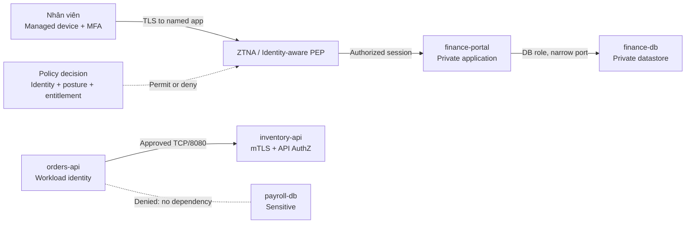
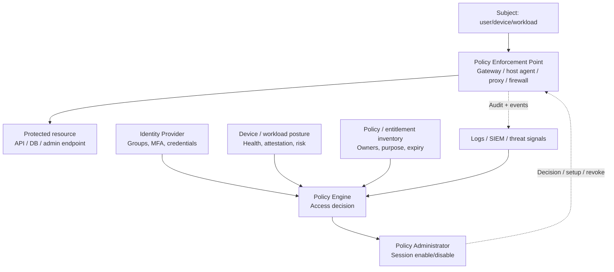
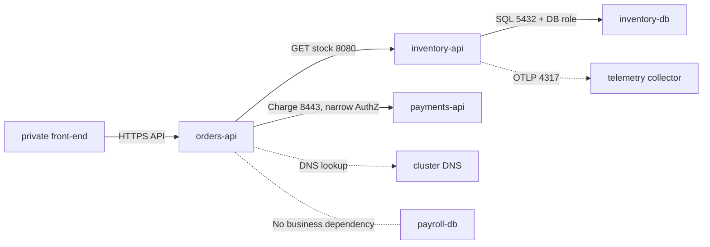
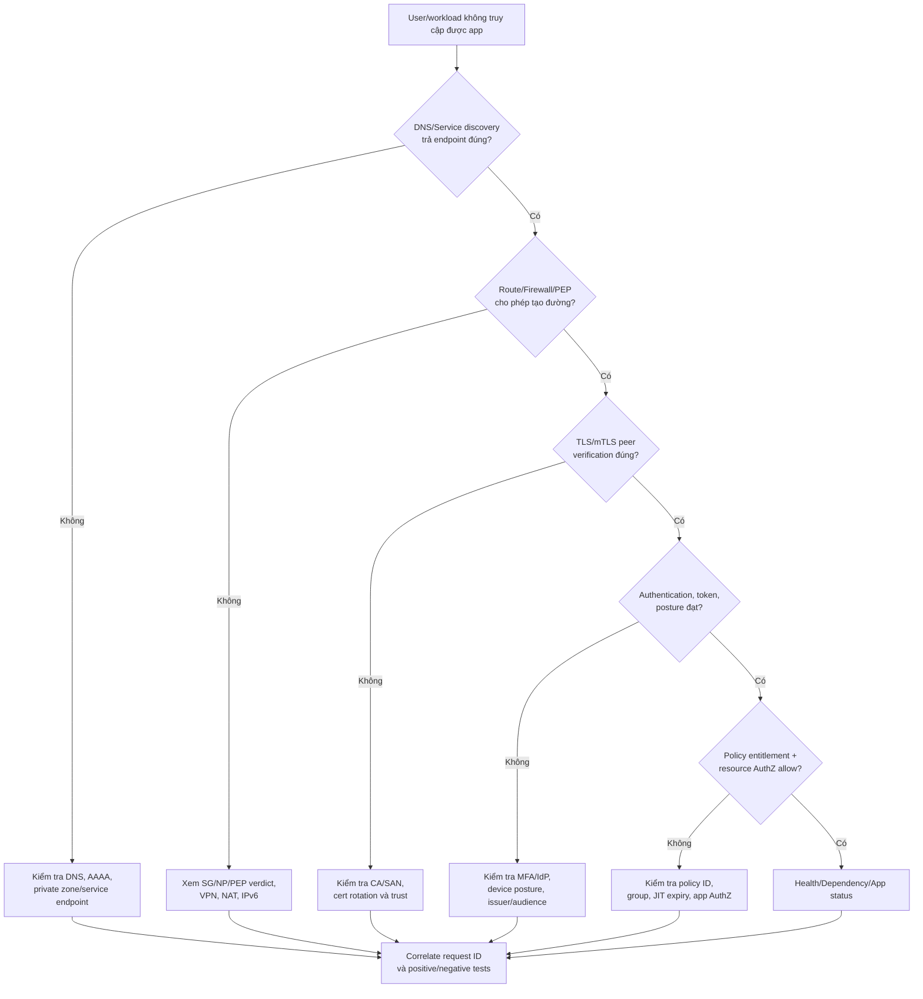

# Least privilege cho kết nối nội bộ trong Zero Trust Network Access

**Least privilege cho kết nối nội bộ** là nguyên tắc chỉ cấp cho một người dùng, thiết bị hoặc workload **đúng khả năng truy cập tài nguyên cần thiết để thực hiện một nhiệm vụ hợp lệ**, ở **phạm vi, điều kiện và thời hạn** phù hợp. Trong thiết kế mạng truyền thống, truy cập vào VPN hoặc cùng subnet đôi khi đồng nghĩa có khả năng kết nối rất nhiều máy chủ. Trong **Zero Trust Network Access (ZTNA)**, sự hiện diện trên mạng nội bộ, sở hữu IP riêng hoặc kết nối qua VPN **không tự làm một chủ thể trở nên đáng tin**.

Bảo vệ đúng không đơn thuần là chặn tất cả cổng ngoại trừ TCP/443. Nó yêu cầu kết hợp **danh tính chủ thể, danh tính tài nguyên, sức khỏe thiết bị, bối cảnh yêu cầu, phân đoạn mạng, chứng thực kênh, phân quyền nghiệp vụ, thời gian hiệu lực và bằng chứng vận hành**. Một kỹ sư có thể được mở một phiên đến giao diện quản trị đã phê duyệt nhưng không được quét cả dải mạng; một service được gọi inventory-api nhưng không có quyền đọc payroll-db; một pipeline CI được triển khai đúng namespace nhưng không thể tạo policy cho toàn cluster.

Bài học thuộc chương **Zero Trust Network Access** của mô-đun **SECURITY_NETWORK_SECURITY**, liên hệ trực tiếp với **network segmentation, firewall/NGFW, VPN, IDS/IPS, TLS/PKI, DNS security, hạ tầng cloud, mạng container/Kubernetes, phân tích lưu lượng và mô hình hóa mối đe dọa**. Mục tiêu là thiết kế **internal connectivity có thể giải thích và kiểm chứng**, chứ không chỉ đặt một sản phẩm có chữ Zero Trust trước hệ thống.

Ví dụ sử dụng tài nguyên giả định **finance-portal**, **orders-api**, **inventory-api**, **payroll-db**, **bastion-admin** và các namespace **orders/inventory**. Các dải **192.0.2.0/24**, **198.51.100.0/24**, **203.0.113.0/24**, **2001:db8::/32** chỉ dùng trong tài liệu. Chính sách mẫu không phải cấu hình có thể triển khai nguyên trạng lên mọi nhà cung cấp; các thuộc tính và chính sách cần kiểm chứng theo sản phẩm/phiên bản thực tế.

## 1. Mục tiêu học tập

Sau bài học, người học có thể:

1. Giải thích **least privilege**, **default deny**, **explicit allow**, **continuous evaluation** và khác biệt với perimeter-based trust.
2. Xác định **principal, resource, action, context, session và enforcement point** của một kết nối nội bộ.
3. Phân biệt **network reachability, authentication, authorization, application business permission và dữ liệu được phép truy cập**.
4. Thiết kế **mô hình ZTNA** gồm policy engine/decision, policy administrator, policy enforcement point và nguồn identity/device signals.
5. Áp quy tắc tối thiểu cho **người dùng, máy tính, service account, CI job, cloud workload và đối tác**.
6. Xây dựng **dependency graph** để quy đổi nhu cầu nghiệp vụ thành kết nối **source → destination → protocol/port → identity → time**.
7. Sử dụng **MFA, device posture, conditional access, short-lived credential, Just-in-Time (JIT) và Just-Enough-Administration (JEA)** có giới hạn.
8. Kết hợp **ZTNA gateway/proxy, VPN, VPC/VNet firewall, Kubernetes NetworkPolicy, mTLS/service mesh và API RBAC/ABAC**.
9. Nhận diện điểm yếu từ **IP allowlist quá rộng, wildcard FQDN, shared credentials, stale entitlement, IPv6 bypass, hostNetwork và đường đi ngoài PEP**.
10. Thiết kế **thu hồi phiên và chính sách thay đổi** mà không ngầm giả định mọi session đang mở lập tức bị đóng.
11. Xây dựng **telemetry, decision log, alert, policy test, exception workflow và runbook** để kiểm chứng allow/deny.
12. Phân tích tình huống xâm nhập một laptop hoặc Pod nhưng kẻ tấn công không thể di chuyển ngang ngoài các quyền thật sự được cấp.

## 2. Least privilege trong mạng có nghĩa gì?

Ở tầng hệ thống, least privilege thường được mô tả là **chỉ cấp đủ quyền**. Đối với kết nối mạng, phải cụ thể hóa **đủ để làm gì**.

Ví dụ:

- **User Alice**, thành viên nhóm finance, có thể mở **finance-portal** qua ZTNA ở HTTPS với MFA và thiết bị đạt chính sách; Alice **không** được kết nối trực tiếp đến database port.
- **orders-api** có thể gọi **inventory-api TCP/8080** bằng workload identity cụ thể; nó không được gọi **payroll-db TCP/5432**.
- **CI job** có thể triển khai một ứng dụng trong namespace đã duyệt; nó không được dùng chung cluster-admin credential.
- **SRE trực ca** có thể mở phiên quản trị có phê duyệt tới một nhóm node trong cửa sổ xử lý sự cố, không tự có permanent SSH vào toàn bộ production.

### 2.1. Sáu chiều của một quyền kết nối

| Chiều | Câu hỏi | Ví dụ mức quyền hẹp |
| --- | --- | --- |
| **Chủ thể** | Ai hoặc workload nào đang yêu cầu? | user/alice; serviceaccount/orders-api |
| **Tài nguyên** | Muốn truy cập dịch vụ cụ thể nào? | finance-portal, không phải toàn 10.0.0.0/8 |
| **Hành động** | Kết nối đến port, API method hay resource nào? | HTTPS GET /reports, không DELETE /users |
| **Bối cảnh** | Có xác thực mạnh và thiết bị đạt yêu cầu? | Managed device, MFA, risk acceptable |
| **Thời hạn** | Quyền có hiệu lực bao lâu? | 30 phút hoặc theo on-call assignment |
| **Ranh giới dữ liệu** | Được truy cập dữ liệu thuộc tenant/vùng nào? | Chỉ department=finance, tenant đã gán |

Một firewall L3/L4 có thể biểu đạt source/destination/port; **không tự hiểu** MFA, vai trò user hoặc quyền trên từng báo cáo. Vì vậy cần nhiều điểm kiểm soát.

### 2.2. Least privilege không phải “mọi kết nối phải qua một proxy”

Tổ chức có thể dùng ZTNA broker, identity-aware proxy, microsegmentation firewall, cloud security groups, service mesh hoặc cơ chế khác. Quan trọng là **mỗi yêu cầu có quyết định truy cập được xác thực và thực thi tại đúng trust boundary**. Không nhất thiết mọi packet phải quay về một điểm mạng tập trung nếu điều đó phá availability hoặc tạo một single point of failure.

## 3. Từ perimeter trust sang Zero Trust

Trong mô hình cũ, một VPN user sau khi vào mạng nội bộ có thể nhận route đến cả subnet. Firewall đôi khi chỉ chặn ở ranh giới Internet, trong khi **east–west traffic** nội bộ được cho phép rộng.

Zero Trust thay câu hỏi:

> “Thiết bị đã vào mạng công ty chưa?”

bằng:

> “Danh tính hiện tại có được dùng đúng ứng dụng/tài nguyên này, cho hành động này, trong điều kiện hiện tại và khoảng thời gian này không?”

### 3.1. So sánh

| Vấn đề | Cách tiếp cận perimeter-based thường gặp | Mục tiêu Zero Trust/least privilege |
| --- | --- | --- |
| **Trust signal** | Mạng/VPN/subnet nội bộ | Identity, device/workload posture, policy, context |
| **Phạm vi sau kết nối** | Nhiều host/port theo route | Ứng dụng/resource cụ thể |
| **Quyền quản trị** | VPN + shared admin credential | JIT, per-user identity, audited session |
| **Service-to-service** | IP/namespace được coi là trusted | Workload identity, mTLS, API AuthZ |
| **Chặn lateral movement** | Segment lớn hoặc firewall perimeter | Microsegmentation, default deny east–west |
| **Thu hồi** | Cắt VPN hoặc xóa tài khoản | Revocation theo resource/session/credential |
| **Logging** | VPN connected/disconnected | Access decision, identity, resource, policy, result |

Không phải mọi VPN đều “sai”; **VPN là một cơ chế truyền kết nối có thể được cấu hình giới hạn rất chặt**. Sai lầm là coi **VPN connected** đồng nghĩa **được truy cập mọi tài nguyên**.

## 4. Trust boundaries và luồng kết nối nội bộ



Một ranh giới có thể có nhiều policy cùng lúc:

1. **User → ZTNA gateway:** user identity, MFA, device posture, session policy.
2. **Gateway → finance-portal:** route, TLS, allowlist nguồn, resource identity.
3. **finance-portal → finance-db:** service identity, network segmentation, database role.
4. **orders-api → inventory-api:** NetworkPolicy, mTLS, workload AuthZ.
5. **Chủ thể → control plane:** IAM/RBAC/admin access policy, audit.

**Không tin vào header identity được proxy thêm nếu backend vẫn có đường direct public/internal bypass** cho phép caller giả mạo header. Backend cần giới hạn trusted proxy paths hoặc tự kiểm tra signed identity token/mTLS theo thiết kế.

## 5. Thành phần kiến trúc Zero Trust Access

Một mô hình Zero Trust tham chiếu có các chức năng **Policy Decision Point (PDP)**, thường phân chia **Policy Engine (PE)** và **Policy Administrator (PA)**, cùng **Policy Enforcement Point (PEP)**.



### 5.1. Vai trò từng thành phần

| Thành phần | Vai trò | Điều cần bảo vệ |
| --- | --- | --- |
| **PE/PDP** | Quyết định cho phép hay từ chối theo policy/context | Chính sách, tín hiệu rủi ro, tính khả dụng, integrity |
| **PA** | Thiết lập/ngắt/điều chỉnh đường kết nối theo quyết định | Credentials, session lifecycle, control-plane privileges |
| **PEP** | Thực thi allow/deny trên traffic hoặc requests | Không có bypass, bảo vệ dataplane và logs |
| **IdP** | Chứng thực user/group/MFA, vòng đời identities | Token/key/issuer, account lifecycle, MFA anti-phishing |
| **Device posture** | Đánh giá sức khỏe và mức quản lý thiết bị | Freshness, telemetry integrity, spoof resistance |
| **Workload identity issuer** | Cấp/luân chuyển credentials cho máy/service | Trust root, certificate/token issuance và rotation |
| **Policy repository** | Ai được truy cập resource nào và tại sao | Approval, least privilege, change audit |
| **Telemetry/SIEM** | Tín hiệu truy cập, anomaly và sự cố | Confidentiality, retention và integrity |

**Vị trí PDP và PEP là chức năng**, không nhất thiết là hai máy chủ riêng. Cloud IAM/identity-aware proxy, endpoint agent và mesh có thể phân tán vai trò theo implementation.

### 5.2. “Continuous verification” không phải mọi packet gọi IdP

Một hệ thống có thể kiểm tra policy **khi tạo session, khi token hết hạn, khi đổi thiết bị/risk score hoặc ở từng API request**, tùy thiết kế. Không nên hứa một session TCP đang chạy sẽ bị cắt ngay trong mili-giây khi user đổi nhóm. Cần **session TTL, re-authentication, revocation propagation và kill-session capability** được kiểm thử.

## 6. Tài sản nội bộ: private IP không tự là tài nguyên đáng tin

Một ứng dụng có địa chỉ **10.20.10.12** không vì thế mà chỉ có “người nội bộ” truy cập. Đường tới nó có thể đến từ:

- User sau VPN/ZTNA.
- Pod cùng cluster hoặc workload ở VPC khác.
- Hybrid data center qua private interconnect.
- CI job dùng cloud-hosted runner.
- Đối tác qua B2B private connectivity.
- VM bị chiếm trong subnet khác.
- Public load balancer chuyển tiếp đến backend.
- Operator qua bastion/managed session.

### 6.1. Inventory cần chứa nhiều hơn IP

Một protected resource nên được mô tả bằng:

| Trường | Ví dụ |
| --- | --- |
| Resource ID | service/finance-portal-prod |
| Owner và dữ liệu | Finance, confidential |
| Hostname/service identity | finance.internal.example; svc/finance |
| Network placement | VPC app subnet, private LB |
| Allowed principals | group/finance-readers |
| Allowed operations | reports:read |
| Allowed environment | corporate-managed device, production |
| Authentication | OIDC + MFA / mTLS |
| Enforcement points | ZTNA gateway + app AuthZ |
| Connection ports | HTTPS 443 tới gateway; backend 8443 |
| Session TTL/expiry | 30 phút (chỉ ví dụ) |
| Log/alert owner | IAM + SOC |
| Exception/change record | Access request ID, approval date |

**Một dải CIDR chưa xác định owner/resource** không đủ làm policy resource-centric.

## 7. Principal: user, device, workload và delegated identity

Một request nội bộ có thể mang nhiều danh tính:

- **Human user**: người được xác thực với IdP.
- **Device identity**: máy tính có đăng ký, certificate, posture và risk status.
- **Workload identity**: service account, certificate, cloud managed identity.
- **Delegated end-user identity**: token được cấp cho downstream để thực hiện hành động on-behalf-of.
- **Gateway/proxy identity**: hạ tầng chuyển request, không tự đại diện cho end-user.
- **Partner organization identity**: tổ chức đối tác, B2B trust và scope cụ thể.

### 7.1. Không đồng nhất identity của gateway với người dùng

Nếu finance-portal luôn nhận connection từ **ZTNA gateway IP**, firewall có thể chỉ thấy gateway. Backend cần xác định **Alice hay Bob**, group/claims nào và quyền với resource nào, thông qua cơ chế identity tin cậy. Không trao quyền “admin toàn hệ thống” cho mọi request đến từ IP của gateway.

### 7.2. Không tin user-supplied headers

Header như **X-User, X-Email, X-Forwarded-User** có thể bị giả nếu caller được trực tiếp gửi HTTP tới backend. Chỉ tin khi:

1. Đường **gateway → app** được giới hạn.
2. Gateway xóa/ghi đè headers từ client theo cấu hình.
3. App xác thực nguồn của identity assertion bằng **mTLS hoặc token ký** phù hợp.
4. App vẫn kiểm tra **resource-level authorization**.

## 8. MFA và mức đảm bảo danh tính

**Multi-factor authentication (MFA)** làm giảm rủi ro credential bị lộ, nhưng sức mạnh tùy phương thức và cách chống phishing.

### 8.1. Thiết kế MFA cho internal access

- Ưu tiên **phishing-resistant authentication** cho admin và ứng dụng dữ liệu nhạy cảm theo khả năng IdP.
- Dùng **step-up authentication** khi quyền thao tác nhạy cảm hơn phiên xem thông thường.
- Không chia sẻ admin accounts; liên kết user với identity cá nhân và audit.
- Định nghĩa **session freshness** cho quyền cao, không chỉ “đã MFA cách đây vài tháng”.
- Có phương án fallback/break-glass an toàn khi IdP gặp sự cố, không bật anonymous.
- Giảm quyền/thu hồi khi nhân sự chuyển nhóm hoặc nghỉ việc.

### 8.2. MFA không thay API permissions

Một user xác thực mạnh vẫn chỉ được **đọc báo cáo thuộc đơn vị của mình** nếu policy nói vậy. MFA nâng độ tin cậy của danh tính; nó **không tự cấp quyền CRUD hay truy cập database**.

### 8.3. Service account không dùng MFA như human

Một workload tự động không thể nhập OTP theo mỗi request. Cần **workload identity, mTLS, managed credentials, short-lived tokens và machine-to-machine authorization**, không nhúng MFA bypass hoặc shared human account cho service.

## 9. Device posture và context-aware access

ZTNA dành cho người dùng thường kết hợp **user authentication** với **device compliance/posture**. Posture có thể gồm:

- Thiết bị do tổ chức quản lý/đăng ký.
- Tình trạng cập nhật OS, disk encryption và firewall.
- Endpoint protection/EDR signal.
- Chứng chỉ thiết bị và binding vào user session.
- Mức rủi ro/hành vi đăng nhập bất thường.
- Trạng thái jailbreak/root hoặc security controls bị vô hiệu.
- Thời điểm telemetry cuối cùng còn đáng tin.

### 9.1. Posture là một tín hiệu, không phải proof tuyệt đối

Một thiết bị “compliant” vẫn có thể bị chiếm quyền trong session. Các tín hiệu có thể chậm cập nhật, thiếu dữ liệu hoặc bị thao túng. Bởi vậy vẫn cần **phân quyền theo ứng dụng, giới hạn thao tác, logs, session TTL và kiểm tra liên tục ở mức phù hợp**.

### 9.2. Rủi ro khi dùng IP địa lý làm proxy trust

Nguồn request đến từ IP văn phòng hoặc quốc gia quen thuộc **không tự chứng minh** user/thiết bị đáng tin. Địa chỉ có thể đổi do proxy/VPN/CGNAT. Có thể dùng location/risk như **một yếu tố bổ sung**, không dùng làm duy nhất.

### 9.3. Thiết bị không quản lý

Đối với contractor/BYOD, chính sách có thể:

- Chỉ cho **browser-based isolated session** hoặc app ít nhạy cảm.
- Yêu cầu MFA mạnh và hạn chế file transfer nếu sản phẩm hỗ trợ.
- Không cho SSH/RDP trực tiếp hoặc truy cập dữ liệu nhạy cảm.
- Cấp quyền có thời hạn theo hợp đồng, sponsor/owner và audit.

Không tuyên bố browser isolation có thể loại bỏ hoàn toàn rủi ro sao chép dữ liệu; cần đánh giá capability thực tế.

## 10. Session và quyền tạm thời: JIT, JEA, PAM

**Just-in-Time access (JIT)** cấp quyền chỉ khi có nhu cầu và giới hạn thời gian. **Just-Enough-Administration (JEA)** giới hạn đúng thao tác quản trị. **Privileged Access Management (PAM)** quản lý credential/session/approval cho đặc quyền theo chính sách.

### 10.1. Mẫu yêu cầu truy cập

```text
Requester: sre/oncall-17
Resource:  production/orders-db-read-replica
Purpose:   incident INC-EXAMPLE-042
Action:    SELECT/diagnostic queries only
Network:   approved managed session, no public DB port
Duration:  30 minutes, start after approval
Controls:  phishing-resistant MFA, device posture, audit
Result:    permission auto-expires, session reviewed
```

### 10.2. Network permission chưa đủ cho admin

Cho SRE kết nối TCP/5432 tới database nhưng dùng chung **superuser password** vẫn là quá quyền. Cần **database role read-only**, session identity, audit và truy cập qua đường private. Tương tự, có quyền truy cập TCP/22 tới node không có nghĩa được chạy mọi command với root.

### 10.3. Quản trị khẩn cấp

Break-glass cần được thiết kế trước:

- Principal riêng, credentials được bảo quản chặt.
- Điều kiện kích hoạt/owner rõ và log đầy đủ.
- Quyền tối thiểu để phục hồi hệ thống quan trọng.
- Có thông báo và review sau sự cố.
- Không trở thành tài khoản admin chung dùng mỗi ngày.

## 11. Workload identity: least privilege cho máy gọi máy

Đường **orders-api → inventory-api** có thể cần kết nối nội bộ không qua user login. Quyết định phải dựa trên **workload identity** chứ không chỉ Pod IP.

### 11.1. Lớp danh tính

- **Kubernetes ServiceAccount** mô tả danh tính workloads trong cluster, nhưng quyền Kubernetes API khác quyền ứng dụng.
- **SPIFFE ID/X.509-SVID** hoặc identity tương tự có thể ràng buộc workload với certificate do issuer tin cậy cấp.
- **mTLS** cho phép hai proxy/services xác minh danh tính peer trên transport.
- **Service-to-service authorization policy** giới hạn principal nào được gọi service/route.
- **OAuth 2.0 client credentials / token exchange** có thể dùng khi resource server yêu cầu token với audience/scope.

### 11.2. Ví dụ principal

```text
source identity:
  spiffe://corp.example/ns/orders/sa/orders-api
destination identity:
  spiffe://corp.example/ns/inventory/sa/inventory-api

network access:
  orders-api -> inventory-api, TCP 8080

service authorization:
  allow GET /v1/stock/...
  deny payroll API; deny unrelated inventory admin actions
```

Chuỗi SPIFFE trên là **ví dụ trust domain**. Một mesh cụ thể có thể dùng định dạng identity/trust domain khác; phải xác minh issuer và cách mapping từ ServiceAccount/workload.

### 11.3. Certificate có hạn sử dụng không tự tạo least privilege

Khi mọi workload dùng certificate hợp lệ từ cùng CA, một policy **allow all from any authenticated service** vẫn rất rộng. Cần kiểm tra **expected peer identity**, route/action và namespace/environment để không biến “có cert” thành “được gọi mọi API”.

## 12. mTLS, TLS và application authorization

### 12.1. Ba câu hỏi khác nhau

| Lớp | Câu hỏi | Công cụ |
| --- | --- | --- |
| **Network access** | Có đường kết nối từ source đến destination không? | Firewall, SG/NSG, NetworkPolicy, PEP |
| **Transport identity** | Có đúng service/peer và kênh an toàn không? | TLS/mTLS, CA/SAN, trust domain |
| **Resource authorization** | Caller có được làm hành động này với dữ liệu này không? | RBAC/ABAC/ReBAC, OAuth scopes, app rules |

**Có TCP connection và TLS handshake thành công chưa chứng minh API request được phép**. Một ứng dụng có thể trả HTTP **403** sau khi transport thành công; việc mở thêm firewall không sửa điều đó.

### 12.2. mTLS ở mỗi hop

Khi service mesh hoặc gateway chấm dứt TLS, backend có thể nhận traffic trên chặng khác. Phải xác định:

- TLS kết thúc ở đâu?
- Đoạn **gateway → app** có mã hóa/xác thực không?
- Origin/backend có cho phép đường bypass?
- Identity end-user truyền đến backend bằng cơ chế có thể xác minh?
- Certificate rotation có ảnh hưởng kết nối lâu dài và sidecars không?

Không coi **TLS tại public ingress** là bằng chứng mọi east–west hop đã có mTLS.

## 13. Dependency graph: từ nhu cầu nghiệp vụ tới quyền mạng

Một policy least privilege tốt phải bắt đầu từ **application dependency graph**, thay vì viết allow rules theo sơ đồ mạng tĩnh.

### 13.1. Luồng mẫu



### 13.2. Ma trận quyền kết nối

| Caller | Destination | Port/protocol | Operation | Required controls |
| --- | --- | --- | --- | --- |
| finance user | finance-portal | HTTPS/443 | Read own reports | IdP/MFA/posture + app AuthZ |
| gateway | finance-portal backend | TLS/8443 | Proxy approved requests | Gateway identity, no direct bypass |
| orders-api | inventory-api | TCP/8080 | GET stock | CNI allow + mTLS principal + AuthZ |
| orders-api | payments-api | TLS/8443 | Create authorized charge | mTLS + OAuth + idempotency |
| inventory-api | inventory-db | TCP/5432 | Scoped SQL queries | DB service credential/role |
| workloads | approved DNS | UDP/TCP 53 | Resolve service names | Resolver/source policy |
| selected workloads | telemetry | TCP/4317 | Emit metrics/traces | Collector identity/token |
| orders-api | payroll-db | Any | None | **Deny** |
| contractor device | production database | Any | None | **Deny** |
| SRE on-call | target admin API | HTTPS/443 | Time-bounded diagnostics | JIT + PAM + audit |

### 13.3. Một luồng cần owner và lý do

Mỗi rule nên có **source principal**, **destination resource ID**, **operations/ports**, **business owner**, **ticket/approval**, **expiry/review date**, **enforcement point** và **evidence test**. Nếu không thể giải thích tại sao một allow rule tồn tại, đó là tín hiệu cần review.

## 14. Default deny và microsegmentation

**Default deny** nghĩa kết nối không được phê duyệt rõ ràng thì không được phép, theo phạm vi enforcement. **Microsegmentation** chia quyền mạng thành các nhóm nhỏ quanh workload/service thay vì cho mọi máy trong subnet giao tiếp tùy ý.

### 14.1. Ba loại phân đoạn

1. **Macrosegmentation:** dev vs prod, partner vs internal, office vs data center, VPC/VNet.
2. **Microsegmentation L3/L4:** specific workload → specific service, port/protocol.
3. **Identity-/application-aware segmentation:** authenticated principal → API/resource/action.

Một kiến trúc tốt thường dùng **cả ba**, không cố biến một SG CIDR thành hệ thống phân quyền data-level.

### 14.2. Stateful và stateless policy

Một firewall **stateful** có thể cho phép response thuộc kết nối đã được cho phép. Một network ACL **stateless** phải có rule cho cả chiều phản hồi và ephemeral ports theo topology. Đừng mở toàn bộ inbound/outbound chỉ vì request timeout; hãy phân biệt **flow direction, conntrack, NAT, return path**.

### 14.3. Default deny không có nghĩa chặn dependency thiết yếu

Một policy quá hẹp có thể làm hỏng DNS, certificate issuance/rotation, identity provider, logging, time sync, health checks hoặc backup. Phải có **inventory dependency riêng cho control plane** và kiểm thử trước khi áp production.

## 15. ZTNA theo ứng dụng khác VPN cấp mạng

### 15.1. VPN truyền thống

VPN tạo đường mạng riêng có mã hóa hoặc kết nối tin cậy theo cấu hình. Sau khi xác thực, client có thể có route đến một hoặc nhiều subnet, tùy split-tunnel/full-tunnel và firewall rules.

### 15.2. ZTNA theo ứng dụng

ZTNA hướng tới **tài nguyên cụ thể**: finance-portal, wiki hoặc admin endpoint. PEP chỉ cho phép connection/application session khi danh tính, điều kiện và entitlement phù hợp, thay vì tự route đến toàn CIDR.

### 15.3. Không phủ nhận vai trò VPN

VPN có thể vẫn phù hợp cho **routing private, site-to-site, legacy protocol hoặc backend connectivity**, và hoàn toàn có thể kết hợp MFA, segmentation và per-resource controls. Zero Trust không bắt buộc mọi tổ chức bỏ VPN; điều cần tránh là **VPN session được coi như quyền mặc định để truy cập mọi host**.

### 15.4. Tình huống khác biệt

```text
Legacy broad network access:
  Alice --VPN--> route 10.40.0.0/16
  Firewall permits many internal hosts/ports

Least-privilege application access:
  Alice --IdP/MFA/device posture--> finance-portal
  Entitlement: reports:read, department=finance
  Other internal hosts: not reachable through that access path
```

Trong triển khai thực tế, một thiết bị có thể vẫn có mạng văn phòng hoặc route khác tới tài nguyên; phải **kiểm tra đường bypass** thay vì chỉ nhìn ZTNA console.

## 16. Policy-based access: RBAC, ABAC và ReBAC

**RBAC** dùng role/group, **ABAC** dùng thuộc tính chủ thể/tài nguyên/bối cảnh, **ReBAC** dùng mối quan hệ (ví dụ owner/member) để quyết định quyền.

### 16.1. Khi nào dùng cái gì?

| Mô hình | Hợp với | Giới hạn |
| --- | --- | --- |
| **RBAC** | Quyền ổn định theo job role/team | Role explosion, group quá rộng |
| **ABAC** | Context như department, environment, risk, device | Attribute freshness, policy khó debug |
| **ReBAC** | Người dùng thuộc team/project/tenant và quan hệ sở hữu | Graph quan hệ có thể phức tạp; cần consistency |
| **JIT/PAM** | Quyền cao, ngắn hạn, có approval | Phải có quy trình khẩn cấp và thu hồi |
| **Network ACL** | IP/subnet/port boundary | Không biết user/tenant/resource action |

Nên tách **entitlement decision** khỏi cơ chế truyền kết nối: ZTNA cho Alice mở finance-portal, nhưng ứng dụng vẫn phải kiểm tra **báo cáo số X thuộc bộ phận được phép**.

### 16.2. Không cấp quyền theo group “all employees” để cho nhanh

Nếu mọi nhân viên đều truy cập được dashboard quản trị vì cùng nằm trong nhóm employee, đó là trust perimeter được tái tạo ở tầng identity. Cần nhóm/claim theo **nhiệm vụ và tài nguyên**.

## 17. Mẫu chính sách độc lập nhà cung cấp

Đây là **pseudo-policy mô tả ý định**, không phải cấu hình thực thi trực tiếp:

```yaml
policy_id: ZTNA-FINANCE-REPORT-READ
version: 1
effect: allow

subject:
  type: human
  group: finance-report-readers
  require_phishing_resistant_mfa: true
  require_managed_device: true
  max_posture_age_minutes: 15

resource:
  id: service/finance-portal-prod
  hostname: finance.internal.example
  allowed_actions:
    - reports:read
  data_scope:
    department: finance

connection:
  frontend_protocol: https
  frontend_port: 443
  require_verified_tls: true
  allowed_through:
    - finance-ztna-gateway
  prohibit_direct_backend_bypass: true

session:
  max_duration_minutes: 30
  reauthorize_on_material_context_change: true
  terminate_on_confirmed_revocation: true

audit:
  record_principal_resource_action_and_decision: true
  correlate_session_id_and_policy_version: true
  redact_credentials_and_sensitive_report_content: true

exceptions:
  owner: finance-security
  require_approval: true
  require_expiry: true
```

### 17.1. Những điều không thể suy từ pseudo-policy

- PEP có thực thi **max_posture_age_minutes** chính xác hay không phụ thuộc nhà cung cấp.
- **Application-level reports:read** phải có enforcement tương ứng; một network proxy TCP thuần không thể tự kiểm tra nội dung báo cáo.
- **Terminate-on-revocation** phải kiểm chứng theo session/protocol và đường truyền thực.
- Data scope department cần được app/database kiểm tra, không dựa vào một header tự khai từ client.

## 18. Kubernetes NetworkPolicy: L3/L4 least privilege

Kubernetes NetworkPolicy chuẩn cho phép khai báo **ingress/egress** theo Pod/Namespace selectors, ports và IP blocks theo khả năng CNI. Đây là lớp hữu ích để giới hạn **east–west network reachability**, nhưng **không xác thực user hay phân quyền API**.

### 18.1. Default deny toàn bộ namespace orders

```yaml
apiVersion: networking.k8s.io/v1
kind: NetworkPolicy
metadata:
  name: default-deny-all
  namespace: orders
spec:
  podSelector: {}
  policyTypes:
    - Ingress
    - Egress
```

Policy trên chọn tất cả Pods ở namespace orders và cô lập cả hai chiều **nếu CNI thực thi NetworkPolicy**. Nó có thể làm DNS và các dependencies không hoạt động cho đến khi thêm allow rules.

### 18.2. Chỉ cho inventory-api nhận request từ orders-api

```yaml
apiVersion: networking.k8s.io/v1
kind: NetworkPolicy
metadata:
  name: allow-orders-to-inventory
  namespace: inventory
spec:
  podSelector:
    matchLabels:
      app: inventory-api
  policyTypes:
    - Ingress
  ingress:
    - from:
        - namespaceSelector:
            matchLabels:
              kubernetes.io/metadata.name: orders
          podSelector:
            matchLabels:
              app: orders-api
      ports:
        - protocol: TCP
          port: 8080
```

**Cùng một peer item** chứa namespaceSelector **và** podSelector tạo điều kiện **AND**. Viết chúng ở **hai peer items** khác nhau tạo logic **OR**, có thể mở quyền rộng hơn dự kiến.

### 18.3. Chỉ orders-api được phát request đến inventory-api

```yaml
apiVersion: networking.k8s.io/v1
kind: NetworkPolicy
metadata:
  name: allow-egress-to-inventory
  namespace: orders
spec:
  podSelector:
    matchLabels:
      app: orders-api
  policyTypes:
    - Egress
  egress:
    - to:
        - namespaceSelector:
            matchLabels:
              kubernetes.io/metadata.name: inventory
          podSelector:
            matchLabels:
              app: inventory-api
      ports:
        - protocol: TCP
          port: 8080
```

Một flow được phép khi **egress nguồn và ingress đích** cùng cho phép theo isolation trạng thái hiện tại. **NetworkPolicy rules cộng gộp**, không có priority/explicit deny ở chuẩn core policy; một policy khác allow-all có thể làm kế hoạch hẹp trở nên vô hiệu.

### 18.4. Giới hạn không được bỏ qua

- Namespace riêng **không tự** là network isolation.
- CNI không hỗ trợ NetworkPolicy → YAML tồn tại nhưng traffic có thể vẫn đi.
- Policy chuẩn **không có FQDN/HTTP route selector**; tính năng mở rộng là vendor-specific.
- **hostNetwork, NodePort, cloud LB, secondary interfaces và node-originated traffic** có đường thực thi khác.
- **DNS/CoreDNS/NodeLocal** và control-plane dependencies cần allow đúng.
- Labels phải được bảo vệ bằng RBAC/admission; một label **không là cryptographic identity**.
- Kiểm thử **IPv4 và IPv6**, Service IP/Pod IP, NAT và các đường ngoài mesh.

## 19. Service mesh mTLS và authorization theo identity

NetworkPolicy L3/L4 có thể cho phép Pod orders gọi Pod inventory. **mTLS** bổ sung xác thực peer, còn **service mesh AuthorizationPolicy** (khi được hỗ trợ) có thể giới hạn method/path.

### 19.1. Ví dụ Istio PeerAuthentication STRICT

```yaml
apiVersion: security.istio.io/v1
kind: PeerAuthentication
metadata:
  name: require-mtls
  namespace: inventory
spec:
  mtls:
    mode: STRICT
```

Ví dụ có hình thức theo Istio CRD; cần kiểm tra **API version, data plane mode (sidecar/ambient), selectors và điểm thực thi**. Strict mTLS không thay backend resource authorization.

### 19.2. Ví dụ cho đúng workload identity gọi đúng route

```yaml
apiVersion: security.istio.io/v1
kind: AuthorizationPolicy
metadata:
  name: orders-read-stock
  namespace: inventory
spec:
  selector:
    matchLabels:
      app: inventory-api
  action: ALLOW
  rules:
    - from:
        - source:
            principals:
              - cluster.local/ns/orders/sa/orders-api
      to:
        - operation:
            methods: ["GET"]
            paths: ["/v1/stock/*"]
            ports: ["8080"]
```

**Chú ý kỹ khi triển khai:**

1. **cluster.local** chỉ là trust domain mẫu, không phải mọi mesh cùng dùng.
2. L7 method/path cần **proxy/waypoint có khả năng HTTP authorization**, không mặc định áp trên mọi L4-only mode.
3. Các policy khác có thể tác động tập allow/deny; cần xem **thứ tự và semantics của sản phẩm thực tế**.
4. Nếu request đi thẳng backend không qua mesh hoặc Pod có alternate path, policy có thể bị bypass.
5. App vẫn kiểm tra **tenant/SKU/resource-level authorization**.
6. Identity phải được cấp phát/luân chuyển qua issuer tin cậy; không dùng label làm proof độc lập.

## 20. Cloud VPC/VNet: Security Groups, NSG và private endpoints

Trong cloud, internal application có thể nằm trong subnet/VPC/VNet riêng nhưng liên thông qua peering, transit hub hoặc private interconnect. Phải xét cả đường **trong cùng VPC** và **giữa các mạng**.

### 20.1. Ma trận firewall theo ý định

```text
SOURCE                       DESTINATION               ALLOW
finance-ztna-gateway         finance-portal:8443       YES
finance-portal workload      finance-db:5432           YES
orders-api workload          inventory-api:8080        YES
orders-api workload          payroll-db:any            NO
contractor-subnet            production-db:any         NO
internet-any                 internal-db:any           NO
approved-admin-session       bastion-admin:443         JIT ONLY
```

**Phải chuyển ma trận sang chính sách đúng nhà cung cấp**:

- AWS: security groups, VPC routing, NACL, VPC endpoints, IAM, network firewall tùy use case.
- Azure: NSG, Azure Firewall, VNet routes/peering, private endpoints, identity access.
- Google Cloud: VPC firewall policies, routes, Cloud NAT/Private Service Connect và IAM theo triển khai.

Các tính năng source identity/SG reference, stateful behavior, rule priority, private endpoint permissions và FQDN filtering **khác nhau theo provider**. Không áp nguyên rule syntax của cloud này vào cloud khác.

### 20.2. Private IP không là data authorization

Một private endpoint tới object storage hoặc database chỉ tạo **đường truy cập private**. Dịch vụ vẫn cần **IAM/resource policies, TLS/hostname validation và least-privilege application role**.

## 21. On-premises, hybrid và đối tác

ZTNA không chỉ dành cho cloud. Hệ thống on-prem có thể có VLAN/VRF, campus NAC, firewall giữa các zones, remote desktop gateways và Active Directory hoặc IdP liên kết.

### 21.1. Vấn đề mạng nội bộ phẳng

Một laptop được kết nối vào VLAN employee rồi có đường TCP tới các server tài chính, domain controllers, backup hoặc hypervisor management có thể là cơ hội **lateral movement** sau khi bị chiếm.

### 21.2. Kiến trúc hybrid phù hợp

- Tách **employee, admin, app, database, domain services và backup management** zones.
- ZTNA/PAM cho các quyền quản trị/ứng dụng cụ thể.
- VPN/private interconnect chỉ là **transport path**, không tự được trusted.
- Firewall/default deny giữa zones, policy có owner và logs.
- Xác thực machine/service identity qua PKI/mTLS khi khả thi.
- Giới hạn quyền domain/service accounts, không reuse credentials rộng.
- Đối tác chỉ được vào **dịch vụ đã phê duyệt**, không entire internal address space.

### 21.3. DNS và domain controllers là dependency nhạy cảm

Nếu policy chặn DNS/Kerberos/LDAP hoặc giao thức identity cần thiết, authentication có thể hỏng. Nhưng mở **mọi domain controller ports từ mọi host** lại tạo attack surface rộng. Cần **dependency matrix và nguồn/đích/port cụ thể theo hệ thống đang dùng**, không xem đây là lý do bỏ segmentation.

## 22. DNS, service discovery và FQDN-based access

Một user thường gọi **finance.internal.example** còn service gọi **inventory-api.inventory.svc.cluster.local**. DNS hỗ trợ tìm đích, không tự cung cấp quyết định truy cập theo principal.

### 22.1. Các vấn đề phải kiểm tra

- **A/AAAA** có thể trả IPv4 hoặc IPv6; một address family có route khác.
- DNS split-horizon/private zones tạo các kết quả khác theo mạng.
- Một hostname có thể đổi IP vì load balancing/CDN.
- **DNS rebinding/redirect** có thể gây vấn đề cho ứng dụng chấp nhận URL do user nhập.
- Proxy có thể **tự resolve DNS**, không phải workload nguồn.
- TLS hostname verification phải khớp danh tính service, không chỉ IP allowlist.

### 22.2. IP allowlist khác FQDN policy

Một firewall rule chỉ cho **10.20.0.0/16** không biết request thực sự hướng đến finance-portal hay bất kỳ host nào trong subnet. Một FQDN-based rule nếu được sản phẩm hỗ trợ có thể hữu ích, nhưng cần kiểm tra **DNS cache, IP reuse, direct-IP bypass, IPv6 và TLS identity**.

### 22.3. DNS egress vẫn phải tối thiểu

Workload cần được phép dùng **resolver đúng** qua UDP/TCP 53 hoặc phương thức DNS do tổ chức phê duyệt, không mở bất kỳ DNS server Internet để tránh policy. Nếu dùng DoH/DoT hoặc node-local cache, các endpoint/port và telemetry phải được kiểm kê riêng.

## 23. Privileged management: SSH, RDP, Kubelet, database và control plane

Các cổng quản trị thường mang quyền cao hơn business API.

| Tài nguyên | Sai lầm phổ biến | Thiết kế least privilege |
| --- | --- | --- |
| **SSH/RDP** | VPN vào là SSH/RDP tất cả servers | Managed session/Bastion, JIT source, MFA, per-user credentials |
| **Kubernetes API** | Shared cluster-admin kubeconfig | OIDC/RBAC namespace/verbs, audit, session expiry |
| **Kubelet/etcd** | Mở 10250/2379 từ mọi worker/internal CIDR | Chỉ control-plane/collector đúng vai trò, mTLS, host firewall |
| **Cloud IAM control plane** | Developer được sửa SG, route, public IP toàn account | IAM least privilege, review, policy-as-code |
| **Database** | Shared superuser password | DB identity, read/write roles, connection policy, audit |
| **Backup/hypervisor** | Trusted vì trong management VLAN | Dedicated admin identity, segmentation, access workflow |
| **CI runners** | Permanent SSH private key vào tất cả nodes | Workload identity/JIT credential/namespace scope |

**Quyền network và quyền thực hiện lệnh là hai lớp riêng.** Giới hạn TCP/22 là cần thiết nhưng không thay **OS sudo policy**, session recording hay approval.

## 24. Quản lý đặc quyền cho CI/CD và machine identities

Automation thường chạy cả ngày, không có người tương tác từng request. Nếu dùng token/khoá lâu hạn, service account có quyền rộng, đây là mục tiêu hấp dẫn cho attacker.

### 24.1. Quyền theo workflow

- Pipeline A chỉ có thể deploy **orders** ở staging.
- Pipeline B được deploy **payments production** sau approval cụ thể.
- Build job được đọc artifact registry, không được sửa firewall route.
- Scheduler chỉ có quyền truy cập database/API phục vụ job của nó.
- Monitoring agent chỉ được đọc metrics, không được exec containers.

### 24.2. Credential lifecycle

- Ưu tiên **federated workload identity / short-lived credentials** thay static secrets khi có hỗ trợ.
- Giới hạn audience/issuer, role, namespace, repository/ref và thời hạn token theo thiết kế.
- Rotate keys/certificates, revoke khi pipeline bị xóa hoặc service retired.
- Phân tách build-time và runtime privileges.
- Không đặt secrets trong image, Git logs hoặc env dump công khai.

### 24.3. Thiết bị người dùng và runner không có cùng policy

Một CI runner được xác thực bằng workload identity **không cần MFA như user**; nó cần provenance/attestation và scope máy-máy. Ngược lại, admin người thật không nên đăng nhập bằng service account của pipeline.

## 25. Thu hồi quyền và giới hạn phiên

Một thiết kế least privilege phải trả lời **khi nào quyền hết hiệu lực** và **phải làm gì với connection đang mở**.

### 25.1. Trường hợp thu hồi

- Người dùng nghỉ việc/đổi nhóm.
- Device bị mất hoặc EDR báo compromise.
- Contractor hết hợp đồng.
- Approval JIT hết hạn.
- ServiceAccount/Pod/CI job bị xóa hoặc credential bị lộ.
- Một resource chuyển owner/data classification.
- Threat intelligence phát hiện session rủi ro cao.

### 25.2. Các lớp thời gian khác nhau

| Lớp | Điều cần kiểm soát |
| --- | --- |
| **IdP token/session** | Expiry, refresh, revocation, logout |
| **PEP authorization cache** | TTL, invalidation, policy version |
| **Transport session** | Re-auth/connection termination khả dụng? |
| **mTLS certificate** | Validity, trust bundle, rotation và revocation model |
| **Application session** | Cookie/session lifetime, AuthZ recheck |
| **Database connection pool** | User/service role có thay khi connection còn mở? |
| **JIT entitlement** | Approval window, automatic expiry và cleanup |

**Không giả định xóa RoleBinding hoặc gỡ group sẽ cắt ngay mọi TCP session hiện có.** Phải biết proxy/PEP kiểm tra policy khi mở session, theo mỗi request, theo chu kỳ hay theo event.

### 25.3. Thiết kế kiểm chứng thu hồi

1. Cho phép user hợp lệ vào tài nguyên.
2. Thu hồi entitlement trong môi trường lab.
3. Quan sát **new session** bị từ chối.
4. Quan sát **existing session** xử lý thế nào.
5. Đo thời gian propagation thực và so với SLO bảo mật.
6. Kiểm tra logs nêu đúng policy version/decision.
7. Xác minh không còn đường thay thế qua VPN/direct IP hoặc token còn hiệu lực ngoài ý định.

## 26. Access review, stale permissions và exceptions

Least privilege không thể là bài tập “cấu hình một lần”.

### 26.1. Quy trình review định kỳ

- Tổng hợp **principal → resources → actions → last used → owner → reason**.
- Phát hiện role/group không còn người sử dụng.
- Kiểm tra quyền lâu hạn của admin, break-glass, service accounts.
- Đối chiếu những kết nối allow nhưng không xuất hiện trong traffic đã đủ thời gian quan sát.
- Đánh giá **owner và compliance** trước khi xóa dependency hiếm dùng.
- Thu hồi ngoại lệ hết hạn hoặc không còn lý do.
- Kiểm tra route/SG/API endpoint drift sau deployment.

### 26.2. Không xóa rule chỉ vì không thấy traffic một ngày

Một đường backup/DR hoặc tác vụ cuối tháng có thể chỉ hoạt động hiếm. Việc xóa không kiểm tra có thể gây outage vào lúc quan trọng. Cần xác định **business owner, dependency SLO và thử nghiệm diễn tập** trước khi thu hồi.

### 26.3. Exception có hạn

Mọi ngoại lệ như “SRE cần toàn subnet để debug” phải có:

- Ticket/approval và chủ thể cụ thể.
- Tài nguyên/cổng/hành động rõ.
- Thời điểm bắt đầu và **expiry**.
- Risk acceptance, compensating controls, session recording.
- Kế hoạch thay bằng rule hẹp và tự thu hồi.
- Audit xác nhận đã dọn ngoại lệ.

## 27. Identity và resource policy không được vượt trust boundary

Một request có thể đi qua nhiều trust domains hoặc tenants. Ví dụ inventory-api được phép gọi storage, nhưng không được truyền **token của end-user** sang một API đối tác chỉ vì nó nằm trên đường mạng.

### 27.1. Audience và delegation

- Token dành cho **service A** không tự hợp lệ ở **service B**.
- Quyền của workload (service account) khác quyền do user ủy quyền.
- Nếu có flow **on-behalf-of/token exchange**, cần issuer/audience/scope đúng và app AuthZ ở đích.
- Service mesh proxy identity không phải bằng chứng user cuối đã được duyệt.
- Chứng chỉ mTLS hợp lệ từ cùng trust CA không cấp mọi quyền dữ liệu.

### 27.2. Cross-tenant protection

Các dịch vụ đa tenant phải kiểm tra **tenant ID thuộc nguồn tin cậy** và ràng buộc vào resource lookup. Network segmentation theo namespace chỉ là một lớp; cùng một backend có thể phục vụ nhiều tenants, nên cần **row-/object-level authorization**.

### 27.3. Lateral movement qua service đã được allow

Giả sử orders-api chỉ được phép gọi inventory-api. Kẻ tấn công kiểm soát orders-api có thể lạm dụng **một endpoint inventory được phép** để truy vấn dữ liệu quá rộng. Do đó app phải áp **scope, request validation, rate limits và anomaly detection**, không coi traffic mesh allow là an toàn hoàn toàn.

## 28. Egress và data exfiltration: phạm vi least privilege không chỉ east–west

Một internal workload vẫn có thể gửi dữ liệu ra SaaS/Internet qua NAT hoặc proxy. Nếu chỉ chặn lateral movement, attacker vẫn có thể **exfiltrate**.

### 28.1. Kiểm soát cần thiết

- Chỉ cho workloads truy cập **external destinations** được phê duyệt.
- Dùng **egress gateway, forward proxy hoặc network firewall** khi yêu cầu domain/URL-aware policy.
- Bảo vệ **DNS/DoH/DoT**, direct IP, IPv6 và alternate routes theo topology.
- Dùng **private endpoints** cho cloud services được hỗ trợ.
- Gắn API credentials với đúng **audience và workload identity**.
- Quan sát **destination, data volume, process/workload, policy verdict và app trace**.
- Có cảnh báo outbound bất thường và response runbook.

### 28.2. NAT không phải authorization

Một NAT gateway cho phép private host ra Internet bằng egress IP. Nó không tự kiểm tra user, data class, URL hay entitlement. **Shared public IP allowlist** ở đối tác cũng không phân biệt được service nào đứng sau NAT.

### 28.3. SSRF và metadata

Một backend có lỗ hổng **Server-Side Request Forgery** có thể bị khiến gọi internal admin APIs, link-local metadata endpoint hoặc external callback. Network restrictions, application URL validation, cloud metadata hardening và IAM least privilege cần phối hợp. Không chắc mọi metadata traffic đều đi qua PEP ZTNA hoặc Internet NAT.

## 29. Host, privileged workload và đường bypass

Một thiết kế lý thuyết có thể đúng ở gateway nhưng **không áp được trên đường khác**:

- Máy trong LAN kết nối **direct IP** tới backend bỏ qua ZTNA.
- Một Pod dùng **hostNetwork: true** hoặc NodePort/LoadBalancer khác.
- VM có **secondary network interface** hoặc route qua VPC peering.
- CNI policy chỉ áp một interface, còn SR-IOV/VLAN khác thiếu policy.
- Backend tin **X-Forwarded-User** từ mọi nguồn.
- Service mesh ở **PERMISSIVE** hoặc unmanaged workloads còn đường plaintext.
- IPv4 bị chặn nhưng IPv6 **::/0** còn mở.
- Partner/VPN tunnel có quyền tới subnet rộng hơn app đang được công bố.
- Dev/staging cluster có kết nối tới production qua transit hub.

### 29.1. Kiểm chứng không chỉ bằng UI của sản phẩm

Cần test **source thật → destination thật → packet path → enforcement point → application decision**. Chỉ thấy policy trong dashboard không chứng minh dataplane không có bypass.

### 29.2. Ranh giới kernel/node

NetworkPolicy Pod-to-Pod không tự bảo vệ host kernel hoặc node credentials. Một **privileged container** bị chiếm có thể vượt khả năng cô lập của policies. Cần **runtime hardening, Pod Security, RBAC, host firewall, cloud SG và node isolation**.

## 30. High availability và rủi ro PEP/PDP không sẵn sàng

Nếu tất cả kết nối nội bộ phụ thuộc một broker/PDP, hệ thống có thể đối mặt với availability risk. Cần thiết kế để **không buộc phải nới quyền khi có sự cố**.

### 30.1. Các tình huống

- **IdP outage:** user mới không xác thực được.
- **PDP timeout:** PEP không nhận được quyết định mới.
- **PEP failure:** đường tới app bị gián đoạn hoặc bypass nếu cấu hình sai.
- **Certificate issuer outage:** credential rotation thất bại khi cert tới hạn.
- **WAN failure:** chi nhánh không kết nối tới central policy service.
- **Policy deployment bad:** tất cả tài nguyên bị từ chối hoặc cấp sai.

### 30.2. Fail closed, fail open và cached authorization

**Fail closed** thường phù hợp khi không thể chứng minh quyền truy cập, nhất là dữ liệu nhạy cảm. Tuy nhiên có hệ thống yêu cầu availability đặc biệt: có thể dùng **cached allow decision có TTL ngắn, điều kiện rủi ro và phạm vi rõ**, với cơ chế đánh giá lại khi kết nối phục hồi.

Không nên áp “fail open toàn subnet” một cách âm thầm. Mọi ngoại lệ availability phải **được threat model, có owner, giới hạn thời gian, compensating controls và kiểm thử**.

### 30.3. Capacity planning

Đo:

- IdP/PDP decision latency p95/p99.
- Connection setup, TLS handshake và proxy throughput.
- Session concurrency, active connections/streams.
- Certificate renewal rate và trust bundle propagation.
- Cache hit rate, policy update propagation lag.
- PEP node/zone health và failover behavior.
- Denials do policy thật khác lỗi connection/identity service.

## 31. Quan sát và bằng chứng quyết định truy cập

Một chính sách có thể bị hiểu sai nếu logs chỉ ghi “connection timed out”. Cần tách **network deny**, **TLS failure**, **authentication**, **authorization** và **application-level refusal**.

### 31.1. Mẫu trường log

| Nhóm | Trường | Mục đích |
| --- | --- | --- |
| **Who** | principal ID, group, device/workload ID | Danh tính được quyết định |
| **What** | resource ID, action/route, tenant | Tài nguyên và hành động |
| **Where** | source/destination IP:port, zone, PEP ID | Đường kết nối |
| **How** | TLS/mTLS identity, authn method, device posture | Bằng chứng tin cậy |
| **Why** | policy ID/version, condition, reason code | Giải thích allow/deny |
| **When** | timestamp, session start/end, token expiry | Timeline |
| **Outcome** | allow/deny, TCP result, HTTP status | Kết quả thực |
| **Correlation** | request ID, session ID, trace ID | Ghép sự kiện nhiều lớp |

### 31.2. Event mẫu tự dựng

```json
{
  "event_time": "2026-11-28T06:30:00Z",
  "event_type": "ztna_access_decision",
  "principal": "user/alice",
  "device_id": "managed-device-demo-01",
  "resource_id": "service/finance-portal-prod",
  "action": "reports:read",
  "session_id": "session-demo-01",
  "identity_assurance": "mfa_verified",
  "device_posture": "compliant",
  "policy_id": "ZTNA-FINANCE-REPORT-READ",
  "policy_version": 1,
  "decision": "allow",
  "pep_id": "finance-gateway-a",
  "application_authorization": "verified_separately",
  "raw_credential_logged": false,
  "report_contents_logged": false
}
```

Đây **không phải log format mặc định của một ZTNA vendor**. Những trường như posture/mfa chỉ được ghi “verified” nếu hệ thống có **bằng chứng tương ứng**, không tự suy từ IP nguồn.

### 31.3. Privacy và bảo mật logs

- Không ghi access tokens, private keys, passwords hoặc full report contents.
- Hạn chế truy cập logs vì identity/hostname/source IP có thể là thông tin nhạy cảm.
- Có retention, integrity, clock synchronization và audit trail.
- Correlate **PEP logs + IdP + device posture + cloud flow logs + app/AuthZ logs**.
- Không đưa user IDs hoặc request IDs có cardinality cao vào mọi metric label.

## 32. Threat modeling: least privilege thất bại ở đâu?

| Threat | Đường khai thác | Kiểm soát cần thiết |
| --- | --- | --- |
| **VPN user bị chiếm credential** | Truy cập nhiều subnet sau VPN | MFA, ZTNA per-app, network segmentation |
| **Device compromised sau login** | Dùng session và privileges hợp lệ | Posture/risk recheck, limited sessions, anomaly detection |
| **Nhóm IdP quá rộng** | “All employees” được truy cập finance | Entitlement review, resource-based policy |
| **Shared admin identity** | Không phân biệt ai thao tác | Per-user identity, JIT/PAM, audit |
| **ZTNA origin bypass** | Direct private IP/NodePort tới app | Firewall/NetworkPolicy, trusted proxy identity |
| **Header spoofing** | Giả X-User qua đường trực tiếp | Signed assertion, trusted gateway, backend verification |
| **CI token bị lộ** | Deploy hoặc sửa policy quá rộng | Workload federation, scoped IAM, token TTL |
| **Service certificate bị lộ** | Mạo danh workload | Identity issuance security, rotation, narrow AuthZ |
| **mTLS allow-all** | Peer có cert được gọi mọi service | Principal-specific AuthorizationPolicy |
| **Kubernetes label spoofing** | Pod tự nhận app=trusted | RBAC/admission, workload identity |
| **IPv6 bypass** | Direct ::/0 tránh firewall IPv4 | Dual-stack parity, route/firewall tests |
| **SSRF tới metadata** | Lấy temporary credentials | Metadata hardening, app SSRF controls, IAM |
| **PDP/PEP fail open** | Nối trực tiếp khi hệ thống lỗi | Fail policy có giới hạn, HA, test |
| **Session chưa bị thu hồi** | Privilege còn qua connection cũ | Short TTL, re-evaluation, kill-session |
| **Policy drift** | Route/SG thay ngoài IaC | Audit, detection, reconciliation |
| **Excessive DB role** | Kết nối đúng nhưng truy xuất sai dữ liệu | DB role, row-level/app AuthZ, logging |
| **DNS spoof/rebinding** | Hostname trỏ endpoint trái phép | Resolver controls, TLS identity, allowlist enforcement |
| **Tenant crossing** | Một backend phục vụ dữ liệu nhiều tenant | Object/row-level authorization |
| **JIT exception không hết hạn** | Quyền tạm trở thành lâu dài | Expiry/cleanup/review |
| **Logging không đủ** | Không biết vì sao kết nối được phép | PEP decision + app/flow evidence |

### 32.1. Giả định an ninh quan trọng

Zero Trust không hứa **ngăn tuyệt đối** một attacker đã chiếm ứng dụng thực thi mọi hành động. Nó giảm các đường di chuyển ngang và buộc request tiếp tục bị kiểm tra ở **dịch vụ, danh tính và tài nguyên đích**.

## 33. Chẩn đoán kết nối bị từ chối theo từng lớp



### 33.1. Đừng chẩn đoán mọi 403 là firewall

- **Timeout:** có thể là route, firewall drop, PEP, DNS sai, backend unavailable.
- **Connection refused:** có thể không có listener hoặc một tầng trả reject.
- **TLS unknown_ca/hostname mismatch:** lỗi trust, không phải lý do tắt TLS.
- **401:** thiếu credential, token invalid/expired.
- **403:** principal thiếu quyền theo ZTNA/API, hoặc rule ứng dụng từ chối.
- **429:** quota/rate limit.
- **502/503/504:** gateway/dependency failures; không tự kết luận quyền đã bị chặn.
- **Device posture failed:** cần xem tín hiệu nào chưa đạt và remediation flow.
- **Existing session còn hoạt động sau revoke:** kiểm tra TTL/caching/PEP session semantics.

### 33.2. Bằng chứng phải đến từ đường thật

Không kết luận chỉ từ policy file hoặc một màn hình “compliant”. Cần xác minh **source và destination thực**, identity được issuer tin cậy chứng nhận, rule được PEP áp, response từ app và các đường thay thế.

## 34. Lệnh quan sát read-only trong môi trường được phép

Những lệnh này dành cho **môi trường quản trị/cluster có quyền**, không chỉnh policy, không dò quét diện rộng, không truy cập tài sản ngoài phạm vi.

### 34.1. Kiểm tra mạng Linux tại workload/host được phép

```bash
# Địa chỉ IPv4/IPv6 và các tuyến đã được OS khai báo
ip -br addr
ip -4 route show
ip -6 route show

# Route được OS chọn cho một destination mẫu
ip -4 route get 203.0.113.10

# Quan sát listener và TCP sessions
ss -lnt
ss -tn
```

**Lưu ý:** guest OS trong cloud có thể chỉ thấy route tới virtual router; effective route tới ZTNA PEP, firewall, NAT hoặc private endpoint phải được kiểm tra ở **cloud/network control plane** tương ứng.

### 34.2. Quan sát Kubernetes/RBAC/NetworkPolicy

```bash
# Kiểm tra network policies đã khai báo
kubectl get networkpolicy --all-namespaces
kubectl -n inventory get networkpolicy allow-orders-to-inventory -o yaml

# Xác định labels, Services và endpoints
kubectl get namespaces --show-labels
kubectl -n orders get pods -o wide --show-labels
kubectl -n inventory get services -o wide
kubectl -n inventory get endpointslices

# Kiểm tra quyền của principal Kubernetes hiện tại
kubectl auth can-i get pods -n orders
kubectl auth can-i create pods/exec -n orders
kubectl auth can-i get nodes/proxy
```

**kubectl auth can-i** kiểm tra Kubernetes authorization, không tự chứng minh người dùng có quyền vào một API nghiệp vụ. NetworkPolicy API resource tồn tại cũng không chứng minh CNI đã thực thi dataplane; cần test packet/flows.

### 34.3. Kiểm tra TLS và HTTP có phép

```bash
# Tên miền ví dụ; chỉ gọi endpoint đã phê duyệt.
curl -I -v https://finance.internal.example/

# Xem server cert/SNI; thêm CAfile phù hợp với private PKI.
openssl s_client \
  -connect finance.internal.example:443 \
  -servername finance.internal.example \
  -verify_hostname finance.internal.example \
  -verify_return_error
```

**curl -I** dùng HEAD, nên HTTP 405 có thể chỉ do app không hỗ trợ HEAD. Không dùng **curl -k** hoặc tắt certificate verification để chứng minh thiết kế an toàn. Một TLS handshake hợp lệ **không chứng minh AuthZ** đã cho phép thao tác.

### 34.4. Đối chiếu PEP/ZTNA logs

Thông tin cần đọc từ hệ thống quản lý được cấp quyền:

- Principal và device/workload identity.
- Tài nguyên và policy rule được match.
- Phản hồi allow/deny, posture/MFA điều kiện nào pass/fail.
- Session age, token expiry, revocation propagation.
- Target backend, DNS resolution, IPv4/IPv6 và route path.
- HTTP error/trace ID và application authorization result.

Không tạo file log chứa raw tokens hoặc client private keys để “tiện debug”.

## 35. Tình huống A — VPN cho phép lateral movement quá rộng

**Bối cảnh:** nhân viên cần finance-portal nhưng sau khi vào VPN có route tới toàn bộ **10.40.0.0/16**; firewall cho nhiều management/database ports.

**Rủi ro:** nếu laptop bị chiếm, attacker có cơ hội quét/tiếp cận các máy không liên quan. MFA VPN không ngăn tất cả tác động sau phiên đăng nhập.

**Thiết kế lại:** bảo vệ finance-portal bằng **per-application ZTNA**, giới hạn backend chỉ nhận từ gateway; tách admin/database zones bằng firewall và IAM. Giữ VPN chỉ cho những luồng legacy không thể chuyển ngay.

**Xác minh:** Alice vào finance-portal được, nhưng từ cùng endpoint **không** truy cập trực tiếp payroll-db, node management hoặc dịch vụ chưa được phê duyệt.

## 36. Tình huống B — Pod bị chiếm nhưng không được gọi payroll

**Bối cảnh:** một lỗi RCE trong orders-api khiến attacker có thể gửi request từ Pod, nhưng nhu cầu nghiệp vụ của Pod chỉ là inventory-api và payments-api.

**Rủi ro nếu mạng phẳng:** Pod có thể gọi payroll-db hoặc nội bộ credential services.

**Phòng vệ:** Kubernetes NetworkPolicy **default deny + explicit allow** chỉ cho dependencies; mTLS identity cụ thể ở inventory/payments; API AuthZ và egress firewall. Giới hạn ServiceAccount/Kubernetes API permissions.

**Xác minh:** Pod hợp lệ gọi GET stock thành công; kết nối đến payroll-db và metadata ngoài quyền bị từ chối theo chính sách và được ghi telemetry. Không cố thực hiện exploit thật để kiểm thử.

## 37. Tình huống C — Thiết bị được xác thực nhưng posture chuyển sang rủi ro

**Bối cảnh:** nhân viên đã đăng nhập finance-portal từ managed laptop. Sau đó EDR báo thiết bị không còn compliant.

**Rủi ro:** session cũ có thể tiếp tục nếu PEP chỉ kiểm tra posture lúc đăng nhập.

**Thiết kế:** posture/risk events kích hoạt **re-evaluation**, session TTL hữu hạn, quyền cao yêu cầu step-up và khả năng terminate sessions khi hỗ trợ.

**Xác minh:** new session bị deny sau policy update; existing session có hành vi phù hợp với **revocation SLO đã công bố**, không hứa thu hồi tức thời nếu sản phẩm không hỗ trợ.

## 38. Tình huống D — Gateway xác thực đúng nhưng backend bị bypass

**Bối cảnh:** gateway chèn identity header và áp MFA, nhưng backend có private IP reachable từ mọi VPN client. Backend tin header **X-User** mà không xác minh nguồn.

**Rủi ro:** caller đi direct IP có thể tự tạo header mạo danh admin.

**Khắc phục:** host/cloud firewall chỉ cho trusted gateway; backend xác thực **signed assertion/mTLS**, xóa hoặc bỏ qua untrusted headers và kiểm tra resource AuthZ.

**Xác minh:** request qua gateway thành công; request direct backend từ nguồn không có quyền bị chặn dù caller gửi identity header giả.

## 39. Tình huống E — CI pipeline có quyền quá rộng

**Bối cảnh:** runner được phép triển khai service nhỏ nhưng giữ static token cluster-admin và có route đến nhiều production endpoints.

**Rủi ro:** repository hoặc runner bị chiếm có thể thay network policy, đọc Secrets hoặc triển khai workload độc hại.

**Khắc phục:** CI workload federation/short-lived token; RBAC namespace/verbs hẹp; hạn chế runtime network; deployment approval cho production; logs và token revocation.

**Xác minh:** runner được deploy đúng resource đã duyệt, nhưng **create ClusterRoleBinding, modify firewall, read unrelated Secrets** đều bị từ chối.

## 40. Tình huống F — Quyền JIT hết hạn nhưng phiên admin chưa đóng

**Bối cảnh:** SRE có quyền vào database 30 phút. Sau khi hết thời hạn, entitlement bị thu hồi nhưng một session DB cũ còn mở.

**Nguyên nhân:** PEP chỉ kiểm tra lúc kết nối, DB session giữ credential/role hoặc connection pool không có cơ chế termination phù hợp.

**Khắc phục:** xác định **revocation semantics** và phối hợp quyền JIT, session lifetime, database identity và active-session termination khi cần; không giả định xóa role ở IdP sẽ đóng TCP ngay.

**Xác minh:** new connection bị deny và existing session được xử lý đúng runbook/security SLO.

## 41. Tình huống G — IPv6 hoặc secondary interface bypass

**Bối cảnh:** chính sách egress chặn IPv4 từ app subnet tới internal management, nhưng workload có global IPv6 route **::/0** hoặc interface phụ không qua cùng firewall.

**Rủi ro:** một đường kết nối khác không được kiểm soát có thể tiếp cận tài nguyên trái phép.

**Khắc phục:** inventory **tất cả interfaces/address families/route tables**, áp cloud/host firewall, kiểm chứng CNI/PEP trên secondary interfaces, chặn direct path.

**Xác minh:** negative tests từ cả IPv4/IPv6 và mỗi interface đã được cấp phép thử; chính sách không phụ thuộc một đường eth0 duy nhất.

## 42. Tình huống H — Người dùng đổi phòng ban nhưng nhóm cũ còn quyền

**Bối cảnh:** nhân viên chuyển khỏi bộ phận Finance, nhưng entitlement đến finance-portal chưa được gỡ khỏi group hoặc policy cache giữ quyền lâu.

**Rủi ro:** stale access vượt nhiệm vụ hiện tại.

**Khắc phục:** kết nối **HR lifecycle/IdP provisioning**, periodic access review, group ownership, TTL và revocation propagation. Backend vẫn kiểm tra reports:read/department.

**Xác minh:** người dùng mới không có quyền không thể mở portal; tài khoản chuyển phòng ban bị thu hồi trong thời hạn cam kết và audit đầy đủ.

## 43. Tình huống I — PDP mất kết nối, hệ thống fail-open

**Bối cảnh:** policy decision service không sẵn sàng, gateway được cấu hình cho phép mọi traffic nội bộ để duy trì hoạt động.

**Rủi ro:** authorization boundary bị loại bỏ đúng lúc hệ thống đang bất ổn, cho phép lateral movement và khó truy vết.

**Khắc phục:** đánh giá **fail closed với dữ liệu nhạy cảm**, HA PDP/PEP, cached decisions có TTL/phạm vi giới hạn khi được phê duyệt, policy change safety và break-glass có audit.

**Xác minh:** thử PDP outage trong lab: không phát sinh allow-all, các kết nối hợp lệ/không hợp lệ được xử lý theo failure-mode đã xác định.

## 44. Tình huống J — Đối tác chỉ cần một API nhưng được cấp toàn subnet

**Bối cảnh:** vendor được kết nối B2B VPN đến 10.70.0.0/16 dù chỉ cần gọi một API báo cáo.

**Rủi ro:** khi partner credential/endpoint bị chiếm, attacker có thể thấy các hệ thống nội bộ khác.

**Khắc phục:** per-resource identity-aware API/connector, partner workload identity/mTLS/OAuth, firewall segmentation, time-limited approval và logs. Giới hạn dữ liệu theo tenant/project cụ thể.

**Xác minh:** partner được gọi report API đã cấp quyền; mọi management/database/other services không reachable và không được API AuthZ cấp quyền.

## 45. Ma trận kiểm thử least privilege cho kết nối nội bộ

| ID | Kiểm thử trong lab/phạm vi được phép | Kết quả mong đợi |
| --- | --- | --- |
| **T01** | User đúng group + MFA + device compliant gọi finance-portal | Allow qua PEP, app AuthZ vẫn kiểm tra |
| **T02** | User không thuộc group finance gọi cùng portal | Deny và ghi policy reason |
| **T03** | User đã MFA nhưng thiết bị không compliant | Deny/step-up theo policy |
| **T04** | User có group đúng nhưng MFA chưa đạt | Deny hoặc yêu cầu xác thực tăng cường |
| **T05** | User từ IP văn phòng nhưng không có credential | Không tự được tin vì vị trí |
| **T06** | Contractor dùng unmanaged device vào restricted app | Deny/limited session theo policy |
| **T07** | Approved user truy cập report của tenant khác | Deny ở resource/app AuthZ |
| **T08** | User cố direct backend bỏ qua gateway | Deny ở network/backend identity controls |
| **T09** | Caller gửi X-User header tự khai tới origin | Không mạo danh được user |
| **T10** | User đổi nhóm, tạo new session | Quyền mới được áp sau propagation |
| **T11** | User đổi nhóm khi có existing session | Hành vi thu hồi đúng TTL/SLO |
| **T12** | Break-glass admin đúng phê duyệt | Chỉ đúng resource/time/actions |
| **T13** | Hết JIT window, thử tạo session mới | Deny |
| **T14** | DB session còn mở sau JIT expiry | Phát hiện và xử lý theo runbook |
| **T15** | Đăng nhập bằng shared admin identity ngoài policy | Bị ngăn hoặc cảnh báo |
| **T16** | orders-api gọi inventory-api TCP/8080 | Allow L3/L4 + mTLS + app AuthZ |
| **T17** | orders-api gọi inventory-api trên port khác | Deny nếu không có policy khác |
| **T18** | Pod khác mang nhãn app=orders-api nhưng sai namespace | Không vượt điều kiện AND |
| **T19** | orders-api gọi payroll-db | Deny và ghi được nguồn chính xác |
| **T20** | inventory-api nhận peer có mTLS identity không khớp | Deny transport/mesh AuthZ |
| **T21** | Workload có cert hợp lệ nhưng route không được phép | Deny resource-specific |
| **T22** | Workload token sai audience/issuer | Resource server từ chối |
| **T23** | Service có API permission nhưng network bị chặn | Không có route bypass dù token đúng |
| **T24** | API network cho phép nhưng object-level permission sai | HTTP/AuthZ deny |
| **T25** | CNI không thực thi NetworkPolicy | Preflight/test phát hiện không có enforcement |
| **T26** | Một allow-all NetworkPolicy chồng lên policy hẹp | Phát hiện rule union ngoài ý định |
| **T27** | DNS query tới approved resolver | Hoạt động khi có policy đúng |
| **T28** | DNS qua alternate external resolver ngoài policy | Deny theo egress strategy |
| **T29** | Workload gọi cloud metadata ngoài entitlement | Bị chặn qua phối hợp runtime/IAM/app controls |
| **T30** | Direct Internet egress bỏ qua proxy | Deny theo network route/firewall |
| **T31** | IPv4 route bị chặn nhưng IPv6 ::/0 tồn tại | Không có bypass trái policy |
| **T32** | Pod có hostNetwork/secondary NIC | Host-level controls/compensating tests pass |
| **T33** | User/VPN route tới subnet không thuộc entitlement | Không truy cập được resource ngoài scope |
| **T34** | Partner mTLS được phép gọi một API | Chỉ đúng resource/tenant/action |
| **T35** | Partner thử gọi node/database management | Deny |
| **T36** | CI job deploy đúng namespace/resource | Allow với machine identity hẹp |
| **T37** | CI job cố tạo ClusterRoleBinding hoặc sửa SG | Deny theo IAM/RBAC |
| **T38** | Policy cập nhật ngoài IaC/approval | Audit/drift detection phát hiện |
| **T39** | PEP không thể tới PDP | Không fail-open ngoài exception đã duyệt |
| **T40** | IdP gặp sự cố theo kế hoạch lab | Failure policy đúng, không bật anonymous |
| **T41** | Cert rotation của workload issuer | Service hợp lệ tiếp tục theo SLO, peer sai bị deny |
| **T42** | App service failover qua zone/region | Không vượt trust/data residency policy |
| **T43** | Policy mới deny một dependency quan trọng | Canary test phát hiện trước rollout rộng |
| **T44** | API trả HTTP 403 sau network/TLS pass | Không chẩn đoán nhầm thành firewall error |
| **T45** | PEP logs và app/flow logs có cùng trace ID | Tương quan được quyết định và kết quả |
| **T46** | Thu hồi ngoại lệ hết hạn | Không còn access path và có evidence |
| **T47** | Permission không sử dụng nhưng thuộc DR use case | Review có owner trước khi xóa |
| **T48** | Policy rollback khi outage trong lab | Phục hồi dịch vụ mà không mở subnet all-access |

**Positive tests phải chứng minh kết nối hợp lệ còn hoạt động. Negative tests phải chứng minh đường không được phép bị chặn.** Các thử nghiệm chỉ dùng tài nguyên và identities được ủy quyền; không quét mạng của đối tác hoặc cố chiếm credential thật.

## 46. Runbook khi một quyền mạng bị cấp rộng bất thường

### Bước 1 — Nhận diện và khoanh vùng

Thu thập:

- Principal (user/device/workload) và resource IDs.
- Quyền hiện tại, owner, expiry và ticket.
- Route/PEP/policy version, network scope và alternate paths.
- Thời gian quyền được cấp/sửa và actor từ IdP/cloud audit.
- Flow/log chứng minh đã có traffic hay chỉ là cấu hình tiềm ẩn.

### Bước 2 — Đánh giá mức độ

Một firewall mở TCP/22 từ **0.0.0.0/0** vào node quản trị và một user có thêm group đọc wiki là hai rủi ro khác nhau. Đánh giá **data sensitivity, privilege, reachability, active sessions và exploitability**, tránh cả báo động giả lẫn bỏ qua lateral movement.

### Bước 3 — Cô lập đúng điểm rủi ro

- Thu hồi **entitlement/JIT session** ngoài phạm vi.
- Giới hạn route/firewall/PEP source theo policy.
- Rotate/revoke credential nghi ngờ lộ.
- Khóa direct backend bypass hoặc temporary admin tunnel.
- Nếu tài sản bị compromise, theo IR playbook để bảo toàn evidence.
- Không cắt toàn hệ thống trước khi hiểu dependencies/HA nếu không cần containment khẩn cấp.

### Bước 4 — Kiểm chứng

1. Chủ thể không có quyền **không** tạo được new session.
2. Chủ thể hợp lệ vẫn truy cập được service cần thiết.
3. Existing sessions đáp ứng **revocation semantics/SLO**.
4. IPv4/IPv6, VPN, private routing, app gateway và secondary paths không bypass.
5. TLS/identity và app resource-level authorization còn đúng.
6. Telemetry có enough evidence để truy actor/decision/flow.

### Bước 5 — Ngăn lặp lại

Cập nhật **policy-as-code**, IAM/role ownership, expiry automation, device posture checks, approval workflow và tests. Ghi quyết định, điều kiện exception và nguyên nhân gốc; không chỉ đóng ticket khi rule đã bị xóa.

## 47. Quy trình triển khai Zero Trust least privilege

### 47.1. Giai đoạn 1 — Discover và phân loại

- Inventory **users, devices, workloads, applications, databases và management endpoints**.
- Phân loại data/process criticality.
- Vẽ **east–west traffic**, private access, hybrid VPN/peering.
- Tập hợp app/API owners và authentication methods.
- Xác định những quyền **không có owner hoặc không có lý do**.
- Đo baseline p95 latency, auth failures, traffic flow and availability.

### 47.2. Giai đoạn 2 — Chọn enforcement points

- ZTNA identity-aware PEP ở user-to-app.
- Network firewall/SG/NSG giữa segments.
- Kubernetes NetworkPolicy/CNI ở Pod traffic.
- Mesh mTLS/AuthorizationPolicy cho service-to-service.
- PAM/JIT/managed session cho quản trị.
- Application RBAC/ABAC/tenant checks ở resource level.

Một PEP không nhất thiết áp được policy cho **mọi network interface/hostNetwork/workload**, nên phải xác minh coverage.

### 47.3. Giai đoạn 3 — Thiết kế policy theo resource

- Bắt đầu **default deny** cho các ranh giới được lựa chọn.
- Thêm explicit allows từ dependency graph có owner.
- Định nghĩa MFA/posture/identity freshness, session expiry.
- Phân tách environment/tenant/admin actions.
- Viết **positive/negative test** trước khi áp.
- Có exception có hạn và rollback rõ.

### 47.4. Giai đoạn 4 — Canary và xác minh

- Kiểm thử ở staging với realistic identities.
- Canary một ứng dụng/nhóm thiết bị/namespace.
- Quan sát **denied flows, auth failures, latency và SLO**.
- Kiểm tra control-plane dependencies, DNS/CA/telemetry.
- Test revoke/expiry, failover, IP family/alternate routes.
- Mở rộng rollout khi cả app owner và security đồng ý.

### 47.5. Giai đoạn 5 — Continuous improvement

- Periodic access review và orphan entitlement cleanup.
- IaC/policy-as-code + change approvals + drift detection.
- Certificate/token lifecycle, incident response integration.
- Threat modeling theo thay đổi kiến trúc.
- Liên kết IAM/HR/CMDB hoặc asset inventory.
- Diễn tập JIT, break-glass, IdP/PDP failures theo kỳ.

## 48. Những sai lầm phổ biến

| Hiểu lầm | Vì sao sai | Cách hiểu đúng |
| --- | --- | --- |
| “VPN connected nghĩa trusted” | VPN là đường kết nối, không là entitlement | Per-resource authorization |
| “IP private mặc định an toàn” | Workloads nội bộ cũng có thể bị chiếm | Identity + segmentation |
| “Zero Trust nghĩa không bao giờ tin ai” | Chính sách vẫn cấp quyền theo bằng chứng | Verify explicitly, least privilege |
| “ZTNA là một proxy sản phẩm duy nhất” | Có nhiều chức năng PDP/PEP/identity | Kiến trúc theo trust boundary |
| “Chỉ cần MFA” | Device/session/resource AuthZ còn | MFA + posture + entitlement |
| “Device compliant là không thể bị nhiễm mã độc” | Posture có thể bị trễ hoặc sai | Risk recheck và giảm blast radius |
| “Source IP nội bộ là danh tính” | IP/NAT/CGNAT chia sẻ và thay đổi | Cryptographic/workload identity |
| “Mọi user finance được đọc mọi dữ liệu finance” | Còn tenant/object/department scope | Resource-level permissions |
| “Firewall TCP/443 đủ phân quyền API” | Không biết method/tenant/resource | App AuthZ và L7 policy |
| “NetworkPolicy object là traffic đã bị chặn” | CNI có thể không thực thi | Dataplane tests |
| “Namespace khác nghĩa mạng khác” | Namespace không tự deny Pod connectivity | Explicit network policy |
| “mTLS nghĩa mọi workload được gọi nhau” | Cert valid không cấp quyền | Principal-specific AuthZ |
| “Policy chỉ cần ở gateway” | Backend có thể có direct route | Lock down origin/bypass |
| “Identity header từ client là đáng tin” | Có thể spoof | Signed assertion/trusted proxy |
| “Thu hồi group là cắt ngay TCP session” | Session/cache/token có lifecycle khác | Test revocation semantics |
| “JIT quyền mạng đủ cho admin” | DB/OS privileges vẫn rộng | JEA + PAM + audit |
| “Shared CI token tiết kiệm công sức” | Blast radius rất lớn | Federated narrow credentials |
| “Private endpoint tự cấp quyền dữ liệu” | Endpoint chỉ định đường mạng | IAM/resource AuthZ |
| “NAT là DLP/firewall” | NAT chỉ chuyển đổi địa chỉ | Egress controls và logs |
| “Chặn IPv4 là không còn đường Internet” | IPv6/alternate interfaces còn | Dual-stack route tests |
| “PDP lỗi thì nên allow tất cả” | Mất ranh giới bảo mật | HA/fail-closed/limited cache policy |
| “Không thấy traffic nghĩa rule thừa” | DR/periodic jobs hiếm dùng | Review owner trước thu hồi |
| “Mọi 403 là sai route/PEP” | Có thể là app AuthZ | Correlate tầng khác nhau |
| “Zero Trust bắt buộc bỏ mọi VPN” | VPN có thể là transport riêng | Giới hạn entitlement sau VPN |
| “Có policy YAML là đã đạt least privilege” | Need coverage, identity, enforcement, audit | Verify actual flows/decisions |
| “Chặn tất cả east–west là tốt nhất” | Service dependencies sẽ lỗi | Default deny + approved allows |
| “Một principal có cert được đọc toàn DB” | Cert là xác thực, không là DB role | App/database least privilege |
| “Compliance của mọi user cố định” | Roles/device risk đổi theo thời gian | Continuous review/session freshness |
| “ZTNA thay bảo mật endpoint” | Workload/user device vẫn có thể bị chiếm | EDR/host security + least privilege |
| “Bảo mật tốt không cần khả năng quan sát” | Không thể biết policy bypass và drift | Audit/flows/positive-negative tests |

## 49. Checklist least privilege cho kết nối nội bộ

- [ ] Có danh mục người dùng, thiết bị, workloads và tài nguyên nội bộ với owner.
- [ ] Mỗi resource có business purpose, data classification và authorized operations.
- [ ] Không dùng địa chỉ IP, subnet hoặc VPN presence làm nguồn tin cậy duy nhất.
- [ ] User access được bảo vệ bằng IdP, MFA phù hợp và entitlement resource-specific.
- [ ] Device posture được sử dụng theo risk policy, có freshness và revocation.
- [ ] Có chính sách riêng cho contractor/BYOD và restricted applications.
- [ ] Workloads dùng machine identity/short-lived credentials, không shared human accounts.
- [ ] mTLS xác thực đúng peer/trust domain; issuer/certificate rotation được giám sát.
- [ ] Network reachability và API/resource authorization được kiểm tra riêng.
- [ ] PEP nằm trên mọi đường truy cập dự kiến, không còn direct backend bypass.
- [ ] ZTNA gateway/proxy identity không thay end-user identity ở backend.
- [ ] Identity headers được lọc/xác minh, không tin user-supplied headers.
- [ ] Có dependency graph source → destination → port/protocol → operation → owner.
- [ ] Default deny được áp ở ranh giới phù hợp, explicit allows theo nhu cầu.
- [ ] Firewall, SG/NSG và Kubernetes NetworkPolicy không mở cả subnet rộng vô cớ.
- [ ] Kubernetes CNI thực thi policy; selectors AND/OR và allow union được kiểm thử.
- [ ] HostNetwork, NodePort, secondary NIC và IPv6 không tạo đường bypass.
- [ ] DNS/CoreDNS, identity/CA, telemetry và health dependencies có policy tối thiểu.
- [ ] Cloud/hybrid peering, VPN, transit hub, private endpoints được inventory.
- [ ] Private endpoints còn có IAM/resource policies và TLS validation.
- [ ] Có egress controls chống kết nối tới external/metadata destinations ngoài quyền.
- [ ] Admin/SSH/RDP/DB sessions dùng PAM/JIT/JEA và audit, không cấp quyền thường trực rộng.
- [ ] CI/CD jobs có scoped federated credentials, hạn chế production/control-plane privileges.
- [ ] Role/group/permission owners được gắn rõ và access review định kỳ.
- [ ] Exceptions có approval, owner, phạm vi, TTL/expiry và test thu hồi.
- [ ] Revoke user/device/workload được kiểm tra với **new và existing sessions**.
- [ ] Policy cache/PEP/PDP failure modes được xác định, không âm thầm fail-open.
- [ ] IdP/PEP/CA có HA, lifecycle, monitoring và runbook.
- [ ] Failover không chuyển traffic sang tenant, region hay trust domain không được phép.
- [ ] Audit logs ghi principal, device, resource, action, decision, policy version, timestamp.
- [ ] Network flow/mesh/app logs được correlate, không chứa raw credentials/payload nhạy cảm.
- [ ] Có alert access ngoài giờ, admin entitlement drift, posture loss, service identity anomaly.
- [ ] Có positive tests cho user/workload hợp lệ và negative tests cho mọi đường cấm.
- [ ] Tests bao gồm IPv4/IPv6, direct IP, API method/tenant, JIT expiry, device posture.
- [ ] Rollout theo canary với app owner, security và SRE, có rollback không mở all-access.
- [ ] Threat model và policy-as-code được cập nhật sau thay đổi dịch vụ.
- [ ] Mọi thử nghiệm chỉ dùng tài sản/identities được phép, không tạo tải gây hại.

## 50. Tổng kết

**Least privilege cho kết nối nội bộ** là cách biến nguyên tắc Zero Trust thành quyết định truy cập cụ thể theo **chủ thể, tài nguyên, hành động, bối cảnh và thời hạn**, thay vì tin rằng có IP private, vào VPN hoặc thuộc cùng namespace là đủ. Truy cập đúng phải được giới hạn ở cả **đường mạng**, **danh tính kênh**, **quyền trên ứng dụng/dữ liệu** và **lifecycle của phiên**.

Một mô hình thành công dùng **ZTNA PEP/PDP, MFA/device posture, JIT/PAM, service identity/mTLS, microsegmentation, Kubernetes NetworkPolicy, cloud/on-prem firewall, IAM và resource-level authorization** theo nhu cầu thực. Hệ thống phải ghi nhận được **đúng ai đã được quyền gì, vì sao, trong bao lâu, qua đường nào và điều gì xảy ra khi quyền bị thu hồi hoặc enforcement point gặp lỗi**. Chỉ đọc cấu hình policy là chưa đủ; cần kiểm chứng **positive/negative traffic và policy decisions** trên đường đi thực.

Trong **SECURITY_NETWORK_SECURITY**, least privilege giảm khả năng di chuyển ngang và lạm dụng quyền khi một thành phần bị chiếm, đồng thời giữ các luồng nghiệp vụ hợp lệ hoạt động. Tiêu chí đạt yêu cầu là **những kết nối được phê duyệt đi đúng nguồn–đích và quyền; kết nối không cần thiết bị chặn; người và máy không giữ đặc quyền quá hạn; và mỗi quyết định allow/deny đều có bằng chứng rõ ràng để điều tra, kiểm toán và cải tiến**.
