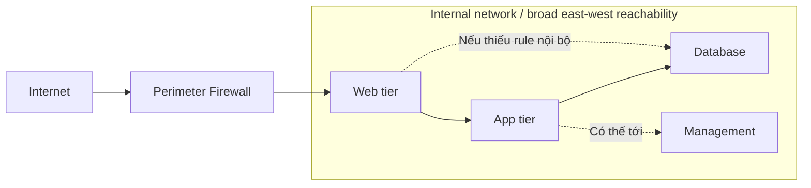
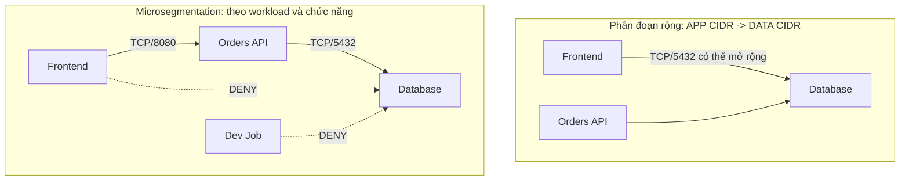
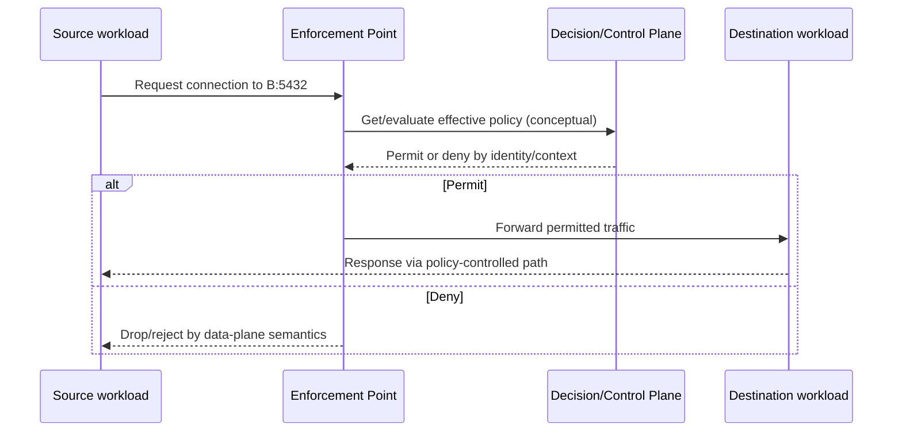
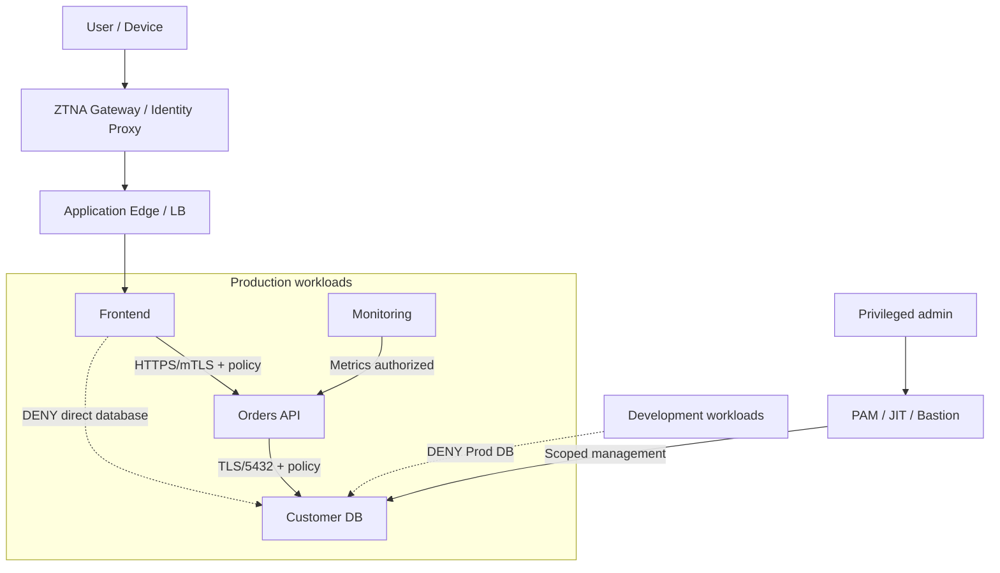
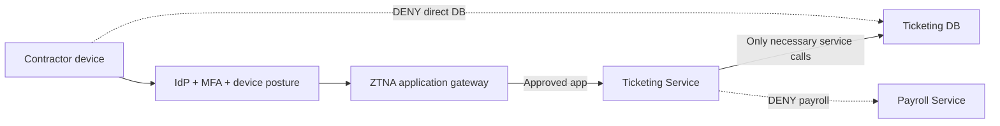
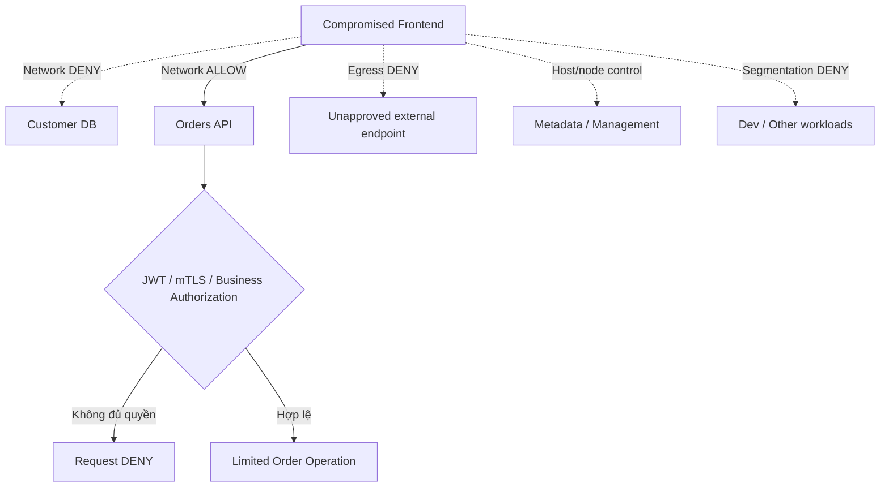
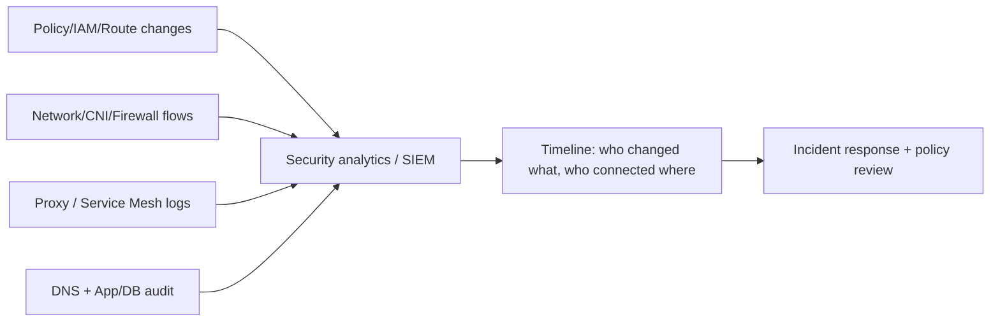
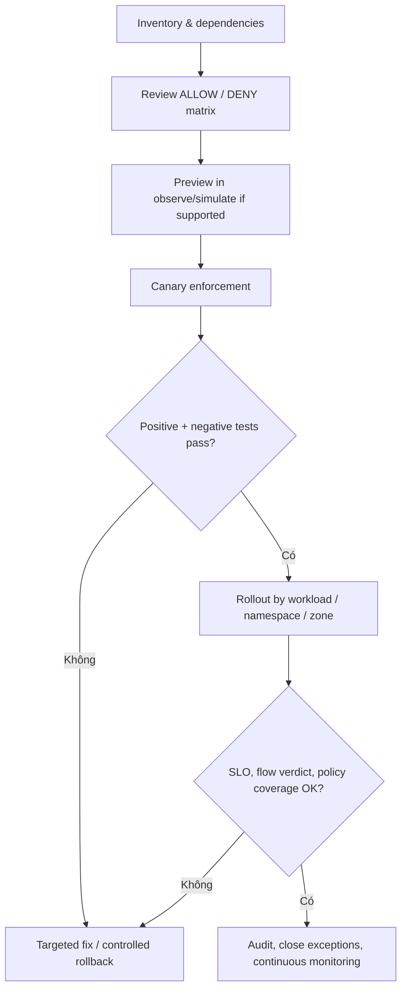
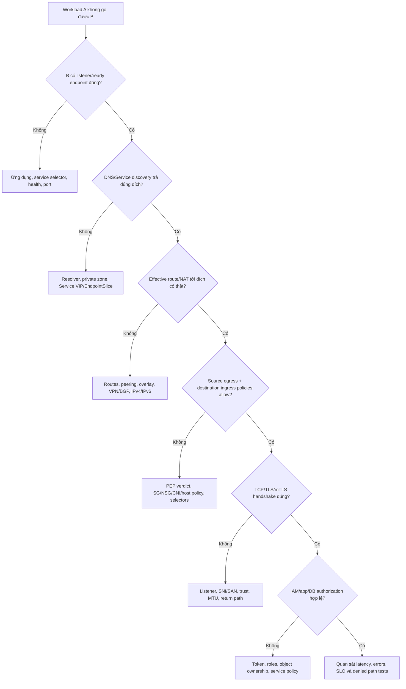
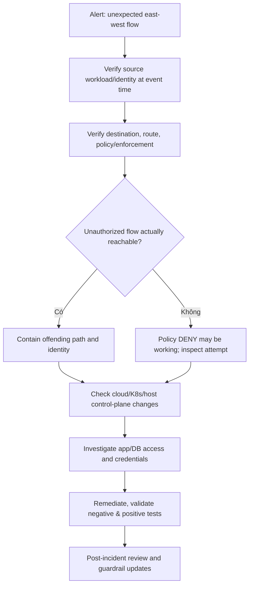

# Microsegmentation trong kiến trúc Zero Trust: phân đoạn theo workload và kiểm soát truy cập tối thiểu

Giả sử một doanh nghiệp có các dịch vụ `frontend`, `orders-api`, `payment-api`, `customer-db`, `monitoring` và `management` cùng chạy trên mạng nội bộ. Firewall biên đã ngăn phần lớn truy cập từ Internet, còn các máy chủ dùng địa chỉ private. Tuy nhiên, nếu một lỗ hổng ở `frontend` cho phép thực thi mã từ xa, kẻ tấn công có thể thử kết nối đến database, hệ thống quản trị, môi trường staging hoặc những máy khác cùng subnet. **Firewall ở ranh giới Internet không tự chặn được lateral movement bên trong.**

**Microsegmentation** là cách chia nhỏ phạm vi kết nối được cho phép, thường tới mức ứng dụng, workload, máy ảo, container/Pod hoặc nhóm tài nguyên có cùng mục đích. Thay vì cho cả một subnet truy cập subnet khác, hệ thống định nghĩa rõ **workload nguồn nào được kết nối tới tài nguyên đích nào, bằng giao thức/cổng nào, trong điều kiện nào**, rồi áp quy tắc tại những điểm có thể thực thi trên traffic thực tế.

Trong kiến trúc **Zero Trust**, microsegmentation giúp hiện thực nguyên tắc *không mặc nhiên tin cậy một yêu cầu chỉ vì nó đến từ mạng nội bộ*. Nó không thay thế danh tính, xác thực thiết bị, TLS/mTLS, ứng dụng phân quyền hoặc giám sát: đó là **một lớp giới hạn reachability và blast radius**, kết hợp với quyết định truy cập dựa trên danh tính và ngữ cảnh.

Bài học thuộc chương **Zero Trust Network Access** của module **SECURITY_NETWORK_SECURITY**. Các kiến thức về subnet/VLAN, firewall, VPN, IDS/IPS, DNS, bảo mật cloud, Kubernetes, xác thực kết nối, mô hình hóa mối đe dọa và giám sát xâm nhập được áp dụng để thiết kế phân đoạn có thể kiểm chứng, thay vì chỉ vẽ một sơ đồ có nhiều vùng mạng.

Sau bài học, bạn có thể:

1. Phân biệt **microsegmentation**, phân đoạn truyền thống, **ZTNA** và các lớp xác thực/ủy quyền.
2. Đọc một đường kết nối theo **source identity → destination identity → route → policy enforcement → TLS/authentication → authorization**.
3. Lập inventory, dependency graph và **flow matrix allow/deny** cho môi trường VM, bare metal, cloud, Kubernetes và hybrid.
4. Lựa chọn điểm thực thi: host firewall/agent, SDN/virtual firewall, cloud SG/NSG/firewall, CNI NetworkPolicy, service mesh và proxy.
5. Thiết kế **default deny + allow tối thiểu** theo vai trò workload, giảm phụ thuộc IP tĩnh và tránh label spoofing.
6. Đánh giá các trường hợp bypass như cùng Pod/host, NAT, public endpoint, IPv6, route peering, `hostNetwork`, service VIP và traffic không qua proxy.
7. Triển khai theo giai đoạn quan sát → mô phỏng → canary → enforce, kiểm tra **positive và negative paths**.
8. Tương quan flow logs, workload identities, IAM và application audit để điều tra lateral movement.
9. Phân tích failure modes, viết incident runbook và đánh giá khả dụng khi policy thay đổi.

> **Phạm vi ví dụ:** Tên services, địa chỉ IP, namespaces, network labels và policies trong bài chỉ để minh họa. Các giá trị trong các dải dành cho tài liệu (ví dụ `192.0.2.0/24`, `198.51.100.0/24`, `203.0.113.0/24`) không phải đích Internet để kiểm thử. Không chạy scans, policy changes hoặc traffic injection lên mạng production khi chưa có quyền, kế hoạch và rollback.

## 1. Từ perimeter security đến Zero Trust và microsegmentation

### 1.1. Giả định “đã ở bên trong là đáng tin” gặp vấn đề gì?

Một mô hình truyền thống:



Firewall biên có thể được cấu hình tốt, nhưng vẫn có các rủi ro:

- Workload bị compromise vốn đã có đường mạng tới những dịch vụ khác.
- VPN user hoặc thiết bị on-prem được cấp cả dải IP nội bộ thay vì đúng ứng dụng cần truy cập.
- Nhiều VM/Pods cùng subnet được allow bởi một rule CIDR rộng.
- Một subnet/peering/VPC được coi là một **trust domain** dù chứa workloads khác môi trường và khác độ nhạy.
- Network topology phát triển nhanh hơn bộ firewall rules được review thủ công.

Không phải mọi mô hình truyền thống đều kém an toàn: một firewall nội bộ cấu hình chi tiết vẫn có thể thực thi phân đoạn rất tốt. Điểm khác biệt là **mức độ chi tiết, tính theo danh tính/ngữ cảnh và khả năng kiểm soát liên tục**.

### 1.2. Nguyên tắc Zero Trust liên quan

Zero Trust thường được trình bày qua các tư tưởng:

1. **Không tin vì vị trí mạng**: private IP, cùng VLAN, VPN hoặc VPC không tự chứng minh quyền.
2. **Xác minh rõ ràng**: sử dụng tín hiệu danh tính workload/user, device posture, trạng thái phiên và resource sensitivity khi có.
3. **Cấp quyền tối thiểu**: chỉ cho những hoạt động/đích cần thiết, theo phạm vi và thời hạn phù hợp.
4. **Giả định có thể đã bị xâm nhập**: thiết kế để một service bị chiếm quyền không tự lan sang database hoặc management plane.
5. **Quan sát và điều chỉnh**: logs, kiểm thử và vòng đời policy phải phát hiện thay đổi về workload, route và rủi ro.

**Zero Trust không phải sản phẩm đơn lẻ** và cũng không có nghĩa mọi packet đều phải gọi một máy chủ chính sách từ xa để xin phép. Kiến trúc thực tế dùng một policy decision/control plane và nhiều enforcement points; cách cache, tái đánh giá và xử lý mất kết nối phụ thuộc sản phẩm.

### 1.3. Microsegmentation khác segmentation và ZTNA thế nào?

| Khái niệm | Đối tượng chính | Granularity thông thường | Ví dụ |
|---|---|---|---|
| Phân đoạn mạng theo VLAN/subnet | Nhóm mạng, IP prefix, routing domain | Subnet/tier/site | `USER VLAN` chỉ tới `APP VLAN` qua firewall |
| **Microsegmentation** | Workload/app/service/resource | Workload-to-workload, port/protocol, identity | Chỉ `orders-api` được tới `customer-db:5432` |
| **ZTNA** | Người dùng/thiết bị/client truy cập ứng dụng | Identity/device/session/app | Contractor chỉ được dùng ticketing app |
| Service mesh authorization | Service-to-service identity và request | mTLS principal, HTTP/gRPC method/path | `frontend` chỉ `GET /orders` |
| Cloud IAM/app authorization | Principal và action trên resource/dữ liệu | API/operation/data | Workload được đọc một storage object prefix |

Microsegmentation và ZTNA **bổ trợ**: ZTNA thu hẹp đường truy cập của người dùng từ xa tới ứng dụng; microsegmentation thu hẹp đường đi ngang sau khi traffic đã vào môi trường hoặc một workload bị compromise. Có triển khai hội tụ cả hai nhưng không được đồng nhất chúng.

### 1.4. North–south và east–west

- **North–south:** Internet/client → gateway/LB → application, hoặc application → external SaaS.
- **East–west:** application → application, Pod → database, VM → VM, service → monitoring/control plane, kể cả giữa các cloud/VPCs.

Microsegmentation đặc biệt quan trọng với **east–west**, nhưng cần kiểm soát ingress/egress để tránh đường bypass. **Một ứng dụng được bảo vệ bằng WAF ở biên chưa chắc được bảo vệ khi một Pod khác gọi thẳng vào Pod IP hoặc service private endpoint của nó.**

### 1.5. Minh họa trước và sau



Không chỉ thay một CIDR rule bằng nhiều IP rules. **Điểm mạnh của microsegmentation là quyền đi theo workload/ứng dụng khi chúng scale hoặc chuyển vị trí**, với điều kiện identity/label/asset inventory và enforcement tương ứng đáng tin.

## 2. Mô hình quyết định: Policy Engine, Administrator và Enforcement Point

Một cách tư duy theo kiến trúc Zero Trust của NIST SP 800-207 là tách **policy decision** khỏi **policy enforcement**. Những tên gọi dưới đây mang tính khái niệm, không nhất thiết tương đương các thành phần có tên như vậy trong mọi sản phẩm.

### 2.1. Ba vai trò cơ bản

| Vai trò | Việc thực hiện | Ví dụ triển khai |
|---|---|---|
| **Policy Engine (PE)** | Quyết định cho phép/từ chối dựa trên policy và tín hiệu | Rule engine, IAM/context engine, service authorization |
| **Policy Administrator (PA)** | Thiết lập/thu hồi đường truy cập theo quyết định | Controller đẩy policies, tạo/chỉnh sessions/routes/rules |
| **Policy Enforcement Point (PEP)** | Áp quyết định trên connection/request | Host agent, virtual firewall, CNI, sidecar, proxy, gateway |

**PDP (policy decision point)** là cách gọi gộp phần ra quyết định ở một số kiến trúc; **PEP** là điểm thực thi. Đừng tự giả định mọi sản phẩm đều có cả PE, PA, PEP dưới dạng ba process riêng.

### 2.2. Một luồng truy cập điển hình



**Cảnh báo:** Sơ đồ là mô hình quyết định **logic**. Với Kubernetes NetworkPolicy hoặc cloud SG, controller thường **đẩy rule trước**, PEP thực thi ở data plane theo rules đã có; mỗi SYN không nhất thiết gọi PE/PA. Với application proxy, có thể kiểm tra theo mỗi request hoặc mỗi phiên. Điều quan trọng là **nơi quyết định được áp và thời điểm policy cập nhật**.

### 2.3. Những dữ liệu đầu vào cho chính sách

Một quyết định có thể dùng:

```text
Source workload identity:
  service account / machine certificate / host agent identity

Destination identity:
  app/service/resource classification

Requested access:
  protocol, destination port, action, method/path if L7

Context:
  environment, risk, device posture, session age, location if relevant

Policy:
  allowed workload-to-resource relation, constraints, expiration
```

Không phải mọi PEP có tất cả các tín hiệu này. **Cloud SG/NSG thông thường không biết JWT subject hoặc HTTP URL**; **NetworkPolicy chuẩn không biết FQDN/identity ở L7**; **service mesh L7 có thể biết workload principal và HTTP path** nhưng không thay kiểm soát database row-level.

### 2.4. Control plane và data plane

**Control plane** quyết định và phân phối desired state: policy definitions, labels, identities, cert trust, service discovery, routing và enrollment.

**Data plane** chuyển hoặc chặn packet/request theo trạng thái đã nhận: host firewall, eBPF maps, virtual switch, SG fabric, proxy filters, service mesh.

Nếu control plane hỏng:

- Data plane có thể tiếp tục áp các rules đã nhận, hoặc không, tùy implementation.
- Workloads mới có thể thiếu policy/identity, nhất là khi autoscale/rotate cert.
- Chính sách mới có thể không hội tụ giữa nodes.
- Một số products có thể fail-open/fail-closed khác nhau, cần đo và định nghĩa trước.

Không tuyên bố một thiết kế là **fail closed** nếu chưa kiểm chứng failure modes và recovery path thật.

## 3. Granularity: microsegment theo app/workload chứ không chỉ theo subnet

### 3.1. Các cấp độ phân đoạn

| Cấp | Ví dụ | Ưu điểm | Giới hạn |
|---|---|---|---|
| Site/VPC/VNet | Tách Production và Dev | Giảm broad trust giữa môi trường | Vẫn có nhiều workloads trong một network |
| VLAN/subnet/tier | Web/App/Data tiers | Dễ tích hợp routing/firewall | CIDR rules có thể quá rộng |
| VM/host | Chỉ VM role A → DB role B | Workload-aware, phân quyền trong cùng subnet | Cần identity/inventory và host control |
| Kubernetes Pod/namespace | NetworkPolicy allow selected Pods | Tự động theo Pod lifecycle/labels | CNI support, selectors và host exceptions |
| Service mesh service identity | mTLS principal/HTTP method | Fine-grained L7, peer identity | Chỉ traffic đi qua mesh và đúng L7 point |
| Resource/data | User được xem một order | Giới hạn dữ liệu thật | Thuộc IAM/app authorization, không chỉ networking |

Một mô hình tốt có thể dùng **nhiều cấp đồng thời**. Chẳng hạn production DB nằm trong private subnet, host/cloud firewall chặn truy cập rộng, CNI chỉ cho `orders-api`, còn DB yêu cầu TLS và credentials có quyền SQL tối thiểu.

### 3.2. Quan hệ ứng dụng mới là câu hỏi cốt lõi

Một policy intent:

```text
orders-api → customer-db
  tcp/5432
  environment: production
  purpose: read/write own application data

frontend → customer-db
  prohibited
```

Triển khai có thể dùng IP/CIDR ở datapath, nhưng source of truth lý tưởng gắn với **ứng dụng, workload owner, environment và danh tính**. Khi `orders-api` chuyển node/IP, controller hoặc hệ thống quản lý phải cập nhật rule đúng, tránh mở rộng sang workload khác dùng chung subnet.

### 3.3. Default deny là một mục tiêu, không phải tên file

```text
Default state: connection denied unless explicitly permitted

Allow:
  Frontend → Orders TCP/8080
  Orders → DB TCP/5432
  Orders → approved DNS resolver UDP/TCP 53
  Monitoring → Orders metrics TCP/9090

Deny:
  Frontend → DB
  Dev → Prod DB
  Unknown → management
  Orders → arbitrary Internet egress
```

**Một chính sách tên `default-deny` không có ý nghĩa nếu enforcement thiếu, target không match hoặc có allow rộng ở nơi khác.** Phải định nghĩa được **thành công bằng test**, không chỉ bằng sự tồn tại của cấu hình.

## 4. Inventory và dependency mapping trước khi viết firewall rules

Microsegmentation thường thất bại không phải do thiếu công cụ, mà do **chưa hiểu đầy đủ ai cần giao tiếp với ai**. Một mạng có thể chứa batch jobs cuối tháng, backup traffic, health probes, monitoring, DNS, IAM/KMS và disaster-recovery links không xuất hiện khi chỉ quan sát một ngày.

### 4.1. Asset và workload inventory

Mỗi entry nên có tối thiểu:

| Trường | Ví dụ | Tại sao cần |
|---|---|---|
| Workload/Service | `orders-api` | Nhận diện business function |
| Owner/On-call | Team Orders | Phê duyệt và xử lý sự cố |
| Environment | `prod` | Chặn Dev → Prod ngoài ý định |
| Classification | `internal`, `restricted` | Quyết định mức hạn chế |
| Workload identity | Kubernetes SA/VM instance identity | Không phụ thuộc IP động |
| Runtime/network | VM, bare metal, Pod, subnet/VPC | Chọn PEP phù hợp |
| Addresses/ports | Pod IP/VM IP, listener TCP/8080 | Kiểm chứng đường kết nối |
| Dependencies | DB, DNS, queue, partner API | Viết allow rules |
| Authentication | mTLS, DB auth, OAuth | Không nhầm allow network với quyền app |
| Logs | Flow, proxy, application audit | Điều tra và compliance |
| Lifecycle | autoscale, schedule, DR | Tránh gián đoạn sau policy rollout |

### 4.2. Cách xây dependency graph

Nguồn bằng chứng hợp lệ có thể gồm:

- Observed network flows trong khoảng đủ dài cho batch/backup.
- Service mesh telemetry với **peer identity và request labels**.
- Kubernetes Services/EndpointSlices, Deployments/labels, VPC/VNet routes.
- IaC files/policy definitions do team cung cấp.
- Application traces, connection pool configs và service catalogs.
- Owner interviews và runbook khôi phục.

**Flow log chỉ cho thấy đã có traffic**, không chứng minh traffic đó **nên được phép**. Một compromised workload có thể quét nhiều ports; nếu tự động “allow mọi observed flow”, hệ thống sẽ hợp thức hóa một cuộc thăm dò. Mỗi flow cần **business justification và owner approval**.

### 4.3. Phân loại dependency

| Loại | Ví dụ | Lưu ý khi giới hạn |
|---|---|---|
| Sync API | Frontend → Orders HTTP/8080 | Client identity, TLS, timeout |
| Database | Orders → PostgreSQL TCP/5432 | Source workload, DB role, HA endpoint |
| Queue/cache | Orders → Broker TLS/5671; Redis TLS/6379 tùy dịch vụ | Service identity/ACL, encryption |
| DNS | Pods → resolver UDP/TCP 53 | CoreDNS/NodeLocal/managed DNS path |
| Identity | App → IdP/JWKS/KMS | Endpoint và token/cert rotation |
| Monitoring | Prometheus → app metrics; app → OTel collector | Pull/push directions khác nhau |
| Operations | Bastion/JIT admin → management endpoint | MFA/PAM, expiration, logging |
| Backup/DR | DB → backup system/secondary region | Chạy theo lịch, cần failover test |
| External APIs | Worker → payment provider HTTPS | Proxy/private egress, TLS verification |

### 4.4. Làm rõ source/destination sau NAT

Ví dụ:

```text
Pod Orders: 10.244.2.10
Node:       10.20.1.15
NAT egress: 198.51.100.10  (documentation address)
Partner observes: NAT egress address
```

Nếu chỉ xem source IP từ phía partner, nhiều Pods có thể cùng mang NAT address. Vì thế cần map **Pod UID/service account + node + NAT/session timing + request ID**, không cho cả NAT IP quyền rộng vào database hoặc service nhạy cảm chỉ vì “đây là IP của ứng dụng”.

### 4.5. Tạo ma trận đúng hướng

Đối với mỗi flow, ghi:

```text
Source service / identity:
Destination service / identity:
Network source/destination actually observed:
Protocol / destination port:
Ingress and egress enforcement points:
Authentication (TLS/mTLS/IAM):
Authorization owner:
Business justification:
Expected ALLOW or DENY:
Failure/rollback impact:
Test evidence:
```

Ma trận này làm **hợp đồng giữa application, platform, network và security teams**; policy YAML/SG rules chỉ là hiện thực hóa một phần hợp đồng.

## 5. Kiến trúc tham chiếu: nhiều điểm thực thi, một chủ trương bảo mật

Một tổ chức có thể có ứng dụng cloud-native, VM cũ, Windows servers, Kubernetes và on-prem. Không có một PEP duy nhất nào đảm bảo bao phủ tất cả các đường đi. Cần đặt controls **tại nơi traffic thực sự đi qua**.

### 5.1. Luồng giữa các tiers



Các lớp kiểm soát tương ứng:

- **Edge/Identity:** ZTNA hoặc gateway kiểm tra user/device/session trước khi đi vào app.
- **Segment:** VPC/VNet, routing domains, firewall giữa tiers và environments.
- **Workload:** host agent/SG/CNI rule giới hạn nguồn–đích ở mức VM/Pod.
- **Service:** mTLS peer identity, mesh/service authorization và JWT verification nếu phù hợp.
- **Resource:** database credential, IAM policy, application ABAC.
- **Observability:** correlates source identity, flow verdict, policy version và action logs.

### 5.2. Đặt enforcement gần tài nguyên cần bảo vệ

Nếu firewall chỉ nằm ở điểm ra Internet, traffic VM A → VM B **trong cùng subnet** có thể không qua firewall đó. Có thể chọn:

- Host-level firewall/agent trên VM A và/hoặc VM B.
- Virtual distributed firewall tại hypervisor/SDN.
- Cloud security group gắn trực tiếp network interface/workload.
- Kubernetes CNI NetworkPolicy trên Pod datapath.
- Application proxy/mesh gateway gần service.

**Không nên mặc định triển khai càng nhiều firewall appliance ở giữa thì segmentation càng tốt.** Một kiến trúc bắt toàn bộ east–west traffic phải hairpin qua NVA có thể tăng latency, cost và failure domains; distributed enforcement giúp kiểm soát tại workload nhưng yêu cầu quản lý policy/identity đồng bộ.

### 5.3. Enforcement ở source, destination hay cả hai?

| Cách áp | Ưu điểm | Đánh đổi |
|---|---|---|
| Source egress | Ngăn workload đi tới destinations ngoài nhiệm vụ | Có thể thiếu nếu source bị compromise/không có agent |
| Destination ingress | Bảo vệ tài nguyên nhạy cảm không phụ thuộc nguồn tự giới hạn | Có thể không kiểm soát exfiltration đến destinations khác |
| **Hai phía** | Phòng vệ nhiều lớp, rõ chiều trách nhiệm | Phải phối hợp rules, DNS, telemetry và change management |
| Gateway/proxy | L7 identity, user policy, centralized audit | Chỉ bảo vệ flows đi qua gateway, có nguy cơ bypass |

Với Kubernetes NetworkPolicy, nếu source bị egress-isolated **và** destination bị ingress-isolated, flow cần **cả hai chiều ALLOW**. Với SG/NSG/host firewalls stateful, return packets của connection được phép có thể được theo dõi; không tự viết symmetric application rules như một stateless ACL nếu không cần.

### 5.4. Phân biệt mạng, identity và object permission

Một flow được phép:

```text
Source: orders-api workload identity
Destination: customer-db TCP/5432
Network: ALLOW
Transport: TLS server identity verified
DB login: app service credential valid
SQL role: can read/update only approved tables
User context: app checks tenant/order ownership
```

**Microsegmentation chỉ giải quyết phần đường mạng**. Nếu service account/DB role có quyền đọc mọi tenant, một attacker chiếm `orders-api` vẫn có thể tận dụng chính luồng hợp lệ. Authorization và secrets management phải giảm **blast radius bên trong đường ALLOW**.

## 6. Tạo policy từ flow matrix: ví dụ thương mại điện tử

### 6.1. Workloads và danh tính

Giả định một hệ thống:

| Workload | Environment | Danh tính logic | Listener |
|---|---|---|---|
| Web frontend | Prod | `prod/frontend` | HTTP/8080 |
| Orders API | Prod | `prod/orders-api` | HTTP/8080 |
| Payment worker | Prod | `prod/payment-worker` | HTTPS/8443 outbound |
| Customer DB | Prod | `prod/customer-db` | PostgreSQL/5432 |
| Collector | Ops | `ops/otel` | OTLP/4317 |
| Dev CI job | Dev | `dev/ci-runner` | Không có quyền truy cập DB |
| Bastion | Mgmt | `mgmt/bastion` | SSH/RDP theo quy trình |
| DNS resolver | Shared | `shared/dns` | UDP/TCP 53 |

Khi viết policy, chú ý tên logic chỉ là **source of truth ở tầng thiết kế**. Enforcement engine có thể cần ánh xạ chúng thành service accounts, SG IDs, host tags, Pod labels, mTLS principals hoặc CIDRs, với cơ chế xác thực nguồn đáng tin.

### 6.2. Allow/deny matrix

| Source | Destination | Port/protocol | Quyết định | Điều kiện bổ sung |
|---|---|---|---|---|
| Ingress gateway | Frontend | TCP/8080 | **ALLOW** | Gateway identity, app auth |
| Frontend | Orders API | TCP/8080 | **ALLOW** | mTLS, request authorization |
| Orders API | Customer DB | TCP/5432 | **ALLOW** | TLS, DB credentials/least privilege |
| Orders API | OTel Collector | TCP/4317 | **ALLOW** | Collector target/identity, retention |
| Approved workloads | DNS resolver | UDP/TCP 53 | **ALLOW** | Đúng resolver path |
| Payment worker | Approved payment endpoint | HTTPS/443 | **ALLOW** | Egress proxy/endpoint policy, token |
| Bastion | Approved management endpoints | Necessary ports | **ALLOW** | MFA/PAM/JIT, audit |
| Frontend | Customer DB | TCP/5432 | **DENY** | Không có nghiệp vụ trực tiếp |
| Dev CI | Customer DB | Any | **DENY** | Boundary Dev → Prod |
| Unknown workloads | Management | Any | **DENY** | Không có owner/approval |
| Orders API | Arbitrary Internet | Any | **DENY** | Chỉ các external services được duyệt |

### 6.3. Pseudocode policy ở mức business intent

```yaml
# ĐÂY LÀ PSEUDOCODE tự định nghĩa, KHÔNG PHẢI schema của Kubernetes,
# Istio, AWS, Azure hay một product microsegmentation cụ thể.
policy_set: production-microsegmentation
default: deny

allow:
  - source: prod/frontend
    destination: prod/orders-api
    protocol: tcp
    destination_port: 8080
    purpose: orders-frontend-api
    require_peer_authentication: true
  - source: prod/orders-api
    destination: prod/customer-db
    protocol: tcp
    destination_port: 5432
    purpose: order-persistence
    require_db_authentication: true
  - source: prod/orders-api
    destination: ops/otel
    protocol: tcp
    destination_port: 4317
    purpose: traces-export

deny_expectations:
  - source: prod/frontend
    destination: prod/customer-db
  - source: dev/ci-runner
    destination: prod/customer-db
  - source: unknown
    destination: mgmt/*

audit:
  owner: platform-security
  negative_tests_required: true
  review_frequency: periodic
```

`default: deny` trong pseudo-YAML này chỉ mô tả **ý định**. Để enforcement thật, phải dịch sang policies của từng PEP và chứng minh scope/semantics đúng.

### 6.4. Tại sao không dùng một rule “Prod → Prod allow”?

Nếu policy cho mọi workload `environment=prod` kết nối mọi workload khác `environment=prod`, blast radius sau khi compromise có thể vẫn rất lớn. Environment là **một thuộc tính cần kiểm tra**, không phải danh tính đủ để chứng minh mọi service đều cần thông nhau.

Một thiết kế tốt yêu cầu **service role, destination role, port và lý do nghiệp vụ**. Các ngoại lệ (ví dụ incident response) phải có thời hạn và giám sát.

### 6.5. Quyền mạng có thể thay đổi mà application vẫn chạy

Khi triển khai một canary `orders-api-v2`, Pod IP có thể đổi, VM có thể scale hoặc app chuyển AZ. Nếu policy binding dùng identity labels/service accounts được quản trị đáng tin, hệ thống có thể tiếp tục cho `orders-api-v2` đến DB mà không mở toàn subnet. Tuy nhiên:

- Nếu labels đổi sai, workload có thể mất ALLOW hoặc bị bỏ sót baseline deny.
- Nếu service account được dùng chung quá rộng, các workloads không cùng nhiệm vụ có thể cùng được allow.
- Nếu controller/agent mất kết nối, policy propagation có thể trễ.
- Nếu deployment dùng public endpoint mới, existing network rules có thể không bảo vệ đường đó.

Do đó cần **tests khi deploy** và policy coverage alerts, không chỉ tin vào việc “định danh bằng label” là đã tự động an toàn.

## 7. Implement microsegmentation trên VM và bare metal

Các hệ thống không chạy Kubernetes vẫn cần microsegmentation. VM cùng VLAN có thể giao tiếp trực tiếp qua L2; nếu chỉ firewall ở router giữa VLANs, nó sẽ không nhìn thấy toàn bộ east–west traffic.

### 7.1. Host firewall và agent

Trên Linux/Windows, host firewall hoặc endpoint security agent có thể thực thi policy gần process/host:

- Chỉ cho `orders-api` host nhận TCP/8080 từ nguồn được phê duyệt.
- Chỉ cho database host nhận TCP/5432 từ `orders-api` hosts.
- Chặn incoming management ports từ user devices/dev networks.
- Chỉ cho egress tới DNS/KMS/monitoring/approved external destinations.

**Giới hạn:** nếu workload/attacker có đặc quyền root/administrator đủ cao, họ có thể ảnh hưởng host firewall/agent theo khả năng môi trường. Một kiến trúc cần **tamper protection, central policy management, OS hardening, EDR và host IAM**; không xem một agent cùng host là bảo vệ tuyệt đối trước kernel compromise.

### 7.2. Virtual distributed firewall

Một số hypervisor/SDN platforms có distributed firewall áp rule tại virtual NIC/switch datapath cho traffic giữa VMs, kể cả cùng subnet. Điều này:

- Giảm việc hairpin mọi flow qua central physical firewall.
- Có thể theo VM tags/security groups/context thay vì chỉ CIDR.
- Đòi policy ordering, tagging governance, vSwitch visibility và HA của controller.
- Cần kiểm tra **traffic VM ↔ bare metal** hoặc những đường nằm ngoài SDN overlay.

**Không cho rằng mọi VM được bảo vệ chỉ vì “mạng có distributed firewall”** nếu còn unmanaged hypervisors, legacy VLANs, cross-cloud links hoặc exception rules.

### 7.3. Ví dụ logic Linux host policy (đọc, không tự sửa)

Kiểm tra trạng thái mạng/host firewall bằng lệnh đọc trong môi trường được phép:

```bash
# Read-only inspection trong lab/host được cấp quyền.
ip -br address
ip route
ip -6 route
ss -ltnp

# Theo hệ điều hành, các công cụ có thể không được cài:
sudo nft list ruleset
sudo iptables -S
```

`nft`/`iptables` có thể không cùng là nguồn sự thật nếu hệ thống dùng eBPF, service-specific host agent hoặc firewall khác. Không tự cài/flush rules khi đang tìm hiểu. Đặc biệt **không chạy `iptables -F`/`nft flush ruleset`** để "thử cho thông" trên server có service thật.

### 7.4. Windows workloads

Windows Defender Firewall và endpoint controls có thể quản lý inbound/outbound theo application, port, network profile hoặc remote addresses, với policy được phân phối qua nền tảng quản trị thích hợp.

```powershell
# Chỉ đọc trạng thái Windows host, không sửa rules.
Get-NetIPConfiguration
Get-NetTCPConnection -State Listen
Get-NetFirewallProfile
Get-NetFirewallRule -Enabled True
```

Một rule cho RemoteAddress CIDR trên host **không tự xác thực ứng dụng nguồn**. Nếu muốn policy theo workload identity, cần cơ chế binding nguồn đáng tin ở enforcement point; không giả rằng IP là identity khi có NAT/shared hosts.

### 7.5. Giới hạn của agent-based segmentation

Các trường hợp cần đánh giá:

- Bare-metal appliance không cài được agent.
- VM/template image mới chưa được agent enroll.
- Agent crash, policy sync mất kết nối, endpoint tampering.
- System bootstrap/patching/log shipping cần traffic trước khi app sẵn sàng.
- Traffic từ host tới VM trong cùng switch hoặc traffic được offload.
- Clustered services dùng dynamic ports hoặc failover virtual IPs.

Khi không thể cài agent, cần **network firewall/SDN/cloud SG/identity proxy** để bao phủ các đường trọng yếu. Không tạo ngoại lệ "unmanaged hosts allow all" lâu dài.

## 8. Implement trên cloud VPC/VNet: SG/NSG, private endpoints và transit

Cloud microsegmentation dùng các primitives sẵn có nhưng cần hiểu **provider semantics và enforcement scope**.

### 8.1. Các lớp thường có

| Lớp | AWS | Azure | Google Cloud |
|---|---|---|---|
| Logical networks | VPC/subnets | VNet/subnets | Global VPC network/regional subnets |
| Workload/network firewall | Security Groups/NACLs; managed firewalls theo nhu cầu | NSGs/Azure Firewall, policies khác | VPC firewall rules/hierarchical policies |
| Private service access | VPC endpoints/PrivateLink | Private Endpoint/Private Link | Private Service Connect/Private Google Access tùy service |
| Inter-network transit | Peering, transit gateways | Peering, virtual hub/WAN | Peering, NCC/routing designs |
| Identity/resource | IAM, service roles, resource policies | Managed identity/RBAC, service policies | IAM/service accounts, resource policies |

Danh sách là **khái quát**; không phải mọi tính năng tương đương một-một hoặc được dùng giống nhau. Phải xem effective routes và policy evaluation thực tế.

### 8.2. AWS SG-to-SG: identity của security group không phải user identity

Một ứng dụng gắn SG `sg-orders` có thể được DB SG cho phép inbound TCP/5432 **từ SG đó**, theo điều kiện network và tính năng tham chiếu SG phù hợp.

```text
orders instances/ENIs with SG=sg-orders
       |
       | TCP/5432 (source SG reference)
       v
DB instances/ENIs with SG=sg-database
```

Ưu điểm: khi app instances đổi private IP, rules theo SG membership vẫn có thể tiếp tục match. Tuy nhiên:

- SG membership được quản lý qua cloud IAM/control plane; ai gắn một ENI vào `sg-orders` có thể làm thay đổi phạm vi cho phép.
- SG-to-SG **không chứng thực JWT user hoặc một process trên VM**.
- VPC peering/transit/SG references có điều kiện hỗ trợ theo topology; không giả định mọi cross-network SG reference đều hợp lệ.
- SG stateful không tự bảo đảm egress qua đúng inspection path hoặc không có public endpoints khác.

### 8.3. Azure NSG và Google Cloud firewall

Azure NSG cho rules theo source/destination addresses, service tags, protocols/ports, priorities và Azure-specific features. GCP firewall có thể áp theo network/target tags, service accounts và hierarchical policies tùy thiết kế.

**Đừng coi tag là identity mật mã.** Nếu một principal có quyền thay VM tags, service account attachments hoặc firewall policy, nó có thể mở đường mà data-plane rules hiện tại vốn định hạn chế. Cần RBAC/IAM, org guardrails, IaC approval và audit logs.

### 8.4. Route không tạo quyền và firewall rule không tạo route

Một source có route tới `10.20.30.5` **không có nghĩa** security policy cho phép. Một SG/NSG rule allow TCP/5432 **không tạo đường định tuyến** nếu VPC/VNet peering, transit, endpoint hoặc return path chưa được thiết lập.

Chuỗi kiểm tra:

```text
DNS → effective route → network policy → listener/TLS → IAM/app authorization
```

Điều này càng quan trọng khi có hub-and-spoke, peering, hybrid VPN/BGP hoặc firewall appliance vì traffic có thể đi theo **specific route** chứ không đi qua default inspection route.

### 8.5. Public exposure không bị ẩn bởi “private subnet”

Backend không public IP nhưng được public LB/API Gateway gọi tới vẫn là **một phần của dịch vụ có public ingress**. Object storage/managed database có public service endpoint riêng dù không có VM network interface của khách hàng.

Microsegmentation phải kiểm kê:

- Public IPv4 **và global IPv6** addresses.
- Load Balancers, API Gateways, function/public URLs.
- Storage/database service firewall/public access settings.
- Alternate origin endpoints bypass WAF.
- Private service endpoints, DNS split-horizon và egress routes.
- IAM permissions cho network/resource changes.

**Private IP không đồng nghĩa private service** và **không đồng nghĩa “chỉ user được phép truy cập”**.

### 8.6. Transit/hub tạo thêm reachability

Hai spokes nối vào transit hub có thể thấy route tới nhau nếu route propagation/associations cho phép. Một VM trong Dev có thể tới Prod DB qua hub dù không có direct peering.

Khi phân đoạn:

1. Định nghĩa route domains/allowed prefixes và segmentation ở hub.
2. Áp policy tại destination workload/DB, không chỉ chặn ở hub.
3. Ngăn bypass qua peering trực tiếp, service endpoints, VPN hoặc cloud-managed paths.
4. Kiểm tra return path và stateful firewall/NVA HA.
5. Audit ai có IAM quyền tạo attachment, route hoặc sửa SG.

Một sơ đồ cloud có biểu tượng “central firewall” **không chứng minh mọi đường east–west đi qua nó**. Thử effective paths/flow logs từ những source thực.

## 9. Kubernetes microsegmentation: Namespace, Pod, CNI và NetworkPolicy

Kubernetes biến đổi liên tục: Pods có thể đổi IP khi reschedule; service replicas scale; Kubernetes Services dùng DNS/VIP để định tuyến tới endpoints. Vì thế nên quản lý segmentation theo **Pod selectors, namespace, service account identity và workload ownership** thay vì hardcode từng Pod IP.

### 9.1. Phân biệt Kubernetes namespace và network isolation

Namespace là một **phạm vi logic cho resources và RBAC**, không mặc định là một firewall. Hai Pods ở hai namespaces có thể liên lạc nếu CNI routing và policies cho phép. Một Service loại `ClusterIP` cũng **không tự xác thực caller**.

Trong mô hình NetworkPolicy chuẩn:

- Policy thuộc **một namespace**.
- `spec.podSelector` chọn **Pods trong namespace của policy**.
- `Ingress` và `Egress` là **hai hướng cô lập độc lập**.
- Nếu không có policy chọn Pod và hướng tương ứng, traffic thường **không bị cô lập bởi NetworkPolicy chuẩn** (các tầng khác vẫn có thể chặn).
- Allow rules từ nhiều NetworkPolicies **cộng gộp**, không có explicit ordered deny trong API chuẩn.
- Network plugin/CNI phải **thực sự hỗ trợ enforcement**, không chỉ cho API object tồn tại.

### 9.2. Microsegmentation theo namespace-wide default deny

```yaml
apiVersion: networking.k8s.io/v1
kind: NetworkPolicy
metadata:
  name: default-deny-all
  namespace: commerce
spec:
  podSelector: {}
  policyTypes:
    - Ingress
    - Egress
  ingress: []
  egress: []
```

`podSelector: {}` áp tới **mọi Pods trong `commerce`**, kể cả Pod mới được thêm và có labels khác. `policyTypes` bao gồm cả Ingress/Egress và không có allow rules trong manifest, nên mọi flow chịu isolation chỉ được phép nếu **một policy khác cho phép** theo semantics.

**Không áp nguyên policy này vào namespace production trước khi lập allow matrix**, vì DNS, telemetry, application calls, identity/KMS, mesh control plane và health checks có thể bị ảnh hưởng.

### 9.3. Allow frontend egress tới Orders

```yaml
apiVersion: networking.k8s.io/v1
kind: NetworkPolicy
metadata:
  name: frontend-egress-orders
  namespace: commerce
spec:
  podSelector:
    matchLabels:
      app: frontend
  policyTypes:
    - Egress
  egress:
    - to:
        - podSelector:
            matchLabels:
              app: orders-api
      ports:
        - protocol: TCP
          port: 8080
```

Rule này chỉ mở **egress** từ frontend Pods tới orders Pods TCP/8080 trong cùng namespace. Vì cả hai đầu đều bị default-deny, cần một rule cho **Orders ingress** nữa:

```yaml
apiVersion: networking.k8s.io/v1
kind: NetworkPolicy
metadata:
  name: orders-ingress-frontend
  namespace: commerce
spec:
  podSelector:
    matchLabels:
      app: orders-api
  policyTypes:
    - Ingress
  ingress:
    - from:
        - podSelector:
            matchLabels:
              app: frontend
      ports:
        - protocol: TCP
          port: 8080
```

**Hai policies cùng nhau** mô tả ALLOW frontend → Orders. Kết quả thật cần kiểm chứng qua đúng Service/port/CNI. Nếu frontend gọi Service port `80` còn Pod `targetPort=8080`, vị trí policy evaluation trước/sau service NAT có thể khác theo CNI; phải kiểm tra thực tế.

### 9.4. Orders → Database với điều kiện hai chiều

```yaml
apiVersion: networking.k8s.io/v1
kind: NetworkPolicy
metadata:
  name: orders-egress-database
  namespace: commerce
spec:
  podSelector:
    matchLabels:
      app: orders-api
  policyTypes:
    - Egress
  egress:
    - to:
        - podSelector:
            matchLabels:
              app: database
      ports:
        - protocol: TCP
          port: 5432
---
apiVersion: networking.k8s.io/v1
kind: NetworkPolicy
metadata:
  name: database-ingress-orders
  namespace: commerce
spec:
  podSelector:
    matchLabels:
      app: database
  policyTypes:
    - Ingress
  ingress:
    - from:
        - podSelector:
            matchLabels:
              app: orders-api
      ports:
        - protocol: TCP
          port: 5432
```

**Chú ý:** Đây là ví dụ DB **chạy trong Pod** cùng namespace. Nếu database là managed service ngoài cluster, `podSelector` không chọn được database đó. Thay bằng enforcement tương ứng: egress `ipBlock` trong giới hạn thật, cloud SG/NSG/private endpoint, egress proxy, DB TLS/credentials; không giả rằng Kubernetes Pod label có mặt trên managed DB.

### 9.5. DNS là một dependency riêng

Khi Pod bị egress-isolated, DNS request tới CoreDNS/NodeLocal DNS cũng có thể bị chặn. Một policy minh họa trong cluster có CoreDNS Pods ở `kube-system` với label `k8s-app=kube-dns`:

```yaml
apiVersion: networking.k8s.io/v1
kind: NetworkPolicy
metadata:
  name: allow-dns
  namespace: commerce
spec:
  podSelector: {}
  policyTypes:
    - Egress
  egress:
    - to:
        - namespaceSelector:
            matchLabels:
              kubernetes.io/metadata.name: kube-system
          podSelector:
            matchLabels:
              k8s-app: kube-dns
      ports:
        - protocol: UDP
          port: 53
        - protocol: TCP
          port: 53
```

**Đừng sử dụng y nguyên nếu DNS không đi tới CoreDNS Pod được chọn.** Nhiều clusters dùng NodeLocal DNSCache, DNS proxy hoặc Service VIP; cách NetworkPolicy xét gói đã DNAT và node traffic có thể khác CNI. Kiểm tra source Pod `/etc/resolv.conf`, actual DNS IP/port, CNI verdict và labels trước khi mở rule.

### 9.6. `namespaceSelector` và `podSelector` không được đặt sai

Muốn cho một Prometheus Pod trong namespace `observability` scrape `orders-api:9090`:

```yaml
ingress:
  - from:
      - namespaceSelector:
          matchLabels:
            kubernetes.io/metadata.name: observability
        podSelector:
          matchLabels:
            app: prometheus
    ports:
      - protocol: TCP
        port: 9090
```

Khi `namespaceSelector` và `podSelector` nằm trong **cùng một peer item**, đây là kết hợp **AND**: đúng namespace **và** đúng Pod label. Nếu tách thành **hai phần tử** của `from`, thường trở thành **OR**, mở rộng nhiều nguồn hơn dự kiến.

Rule trên là đoạn **`spec.ingress` minh họa**, cần đặt trong NetworkPolicy có namespace và `podSelector` đích đúng. Nếu Prometheus Pod cũng egress-isolated, cần egress allow riêng ở namespace `observability`.

### 9.7. NetworkPolicy không chặn mọi đường ở host/Pod

Các ngoại lệ và scope cần xét:

- Containers **trong cùng Pod** chia sẻ network namespace; NetworkPolicy chuẩn không chọn từng container để chặn `localhost`.
- Pod `hostNetwork: true` dùng host network namespace, CNI enforcement có thể khác.
- Kubelet/node/probes/host-to-Pod traffic có những ngoại lệ/khả năng hỗ trợ khác nhau.
- `hostPort`, NodePort, LoadBalancer, Ingress/Gateway và SNAT có packet paths khác.
- CNI có eBPF/service routing hoặc overlay có thể không xử lý policy giống một host iptables chain.
- NetworkPolicy chuẩn không cung cấp FQDN allowlist, HTTP path/method rules hoặc mTLS verification.

Nếu cần một guarantee cụ thể, **test từ đúng nguồn và đường** và dùng host firewall, cloud policy, service mesh/app authorization bổ sung.

### 9.8. Khả năng label spoof và ServiceAccount

Kubernetes Pod labels do principal có quyền tạo/sửa Pod/Deployment gán. Nếu attacker có quyền tạo Pod với label `app=orders-api`, một NetworkPolicy chỉ dựa labels có thể cho Pod này nhận một số quyền mạng không thuộc ý định.

Giảm rủi ro:

- RBAC/admission chính sách bảo vệ labels/namespace memberships quan trọng.
- Tách service accounts theo workload, không dùng một quyền chung toàn namespace.
- CNI/microsegmentation dựa trên identity được chứng thực khi sản phẩm hỗ trợ.
- mTLS/service mesh xác minh caller service principal và ứng dụng xác minh user/context.
- Namespace-wide default deny để Pods mới **không mặc nhiên trở thành unisolated**.

**Labels là dữ liệu cấu hình hữu ích, không phải chữ ký mật mã**.

## 10. Service mesh: phân đoạn tới mức identity và request

Kubernetes NetworkPolicy kiểm soát L3/L4 reachability. Service mesh như Istio có thể bổ sung **mTLS peer authentication** và **L7 authorization**, nhưng chỉ cho traffic đi qua datapath có hỗ trợ.

### 10.1. Khi L4 cho phép nhưng L7 vẫn phải từ chối

```text
Frontend -- TCP/8080 allowed --> Orders API
                               |
                               +-- GET /orders -> allowed for valid identity
                               |
                               +-- POST /admin -> denied by service authorization
```

Ví dụ network policy cho frontend kết nối Orders TCP/8080. Điều đó không có nghĩa `frontend` được gọi mọi HTTP operation. Istio/Envoy hoặc ứng dụng có thể yêu cầu **mTLS source principal, JWT request principal và method/path**, trong phạm vi khả năng đã được cấu hình.

### 10.2. Ví dụ PeerAuthentication

```yaml
apiVersion: security.istio.io/v1
kind: PeerAuthentication
metadata:
  name: orders-strict-mtls
  namespace: commerce
spec:
  selector:
    matchLabels:
      app: orders-api
  mtls:
    mode: STRICT
```

Với sidecar data plane phù hợp, policy này yêu cầu inbound mTLS cho workload Orders; nó **không tự xác định peer nào được gọi API nào**, cũng không tự xác thực JWT người dùng. Phải kiểm tra effective policy, datapath enrollment và probe behavior.

### 10.3. Ví dụ AuthorizationPolicy dựa trên service principal

```yaml
apiVersion: security.istio.io/v1
kind: AuthorizationPolicy
metadata:
  name: orders-only-frontend-reads
  namespace: commerce
spec:
  selector:
    matchLabels:
      app: orders-api
  action: ALLOW
  rules:
    - from:
        - source:
            principals:
              - "cluster.local/ns/commerce/sa/frontend"
      to:
        - operation:
            methods: ["GET"]
            paths: ["/orders", "/orders/*"]
            ports: ["8080"]
```

Trong Istio sidecar với HTTP L7 enforcement:

- Peer principal được xác minh qua mTLS và đối chiếu với service account `frontend`.
- `GET /orders*` được allow theo những method/path được cấu hình.
- Những requests không khớp rule có thể bị deny khi một ALLOW policy áp dụng, **nếu không có ALLOW rule khác hoặc override policy effect**.

**Đây không phải là JWT-required policy.** Nếu cần user authentication, phải có `RequestAuthentication`/JWT verification thích hợp **và** `AuthorizationPolicy` yêu cầu `requestPrincipals`, cùng app business authorization.

### 10.4. Peer authentication khác user authorization

Một Pod `frontend` bị compromise vẫn có thể sử dụng **workload mTLS identity hợp lệ** để gọi những operations được phép. Vì thế:

- Giảm quyền networking và service operations tối thiểu.
- Xác minh JWT issuer/audience khi cần user identity.
- App kiểm tra ownership/tenant/role, không chỉ `GET` và peer identity.
- Rate limit/detect bất thường trên những allowed flows.

### 10.5. Sidecar, ambient và gateway

**Không mọi Pod hoặc packet đều tự đi qua sidecar/waypoint**. Với Istio ambient, ztunnel chủ yếu xử lý L4 identity/mTLS; cần waypoint/gateway hỗ trợ L7 để enforce HTTP/JWT rules. Các selector/`targetRefs`/policy attachment khác theo phiên bản và datapath.

Một policy YAML được API chấp nhận **không chứng minh** datapath có thể kiểm tra HTTP/JWT. Khi đánh giá microsegmentation, xác định rõ:

1. Traffic được intercept ở đâu?
2. L4 mTLS được xác minh ở đâu?
3. L7 authorization được thực thi ở đâu?
4. Có direct Pod IP/NodePort/hostNetwork/alternate gateway bypass không?
5. Có NetworkPolicy/cloud firewall đóng đường không đi qua mesh không?

### 10.6. Không sử dụng service mesh để thay mọi network segmentation

Mesh identity/authorization rất có ích giữa các mesh-enrolled services; nhưng:

- Database TCP/custom protocols có thể không hỗ trợ HTTP path rules.
- Một VM/bare-metal appliance có thể không thuộc mesh.
- Traffic node/control-plane hoặc service endpoint ngoài mesh có thể bypass.
- Nếu workload có root/host privileges, attacker có thể tìm đường vòng qua proxy.

Kết hợp **CNI/host/cloud firewall + mesh + application authorization** để kiểm soát reachability và quyền ở các tầng khác nhau.

## 11. ZTNA user access và microsegmentation ở backend

Một tổ chức có thể có remote users dùng ZTNA gateway để truy cập một ứng dụng. Đó là một điểm khởi đầu tốt, nhưng **sau khi gateway vào ứng dụng**, quyền truy cập sang database/các service khác vẫn cần được phân đoạn.

### 11.1. Truy cập của contractor



**ZTNA** có thể kiểm tra user/device/session trước khi cấp đường tới Ticketing. **Microsegmentation** ngăn Ticketing service hoặc remote client được route tự do tới Payroll/DB management. **App authorization** kiểm tra contractor được xem ticket nào.

### 11.2. VPN broad network access khác app-specific access

Một VPN cấp route tới `10.0.0.0/8` không tự khiến user có quyền truy cập mọi API, nhưng mở phạm vi **network reachability** rất rộng nếu firewall nội bộ không giới hạn. ZTNA app-specific gateway có thể giảm exposed destinations; tuy nhiên với những giao thức legacy cần VPN, vẫn có thể triển khai microsegmentation và PAM để thu hẹp quyền.

**Không coi thay VPN bằng ZTNA là đã hoàn tất Zero Trust**. Cần kiểm soát workloads gọi nhau, device health, session lifetime, service identities và data permissions.

### 11.3. Quyết định thay đổi theo phiên/ngữ cảnh

Các tín hiệu có thể ảnh hưởng quyền user access: identity, MFA, device compliance, network risk, session age, resource sensitivity. Nhưng không nhất thiết mọi hệ thống tái xác minh chúng từng packet. Chính sách nên xác định:

- Khi nào phải xác thực lại hoặc re-evaluate session?
- Nếu posture mất compliant hoặc user offboard, quyền được thu hồi sau bao lâu?
- Gateway/proxy xử lý phiên đang mở như thế nào?
- App có short-lived credentials và data authorization hay không?

**Microsegmentation của workload và ZTNA của user** nên có owner/observability riêng và cùng tuân thủ nguyên tắc least privilege.

## 12. DNS, identity, dynamic IP và egress trong microsegmentation

### 12.1. DNS resolution không phải authorization

Ứng dụng phân giải `db.internal.example.test` thành private IP vẫn có thể:

- Không có route tới IP đó.
- Bị firewall/NetworkPolicy chặn.
- Kết nối tới server TLS certificate sai.
- Bị DB từ chối credentials/roles.
- Kết nối một service khác do DNS record bị thay đổi.

Do đó:

```text
DNS result
    ↓
Route and firewall/network policy
    ↓
Transport TLS/mTLS peer verification
    ↓
IAM/app/database authorization
    ↓
Audit and monitoring
```

**DNS name có ích cho discovery nhưng không tự là security principal**. Nếu policy dựa FQDN, phải biết resolver/cache/TTL, DNS rebinding, direct-IP bypass, IPv6 `AAAA` và năng lực policy engine.

### 12.2. Egress thay đổi theo cloud/network path

Một app Pod/VM private không có public IPv4 vẫn có thể gửi dữ liệu ra Internet qua NAT, egress proxy hoặc managed cloud gateway; có thể có global IPv6 address riêng. Một egress-only gateway có thể cho outbound mà không nhận unsolicited inbound nhưng **không tự giới hạn ứng dụng chỉ đến một SaaS**.

Nhu cầu zero-trust egress:

- Chỉ cho những external destinations/protocols được phê duyệt.
- Dùng egress gateway/proxy có workload identity/hostname policy khi thích hợp.
- Chặn đường direct route/IPv6/DoH bypass nếu chính sách yêu cầu.
- TLS certificate verification, API tokens và third-party authorization.
- Kết nối flow logs với source workload identity dù có NAT.

### 12.3. Private endpoints vẫn cần IAM

AWS PrivateLink, Azure Private Endpoint hoặc Google Cloud Private Service Connect có thể cung cấp private connectivity tới một dịch vụ được hỗ trợ. Nhưng private endpoint không tự cấp **quyền đọc dữ liệu** cho source workload.

Cần kiểm tra:

1. Private DNS resolution và endpoint association đúng resource.
2. Effective route và security policy hai phía.
3. Public service endpoint có bị giới hạn/tắt theo yêu cầu không?
4. TLS hostname/certificate verification còn đúng khi dùng private DNS?
5. IAM/service policy/database auth xác minh identity/operation.
6. Không có alternate public path hoặc cross-account private path ngoài ý định.

### 12.4. IPv6 và dual stack

Nếu chỉ kiểm tra `0.0.0.0/0` và IPv4 security rules, có thể bỏ qua IPv6 `::/0`, global IPv6 address, Service/LB dual-stack listener hoặc DNS `AAAA`. Một thiết kế microsegmentation phải:

- Inventory cả hai address families.
- Kiểm tra host/CNI/cloud firewall/route theo IPv6.
- Không chặn ICMPv6 cần thiết một cách mù quáng.
- Test allow/deny trên đường IPv4 **và IPv6** khi môi trường hỗ trợ.

Không có public IPv4 không đồng nghĩa workload không có public network path.

## 13. Threat modeling: microsegmentation giảm lateral movement như thế nào?

**Microsegmentation phát huy giá trị nhất khi giả định một workload đã bị xâm nhập.** Hãy đặt câu hỏi: nguồn đó còn có thể kết nối tới đâu, dùng credentials gì, có thể thay đổi network controls hay không và hệ thống có phát hiện được không?

### 13.1. Một kịch bản compromise

Giả định attacker khai thác lỗi upload ở `frontend`, có quyền chạy mã trong process của frontend. Để đạt mục tiêu lấy dữ liệu khách hàng, attacker có thể:

1. Thử kết nối trực tiếp DB TCP/5432.
2. Liệt kê services nội bộ từ DNS/service discovery.
3. Gọi Orders API thông qua **một luồng vốn được phép**.
4. Thử truy cập metadata/IAM credentials của VM hoặc Kubernetes node.
5. Tìm container escape/host privilege hoặc Kubernetes API permissions rộng.
6. Sử dụng egress Internet để gửi dữ liệu.
7. Truy cập mạng Dev/Prod qua peering/transit/hybrid path.

Microsegmentation tốt sẽ **chặn nhiều đường không cần thiết**, nhưng không ngăn bước 3 nếu frontend cần gọi Orders cho nghiệp vụ. Khi đó chính sách API và DB permissions vẫn quyết định an toàn dữ liệu.

### 13.2. Attack path và các điểm kiểm soát



**Không vẽ các mũi tên DENY như một kết luận chưa thử.** Mỗi cạnh phải được map tới điểm thực thi, policy version và phép kiểm tra cụ thể. Nếu node admin có thể đổi CNI rules hoặc IAM principal có thể mở SG, ranh giới này có thể bị thay đổi từ control plane.

### 13.3. Ma trận mối đe dọa

| Mối đe dọa | Đường bị lợi dụng | Biện pháp phù hợp |
|---|---|---|
| Compromised frontend → DB | Broad network allow hoặc DB exposed | Workload ingress/egress deny + DB auth |
| Dev → Prod lateral movement | Peering/transit route + CIDR allow rộng | Env trust boundary, firewall policy, workload identity |
| Stolen service account/token | Authenticated traffic trên flow được allow | Least-privilege IAM, token/cert rotation, app authorization |
| Policy label spoofing | Pod/VM tag tự nhận role được cho phép | RBAC/admission, tag governance, identity binding |
| SSRF → metadata/cloud APIs | App thực hiện outbound tới internal/metadata endpoints | SSRF defense, metadata controls, egress restrictions |
| Direct Pod IP hoặc hostNetwork bypass | Traffic không qua gateway/service mesh | CNI/host/cloud firewall và test alternate path |
| Service NAT/egress bypass | Direct IP/IPv6/private route không qua proxy | Effective route audit, egress gateway and deny tests |
| Unauthorized policy edit | IAM/RBAC cho phép sửa SG/NetworkPolicy | Guardrails, GitOps review, protected audit |
| CNI/host agent failure | Policies tồn tại nhưng không enforce | Agent health, fail-mode tests, canary |
| Microseg rule quá rộng | `allow-all` hoặc CIDR huge | Policy linting, inventory và exception lifecycle |
| Data exfiltration qua approved API | Lạm dụng luồng được cho phép | DLP/behavior analytics, resource permissions, audit |
| BGP/hybrid route leak | Cloud/on-prem prefixes quảng bá quá rộng | Prefix filtering, routing domain, firewall |
| Incomplete IPv6 controls | Shadow dual-stack path | Dual-stack inventory, IPv6 rules/tests |
| Compromised control plane | Thay identity/policies/enrollment | IAM least privilege, MFA/PAM, out-of-band audit |

### 13.4. Giảm blast radius không chỉ bằng network drop

Để đo mức giảm ảnh hưởng, xem xét:

```text
Blast radius ≈ reachable targets
             × privileges available on those targets
             × ability to move or exfiltrate
             × detection/response delay
```

Đây là **mô hình suy luận định tính**, không phải công thức tính xác suất hay số liệu định lượng chuẩn. Segmentation giảm **reachable targets**; IAM/DB roles giảm quyền khi đã vào được; egress policies giới hạn đường thoát; giám sát và IR giảm thời gian attacker hoạt động.

### 13.5. Các đường ALLOW vẫn là attack surface

Microsegmentation không thể loại bỏ các kết nối thật sự cần cho hệ thống. Một Orders API cần query DB có thể bị compromise rồi dùng đúng account DB của nó. Phải:

- Chạy app non-root, hạn chế runtime capabilities và secrets.
- Kiểm tra input/authz, chống IDOR/BOLA, injection và SSRF.
- DB role chỉ có đúng tables/operations cần.
- Log API/DB actions và alerts cho hành vi bất thường.
- Dùng short-lived workload credentials/secret rotation.
- Giới hạn outbound traffic và đường tới admin APIs.

**Không dùng kết quả “frontend không kết nối được DB” làm bằng chứng hệ thống đã an toàn trước mọi đường lấy dữ liệu.**

## 14. Những đường bypass và blind spots thường gặp

### 14.1. Cùng subnet/host: traffic không đi qua firewall biên

Nếu hai VMs cùng L2 segment, packet VM A → VM B có thể chỉ qua local switch/vSwitch. Firewall giữa Internet và datacenter không nhìn thấy flow. Dùng host/distributed firewall hoặc điều chỉnh routing/inspection, không suy từ perimeter policy.

### 14.2. Kubernetes cùng Pod hoặc host networking

Hai containers trong cùng Pod chia sẻ network namespace, có thể truy cập `localhost` của nhau. NetworkPolicy chuẩn chọn **Pod**, không chọn từng container. Pod `hostNetwork` dùng host namespace, không nhất thiết chịu cùng policy enforcement như Pod netns.

Biện pháp:

- Tách workloads thành Pods nếu cần ranh giới mạng thực.
- Chặn đường host/admin bằng host firewall, CNI host policies và RBAC.
- Hạn chế `privileged`, `CAP_NET_ADMIN`, Docker/containerd socket và hostPath mounts.
- Kiểm tra application local admin listeners.

### 14.3. Public ingress và alternate origins

Một app qua WAF/LB nhưng vẫn có direct public IP, debug port hoặc API Gateway route khác có thể bị gọi qua đường **bỏ qua lớp kiểm soát**. Inventory DNS aliases, public endpoints, IPv6 listeners, service-specific public access và host ports.

**ZTNA gateway không bảo vệ một origin public khác** nếu attacker truy cập được origin mà không qua gateway.

### 14.4. NAT làm mất thông tin danh tính ở L3

Nhiều Pods dùng chung node hoặc NAT egress IP. Một database rule allow "node subnet" có thể cho nhiều workloads hơn `orders-api`. Không xem source IP shared là identity an toàn; dùng SG/Pod identity mechanisms, mTLS hoặc DB authentication.

### 14.5. Overlay và encryption khác nhau

VXLAN/Geneve encapsulation chuyển traffic giữa nodes nhưng không tự mã hóa payload. Dùng TLS/mTLS hoặc node-level IPsec/WireGuard khi threat model yêu cầu và implementation hỗ trợ. Cần kiểm tra MTU, cross-node latency và service health.

### 14.6. Service mesh bypass

Một request không qua sidecar/waypoint có thể không bị L7 `AuthorizationPolicy` áp. Các nguyên nhân có thể gồm:

- Workload chưa enroll/inject.
- Inbound/outbound port bị exclude.
- Direct Pod IP route hoặc sidecar interception bị thay đổi.
- HostNetwork/custom network path.
- Ambient mesh có ztunnel L4 nhưng chưa gắn waypoint L7.

Giảm rủi ro bằng network segmentation và kiểm thử **đường bypass**, không chỉ gửi request qua Service DNS đã chọn.

### 14.7. DNS và IPv6

Nếu egress policy chỉ kiểm soát DNS ở một resolver, ứng dụng có thể dùng hardcoded IP, DoH/DoT hoặc IPv6 route khác nếu chúng không bị giới hạn. Do vậy cần xác minh **đường đi chứ không chỉ tên miền**.

### 14.8. Route specificity và inspection bypass

Một default route qua firewall có thể bị route cụ thể hơn thay thế (peering/private endpoint). Firewall trung tâm không nhìn thấy mọi flow chỉ vì sơ đồ vẽ nó ở giữa. Phải đọc effective routes của **từng source**.

### 14.9. Traffic không thuộc workload chính

Identity/KMS/JWKS, DNS, NTP, monitoring, backup, DR và certificate rotation có thể sử dụng ports/destinations không rõ từ flow mẫu. Nếu bị chặn, segmentation có thể phá availability hoặc khiến đội vận hành **mở allow-all để chữa cháy**, tạo thêm rủi ro dài hạn.

### 14.10. Policy đã nhận nhưng chưa được enforce

API resource/agent inventory tồn tại nhưng:

- CNI không hỗ trợ policy enforcement.
- Agent chưa enroll hoặc chưa nhận bản policy mới.
- Rules chỉ áp cho một số interfaces/Pods.
- Một controller/CRD đặt sai scope/selector.
- Proxy không intercept traffic đã đi.

Kết luận cần dựa trên **positive/negative traffic tests và enforcement telemetry**, không chỉ `kubectl get` hoặc `terraform plan`.

## 15. Observability: kết hợp flow, workload identity và application audit

Microsegmentation thành công cần biết **policy nào cho phép hoặc chặn flow, nguồn nào thực hiện, đích là ai, và app đã làm gì**.

### 15.1. Nguồn telemetry

| Nguồn | Thấy gì | Hạn chế |
|---|---|---|
| Distributed/host firewall logs | IP, port, action, rule ID | Không nhất thiết biết user/app |
| Cloud VPC/VNet flow logs | Flow metadata, ENI/VM và action khi hỗ trợ | Sampling/aggregation/NAT có thể che workload |
| Kubernetes CNI flow telemetry | Pod/namespace, flow verdict, policy context khi hỗ trợ | Fields khác theo CNI, host/overlay blind spots |
| Service mesh access logs | Authenticated service principal, HTTP path/status khi hỗ trợ | Không thấy traffic bypass mesh |
| DNS logs | Domain queries, resolver behavior | Cache/direct IP/DoH có thể bypass |
| IAM/control-plane audit | Ai thay SG, network routes, identity/policy | Không cho biết packet data |
| Application/DB audit | User, operation, resource authorization | Không ghi packet đã bị chặn trước app |
| EDR/NDR | Process/socket behavior, lateral movement signals | Agent coverage và false positives cần quản trị |

### 15.2. Một flow record logic

```json
{
  "timestamp": "2026-11-28T09:10:00Z",
  "source_workload": "prod/frontend",
  "source_pod_uid": "pod-uid-example",
  "destination_workload": "prod/customer-db",
  "protocol": "TCP",
  "destination_port": 5432,
  "decision": "DENY",
  "policy_id": "prod-no-direct-web-to-db",
  "enforcement_point": "cni-workload-policy",
  "source_network_ip": "10.244.1.15"
}
```

Đây là **JSON schema minh họa**, không phải format mặc định của bất kỳ CNI/cloud tool nào. Một số tools không có `policy_id`, workload identity hay Pod UID trong mọi record, nhất là ở host-level NAT.

### 15.3. Dynamic IP phải map theo thời gian

```text
08:00  Pod frontend-x UID=A uses 10.244.1.15
08:30  Pod frontend-x deleted
08:31  Pod batch-y UID=B reuses 10.244.1.15
```

Một flow tại 08:05 không thể bị gán cho batch-y chỉ vì nó đang giữ IP lúc điều tra. Cần lưu **Pod UID/IP allocation/node/service account history** theo timestamp. Với VM autoscaling/NAT/shared hosts cũng phải map identity/lifecycle tương tự.

### 15.4. Nên đo cả coverage và hiệu lực

| Chỉ số | Ý nghĩa |
|---|---|
| % critical workloads covered by enforcement | Tránh tài nguyên ngoài phạm vi |
| % flows mapped to approved policy | Biết traffic nào có owner/lý do |
| Count of overly broad allow rules | Kiểm soát blast radius |
| Unexpected east–west denied attempts | Phát hiện scan/lateral movement hoặc app misconfiguration |
| Allowed unexpected destinations | Phát hiện quyền quá rộng hoặc new dependencies |
| Policy sync lag/drift | Kiểm soát phiên bản ở data plane |
| DNS/MTLS/DB error and user SLO | Đo tác động availability |
| Privileged/hostNetwork/unmanaged assets | Phát hiện bypass candidates |
| Public exposure changes | Tìm origin/gateway bypass |
| Audit pipeline health | Không suy từ “không có alert” là không có attack |

Một denied flow sau positive canary test có thể là **tín hiệu kiểm soát đang hoạt động**. Ngược lại, denied flows tăng đột ngột cùng 5xx/DNS timeout có thể là **sự cố cấu hình**. Cần context, không chỉ đếm drops.

### 15.5. Tương quan control-plane và data-plane



Điều tra tốt cần biết:

1. Policy version nào đã được enforce tại thời điểm flow?
2. Workload/user identity thật là gì, kể cả NAT và token/cert contexts?
3. Flow được allow/deny tại PEP nào?
4. Ứng dụng có nhận request và cấp quyền dữ liệu không?
5. Có thay đổi IAM/labels/routes gần thời điểm đó không?

**Không log bearer tokens, private keys, Authorization headers hoặc dữ liệu khách hàng không cần thiết** chỉ để quan sát microsegmentation. Dùng least-privilege log access, retention và audit.

## 16. Triển khai từng giai đoạn: tránh “deny-all rồi sửa từng lỗi”

Microsegmentation có thể gây gián đoạn hàng loạt nếu áp policy với dependency graph không đầy đủ. Một quy trình trưởng thành bắt đầu từ quan sát và thiết kế, rồi enforce theo mức độ rủi ro tăng dần.

### 16.1. Giai đoạn 0 — Governance và owner

Quyết định:

- Workloads/environments nào nằm trong scope?
- Policy owner và application owner là ai?
- Quyền nào được xem là default? Yêu cầu ngoại lệ được duyệt ra sao?
- SLO/maintenance window, RTO/RPO và rollback kỳ vọng?
- PEP có bao phủ VM, Pod, node, cloud endpoints hay chỉ một phần?
- Có đường emergency management không phụ thuộc PEP đang thử?

### 16.2. Giai đoạn 1 — Observe-only / discovery

Thu flows đủ lâu cho:

- Peak traffic và background batch jobs.
- DNS/identity/monitoring.
- HA/failover/backup/DR.
- External dependencies, cert/key rotation.
- Scaling/rolling deployment và pod rescheduling.

**Observe-only là trạng thái học và lập baseline**, không được coi là đã áp bảo vệ. Quan sát **không tự chứng minh mọi observed flow hợp lệ**; cần owner review.

### 16.3. Giai đoạn 2 — Phê duyệt policy intent

Xây:

1. Inventory + dependency graph.
2. Flow matrix allow/deny.
3. Workload identity/label governance.
4. Mappings từ business identities sang SG/NSG/CNI/service mesh/host policies.
5. Positive và negative test cases.
6. Exception list có owner, TTL và lý do.

Tách **normal business paths**, **operational management paths** và **incident response paths** để tránh quy tắc cứu hộ trở thành backdoor.

### 16.4. Giai đoạn 3 — Simulate / dry run / shadow mode

Nếu sản phẩm hỗ trợ policy simulation/monitor mode, đánh giá **flows nào sẽ bị chặn** trước khi enforce. Với Kubernetes NetworkPolicy chuẩn **không có chế độ dry-run data-plane chung do API định nghĩa**; có thể dùng CNI-specific audit/policy preview hoặc staging cluster.

Không nhầm:

- `kubectl apply --dry-run=server` xác nhận cấu trúc tài nguyên được API chấp nhận.
- Terraform plan cho thấy desired-state diff.
- Policy simulator dự đoán rules/reachability trong phạm vi công cụ.
- **Traffic test** xác minh thực tế data plane và application.

Chỉ phép cuối cùng mới cung cấp bằng chứng end-to-end trong bối cảnh chạy thực, và vẫn cần kiểm soát test scope.

### 16.5. Giai đoạn 4 — Enforce canary

Bắt đầu ở một environment/workload ít rủi ro hoặc một namespace lab/canary:

- Áp baseline isolation nhỏ nhất, **mở dependencies đã phê duyệt**.
- Theo dõi DNS, 5xx, connection errors, probe/readiness và telemetry loss.
- Thử frontend → Orders **ALLOW**, frontend → DB **DENY**.
- Test source identity khác nhau, public/alternate origin, IPv4/IPv6 khi có.
- So control-plane desired policy và **data-plane effective policy** trên nhiều nodes/AZs.

Khi test không đạt, sửa đúng rule hoặc đường kết nối, **không mở allow-all**.

### 16.6. Giai đoạn 5 — Mở rộng dần và bắt buộc kiểm thử khi thay đổi



Sau này, khi autoscale/new service/label updates:

- Re-run expected flows.
- Test all **negative controls** như Dev → Prod DB.
- Check exception expiry và unused ALLOW rules.
- Alert orphan/unmanaged workloads.
- Verify CA/JWKS/IAM changes không phá authenticated flows.

### 16.7. Rollback đúng mức

Một policy gây outage không nhất thiết cần xóa toàn bộ segmentation. Có thể:

- Sửa nhầm selector/port của **một** workload.
- Khôi phục một DNS/identity dependency.
- Rollback canary policy version.
- Tạm thêm narrowly scoped ALLOW rule có thời hạn và audit.
- Quay về route/policy state đã biết an toàn theo change plan.

**Không mặc định `delete default-deny` hoặc mở `0.0.0.0/0` là cách khôi phục an toàn.** Nó có thể giúp app tạm hoạt động nhưng tăng blast radius và làm mất kiểm soát.

### 16.8. Kết hợp CI/CD và policy-as-code

Các kiểm tra tự động nên phát hiện:

- Policy thiếu owner/expiry.
- `allow all` sources/destinations/ports trên sensitive workloads.
- Mở Dev → Prod không được phê duyệt.
- Namespace labels/POD selectors quá rộng, không ổn định.
- Public endpoint/LB/SG mới bypass gateway.
- CNI/agent không enforce trên workload mới.
- Quyền IAM sửa policy bị cấp cho app accounts.
- Kết quả negative regression tests bất thường.

**Policy-as-code là bước hỗ trợ**, không thay chạy thử traffic và review nghiệp vụ. Một rule chặt cú pháp vẫn có thể chặn nhầm backup traffic hoặc làm mất nguồn log cần thiết.

## 17. Troubleshooting microsegmentation: tìm đúng lớp gây lỗi

Khi một service báo `timeout` sau khi áp phân đoạn, nguyên nhân không nhất thiết là firewall. DNS sai, Service không có endpoints, route thiếu, NAT/conntrack, TLS certificate, IAM hay application listener đều có thể làm kết nối thất bại.

### 17.1. Trình tự điều tra



Đây là **quy trình điều tra logic**, không phải một công cụ tự xác định thứ tự của mọi network datapath. Một CNI có thể drop packet trước host capture; một external API có thể trả `403` sau khi TCP/TLS đã thành công.

### 17.2. Các lệnh chỉ đọc trên Linux

Trong lab/VM được cấp quyền:

```bash
# Xem network identity tại host/container hiện tại.
ip -br address
ip route
ip -6 route
ip rule show
ss -ltn

# Resolver và DNS result. Công cụ có thể khác theo distro.
cat /etc/resolv.conf
getent ahosts db.internal.example.test

# Tra route từ network namespace hiện tại; không thay thế cloud effective routes.
ip route get 10.20.30.5

# Thử TLS endpoint tồn tại trong lab, giữ certificate verification.
curl -Iv --max-time 8 https://api.example.test/
```

`getent`/`curl` không có trong mọi minimal container images. Đừng cài debugger vào production workload hoặc thay network policy để thử nếu chưa có quy trình. `ip route get` chỉ nói route trong **namespace đang chạy lệnh**, không mô tả mọi hop trong VPC/underlay.

### 17.3. Read-only Kubernetes inspection

```bash
# Xác minh context trước khi thao tác.
kubectl config current-context
kubectl get pods -n commerce --show-labels -o wide
kubectl get svc -n commerce
kubectl get endpointslices -n commerce
kubectl get networkpolicies -n commerce
kubectl get events -n commerce --sort-by=.lastTimestamp

# Xác minh scope, Pod labels và allow rules.
kubectl describe networkpolicy default-deny-all -n commerce
kubectl describe service orders-api -n commerce
```

Một `NetworkPolicy` tồn tại **không chứng minh** CNI thực thi. Các workloads thực tế có thể ở namespaces khác, source Pod/namespace labels không match hoặc route vòng qua host/gateway.

### 17.4. Windows host inspection

```powershell
# Những lệnh đọc trạng thái.
Get-NetIPConfiguration
Get-NetRoute -AddressFamily IPv4
Get-NetRoute -AddressFamily IPv6
Get-NetFirewallProfile
Get-NetFirewallRule -Enabled True
Resolve-DnsName db.internal.example.test
Test-NetConnection db.internal.example.test -Port 5432
```

`Test-NetConnection` TCP success chỉ chứng minh **kết nối ở mức giao thức được thử**, không xác minh TLS certificate, database login hay object permission.

### 17.5. Phân loại theo triệu chứng

| Triệu chứng | Giả thuyết nên kiểm tra | Không được suy vội |
|---|---|---|
| Pod/VM không resolve được hostname | DNS egress, resolver path, private DNS zones | Chỉ có firewall app lỗi |
| DNS đúng, TCP timeout | Route/NetworkPolicy/SG/NACL/listener/return path | Mọi timeout là do deny policy |
| Direct Pod IP được, Service VIP lỗi | Service selector, EndpointSlice, NAT/CNI datapath | Microseg không hoạt động |
| TCP OK, HTTPS cert fail | Trust root, hostname/SAN, mTLS config | Tắt TLS verify là giải pháp an toàn |
| App 401/403 | User token/permissions hoặc proxy authz | NetworkPolicy drop packet |
| Source A → DB works, source B fails | Labels/principals/SG attachments khác nhau | DB downtime toàn hệ thống |
| One node/AZ works, another fails | Policy sync, node/CNI health, route, overlay | Phải restart cluster |
| Peered networks không tới nhau | Routes hai phía, CIDR overlap, firewall | Peering không có hiệu lực vì ICMP fail |
| NAT egress kết nối được nhưng policy audit không map Pod | NAT/source identity correlation gap | Mọi traffic cùng NAT IP là cùng workload |
| IPv4 bị chặn, IPv6 tới được | Dual-stack listener/route/policy thiếu | Chỉ cần đóng public IPv4 |
| TCP connection cũ tiếp tục sau policy change | Conntrack/session/agent update semantics | Policy mới không hề hoạt động |
| CNI flow log không có denied event | Scope/sampling/tool limitation | Không hề có packet |
| Public LB request OK, direct origin cũng OK | Alternate ingress bypass | WAF đã bảo vệ toàn bộ |

### 17.6. Debug tại đúng enforcement point

Tùy công nghệ, cần kiểm tra:

1. **Host firewall**: effective rules và interface profile.
2. **Cloud SG/NSG**: attachments, route tables, effective policies.
3. **CNI**: Pod selectors, ingress/egress policy verdict, agent sync health.
4. **Mesh**: authenticated principal, TLS mode, HTTP authorization decision.
5. **External proxy/egress gateway**: source identity, destination decision, bypass paths.
6. **Application**: server listener, authn/authz, DB/IAM errors.

Không đọc một log ở gateway rồi kết luận **mọi direct Pod-to-Pod traffic** đều đi qua gateway ấy.

### 17.7. Một negative test cần positive control

Giả sử Frontend → DB TCP/5432 **phải bị deny**:

```text
Test 1: Frontend → DB = timeout
Test 2: Orders API → SAME DB = connection succeeds
Evidence: DB listener healthy, route known, CNI/host firewall verdict
```

Nếu Test 1 timeout vì DB chưa chạy, nó không chứng minh segmentation. Test 2 giúp xác nhận đích hoạt động; policy verdict và source identity cho biết **đúng lớp kiểm soát** đã chặn đường trái quyền.

**Không chạy port scans diện rộng hoặc cố vượt chính sách** để kiểm thử. Dùng network namespace/workload được cấp quyền, một đích được chỉ định và số request giới hạn.

## 18. Mười hai tình huống kiến trúc và sự cố

### Tình huống A — Frontend cùng subnet DB và kết nối trực tiếp được

**Bối cảnh:** Firewall giữa Web VLAN và Data VLAN chặt, nhưng Web/DB thực tế cùng network overlay/subnet sau một migration.

**Nguyên nhân:** Policy chỉ áp tại router/firewall giữa các VLAN; cùng subnet traffic không đi qua PEP đó.

**Khắc phục:** Đặt host/distributed firewall/CNI rules gần DB hoặc tách route domains thật; test Frontend → DB DENY dù cùng subnet.

### Tình huống B — Dev được route tới Prod DB qua transit hub

**Bối cảnh:** Dev VPC và Prod VPC nối cùng hub; route propagation khiến Dev reach Prod DB.

**Nguyên nhân:** Thiết kế hub mặc định cho mọi spokes transit và Prod DB firewall cho một CIDR quá rộng.

**Khắc phục:** Giới hạn route domains/propagation, destination DB SG/NSG, principal/IAM và app auth. Đánh giá tất cả peering/private service paths.

### Tình huống C — Default deny chặn DNS của ứng dụng

**Bối cảnh:** Team áp default-deny egress; API gọi các Services bằng tên bắt đầu timeout.

**Nguyên nhân khả dĩ:** Thiếu egress UDP/TCP 53 tới CoreDNS hoặc NodeLocal DNS path khác rule dự kiến.

**Khắc phục:** Quan sát DNS IP/port thực từ source Pod, kiểm tra CNI verdict, mở đúng resolver; không allow mọi Internet DNS server.

### Tình huống D — Một NetworkPolicy khác mở toàn bộ ingress

**Bối cảnh:** Có baseline `default-deny-all`, nhưng một policy thêm `ingress: - {}` cho namespace.

**Nguyên nhân:** NetworkPolicy chuẩn cộng gộp ALLOW rules; policy rộng làm mất hiệu quả deny tại những Pods được chọn.

**Khắc phục:** Kiểm tra **tất cả policies** chọn cùng Pods, sửa/xóa broad rule và re-run negative tests.

### Tình huống E — Container hostNetwork vượt một policy ở Pod network

**Bối cảnh:** Ứng dụng Pod bình thường không tới metadata, nhưng DaemonSet dùng `hostNetwork` có thể tới.

**Nguyên nhân:** Host networking và CNI enforcement scope khác assumption.

**Khắc phục:** Giới hạn privileged/hostNetwork, dùng host/cloud firewall và metadata restrictions, test đúng node path.

### Tình huống F — Một Service được mTLS nhưng vẫn bị lạm dụng qua API hợp lệ

**Bối cảnh:** Compromised frontend chỉ được gọi `orders-api`, nhưng thực hiện nhiều request thay đổi dữ liệu.

**Nguyên nhân:** mTLS xác minh **frontend workload identity hợp lệ**, còn app/mesh authorization quá rộng.

**Khắc phục:** Giới hạn method/path, JWT audience/scope, object-level app authorization, rate limiting và behavioral detection. Không coi mTLS là full authorization.

### Tình huống G — Pod mới đổi labels, policy không còn match

**Bối cảnh:** Rolling update từ `app=orders-api` sang `app=orders-v2` khiến traffic đột ngột fail hoặc Pod mới không còn được isolate.

**Nguyên nhân:** Deployment/Service/NetworkPolicy selectors không được cập nhật đồng bộ.

**Khắc phục:** Namespace-wide default deny, protected labels, policy-as-code regression test và rollout canary; không mở toàn subnet để giữ release.

### Tình huống H — NAT egress khiến DB nhầm nguồn

**Bối cảnh:** DB service firewall cho NAT IP chung; workload không liên quan cũng có thể gửi TCP đến DB endpoint.

**Nguyên nhân:** Network boundary chỉ thấy shared NAT IP, không có service identity.

**Khắc phục:** Giới hạn nguồn trước NAT tại CNI/host/SG, dùng mTLS/DB auth, egress gateway identity và logs mapping source workload.

### Tình huống I — Centralized firewall bị bypass qua private endpoint

**Bối cảnh:** App có default route qua egress NVA, nhưng một private service endpoint có route/resolution riêng.

**Nguyên nhân:** Data path cụ thể không đi qua NVA như sơ đồ thiết kế.

**Khắc phục:** Kiểm tra effective routes/DNS, service endpoint/SG policy và IAM, không chỉ quan sát NVA logs.

### Tình huống J — Public origin làm mất tác dụng ZTNA gateway

**Bối cảnh:** Contractor chỉ được cấp app qua ZTNA, nhưng backend có public IP/alternate API URL không yêu cầu gateway identity.

**Nguyên nhân:** Một đường public ingress khác không nằm trong identity-aware path.

**Khắc phục:** Đóng origin exposure, hạn chế trusted ingress identities, app auth và test direct endpoint kể cả IPv6.

### Tình huống K — Agent phân đoạn ngừng thực thi trên một số VMs

**Bối cảnh:** Policy console hiển thị rules, nhưng một nhóm VM chưa enroll/agent offline sau autoscaling.

**Nguyên nhân:** Coverage gap và không có cảnh báo agent health/fail mode.

**Khắc phục:** Policy coverage monitor, enrollment gate, host/cloud firewall dự phòng, test allow/deny tại các VMs mới. Không coi management console “configured” là enforcement.

### Tình huống L — Tăng deny flows sau change, nhưng không rõ có tấn công không

**Bối cảnh:** Sau deploy, flow drops tăng gấp nhiều lần; SOC nghi lateral movement.

**Giả thuyết:** Cũng có thể app thay dependency và đang retry một endpoint hợp lệ nhưng chưa được khai báo; hoặc có scan thật.

**Điều tra:** Gắn source process/workload, destination, release time, denied policy, request patterns, EDR/IDS events và business owner. Giữ deny cho traffic không được phép trong khi xác định root cause; không tự mở một CIDR rộng từ alert.

## 19. Lab: kiểm chứng microsegmentation có giảm reachability thật hay không?

Lab này nhằm **thiết kế và kiểm thử** một mạng nhỏ theo nguyên tắc Zero Trust, không chỉ tạo ra nhiều subnet. Trong môi trường thực, hãy dùng một Kubernetes sandbox/cluster được cấp quyền hoặc các VMs thử nghiệm với host/cloud firewall tương đương.

### 19.1. Mục tiêu

Một lab đạt yêu cầu khi:

- Workload được phép kết nối đúng destination/port.
- Workload không được phép **bị chặn tại enforcement point dự kiến**.
- DNS, health checks và telemetry vẫn hoạt động.
- Không có đường bypass qua Service VIP/Pod IP, host/network route, IPv6 hoặc public endpoints thuộc phạm vi lab.
- Policy thay đổi khi workload scale hoặc label thay đổi theo đúng tiêu chí.
- Có flow evidence gắn source identity, timestamp và policy version.

### 19.2. Mô hình lab

```text
Namespace: commerce-lab

Pod frontend     app=frontend     HTTP client / optionally mock listener
Pod orders-api   app=orders-api   listens TCP/8080
Pod database     app=database     mock TCP/5432
Pod untrusted    app=untrusted    TCP test client only

Expected:
  frontend   → orders-api:8080     ALLOW
  orders-api → database:5432       ALLOW
  frontend   → database:5432       DENY
  untrusted  → orders-api:8080     DENY
  untrusted  → database:5432       DENY
  orders-api → arbitrary external  DENY

Separate dependencies:
  DNS resolver      UDP/TCP 53
  metrics collector TCP/9090 or configured target
```

Đây là **Pod-level microsegmentation** trên một CNI có khả năng thực thi NetworkPolicy. Nếu dùng VM/cloud thay thế, áp dụng cùng ma trận bằng host firewall/SG/NSG; không coi YAML Kubernetes là cấu hình áp dụng được cho VM.

### 19.3. Policy bundle ví dụ (chỉ cho lab)

```yaml
apiVersion: networking.k8s.io/v1
kind: NetworkPolicy
metadata:
  name: lab-default-deny
  namespace: commerce-lab
spec:
  podSelector: {}
  policyTypes:
    - Ingress
    - Egress
  ingress: []
  egress: []
---
apiVersion: networking.k8s.io/v1
kind: NetworkPolicy
metadata:
  name: lab-frontend-egress-orders
  namespace: commerce-lab
spec:
  podSelector:
    matchLabels:
      app: frontend
  policyTypes:
    - Egress
  egress:
    - to:
        - podSelector:
            matchLabels:
              app: orders-api
      ports:
        - protocol: TCP
          port: 8080
---
apiVersion: networking.k8s.io/v1
kind: NetworkPolicy
metadata:
  name: lab-orders-ingress-frontend
  namespace: commerce-lab
spec:
  podSelector:
    matchLabels:
      app: orders-api
  policyTypes:
    - Ingress
  ingress:
    - from:
        - podSelector:
            matchLabels:
              app: frontend
      ports:
        - protocol: TCP
          port: 8080
---
apiVersion: networking.k8s.io/v1
kind: NetworkPolicy
metadata:
  name: lab-orders-egress-database
  namespace: commerce-lab
spec:
  podSelector:
    matchLabels:
      app: orders-api
  policyTypes:
    - Egress
  egress:
    - to:
        - podSelector:
            matchLabels:
              app: database
      ports:
        - protocol: TCP
          port: 5432
---
apiVersion: networking.k8s.io/v1
kind: NetworkPolicy
metadata:
  name: lab-database-ingress-orders
  namespace: commerce-lab
spec:
  podSelector:
    matchLabels:
      app: database
  policyTypes:
    - Ingress
  ingress:
    - from:
        - podSelector:
            matchLabels:
              app: orders-api
      ports:
        - protocol: TCP
          port: 5432
```

**Giới hạn nghiêm ngặt của ví dụ:**

- Nó không tạo namespace, Pods, listeners, Services hoặc DNS policies.
- Nó cố tình **không cho DNS** để kiểm thử luồng direct Pod IP; thêm DNS allow dựa trên resolver thật nếu dùng tên.
- Nó không xác minh mTLS, DB credential, JWT hoặc business authorization.
- Nó không đảm bảo traffic node/host/Service NAT/overlay/IPv6 được enforce như mong đợi nếu CNI hỗ trợ hạn chế.
- Nó chỉ phù hợp với mock services và policy-aware CNI trong môi trường test. **Không apply vào production**.

### 19.4. Xác minh state trước khi test

```bash
# Read-only lệnh kiểm tra context và objects, khi đã có lab.
kubectl config current-context
kubectl get pods -n commerce-lab --show-labels -o wide
kubectl get svc -n commerce-lab
kubectl get endpointslices -n commerce-lab
kubectl get networkpolicies -n commerce-lab

# Tìm đúng policy và labels thực tế.
kubectl describe networkpolicy lab-default-deny -n commerce-lab
```

Để xác nhận DB mock thực sự listen trên Pod IP:5432, thử positive control Orders → DB trước khi chấp nhận kết quả Frontend → DB timeout là bằng chứng deny.

### 19.5. Positive và negative connection test mẫu

Trong lab với công cụ `nc` thích hợp đã có sẵn:

```bash
# Replace placeholders với names/IPs của lab, không copy nguyên văn.

# Expected ALLOW:
kubectl exec -n commerce-lab <frontend-pod> -- \
  nc -vz -w 3 <orders-pod-ip> 8080

# Expected ALLOW:
kubectl exec -n commerce-lab <orders-pod> -- \
  nc -vz -w 3 <database-pod-ip> 5432

# Expected DENY:
kubectl exec -n commerce-lab <frontend-pod> -- \
  nc -vz -w 3 <database-pod-ip> 5432

# Expected DENY:
kubectl exec -n commerce-lab <untrusted-pod> -- \
  nc -vz -w 3 <orders-pod-ip> 8080
```

Các containers tối giản có thể không có `nc`. Không cài thêm công cụ vào production workload hoặc tạo privileged debug Pod chưa được phê duyệt. Một debug Pod khác labels/service account với frontend **không đại diện cho frontend** dưới policy.

### 19.6. Ma trận kiểm thử 24 trường hợp

| ID | Phép thử | Kỳ vọng và bằng chứng |
|---|---|---|
| **MS-01** | Frontend → Orders Pod TCP/8080 | ALLOW; có server listener và connection log |
| **MS-02** | Orders → DB Pod TCP/5432 | ALLOW; positive control DB |
| **MS-03** | Frontend → DB Pod TCP/5432 | DENY; CNI verdict và control từ MS-02 |
| **MS-04** | Untrusted → Orders TCP/8080 | DENY; xác minh source Pod labels/UID |
| **MS-05** | Untrusted → DB TCP/5432 | DENY; policy ingress/egress evidence |
| **MS-06** | Orders → unrelated Pod/port | DENY; ngoài ma trận |
| **MS-07** | Frontend DNS query trước khi allow resolver | DENY/timeout theo CNI path |
| **MS-08** | Thêm đúng allow DNS sau khi khảo sát resolver | ALLOW; lookup Service name thành công |
| **MS-09** | Frontend → Orders qua Service VIP/DNS | ALLOW khi Service/targetPort/CNI match |
| **MS-10** | Thử Service không có endpoints | Phân biệt Service failure với policy deny |
| **MS-11** | Cùng flow từ namespace khác chưa allow | DENY; namespace selector đúng |
| **MS-12** | Thêm replica Orders với Pod IP mới | ALLOW theo labels nếu policy/enforcement cập nhật |
| **MS-13** | Đổi label Orders trong lab | Baseline deny còn; allow mismatch được phát hiện |
| **MS-14** | Thêm một broad ALLOW rule trong canary được giám sát | Negative regression phát hiện quyền mở rộng |
| **MS-15** | Proxy/App có mTLS identity hợp lệ | TLS/peer verification PASS |
| **MS-16** | Kết nối đúng port nhưng peer TLS sai | mTLS reject hoặc app auth deny |
| **MS-17** | Caller valid peer gọi HTTP operation bị cấm | L7/app authorization DENY |
| **MS-18** | External API được phê duyệt qua egress proxy | ALLOW, ghi identity/destination/audit |
| **MS-19** | Direct external IP bypass proxy | DENY trong phạm vi egress enforcement |
| **MS-20** | Public/NodePort/host access path không dự kiến | Không có bypass; cloud/host rules |
| **MS-21** | IPv6 destination/route nếu cluster hỗ trợ | Policy nhất quán với IPv4, không shadow path |
| **MS-22** | Peering/transit test từ Dev → Prod DB ở sandbox | DENY dù route tồn tại, nếu test topology phù hợp |
| **MS-23** | Agent/CNI policy sync lỗi trong fault-injection lab | Phát hiện gap, ghi FAIL/INCONCLUSIVE |
| **MS-24** | Incident drill: compromised frontend giả lập | Chỉ ALLOW paths còn reachable; telemetry đủ điều tra |

**MS-14, MS-20–MS-24** yêu cầu đặc quyền và topology lab đặc biệt. Không thực hiện chúng trên môi trường đang phục vụ người dùng; nếu không hỗ trợ, ghi `NOT RUN`, không tìm cách làm giả bằng chứng.

### 19.7. Kiểm thử những đường phải bị từ chối

Đặt câu hỏi cho mỗi negative path:

1. Source đã xác minh **Pod UID/workload identity** hay chỉ có IP?
2. Destination thật có listener/ready endpoints và route hợp lệ không?
3. Đã có positive control từ source hợp lệ tới cùng destination/port chưa?
4. PEP nào đã deny flow, ở hướng egress hay ingress?
5. Có ALLOW policy khác có thể override/thêm quyền không?
6. Có alternate direct IP, Service VIP, public endpoint, IPv6 hoặc host path không?
7. Logs có đầy đủ timestamp/policy version để người khác tái kiểm tra không?

**Kết quả timeout một mình không chứng minh segmentation.** Một DNS typo, route thiếu hoặc server bị crash cũng có thể tạo timeout dù firewall thực tế đang allow quá rộng.

### 19.8. Mẫu ghi evidence

```text
Test ID: MS-03
Environment: isolated Kubernetes sandbox
Source:
  namespace: commerce-lab
  pod_uid: <verified-source-uid>
  workload: frontend
  source_labels: app=frontend
Destination:
  namespace: commerce-lab
  pod_uid: <verified-destination-uid>
  workload: database
  tcp_port: 5432
Expected: DENY

Control:
  Orders API → same DB port = ALLOW

Enforcement:
  CNI supports NetworkPolicy: confirmed
  Effective policies: recorded
  Flow verdict: recorded if supported
  Route/Service endpoints: inspected

Result: PASS / FAIL / INCONCLUSIVE
Reviewer:
Evidence timestamp:
Rollback/Cleanup:
```

Đây là **template**, không phải kết quả test đã chạy. Chỉ báo PASS khi evidence thực có đủ để phân biệt policy deny với lỗi kết nối ngoài ý định.

### 19.9. Làm sạch lab

- Chỉ xóa resources do lab sở hữu, theo quy trình được cấp quyền.
- Không để lại public NodePort/LoadBalancer, privileged debug Pod hoặc temporary allow-all policies.
- Thu hồi test tokens/credentials và không giữ secrets trong console history.
- Bảo quản logs/tests theo retention chính sách.
- Xác minh mọi policy production khác **không bị ảnh hưởng** bởi namespace lab.

## 20. Incident response: khi phát hiện lateral movement hoặc policy bypass

### 20.1. Triệu chứng

SOC có thể nhận các tín hiệu:

- Một frontend process mới kết nối tới database/management ports.
- CNI/firewall deny rates tăng đột biến với nhiều destination IPs.
- IAM audit cho thấy security group/NetworkPolicy bị mở allow-all.
- Egress traffic đến một external endpoint không liên quan nghiệp vụ.
- Một VM/Pod mới không có enforcement agent hoặc dùng host network.
- User/client dùng VPN/ZTNA identity truy cập ứng dụng không thuộc vai trò.

Một cảnh báo đơn lẻ chưa đủ kết luận tấn công. Phải kết hợp **process/network identity, log context, thời điểm thay đổi và business activity**.

### 20.2. Quy trình điều tra



### 20.3. Containment không chỉ là firewall

Nếu workload đã bị compromise:

1. **Hạn chế network reachability** tại enforcement points đáng tin, giữ đường quản trị/forensics cần thiết.
2. **Thu hồi identity/credentials**: service account tokens, cloud IAM sessions, DB credentials, mTLS certs nếu nghi lộ.
3. **Bảo vệ data plane và dữ liệu**: kiểm tra application/DB authorization, access logs, unusual queries.
4. **Đánh giá host/node compromise**: privileged Pod, Docker socket, agent tampering.
5. **Kiểm tra alternate paths**: egress NAT/proxy, peering, public endpoint, IPv6, private service path.
6. **Giữ bằng chứng**: timestamped flow logs, Kubernetes/cloud audit và policy versions.

Nếu attacker có IAM quyền sửa SG hoặc Kubernetes RBAC sửa NetworkPolicy, chỉ đóng một rule mà **không thu hồi quyền control plane** có thể bị mở lại. Ngược lại, thu hồi IAM token mà không chặn lateral network route cũng có thể để các attacker processes tiếp tục tương tác với những services khác.

### 20.4. Playbook A — Policy bị mở rộng ngoài quy trình

1. Xác định rule/policy, source principal tạo thay đổi, time và scope resources.
2. Đánh giá effective data-plane state và truy cập nào đã được allow trong cửa sổ.
3. Giới hạn rule theo approved baseline, có kiểm tra các dependencies hợp lệ.
4. Nếu credential bị lộ, revoke hoặc điều tra principal tương ứng.
5. Test lại những negative paths từng bị mở, kể cả IPv6 và alternate endpoints.
6. Cập nhật GitOps/CI guardrails và cảnh báo policy drift.

### 20.5. Playbook B — Một PEP không còn enforce

1. Xác định impacted hosts/Pods/interfaces/nodes, agent/CNI version và policy sync state.
2. Kiểm tra có dữ liệu nhạy cảm đang reachable trái phép không.
3. Nếu cần, áp kiểm soát dự phòng ở destination/host/cloud firewall theo quyền được cấp.
4. Khôi phục agent/CNI từ bản tin cậy, kiểm tra config distribution.
5. Thử **ALLOW + DENY** trên impacted assets trước khi đóng incident.
6. Ghi fail-open/fail-closed behavior thực, không suy từ tài liệu marketing.

### 20.6. Playbook C — Chính sách quá chặt gây sự cố ứng dụng

1. Đo user-facing SLO và xác định source/destination của flows bị chặn.
2. Phân biệt deny đúng chính sách với dependency đã được bỏ sót.
3. Kiểm tra DNS/IdP/KMS/metrics/backup/DR và cert rotation.
4. Thêm narrowly scoped allow cho dependency được chủ sở hữu phê duyệt, hoặc rollback canary.
5. Không đổi `default-deny` thành allow-all toàn environment.
6. Giám sát recovery và vẫn kiểm tra negative paths.

### 20.7. Playbook D — Suspected exfiltration qua flow được phép

Một source Orders API có thể được allow tới DB và một approved egress proxy. Nếu attacker sử dụng đúng các flows đó để đọc/gửi dữ liệu:

1. Kết hợp DB/application audit và egress proxy logs, không chỉ network allow metrics.
2. Phân tích workload process, user/session, data access và action patterns.
3. Giới hạn account/role/egress destinations theo incident scope.
4. Xem xét DLP/rate limiting/API authorization, nếu phù hợp.
5. Xác định điểm phát sinh lỗ hổng ứng dụng hoặc credential theft.
6. Phân biệt allowed business data transfer với unauthorized transfer.

**Microsegmentation giúp giảm số đường tấn công, nhưng không thể một mình phân biệt mọi nội dung dữ liệu hợp pháp/trái phép trên một luồng đã được cấp quyền.**

### 20.8. Biên bản hậu kiểm

```text
Incident ID / timeline:
First signal / detection latency:
Affected services / owners:
Source workload identity at event time:
Destination and observed route:
Policy expected vs actual:
Enforcement point / version / health:
Control-plane changes:
Data access evidence:
Containment actions + credentials revoked:
Availability impact:
Negative tests after remediation:
Positive tests after remediation:
Permanent guardrail changes:
Open exceptions with expiry/owner:
Reviewer and closure:
```

Lưu ý giữ dữ liệu điều tra theo quyền truy cập và chính sách retention, không đính kèm JWT/private keys/PII không cần thiết.

## 21. Đánh đổi thiết kế: chi tiết hơn không luôn dễ vận hành hơn

Microsegmentation có thể tạo hàng nghìn quan hệ source → destination. Nếu mỗi quan hệ được quản lý thủ công theo IP, hệ thống sẽ khó kiểm soát drift và incident recovery. Cần cân bằng **least privilege, khả dụng, khả năng giải thích và chi phí vận hành**.

### 21.1. Policy granularity theo mức độ rủi ro

| Phương án | Khi phù hợp | Đánh đổi |
|---|---|---|
| Chỉ subnet/tier segmentation | Hệ thống legacy đơn giản, ít thay đổi | Blast radius còn rộng, cùng subnet flows có thể bypass |
| Workload/host-level L4 | Nhiều VMs/Pods, cần chặn lateral movement | Identity/agent/selector governance phức tạp |
| Service identity + mTLS | Microservices có PKI/mesh maturity | Certificate/control plane, interoperability, policy coverage |
| L7 authz theo API | APIs nhạy cảm, multi-tenant | Phải bảo trì method/path/claims semantics, app ownership |
| DB/resource-level permissions | Dữ liệu nhạy cảm và tuân thủ | Không thay mạng; cần fine-grained roles/queries |

**Không bắt mọi packet đi qua nhiều tầng proxy chỉ vì muốn nhiều chính sách.** Một distributed PEP có thể thực thi L4 gần workload, còn L7 authz ở gateway/service phù hợp. Ưu tiên **đúng điểm kiểm soát** và evidence hơn số lượng appliance.

### 21.2. Độ phức tạp policy và change risk

Các dấu hiệu policy design cần xem lại:

- Hàng trăm rules trùng lặp IP, không có workload owner.
- Dùng một service account/SG tag chung cho nhiều ứng dụng độc lập.
- Mỗi deploy phải mở broad firewall tạm thời rồi quên thu hồi.
- Quan sát thấy nhiều Deny đúng nhưng SOC không phân biệt được test với attack.
- Không biết source nào đang bị cô lập ingress/egress.
- Canary pass nhưng sau autoscaling có nodes/Pods không nhận enforcement.
- Chỉ có policy-as-code, không có runbook rollback hoặc negative tests.

**Một hệ thống có fewer, well-owned, testable policies thường tốt hơn một hệ thống có nhiều rule rất chi tiết nhưng không ai chứng minh được chúng đang hoạt động.**

### 21.3. Đánh đổi latency và failure domains

| Kiểm soát | Tác động có thể có | Cách đánh giá |
|---|---|---|
| Host/CNI distributed filtering | Packet processing overhead, CNI/agent resource use | CPU, throughput, flow drops, p95/p99 |
| Service mesh mTLS/proxy | TLS/cert lifecycle, CPU/memory/latency | Handshake, connection reuse, proxy telemetry |
| Central firewall/NVA | Hairpin path, bandwidth, appliance bottleneck | Effective route, HA, saturation tests |
| ZTNA/identity proxy | Authn/session decision latency | Login/error rate, session revocation timing |
| Dynamic FQDN/egress policy | DNS/caching and policy sync | DNS TTL, changes, fail modes |
| Central policy controller | Configuration dependency, rollout lag | Sync time, offline behavior, rollback |

Không có **mức overhead chuẩn** áp dụng cho mọi công nghệ; cần đo trên workload, đường truy cập và scale thực tế.

### 21.4. Ưu tiên theo dữ liệu nhạy cảm và attack paths

Nếu nguồn lực hạn chế, có thể ưu tiên:

1. **Management/control plane**: Kubernetes API, hypervisors, backup/identity stores, cloud APIs.
2. **Critical data**: production databases, secrets, payment/personal data.
3. **Cross-environment**: Dev/staging → Prod, partner/on-prem → internal.
4. **Public-facing workloads**: Web/APIs có nguy cơ RCE/SSRF.
5. **Unmanaged/legacy assets** và đường broad east–west reachability.
6. **Egress exfiltration paths** và source identity correlation.

Ưu tiên này là một **gợi ý risk-based**, cần điều chỉnh theo threat model, compliance, dữ liệu, độ tin cậy của asset inventory và business dependencies.

### 21.5. Kết quả mục tiêu phải đo được

Thay vì tuyên bố “đã đạt Zero Trust”, dùng các tiêu chí:

```text
Critical workloads:
  coverage by actual PEP enforcement: measured

Approved flows:
  availability and SLO: measured

Unapproved flows:
  DENY outcomes and PEP evidence: tested

Identity:
  source/destination binding: verified

Drift:
  ownership, review and alerts: operational

Failure modes:
  policy sync outage and emergency rollback: rehearsed
```

Những phép đo này giúp đội kỹ thuật chứng minh **mức độ hạn chế đường kết nối và khả năng vận hành**, thay vì coi việc mua hoặc bật một công cụ là đã hoàn thành chiến lược.

## 22. Câu hỏi ôn tập và đáp án định hướng

### Câu 1. Microsegmentation khác phân đoạn VLAN/subnet ở điểm cốt lõi nào?

**Gợi ý:** Nó hướng tới cho phép kết nối chi tiết theo workload/service/resource, không chỉ theo một dải mạng hoặc vị trí IP. Vẫn có thể dùng VLAN/subnet kết hợp nhưng chúng không tự là microsegmentation đủ chi tiết.

### Câu 2. Tại sao Zero Trust không đồng nghĩa “không có mạng private”?

**Gợi ý:** Private networking vẫn là lớp giảm exposed paths. Zero Trust không **tự tin** một request chỉ vì xuất phát từ private location; cần identity, authorization và policy enforcement.

### Câu 3. ZTNA cho user truy cập app có thay được microsegmentation backend không?

**Gợi ý:** Không. ZTNA giảm đường user/device → app, còn microsegmentation giảm east–west reachability giữa workloads sau khi vào môi trường.

### Câu 4. Một policy engine và một enforcement point khác nhau ra sao?

**Gợi ý:** Engine/control plane quyết định chính sách; enforcement point chặn/cho traffic thật. Một số PEP áp rules đã được đẩy xuống, không gọi controller trên từng packet.

### Câu 5. Vì sao phải có dependency graph trước khi bật default deny?

**Gợi ý:** Để tránh chặn nhầm DNS, identity/KMS, metrics, backups, batch jobs và các luồng HA/DR, đồng thời xác định đúng ALLOW matrix.

### Câu 6. Nếu flow log ghi frontend → DB từng xảy ra thì có nên tự động allow không?

**Gợi ý:** Không. Quan sát chỉ chứng minh traffic đã xảy ra, có thể là scan, lỗi app hoặc attack. Cần owner approval và lý do nghiệp vụ.

### Câu 7. Source IP của một NAT gateway có phải identity của một Pod không?

**Gợi ý:** Không. Nhiều Pods/VMs có thể dùng chung NAT IP; cần Pod UID/service account, node/NAT mappings và timestamps.

### Câu 8. Vì sao workload-level SG/NetworkPolicy vẫn cần TLS/app authorization?

**Gợi ý:** Rule chỉ quyết định reachability. TLS xác minh đích/peer và app auth quyết định user/service có quyền thực hiện thao tác hay không.

### Câu 9. Kubernetes namespace có tự là network security boundary không?

**Gợi ý:** Không. NetworkPolicy/CNI hoặc network controls khác phải hạn chế traffic; namespace là logical scope, không tự chặn Pod-to-Pod.

### Câu 10. KNP default deny ingress/egress có buộc cả hai đầu ALLOW cho một flow không?

**Gợi ý:** Nếu source bị egress-isolated và destination bị ingress-isolated, cần source egress và destination ingress allow, cùng route và listener hợp lệ.

### Câu 11. Tại sao `podSelector: {}` hữu ích cho namespace-wide default deny?

**Gợi ý:** Chọn tất cả Pods trong namespace, bao gồm Pod mới hoặc đổi label, giúp giảm nguy cơ một Pod rơi khỏi baseline isolation.

### Câu 12. Vì sao hai NetworkPolicies với allow rules không hoạt động như ordered deny firewall rules?

**Gợi ý:** KNP chuẩn kết hợp allow bằng phép hợp. Một broad allow rule khác có thể làm mục tiêu deny mất hiệu quả dù policy `default-deny` còn tồn tại.

### Câu 13. Khi nào phân đoạn bằng Pod labels có thể bị giả mạo?

**Gợi ý:** Khi một principal có quyền tạo/sửa Pods với protected labels hoặc thay namespace labels, nó có thể được policy cho quyền sai. Cần RBAC/admission/workload identity.

### Câu 14. Hai containers trong cùng Pod có bị NetworkPolicy chuẩn tách riêng ở localhost không?

**Gợi ý:** Không. Chúng thường chia sẻ network namespace; nếu cần isolation giữa chúng, cân nhắc tách Pods và app local auth.

### Câu 15. Một Service ClusterIP có bảo đảm chỉ callers được cấp quyền mới gọi được không?

**Gợi ý:** Không. Service discovery/routing không tự là authorization; phải áp NetworkPolicy/mesh/app permission.

### Câu 16. Istio mTLS bảo vệ một request đến mức nào?

**Gợi ý:** Xác minh peer và mã hóa transport theo điểm kết thúc mTLS. Nó không tự hạn chế user, HTTP path hay object permission; cần AuthorizationPolicy và app auth.

### Câu 17. Tại sao một gateway được bảo vệ bằng ZTNA không đủ nếu backend có public origin khác?

**Gợi ý:** Attacker có thể bỏ qua gateway và gọi thẳng origin, không đi qua policy/identity checks ở gateway. Cần đóng alternate paths.

### Câu 18. Một VM không có public IPv4 liệu có thể exfiltrate data không?

**Gợi ý:** Có thể qua NAT, egress proxy, private service path hoặc IPv6 route. Phải kiểm soát outbound destinations/identity.

### Câu 19. VPC peering A↔B và B↔C có tự tạo reachability A↔C không?

**Gợi ý:** Trong peering thông thường không tự bắc cầu. Transit/hub/route propagation được thiết kế riêng có thể tạo đường; cần effective route và firewall review.

### Câu 20. Tại sao `ip route get` trong Pod không chứng minh toàn đường cloud network?

**Gợi ý:** Nó cho route trong namespace hiện tại, không hiển thị toàn bộ cloud fabric, NVA, SG, host firewall, Service NAT và destination controls.

### Câu 21. Một TCP timeout có đủ bằng chứng rằng PEP đã deny không?

**Gợi ý:** Chưa. Timeout còn xảy ra vì DNS, route hoặc server listener không hoạt động; cần positive control và policy/flow verdict.

### Câu 22. Vì sao phải kiểm tra IPv6 riêng khi microsegmentation đang áp IPv4?

**Gợi ý:** Global IPv6, `::/0` route, DNS AAAA và firewall rules có thể tạo shadow path, trong khi IPv4 đã được giới hạn.

### Câu 23. NetworkPolicy API có mặt nhưng CNI không hỗ trợ enforcement thì sao?

**Gợi ý:** YAML có thể được API chấp nhận nhưng packet không bị chặn. Cần CNI feature/health verification và negative traffic tests.

### Câu 24. Nếu source đã bị compromise nhưng vẫn cần gọi Orders API, microsegmentation có chặn mọi tấn công không?

**Gợi ý:** Không. Luồng hợp lệ vẫn tồn tại; phải giới hạn method/path, IAM/DB permissions và object-level app authorization, cộng với detection.

### Câu 25. Tại sao không nên xóa toàn bộ default deny khi một dependency bị chặn?

**Gợi ý:** Việc đó mở rộng reachability cho nhiều workloads. Hãy xác định đúng dependency, thêm narrowly scoped ALLOW hoặc rollback canary cụ thể có audit.

### Câu 26. Tại sao policy tags phải có ownership và quyền sửa được kiểm soát?

**Gợi ý:** Quyền thay tags/service accounts/labels có thể làm thay đổi phạm vi allow của policy, tương đương quyền thay đổi ranh giới bảo mật.

### Câu 27. Để chứng minh đã triển khai microsegmentation, cần ít nhất những nhóm evidence nào?

**Gợi ý:** Inventory/flow matrix, effective policy/enforcement coverage, positive+negative traffic tests, workload identity, routing/alternate paths, logs và rollback/incident procedures.

### Câu 28. Khi traffic từ một subnet đã bị DENY ở firewall biên, có cần test từ cùng subnet không?

**Gợi ý:** Có nếu threat model yêu cầu. Traffic giữa hai hosts cùng L2/vSwitch có thể không đi qua firewall biên, cần host/distributed PEP.

## 23. Checklist kiến trúc Zero Trust microsegmentation

### 23.1. Asset inventory và policy intent

- [ ] Đã xác định workloads, owners, environments, data classification và lý do nghiệp vụ cho từng kết nối.
- [ ] Có dependency graph bao gồm sync API, DB, queue/cache, DNS, IdP/KMS, monitoring, backup và DR.
- [ ] Đã phân biệt **north–south** và **east–west** paths; không chỉ bảo vệ public ingress.
- [ ] Đã lập ALLOW/DENY matrix có source identity, destination identity, protocol/port và expected enforcement point.
- [ ] Observed flows được owner review, không auto-allow mọi traffic chỉ vì đã xuất hiện trong logs.
- [ ] Các workload identities/labels/tags được gắn với tài nguyên đúng, có lifecycle và governance.
- [ ] Không dựa vào private IP/VPN/subnet membership như bằng chứng quyền user/service.

### 23.2. Segmentation và enforcement

- [ ] Mỗi critical workload/data service có enforcement coverage được kiểm chứng: host, SDN, SG/NSG, CNI hoặc proxy.
- [ ] Workload-to-workload flows được giới hạn cụ thể; không allow cả CIDR/tier/environment quá rộng nếu không có lý do.
- [ ] Ingress và egress được xem riêng; default deny thực thi đúng phạm vi và có exceptions tối thiểu.
- [ ] CNI NetworkPolicy support và actual enforcement đã được kiểm thử bằng traffic, không chỉ Kubernetes resource tồn tại.
- [ ] Đã kiểm tra NetworkPolicy allow rules cộng gộp, không có broad policies vô tình phá deny mục tiêu.
- [ ] Namespace/Pod selectors dùng đúng AND/OR semantics và quyền sửa labels được kiểm soát.
- [ ] Cùng-Pod localhost, hostNetwork, hostPort, NodePort, LoadBalancer và node traffic được đánh giá theo enforcement scope.
- [ ] Những VMs/bare metal không cài được agent có network/security controls thay thế.
- [ ] Agent/CNI/proxy health và policy sync drift có alerts; fail-open/fail-closed semantics được hiểu qua thử nghiệm.
- [ ] Cloud IAM/RBAC/organization policies giới hạn quyền tạo public IP, sửa SG/NSG, peering/transit, NetworkPolicy và tắt logs.

### 23.3. Routes, DNS và multi-environment

- [ ] Effective routes hai chiều được kiểm tra cho source/destination, kể cả peerings, transit hub, VPN/BGP và NVA paths.
- [ ] Đã loại hoặc giới hạn Dev/Staging → Prod, partner → sensitive resources và broad management reachability.
- [ ] Private service endpoints và public service settings được đánh giá riêng, không nhầm private path với authorization.
- [ ] Public origins, alternate DNS aliases, API Gateways, managed service endpoints, IPv4/IPv6 listeners đã được inventory.
- [ ] DNS egress tới resolver đúng được allow, nhưng không mở arbitrary DNS/DoH hoặc public egress ngoài chính sách.
- [ ] NAT/egress gateways không che mất khả năng quy thuộc source workload: có correlation logs theo thời gian.
- [ ] IPv6 `::/0`, global IPv6 addresses, DNS AAAA và cloud/CNI/host firewall rules được test.
- [ ] TLS/mTLS hoặc encryption phù hợp được dùng cho paths có confidentiality requirement; overlay encapsulation không bị nhầm với encryption.

### 23.4. Danh tính và authorization

- [ ] ZTNA user/device access và microsegmentation backend có policy owners, scopes và logs riêng, phối hợp qua identity model.
- [ ] Workload identity được xác thực bằng cơ chế đáng tin (mTLS/SPIFFE/managed identity/agent enrollment khi phù hợp), không chỉ bằng một Pod label hoặc shared IP.
- [ ] App/DB dùng TLS server verification, credentials và IAM/role least privilege trên những network flows được allow.
- [ ] User/tenant/object-level authorization vẫn được thực hiện ở ứng dụng, không coi một mTLS/JWT connection hợp lệ là quyền đọc mọi dữ liệu.
- [ ] Secrets, tokens, CA/private keys và service accounts có lifecycle/rotation/revocation policy.
- [ ] SSRF/metadata service, privileged processes và node/runtime compromise nằm trong threat model.
- [ ] Không tin unauthenticated forwarded identity headers từ mạng không được kiểm soát.

### 23.5. Rollout và xác minh

- [ ] Có observe-only/flow discovery và owner approval trước khi enforce.
- [ ] Policy simulator/dry-run được hiểu đúng phạm vi; không nhầm với data-plane traffic validation.
- [ ] Có canary rollout, SLO/latency monitoring, rollback và emergency management path.
- [ ] Đã chạy **positive tests** cho legitimate flows và **negative tests** cho forbidden flows, từ đúng source workload/identity.
- [ ] Negative test có positive control ở cùng destination/port, xác định deny tại đúng PEP nếu có telemetry.
- [ ] Đã kiểm tra alternate paths: direct IP, Service VIP, public endpoint, IPv6, egress proxy bypass, host/node, private endpoint.
- [ ] Policies theo workload vẫn đúng sau autoscaling, Pod/VM IP thay đổi, failover và rolling deploy.
- [ ] Các ngoại lệ có owner, mục đích, TTL, audit và review trước khi hết hạn.
- [ ] CI/CD policy-as-code phát hiện broad rules, label/identity drift, public exposure và policy coverage gaps.

### 23.6. Quan sát và ứng phó

- [ ] Flow logs/CNI/host/cloud metrics và proxy/application/DB audit có thể correlation theo source identity và timestamp.
- [ ] Pod UID/IP allocation, VM lifecycle, NAT mappings và rule versions được lưu đủ để điều tra.
- [ ] Alert cho unexpected east–west attempts, new public routes, unauthorized policy edits, agent/CNI sync failures và telemetry loss.
- [ ] Không đưa bearer tokens, private keys, credentials hoặc dữ liệu cá nhân không cần thiết vào logs/PCAP.
- [ ] Có IR playbook khi lateral movement, PEP failure, control-plane privilege abuse và exfiltration qua allowed flow.
- [ ] Sau incident hoặc policy change đã kiểm tra **cả availability lẫn negative security regressions**.
- [ ] Định kỳ xóa unused allow rules, expired exceptions và unmanaged resources.

### 23.7. Bảng quyết định ngắn

| Mục tiêu | Kiểm soát chính | Cách chứng minh |
|---|---|---|
| Frontend không tới database trực tiếp | CNI/host/cloud firewall microsegmentation | Frontend→DB DENY, Orders→DB ALLOW |
| Dev không tới Prod | Routing domains + workload firewall | Dev→Prod DB DENY dù có route thử |
| User remote chỉ dùng đúng app | ZTNA/IAM/device/session policy | Unauthorized app access denied |
| Workload A đúng danh tính mới gọi API B | mTLS + service authorization | Invalid peer bị reject; valid peer constrained |
| App không thể gửi data tùy ý ra ngoài | Egress policy/proxy/firewall | Approved API ALLOW, direct external IP DENY |
| Policy theo kịp Pod/VM autoscaling | Trusted identity/label mapping + controller | IP mới vẫn đúng allow/deny matrix |
| Không bị alternate origin bypass | Ingress lockdown, cloud firewall, app auth | Direct origin/IPv6/NodePort negatives |
| Có thể điều tra lateral movement | Flow + identity + app audit correlation | Map flow đúng workload/time/action |
| Không mất DNS/health khi siết mạng | Dependency inventory + scoped allow | DNS/probes/SLO positive tests |

**Ghi nhớ:** **Microsegmentation là cách thực thi nguyên tắc Zero Trust ở mức kết nối giữa workloads và services**, giảm những con đường mà một máy/Pod đã bị compromise có thể dùng để đi ngang. Nó cần nhiều hơn một rule `deny`: inventory đúng, identity đáng tin, policy intents rõ ràng, enforcement ở đúng điểm, các luồng ALLOW tối thiểu, application authorization và kiểm thử các đường DENY. Một kiến trúc thành công không chỉ giới hạn traffic, mà còn giữ hoạt động các luồng nghiệp vụ hợp lệ, biết chính sách đang thực thi ở đâu và có thể chứng minh/khôi phục khi hệ thống thay đổi.
