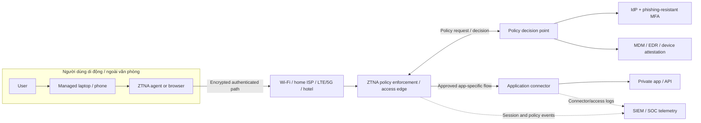
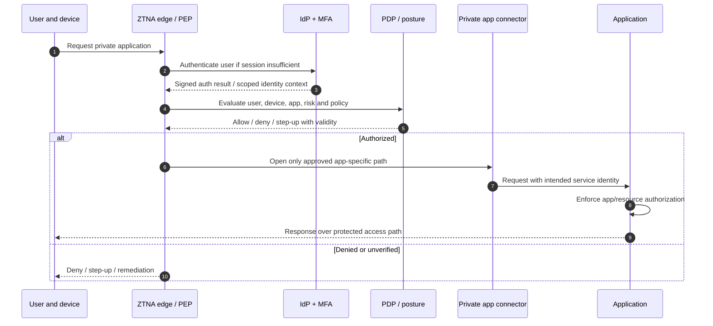
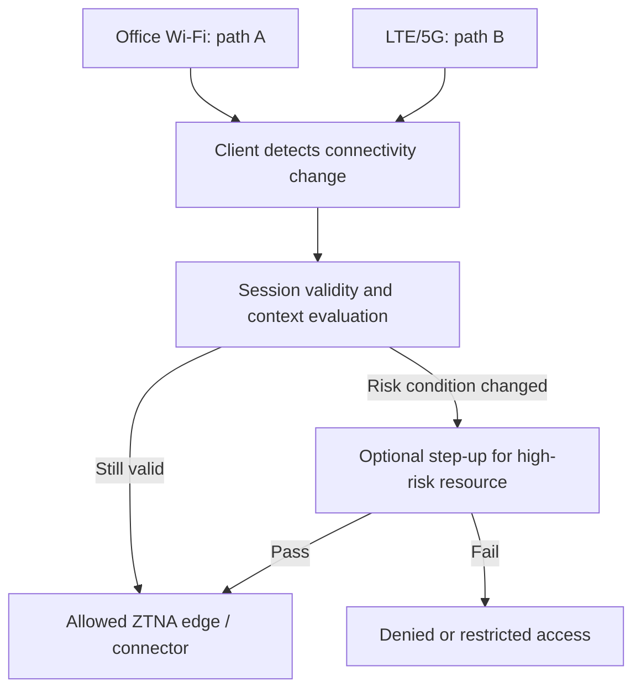
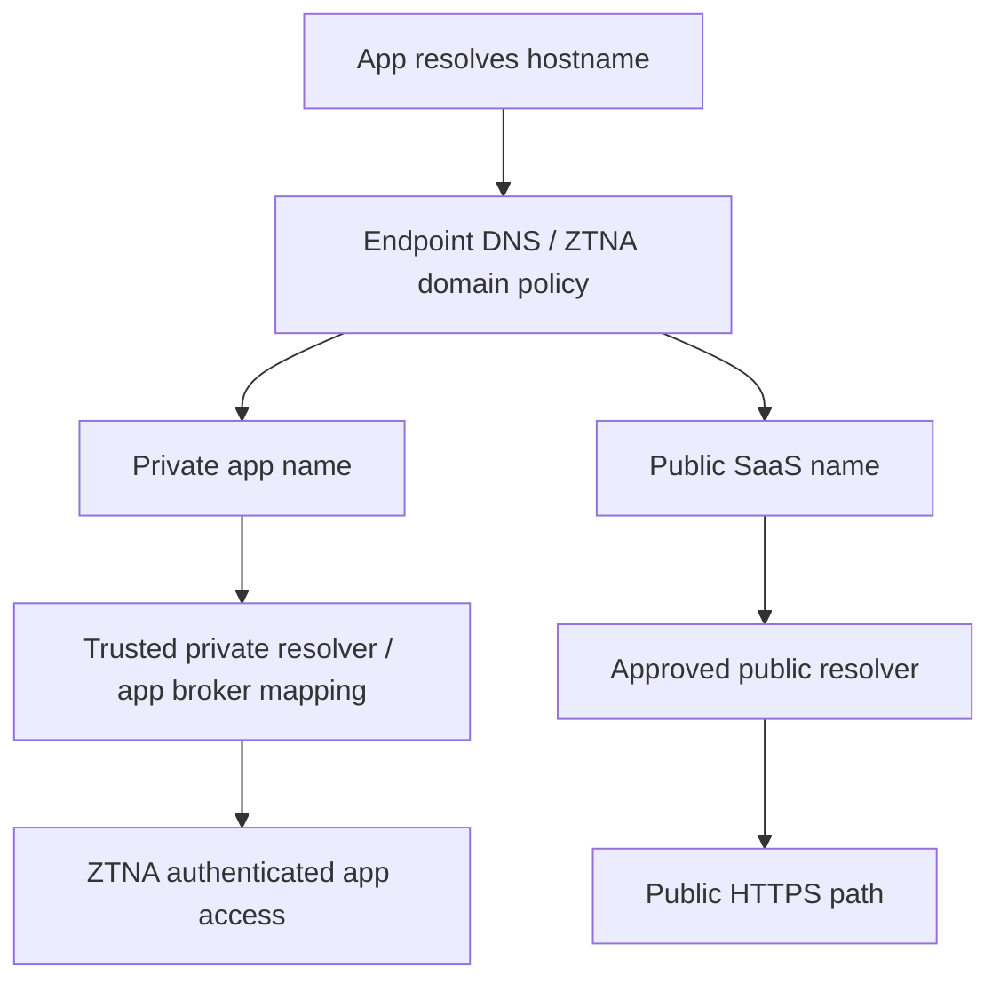
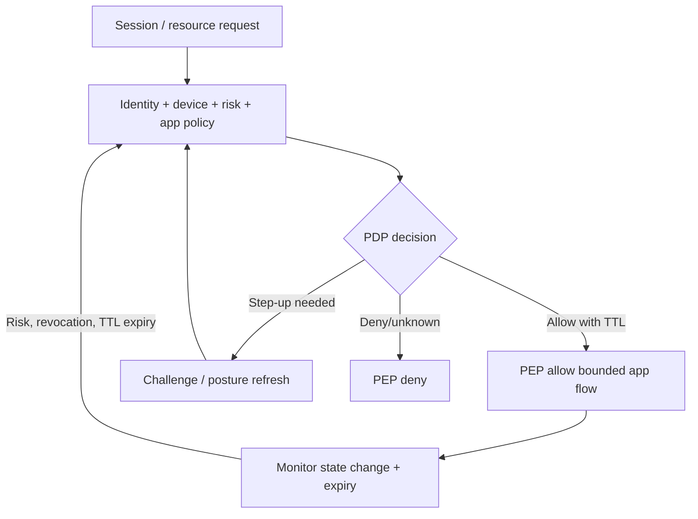
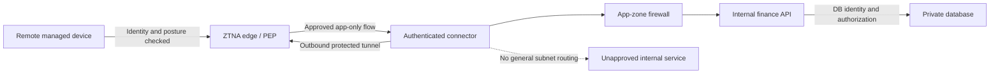
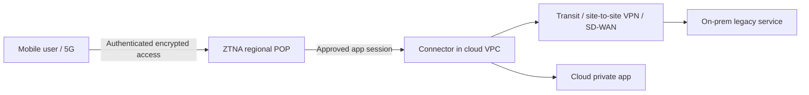
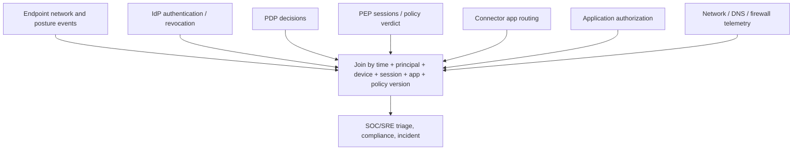
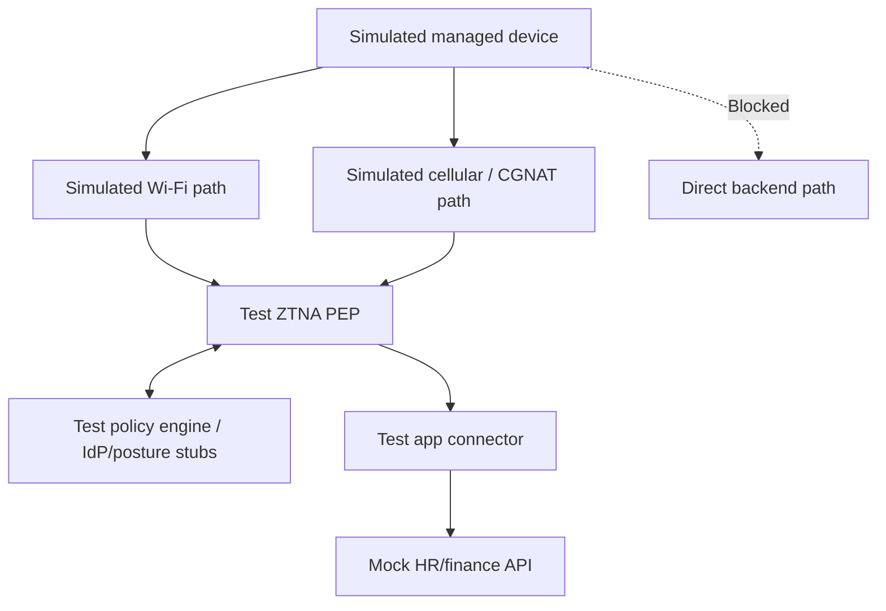

# Đường đi di động và truy cập ngoài văn phòng

> **Học phần:** `SECURITY_NETWORK_SECURITY`  
> **Chương:** Zero Trust Network Access  
> **Trọng tâm:** Thiết kế và vận hành truy cập ứng dụng an toàn khi nhân viên, nhà thầu và thiết bị di chuyển giữa Wi-Fi văn phòng, Wi-Fi gia đình, mạng công cộng, mạng di động và các vùng địa lý; ứng dụng nguyên tắc **Zero Trust Network Access (ZTNA)** để bảo vệ danh tính, thiết bị, phiên truy cập và đường kết nối mà không mặc định tin mạng nội bộ.

## Mục tiêu học tập

Sau khi hoàn thành, người học có thể:

1. Diễn giải các đường đi thực của client từ ngoài văn phòng đến ứng dụng private, SaaS và dịch vụ quản trị.
2. Phân biệt **mạng đang kết nối**, **danh tính người dùng**, **danh tính thiết bị**, **posture**, **phiên**, **danh tính ứng dụng** và **quyền truy cập**.
3. Mô tả kiến trúc ZTNA gồm identity provider (IdP), policy decision point (PDP), policy enforcement point (PEP), client/agent, broker và application connector.
4. Phân tích roaming giữa Wi-Fi và LTE/5G, IP đổi, NAT/CGNAT, IPv6, DNS split-horizon, captive portal và ảnh hưởng tới TLS, tunnel, token và session.
5. So sánh ZTNA theo ứng dụng, VPN truyền thống, per-app VPN, full/split tunnel và mô hình SSE/SASE theo phạm vi chức năng thực.
6. Thiết kế kiểm tra truy cập theo **identity + device trust + ứng dụng + bối cảnh + quyền tối thiểu**, có tái đánh giá phù hợp khi nguy cơ đổi.
7. Xây dựng cơ chế fail-closed/fail-restricted, revoke sessions, xử lý mất thiết bị và bảo vệ kết nối khi mạng di động mất ổn định.
8. Thiết kế logs, metrics, kiểm thử và runbook chứng minh cả **truy cập hợp lệ** lẫn **đường đi bị chặn** được kiểm soát.

## 1. Vấn đề của truy cập di động

Một người dùng không còn làm việc ở một địa chỉ mạng cố định. Buổi sáng, laptop dùng Wi-Fi văn phòng; buổi trưa chuyển sang hotspot điện thoại; chiều dùng Wi-Fi gia đình; tối mở ứng dụng từ khách sạn. Trong hành trình đó, **IP nguồn, DNS resolver, độ trễ, proxy, NAT, MTU và khả năng tới gateway** có thể thay đổi.

Nếu hệ thống chỉ cho phép theo nguyên tắc “IP thuộc VPN hoặc LAN công ty thì đáng tin”, người dùng có thể được cấp khả năng tới cả subnet mà không cần thiết. Khi một endpoint bị xâm nhập, bề mặt dò tìm nội bộ và lateral movement tăng.

**Zero Trust Network Access (ZTNA)** thay điểm tựa từ **vị trí mạng** sang **danh tính, ngữ cảnh và chính sách truy cập tài nguyên cụ thể**. Việc ở trong LAN, kết nối VPN hoặc dùng IP của công ty **không tự cấp quyền** vào toàn bộ mạng.

### Ba thay đổi liên tục cần phân biệt

- **Đường kết nối:** Wi-Fi → cellular, private subnet → CGNAT, IPv4 → IPv6, thay access point hoặc gateway.
- **Trạng thái bảo mật:** thiết bị bị mất quản lý MDM, EDR ngừng hoạt động, hệ điều hành không còn đạt baseline, phiên đăng nhập bị thu hồi.
- **Nhu cầu truy cập:** user mở ứng dụng HR, API developer, SSH bastion hay SaaS; mỗi đích có policy và mức nhạy cảm khác.

Mobility không nên khiến hệ thống buộc user đăng nhập lại sau **mọi packet**, nhưng cũng không được để phiên đã có quyền cao tồn tại vô điều kiện sau khi tín hiệu rủi ro quan trọng thay đổi.

## 2. Nguyên tắc Zero Trust áp vào truy cập từ xa

Zero Trust không có nghĩa “không tin ai”; nó có nghĩa **không mặc định tin** chỉ vì client đang ở một mạng được coi nội bộ.

| Nguyên tắc | Ý nghĩa trên thiết bị di động/ngoài văn phòng |
|---|---|
| **Verify explicitly** | Đánh giá user, thiết bị, credential, ứng dụng, ngữ cảnh và tín hiệu rủi ro |
| **Least privilege** | Cho đúng application/API/operation, không mở cả dải mạng theo mặc định |
| **Assume breach** | Hạn chế khả năng tiếp cận nội bộ khi endpoint hoặc credential đã bị chiếm |
| **Continuous evaluation** | Tái đánh giá theo sự kiện, TTL, risk signal và tài nguyên, không “tin mãi” sau login |
| **Protect the resource** | Ứng dụng và backend vẫn xác thực/ủy quyền; broker không thay mọi lớp bên trong |
| **Visibility** | Có logs về policy decision, session, connector, endpoint posture và đường dữ liệu |
| **Fail securely** | Khi không thể xác minh điều kiện bắt buộc, không tự chuyển sang đường không bảo vệ |

**Tái đánh giá liên tục** là mục tiêu kiến trúc, không đồng nghĩa PDP phải xử lý từng packet. Quyết định có thể được cache ngắn hạn, buộc re-evaluate khi bối cảnh thay đổi và có giới hạn thời gian rõ; phải kiểm chế độ hoạt động thực của sản phẩm.

## 3. Thuật ngữ cần dùng chính xác

| Thành phần | Chức năng | Không nên nhầm |
|---|---|---|
| **IdP** | Xác thực user, phát hành assertion/token và các tín hiệu login | Không thay application-level authorization |
| **MFA/FIDO2** | Xác minh thêm yếu tố, có thể chống phishing khi dùng cơ chế phù hợp | Không chứng minh thiết bị không bị malware |
| **Endpoint agent / ZTNA client** | Nhận chính sách, kiểm posture và/hoặc tạo secure access path | Không phải mọi ZTNA buộc có agent |
| **MDM/UEM** | Quản lý thiết bị, cấu hình và compliance state | Posture có thể trễ hoặc bị giả mạo nếu thiếu attestation |
| **EDR** | Phát hiện/điều tra hành vi endpoint | Không phải một danh tính truy cập |
| **PDP** | Ra quyết định policy theo nguồn dữ liệu được phép | Không nhất thiết nằm inline trên data path |
| **PEP** | Thực thi allow/deny/challenge tại một cửa truy cập | Một PEP không bảo vệ đường bypass |
| **ZTNA broker/gateway** | Trung gian kết nối client tới ứng dụng theo policy | Không mặc nhiên kiểm mọi egress Internet |
| **Application connector** | Kết nối được quản lý tới private app; nhiều mô hình dùng outbound-only | Không tự thay app authentication |
| **Device identity** | Credential/chứng thư hoặc attested identity cho endpoint | Không đồng nghĩa user identity |
| **Session** | Trạng thái truy cập có thời hạn và ràng buộc policy | IP nguồn không phải session identity ổn định |
| **Posture** | Đánh giá điều kiện thiết bị tại thời điểm nhất định | Không tự miễn trừ malware hoặc stolen credentials |
| **SSE/SASE** | Tập hợp dịch vụ edge/network/security theo sản phẩm/kiến trúc | Không đồng nghĩa mọi vendor có cùng tính năng ZTNA |

## 4. Kiến trúc ZTNA tham chiếu



### Trust boundaries

1. **Endpoint → Internet/access edge:** không tin Wi-Fi, ISP hoặc IP nguồn; dùng TLS/mTLS/tunnel theo khả năng hệ thống.
2. **Access edge → policy services:** IdP, device posture, risk signals và configuration phải được xác thực, đồng bộ đúng phiên bản.
3. **PEP → application connector:** chỉ đến đúng ứng dụng/port theo principal, không trở thành unrestricted reverse tunnel.
4. **Connector → backend:** giới hạn route, firewall, service identity và application authorization.
5. **Ứng dụng → dữ liệu:** quyền truy cập từng bản ghi, tenant và operation vẫn phải được kiểm.

**Hình vẽ là kiến trúc tham chiếu**, không phải mô tả bắt buộc của mọi sản phẩm. Agentless browser ZTNA, client-based tunnel và identity-aware reverse proxy có đường dữ liệu khác nhau.

## 5. Hành trình truy cập một ứng dụng private



### Các điểm cần chứng minh

- **User identity** được xác minh từ IdP có issuer, audience, expiry và signature đúng.
- **Device posture** được thu từ nguồn được tin và có timestamp/snapshot đủ mới.
- **App authorization** ràng buộc user và tài nguyên, không chỉ dựa vào “token đã có”.
- **Session state** có TTL, refresh, revocation hoặc re-evaluation khi policy yêu cầu.
- **Data path** qua PEP bắt buộc; không tồn tại route trực tiếp tới cùng private app bỏ qua policy.
- **Backend** có controls riêng: ACL, API RBAC/ABAC, database scopes, audit.

## 6. Mạng thay đổi nhưng principal không được thay theo IP

Một laptop có thể đổi địa chỉ nguồn khi:

- Ngắt Wi-Fi công ty và chuyển sang hotspot LTE.
- Đi giữa các AP/router và lấy lease DHCP mới.
- ISP NAT thay public IP dù mạng Wi-Fi không thay.
- Đổi eSIM/5G hoặc roaming giữa các nhà mạng.
- Chuyển giữa IPv4 và IPv6 theo policy của carrier.
- VPN/mesh client thiết lập lại tunnel qua một edge khác.
- Browser kết nối đến một CDN/access POP mới.

**IP mới không tự là credential mới hay dấu hiệu gian lận.** Nhưng network transition có thể là một **risk signal** khi kết hợp cùng thay đổi quốc gia bất thường, device health, token theft hoặc tài nguyên nhạy cảm.

### Policy nên phản ứng ra sao?

| Sự kiện | Phản ứng có thể phù hợp |
|---|---|
| IP thay nhưng device identity, user, session và posture vẫn tin cậy | Rebind/reconnect tunnel, ghi sự kiện, evaluate theo policy |
| Wi-Fi công cộng mới | Tăng bảo vệ transport và kiểm posture; step-up nếu app nhạy cảm |
| Đồng thời có hai phiên từ những vị trí khó giải thích | Risk assessment/step-up/revoke theo bằng chứng và policy |
| MDM compliance chuyển sang fail | Hạn chế hoặc chặn app nhạy cảm theo điều kiện bắt buộc |
| Phát hiện credential compromise | Thu hồi session/credential, chặn ở PEP và app |
| Device bị báo mất | Lock/wipe/revoke theo quy trình được phép |
| Không có risk feed tạm thời | Dùng policy TTL/fail-restricted; không tự allow-any |

**Không dùng địa lý IP làm chứng cứ tuyệt đối.** CGNAT, carrier routing, VPN exit nodes, proxy và geolocation database có thể tạo vị trí ước tính sai. Tránh khóa user vô căn cứ chỉ vì một ASN/địa chỉ mới.

## 7. Đi từ Wi-Fi văn phòng ra mạng di động

Giả sử thiết bị đã có phiên truy cập ứng dụng private. Khi user rời văn phòng:

1. Wi-Fi signal yếu, hệ điều hành chuyển đường ra sang 4G/5G.
2. Source IP, NAT mapping, DNS server và latency thay đổi.
3. Transport đang dùng có thể mất socket/TCP connection hoặc được tiếp tục/migrate nếu protocol/implementation hỗ trợ.
4. ZTNA client hoặc browser thử thiết lập lại đường kết nối bảo vệ.
5. PEP kiểm session vẫn hợp lệ, posture/identity không đổi ngoài ngưỡng và chính sách mới.
6. Gateway/connector tiếp tục cho **ứng dụng được phép**, không mở rộng network routes.
7. App có thể yêu cầu retry an toàn, idempotency key hoặc reauth với thao tác nhạy cảm.



**Không phải mọi TCP session tự “di cư” sang cellular.** QUIC có hỗ trợ migration theo điều kiện, VPN tunnels có cơ chế roaming tùy sản phẩm, còn nhiều TCP flows sẽ cần reconnect. Ứng dụng phải chuẩn bị cho retry/recovery, không dựa hoàn toàn vào network layer.

## 8. Những môi trường ngoài văn phòng cần threat modeling

| Môi trường | Tính chất | Rủi ro / kiểm soát |
|---|---|---|
| **Wi-Fi gia đình** | Router cá nhân, IoT chung LAN | DNS/router compromise, default passwords; dùng protected access path và endpoint controls |
| **Wi-Fi quán cà phê/khách sạn** | Shared/public AP, captive portal | Evil twin, local interception, portal redirect; verify TLS, không bypass agent lâu dài |
| **Hotspot điện thoại** | Cell uplink + Wi-Fi local | Hotspot password và thiết bị host có thể bị chiếm; vẫn cần IdP/PEP |
| **LTE/5G carrier** | Carrier NAT/IPv6, IP changes | CGNAT, MTU, non-UDP path; bảo vệ reconnect/session |
| **Máy kiosk/thiết bị dùng chung** | Quản lý endpoint hạn chế | Chỉ browser-managed session hoặc chặn ứng dụng nhạy cảm theo policy |
| **Thiết bị BYOD** | Chưa chắc có MDM/EDR đầy đủ | Phân tầng ứng dụng, browser isolation, VDI, data controls |
| **Chi nhánh/partner site** | NAT, VPN, local DNS/SD-WAN | Không tin whole subnet; conditional access tới đúng app |
| **Vùng mất kết nối thường xuyên** | Network intermittent, captive portal | Offline policy, stale posture, token expiry và data at rest |

**Không suy “mạng di động được mã hóa ở lớp radio” là đủ bảo vệ ứng dụng end-to-end.** TLS đúng hostname, device protection và authorization vẫn cần.

## 9. Wi-Fi công cộng, captive portal và evil twin

Một captive portal yêu cầu user chấp nhận điều khoản hoặc đăng nhập mạng trước khi Internet hoạt động. Một **evil twin** có thể giả SSID quen thuộc để dụ thiết bị kết nối qua AP do attacker kiểm soát.

### Trải nghiệm phổ biến

- DNS hoặc HTTP probe bị redirect đến captive portal.
- ZTNA client không reach edge trước khi user hoàn thành portal.
- TLS tới ZTNA edge thất bại do proxy/interception hoặc CA trust lạ.
- Portal có thể yêu cầu HTTP allowlist tối thiểu để user xác thực mạng.
- Một số mạng chặn UDP/QUIC, chỉ cho HTTPS/TCP hoặc proxy bắt buộc.

### Thiết kế an toàn

1. Thiết bị xác định captive portal bằng cơ chế hệ điều hành/client hỗ trợ; không tự tắt TLS verification.
2. Tách **kết nối tới portal để có Internet** khỏi **truy cập private application**.
3. Trong lúc portal chưa hoàn tất, chỉ cho traffic cần thiết để khôi phục network access theo allowlist hẹp có giới hạn.
4. ZTNA client tiếp tục xác minh server certificate, hostname và chính sách truy cập khi kết nối lại.
5. Không cho browser nhập enterprise credentials vào một captive portal giả danh IdP.
6. Dùng phishing-resistant MFA và đăng nhập IdP qua domain hợp lệ.
7. Telemetry ghi captive portal state, TLS errors và đường phục hồi mà không lưu mật khẩu.

**Captive portal exceptions không được là “allow all private routes”**. Nếu thiết bị được phép truy cập app khi ZTNA không sẵn sàng, đó là ngoại lệ chính sách lớn cần được review rõ ràng.

## 10. LTE/5G, CGNAT và thay đổi public IP

Trong mạng di động, nhiều thuê bao chia sẻ public IPv4 qua **Carrier-Grade NAT (CGNAT)**. Cũng có những mạng ưu tiên IPv6 hoặc dùng NAT64/464XLAT. IP mà server thấy không nhất thiết ổn định hay duy nhất cho người dùng.

### Hệ quả với ZTNA

- **Không dùng public IP làm danh tính user.**
- Một source public IP có thể đồng thời đại diện nhiều thuê bao.
- Source port có thể thay khi carrier NAT mapping được tái tạo.
- Idle timeout ở NAT có thể ngắt tunnel; client cần keepalive/reconnect theo thiết kế có kiểm soát.
- UDP path có thể bị hạn chế, khiến transport fallback sang TLS/TCP theo khả năng sản phẩm.
- IPv6 path có thể khác IPv4 về firewall, route, DNS và monitoring.
- Application sessions cần **token/session binding** phù hợp thay vì gắn cứng vào một địa chỉ IP duy nhất.

### Không lạm dụng keepalive

Keepalive quá dày có thể tiêu tốn pin, dữ liệu di động và server resources; quá thưa có thể khiến NAT state hết hạn. Cấu hình theo **client/transport/edge behavior và quan sát thực tế**, không áp một chu kỳ chung cho mọi carrier.

## 11. IPv6, NAT64/464XLAT và dual-stack remote access

Một số mobile providers sử dụng IPv6 native, NAT64/DNS64 hoặc cơ chế translation. Client có thể kết nối tới edge qua IPv6 nhưng private app là IPv4, hoặc ngược lại.

| Thành phần | Cần kiểm tra |
|---|---|
| **Client** | IPv4/IPv6 stacks, DNS A/AAAA, address selection và VPN client support |
| **Access edge** | IPv6 listeners, TLS identity, routing, anti-DDoS và WAF/PEP |
| **Tunnel** | Outer transport IPv4/IPv6 và inner application traffic không nhất thiết cùng family |
| **Connector** | Có route đến private IPv4/IPv6 app, không expose subnet ngoài scope |
| **Firewall** | Rules IPv4 và IPv6 độc lập, không có alternate path bypass |
| **Telemetry** | Log actual source/edge/inner destination/address family và decision |
| **DNS64/NAT64** | Name resolution/translation có thể đổi địa chỉ nhìn thấy tại các tầng |

### Những sai lầm

- Chỉ test IPv4, sau đó quên app có IPv6 direct listener.
- Giả định một rule deny `0.0.0.0/0` tương đương deny IPv6.
- Dùng IP literal IPv4 cố định trong môi trường IPv6-only cần translation.
- Nhầm public IPv6 của client với stable device identity.
- Bỏ qua IPv4-mapped IPv6 và special-use classification trong egress security.

**Thiết kế phải bảo vệ đường mạng thực**, không chỉ IP được ghi trong slide kiến trúc. Với doanh nghiệp sử dụng mobile roaming xuyên quốc gia, test IPv6 và DNS64 trên mạng mô phỏng hoặc nhà mạng được phép.

## 12. QUIC, TLS/TCP và network path migration

Một số ZTNA/VPN transports dùng UDP hoặc QUIC-like mechanisms. **QUIC** có khả năng hỗ trợ connection migration theo giao thức và implementation; các products khác vẫn dùng TCP/TLS, DTLS, IPsec, WireGuard hoặc cơ chế riêng.

### Phải phân biệt

- **IP route đổi** không tự đảm bảo application connection còn sống.
- **Transport migration** không tự thay authorization/session validation.
- **Session token còn hạn** không đồng nghĩa transport hiện tại an toàn.
- **TLS handshake/resumption** có thể khác với fresh authentication theo thiết kế; chính sách có thể buộc reauth.
- **0-RTT/early data** có nguy cơ replay cho request không idempotent nếu được hỗ trợ và không được giới hạn phù hợp; không nên cho phép nhầm ở thao tác nhạy cảm.

### Quy tắc bảo vệ

- Kiểm hostname/certificate và peer identity khi thiết lập hoặc tái thiết lập secure path.
- Không hạ cấp sang plaintext khi UDP/QUIC bị chặn.
- Fallback transport phải đáp ứng cùng policy identity và encryption.
- Giữ session TTL, risk evaluation và revoke semantics độc lập sự tiện lợi của connection migration.
- Dùng idempotency key cho nghiệp vụ có side effects nếu app có retry tự động.
- Đo reconnect success, latency, duplicate requests và auth failures khi đổi Wi-Fi/cellular.

**Không lấy “QUIC hỗ trợ migration” để hứa mọi gRPC, VPN hay app flow đều seamless**. Yêu cầu thực phụ thuộc server, client, middleboxes và cách ứng dụng xử lý state.

## 13. DNS ở thiết bị di động và split-horizon names

Private app có thể có hostname giống `erp.corp.example.test` không public trên Internet. Một số kiến trúc ZTNA dùng DNS resolution đặc biệt để chỉ định tuyến **các ứng dụng đã được phép**.

### Các luồng resolution có thể tồn tại

- **Public DNS** cho SaaS và website thông thường.
- **Enterprise split DNS** cho private applications.
- **ZTNA agent-resolved/app mapping** gắn application ID với protected hostname.
- **OS/browser secure DNS (DoH/DoT)** theo policy, có thể bỏ qua resolver doanh nghiệp.
- **Captive portal DNS** khi mới vào Wi-Fi.
- **VPN profile DNS** được đẩy vào interface ảo.



### Lỗi cấu hình thường gặp

- Split DNS resolver không hoạt động sau khi network changes.
- Browser tự dùng DoH khác OS DNS và không resolve được private name.
- Proxy PAC/auto-config đẩy lưu lượng ra Internet thay vì private app connector.
- DNS caching giữ IP/gateway cũ sau network transition.
- Private DNS record lộ cấu trúc nội bộ qua resolver public.
- DNS64 chuyển đích theo đường không được security policy dự kiến.

**DNS không phải authorization.** Việc resolve được tên private app không cấp quyền tới app; ngược lại, chặn DNS mà vẫn có direct IP route có thể để lại bypass. Cần enforce ở PEP và backend.

## 14. Split tunnel, full tunnel và per-application routing

Một enterprise remote access solution có thể dùng:

- **Full tunnel:** phần lớn/all traffic đi vào secure tunnel theo policy.
- **Split tunnel:** chỉ một số prefixes, domains hoặc applications đi trong tunnel.
- **Per-app tunnel/ZTNA:** chỉ các applications được quy định được gán protected access path.
- **Direct SaaS access với cloud security controls:** không nhất thiết đi qua private WAN.
- **Browser-based isolation/gateway:** một số ứng dụng được truy cập qua browser proxy mà không có layer-3 VPN.

| Chiến lược | Ưu điểm | Rủi ro/chú ý |
|---|---|---|
| Full tunnel | Dễ tập trung Internet inspection theo một mô hình | Hairpin latency, gateway bandwidth, privacy, high dependency |
| Split tunnel theo CIDR | Giảm backhaul, cải thiện latency | Route overlap, local network bypass, IP dynamic |
| Split tunnel theo DNS/FQDN | Dễ theo app domain khi có hỗ trợ | DNS rebinding/caching, hostname/IP mismatch |
| Per-app ZTNA | Giới hạn attack surface tới ứng dụng cụ thể | Non-HTTP protocol support, app discovery, bypass route |
| Browser-based | BYOD không cần tunnel toàn hệ điều hành | App compatibility, data/download controls, browser session risk |

**Không có lựa chọn đúng cho mọi ứng dụng.** Thiết kế cần phân biệt tài nguyên public SaaS, private API, SSH/RDP, legacy thick clients, management interfaces và dữ liệu nhạy cảm.

### Rủi ro “split tunnel cho mọi private IP”

Nếu một VPN client đưa route tới toàn bộ RFC1918 mà app chỉ cần một service, endpoint bị chiếm có thể thử quét/lateral movement tới nhiều dải nội bộ. ZTNA theo app hướng đến giới hạn **destination + identity + authorization** thay vì mở network plane rộng.

## 15. ZTNA khác VPN truyền thống ở đâu?

VPN xây dựng một kênh mạng bảo vệ giữa client và gateway, có thể đưa endpoint vào một hoặc nhiều vùng định tuyến. VPN hiện đại hoàn toàn có thể kết hợp MFA, device posture, microsegmentation và per-app policy; không nên coi mọi VPN đều yếu.

| Tiêu chí | VPN network-level thường gặp | ZTNA theo ứng dụng thường gặp |
|---|---|---|
| Đối tượng cấp quyền | Network/subnet/route và ACL | Application/service/resource scoped |
| User identity | VPN auth/MFA, directory policy | IdP + conditional access per app |
| Device posture | Có thể tích hợp | Thường là tín hiệu trọng tâm |
| Discoverability | Tùy routes, firewall và ACL | Private apps có thể ẩn khỏi public scanning nếu connector brokered |
| Roaming | Tunnel rekey/reconnect theo sản phẩm | Client/edge rebind và session re-evaluation theo sản phẩm |
| Legacy protocol | IPsec/SSL VPN thường hỗ trợ nhiều IP protocols | Phụ thuộc client-based vs browser-based ZTNA |
| Enforcement | VPN concentrator + network firewall | PEP/broker + connector + app authorization |
| Fail mode | Tùy tunnel/ACL/IdP | Tùy PEP/IdP/posture/connector, cần kiểm downgrade |
| Logging | Tunnel/session IP và identity | App/session/policy decision, nếu product hỗ trợ |

**ZTNA không phải phép màu.** Nếu PEP cho wildcard destination/port, posture quá lỏng hoặc connector có route toàn VPC và backend không kiểm authz, “ZTNA” trên nhãn sản phẩm chưa đảm bảo least privilege.

## 16. Danh tính người dùng: MFA và token lifecycle

Một remote access decision thường cần danh tính người dùng từ IdP với chính sách phù hợp.

### Một số lớp xác thực

- Account/SSO có quản lý lifecycle, offboarding và group/role.
- MFA chống phishing khi có thể: ví dụ **FIDO2/WebAuthn/passkeys hoặc hardware security keys** với origin binding phù hợp.
- Risk-based step-up theo ứng dụng, thay đổi thiết bị hoặc tín hiệu nghi vấn.
- IdP-issued tokens/assertions được PEP kiểm signature, issuer, audience, expiry, nonce/state và policy constraints theo giao thức.
- Session TTL, refresh và revocation hỗ trợ giảm thời gian credential bị lộ còn dùng được.
- Backend application vẫn kiểm user-level scopes và resource authorization.

### Những câu hỏi vận hành

1. Một browser SSO session còn hạn có được dùng cho SSH production không?
2. Khi user bị disable ở IdP, PEP cập nhật state trong bao lâu?
3. Nếu PEP cache policy/tokens khi IdP outage, thời gian cache bao lâu và tài nguyên nào được phép?
4. Network roaming có buộc phishing-resistant MFA lại không? Khi nào là cần thiết?
5. Nếu attacker lấy token từ endpoint, token có bị ràng buộc với device/DPoP/mTLS/session keys theo khả năng sản phẩm không?
6. Có log các quyết định challenge/deny nhưng không ghi tokens không?

**MFA đã pass không đảm bảo endpoint sạch** hoặc app tự kiểm tenant permissions. Điều này giải thích vì sao device posture và application authorization cần được đánh giá song song.

## 17. Danh tính thiết bị và posture

Tín hiệu posture có thể gồm:

- Device enrolled trong MDM/UEM, ownership và quản lý policy.
- OS version, security patch level, disk encryption và screen lock.
- EDR health, malware signals, tamper detection.
- Secure boot/TPM hoặc hardware-backed attestation nếu nền tảng hỗ trợ.
- Certificate/key được lưu trong TPM/secure enclave/keystore nếu khả thi.
- Jailbreak/root status trên mobile OS, app integrity signals.
- Endpoint firewall, local DNS/proxy settings và approved ZTNA client version.
- Timestamp của lần đo và khoảng chấp nhận **staleness**.

### Posture là tín hiệu, không phải sự thật vĩnh viễn

Một compliance report lúc 08:00 không chứng minh thiết bị vẫn compliant lúc 17:00. Agent có thể offline, MDM webhook trễ hoặc endpoint bị compromise sau lần đo trước.

| Posture state | Đề xuất xử lý |
|---|---|
| **Compliant & fresh** | Cho ứng dụng đúng quyền, giới hạn session theo policy |
| **Noncompliant** | Deny app nhạy cảm; cho self-service remediation nếu chính sách |
| **Unknown/offline** | Hạn chế/từ chối theo sensitivity; không tự coi unknown = healthy |
| **Stale quá thời hạn** | Recheck, step-up hoặc degrade; có TTL được phê duyệt |
| **EDR critical alert** | Thu hồi/khóa đường truy cập có liên quan và điều tra |
| **Unmanaged/BYOD** | Chỉ công cụ/ứng dụng ít dữ liệu hơn, browser isolation/VDI khi phù hợp |

**Không giả định agent là một phần không thể bị giả mạo.** Device identity cần gắn với cryptographic credentials và attestation phù hợp; PEP không nên chỉ tin header do client tự khai như `X-Device-Compliant: true`.

## 18. Chính sách ABAC theo resource, device và context

Zero Trust thường cần nhiều thuộc tính hơn RBAC thuần túy. Một **ABAC** hoặc policy engine có thể xét:

- **Subject:** principal, employment/contractor status, group, just-in-time privilege.
- **Device:** enrollment, posture, attestation level, client version.
- **Resource:** app ID, environment (dev/prod), data classification, protocol/port.
- **Action:** read, write, deploy, admin, SSH/RDP command scope hoặc API operation.
- **Environment:** request time, network risk, device location signal, session age, observed anomalies.
- **Obligations:** require MFA, read-only mode, browser isolation, enhanced logging, shorter session.

### Ví dụ quyết định

| User/device/app | Quyết định | Lý do |
|---|---|---|
| Employee, managed laptop, compliant, HR portal | Allow theo role | Điều kiện user/device/app đạt |
| Contractor, unmanaged BYOD, production SSH | Deny | Không có quyền/quy chuẩn thiết bị |
| Admin, managed laptop, production bastion, MFA mới | JIT allow ngắn hạn | Quyền admin chỉ trong cửa sổ được phê duyệt |
| Employee, device posture stale, source IP đổi | Step-up/recheck | Không coi roaming tự nguy hiểm, nhưng posture cần làm mới |
| Terminated user, token còn cache | Deny/revoke theo policy | Offboarding phải thắng session cũ |
| Known user nhưng app không thuộc scope | Deny | Least privilege áp theo resource |

**Không gửi PEP một chuỗi “allow” mà không có expiry, subject và resource binding**. Decision phải ràng buộc với ngữ cảnh cụ thể để tránh reuse ở ứng dụng/port khác.

## 19. PDP, PEP và thời điểm tái đánh giá



### Những trường hợp cần re-evaluate

- Token/session hết hạn hoặc IdP gửi revoke/disable signal.
- MDM/EDR báo mất compliance, thiết bị bị đánh dấu lost/stolen.
- Chuyển đến ứng dụng nhạy cảm hơn hoặc request privilege escalation.
- Threat intelligence/UEBA nêu tín hiệu đáng kể, có evidence được đánh giá.
- Network path thay đổi, khi chính sách coi điều đó là điều kiện cần kiểm.
- Connector/PEP policy version đổi; entitlement của user thay đổi.
- Mất khả năng kiểm posture quá thời gian stale limit.

### Không nên xây hệ thống gây đăng nhập vòng lặp

Nếu bắt reauth mỗi lần IP cellular đổi hoặc NAT mapping reset, người dùng có thể bị endless prompts, dẫn tới workaround kém an toàn. Thiết kế **event-triggered evaluation + bounded TTL + risk-based step-up** có thể cân bằng usability và security.

## 20. mTLS, TLS và credential binding trên đường từ xa

Một kiến trúc có thể có nhiều TLS contexts:

1. **Client → ZTNA edge:** TLS hoặc tunnel có xác thực gateway, có thể thêm device certificate/mTLS tùy sản phẩm.
2. **Edge → private connector:** kênh đã xác thực giữa PEP và connector, có policy identity.
3. **Connector → backend app:** TLS/mTLS nội bộ hoặc proxy tới app; không mặc định cùng mức end-to-end cryptographic identity.
4. **User browser → SaaS:** public HTTPS, IdP federation và app-specific authorization.

### Quy tắc

- Certificate phải đúng hostname/SAN, issuer/CA và thời hạn.
- Không bỏ verify/“trust all” khi chuyển mạng hoặc gặp captive portal.
- Device certificate và user token có lifecycle khác nhau: mất device có thể cần revoke cả hai.
- Client/connector private keys được bảo vệ bởi keystore/TPM hoặc cơ chế thích hợp.
- Revocation latency và active connections phải được định nghĩa; revoke certificate không luôn cắt ngay mọi established tunnel.
- Nếu sử dụng session-bound/proof-of-possession tokens, phải xác minh sản phẩm thực thi binding tại PEP.
- App identity và resource authorization vẫn phải được kiểm sau TLS.

**TLS mã hóa traffic không tự ẩn metadata ở mọi tầng**. DNS queries, destination IP, SNI (nếu không dùng cơ chế phù hợp), packet sizes và timing có thể nhìn thấy tùy giao thức; network privacy cần threat model riêng.

## 21. Application connector và nguyên tắc không mở toàn subnet

Trong nhiều mô hình ZTNA, application connector nằm gần private app và tạo một hoặc nhiều **kênh outbound được xác thực tới broker/edge**, thay vì phải mở cổng inbound công khai trên app server. Cơ chế thực tế phụ thuộc sản phẩm và topology.



### Connector là một privileged path

Connector thường cần network reachability tới ứng dụng được publish. Nếu connector có route rộng tới toàn bộ data center/VPC, lỗi policy hoặc lộ connector credential có thể tăng blast radius.

### Quy tắc

- **Chỉ khai báo các applications** và TCP/UDP ports thực sự cần; không sử dụng một wildcard `10.0.0.0/8:*` cho toàn bộ nhân viên.
- Firewall ở app zone chỉ cho connector identities/IPs cần thiết; không mặc định tin mọi traffic nội bộ.
- Nếu connector và ứng dụng chạy trên Kubernetes, dùng `NetworkPolicy` (sau khi CNI được xác minh có thực thi) để giới hạn Pod ingress/egress theo đúng nguồn/đích. NetworkPolicy chuẩn có quy tắc allow cộng dồn và không thay host firewall cho mọi luồng node/host; vì vậy vẫn phải chặn đường trực tiếp tới backend ngoài ZTNA PEP.
- Broker xác thực connector bằng credentials có rotation, hạn dùng và policy scope.
- IdP session/PEP decision ràng buộc **principal, app ID, action và TTL**.
- Connector không tự cho phép user access dựa vào tên DNS hoặc source IP.
- Có mTLS/TLS giữa connector và backend khi phù hợp, xác minh server identity.
- Chạy nhiều connector instances/availability zones để tránh single point of failure; kiểm chúng đều nhận cùng policy.
- Quản lý credentials connector như secret: không in vào logs, không dùng token chung vô thời hạn.
- Đo connector health, applied policy version, active flows, denial và routing.

**Outbound-only connector không đồng nghĩa ứng dụng không thể bị truy cập qua đường khác.** Cần xác minh không có public ALB, NodePort, VPN route hoặc private peering bypass PEP.

## 22. Đường đi của ứng dụng web, SSH, RDP và giao thức cũ

Khái niệm “truy cập ứng dụng” không chỉ là HTTPS browser:

| Giao thức / ứng dụng | Hình thức triển khai có thể | Yêu cầu bảo mật bổ sung |
|---|---|---|
| **HTTPS web app** | Identity-aware proxy/browser/client tunnel | OIDC/SAML, cookie/session security, CSRF, per-resource authz |
| **REST/gRPC APIs** | ZTNA app gateway, mTLS, token auth | Audience/scopes, method-level authorization, rate limits |
| **SSH** | Approved bastion hoặc client-based ZTNA TCP tunnel | Short-lived SSH certs/keys, MFA/JIT, audit session/commands theo policy |
| **RDP/desktop** | Protected remote desktop gateway/broker | Strong identity, clipboard/file transfer control, screen/session audit |
| **Legacy TCP database** | Per-app TCP forwarding tới đúng DB host/port | DB TLS, credential isolation, database authorization |
| **UDP hoặc non-TCP app** | Chỉ khi ZTNA client/edge hỗ trợ | Không giả định browser-only ZTNA có UDP/ICMP support |
| **Voice/video real-time** | Direct secure media hoặc optimized edge | Latency, NAT traversal, session binding, media encryption |
| **SaaS** | IdP federation/conditional access, CASB/SSE nếu cần | Per-tenant authorization, data controls, independent vendor auth |

### SSH production

Không cấp nhân viên “IP reachability tới tất cả servers” chỉ vì họ cần SSH vào một bastion. Có thể dùng JIT access tới đúng host, short-lived credentials, approval và session recording theo chính sách. Nếu chỉ giới hạn TCP 22 mà account trên server có quyền root rộng, ZTNA mới bảo vệ **đường đến cổng**, chưa đủ giảm quyền bên trong.

### RDP

RDP có clipboard, drive mapping và file transfer theo tính năng. Nếu người dùng làm việc ở BYOD, cần policy data protection riêng; không mặc định mã hóa transport là đủ để chống dữ liệu nhạy cảm rời môi trường.

## 23. BYOD, mobile apps và browser-only access

Thiết bị ngoài quản lý của công ty (BYOD) có thể cần mức truy cập khác thiết bị được enroll MDM.

### Một mô hình phân tầng

| Loại thiết bị | Ứng dụng được xem xét | Bảo vệ gợi ý |
|---|---|---|
| **Managed corporate** | HR, finance, source repo, một số production tools | FIDO2 MFA, fresh posture, device-bound credential, app-scoped policies |
| **Managed partner** | Một số portal/API được ký hợp đồng | Segmented app access, contract expiration, separate tenant roles |
| **Unmanaged BYOD** | Low-risk browser-based portals | Browser-only ZTNA, conditional access, no local download nếu cần |
| **Shared/public device** | Thường hạn chế/deny dữ liệu nhạy cảm | Không lưu persistent cookies, device management hoặc VDI khi phù hợp |
| **Lost/noncompliant device** | Không truy cập app yêu cầu posture | Revoke access, remediation flow, investigation |

### Application-level bảo vệ dữ liệu

- Session cookies nên có thuộc tính phù hợp (Secure, HttpOnly, SameSite theo luồng ứng dụng).
- Sensitive workflows có step-up hoặc reauth, không phụ thuộc chỉ vào thời điểm đăng nhập edge.
- Download/screenshot/clipboard restrictions có giới hạn theo OS/browser và chưa thể bảo đảm tuyệt đối; cần nêu rõ phạm vi.
- Với BYOD, tránh đòi thu thập telemetry cá nhân quá rộng nếu có thể thiết kế browser isolation/remote workspace.
- Remote desktop/VDI có thể giảm lưu trữ dữ liệu trên endpoint nhưng vẫn cần kiểm file transfer, clipboard, copy/paste, print, screen capture và session hijack.

**Device posture phải đi cùng quyền riêng tư và khả năng giải thích.** Người dùng nên biết điều kiện nào khiến access bị hạn chế và có đường khắc phục chính đáng.

## 24. Local network access, printers và nguy cơ hairpin/bypass

Khi laptop ở nhà hoặc khách sạn, một ZTNA/VPN profile có thể đồng thời xử lý:

- Đường tới private applications.
- DNS cho internal domains.
- Internet trực tiếp tới SaaS/public sites.
- Mạng local tới printer, Chromecast hoặc NAS.
- Captive portal detection.
- Traffic tới security updates/MDM/EDR endpoints.

### Vấn đề

Nếu bật **full tunnel**, local printer hoặc captive portal có thể không hoạt động như trước. Nếu bật **local LAN bypass**, endpoint có thể kết nối tới thiết bị cùng Wi-Fi có cấu hình yếu. Nếu split tunnel quá rộng, malware có thể tìm đường tới app admin ngoài PEP.

### Quy tắc đánh giá

1. Xác định local LAN access có thực sự cần cho nhóm thiết bị và user không.
2. Không để route đến corporate private ranges trùng với home network gây nhầm (ví dụ nhiều mạng dùng `192.168.1.0/24`).
3. Ưu tiên routing theo **application identity/destination** khi feasible, có cơ chế xử lý overlap.
4. Chặn inbound lateral movement tới endpoint bằng host firewall.
5. Nếu cho phép local printers, giới hạn protocol/port theo policy; không đồng nhất “local” là trusted.
6. Kiểm DNS proxy/split DNS và đường Internet của SaaS độc lập.
7. Đo hiệu quả với Mac/Windows/iOS/Android theo tính năng thực.

**Split tunnel không phải lỗ hổng mặc định, và full tunnel không tự an toàn.** Mức độ bảo vệ phụ thuộc route scope, PEP coverage, DNS/egress controls và ứng dụng.

## 25. SASE, SSE, CASB, SWG và ZTNA

Nhiều sản phẩm đóng gói các capabilities vào dịch vụ cloud edge:

- **ZTNA:** truy cập tài nguyên private hoặc ứng dụng có policy identity/device.
- **SWG (Secure Web Gateway):** kiểm soát outbound web/internet traffic.
- **CASB:** một số khả năng kiểm SaaS usage, dữ liệu và policy theo cloud apps.
- **DLP:** kiểm soát luồng dữ liệu nhạy cảm theo ngữ cảnh và loại dữ liệu.
- **FWaaS:** firewall security functions dưới dạng dịch vụ.
- **SSE:** tập hợp security services at the edge theo định nghĩa/nhà cung cấp.
- **SASE:** mô hình hội tụ network (thường bao gồm WAN/SD-WAN) với security services.

### Cần tránh hai giả định

- “Đã có ZTNA” không chắc thiết bị có secure web gateway kiểm mọi URL Internet.
- “Đã có SASE” không chắc ứng dụng backend có per-resource authorization hoặc certificate pinning.

**Chọn capabilities theo dữ liệu flow thực tế.** SaaS direct access, private app access, web browsing, SSH production và mobile API có những policy enforcers và session lifecycles khác nhau.

## 26. SD-WAN, VPN và hybrid/private routing

Mạng doanh nghiệp có thể dùng site-to-site VPN, SD-WAN, transit gateway hoặc private link để nối các data centers, branches và clouds. Client di động có thể đi tới ZTNA edge gần nhất, còn edge/connector đi qua mạng private khác.



### Câu hỏi bảo mật

- Edge có thể route tới toàn bộ hybrid network hay chỉ apps được publish?
- Connector identity và firewall ở VPC/on-prem có giống nhau?
- VPN/peering có đường trực tiếp user→app bypass ZTNA?
- DNS private names có được resolve ở đúng nơi không?
- MTU/PMTUD và MSS có phù hợp khi lồng tunnel/VPN?
- Logs có nối được user session với connector→backend flow qua NAT/proxy không?
- Nếu gateway failover sang region khác, policy và trust domain có giữ nguyên không?
- Latency tăng có làm user chuyển sang shadow IT hay insecure workaround?

**Network reachability không phải authorization.** Cần chặn tại PEP và ứng dụng, kể cả khi hybrid VPN đã bảo vệ lớp transport giữa sites.

## 27. Mạng không ổn định: timeout, retries, MTU và QoS

Người dùng di động thường trải qua jitter, packet loss, throughput thay đổi, NAT timeout và transient DNS failure. Một giải pháp Zero Trust cần **khả dụng** nhưng không được tự nới kiểm soát khi mạng kém.

### Những lỗi đặc trưng

| Triệu chứng | Lớp có thể liên quan |
|---|---|
| App load lúc Wi-Fi nhưng không lúc 4G | Carrier NAT, UDP block, IPv6, ZTNA transport |
| Login success nhưng app timeout | Connector route, firewall, DNS hoặc backend |
| HTTP/2 streams bị ngắt khi roaming | Transport/session continuity, TCP reconnect |
| File upload lớn bị treo | MTU/PMTUD, proxy body limit, idle timeout |
| RDP lag nhưng web ổn | Latency/jitter, RDP transport, edge region |
| Repeated MFA prompts | Session binding quá cứng vào IP/network transitions |
| Chỉ một app lỗi | App connector/policy/port hoặc app-level authorization |
| Chỉ một carrier lỗi | IPv6-only, DNS64, transport filtering hoặc route |
| Login qua captive portal không xong | Portal detection, bootstrap allowlist, TLS errors |

### Đặt budgets

- Connect timeout và **end-to-end deadline** cho từng loại ứng dụng.
- Retry có backoff/jitter; tránh retry trên operations không idempotent.
- Session refresh trước expiry nhưng không giữ token vô thời hạn.
- Keepalive theo client/carrier/NAT behavior, cân bằng pin và dữ liệu.
- MTU discovery/MSS clamping khi cần và theo mô hình tunnel.
- Network congestion/latency metrics để phân biệt security deny với packet loss.

**Không cấu hình “bỏ hết timeout, tắt xác thực và mở mọi port” để tăng độ ổn định.** Đó là thay security posture, không phải resilience.

## 28. Control plane outage và fail-closed/fail-restricted

ZTNA phụ thuộc IdP, policy engine, posture service, edge, connector và network. Khi một thành phần lỗi, cần phân biệt **established access** với **new access**.

| Thành phần lỗi | Điều cần cân nhắc | Không nên làm |
|---|---|---|
| **IdP** | Existing sessions còn TTL? New login/step-up có deny? | Bỏ MFA hoặc accept mọi user |
| **Posture service** | Cached posture còn trong freshness window? | Unknown = compliant vô thời hạn |
| **PDP** | Cached decision scope/TTL? Policy version? | Bật allow-all cho mọi app |
| **PEP/edge** | HA POP, session re-establish, failover | Bypass trực tiếp backend không policy |
| **Connector** | Nhiều connectors, health routing | Mở public app endpoint để tránh outage |
| **DNS** | Alternate approved resolver, stale cache policy | Tự đổi sang untrusted DNS cho private names |
| **Endpoint agent** | Reconnect/remediation, reject revoked sessions | Disable TLS checks khi agent lỗi |
| **SIEM** | Lưu buffer logs có giới hạn | Tắt enforcement vì logging tạm unavailable |

### Mô hình degradation được duyệt

- **Low sensitivity:** cho tiếp tục một số sessions đã được xác minh với TTL ngắn và audit, nếu chính sách cho phép.
- **High sensitivity:** deny new privileged access hoặc buộc xác thực lại khi IdP/PDP phục hồi.
- **Public emergency communications:** có thể có kênh riêng không chứa dữ liệu nhạy cảm để gửi hướng dẫn khắc phục.
- **Security incident:** revoke/contain có thể được ưu tiên hơn availability.

**Không có một cấu hình fail-closed duy nhất cho tất cả dịch vụ.** Quyết định được phê duyệt theo risk classification, offline tolerance, legal/safety constraints và khả năng khôi phục; nhưng **không bao giờ âm thầm chuyển sang unprotected route** trái policy.

## 29. Thu hồi phiên, mất thiết bị và sự kiện offboarding

Một nhân viên báo mất laptop lúc 10:15. Thiết bị có thể còn lưu SSO cookies, refresh tokens, device certificate, ZTNA tunnel secrets và dữ liệu cache offline.

### Các hành động có thể cần

1. Đánh dấu thiết bị lost/noncompliant trong MDM/IdP/EDR.
2. Revoke sessions/refresh tokens theo provider capabilities.
3. Thu hồi hoặc vô hiệu hóa device certificate/tunnel identity theo hệ thống PKI.
4. Cập nhật PDP/PEP decision cache và kiểm **revocation propagation delay**.
5. Chặn access tại gateway và backend service nếu session vẫn tồn tại.
6. Đánh giá các persistent connections, WebSockets, RDP/SSH sessions đã mở.
7. Kích hoạt remote lock/wipe khi có hỗ trợ và được phê duyệt, không coi wipe success là chắc chắn nếu device offline.
8. Kiểm dữ liệu local đã được disk-encrypted và các secrets cần rotate.
9. Thu log identity, app, session, device, policy decision để đánh giá có truy cập bất thường.
10. Khôi phục quyền user trên thiết bị thay thế bằng attestation và xác thực mới.

### Điểm dễ sai

**Revoke SSO login** không đảm bảo mọi token/cookie và **đường tunnel đã thiết lập** tự biến mất tức thì; độ trễ phụ thuộc session model và khả năng back-channel revocation. Test thời gian từ “mark lost” đến “new requests denied” và cách xử lý current sessions.

## 30. Threat modeling STRIDE cho mobile ZTNA

| STRIDE | Kịch bản điển hình | Biện pháp |
|---|---|---|
| **Spoofing** | Attacker dùng stolen cookie/token hoặc giả compliance header | FIDO2 MFA, token/session binding, trusted posture, app auth |
| **Tampering** | Captive portal/proxy thay đường, client config bị sửa, fake connector | Authenticated updates, TLS verification, signed policy/config |
| **Repudiation** | Không biết ai cấp app exception hoặc khi nào session được step-up | Identity/policy logs, change ticket, request/session IDs |
| **Information Disclosure** | Split tunnel mở direct app path, cache dữ liệu trên BYOD, DNS leaks | PEP coverage, browser isolation, DLP controls, DNS policy |
| **Denial of Service** | IdP/PEP/connector unavailable, mobile roaming quá nhiều reconnect | HA, retry budgets, pre-approved restricted degradation |
| **Elevation of Privilege** | Connector được phép toàn VPC; app tin VPN subnet làm admin | Least-privilege app publishing, service authorization, JIT PAM |

### Threat statement ví dụ

> Nhân viên sử dụng laptop do công ty quản lý để truy cập ứng dụng tài chính qua ZTNA. Khi laptop chuyển sang Wi-Fi khách sạn, một captive portal giả mạo lừa người dùng mở trang yêu cầu đăng nhập doanh nghiệp và ZTNA client gặp lỗi DNS. Nếu user nhập mật khẩu vào domain không hợp lệ hoặc tổ chức cho client bỏ verify để “thông mạng”, attacker có thể chiếm credential/session. Giảm thiểu bằng phishing-resistant MFA, captive portal detection an toàn, TLS hostname verification, PEP re-evaluation và đào tạo xử lý portal.

**Không suy “có rủi ro spoofing” là bằng chứng credential đã bị đánh cắp.** Cần identity/audit/endpoint evidence trước khi kết luận sự cố thật.

## 31. Telemetry: nối hành trình mạng với quyết định truy cập

Một truy cập ZTNA thường có ít nhất các nguồn quan sát:

- Endpoint agent: network transitions, posture, tunnel reconnect và lỗi TLS (giới hạn quyền riêng tư).
- IdP: login, MFA, token/session events, disabled users.
- PDP: chính sách/phiên bản, context snapshot, allow/deny/step-up và TTL.
- PEP/edge: app ID, authenticated principal, transport, policy decision, session ID.
- Connector: route health, app-to-connector mapping và backend connection result.
- App/backend: resource authorization, business actions, audit.
- DNS resolver: private/public domain resolution theo policy và sampling.
- Firewall/IDS/NDR: egress routes, direct bypass attempts và traffic anomalies.
- MDM/EDR: device posture changes, unmanaged/lost device events.



### Event schema minh họa

```json
{
  "event_time": "2026-11-28T08:30:00Z",
  "event_type": "ztna_access_decision",
  "user_principal": "employee-test",
  "device_id": "managed-laptop-lab-07",
  "posture_state": "compliant",
  "posture_observed_at": "2026-11-28T08:26:00Z",
  "application_id": "finance-readonly-lab",
  "requested_action": "read",
  "network_type": "cellular",
  "address_family": "IPv6",
  "edge_region": "lab-edge-1",
  "session_id": "example-session-102",
  "policy_version": "ztna-policy-v4",
  "decision": "allow",
  "decision_ttl_seconds": 300,
  "connector_id": "finance-connector-lab",
  "trace_id": "ztna-lab-011"
}
```

**Dữ liệu là giả lập**, không phải schema chuẩn của ZTNA hay IdP. Không log tokens, refresh secrets, URLs chứa PII, định vị chính xác của user hoặc nội dung tài liệu nhạy cảm nếu không cần thiết. Lưu thời hạn và quyền xem log theo quy định nội bộ/pháp luật.

## 32. Metrics, SLO và cảnh báo có ý nghĩa

| Chỉ số | Mục đích | Một cảnh báo hữu ích |
|---|---|---|
| **Access success rate** theo ứng dụng | Phân biệt app lỗi với PEP deny | Đột ngột giảm sau policy rollout |
| **Authentication latency** | Đo MFA/IdP ảnh hưởng người dùng | p95/p99 tăng cao theo region |
| **Policy decision latency** | Sức khỏe PDP/cache | Timeout làm request không thể xác minh |
| **Posture freshness** | Biết thiết bị có dữ liệu trạng thái mới không | Nhiều sessions dựa vào posture stale |
| **Tunnel reconnect latency** | Trải nghiệm roaming | Wi-Fi→LTE quá thời gian SLO |
| **Transport fallback share** | Phát hiện carrier chặn UDP/QUIC | Fallback tăng bất thường nhưng TLS vẫn bảo vệ |
| **Connector health** | Backend reachability | Một region mất connectors hoặc route |
| **Unauthorized direct-app attempts** | Phát hiện đường bypass PEP | Tăng từ unknown network |
| **Revocation propagation** | Mất thiết bị/offboarding | Session vẫn truy cập lâu hơn policy |
| **TLS errors** | SNI/CA/cert/clock mismatch | Tăng theo hotspot/carrier/client version |
| **DNS resolution failures** | Split DNS/DoH/client roaming | Private app fail ở một network |
| **Session step-up rate** | UX và security balance | Quá nhiều prompt do IP đổi thường xuyên |

### Chỉ đo “có truy cập được” là chưa đủ

Một giải pháp có thể đạt 99,9% availability **do fail-open trực tiếp tới backend**. Vì vậy SLO security phải kèm **mTLS/TLS correctness, policy decision coverage, blocked unauthorized paths và revocation timeliness**.

## 33. Policy mẫu ZTNA theo người dùng, thiết bị và ứng dụng

Đây là **policy intent trung lập sản phẩm**, không phải cấu hình có thể chạy trực tiếp trên bất kỳ ZTNA vendor, Istio, Open Policy Agent, Cilium hoặc Kubernetes.

```yaml
policyId: ZTNA-MOBILE-REMOTE-011
service: SECURITY_NETWORK_SECURITY
defaultDecision: deny
subjects:
  allowedGroups: ["employees"]
  requireActiveIdentity: true
authentication:
  requirePhishingResistantMfaForSensitiveApps: true
  maxAuthenticationAgeForAdminMinutes: 15
device:
  requireManagedForSensitiveApps: true
  requireHealthyEdRForSensitiveApps: true
  maxPostureAgeMinutes: 10
  unknownOrLostDeviceDecision: deny
resources:
  - applicationId: "finance-readonly"
    allowedActions: ["read"]
    allowedRoles: ["finance-analyst"]
    allowedTransports: ["https"]
  - applicationId: "production-bastion"
    allowedActions: ["ssh"]
    allowedRoles: ["oncall-admin"]
    requireJustInTimeApproval: true
    maxSessionMinutes: 30
network:
  ignoreSourceIpAsSoleIdentity: true
  reevaluateOnRiskOrNetworkChange: true
  allowIpv4AndIpv6PathsOnlyThroughPdpPep: true
  denyUnapprovedDirectAppRoutes: true
  doNotDisableTlsVerification: true
  doNotFallbackToPlaintext: true
session:
  boundToUserDeviceAndApp: true
  enforceTtlAndRevocation: true
  reevaluateOnPostureFailure: true
  allowApprovedTransportReconnection: true
failover:
  requireEquivalentEnforcement: true
  denyNewPrivilegedAccessWhenPolicyUnavailable: true
telemetry:
  logPolicyDecisionsWithoutSecrets: true
  trackReconnectionAndRevocationDelay: true
```

**Các giá trị 10/15/30 phút chỉ để minh họa.** Thời gian phù hợp phải được xác định từ risk appetite, device telemetry freshness, privacy policy, SLO và giới hạn sản phẩm; không coi bảng này là chính sách được nhà cung cấp xác thực.

### Quy tắc kiểm hiệu lực

- Một user thuộc `employees` nhưng không có `finance-analyst` phải bị deny finance data.
- Một admin dùng thiết bị unmanaged phải bị deny production SSH.
- Một thiết bị managed có MDM posture stale không được mặc định compliant.
- Khi IP thay nhưng identity/device/app vẫn hợp lệ, policy có thể cho reconnect mà **không cấp thêm tài nguyên**.
- Khi IdP session revoked, request mới phải bị deny trong thời gian propagation đã phê duyệt.
- Không có network bypass tới backend cho một session bị deny tại PEP.

## 34. Case study A — Wi-Fi khách sạn và captive portal

**Bối cảnh giả định:** Nhân viên dùng laptop quản lý bởi công ty để truy cập hệ thống ERP trong chuyến công tác. Wi-Fi khách sạn chặn Internet cho đến khi hoàn tất portal và ép DNS redirect.

### Tín hiệu

- ZTNA client báo không resolve/không reach edge.
- Browser thấy portal login của khách sạn.
- Portal hiện banner giống công ty, đề nghị đăng nhập SSO.
- Một số website public load nhưng ERP private app không.

### Rủi ro

Portal giả có thể dụ user nhập thông tin IdP hoặc cài root CA không đáng tin. Client không được disable certificate verification để kết nối private ERP.

### Quy trình phù hợp

1. Xác định portal có đúng thuộc mạng đang sử dụng bằng cơ chế OS và thao tác an toàn.
2. Không nhập corporate password vào trang tự nhận là SSO ngoài domain IdP đã phê duyệt.
3. Hoàn tất network portal theo quy định, không nới VPN/ZTNA app policy.
4. Khi Internet có lại, client xác minh ZTNA edge TLS/identity và posture.
5. Thực hiện MFA/reauth khi PEP yêu cầu.
6. Test truy cập ERP và negative test direct-to-private IP trong lab nếu cần.
7. Ghi network error loại DNS/portal riêng với authz deny để tránh mở allow-any.

**Bài học:** Quản trị captive portal là vấn đề **bootstrap Internet**, không phải lý do cho phép truy cập tài nguyên nội bộ không có policy.

## 35. Case study B — Nhân viên chuyển Wi-Fi → 5G khi đang họp

**Bối cảnh giả định:** Laptop đang chạy video meeting và kết nối developer portal qua ZTNA. User ra khỏi tòa nhà, laptop chuyển sang 5G hotspot; carrier dùng CGNAT/IPv6.

### Vấn đề

- Video call có thể giật/đứt khi transport đổi.
- Một tunnel cũ bị timeout vì NAT mapping mất.
- Device posture vẫn healthy và user session còn hợp lệ.
- PEP policy có thể nhầm IP mới với tài khoản khác nếu binding quá cứng.

### Thiết kế tốt

1. Endpoint phát hiện network transition và thiết lập secure path mới.
2. Chứng thư gateway/edge được xác minh trên transport mới.
3. Session được ràng buộc với user/device/app; IP là tín hiệu phụ, không quyết định quyền một mình.
4. Risk engine ghi network change; step-up khi có chỉ báo đáng tin hoặc app rất nhạy cảm.
5. Ứng dụng retry/resume theo protocol; không mặc định mọi TCP session migrate.
6. Connector chỉ tiếp tục luồng đã cấp, không mở subnet rộng.
7. SLO đo reconnect time và session reauth loops.

**Bài học:** Mobility resilience tốt không yêu cầu bỏ auth, mà cần **rebind/reconnect có kiểm soát**.

## 36. Case study C — Thiết bị BYOD truy cập dữ liệu tài chính

**Bối cảnh giả định:** Nhà thầu dùng tablet riêng không có MDM và đề nghị truy cập báo cáo tài chính trong private app.

### Phân tích

- User identity hợp lệ không chứng minh device compliance.
- Mã hóa TLS không ngăn file đã tải xuống lưu trong local app hoặc cloud sync.
- Yêu cầu cài device agent toàn quyền trên BYOD có thể ảnh hưởng quyền riêng tư.
- Một browser session với restricted app scope có thể phù hợp hơn VPN network-level.

### Policy phân tầng

- Cho tài nguyên low-risk qua browser identity-aware proxy khi contractual policy cho phép.
- Với dữ liệu nhạy cảm, yêu cầu managed device hoặc isolated remote workspace/VDI.
- Giới hạn file download/clipboard/print theo năng lực và công bố giới hạn.
- Yêu cầu MFA mạnh, session TTL, per-resource RBAC/ABAC.
- Không cấp route tới toàn finance subnet chỉ vì có một report cần xem.
- Ghi audit đọc/export dữ liệu ở ứng dụng, không chỉ ở ZTNA edge.

**Bài học:** Zero Trust cần đánh giá **thiết bị và dữ liệu**, không chỉ đường hầm được mã hóa.

## 37. Case study D — ZTNA edge outage và đường bypass không được duyệt

**Bối cảnh giả định:** Một regional ZTNA edge không hoạt động. Nhóm vận hành đề nghị mở trực tiếp private application qua public load balancer “trong vài giờ” để tránh gián đoạn.

### Rủi ro

- Access path mới bỏ qua PEP, posture/step-up và session authorization.
- App có thể tin client source IP hoặc header được proxy chuẩn hóa từ gateway cũ.
- Cloud firewall chưa hề thiết kế để kiểm app users.
- Sau khi edge hồi phục, cửa bypass có thể bị quên không đóng.

### Phương án phục hồi

1. Chuyển sang edge/connector dự phòng **giữ nguyên identity và policy enforcement**.
2. Nếu không có standby, dùng restricted degradation đã được security và business owner phê duyệt, không tự mở admin/data apps.
3. Với kênh emergency, chỉ cho chức năng/mức nhạy cảm phù hợp, có owner/expiry và audit.
4. Xác minh direct backend routes vẫn đóng.
5. Theo dõi connectivity, policy decisions và business SLO sau failover.
6. Ghi root cause và kiểm bypass rules đã được xóa nếu từng có exception hợp lệ.

**Bài học:** High availability đúng nghĩa là **đường dự phòng an toàn**, không phải bypass.

## 38. Case study E — Laptop bị đánh dấu mất nhưng tunnel cũ vẫn hoạt động

**Bối cảnh giả định:** EDR/MDM đánh dấu laptop lost/noncompliant, IdP thu hồi refresh token. Một ứng dụng nội bộ dùng WebSocket lâu sống vẫn gửi dữ liệu qua một ZTNA tunnel đã thiết lập.

### Câu hỏi điều tra

- PEP có nhận được device status event không? Trong bao lâu?
- Session đã mở có chính sách re-evaluate và terminate hay chỉ chặn new login?
- Backend có application session/cookie độc lập IdP không?
- WebSocket/mTLS transport có được đóng khi token revoked không?
- Có active endpoints/privileged actions sau thời điểm mark lost không?

### Khắc phục

- Phân biệt revocation ở IdP, PDP, PEP, connector và backend.
- Đo propagation latency và enforce session TTL hợp lý.
- Có cơ chế close/drain active connections khi incident policy yêu cầu.
- Xác minh endpoint backup/sessions/device certificates cũng được xử lý.
- Audit hành động sau incident timestamp bằng application logs.

**Bài học:** “Đã vô hiệu hóa user ở IdP” không tự chứng minh mọi kênh đang mở đã kết thúc.

## 39. Lab an toàn: mô phỏng đường đi remote access

### Mục tiêu và phạm vi

Thực hành chỉ sử dụng **test IdP, policy engine/PEP mock, application mock và network simulation** do tổ chức sở hữu. Không tiến hành quét mạng công cộng, vượt captive portal người khác hoặc thử mật khẩu của hệ thống thật.

### Mô hình



### Test cases

| Case | Input/tình trạng | Kết quả mong đợi |
|---|---|---|
| 1 | Managed compliant, đúng role, Wi-Fi test | Allow đúng mock app |
| 2 | Cùng user/device đổi sang cellular | Reconnect/re-evaluate, không tự đổi quyền |
| 3 | Unknown user | Deny ở IdP/PEP |
| 4 | Device lost/noncompliant | Deny sensitive app; hạn chế/cắt session |
| 5 | BYOD unmanaged tới production SSH | Deny |
| 6 | App khác ngoài entitlement | Deny dù tunnel còn hoạt động |
| 7 | UDP/QUIC bị chặn ở lab | Secure transport fallback nếu sản phẩm hỗ trợ; không plaintext |
| 8 | IPv6-only simulation | Kết nối an toàn hoặc fail-restricted có log, không bypass |
| 9 | Split DNS lỗi | Không route trực tiếp tới backend; error rõ |
| 10 | Captive portal mock trước Internet | Chỉ bootstrap traffic được duyệt, không private app |
| 11 | Edge primary unavailable | Secondary edge với policy tương đương hoặc deny |
| 12 | PDP unavailable | Cache TTL/restricted behavior đúng policy |
| 13 | Token đã bị revoke | New requests bị deny trong thời gian mục tiêu |
| 14 | Direct private/backend IP test | Block tại firewall/backend policy |
| 15 | Long-lived websocket sau revoke | Terminate/re-evaluate theo security requirements |
| 16 | Tenant khác dùng cùng CGNAT IP | Không được hưởng quyền của user hợp lệ |

**Điều kiện đo:** Ghi thời gian chuyển mạng, thời gian PEP quyết định, ứng dụng và policy verdict. Một lần TCP timeout không đủ để chứng minh firewall deny, cần CNI/host/cloud firewall hoặc mock PEP event xác nhận.

## 40. Gherkin — kiểm thử remote/mobile ZTNA

```gherkin
Feature: Zero Trust access remains scoped while users roam across networks

  Scenario: Managed employee accesses an authorized private application
    Given an active employee is authenticated by an approved identity provider
    And the managed device passes fresh compliance checks
    And the employee has access to the finance read-only application
    When the employee connects from an untrusted home network
    Then the ZTNA policy enforcement point allows only that application
    And the application still enforces resource-level authorization

  Scenario: Source IP does not establish user identity
    Given two unrelated mobile clients share a carrier NAT public IP
    When one of them authenticates with a valid identity
    Then the other client does not inherit its session or application access
    And the policy decision is bound to the correct principal and device

  Scenario: Wi-Fi to cellular roaming does not silently elevate privileges
    Given a user has an existing authorized application session
    When the device switches from Wi-Fi to cellular transport
    Then secure connectivity is re-established according to the client design
    And the new path is evaluated under the same least-privilege policy

  Scenario: Public Wi-Fi captive portal cannot bypass application policy
    Given a device joins a network with a simulated captive portal
    When the portal is not yet completed
    Then only approved network bootstrap traffic is permitted
    And private application access remains protected by the ZTNA PEP

  Scenario: A fake IdP page does not receive corporate credentials
    Given a captive portal presents a page that mimics corporate SSO
    When the user opens that page in a phishing-resistant login workflow
    Then authentication is bound to the expected relying-party origin
    And the ZTNA client does not disable TLS validation

  Scenario: Noncompliant device is blocked from sensitive applications
    Given a previously compliant device reports a critical EDR failure
    When its user requests a sensitive private application
    Then the PDP denies or restricts access according to policy
    And stale posture is not treated as a healthy signal

  Scenario: Unmanaged BYOD cannot open production bastion
    Given a contractor has valid credentials but an unmanaged device
    When the contractor requests production SSH access
    Then the request is denied unless explicit approved exceptions apply
    And no direct network route bypasses the access control

  Scenario: Revoked account cannot keep unlimited application access
    Given an employee session has been revoked by an authorized event
    When that session initiates a new application request
    Then the PEP rejects it within the approved propagation budget
    And persistent connections are handled by the revocation policy

  Scenario: Device loss invalidates sensitive access
    Given a laptop is marked lost in the endpoint management system
    When its existing session attempts to use a finance application
    Then the access path is terminated or restricted as required
    And the audit trail links device status with session decisions

  Scenario: Untrusted DNS cannot redirect the client to an unauthorized edge
    Given an endpoint receives an unexpected DNS answer on public Wi-Fi
    When it establishes a protected ZTNA connection
    Then it verifies the expected gateway identity
    And it rejects an untrusted certificate or wrong hostname

  Scenario: IPv6 access uses the same security policy as IPv4
    Given a client can reach the access edge over IPv4 or IPv6
    When the client requests an application without entitlement
    Then both paths enforce the same deny decision
    And IPv6 does not provide a direct application bypass

  Scenario: Transport fallback never becomes plaintext
    Given a carrier network blocks the preferred UDP transport
    When the ZTNA client falls back to a supported transport
    Then encryption and identity checks remain enabled
    And the client does not open a plaintext private application path

  Scenario: Control plane outage restricts new privileged access
    Given the live policy decision service is unavailable
    And no valid approved decision covers production administration
    When a user requests a new privileged session
    Then the request is denied or deferred under restricted failure policy
    And existing access follows explicitly bounded session rules

  Scenario: A connector cannot route to arbitrary private destinations
    Given a connector is authorized only for one private application
    When a client requests a different host or port outside its entitlement
    Then the broker and network boundary reject the request
    And the connector cannot be used as a general subnet proxy

  Scenario: An unapproved direct application route is blocked
    Given an application must be accessed through the ZTNA gateway
    When a simulated client connects directly to its private backend address
    Then host or cloud firewall policy denies the alternate path
    And backend application authentication remains enabled

  Scenario: Multi-region failover preserves enforcement
    Given the primary ZTNA edge is unavailable
    And a secondary edge has synchronized policy and trust configuration
    When the client reconnects to the secondary region
    Then it is permitted only after the required identity and posture checks
    And no broader application entitlement is introduced

  Scenario: A source IP change alone does not cause endless MFA prompts
    Given user identity, device binding and compliance are unchanged
    When the mobile carrier changes public IP repeatedly
    Then reauthentication is based on policy and meaningful risk signals
    And access does not require unnecessary repeated challenges

  Scenario: Application authorization denies a resource outside user scope
    Given a user is allowed to open a finance portal
    When the user requests a report belonging to a different tenant
    Then the application denies unauthorized resource access
    And ZTNA network approval does not override business authorization
```

## 41. Troubleshooting mobile ZTNA theo các tầng

### Quy trình chẩn đoán

1. **User/app:** user nào, app ID nào, action nào, error code cụ thể?
2. **Endpoint status:** agent running, device posture fresh, MDM/EDR state, OS version?
3. **Connectivity:** Wi-Fi/cellular, captive portal, DNS, routes, proxy/PAC, IPv4/v6?
4. **IdP:** login/MFA success, token issuer/audience/expiry, account state?
5. **PDP:** policy matched, decision TTL, step-up reason, entitlement và posture snapshot?
6. **PEP:** access edge được chọn, tunnel TLS, transport fallback, session binding/revoke?
7. **Connector:** healthy, route đến đúng private app, firewall, certificate?
8. **Backend:** listener, TLS, API auth, resource authorization, application errors?
9. **Time:** network transition, config deploy, device compliance change, outage?
10. **Telemetry:** correlate request/trace/session ID giữa các hệ thống; tránh lưu secrets.

### Bảng triệu chứng

| Triệu chứng | Nguyên nhân có thể | Hướng kiểm |
|---|---|---|
| Không truy cập được ở Wi-Fi khách sạn | Captive portal/DNS/proxy | Portal bootstrap, trusted DNS và TLS |
| Wi-Fi chạy, cellular không | IPv6, carrier UDP block, DNS64, NAT | Dual-stack/transport path, edge reachability |
| MFA login pass, app trả 403 | Backend resource authorization hoặc PEP app entitlement | IdP vs PDP vs application decision |
| Tunnel Connected nhưng app timeout | Connector route/firewall/backend | Connector health và backend flow logs |
| App dùng hostname sai sau roaming | Split DNS/caching | Resolver path, A/AAAA, agent mapping |
| Chỉ production SSH không vào | JIT approval/role/device requirement | PDP policy và bastion logs |
| Network đổi là MFA liên tục | Session IP binding quá cứng/risk logic | Decision TTL và session design |
| Device lost nhưng app vẫn mở | Revocation propagation/current sessions | PEP/backend session lifecycle |
| Sau failover chỉ một region lỗi | Policy/trust/connector drift | Version/hash + synthetic tests |
| HTTPS cert error | Wrong gateway, captive portal interception, time skew | Chain/SAN/time, không tắt verify |
| Private app accessible bằng direct IP | PEP bypass/firewall gap | Host/VPC/connector policy review |

### Lệnh chẩn đoán ở client — chỉ đọc

Thực hiện trên **thiết bị thử nghiệm do bạn sở hữu hoặc có quyền quản trị**. Không thu token, credential hoặc endpoint sensitive details lên kênh công cộng.

```bash
# Linux/macOS: xác nhận DNS kết quả của hostname test được phép.
nslookup portal.example.test

# Linux: đọc route và network interface trạng thái, không đổi route.
ip route
ip -6 route

# Kiểm TLS hostname/cert của test endpoint được phép.
# Lệnh sau chỉ dùng khi đã có hostname test do tổ chức cung cấp:
openssl s_client -connect portal.example.test:443 \
  -servername portal.example.test -brief
```

**Ghi chú:** `ip` không phải lệnh mặc định của macOS; dùng công cụ route/network tương đương có trong OS. `openssl s_client` có thể in certificate chain và metadata server; không tự động chứng minh ZTNA PEP đã authorize ứng dụng.

```powershell
# Windows PowerShell: đọc DNS, địa chỉ và tuyến mạng, không sửa cấu hình.
Resolve-DnsName portal.example.test
Get-NetIPConfiguration
Get-NetRoute | Select-Object DestinationPrefix, NextHop, InterfaceIndex

# Chỉ kiểm khả năng tới test host/port đã được cấp phép.
Test-NetConnection portal.example.test -Port 443
```

**Không dùng “thử ping IP admin thật” để kiểm policy**. Với ZTNA, một ping thất bại không có nghĩa app TCP đã bị cấm đúng; phải kiểm đúng identity/PEP/application policy và mock services.

## 42. Rollout ZTNA cho người dùng di động

### Giai đoạn 1 — Inventory và phân loại

- Xác định users/contractors, device types, IdP, MDM/EDR coverage.
- Phân loại apps theo sensitivity, protocol, user group, geography và data classification.
- Vẽ đường đi thật từ remote clients qua VPN/edge/connector tới backend.
- Inventory legacy VPN CIDRs, firewalls, DNS, split tunnel và direct routes.
- Định nghĩa service accounts, resource authorization, logs và ownership.

### Giai đoạn 2 — Thiết kế chính sách

- Mỗi app có principal/role, device requirement, protocol, port, session TTL.
- Quyết định cách xử lý BYOD, lost device, stale posture và IdP outage.
- Chọn phishing-resistant MFA cho sensitive resources.
- Bảo đảm app connectors không trở thành open tunnel tới whole subnet.
- Kiểm DNS names, public/private exposure, edge regions và trust anchors.
- Xác định policy exceptions có owner, thời hạn, reason và audit.

### Giai đoạn 3 — Test staging/canary

- Test Wi-Fi văn phòng, Wi-Fi gia đình, captive portal mock, cellular, IPv6/NAT64 simulation.
- Test transition Wi-Fi→cellular và reconnect UX.
- Test BYOD, compliant/noncompliant, token revoke, account disable.
- Test protocol compatibility: browser, API, SSH/RDP, gRPC.
- Test connector down, edge failover, PDP/IdP unavailable.
- Test direct-backend bypass bị chặn và per-resource authorization.
- Đo latency/availability/security indicators trước/sau.

### Giai đoạn 4 — Migration

- Chuyển từng application/group khỏi broad network VPN sang app-scoped path khi khả thi.
- Không xóa VPN route cần cho critical legacy workload trước khi có phương án thay thế an toàn.
- Tránh áp all-user agent update cùng lúc mà không có rollout ring/canary.
- Giám sát help desk issues: DNS, captive portal, printers, VPN coexistence, proxy conflicts.
- Đồng bộ IdP groups, posture attributes và backend IAM scopes.
- Bảo đảm policy version consistency giữa regional edges/connectors.

### Giai đoạn 5 — Vận hành dài hạn

- Định kỳ recertify entitlement và JIT privileged access.
- Đánh giá connector/app exposure drift, private route bypass và certificate expiry.
- Kiểm revocation latency, long-lived sessions, IPv6 coverage và lost-device procedure.
- Tự động phát hiện apps trực tiếp public mà đáng lẽ phải đi qua gateway.
- Duy trì incident contacts, disaster recovery và người phê duyệt policy ngoại lệ.

**Mục tiêu migration không chỉ là “số users đã cài client”**. Cần chứng minh apps không còn direct exposed, users chỉ thấy đúng resources và đường truy cập hợp lệ vẫn đáp ứng SLO.

## 43. Những hiểu nhầm phổ biến

**“Zero Trust nghĩa không có VPN.”** Không bắt buộc. VPN có thể là một transport thành phần khi policy ràng buộc app/identity, dù VPN network-level rộng thường cần bổ sung segmentation.

**“Đã ở Wi-Fi văn phòng thì không cần MFA.”** Không. Network location không tự là identity/authorization.

**“Có ZTNA nghĩa mọi SaaS web traffic đều được SWG/DLP kiểm tra.”** Không. ZTNA, SWG, CASB, DLP là các capabilities khác nhau.

**“Đổi IP cellular là bằng chứng tài khoản bị hack.”** Không. CGNAT, roaming và carrier routing khiến IP thay thường xuyên.

**“Một IP công cộng chỉ đại diện một user.”** Không. CGNAT làm nhiều người dùng chia sẻ IP.

**“Mạng 5G đã mã hóa nên không cần HTTPS.”** Sai. Vẫn cần TLS và ứng dụng kiểm identity.

**“Captive portal là IdP công ty.”** Không. Cần phân biệt portal nhà mạng/Wi-Fi với login domain của doanh nghiệp.

**“Tắt certificate validation tạm thời giúp kết nối an toàn.”** Không. Đó là hạ bảo mật vận chuyển và identity.

**“Có device MDM compliant là không có malware.”** Không. Posture chỉ là tín hiệu hiện tại với độ tin cậy hữu hạn.

**“Tất cả thiết bị BYOD phải cài agent giám sát toàn bộ máy.”** Không. Có thể dùng browser-based access, VDI hoặc chính sách hạn chế phù hợp privacy/sensitivity.

**“Source-IP allowlist bằng device trust.”** Không. IP có thể bị NAT/proxy/đổi khi roaming.

**“Một session đã MFA được phép truy cập mọi app.”** Không. Entitlement và authorization phải theo từng resource.

**“Token revoke tức TCP/WebSocket đã mở lập tức dừng.”** Không được giả định. Phải kiểm session lifecycle và propagation.

**“ZTNA edge là lớp auth duy nhất.”** Không. Backend/app authorization vẫn cần.

**“Per-app split tunnel là full tunnel trá hình.”** Không. Phạm vi route/trust khác; phải xác định implementation.

**“Full tunnel luôn an toàn hơn mọi split tunnel.”** Không tuyệt đối. Chính sách, routing, data control và latency quyết định.

**“QUIC luôn giữ được kết nối khi đổi Wi-Fi sang LTE.”** Không. Hỗ trợ migration phụ thuộc client/server/middlebox và ngữ nghĩa app.

**“IPv6 không cần kiểm vì policy IPv4 đã chặn.”** Sai. Alternate address family có thể mở đường khác.

**“Private app có DNS nội bộ nên không ai gọi được nếu thiếu ZTNA.”** Không. Direct IP/VPN/peering có thể vẫn tồn tại.

**“Outbound-only connector bảo đảm mọi backend đều ẩn.”** Không. Phải audit tất cả ingress/alternative routes.

**“Edge failover có thể bỏ MFA tạm thời.”** Không mặc định. Phải giữ equivalent policy hoặc restricted service.

**“Một 200 OK chứng minh truy cập đúng quyền.”** Chưa đủ nếu nội dung cached hoặc resource authz chưa được kiểm; test cần đủ identity, app và action.

**“Không có PEP log nghĩa không có request.”** Không. Có thể bypass path hoặc telemetry gap.

**“Đường đi remote access là một vấn đề chỉ của firewall.”** Không. Đó là hệ thống gồm endpoint, IdP, DNS, transport, PDP, PEP, connector, app authz và cloud networking.

## 44. Checklist bảo mật đường đi di động và remote access

- [ ] Có inventory private apps, SaaS, SSH/RDP, developer/admin protocols và nhóm người dùng.
- [ ] Phân biệt mạng văn phòng, gia đình, Wi-Fi công cộng, captive portal, LTE/5G, VPN và peered VPC.
- [ ] Không dùng source IP hoặc subnet công ty làm chứng cứ danh tính duy nhất.
- [ ] Users được quản lý IdP lifecycle, offboarding, group/role và MFA phù hợp sensitivity.
- [ ] Sensitive apps áp phishing-resistant MFA khi khả thi và có step-up theo risk.
- [ ] Application entitlements được cấp đúng resource/action, không wildcard network rộng.
- [ ] Device identity/MDM/EDR signals có freshness, provenance và xử lý unknown/stale rõ.
- [ ] BYOD được phân tầng app access, privacy và data-handling controls.
- [ ] PEP ràng buộc decisions với user/device/app/action/TTL, không cho tái sử dụng ở đích khác.
- [ ] Session refresh và revocation latency được đo và test với active connections.
- [ ] Lost-device procedure xử lý cả IdP tokens, ZTNA cert, backend session và local data.
- [ ] Giao thức TLS/QUIC/VPN được xác thực đúng peer; không trust-all hoặc plaintext fallback.
- [ ] Captive portal bootstrap có allowance tối thiểu, không mở private app bypass.
- [ ] DNS split-horizon/DoH/DoT/proxy và resolver paths được kiểm ở mobile OS thực.
- [ ] Kiểm IPv4/IPv6, NAT64/DNS64, CGNAT và public IP thay khi roaming.
- [ ] Wi-Fi→cellular transition không cấp quyền thêm, gây login loop hoặc bỏ validation.
- [ ] Secure transport fallback khi carrier chặn UDP không chuyển sang plaintext.
- [ ] Route overlap giữa home LAN và corporate private IP ranges được xử lý.
- [ ] Split tunnel/full tunnel/per-app routing được thiết kế theo sensitivity và protocol.
- [ ] Local-LAN access không vô tình mở lateral movement tới endpoint.
- [ ] Browser-only và client-based ZTNA chỉ dùng cho protocols mà sản phẩm thật hỗ trợ.
- [ ] Application connector được xác thực, có scopes hẹp, secret rotation và HA.
- [ ] Connector/app firewall chỉ cho đúng destination/port, không cho mọi private subnet.
- [ ] Không có NodePort, public LB, VPN, VPC peering hoặc direct-IP route bypass PEP.
- [ ] Backend áp TLS/mTLS và authentication/authorization riêng khi cần.
- [ ] Apps kiểm resource/tenant permission, không coi PEP allow là admin access.
- [ ] SSH/RDP admin access có JIT/PAM/audit và policy với clipboard/file transfer nếu cần.
- [ ] Phân biệt ZTNA với SWG, CASB, DLP và cloud security services khác.
- [ ] Khi IdP/PDP/posture unavailable có fail-closed/fail-restricted theo app classification.
- [ ] HA regional edges/connector giữ equivalent identity, crypto và policy enforcement.
- [ ] Retry/timeout/NAT keepalive được cấu hình theo đo đạc để hạn chế pin/data và DoS.
- [ ] Telemetry gồm user/device/session/app/PEP/connector/policy version nhưng không lộ token/PII quá mức.
- [ ] IDS/NDR/SOC có thể phát hiện direct backend attempts, revoked sessions và posture changes.
- [ ] Metrics riêng cho auth success, policy deny, reconnect, DNS, IPv6 và revocation.
- [ ] Kiểm thử positive flows với đúng principal/device/app trên Wi-Fi và cellular.
- [ ] Kiểm thử negative flows cho unknown identity, noncompliant device, wrong app, direct route, replay/expired session.
- [ ] Test captive portal, edge failover, IdP outage, connector outage và IPv6-only lab.
- [ ] Mỗi policy exception có owner, approval, expiry và audit.
- [ ] Có canary rollout, change rollback không mở bypass và migration plan từ VPN.
- [ ] Thay ứng dụng/edge/client/IdP/CNI/cloud route phải re-test remote access.
- [ ] Users được hướng dẫn nhận biết IdP phishing, captive portal, lost-device reporting và remediation.
- [ ] Tài liệu privacy/retention phù hợp luật và không ghi location chi tiết nếu không cần.
- [ ] Security review đo **đường đi bị chặn có bằng chứng**, không chỉ số thiết bị đã cài agent.

## 45. Kết luận và tài liệu học sâu

**Đường đi di động và truy cập ngoài văn phòng** là môi trường thử thách quan trọng của Zero Trust: địa chỉ IP, DNS, carrier NAT, transport và latency có thể đổi liên tục, trong khi **danh tính, chính sách truy cập và ranh giới bảo vệ tài nguyên phải giữ nhất quán**. Giải pháp không nên dựa vào “ở mạng nào” để cấp quyền, mà dựa trên **người dùng, thiết bị, trạng thái, ứng dụng, hành động và rủi ro tại thời điểm có ý nghĩa**.

Một kiến trúc ZTNA vận hành tốt cần:

- IdP với xác thực phù hợp, posture có độ mới, PDP quyết định theo tài nguyên và PEP không bị bypass.
- Secure client/edge transport khi roaming Wi-Fi ↔ LTE/5G, có DNS/IPv4/IPv6 và captive portal handling đúng.
- Connector và firewall giới hạn đường tới **ứng dụng cụ thể**, không mở toàn subnet.
- Backend application authorization, TLS/mTLS, IAM và DLP/data controls đúng phạm vi.
- Session revocation, offline/restricted failure policy, regional failover và telemetry có khả năng chứng minh enforcement.
- Kiểm thử đồng thời **đường được cho phép** và **đường không được cho phép**, ở các network và trạng thái thiết bị đại diện.

**Giá trị của Zero Trust không nằm ở nhãn sản phẩm**, mà ở việc một request từ thiết bị di động **chỉ truy cập đúng tài nguyên được phê duyệt, trong khoảng thời gian đúng, qua đường được bảo vệ**, dù network path thay đổi.

### Tài liệu tham khảo

- **NIST SP 800-207 — Zero Trust Architecture:** chính sách dựa trên identity/resource, PDP, PEP và các nguyên tắc trust evaluation.
- **NIST SP 800-46 Rev. 2 — Guide to Enterprise Telework, Remote Access, and Bring Your Own Device (BYOD) Security:** risk controls cho remote access/endpoints.
- **NIST SP 800-63 series — Digital Identity Guidelines:** định danh, authentication assurance, phishing-resistant authenticators và session considerations.
- **CISA Zero Trust Maturity Model** và hướng dẫn bảo vệ remote access: maturity pillars, visibility, conditional access.
- **RFC 8446 — TLS 1.3:** secure transport, peer authentication, session resumptions.
- **RFC 9000 — QUIC:** transport và connection migration semantics; xem thêm tài liệu QUIC security/HTTP3 theo ứng dụng.
- **RFC 1918, RFC 4193 và IANA Special-Purpose Address Registries:** private IPv4, IPv6 unique-local và network address classes.
- **OWASP Authentication Cheat Sheet, Session Management Cheat Sheet, Transport Layer Security Cheat Sheet:** identity, session, TLS application defense.
- **FIDO Alliance/WebAuthn standards:** origin-bound phishing-resistant authentication và device/platform considerations.
- **Tài liệu chính thức của IdP, ZTNA/SSE/SASE, MDM/EDR, VPN, cloud network và browser/OS** theo **đúng phiên bản đang dùng**, đặc biệt về mobile handoff, session revocation, DoH, IPv6 và failover.

**Giới hạn:** Cơ chế per-app tunnel, posture freshness, token binding, QUIC migration, cross-region policy replication, connector transport và offline access **khác nhau theo sản phẩm và phiên bản**. Các policy, sơ đồ, địa chỉ và lệnh kiểm thử trong bài là minh họa học tập; phải xác minh trên hệ thống lab có quyền và dựa vào evidence từ PEP, IdP, endpoint và ứng dụng trước khi triển khai production.
