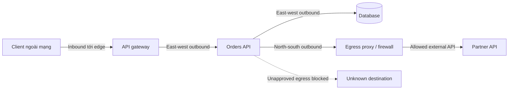
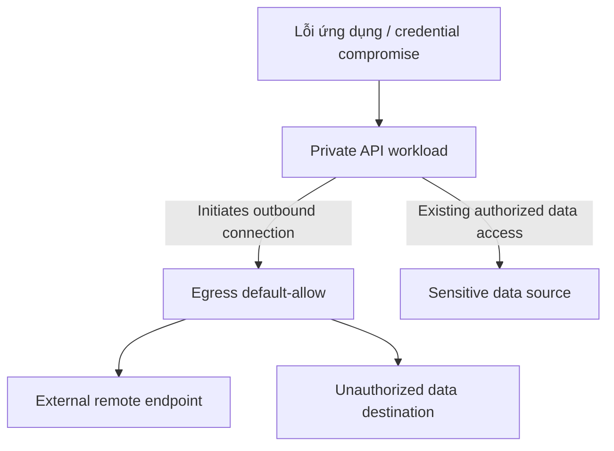
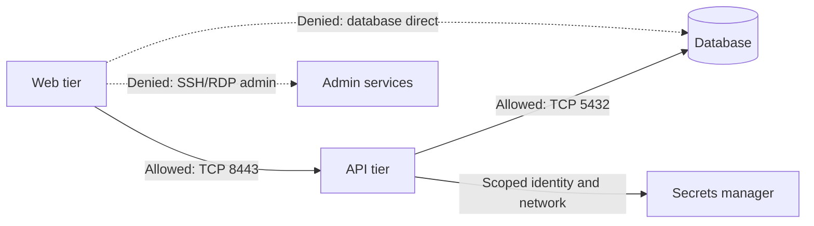
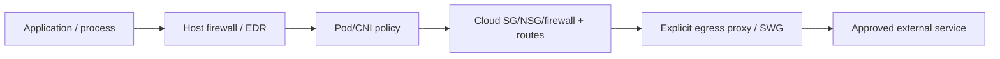
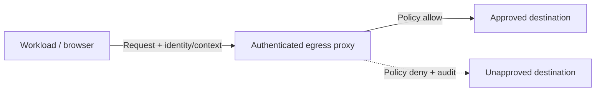

# Vì sao outbound traffic cần được kiểm soát: nền tảng egress security và chống thất thoát dữ liệu

## 1. Outbound traffic là gì và tại sao không thể chỉ bảo vệ chiều vào?

Trong bảo mật mạng, **inbound traffic** thường là lưu lượng khởi tạo từ bên ngoài hoặc từ vùng kém tin cậy **đi vào** một tài nguyên; **outbound traffic** là lưu lượng được một tài nguyên **khởi tạo đi ra** khỏi phạm vi mạng hoặc vùng tin cậy đang xét. Điểm mấu chốt là **phải nêu rõ ranh giới**: một kết nối API → database là outbound đối với API nhưng inbound đối với database, đồng thời có thể là lưu lượng **east-west** của cùng VPC.

Một mạng có firewall inbound chặt nhưng mặc định cho mọi máy chủ kết nối Internet trên mọi cổng có thể gặp các rủi ro:

- Máy chủ bị chiếm quyền có thể liên hệ một điểm điều khiển bên ngoài.
- Dữ liệu kinh doanh, mã nguồn hoặc secrets bị gửi tới đích không được phê duyệt.
- Malware hoặc script trái phép có thể tải thêm thành phần từ Internet.
- Một workload Production có thể gọi dịch vụ trong cloud account khác hoặc một hệ thống nội bộ nhạy cảm không liên quan.
- DNS, HTTPS hoặc các giao thức được coi là “bình thường” có thể trở thành đường vận chuyển dữ liệu không phù hợp.
- Traffic hợp lệ lẫn bất thường đi qua cùng NAT/proxy khiến khó xác định nguồn và chủ thể.

**Kiểm soát egress (outbound traffic)** là kết hợp chính sách, cơ chế thực thi và giám sát để chỉ những luồng **có mục đích nghiệp vụ rõ ràng** mới được đi đến **đúng dịch vụ/tài nguyên**, bằng **giao thức phù hợp**, từ **workload/người dùng được phép**.

**Không phải mọi outbound connection đều đáng ngờ.** Ứng dụng thường cần DNS, API đối tác, identity provider, certificate/PKI services, package updates, backup, monitoring và cloud APIs. Mục tiêu không phải cấm Internet bằng mọi giá, mà là **giảm đường tấn công và thất thoát dữ liệu mà vẫn duy trì tính sẵn sàng**.

> **Nguyên tắc cần nhớ:** “Không thấy cổng inbound mở” **không có nghĩa** hệ thống không thể truyền dữ liệu ra ngoài. Một tiến trình chỉ có outbound connections vẫn có thể gây ra sự cố nghiêm trọng.

### 1.1. Mục tiêu học tập

Sau bài này, người học có thể:

1. Phân biệt **inbound/outbound, north-south/east-west, request/response** và điểm thực thi egress.
2. Phân tích nguy cơ **data exfiltration, command-and-control, dependency compromise, lateral movement** và vi phạm chính sách dữ liệu.
3. Giải thích vai trò và giới hạn của **default-deny egress, firewall, proxy, DNS policy, TLS inspection, DLP, cloud IAM, private endpoints và Kubernetes NetworkPolicy**.
4. Xây ma trận kết nối dựa trên **nguồn, danh tính, đích, giao thức, mục đích, owner, thời hạn**.
5. Thiết kế telemetry, phát hiện bất thường, kiểm thử **positive/negative flows** và kế hoạch triển khai hạn chế outage.
6. Liên kết egress security với **Zero Trust, segmentation, incident response và data governance**.

## 2. Xác định ranh giới: outbound của ai và tới đâu?

Những cách gọi sau dễ bị nhầm với nhau:

| Khái niệm | Ý nghĩa | Ví dụ |
|---|---|---|
| **Egress/outbound** | lưu lượng được nguồn khởi tạo đi qua ranh giới đang xét | Pod gọi dịch vụ ngoài namespace |
| **Ingress/inbound** | lưu lượng đến ranh giới/tài nguyên đích | API nhận TCP từ gateway |
| **North-south** | thường là lưu lượng giữa nội bộ và bên ngoài phạm vi mạng | VM gọi SaaS trên Internet |
| **East-west** | lưu lượng giữa các workload/vùng trong hệ thống | web → API → database |
| **Return traffic** | traffic phản hồi cho một flow đã được khởi tạo | HTTPS response từ SaaS về client |
| **Control plane** | yêu cầu quản lý cấu hình, IAM, routes, firewall | CI gọi cloud management API |
| **Data plane** | traffic vận chuyển request/dữ liệu của ứng dụng | service gửi bản ghi tới database |

Ví dụ:



Một firewall trên DB và một egress gateway ở Internet edge giải quyết **những ranh giới khác nhau**. Không thể chỉ dựa trên một thiết bị ngoại vi để hiểu mọi đường **east-west** hoặc private service connectivity.

### 2.1. Stateful filtering và traffic phản hồi

**Stateful firewall** thường theo dõi trạng thái kết nối, do đó response thuộc một flow được cho phép có thể đi về mà không cần mirror từng allow rule. **Stateless ACL** xử lý packets theo từng chiều, cần xem cả request/return packets, port động và protocol.

**Không nhầm egress deny với chặn mọi response**: nếu rule quá chặt ở stateless layer, app có thể không nhận được TCP response dù request khởi tạo đã được cho phép.

### 2.2. Outbound không phải chỉ Internet

“Không được ra Internet” vẫn chưa đủ nếu workload có thể:

- Kết nối **VPC/VNet khác** qua peering/transit.
- Gọi **private endpoint** của một managed cloud API.
- Truy cập **database, object storage hoặc message queue** ở account/project khác.
- Dùng **shared proxy, bastion, relay hoặc CI runner** làm cầu nối.
- Gửi dữ liệu tới **một tenant khác** trên cùng dịch vụ SaaS.

Định nghĩa “đích được phép” phải bao gồm **tài nguyên và danh tính ở cấp dịch vụ** khi cần, không chỉ private/public IP.

## 3. Inbound firewall tốt nhưng outbound quá rộng: một mô hình thất bại phổ biến

Giả sử API chạy trong private subnet, không có public IP, chỉ nhận HTTPS qua một internal load balancer. Nhóm vận hành kết luận hệ thống “không mở Internet inbound nên an toàn”.

Tuy nhiên, security policy cho phép:

```text
API workload egress:
  TCP/UDP ALL → 0.0.0.0/0
  TCP/UDP ALL → ::/0
  Internal network ANY → ANY
```

Một lỗi ứng dụng dẫn đến thực thi mã trái phép có thể cho process chủ động **kết nối tới dịch vụ ngoài chính sách**. Không cần cổng inbound mới. Vùng private subnet giảm exposure từ Internet, nhưng **không tự kiểm soát những kết nối mà host khởi tạo**.

### 3.1. Mô hình rủi ro



**Rủi ro thứ nhất:** nguồn kết nối bị chiếm có thể gọi tới điểm điều khiển/nhận lệnh.  
**Rủi ro thứ hai:** nguồn có quyền dữ liệu quá rộng có thể chuyển dữ liệu qua một đường outbound hợp lệ về mặt mạng.  
**Rủi ro thứ ba:** một đường outbound “hợp lệ” tới cloud provider không nhất thiết có policy hạn chế **tài khoản, bucket, tenant hoặc object đích**.

### 3.2. Kết luận đúng

Inbound restrictions, private subnet và egress controls **bổ sung nhau**, không thay thế nhau. Nếu ứng dụng không cần truy cập Internet tùy ý, không nên để một rule allow-all tồn tại chỉ vì dễ vận hành.

## 4. Mục tiêu của egress security: không chỉ chặn data exfiltration

| Mục tiêu | Câu hỏi cần trả lời | Ví dụ |
|---|---|---|
| **Giảm attack surface** | workload có thể kết nối tới các hệ thống không cần thiết không? | production DB không cần gọi host công cộng bất kỳ |
| **Ngăn command-and-control** | process bị chiếm có thể duy trì liên lạc điều khiển trái phép không? | không cho outbound tới unknown endpoint |
| **Hạn chế data exfiltration** | dữ liệu nhạy cảm có thể rời trust boundary tới đâu? | chỉ chuyển backup tới approved storage account |
| **Giảm lateral movement** | host bị chiếm có thể đi ngang tới service nào? | web tier không gọi DB admin port |
| **Kiểm soát supply-chain egress** | runtime có thể tải scripts/binaries từ nguồn chưa duyệt? | egress qua artifact proxy có policy |
| **Giảm lạm dụng dịch vụ** | process có thể gửi spam/scan/traffic làm hại bên khác? | chặn SMTP outbound không cần |
| **Tuân thủ dữ liệu** | dữ liệu có đi qua vùng/nhà xử lý ngoài phạm vi được duyệt? | hạn chế data transfer tới approved destination |
| **Khả năng điều tra** | có truy vết được nguồn và đích của kết nối? | workload ID + destination + policy verdict |
| **Giảm gián đoạn** | policy có thể chặn nhầm dependency nào? | DNS/IdP/telemetry vẫn hoạt động |

**Egress filtering** chủ yếu giới hạn **đường và đích kết nối**. **DLP (Data Loss Prevention)** tập trung vào **dữ liệu nào đang được truy cập, truyền, chia sẻ hoặc lưu trữ**, theo nội dung, phân loại và ngữ cảnh. Hai cơ chế giao nhau nhưng không đồng nhất.

## 5. Data exfiltration: có thể xảy ra qua một luồng outbound trông bình thường

**Data exfiltration** là việc đưa dữ liệu ra khỏi phạm vi được phép, có thể do attacker, lỗi cấu hình, insider misuse hoặc tích hợp SaaS không đúng chính sách. Cùng một kết nối HTTPS tới cloud provider có thể mang:

- Một request đọc tài liệu được phê duyệt.
- Một bản sao backup theo quy định.
- Một log có chứa secret do ứng dụng ghi nhầm.
- Dữ liệu khách hàng bị gửi tới tài khoản cloud cá nhân.
- Một webhook chuyển payload ngoài mục đích hợp đồng.

**Khác nhau nằm ở principal, dữ liệu, tài nguyên đích, mục đích và quyền** — không chỉ ở port TCP/443.

### 5.1. Các đường thường cần đưa vào threat model

| Đường truyền | Nguy cơ | Điều cần kiểm |
|---|---|---|
| HTTPS tới domain tùy ý | upload file/JSON vượt chính sách | approved service/domain/account và DLP |
| HTTPS tới provider SaaS hợp pháp | dữ liệu vào **tenant không thuộc tổ chức** | tenant restrictions, OAuth scopes, API policies |
| Object storage private endpoint | gửi object tới bucket/account khác | endpoint + IAM/resource/org policy |
| DNS query tới resolver được phép | hostname chứa dữ liệu bất thường, DNS tunneling | DNS policy, query anomaly và egress limits |
| Email/SMTP/API email | gửi tài liệu ra hộp thư ngoài | mail gateway DLP, recipients và authorization |
| Messaging/WebSocket/gRPC | kênh truyền liên tục | authenticated destinations, session monitoring |
| SFTP/SSH tunnel | chuyển dữ liệu qua kênh mã hóa | destination allowlist, host key, admin approval |
| Logs/telemetry | secrets/PII bị lộ vào collector | redact/filter, collector identity, retention |
| Git/package artifact services | upload source/secret dưới tên build artifact | repository permissions, CI identity, scanning |
| Cloud sync agent | đồng bộ directory không được phép | device/data governance, SaaS tenant policy |

**Không kết luận mọi traffic mã hóa đều là exfiltration.** Mục tiêu là xác minh luồng nào phục vụ nghiệp vụ, ranh giới nào được phép và evidence nào chỉ ra khả năng vi phạm.

### 5.2. Data access và outbound phải cùng bị giới hạn

Nếu application chỉ có quyền đọc **đúng một tập dữ liệu nhỏ**, hậu quả của egress compromise thấp hơn khi application giữ **database superuser credential**. Vì vậy cần:

1. **Data classification/ownership** và chính sách chia sẻ.
2. IAM/RBAC/ABAC, per-object và per-tenant authorization.
3. Segmentation tới nguồn dữ liệu.
4. Egress limits theo workload/destination.
5. Content-aware DLP khi thực sự có yêu cầu.
6. Audit, anomaly detection và incident response.

Chặn traffic chỉ tại firewall trong khi ứng dụng có thể dùng một **approved service account** ghi tới mọi nơi vẫn để lại lỗ hổng về quyền dữ liệu.

## 6. Command-and-control và tải thêm payload: vai trò của outbound path

Sau khi chiếm một endpoint hoặc workload, attacker có thể tìm cách duy trì kết nối đến dịch vụ điều khiển. Kết nối outbound đôi khi thuận lợi vì firewall truyền thống **cho client chủ động kết nối ra ngoài**.

Những dấu hiệu cần phòng vệ:

- Một server không có lý do nghiệp vụ để gọi Internet lại tạo connections tới đích mới.
- Workload tự tạo traffic kéo dài tới domain/IP ngoài dependency map.
- Process lạ gọi DNS/HTTPS dù không thuộc service baseline.
- Các retry hoặc periodic callbacks không phù hợp chu kỳ ứng dụng.
- Outbound traffic tới hạ tầng bị threat intelligence đánh giá rủi ro, **nếu nguồn tình báo phù hợp và đủ tin cậy**.

**Không có một cách phân loại chắc chắn chỉ bằng tần suất hay port.** Ứng dụng giám sát, message brokers và keepalive hợp lệ có thể cũng tạo kết nối định kỳ. Phân tích nên kết hợp **process identity, image digest, endpoint, destination ownership, volume và policy decision**.

### 6.1. “Mở TCP/443 để cập nhật” là ngoại lệ quá rộng nếu không kiểm soát

Package updates, CA retrieval, telemetry hoặc SaaS integration là dependency hợp lệ; nên cho đi qua **approved artifact registry, HTTP(S) proxy, private mirror, endpoint policies hoặc domain allowlist có hỗ trợ**. Không mặc định TCP/443 tới mọi IPv4/IPv6 là “chỉ cho cập nhật”.

### 6.2. Outbound deny không ngăn mọi mã độc

Một malware có thể khai thác quyền truy cập dữ liệu nội bộ, phá dữ liệu hoặc dùng đường đang được cho phép. Egress security nhằm **giảm lựa chọn và tăng khả năng phát hiện**, không thay EDR, patch management, IAM, WAF, application security hay backup.

## 7. Lateral movement: outbound có thể nằm hoàn toàn trong mạng nội bộ

**East-west egress** là luồng một workload khởi tạo đến workload khác. Ví dụ:



Nếu outbound từ web tier tới **mọi private CIDR** được cho phép, attacker có foothold ở web tier có thể thử tiếp cận dữ liệu, secrets, admin endpoints hoặc shared services. Ngay cả khi destination firewall cũng lọc ingress, **đặt quy tắc ở cả source egress và destination ingress** giúp tăng khả năng phân đoạn, đo policy drift và giảm blast radius.

### 7.1. Không coi private IP là identity

Các IP nội bộ có thể thay vì DHCP/NAT/Pod rescheduling/autoscaling. Tốt hơn là chính sách gắn với **workload role/security group, service account, namespace/Pod selector được quản trị hoặc mTLS identity** ở những lớp hỗ trợ. Dù vậy, label/group membership cũng phải được bảo vệ khỏi thay đổi trái phép.

### 7.2. Shared services là cầu nối tiềm ẩn

```text
dev-workload → shared proxy/CI runner → production database
```

Dev workload có thể **không có đường trực tiếp** tới Production DB nhưng lại điều khiển được một shared service có quyền kết nối rộng. Cần kiểm tra **application-level forwarding permissions, identity ở proxy, token scope và downstream egress**, không chỉ một ma trận subnet.

### 7.3. Server-side request forgery (SSRF)

Một web server có quyền egress rộng có thể bị lợi dụng nếu cho client nhập URL để backend tải nội dung. Cần:

- Giới hạn resource/destination theo **allowlist đã được duyệt**.
- Kiểm tra URL scheme, hostname, redirects, DNS re-resolution và resolved IP ranges.
- Bảo vệ metadata endpoints theo cloud-specific controls.
- Không dựa vào client-provided URL như bằng chứng request hợp lệ.
- Kết hợp **network egress policy** với input validation và service identity.

Một request bắt nguồn từ ứng dụng được tin vẫn có thể **phục vụ ý định của attacker** nếu ứng dụng có lỗ hổng SSRF.

## 8. Nguồn traffic là ai? IP, NAT và workload identity

Một egress proxy/cloud firewall có thể thấy một source IP, nhưng source IP chưa chắc chỉ ra user hoặc process thực:

- Hàng trăm containers dùng cùng node/NAT IP.
- Nhiều VMs dùng một NAT gateway.
- Nhiều người dùng sau VPN/proxy có cùng public IP.
- Một service mesh sidecar kết nối thay mặt workload.
- Serverless dùng connector, provider-managed IP hoặc NAT path.
- Một VM dual-stack có địa chỉ IPv4 và IPv6 khác nhau.

### 8.1. Mô hình gắn nguồn với ngữ cảnh

```text
Time window
  + source IP/NAT mapping
  + source ENI/NIC/node/Pod/container
  + workload image/version/service account
  + authenticated principal/session
  + proxy identity/policy verdict
  + destination domain/IP/account/resource
  = investigative evidence
```

Không nhất thiết mọi firewall có đủ các thuộc tính trên. **Tương quan logs từ các tầng** là cần thiết. Không tự gán một cảnh báo DLP từ IP NAT chung cho một user khi thiếu process/session mapping.

### 8.2. Workload identity không thay network egress

Cloud IAM role/service account hoặc Kubernetes projected token có thể cho quyền gọi API cụ thể, nhưng không tự cấm process tạo TCP connection tới một địa chỉ khác. Ngược lại, egress firewall cho tới cloud API không đảm bảo principal được phép gọi resource nào. **Hai policy độc lập phải cùng đúng**.

## 9. Egress policy theo least privilege và mục đích nghiệp vụ

Chính sách tốt được xây từ **dependency của workload** chứ không từ mặc định “mọi thứ outbound cho phép”.

| Source role | Destination role | Protocol/port | Purpose | Expected |
|---|---|---|---|---|
| Public edge | internal API | TCP/8443 | phục vụ web request | ALLOW |
| Orders API | orders database | TCP/5432 + DB/TLS auth | dữ liệu đơn hàng | ALLOW |
| Orders API | approved internal DNS | UDP/TCP 53 | service resolution | ALLOW |
| Orders API | approved identity provider | HTTPS 443 | token/identity verification theo app flow | ALLOW |
| Orders API | approved secret endpoint | HTTPS 443 + IAM | đọc secret cần thiết | ALLOW |
| Orders API | telemetry collector | port giao thức đúng | metrics/logging | ALLOW |
| Orders API | arbitrary Internet host | ANY | không có dependency | DENY |
| Web tier | database | ANY | không cần | DENY |
| Dev workload | Production secrets API | ANY | ngoài scope | DENY |
| Approved backup job | organization backup storage | approved API + resource policy | backup được phê duyệt | ALLOW |
| Backup job | external personal cloud account | ANY | transfer trái phép | DENY |
| CI builder | approved artifact mirror | TLS + required ports | pull dependency | ALLOW |
| CI builder | arbitrary executable-hosting site | ANY | chưa được duyệt | DENY |

**Đây là mô hình chính sách khái niệm**. “DENY” có thể là default deny vì không có allow rule, explicit deny tại firewall/proxy, hoặc resource-level deny; syntax và thứ tự ưu tiên khác giữa các nhà cung cấp.

### 9.1. Source, destination, purpose, owner và expiry

Một egress rule nên ghi ít nhất:

```yaml
# Schema mô tả để review, KHÔNG phải cấu hình cloud firewall.
rule_id: EGRESS-ORDERS-DB-001
environment: production
source:
  workload_role: orders-api
destination:
  service_role: orders-db
protocol: tcp
destination_port: 5432
business_purpose: order-processing
owner: commerce-platform
requires:
  transport_security: tls
  destination_identity_validation: true
  database_authorization: true
exception: false
review_cycle: quarterly
```

**Mã nguồn và destination phải ánh xạ sang tài nguyên thực**: security group, NSG/ASG, Pod label, service identity hoặc endpoint policy. Những trường YAML ở đây **không tự thực thi**.

### 9.2. Khi nào dùng default-deny egress?

Khi có đủ **dependency inventory, enforcement support, testing và rollback**, default-deny là lựa chọn mạnh để giảm reachability. Nhưng áp “deny-all” trực tiếp lên tất cả workloads có thể chặn **DNS, NTP/time service, IdP, PKI, secrets, telemetry, backups, package updates và health checks**.

**Hướng triển khai:** quan sát → phân loại → allow đúng dependency → canary deny những phần còn lại → xác minh positive/negative flows → mở rộng có kiểm soát.

## 10. Lớp thực thi: egress có thể bị kiểm soát ở đâu?



Đây là **sơ đồ nhiều lớp minh họa**, không phải packet path bắt buộc. Trên VM thuần có thể không có CNI; với Kubernetes/managed serverless, chính sách host/cloud được thực thi tại điểm khác; traffic tới **private endpoint, on-prem hoặc same-node Pod** có thể không đi qua central proxy.

| Lớp | Điểm mạnh | Giới hạn |
|---|---|---|
| Host firewall | áp theo host/process/user tùy hệ điều hành/công cụ | container identities, drift và quản trị fleet |
| Kubernetes NetworkPolicy/CNI | lọc Pod ingress/egress L3/L4 theo selectors/ports | tùy CNI; FQDN/L7 không thuộc standard API |
| Security Group/NSG/VPC firewall | kiểm network flow theo workload/subnet/rule | thường không thấy HTTP path/data content |
| NACL/stateless ACL | subnet boundary, explicit rules theo platform | ephemeral return ports, rule priority, khó gắn user |
| Central network firewall | tập trung inspection/rules/telemetry theo đường đã ép qua | routing symmetry/HA/scale và bypass |
| Explicit proxy/SWG | HTTP(S) policy, domain/URL/identity theo tính năng | app phải dùng/được buộc dùng; tunneling/encrypted payload |
| DNS resolver/security gateway | quản lý domain lookups và một số DNS risks | không kiểm mọi IP direct/DoH/DoT/HTTP action |
| Cloud endpoint/resource IAM | giới hạn account/bucket/object/operation | không tự lọc mọi traffic Internet |
| Data DLP/CASB/SSE | phân loại nội dung, quản trị SaaS/share workflows | visibility, TLS, privacy, false positives và coverage |
| Application authorization | quyết định principal/action/tenant/object | không thay traffic segmentation hoặc volumetric limits |

### 10.1. “Đã mua firewall” không đồng nghĩa mọi outbound đi qua firewall

Điểm enforcement chỉ có hiệu lực đối với **traffic đi qua nó** hoặc chịu policy phân tán tương đương. Cần xác minh routes thực, peering/transit paths, public/private endpoints, IPv6, container hostNetwork, serverless connectors và các đường DR.

### 10.2. Chỉ cần chặn ngay đầu nguồn là đủ?

Không luôn đúng. Source-side policy tốt khi workload có định danh rõ, nhưng **attacker có quyền chỉnh CNI/host firewall** có thể thay rule. Nên kết hợp **destination-side controls, cloud org/IAM restrictions, resource AuthZ và central monitoring** khi độ nhạy đòi hỏi.

## 11. Network ACL, firewall và state tracking: chi tiết kỹ thuật dễ nhầm

Một egress rule thường match theo **direction, source, destination, protocol và port**, đôi khi bổ sung FQDN, identity, tags hoặc L7 metadata theo tính năng cụ thể.

### 11.1. Stateful vs stateless

- **Stateful security group/firewall:** nhớ flow đã được cho phép; return traffic có thể được chấp nhận qua connection tracking.
- **Stateless network ACL:** inbound và outbound rule độc lập; cần xem source/destination port của response và ephemeral ports.
- **Application proxy:** có thể có hai kết nối TCP/TLS khác nhau (client→proxy, proxy→upstream), nên telemetry và firewall decisions có **hai nguồn và đích** khác nhau.

### 11.2. Port number không bảo đảm loại ứng dụng

TCP/443 thường mang HTTPS, nhưng không phải mọi traffic 443 đều là HTTPS đúng chuẩn. HTTPS có thể mang **REST, GraphQL, gRPC, uploads, tunnels**. Một số giao thức khác dùng port tùy chỉnh. Kiểm soát an toàn có thể cần **protocol validation, authenticated proxy hoặc L7 controls** ở những điểm hợp pháp/khả thi.

### 11.3. IPv6 là phạm vi độc lập

Nếu chỉ có rule hạn chế `0.0.0.0/0` mà không xem `::/0`, môi trường dual-stack có thể có đường outbound IPv6 khác. Kiểm tra **A/AAAA DNS, effective routes, SG/NSG/firewall IPv6 rules, egress gateway và telemetry**.

### 11.4. UDP và QUIC

QUIC thường dùng **UDP/443**, tạo kết nối được mã hóa cho HTTP/3 và ứng dụng khác. Nếu proxy/network security chỉ thực thi trên **TCP/443**, một phần outbound có thể theo đường khác khi client/server hỗ trợ. Không mặc định chặn UDP/443 toàn hệ thống; hãy quyết định theo **dịch vụ, chức năng kiểm soát, fallback và trải nghiệm ứng dụng**.

## 12. NAT gateway: đường kết nối chứ không phải giải pháp DLP

NAT (Network Address Translation) thường giúp nhiều private workloads đi ra ngoài qua địa chỉ nguồn chung. NAT hữu ích cho connectivity và address management, nhưng **không tự chứng minh**:

- Destination có thuộc danh sách được duyệt hay không.
- HTTP request có chứa dữ liệu nhạy cảm không.
- Workload/source principal nào thực hiện hành động.
- Cloud storage bucket/SaaS tenant đích thuộc ai.
- App có xác minh TLS server identity hay không.

### 12.1. Mẫu kiến trúc đúng

```text
Private workloads
  → per-workload SG/NSG/CNI egress rules
  → approved proxy/firewall or route controls (if required)
  → NAT/address translation where needed
  → approved external resource

Parallel:
  workload identity + resource IAM
  DNS policy + TLS validation
  flow/proxy/application audit
```

NAT có thể được đặt **trước hoặc sau** các enforcement points tùy topology; phải xác minh nguồn IP mà từng thiết bị **thực sự thấy**. Đừng dùng một public NAT IP chung để gán trách nhiệm một request cho một user.

### 12.2. Reverse path và asymmetric routing

Một central stateful firewall có thể bị lỗi kiểm connection nếu request/response đi qua những paths khác nhau hoặc NAT thay mapping ngoài dự kiến. Khi thiết kế egress inspection qua transit/hub, cần xem **symmetric routing, HA, connection tracking, SNAT và failover semantics**.

## 13. DNS: một kênh phụ thuộc hợp lệ và một ranh giới rủi ro

Ứng dụng dùng DNS để tìm host đích, nhưng **DNS lookup thành công không đồng nghĩa có quyền gọi đích**, và DNS lookup bị chặn không chứng minh mọi outbound bị chặn.

### 13.1. Kiểm soát DNS egress

- Chỉ cho workload hỏi **approved recursive resolvers/CoreDNS/NodeLocal DNSCache** theo topology thật.
- Cho phép **UDP và TCP 53** khi cần, không chỉ UDP.
- Giám sát truy vấn có **tần suất/bất thường về domain/response** theo ngữ cảnh.
- Bảo vệ upstream configuration, DNS zone/records, split-horizon và identity của resolver.
- Chống DNS spoofing/poisoning theo khả năng và threat model, nhưng **TLS/mTLS vẫn xác minh service identity**.
- Kiểm soát DoH/DoT nếu muốn ép DNS policy; **chặn port 53 ngoài không đủ**.

### 13.2. Domain allowlist không phải application authorization

Một firewall có thể cho phép `api.partner.example.com`, nhưng:

- DNS có thể trả nhiều IP/CDN addresses hoặc thay đổi.
- TLS SNI có thể khác HTTP Host/`:authority` hoặc service origin.
- Một domain có thể phục vụ nhiều users/tenants khác nhau.
- Redirect có thể chuyển sang hostname khác.
- Public cloud/SaaS domain không xác nhận đúng tenant/bucket.
- Một số clients có thể dùng IP trực tiếp hoặc resolver riêng.

Vì vậy **FQDN filtering phải được hiểu là một lớp giới hạn đích với giả định cụ thể**. Khi dữ liệu nhạy cảm, cần thêm authenticated requests, **tenant/resource restrictions và DLP/application policy**.

### 13.3. DNS tunneling và trách nhiệm điều tra

Một số kiểu exfiltration có thể nhúng thông tin vào **subdomain labels** hoặc tăng queries bất thường; công cụ SOC có thể nhận diện qua QPS, query uniqueness, domain age/reputation, NXDOMAIN ratio và workload behavior.

**Không kết luận chỉ từ hostname dài:** CDN, telemetry, content hashes hoặc verification records cũng tạo tên dài. Điều tra dựa trên **nguồn Pod/process, destination owner, policy, volume và dữ liệu liên quan**, bảo vệ quyền riêng tư của DNS logs.

## 14. TLS, HTTPS, QUIC và giới hạn của inspection

Phần lớn dữ liệu outbound hiện đại được **mã hóa**. Đây là điều tốt cho confidentiality/integrity giữa client và server; đồng thời đặt ra vấn đề cho hệ thống DLP nếu nó muốn đọc nội dung.

### 14.1. Những gì một network sensor có thể nhìn thấy

Tùy giao thức, cấu hình và điểm thu thập, sensor có thể quan sát:

- Source/destination IP, port, protocol.
- Số bytes/packets, thời lượng, tần suất kết nối.
- DNS queries nếu đi qua resolver có logging.
- Một phần TLS handshake metadata khi chưa bị mã hóa/ẩn.
- Certificate/trust data ở những vị trí/phiên bản giao thức có thể quan sát.
- Proxy logs với **authenticated principal, hostname, method/path** nếu proxy terminate hoặc hiểu được giao thức theo thiết kế.

Nhưng sensor nhìn thấy TCP/443 **không tự đọc được HTTP request body** trong TLS end-to-end; SNI có thể bị ẩn bằng những cơ chế như **Encrypted ClientHello (ECH)** khi được hỗ trợ; HTTP/3 dùng QUIC với mã hóa khác traffic HTTPS/TCP truyền thống.

### 14.2. TLS interception có trade-off đáng kể

TLS inspection tại explicit proxy có thể giúp content-aware DLP trong phạm vi được phê duyệt, nhưng phải xem:

| Mối quan tâm | Vì sao quan trọng |
|---|---|
| Trust anchor/CA | proxy thay đổi TLS trust boundary; khóa CA/issuance phải bảo vệ |
| Quyền riêng tư/pháp lý | body có thể chứa thông tin cá nhân, y tế, tài chính hoặc credentials |
| Certificate pinning/mTLS | một số apps không tương thích interception thông thường |
| Modern TLS/QUIC/ECH | visibility và enforcement phụ thuộc protocol, mode và sản phẩm |
| Performance | decryption/inspection có cost, tăng latency và nguy cơ outage |
| Log retention | không ghi payload/secrets tràn lan |
| Bypass paths | app có thể đi direct, private endpoint, UDP/443 hoặc tunnel nếu routing không kiểm soát |
| Break-and-inspect risks | proxy trở thành mục tiêu hấp dẫn, phải harden/HA/audit |

**Không khuyến nghị bật giải mã mọi lưu lượng chỉ để kiểm soát outbound.** Tổ chức có thể kết hợp **allowlist, private endpoints, resource IAM, browser/SaaS controls, endpoint DLP và selective inspection** tùy sensitivity và tính hợp pháp.

### 14.3. Mã hóa không chứng minh đúng đích

Một TLS connection có chứng thư hợp lệ tới **một domain ngoài tổ chức** vẫn có thể chuyển dữ liệu trái phép. Phải phân biệt:

1. **TLS có bảo vệ đường truyền?**
2. **Server identity có khớp expected service?**
3. **Principal có quyền gửi đúng loại dữ liệu tới tài nguyên/tenant đó?**

Ba câu hỏi này thuộc các lớp khác nhau.

## 15. Explicit egress proxy, secure web gateway và policy theo ứng dụng

Một **explicit proxy** là điểm trung gian mà client biết và cấu hình để gửi lưu lượng phù hợp, thường HTTP/HTTPS. Một **secure web gateway (SWG)** hoặc egress gateway có thể thực thi policy về destination, user, application, malware detection hoặc content inspection theo tính năng.



### 15.1. Proxy chỉ có tác dụng nếu traffic thật sự qua nó

Ứng dụng có thể dùng:

- Cấu hình proxy thông qua URL, environment hoặc client library.
- `HTTP_PROXY`, `HTTPS_PROXY`, `NO_PROXY` hoặc cơ chế riêng.
- Protocol không hỗ trợ HTTP proxy một cách trực tiếp.
- Direct TCP/UDP connection, proxy bypass hoặc private endpoint routing.

Do đó cần **network-level egress restrictions** sao cho không thể tự ý bỏ proxy và vẫn kết nối Internet nếu policy yêu cầu.

### 15.2. `CONNECT` có giới hạn

HTTP `CONNECT` thường dùng để tạo tunnel qua proxy đến một authority/port. Nếu proxy cho phép CONNECT tới **bất kỳ host:port**, khả năng hạn chế egress có thể yếu hơn mục tiêu đề ra.

Policy nên xét:

- Authenticated client/principal.
- Destination domain/address/port được cấp quyền.
- Protocol mà proxy cho phép.
- TLS peer verification theo kiến trúc, nếu proxy đóng vai client.
- Deny trực tiếp đến IP/private ranges/metadata services ngoài phạm vi, có ngoại lệ hợp lệ rõ ràng.
- Rate/size quotas và logging metadata.

Không giả định mọi proxy có thể đọc payload **bên trong TLS tunnel** nếu nó chỉ chuyển bytes.

### 15.3. `NO_PROXY` và bypass do cấu hình

Một cấu hình sai `NO_PROXY` có thể khiến request đến host được chọn **bỏ qua proxy** và đi theo route trực tiếp. Đặc biệt cần kiểm tra private DNS, service domains, cloud metadata, CIDR matching semantics của từng HTTP client và user-provided proxy settings.

### 15.4. L7 proxy có thể chưa đủ cho non-HTTP protocols

Database, SSH, message queues và ứng dụng dùng UDP/gRPC custom transports có yêu cầu khác. Một “web gateway” không tự áp policy cho mọi giao thức. Kết hợp **L3/L4 firewall, specialized service gateways, authenticated endpoints và identity controls**.

## 16. DLP: kiểm soát nội dung và dữ liệu, không chỉ mạng

**Data Loss Prevention** là tập hợp kỹ thuật và quy trình nhằm phát hiện/hạn chế dữ liệu bị đưa ra ngoài chính sách. DLP có thể hoạt động:

- Trên **endpoint**: kiểm tra file, clipboard, upload, browser extensions hoặc hành vi theo khả năng sản phẩm.
- Trên **network/proxy**: phân tích lưu lượng mà điểm kiểm soát quan sát được.
- Trong **email/collaboration**: chính sách recipients, attachments, sharing links.
- Với **SaaS/CASB/SSE**: API-based scanning và inline controls tùy dịch vụ.
- Trên **cloud storage/data platforms**: classify objects, access audit, resource/policy constraints.
- Trong **ứng dụng**: per-tenant export restrictions, approval workflows, masking và data minimization.

### 16.1. DLP quyết định dựa vào những gì?

| Yếu tố | Ví dụ |
|---|---|
| **Data classification** | public, internal, confidential, restricted |
| **Content signal** | patterns, fingerprinting, exact data match, classifiers |
| **Source identity** | nhân viên, contractor, workload/service account |
| **Destination ownership** | corporate tenant hay personal account |
| **Action** | read, upload, share link, export, send email |
| **Channel** | browser, SMTP, SaaS API, cloud storage, network upload |
| **Context** | project, business workflow, device posture, approval |
| **Exception** | temporary authorized transfer with reason/expiry |

### 16.2. Egress filtering và DLP bổ sung nhau

```text
Egress filtering:
  "orders-api only talks to approved telemetry and partner endpoints"

DLP:
  "customer PII may not be uploaded to an unapproved SaaS tenant,
   even if HTTPS to the SaaS provider is allowed"
```

Một rule allow đúng domain có thể vẫn cho phép gửi dữ liệu không đúng **account/tenant/object**. Một DLP engine nhận biết dữ liệu có thể cần **application/endpoint/SaaS API visibility**, không thể chỉ dựa vào 5-tuple L3/L4.

### 16.3. False positive và false negative

- Một chuỗi 16 chữ số có thể giống số thẻ nhưng không phải.
- File đã nén/mã hóa có thể hạn chế khả năng nhận diện nội dung.
- Một dữ liệu nhạy cảm đã được đổi định dạng có thể né được bộ pattern đơn giản.
- Tên file “public” không chứng minh nội dung không nhạy cảm.
- DLP blocking có thể ngăn workflow hợp lệ và tạo áp lực yêu cầu bypass.

Vì vậy cần **classification rõ ràng, policy theo risk, chế độ audit trước enforcement, review bởi owner và quy trình exception**. DLP không phải phép màu phát hiện mọi bí mật.

### 16.4. Quyền riêng tư khi kiểm tra nội dung

Kiểm tra payload/copy file có tác động đến quyền riêng tư và dữ liệu của người dùng. Chỉ sử dụng theo **chính sách được phê duyệt, luật và hợp đồng áp dụng**, giảm dữ liệu được ghi, giới hạn analyst access, retention và bảo vệ dữ liệu DLP thu được.

## 17. Zero Trust, identity và egress: không tin vì nguồn ở mạng nội bộ

Một ứng dụng gửi outbound từ private subnet vẫn có thể bị compromise. Zero Trust yêu cầu quyết định theo:

```text
Source principal/workload identity
  + approved resource/destination
  + intended action and data category
  + device/runtime posture where applicable
  + session/credential validity
  + policy and current risk context
```

### 17.1. Không mặc định tin source IP

NAT, VPN pool, container IP, serverless connectors và proxy có thể làm IP không chỉ ra đúng user/process. Kết hợp **workload identity, cloud IAM, service account, mTLS/SPIFFE khi dùng, process/container metadata và session identity**.

### 17.2. Một network allow không phải quyền dữ liệu

Một service được phép kết nối object storage provider cần thêm:

- Credential chỉ cho **đúng resource/tenant**.
- Scope read/write phù hợp.
- Deny unsafe public sharing/cross-account transfer theo policy.
- Audit các operations như `PutObject`, `GetObject` hoặc APIs tương đương.
- Encryption/retention và data classification.

**Source side egress + destination/resource policy + application authorization** mới tạo kiểm soát nhiều lớp.

### 17.3. Ràng buộc thời hạn

Egress exception không nên mở mãi vì một incident/debug session ngắn. Rule nên có **owner, ticket, lý do, expiry, review và automation thu hồi**. Policy drift làm tăng diện tích mà một workload bị chiếm có thể tiếp cận.

## 18. AWS: Security Groups, NAT, VPC endpoints và Network Firewall

AWS có nhiều lớp có thể kiểm outbound; không có một thành phần duy nhất phù hợp mọi workload.

### 18.1. Security Groups

**Security Groups (SG)** là stateful filtering tại network interface/resource tương ứng. SG có **allow rules**, không có explicit deny trong chính SG. Một SG có thể có egress rules rộng theo cấu hình ban đầu của nhiều workflows; cần xem **effective rules của tất cả SGs gắn vào resource**.

- Giới hạn destination CIDR, ports/protocols hoặc **SG references** ở những quan hệ hỗ trợ.
- SGs gắn cùng resource thường có hiệu lực theo **hợp của các allow rules**; một SG hẹp không phủ định SG khác allow all.
- Egress được SG cho phép không tự có nghĩa traffic chắc chắn đến đích: **routes, NACL, service endpoint và các policy khác** cũng có tác động.
- Với network traffic đi tới AWS APIs, **IAM/resource policy** vẫn quyết định operations.

### 18.2. NACL

**Network ACL** trong VPC là stateless, theo subnet, hỗ trợ allow/deny theo rule number và direction. Khi cấu hình outbound, phải xét **response/ephemeral ports**, nếu không app có thể timeout. NACL không thay workload SG hoặc DLP.

### 18.3. NAT Gateway

NAT Gateway cung cấp khả năng translation/connectivity theo tính năng AWS; bản thân nó **không phải content-aware firewall hoặc tenant-aware DLP engine**. Nó không biết object storage bucket thuộc ai và không xác thực user HTTP.

### 18.4. AWS Network Firewall / egress inspection

Với yêu cầu filtering/inspection tập trung, có thể dùng **AWS Network Firewall, appliance hoặc Gateway Load Balancer architectures** theo nhu cầu. Cần xem **route tables, network symmetry, HA/AZ layout, state tracking, throughput và failure mode**.

Một firewall được triển khai trong VPC **không có nghĩa mọi packet của VPC đã đi qua nó**. Direct peering, gateway endpoints, interface endpoints hoặc routes khác có thể tạo path riêng tùy thiết kế.

### 18.5. VPC endpoints/PrivateLink và policies

AWS có **interface endpoints, gateway endpoints** cho những dịch vụ hỗ trợ, cùng IAM/resource/endpoint policy theo capability cụ thể. Khi dùng:

- Kiểm tra security group/routing/DNS tới endpoint tương ứng.
- Xác minh **endpoint policy có hỗ trợ và được cấu hình đúng** cho dịch vụ đó.
- Hạn chế **bucket/account/resource/operation** bằng IAM/resource/org controls phù hợp.
- Xác minh public endpoint path có bị cho phép song song trái mục tiêu không.
- Không mặc định private endpoint nghĩa chỉ có thể gọi **tài nguyên thuộc account của mình**.

**Ví dụ kiểm soát phòng vệ:** backup job chỉ được ghi vào approved backup bucket, với identity và bucket policy ràng buộc đúng resource; network egress tới S3 API **không phải điều kiện đủ**.

### 18.6. DNS

**Route 53 Resolver DNS Firewall** có thể áp domain-based DNS policies trong phạm vi hỗ trợ; nó **không tự là firewall IP/TLS/DLP** cho mọi outbound. Nếu app dùng IP trực tiếp, cache hoặc resolver ngoài policy, cần các kiểm soát khác.

## 19. Google Cloud: VPC firewall, Cloud NAT, PSC và managed API restrictions

Trong Google Cloud, các thành phần có vai trò khác nhau:

### 19.1. VPC firewall rules và network firewall policies

GCP firewall policies hỗ trợ ingress/egress rules theo loại policy, source/target/destination selectors, action và priority. Các **implied rules** và rules ở **organization/folder/network/project** theo mô hình tính năng có thể ảnh hưởng **effective result**.

**Không suy “custom VPC” mặc định deny mọi egress**. Cần xem các implicit egress semantics và explicit higher-scope policies. Chặn nguồn cụ thể phải test theo **VM target/service account/secure tags** được hỗ trợ, không coi mọi loại tag đồng nghĩa workload identity đáng tin.

### 19.2. Cloud NAT

**Cloud NAT** phục vụ address translation/connectivity cho những workload/region được hỗ trợ. Nó có thể cung cấp logs/metrics trong cấu hình tương ứng, nhưng **không thay destination policy, content DLP hay IAM**.

### 19.3. Private Service Connect và cloud APIs

**Private Service Connect (PSC)** có các mô hình private connectivity tới producer services/Google APIs tùy khả năng. Ngoài network path, cần xem:

- Dịch vụ producer/consumer, endpoint/attachment ownership.
- DNS mapping và routing.
- IAM/resource/project ownership và allowed operations.
- Organization policies, service perimeters nếu áp dụng.
- Public API access hoặc route alternative.

### 19.4. VPC Service Controls

**VPC Service Controls** có thể tạo một số **service perimeter** cho **các Google-managed APIs được hỗ trợ**, nhằm giảm nguy cơ truy cập/copy dữ liệu qua ranh giới quản trị theo policy. Nó **không phải L3/L4 firewall** ngăn VM gọi bất kỳ IP, và coverage phụ thuộc dịch vụ, API method và cấu hình.

**Không dùng service perimeter như bằng chứng mọi outbound data path đã bị chặn.** Kết hợp VPC firewall, private access, IAM, per-resource controls và application policies.

### 19.5. Cloud DNS và policy

Private zones, forwarding policies, inbound/outbound DNS forwarding và resolver settings ảnh hưởng **tên đích được phân giải ở đâu**. Đừng biến public resolver thành fallback thiếu review; phải kiểm tra domain scope, split-horizon và query privacy.

## 20. Azure: NSG, UDR, Azure Firewall và Private Link

### 20.1. Network Security Groups (NSG)

NSG là **stateful network filtering** theo rules, priorities, source/destination, protocols và ports tại subnet/NIC theo các mô hình Azure hỗ trợ. **Default NSG security rules** có thể cho phép outbound thuộc nhóm nhất định; cần xem **effective rules** và custom deny/allow priorities.

**Application Security Groups (ASG)** giúp nhóm NICs theo vai trò trong NSG rules khi hỗ trợ, nhưng không phải **user identity** hoặc business authorization.

### 20.2. User-Defined Routes (UDR)

**UDR** có thể điều khiển đường đi đến next hop theo loại route, chẳng hạn network appliance/Azure Firewall. Cần xác minh **effective routes, VNet peering, private endpoints, hub-spoke, symmetric paths và failover**.

### 20.3. Azure Firewall và proxy

Azure Firewall có thể áp **network/application rules** theo SKU/policy, logging và những tính năng nâng cao có sẵn. FQDN filtering, application rule semantics, TLS inspection hoặc IDPS coverage phụ thuộc loại dịch vụ/cấu hình. **Không khẳng định mọi Azure Firewall deployment đều có content DLP**.

### 20.4. Azure Private Endpoint/Private Link

Private Endpoint cung cấp private access tới những managed services hỗ trợ, nhưng phải kiểm tra:

- Private DNS zones/records và client resolution path.
- Service-specific `publicNetworkAccess` hoặc equivalent settings.
- NSG/UDR/private endpoint network policies theo khả năng và cấu hình.
- Data-plane RBAC, managed identity, storage account/container permissions.
- Public and cross-tenant access được hạn chế đúng policy.

**Không coi Private Endpoint tự động tắt public endpoint** hoặc ngăn mọi object transfer qua quyền cloud API.

### 20.5. Bảng so sánh ba cloud

| Mục tiêu | AWS | Google Cloud | Azure |
|---|---|---|---|
| Egress theo workload/VM | SG | VPC firewall/policies | NSG/ASG |
| Subnet/stateless filtering | VPC NACL | không có một NACL tương đương 1:1 | NSG stateful ở subnet/NIC |
| NAT | NAT Gateway | Cloud NAT | NAT Gateway/thiết kế tương đương |
| Central inspection | Network Firewall/GWLB architecture | Cloud NGFW hoặc appliances phù hợp | Azure Firewall/NVA + UDR |
| Private access PaaS | VPC endpoints/PrivateLink | PSC/private access models | Private Link/Private Endpoint |
| Managed API/resource guardrails | IAM/resource/endpoint/org policy | IAM/VPC-SC/org policy | RBAC/managed identities/service policies |

**Bảng chỉ là định hướng kiến trúc**, không phải mapping tính năng 1:1. Có những dịch vụ/vùng/cloud hỗ trợ quy tắc đặc thù hoặc đưa ra behavior khác; kiểm tra tài liệu/version và **effective policies của môi trường thật**.

## 21. Kubernetes: NetworkPolicy egress và những giới hạn hay bị bỏ qua

Trong Kubernetes, **NetworkPolicy** chuẩn định nghĩa các **allow-based rules** theo Pod selectors, namespace selectors, CIDRs, protocols và ports cho ingress/egress.

### 21.1. Default-deny egress

```yaml
# LAB/STAGING: không áp production nếu chưa inventory dependencies.
apiVersion: networking.k8s.io/v1
kind: NetworkPolicy
metadata:
  name: default-deny-egress
  namespace: production
spec:
  podSelector: {}
  policyTypes:
    - Egress
```

Ý nghĩa: Pods trong namespace được chọn **trở thành egress-isolated** đối với standard NetworkPolicy semantics; những egress flows không được **bất kỳ** NetworkPolicy nào cho phép sẽ bị chặn **nếu CNI/dataplane thực thi đúng**.

**Quan trọng:** NetworkPolicies cho phép mang tính **cộng dồn**. Default-deny không phủ định một NetworkPolicy khác allow egress all; không có deny precedence chuẩn trong resource này.

### 21.2. Cho API gọi database và DNS

```yaml
# Ví dụ có tính minh họa: nhãn, namespaces, ports phải được kiểm tra.
apiVersion: networking.k8s.io/v1
kind: NetworkPolicy
metadata:
  name: orders-api-egress
  namespace: production
spec:
  podSelector:
    matchLabels:
      app: orders-api
  policyTypes:
    - Egress
  egress:
    - to:
        - podSelector:
            matchLabels:
              app: orders-db
      ports:
        - protocol: TCP
          port: 5432
    - to:
        - namespaceSelector:
            matchLabels:
              kubernetes.io/metadata.name: kube-system
          podSelector:
            matchLabels:
              k8s-app: kube-dns
      ports:
        - protocol: UDP
          port: 53
        - protocol: TCP
          port: 53
```

**Điều kiện và hạn chế:**

- `orders-db` phải có Pods phù hợp **trong cùng namespace** (hoặc thay selector/namespace theo mô hình thực).
- DNS Pods có thể không có label `k8s-app=kube-dns`; một số clusters dùng **NodeLocal DNSCache**, host-network DNS daemon hoặc CNI NAT path khác.
- `namespaceSelector` + `podSelector` trong cùng một peer là điều kiện **giao nhau**; tách thành hai peers có thể thành **hợp của hai tập**, mở rộng không mong muốn.
- Backend DB ingress cũng phải allow nguồn theo các policies áp dụng nếu đã bị isolate.
- Standard NetworkPolicy không kiểm **FQDN, HTTP path, TLS certificate hoặc SaaS tenant**; cần CNI extensions/proxy hoặc policy ở lớp khác.
- **hostNetwork**, direct-node traffic và service IP translation có semantics riêng tùy CNI. Phải test trên cluster thật.
- Rule được API chấp nhận **không bảo đảm** CNI hỗ trợ và đã enforce.

### 21.3. Workload identity và admission

Kubernetes ServiceAccount/IRSA/Workload Identity/managed identity (tùy cloud) có thể giới hạn các cloud API actions. **NetworkPolicy không thay IAM**; một SA có quyền ghi object storage không được tự coi là chỉ có thể gửi tới bucket tổ chức. Đồng thời cần bảo vệ **Pod labels, namespace ownership, service account binding và admission rules**.

### 21.4. Network egress từ Pod nhưng qua host

Sidecar, hostNetwork, NodePort, node-local DNS, service mesh redirect hoặc eBPF dataplane có thể làm đường đi khác sơ đồ Pod→firewall tưởng tượng. Kiểm tra **effective path và policy verdict** từ đúng Pod/namespaces/nodes.

## 22. Containers, VMs và serverless: egress không luôn giống nhau

| Runtime | Câu hỏi trọng tâm | Điều dễ hiểu sai |
|---|---|---|
| VM trong private subnet | SG/NSG/route/NAT/firewall có cho Internet/private paths nào? | không có public IP ≠ không có outbound |
| Docker container trên host | network namespace, bridge, host firewall/port, DNS và runtime policy gì? | Docker `EXPOSE` không thực thi egress |
| Kubernetes Pod | CNI NetworkPolicy, Service routing, NodeLocal DNS/sidecar ảnh hưởng gì? | namespace riêng ≠ deny egress |
| Serverless function | outbound path qua provider-managed network hay VPC connector/direct integration? | trong project/account ≠ tự nằm trong VPC |
| Managed Kubernetes control plane | API/controller traffic đi theo path và permissions nào? | mọi traffic không nằm dưới workload NetworkPolicy |
| PaaS database/object store | public/private access, tenant, IAM, endpoint policy nào? | private endpoint ≠ ownership/authorization |
| CI runner/build agent | source downloads, artifacts, registries, deploy APIs và secrets nào? | build runner “nội bộ” vẫn có exfil/supply chain risk |

### 22.1. Serverless networking cần dịch vụ-specific review

Tùy nhà cung cấp/sản phẩm, không phải mọi serverless outbound connection đều đi qua VPC integration, NAT hoặc một firewall mà người quản trị đã cấu hình. Cần xác minh:

- Ingress exposure của function/service.
- Outbound routing mode và connector.
- Source IP mà destination thấy.
- Private/public managed API paths.
- Workload execution identity.
- DNS, timeout, cold start và logs.

**Không khẳng định một “serverless firewall rule” bảo vệ mọi request của mọi dịch vụ cùng project** nếu capability chưa được xác minh.

### 22.2. Base image và package retrieval

Một container image tối giản có thể giảm tool surface nhưng không ngăn code trong process **gửi HTTPS ra ngoài**. Build pipelines phải được giới hạn egress riêng:

```text
Source/build stage:
  approved SCM + package mirror + artifact registry

Runtime stage:
  only application dependencies (DB, DNS, telemetry, approved APIs)
```

Không copy chính sách egress rộng của CI builder sang Production runtime chỉ vì dùng cùng source code.

## 23. SaaS và cloud storage: vấn đề không chỉ ở domain/IP

Một doanh nghiệp có thể cho phép `storage-provider.example` vì ứng dụng cần upload objects. Nhưng domain này có thể phục vụ **nhiều tenants/accounts/projects**. Một egress policy theo FQDN chung không đủ hạn chế đối tượng nhận dữ liệu.

### 23.1. Các lớp phải đồng thời đúng

1. **Network path:** client chỉ đi tới approved endpoint.
2. **TLS identity:** client xác minh đúng server/service.
3. **Workload/user identity:** request dùng credential đã được cấp.
4. **Tenant/account binding:** request đi tới đúng account/project/tenant.
5. **Resource authorization:** đúng bucket/container/object và method.
6. **Data classification:** dữ liệu đó được phép chia sẻ/đẩy ra không?
7. **Audit and retention:** thao tác được ghi đủ và lưu đúng chính sách.

### 23.2. Private endpoint chưa chắc ngăn cross-account copy

Một private endpoint có thể cho phép kết nối tới API của nhà cung cấp cloud, nhưng **endpoint không tự động chặn mọi tài nguyên ngoài tài khoản tổ chức**. Hãy dùng endpoint policy khi hỗ trợ, resource/IAM policy, organization restrictions, service perimeter nếu phù hợp và DLP/app authorization.

### 23.3. OAuth và SaaS integrations

Một OAuth app được người dùng cho phép có thể có scope quá rộng, ví dụ đọc dữ liệu và xuất ra dịch vụ khác. **Egress filtering chỉ ở IP/domain** có thể không thấy ý nghĩa business của thao tác. Cần quản lý **OAuth app approval, token scope, API access logs, SaaS tenant policy và external sharing controls**.

### 23.4. Không đánh đồng “sử dụng SaaS đã được cấp phép” với “mọi hành động trên SaaS đều hợp lệ”

SaaS email/collaboration có thể hợp pháp, nhưng một user không nên tự ý share confidential file ra personal account. Chính sách nên xét **người nhận, phân loại dữ liệu, link permission, business process và DLP**.

## 24. Dependency inventory: loại bỏ outbound thừa nhưng vẫn giữ hệ thống chạy

Trước khi siết egress, phải lập bản đồ **phụ thuộc thật**:

| Loại dependency | Ví dụ | Điều dễ bị chặn nhầm |
|---|---|---|
| DNS | CoreDNS/NodeLocal, corporate resolver | UDP/TCP 53, split-horizon |
| Identity | IdP/OIDC/JWKS, SSO service | token refresh, JWKS retrieval, logout/revocation |
| TLS/PKI | CA distribution, revocation endpoints nếu ứng dụng dùng | certificate verification workflows |
| Time synchronization | NTP/platform time service theo mô hình | time drift làm TLS/token validation lỗi |
| Secrets/KMS | cloud/private endpoint, vault service | app không lấy được config/credentials |
| Application DB/queues | DB, Redis, Kafka, gRPC services | ports/protocol, replication và failover |
| Service discovery | service registry, DNS/API discovery | bootstrap và cache misses |
| Logs/metrics/traces | collectors/observability SaaS | mất visibility khi egress thay đổi |
| Artifacts/patching | approved registries, mirrors | image pull/update/DR |
| External business APIs | payment, tax, shipping providers | remote IP rotation, mTLS, retries |
| Backups | approved data storage, DR region | restore/backup tests hiếm khi chạy |
| Health/management | probes, support access, emergency workflow | partial outage sau hardening |

### 24.1. Cần nhìn một chu kỳ nghiệp vụ đủ đại diện

Traffic không xuất hiện trong **24 giờ** chưa chắc không cần. Batch cuối tháng, DR failover, certificate rotation, app cold start, backup weekly hoặc incident-only paths có thể chỉ hoạt động theo chu kỳ.

Nên dùng **flow telemetry, owners, API contracts, architecture docs, synthetic tests và controlled failure exercises**. Log không thấy traffic vì sampling/sensor coverage cũng không chứng minh luồng đó không tồn tại.

### 24.2. Khác nhau giữa development và Production

Developer workspace có thể cần truy cập package registries rộng hơn, nhưng Production runtime không nên thừa hưởng quyền đó. Xác định egress theo **environment, workload role và lifecycle**.

### 24.3. External endpoints thay đổi

Một số SaaS/cloud providers sử dụng CDN hoặc nhiều IP thay đổi theo thời gian. Không hard-code vài IP thu được từ một `nslookup` duy nhất rồi coi là policy bền vững. Dùng **provider-published ranges, supported FQDN controls, private endpoints, authenticated proxy và change monitoring** khi phù hợp.

## 25. Policy-as-code, review và chống drift

Egress policy có thể trải qua nhiều hệ thống: Terraform/CloudFormation/Bicep, network firewall, proxy config, Kubernetes NetworkPolicy, cloud IAM, DNS policy và SaaS controls. Nếu không có owner, các exception “tạm thời” có thể tồn tại vô thời hạn.

### 25.1. Chu kỳ thay đổi policy

```text
Inventory source/destination/data classification
  → Business owner approves dependency
  → Security reviews least privilege
  → Implement through controlled IaC/policy
  → Positive + negative tests
  → Canary + observe denied valid flows
  → Audit policy version and effective deployment
  → Expire unused/temporary exceptions
```

### 25.2. Mẫu YAML mô tả exception

```yaml
# Policy review record, không phải vendor firewall configuration.
exception_id: EGRESS-TEMP-2026-001
environment: authorized-staging
source_workload: reporting-worker
destination: approved-partner-api
protocol: https
destination_port: 443
data_classification_allowed: internal
reason: partner-integration-validation
business_owner: reporting-team
security_approver: network-security
ticket_reference: example-change-ticket
valid_until_utc: "2026-12-07T00:00:00Z"
rollback_required: true
monitoring_required: true
```

### 25.3. Chống “allow all để debug”

Khi egress bị chặn, giải pháp mặc định không nên là thêm `0.0.0.0/0:ANY` vào production rồi quên thu hồi. Thay vào đó:

1. Xác định **request nào không đạt** và **nguyên nhân**: DNS, TLS, route, proxy policy, IAM hay application.
2. Ghi **destination thật** và business justification.
3. Mở quyền nhỏ nhất ở **đúng layer**, có expiry nếu tạm.
4. Test lại positive/negative paths.
5. Thu hồi exception khi dependency/triage hoàn tất.

### 25.4. Policy drift ở control plane

Thay đổi tại console hoặc lệnh cloud CLI có thể lệch IaC baseline. Kiểm tra **effective rules, SG/NSG attachments, route tables, proxy bypass settings, NetworkPolicy objects, labels và IAM resource scopes** định kỳ. Nếu attacker được quyền sửa rules, data-plane egress controls có thể bị nới; bảo vệ **IAM, approvals, GitOps/admission và audit**.

## 26. Tách quyền cho CI/CD, monitoring và quản trị khẩn cấp

Một kiến trúc chỉ kiểm egress của application server nhưng bỏ CI runner hoặc shared monitoring agent có thể tồn tại **đường gián tiếp** tới dữ liệu:

```text
Build runner → artifact / source mirror (approved)
Build runner → deploy API (scoped token)
Build runner -X→ Production DB direct (not justified)

Application → telemetry collector (approved)
Telemetry collector -X→ arbitrary external storage (not justified)
```

### 26.1. CI/CD

- Build dependency retrieval qua approved mirrors/registries.
- Artifact uploads chỉ tới registry/project được duyệt.
- Deploy token có scope/lifetime/audience phù hợp.
- Không gắn secrets Production vào jobs không cần.
- Không tạo direct network routes từ CI runner tới mọi DB.
- Scan images/SBOM/provenance và chặn unauthorized registries theo chính sách.

### 26.2. Monitoring agents

Log/metrics collector có thể nhìn dữ liệu nhạy cảm, nên cần:

- Log redaction tại nguồn.
- Agent identity và chỉ được gửi tới collector hợp lệ.
- Giới hạn quyền truy cập dashboard/log storage.
- Retention và egress policies cho bản thân collector.
- Giám sát nếu collector bị thay endpoint hoặc credential.

### 26.3. Break-glass và vendor support

Vendor/support agent có thể cần kết nối outbound trong incident. Quyền này nên **có phê duyệt, thời hạn, destination/authentication rõ, recording/audit và kiểm thử trước**, không trở thành backdoor thường trực.

## 27. Telemetry: cần nhìn được luồng nào đã đi và vì sao

Không có dữ liệu quan sát, tổ chức khó biết rule nào còn cần hoặc phát hiện egress bất thường. Các nguồn telemetry hữu ích:

| Nguồn | Có thể cung cấp | Giới hạn |
|---|---|---|
| Host process/network events | process exec, socket connects, user/process ID | sensor privilege, ephemeral flows và coverage |
| Kubernetes CNI/eBPF telemetry | Pod/namespace/identity, L3/L4 verdicts theo plugin | không đồng nhất giữa CNIs, sampling |
| AWS VPC Flow Logs | accepted/rejected flow metadata theo cấu hình | không đọc HTTP body; aggregation/phạm vi |
| Google Cloud VPC Flow Logs | metadata flows của network/VM theo sampling | không bảo đảm mọi packet, policy khác cần log riêng |
| Azure network flow diagnostics | network telemetry theo dịch vụ/phiên bản | availability/lifecycle của log type, phải kiểm hiện hành |
| DNS resolver logs | hostname, RCODE, response latency theo khả năng | cache, DoH/DoT bypass, sensitive query names |
| Proxy/SWG | authenticated user/workload, domain/URL/action theo cấu hình | direct paths, TLS interception visibility |
| Cloud API audit | principal/resource/action, operation result | không phải mọi network connection |
| SaaS audit/DLP | uploads/shares/tenant/action và classifier hits | vendor/API coverage, delay |
| App/DB audit | object-level data reads/exports | nguồn code cần instrumentation đúng |
| IDS/NDR/EDR | anomalies, known threats, processes | detection không đồng nghĩa enforcement |

### 27.1. Correlation record minh họa

```json
{
  "time_utc": "2026-11-28T07:30:00Z",
  "event_id": "egress-demo-001",
  "environment": "staging",
  "source_workload": "orders-api",
  "source_pod_uid": "example-pod-uid",
  "source_identity": "workload-orders-api",
  "source_ip": "10.30.1.14",
  "destination_service": "approved-partner-api",
  "destination_ip": "198.51.100.24",
  "destination_port": 443,
  "protocol": "tcp",
  "network_policy_id": "orders-egress-v4",
  "network_decision": "allow",
  "resource_authorization": "checked-at-application",
  "source": "illustrative-correlated-event"
}
```

`198.51.100.0/24` là dải địa chỉ ví dụ. Bản ghi này là **schema kết hợp minh họa**, không phải output nguyên gốc của bất kỳ một công cụ cloud nào. **Network flow logs thường không có thông tin user/workload identity hoặc object authorization**; phải tương quan theo nguồn và thời điểm.

### 27.2. Không thấy log không chứng minh một kết nối bị chặn

Flow có thể không xuất hiện vì sensor ở sai điểm, sampling, pipeline lỗi, NAT thay IP, traffic đi đường private khác, cache, retention hoặc chặn trước điểm thu. Để chứng minh deny cần **effective policy, controlled negative test, policy verdict và destination-side evidence** khi có.

### 27.3. Bảo vệ dữ liệu trong telemetry

Không ghi payload có secrets, access tokens, personal data hoặc full URL query strings vào logs không cần thiết. Egress telemetry phải có **least-privilege access, encryption, retention, redaction và incident audit**, vì chính logs cũng có thể là nguồn dữ liệu nhạy cảm.

## 28. Phát hiện bất thường outbound: từ thống kê tới threat investigation

Một kết nối thành công tới “new destination” không chắc là tấn công; nó có thể là provider CDN rotation hoặc bản cập nhật hợp lệ. Detection nên dựa **nhiều tín hiệu**:

| Tín hiệu | Ví dụ cần điều tra | Bẫy |
|---|---|---|
| New destination domain/account | workload gọi provider không thuộc baseline | SaaS thay endpoint hợp lệ |
| Unusual data volume | data export tăng đột biến | backup hoặc batch tháng |
| Small frequent callbacks | periodic short connections ngoài contract | health/telemetry keepalive |
| DNS novelty/entropy | nhiều tên độc nhất ngoài approved domain | CDN/certificate challenge |
| Unexpected protocol | database Pod tạo UDP/443 ra Internet | QUIC hợp lệ của dependency mới |
| Time-of-day anomalies | backup job chạy ngoài lịch | time zones và scheduler drift |
| Process ancestry | shell/interpreter mới tạo outbound request | authorized debug job |
| TLS errors or destination change | app gọi hostname không khớp cert | provider certificate rotation/config bug |
| New NAT/route path | traffic bypass central proxy | legitimate failover/DR nếu được review |
| Cross-tenant cloud API access | account/bucket ngoài organization | approved external partner workflow |
| High denied-flow spike | workload cố gắng tới port bị cấm | lỗi config, retry storm hoặc compromise |
| DLP match on upload | sensitive pattern được gửi đi | false positive/format transformation |

### 28.1. Alert phải mang đủ ngữ cảnh

```text
Alert:
  source workload and owner
  image/process version
  destination identity and owner
  protocol/port and network path
  network policy verdict
  data category if known
  baseline comparison
  related IAM/endpoint/CI changes
  evidence confidence and analyst action
```

### 28.2. Phân biệt malicious exfil với dữ liệu rò do lỗi ứng dụng

- **Attacker exfil:** kết hợp dấu hiệu compromise, destination không được duyệt, bất thường workload behavior.
- **Accidental leak:** log collector nhận bí mật hoặc email gửi nhầm đối tác dù application hợp lệ.
- **Unauthorized sharing:** user hợp lệ share dữ liệu vượt quyền.
- **Business-approved transfer:** luồng data export có ticket/contract/resource policy phù hợp.

Các loại sự kiện có thể yêu cầu hành động khác nhau: containment host, revoke SaaS token, sửa log redaction, rollback proxy policy hoặc cập nhật data handling process.

### 28.3. Không giám sát bằng một con số duy nhất

Tổng bytes outbound tăng không tự chứng minh exfil. Cần **đường baseline theo service/environment/time, loại dữ liệu, direction, peer, identity và sự kiện deploy**.

## 29. Triển khai egress control từ mạng flat theo giai đoạn

Một hệ thống vận hành lâu năm có thể không có dependency map hoàn chỉnh. Chuyển ngay từ allow-all sang deny-all có thể khiến **production outage**, đặc biệt khi authentication, DNS, package delivery, service discovery hoặc failover không được inventory.

### Giai đoạn A — Khảo sát tài sản và luồng

1. Xác định **workload/service, owner, môi trường, network interfaces, identities, data sensitivity**.
2. Liệt kê Internet routes, NAT, DNS resolvers, proxies, VPC peering/transit, private endpoints và Kubernetes NetworkPolicies.
3. Thu flow/proxy/DNS/application/IAM logs trong cửa sổ đủ đại diện.
4. Ghép **destination domain/IP** với business owner và approved supplier/tenant.
5. Nhận diện **luồng east-west**, không chỉ Internet traffic.
6. Xác minh IPv4/IPv6, UDP/QUIC, custom protocols, serverless và disaster-recovery paths.

### Giai đoạn B — Phân loại theo mục đích

Chia observed traffic:

- **Bắt buộc:** phụ thuộc nghiệp vụ có owner và tests.
- **Tùy chọn:** telemetry, health/analytics hoặc tính năng có thể giới hạn.
- **Không rõ:** thiếu chứng cứ, cần owner giải thích.
- **Không được phép:** không có nhu cầu, vi phạm policy hoặc dest có rủi ro được xác minh.
- **Ngoại lệ tạm:** có approval, purpose, expiry và monitoring.

Không tự động chặn mọi connection được gọi là “unknown” trước khi biết **nó dùng để làm gì**. Nhưng cũng không mặc định cho phép lâu dài vì “chưa xác định”.

### Giai đoạn C — Thiết kế điểm thực thi

- Source egress theo SG/NSG/VPC firewall/host/CNI policies.
- Destination ingress và application identity.
- Explicit proxy/SWG cho web traffic phù hợp.
- Private endpoints/endpoint policies cho managed cloud APIs.
- DNS resolver/DoH restrictions khi cần.
- SaaS tenant restrictions, DLP và IAM/resource controls.
- Central logging/correlation, change control và rollback.

Lựa chọn phải dựa trên **đường traffic thật**. Một firewall ở hub không tác dụng nếu workload đi Internet qua một egress khác.

### Giai đoạn D — Observe và canary

1. Dùng audit/monitor mode nếu nền tảng hỗ trợ.
2. Áp rules hẹp vào **staging hoặc một nhóm canary workloads**.
3. Test luồng hợp lệ: authentication, DNS, DB, APIs, backup, health, observability, failover.
4. Test luồng bị cấm: unapproved domain/IP, admin port, SaaS tenant, bucket/resource.
5. Đo **latency/error rates** và số denies hợp lệ cần được sửa.
6. Xác minh các điểm bypass: IPv6, QUIC, proxy direct, peering, serverless, NodeLocal DNS.

### Giai đoạn E — Enforce và vận hành

- Enforce default deny ở phạm vi đã hiểu.
- Không “mở lại toàn bộ outbound” khi chỉ một dependency bị lỗi.
- Gắn policy owner, version, expiry và alerts.
- So sánh effective config với IaC source.
- Kiểm thử định kỳ sau deploy/scale/region failover.
- Có runbook xử lý incident và **cơ chế cấp exception khẩn cấp** có audit.

## 30. Ma trận nghiệm thu: kiểm thử cả luồng cần và luồng cấm

| Test case | Expected | Evidence |
|---|---|---|
| API → approved DB TCP/5432 | allow với TLS/DB AuthN | source SG/CNI + DB audit |
| Web → DB trực tiếp | deny | source/dest policy verdict |
| Production API → internal DNS UDP/53 | allow | resolver response + CNI logs |
| Production API → DNS TCP/53 khi cần | allow | TCP query + firewall evidence |
| API → unauthorized DNS resolver | deny | egress test + policy verdict |
| API → approved IdP/JWKS endpoint | allow | token refresh/HTTP health |
| API → arbitrary Internet TCP/443 | deny | network/proxy decision |
| API → Internet UDP/443 nếu policy cấm | deny | UDP/QUIC negative test |
| API → approved telemetry collector | allow | collector ingestion + logs |
| API → unknown logs endpoint | deny | policy and collector audit |
| CI → approved artifact mirror | allow | artifact pull and authenticated logs |
| CI → arbitrary source-download endpoint | deny | egress verdict |
| CI → Production DB | deny | source/network/DB evidence |
| Backup job → approved storage account | allow đúng IAM role/resource | cloud API audit |
| Backup job → personal account/bucket | deny | endpoint/resource/IAM policy decision |
| Workload → own cloud secrets scope | allow | access policy + audit |
| Workload → unrelated secrets resource | deny | IAM/resource deny |
| Contractor → approved SaaS tenant | allow đúng action | SaaS/IdP logs |
| Contractor → unapproved tenant | deny/restrict theo policy | SaaS tenant/DLP control |
| Upload chứa restricted data ra ngoài | block/alert theo data policy | DLP decision, no data side effects |
| Service worker không cần inbound nhưng có outbound | được inventory và kiểm soát | process/network baseline |
| Private VM không có public IP → Internet | chỉ được khi policy cho phép | effective route, NAT/SG |
| Pod bị default-deny nhưng DNS vẫn hoạt động | allow DNS path đúng | CNI/NodeLocal test |
| Pod → unmanaged service qua private path | deny | NetworkPolicy/mesh policy |
| Direct route bypass proxy | deny tại network layer | firewall and path check |
| IPv6 alternative egress | deny/allow tương đương IPv4 theo policy | IPv6 route and flow logs |
| WAN/Internet failover path | không làm yếu enforcement | backup path test |
| Proxy outage | fail mode theo policy, không allow-all | controlled fault and logs |
| DNS/cache thay IP đối tác | policy cập nhật đúng, app vẫn hoạt động | DNS/provider notice and test |
| Container hostNetwork | policy enforcement node/cloud đúng | effective host/CNI rules |
| Serverless VPC connector path | đúng routing/identity | provider logs + destination evidence |
| Exception hết hạn | rule tự thu hồi hoặc alert rõ | policy version and audit |
| Policy được sửa ngoài IaC | drift alert và remediation | control-plane audit |
| Deny event không được ghi | phát hiện telemetry gap | monitoring self-test |
| Dữ liệu nhạy cảm vào telemetry logs | bị redaction/retention rule kiểm soát | collector/DLP audit |
| Backup/restore định kỳ | không mất kết nối sau siết egress | DR test report |
| App token bị thu hồi | cloud API thao tác mới bị deny | identity/resource audit |

### 30.1. Mẫu kiểm thử có thể kiểm toán

```yaml
# Ví dụ record chứng minh, không phải policy config.
test_id: EGRESS-001-BLOCK-UNAPPROVED
environment: authorized-staging
source_workload: orders-api
source_identity: svc-orders-api
requested_destination: synthetic-unapproved-endpoint
protocol: tcp
port: 443
expected:
  network_decision: deny
  business_side_effect: none
  policy_owner: network-security
evidence:
  - effective_firewall_policy_snapshot
  - controlled_connectivity_result
  - proxy_or_cni_verdict
  - destination_side_observation_if_available
result: PENDING
```

**Chỉ thực hiện thử nghiệm từ tài sản và tới đích được cấp phép**, ưu tiên synthetic endpoints trong staging. Một TCP connection thất bại do DNS/route/service outage **không phải bằng chứng đủ về egress deny**; phải xác minh rule và verdict.

### 30.2. Kiểm thử DLP phải dùng dữ liệu giả

Để test classifier, dùng **synthetic test records** và marker có chủ đích, không upload hồ sơ khách hàng thật, khóa API hay dữ liệu doanh nghiệp lên một endpoint ngoài tổ chức chỉ để “xem DLP có chặn không”.

### 30.3. Positive tests quan trọng ngang negative tests

Egress security đúng phải chặn đường trái phép **và** giữ các luồng bắt buộc hoạt động. Nếu sau khi enforce doanh nghiệp mất DNS, mTLS certificate refresh hoặc backup, chính sách chưa đạt yêu cầu vận hành.

## 31. Quan sát cấu hình bằng lệnh read-only có giới hạn

Các lệnh sau dùng cho **inventory trên tài khoản/project/cluster bạn được cấp quyền**, không nên in/chia sẻ công khai toàn bộ topology, credentials hoặc identifiers nhạy cảm. Một số lệnh có thể gọi API phục vụ truy vấn nhưng **không thay đổi resource được kiểm tra**.

### 31.1. AWS CLI

```bash
# Chỉ chọn region và AWS profile được cấp phép.
aws ec2 describe-route-tables --region us-east-1
aws ec2 describe-security-groups --region us-east-1
aws ec2 describe-network-acls --region us-east-1
aws ec2 describe-vpc-endpoints --region us-east-1
aws ec2 describe-nat-gateways --region us-east-1
```

Không suy từ danh sách SG rằng rules đã áp cho đúng workload: còn phải đối chiếu **ENI/SG attachments, effective routes, NACLs và endpoints**; centralized firewall có objects/policy riêng cần xem theo quyền.

### 31.2. Google Cloud CLI

```bash
# Thay PROJECT_ID bằng project đã được phê duyệt.
gcloud compute firewall-rules list --project PROJECT_ID
gcloud compute routes list --project PROJECT_ID
gcloud compute networks list --project PROJECT_ID
gcloud compute instances list --project PROJECT_ID
```

GCP có firewall policies/rules **ngoài phạm vi danh sách project VPC rules** và effective organization/folder policies; inventory phải xem đúng nguồn cấp policy khi được phép. Không khẳng định egress đã deny chỉ từ một output này.

### 31.3. Azure CLI

```bash
# Chỉ trong resource group/subscription đã được cấp quyền.
az network nsg list --resource-group example-rg --output table
az network route-table list --resource-group example-rg --output table
az network nat gateway list --resource-group example-rg --output table
az network private-endpoint list --resource-group example-rg --output table
```

Phải đối chiếu **effective NSG/route rules tại resource, Azure Firewall policies, VNet peering và private DNS** nếu deployment có sử dụng.

### 31.4. Kubernetes

```bash
# Chỉ trên Kubernetes context/namespace được phê duyệt.
kubectl config current-context
kubectl get networkpolicy --all-namespaces
kubectl get pods -n production --show-labels
kubectl get namespaces --show-labels
kubectl get services -n production
```

`kubectl get` chỉ cho biết **API object state**, không chứng minh CNI/dataplane thực thi từng flow. Cần negative tests và CNI/firewall telemetry có quyền.

### 31.5. Host/process-level

```bash
# Trên lab/host Linux được cấp phép và có các công cụ tương ứng.
ss -tunap
ip route show
ip -6 route show
```

Đây là **quan sát cục bộ**, không áp trực tiếp cho mọi network namespace/container khác. `ss -p` có thể yêu cầu quyền bổ sung để xem process owner; output command line có thể vô tình chứa secrets, cần bảo vệ.

**Không tự chạy packet scanners, curl upload hoặc traffic generators trên hệ thống không có ủy quyền**. Các lệnh phía trên chỉ nhằm hỗ trợ **đọc configuration/network state**.

## 32. Tình huống 1: API trong private subnet gửi dữ liệu tới SaaS ngoài chính sách

### 32.1. Bối cảnh giả định

Một doanh nghiệp có API xử lý đơn hàng trong private subnet. API chỉ nên:

- Gọi database và secrets manager.
- Gửi một số events tới approved event/telemetry pipeline.
- Truy cập payment partner qua HTTPS theo contract.

Nhưng outbound rule cho phép TCP/443 tới toàn Internet. Một package phụ bị thay hoặc một lỗi ứng dụng khiến API gửi payload chứa trường dữ liệu khách hàng tới một SaaS endpoint không được duyệt.

### 32.2. Vì sao inbound security không đủ?

API không có public IP, chỉ nhận request qua gateway. Tuy nhiên tiến trình ở trong API **chủ động tạo HTTPS connection**; nó không cần Internet host khởi tạo inbound đến VM.

### 32.3. Điều tra

1. Xác nhận **image/build version, process, destination domain/account, session identity** và thời điểm.
2. Đối chiếu dependency map, thay đổi package/CI, IdP/secrets/cloud IAM events.
3. Kiểm tra egress flow/proxy logs, DNS queries và app data-access audit.
4. Xác định **dữ liệu nào thực sự đã rời**, dựa trên bằng chứng được phép và data owner; đừng suy tất cả outbound bytes đều là PII.
5. Kiểm tra đường alternate DNS/IPv6/private proxy có tạo bypass không.

### 32.4. Phòng ngừa và khắc phục

- Giới hạn egress của API tới destination roles đã duyệt.
- Dùng **authenticated egress proxy** cho HTTPS khi phù hợp.
- Hạn chế quyền đọc dữ liệu và secret exposure trong API.
- Dùng data classification/DLP ở app/endpoint/proxy hoặc SaaS theo coverage thực.
- Thắt chặt package provenance, build artifacts và deployment approval.
- Chạy negative tests với synthetic payloads và audit SIEM correlation.

**Bài học:** private subnet giảm inbound attack surface, nhưng **không ngăn data exfiltration do workload chủ động gửi ra ngoài**.

## 33. Tình huống 2: DNS được phép nhưng xuất hiện queries không bình thường

### 33.1. Bối cảnh

Một worker chỉ cần resolve database và cloud identity endpoint. SOC phát hiện **nhiều DNS queries tới các subdomains mới, dài và rất ít được tái sử dụng**, từ cùng một workload sau khi ứng dụng deploy.

### 33.2. Có phải DNS exfiltration?

Chưa thể kết luận. Một thư viện telemetry hoặc content verification mới cũng có thể sinh tên miền dài. Cần:

- Xác định process/image version phát sinh queries.
- So sánh domains, QPS, RCODE, uniqueness với baseline.
- Đối chiếu DNS logs với outbound HTTPS, process events và cloud/IAM audit.
- Kiểm tra domain ownership, dependency documentation và thay đổi CI/CD.
- Xem source IP có phải NAT/NodeLocal aggregate, tránh gán nhầm một Pod.

### 33.3. Kiểm soát

- Chỉ cho worker query **approved resolver**, không trực tiếp dùng external DNS.
- Kiểm soát **DoH/DoT và direct outbound IP** nếu threat model yêu cầu.
- Cấu hình resolver/security policy để phát hiện/chặn queries trái chính sách theo khả năng.
- Giữ workload IAM/data access tối thiểu và audit.
- Điều tra trên dữ liệu/logs đã được cấp quyền, không giải mã hoặc xuất dữ liệu nhạy cảm bừa bãi.

**Bài học:** cho phép UDP/TCP 53 tới resolver là cần thiết nhưng chưa phải **quyền gửi mọi nội dung** qua DNS. Monitoring và data controls phải đi cùng network policy.

## 34. Tình huống 3: Private endpoint vẫn cho upload tới sai tài khoản cloud

### 34.1. Bối cảnh

Backup job được cấu hình chỉ đi qua private endpoint tới một cloud object storage service. Firewall chặn Internet public direct. Nhóm vận hành kết luận “dữ liệu không thể ra khỏi organization vì network private”.

Nhưng job credential được cấp quyền rộng, endpoint/resource policies không hạn chế đúng storage account/bucket. Nếu một actor thay destination trong job config, dữ liệu có thể được gửi qua **đường private tới API hợp lệ** nhưng **tài nguyên nhận không thuộc phạm vi được duyệt**, nếu provider/mô hình quyền cho phép.

### 34.2. Các lớp cần kiểm

| Lớp | Kiểm soát mong đợi |
|---|---|
| Route | workload dùng đúng private path, không bypass |
| Network | SG/NSG/CNI cho đúng endpoint/port |
| IAM | job identity chỉ có permissions cần |
| Endpoint/resource policy | hạn chế tài nguyên hoặc tài khoản đích theo khả năng |
| Application job config | destination bucket/container đã được duyệt, đổi phải review |
| Data protection | classification, encryption, retention và backup integrity |
| Audit | principal, destination resource, API operation, time |

### 34.3. Kiểm thử an toàn

Trong lab/staging, tạo **resource giả không thuộc allowlist** và thử một thao tác không gây mất dữ liệu. Expected là **deny ở resource/endpoint/IAM layer**, không chỉ network connectivity fail. Ghi bằng chứng policy version và operation outcome.

**Bài học:** “private network” mô tả **đường đi**, không phải **ownership của dữ liệu đích**. Quyền cloud API và tài nguyên là một ranh giới độc lập.

## 35. Threat modeling theo STRIDE cho outbound và DLP

### 35.1. Ranh giới và tài sản

**Tài sản:** dữ liệu khách hàng, secrets, source code, backup files, object storage, internal APIs, DNS/proxy configuration, egress firewall policy, workload credentials, SIEM/DLP logs và khả năng vận hành.

**Biên tin cậy:** app→internal DB; app→egress proxy; proxy→Internet/SaaS; Pod→cluster DNS; VPC→cloud managed API; CI→artifact repository; operator→control plane; authorized user→SaaS sharing.

### 35.2. Ma trận

| STRIDE | Kịch bản | Điều kiện | Phòng vệ |
|---|---|---|---|
| **Spoofing** | process tự gắn nhãn trusted-app để vượt egress | identity dựa IP/header/label không được bảo vệ | verified workload identity, RBAC, authenticated proxy |
| **Spoofing** | destination giả là partner API | DNS/cert validation yếu | TLS hostname validation, approved origin/trust |
| **Tampering** | firewall/proxy allowlist bị mở rộng trái quy trình | quyền sửa policy quá rộng | policy-as-code, JIT admin, approval, drift detection |
| **Tampering** | job config đổi bucket nhận backup | destination không khóa đúng resource | app config review, IAM/resource/endpoint policy |
| **Repudiation** | không gán được outbound flow cho worker cụ thể | NAT logs thiếu principal/process mapping | correlation, workload metadata, cloud API audit |
| **Information disclosure** | HTTPS upload dữ liệu restricted ra SaaS cá nhân | allowed domain không có tenant restriction | DLP, SaaS policy, IAM/tenant controls |
| **Information disclosure** | DNS queries mang metadata/secrets | DNS resolver không được quản lý | controlled DNS, anomaly detection, data minimization |
| **Information disclosure** | secrets lộ qua observability collector | application logging sai | redaction, collector access/egress controls |
| **Denial of Service** | deny-all ngẫu nhiên cắt DNS/IdP | thiếu dependency inventory | canary, positive/negative tests, rollback |
| **Denial of Service** | egress proxy tập trung quá tải | HA/scaling thiếu | capacity, failover với policy tương đương |
| **Elevation of Privilege** | CI runner có thể sửa SG/route để bypass | control-plane IAM rộng | least-privilege IAM, approvals, audit |
| **Elevation of Privilege** | compromised app gọi secrets API không thuộc scope | workload role quá quyền | resource IAM, network egress, secret isolation |

### 35.3. Xét attacker đã nằm trong mạng

Giả định **một workload đã bị compromise**. Hỏi:

1. Nó có thể gọi tới **destination nào không phục vụ nghiệp vụ**?
2. Có **đường outbound ngoài firewall** qua proxy, IPv6, peering, DNS/DoH, serverless hoặc private endpoint không?
3. Nó **đọc được dữ liệu nào** trước khi gửi?
4. Có thể sử dụng **allowed SaaS/API** để chuyển dữ liệu đến account khác không?
5. Khi quyền bị thu hồi, long-lived sessions/tokens/caches mất hiệu lực trong bao lâu?
6. Có log đủ để xác định **actual transfer** hay chỉ suy từ connection?

Đó là lý do egress control là phần thiết yếu của **phòng vệ chiều sâu**, không phải một cài đặt phụ sau inbound firewall.

## 36. Playbook ứng phó khi nghi outbound exfiltration hoặc C2

### A — Triage

1. Xác định nguồn: host/Pod/VM, process, principal, identity, image version, owner và time window.
2. Xác định destination: IP/domain/SaaS tenant/cloud account, protocol, volume, duration, approval status.
3. Ghép firewall/proxy/DNS/CNI events với app/API/data access logs và IAM/CI changes.
4. Phân biệt **malicious transfer, accidental leakage, legitimate batch/export và false positive**.
5. Đánh giá mức độ nhạy cảm của data và nghĩa vụ thông báo theo policy/pháp lý liên quan.
6. Kiểm tra alternate paths, hidden proxies, IPv6, private endpoints, cloud API operations hoặc logs bị thiếu.

### B — Containment

- Chặn cụ thể những **destination/path bị xác nhận nguy cơ** hoặc cô lập compromised workload theo incident authority.
- Thu hồi/rotate credentials và hạn chế service account/IAM scope khi có căn cứ.
- Tạm dừng job/export/share links trái policy nếu cần và được người có thẩm quyền phê duyệt.
- Giữ ứng dụng quan trọng hoạt động nếu có thể; không tự tắt toàn Internet của cả tổ chức khi chỉ một workload bị ảnh hưởng.
- Bảo toàn logs, endpoint evidence, cloud resource audit và timeline; không xóa container ngay khi chưa lưu bằng chứng cần thiết.
- Nếu policy control plane bị compromise, bảo vệ/recover **IAM, admission, Terraform pipelines và admin sessions**.

### C — Recovery

1. Khắc phục nguyên nhân gốc: mã độc/lỗi ứng dụng/credential lộ/misconfigured SaaS/resource policy.
2. Rebuild/redeploy artifact được phê duyệt nếu có supply-chain compromise.
3. Thắt **egress allowlist + data authorization/DLP/tenant restrictions**.
4. Chạy controlled positive/negative tests, gồm DNS, TLS, cloud API ownership, IPv6 và fallback.
5. Kiểm tra revoked tokens, ongoing transfers, cache và delayed jobs.
6. Theo dõi recurrence, error rate và false denies sau canary.

### D — Post-incident

- Xác định dữ liệu thực sự bị tiếp cận/chuyển đi trong mức có thể chứng minh.
- Cập nhật data inventory, owner và egress dependency maps.
- Thêm test regression và detector cho đúng kiểu sự cố.
- Loại bỏ exceptions quá hạn và bảo vệ quyền sửa network/identity policies.
- Báo cáo cho bên chịu trách nhiệm về bảo mật/pháp lý theo quy trình tổ chức.

**Không tuyên bố đã ngăn thất thoát chỉ vì chặn một IP.** Dữ liệu có thể còn được gửi qua những đường đã được phép hoặc đã rời tổ chức trước khi chặn.

## 37. KPI và mức độ trưởng thành của egress controls

| KPI | Đo điều gì | Bẫy thường gặp |
|---|---|---|
| **Approved-egress coverage** | tỷ lệ flows đã xác định owner/purpose/policy | “không có log” bị tính là không có flow |
| **Default-deny coverage** | tỷ lệ workloads/segments có implicit deny hiệu lực | rule object tồn tại nhưng CNI/firewall không enforce |
| **Forbidden-path deny rate** | đường cấm được chứng minh chặn qua test | DNS fail bị tính là policy deny |
| **Unrestricted outbound exposure** | số workloads egress `0.0.0.0/0`/`::/0` quá rộng | không xét data plane khác/private services |
| **Cloud resource restriction coverage** | endpoints dùng IAM/resource/tenant policies đúng | private endpoint được coi là đủ |
| **DLP high-risk policy coverage** | channels/datasets nhạy cảm được kiểm phù hợp | đếm rules không đo false negatives |
| **Policy drift/expired exceptions** | rules lệch chuẩn hoặc quá hạn | chỉ nhìn IaC, không nhìn effective state |
| **Outbound anomaly time-to-detect** | từ hành vi bất thường tới alert có ngữ cảnh | đếm alerts thô không xét triage |
| **Time-to-containment** | từ xác nhận đến giảm khả năng truyền dữ liệu | thay firewall rule nhưng connection còn sống |
| **Telemetry identity correlation** | tỷ lệ flow ghép được workload/user đúng | NAT IP bị gán cho một cá nhân |
| **DNS/HTTP egress visibility** | tỷ lệ đường outbound có telemetry phù hợp | NodeLocal cache, ECH/QUIC hay direct paths |
| **Valid-flow availability** | tỷ lệ dependency hợp lệ tiếp tục chạy | mặc định deny gây outage được xem là thành công |
| **Egress-caused incidents** | số sự cố availability/security do change | không phân biệt misconfig và attack |
| **Risky SaaS share actions** | chia sẻ trái policy được phát hiện/ngăn | chỉ xét domain thay vì tenant/resource |
| **Backup/DR compliance** | paths backup/restore đúng đích và test được | backup jobs không chạy hàng ngày bị bỏ sót |

### 37.1. Đừng đo bảo mật bằng số bytes bị chặn

Một rule chặn hàng triệu retries của service đang lỗi có thể tạo số “blocked requests” rất cao nhưng **không có ý nghĩa chống exfil**. Đánh giá nên dựa trên **khả năng chặn đường không được cấp, bảo vệ data/resource scope và không làm hỏng nghiệp vụ**.

### 37.2. Balanced scorecard

Một báo cáo tốt thể hiện **security effectiveness + availability + operational maintainability**. Việc siết egress mà không có owner/rollback và khiến các workflows hợp lệ phải bypass thường xuyên có thể làm tăng rủi ro về lâu dài.

## 38. Những hiểu lầm phổ biến

1. **“Không có public inbound port nghĩa là dữ liệu không thể ra ngoài.”** Process có thể chủ động mở outbound connection.
2. **“Private subnet tự cấm Internet.”** NAT/proxy/private/cloud routes có thể cho outbound.
3. **“NAT Gateway là content-aware DLP.”** NAT không biết user/data/bucket owner.
4. **“Outbound chỉ là Internet.”** East-west, peering, private endpoints và cross-account APIs cũng là egress theo ranh giới.
5. **“Egress allow TCP/443 nghĩa chỉ có web hợp lệ.”** HTTPS mang nhiều loại nội dung, đôi khi tunnel.
6. **“Chỉ chặn UDP/TCP 53 tới public DNS là hết DNS exfil.”** DoH/DoT và đường đã được phép có thể khác.
7. **“DNS domain allowlist cấp quyền object trên SaaS.”** Cần tenant/account/resource authorization.
8. **“IP private hoặc NAT IP là danh tính user.”** NAT, autoscale và workload scheduling làm mất tính duy nhất.
9. **“Private endpoint nghĩa chỉ truy cập được bucket của tổ chức.”** Phải ràng buộc bằng IAM/resource/endpoint policies.
10. **“Có mTLS thì không cần egress policy.”** mTLS xác thực peer, không tự giới hạn mọi destination/action.
11. **“Không thấy HTTPS body là không có exfiltration.”** TLS mã hóa nội dung; dùng data-layer logs và policy.
12. **“TLS inspection cần bật cho tất cả user và app.”** Cần risk/privacy/compatibility review.
13. **“DLP luôn phát hiện mọi secret.”** Classifiers có false positives/negatives và giới hạn visibility.
14. **“DLP là firewall chặn IP.”** DLP xem nội dung/chính sách dữ liệu; egress lọc đường/đích.
15. **“Một firewall đặt trong hub tự kiểm mọi flow.”** Phải xác minh routing/HA/bypass paths.
16. **“Security Group hẹp phủ định SG rộng cùng resource.”** SG allow rules được kết hợp theo semantics AWS.
17. **“NACL stateless không cần rule cho response.”** Return traffic và ephemeral ports phải được xét.
18. **“Cloud NAT có chức năng outbound policy như cloud firewall.”** Không tự thay filtering/DLP.
19. **“GCP custom VPC mặc định deny mọi egress.”** Phải xét implicit rules và effective policies.
20. **“Azure NSG chỉ có custom rules.”** Default rules/priority/effective attachments quan trọng.
21. **“Một Kubernetes default-deny policy luôn thắng mọi allow khác.”** Standard NetworkPolicies additive.
22. **“NetworkPolicy đã apply nghĩa CNI đã chặn traffic.”** Cần dataplane verification.
23. **“Pod cùng namespace được phép gọi mọi service.”** Network policies và AuthZ cần rõ.
24. **“NodeLocal DNS đi đúng CoreDNS Pod selector trong mọi cluster.”** Đường node-local/CNI có thể khác.
25. **“Chỉ kiểm IPv4 là đủ.”** IPv6 egress có thể có đường riêng.
26. **“Chặn TCP/443 cũng chặn HTTP/3.”** HTTP/3 thường đi UDP/443.
27. **“Proxy policy hiệu quả dù client có direct Internet route.”** Có thể bypass nếu không enforce ở network.
28. **“Một SaaS domain được duyệt nghĩa mọi tenant/account trên đó đều hợp lệ.”** Cần tenant controls.
29. **“Một source IP NAT log đủ xác định ai tải file.”** Cần session/process/workload mapping.
30. **“Không thấy denied log nghĩa mọi traffic đã được phép đúng.”** Logging scope/sampling có hạn.
31. **“Một TCP timeout chứng minh firewall deny.”** Có thể DNS, route, TLS, service outage.
32. **“Chỉ cần chặn data exfil, không cần hạn chế command-and-control.”** Egress còn giảm C2 và tải payload.
33. **“Cho default-deny Production ngay là luôn tốt.”** Thiếu dependency inventory có thể gây outage nghiêm trọng.
34. **“Traffic không xuất hiện một ngày nghĩa rule không cần.”** DR/batch/cert rotation có chu kỳ.
35. **“Rule tạm mở có thể để mãi nếu chưa thấy sự cố.”** Phải có expiry/review.
36. **“Data được gửi qua TLS tới server có cert đúng là hợp lệ.”** TLS chỉ chứng minh kênh/identity, không chứng minh quyền gửi dữ liệu.

## 39. Câu hỏi tự kiểm tra và bài tập thực hành

**Câu 1.** Phân biệt outbound, inbound, north-south, east-west và return traffic. Cho một ví dụ API→DB và một ví dụ API→SaaS.

**Câu 2.** Vì sao một VM không có public IP vẫn có thể bị lợi dụng để chuyển dữ liệu ra ngoài?

**Câu 3.** Phân biệt egress filtering, content-aware DLP, application authorization và cloud IAM. Chúng giải quyết các câu hỏi khác nhau nào?

**Câu 4.** Tại sao một rule allow TCP/443 tới toàn Internet không chứng minh egress đã được kiểm soát?

**Câu 5.** So sánh stateful SG và stateless NACL trong việc xử lý outbound/return traffic.

**Câu 6.** Giải thích vì sao Cloud NAT/AWS NAT Gateway/Azure NAT Gateway không thay firewall, DLP và resource policy.

**Câu 7.** Một workload chỉ gửi object storage qua private endpoint. Những kiểm soát nào còn cần để tránh ghi tới bucket ngoài tổ chức?

**Câu 8.** Nêu ba cách attacker có thể lợi dụng **đường đã được cho phép** để chuyển dữ liệu, và tại sao L3/L4 filtering không đủ chứng minh quyền dữ liệu.

**Câu 9.** Vì sao DNS egress cần kiểm cả UDP/TCP 53, DoH/DoT và NodeLocal DNS paths?

**Câu 10.** Một client HTTPS dùng QUIC trên UDP/443. Điều gì có thể xảy ra nếu tổ chức chỉ áp policy cho TCP/443?

**Câu 11.** Tại sao bật TLS inspection có thể ảnh hưởng mTLS, certificate pinning, user privacy và availability?

**Câu 12.** Một Kubernetes NetworkPolicy default deny đã được áp nhưng Pod vẫn gửi outbound. Nêu các giả thuyết hợp lý về CNI, policy cộng dồn, hostNetwork và đường service.

**Câu 13.** Vì sao FQDN allowlist cần đi kèm tenant/account restrictions khi dùng SaaS?

**Câu 14.** Một cảnh báo “nhiều outbound bytes” xuất hiện lúc backup chạy. Bạn cần những bằng chứng nào trước khi gọi đó là exfiltration?

**Câu 15.** Tại sao source IP từ egress NAT không đủ gắn một event với user/POD cụ thể?

**Câu 16.** Phân biệt deny do policy với connection timeout do DNS, routing, TLS, target availability.

**Câu 17.** Kế hoạch của bạn khi một service mất kết nối IdP/JWKS sau khi default-deny egress là gì?

**Câu 18.** Vì sao một egress firewall không ngăn hết insider misuse nếu user có quyền chia sẻ SaaS quá rộng?

**Bài tập A — Baseline:** thiết kế danh sách allowed outbound cho một Java/Spring Boot API, background worker, CI runner và database. Có DNS, IdP, secrets, DB, metrics, backup, vendor endpoints; ghi owner và lý do từng flow.

**Bài tập B — Ma trận:** lập ít nhất 20 cases source/destination/port/resource/action/ALLOW-DENY, gồm east-west và Internet, cloud private endpoint, IPv6/QUIC, SaaS tenant, DR và policy expiry.

**Bài tập C — Kubernetes staging:** trên cluster được cấp phép, dựng default-deny egress và allow DNS + DB cho một Pod demo. Chứng minh CNI thật sự enforce; không áp vào Production chưa inventory.

**Bài tập D — Proxy:** thiết kế sơ đồ client→egress proxy→partner, cơ chế bắt buộc traffic đi qua proxy, policy CONNECT, TLS trust, NO_PROXY và HA. Nêu đường bypass cần negative test.

**Bài tập E — Cloud:** so sánh cách ràng buộc egress cho VM trên AWS, GCP, Azure bằng firewall, NAT, private endpoint và IAM/resource policies; xác định một điểm mỗi nền tảng dễ bị hiểu sai.

**Bài tập F — DLP:** dùng **synthetic sensitive markers** trong lab để kiểm thử upload qua một approved SaaS và một unapproved tenant. Ghi expected/actual, không dùng dữ liệu khách hàng hoặc secrets thật.

**Bài tập G — Threat modeling:** áp STRIDE cho một application có quyền đọc DB, ghi object storage và gọi HTTP proxy. Tìm các đường bypass và phương án phòng thủ nhiều lớp.

**Bài tập H — Triage:** từ flow logs giả có NAT IP, DNS queries, process events và cloud API audit, viết timeline một sự kiện outbound bất thường; phân loại là C2, leak, batch hợp lệ hoặc chưa đủ bằng chứng.

**Bài tập I — Runbook:** viết quy trình rollout/canary/rollback default-deny egress cho 3 services, đo DNS, IdP, API dependency, backup, log ingestion và denied-path coverage.

**Bài tập J — Chính sách:** đề xuất format exception 7 ngày với principal, source, destination, account ownership, data classification, approver, evidence và expiry automation.

## 40. Tổng kết

**Outbound traffic cần được kiểm soát vì một máy chủ hoặc ứng dụng có thể chủ động tạo kết nối ra ngoài ngay cả khi không có cổng inbound công khai.** Những đường này có thể phục vụ nghiệp vụ hợp lệ, nhưng cũng có thể bị lợi dụng để **liên lạc điều khiển, tải thêm phần mềm trái phép, di chuyển ngang hoặc chuyển dữ liệu ra ngoài trust boundary**. Do đó, chỉ bảo vệ inbound firewall, dùng private subnet hay NAT gateway là chưa đủ.

Một kiến trúc egress tốt phải bắt đầu từ **dependency inventory và data classification**, sau đó thực thi **least-privilege source/destination policies**, kết hợp **SG/NSG/VPC firewall, host/CNI NetworkPolicy, DNS, proxy/SWG, cloud private endpoints, IAM/resource restrictions và DLP** theo điểm kiểm soát phù hợp. **TLS/mTLS bảo vệ kênh và xác thực peer; chúng không tự chứng minh dữ liệu được phép gửi.** DNS/FQDN filtering có giá trị, nhưng không thay tenant/resource authorization hay content-aware controls.

Kết quả cần được **kiểm chứng**: luồng hợp lệ tiếp tục hoạt động, đường trái phép thật sự bị chặn, các bypass IPv6/QUIC/private endpoints/proxy direct được xem xét, event logs đủ gắn workload với destination và data operations, exceptions có owner/expiry, revocation/incident response có bằng chứng. **Kiểm soát outbound không phải khóa mạng cho sạch; đó là bảo đảm mỗi kết nối đi ra có mục đích, phạm vi quyền và khả năng giải trình.**

**Tài liệu tham khảo để đọc sâu:** NIST SP 800-41 (*Guidelines on Firewalls and Firewall Policy*); NIST SP 800-207 (*Zero Trust Architecture*); NIST SP 800-53 (*Security and Privacy Controls*); NIST SP 800-190 (*Application Container Security Guide*); NIST SP 800-218 (*Secure Software Development Framework*); MITRE ATT&CK (*Exfiltration*, *Command and Control* tactics); CIS Controls (Data Protection, Network Infrastructure Management, Network Monitoring and Defense); tài liệu chính thức **AWS VPC Security Groups, Network ACLs, VPC Endpoints, Network Firewall, Route 53 Resolver DNS Firewall, VPC Flow Logs và IAM**; **Google Cloud VPC Firewall Rules/Network Firewall Policies, Cloud NAT, Private Service Connect, VPC Service Controls, Cloud DNS và VPC Flow Logs**; **Azure Network Security Groups, Azure Firewall, User-Defined Routes, Private Endpoint/Private Link, Azure network telemetry và Microsoft Purview DLP**; **Kubernetes NetworkPolicy specification và hướng dẫn CNI thực tế**; OWASP (*SSRF Prevention Cheat Sheet*, *API Security Top 10*, data protection và secure logging guidance); RFC 8446 (*TLS 1.3*) và tài liệu HTTP/3/QUIC hiện hành; tài liệu egress proxy, SaaS security và DLP theo sản phẩm/version tổ chức sử dụng.
