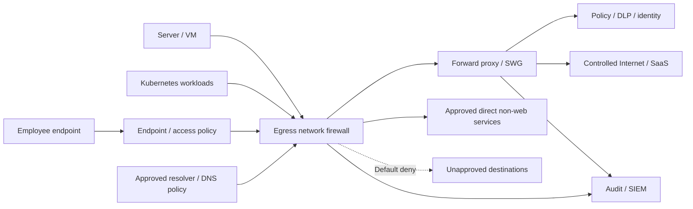
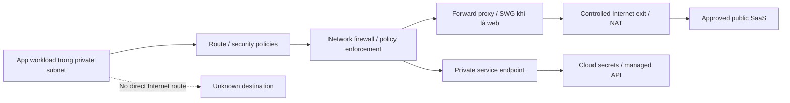

# Egress firewall và proxy tập trung

## Mục tiêu học tập

Sau bài học, bạn có thể:

1. Giải thích **egress traffic**, **default deny**, **egress firewall**, **forward proxy**, **secure web gateway (SWG)**, **NAT gateway**, **DNS security**, **DLP** và ranh giới tác dụng của từng lớp.
2. Vẽ luồng từ endpoint, server, container/pod hoặc cloud workload ra Internet/SaaS, xác định những điểm có thể thực thi chính sách **L3/L4 và L7**.
3. Phân biệt **explicit forward proxy, transparent/intercept proxy, egress gateway**, reverse proxy và application-aware cloud firewall; hiểu HTTP `CONNECT` và các giới hạn TLS.
4. Thiết kế ma trận **nguồn — đích — dịch vụ — mục đích — giao thức — danh tính — hành động** theo nguyên tắc **least privilege**, đồng thời giữ những đường ra thiết yếu như DNS, identity, certificate, update và telemetry.
5. Đánh giá rủi ro vượt chính sách qua **IPv6, UDP/QUIC, DoH/DoT, DNS rebinding, shared IP/CDN, direct IP, VPN/split tunnel, alternate route và cloud NAT**.
6. Kết hợp firewall/proxy với **classification, DLP, CASB/SSE, endpoint controls, ứng dụng, IAM**, nhận biết giới hạn quan sát nội dung mã hóa.
7. Thiết kế hệ thống **HA, capacity, fail behavior, privacy, log/audit, ngoại lệ có hạn và incident response**, tránh biến proxy tập trung thành single point of failure.
8. Áp dụng policy mẫu, mô phỏng quyết định bằng **Python ngoại tuyến**, lập phép thử allow/deny và giải thích kết quả **PASS, BLOCK, WARN, INCONCLUSIVE** dựa trên bằng chứng thực thi.

## 1. Bài toán: ứng dụng được phép truy cập mạng nhưng không được gửi dữ liệu đi tùy ý

Giả sử công ty có:

- Máy nhân viên truy cập SaaS qua HTTPS.
- API xử lý đơn hàng trên Kubernetes cần gọi cổng thanh toán và kho bí mật.
- Server database chỉ cần backup đến hệ thống đã duyệt.
- Công cụ CI/CD cần tải package từ repository tin cậy.
- Thiết bị quản trị cần gọi IdP, MDM, EDR và management API.

Một cấu hình egress quá rộng, ví dụ cho mọi workload kết nối `0.0.0.0/0` và `::/0` trên TCP/443, có thể làm ứng dụng chạy thuận tiện. Tuy nhiên, **TCP/443 không có nghĩa đích đáng tin, nội dung an toàn hoặc hành vi hợp lệ**. Nếu một process bị chiếm quyền, nó có thể gửi secrets, tài liệu hoặc bản ghi khách hàng qua một đích HTTPS không được duyệt.

Ở chiều ngược lại, đặt chính sách “cấm mọi kết nối ra ngoài” mà không phân tích dependencies sẽ làm:

- DNS và service discovery ngừng hoạt động.
- OIDC/JWKS/token refresh thất bại.
- Ứng dụng không nhận certificate trust updates hoặc không truy cập dịch vụ cấp phát cần thiết.
- Container images, OS/EDR updates không tải được.
- Backup, email, monitoring và webhook hợp lệ bị gián đoạn.
- Egress proxy quá tải trở thành điểm sự cố chung.

**Egress firewall và proxy tập trung** phải đồng thời trả lời hai câu hỏi:

1. **Luồng nào được đi ra và vì sao?** — quyết định theo nguồn, đích, giao thức, danh tính, dữ liệu và resource policy.
2. **Đâu là điểm thực thi không thể dễ dàng đi vòng?** — topology, route, firewall, proxy, endpoint/cluster agent và kiểm tra bằng thử nghiệm thực tế.

Trong module `SECURITY_NETWORK_SECURITY`, đây là chủ đề thuộc chương **Kiểm soát egress và chống thất thoát dữ liệu**. Bài kết nối các lớp phân đoạn, firewall, VPN, DNS, TLS, IDS/IPS, cloud security và mô hình hóa mối đe dọa để thiết kế đường ra tối thiểu nhưng đủ cho nghiệp vụ.

> **Nguyên tắc:** **NAT chỉ thay đổi địa chỉ, proxy không tự là DLP, firewall chỉ nhìn port không hiểu dữ liệu; HTTPS là mã hóa vận chuyển, không phải dấu chứng nhận hoạt động an toàn.** Cần kết hợp các cơ chế với policy theo tài nguyên và có bằng chứng thực thi.

### 1.1. “Egress control” không phải một sản phẩm duy nhất

Một kiến trúc có thể dùng:

- Host firewall hoặc network firewall để chặn đường IP/port trái phép.
- DNS resolver được duyệt để kiểm soát phân giải tên và hỗ trợ phát hiện.
- Forward proxy/SWG để áp quy tắc domain, URL, user/workload và nội dung theo khả năng.
- Egress gateway cho traffic container, mesh hoặc VPC/VNet.
- Application allowlist hoặc cloud IAM cho API nhạy cảm.
- DLP ở endpoint, proxy, SaaS hoặc application để bảo vệ dữ liệu.
- SIEM/NDR/flow logs để theo dõi drift và các đường không đi qua proxy.

Không lớp nào độc lập chứng minh **“không có data exfiltration”**; cần phân tích những đường đi và dữ liệu thực.

## 2. Phân biệt thuật ngữ nền tảng

| Thuật ngữ | Tác dụng chính | Không thể suy ra |
|---|---|---|
| **Ingress** | Traffic đi vào mạng, host, workload hoặc ứng dụng | Egress cũng đã được kiểm soát |
| **Egress** | Traffic đi ra khỏi trust zone/endpoint/workload | Đích ở ngoài lúc nào cũng độc hại |
| **Egress firewall** | Allow/deny dựa trên thuộc tính network, có thể thêm app identity/L7 tùy sản phẩm | Đọc được mọi nội dung HTTPS |
| **Stateful filtering** | Theo dõi luồng/phiên để xử lý response theo trạng thái | User/app business authorization |
| **NAT / SNAT / MASQUERADE** | Đổi địa chỉ/cổng nguồn, thường để private workloads đi ra | Tự động giới hạn destination hay ngăn exfil |
| **NAT gateway** | Dịch địa chỉ, quản lý traffic ra ngoài theo cấu hình cloud/on-prem | Tự động lọc theo FQDN, nội dung hoặc identity |
| **Explicit forward proxy** | Client biết proxy, gửi yêu cầu đến proxy để truy cập đích | Mọi client bắt buộc phải dùng nếu direct path còn mở |
| **Transparent/intercept proxy** | Thiết bị trung gian chuyển/đón traffic mà client không chủ động cấu hình proxy | Luôn hiểu được TLS hoặc từng giao thức |
| **Secure Web Gateway (SWG)** | Kiểm soát web egress theo user/domain/category/risk; tính năng phụ thuộc sản phẩm | Kiểm soát mọi protocol ngoài web |
| **CASB/SSE** | Kiểm soát truy cập, cấu hình hoặc hoạt động trên dịch vụ cloud/SaaS theo chế độ triển khai | Thấy mọi nội dung trên app không được tích hợp |
| **DLP** | Phát hiện/hạn chế dữ liệu thuộc policy khi di chuyển hoặc sử dụng | Xác định chính xác mọi bí mật hoặc không có false positive |
| **Proxy authentication** | Gắn request với user/service identity đã xác thực | Danh tính ấy được quyền gửi bất kỳ dữ liệu nào |
| **Service mesh egress gateway** | Điểm ra có kiểm soát cho traffic trong mesh theo cấu hình | Tự bắt mọi hostNetwork/sidecar-bypass traffic |
| **DNS firewall/policy** | Kiểm soát domain name resolution theo policy | Chặn mọi direct-IP hoặc alternate DNS path |
| **TLS inspection** | Giải mã/kiểm tra có kiểm soát một số luồng tại trusted proxy | Khả thi hoặc phù hợp quyền riêng tư với mọi traffic |
| **Default deny** | Không có allow rule phù hợp thì deny | Tất cả data paths đều thực thi cùng chính sách |

### 2.1. Egress được định nghĩa theo ranh giới nào?

Một packet có thể là:

- **Egress của Pod** nhưng ingress của node.
- **Egress của VPC** nhưng ingress của đối tác qua private peering.
- **Egress của laptop** qua local Wi-Fi trong lúc VPN split tunnel.
- **Egress của ứng dụng** qua forward proxy, dù proxy tiếp tục có một kết nối egress độc lập.
- **Traffic nội bộ subnet** nhưng vẫn ra khỏi một **sensitivity zone**.

Vì vậy, đừng đồng nhất “egress” với “đi Internet”. Policy phải nêu **source trust zone và destination trust zone**. Với dữ liệu nhạy cảm, các private cross-account links có thể quan trọng không kém public Internet.

## 3. Kiến trúc nhiều lớp: firewall và proxy tập trung đứng ở đâu?

### 3.1. Sơ đồ logic



Sơ đồ cho thấy **ý định**: những web flows cần proxy đi qua proxy; những protocol hợp lệ khác đi theo rule riêng; không còn default direct path tự do.

Trong môi trường thật, routing và NAT có thể khác:

- Endpoint có explicit proxy PAC/MDM policy, kết nối trực tiếp tới proxy.
- Firewall chỉ cho client kết nối đến **proxy listener** và approved non-web destinations.
- Proxy tự mở phiên mới tới SaaS/Internet qua egress WAN/NAT.
- Một server trong private subnet không có Internet gateway trực tiếp.
- Kubernetes traffic có thể qua CNI/egress gateway, mesh proxy, cloud NAT và SG.
- Cloud firewall có thể kết hợp stateful L3/L4 với domain/application policies theo khả năng vendor.

### 3.2. Tách ba mặt phẳng

| Mặt phẳng | Thành phần | Câu hỏi |
|---|---|---|
| **Control plane** | Policy store, IAM, governance, change approvals | Ai cấu hình allow/deny và exception? |
| **Decision plane** | Policy evaluator, reputation/threat intel, DLP rules, identity mapping | Request này có đủ điều kiện không? |
| **Data/enforcement plane** | Host/cloud firewall, proxy, gateway, agent | Traffic thật có bị allow/deny/inspect theo quyết định không? |

Một policy file `deny *.example` là không đủ nếu gateway **không áp rules**, connector cũ chưa nhận policy, hoặc client còn route ngoài PEP. Cần xem **effective path và outcome**.

## 4. Lập danh mục luồng trước khi đặt default deny

### 4.1. Các nguồn egress

- User workstations, laptops (managed/BYOD), mobile, VDI.
- Database/application VMs; các subnet frontend, backend và quản trị.
- Containers, Pods, namespaces, build jobs và CI runners.
- Cloud workloads (VMs, serverless, managed services theo sản phẩm).
- Monitoring collectors, security scanners được ủy quyền, backup agents.
- DNS forwarders, NTP, CA/OCSP/CRL services, artifact registries.
- Partner VPNs, private links, cross-VPC/VNet traffic.
- Legacy/OT/IoT devices sử dụng broker/proxy riêng.

### 4.2. Mẫu flow matrix

| ID | Nguồn | Đích | Giao thức | Mục đích | Policy minh họa |
|---|---|---|---|---|---|
| F01 | Employee managed browsers | Approved SaaS tenant | HTTPS/TCP 443 | Công việc | ALLOW qua authenticated SWG |
| F02 | Employee guest/BYOD | Admin console | HTTPS | Quản trị | DENY |
| F03 | API workloads | Payment partner endpoint | HTTPS/TCP 443 | Thanh toán | ALLOW đúng FQDN/API identity |
| F04 | API workloads | Arbitrary Internet | TCP/443 | Không có use case | DENY |
| F05 | API workloads | Approved DNS resolver | UDP/TCP 53 | Phân giải | ALLOW |
| F06 | API workloads | Unknown DNS resolver | UDP/TCP 53 | Bypass | DENY |
| F07 | API workloads | Cloud secrets API | HTTPS/TCP 443 | Cấu hình | ALLOW qua private/service endpoint |
| F08 | CI runner | Artifact registry | HTTPS/TCP 443 | Build | ALLOW scoped registry |
| F09 | Database | Approved backup target | Tùy dịch vụ | Backup | ALLOW theo identity |
| F10 | Database | Public file-sharing site | HTTPS | Không có nhu cầu | DENY |
| F11 | EDR agents | Vendor EDR endpoints | HTTPS và giao thức được công bố | Sensor/updates | ALLOW có owner |
| F12 | Monitoring collector | SIEM/log endpoint | HTTPS/TCP 443 | Telemetry | ALLOW |
| F13 | Any untrusted workload | Metadata/control service | Link-local/private | Không có nhu cầu | DENY theo nền tảng |
| F14 | Proxy | Internet/SaaS đã duyệt | HTTPS | Truy xuất thay client | ALLOW dưới identity proxy |
| F15 | Workloads | Proxy listener | TCP theo cấu hình | Web egress | ALLOW đúng client nhóm |
| F16 | Workloads | Proxy bypass via direct IP | TCP/443 | Không được phê duyệt | DENY |

**FQDN, IP/CIDR, protocol, source identity, time window, risk tier và owner thực tế cần được điền bằng nguồn được phê duyệt**. Những giá trị ở bảng là ví dụ; không copy wildcard rules vào production.

### 4.3. Hãy nhớ những traffic ít thấy

- DNS, DHCP nếu kiến trúc cần, NTP/time sync, mTLS cert rotation.
- IdP discovery, OIDC/JWKS, SAML, STS và MFA callbacks.
- CRL/OCSP/CA endpoints khi sản phẩm cần status checking.
- Package repositories, registry pull/push, image signature verification.
- Service mesh control plane, sidecar bootstrap, certificate delivery.
- Cloud metadata/managed identities theo kiến trúc — **không mở metadata rộng cho untrusted apps**.
- Backup/restore, retention, incident logging và health checks.
- Third-party webhooks, payment processors, email relay, SMS gateway.
- IPv6 AAAA-resolved destinations, UDP QUIC và private partner APIs.

**Không chặn nhầm dịch vụ bảo mật**: nếu EDR/MDM, IdP hoặc SIEM mất egress, hệ thống có thể vừa mất khả dụng vừa mất khả năng phát hiện sự cố.

## 5. Egress firewall L3/L4: chức năng, state và hạn chế

### 5.1. Các trường một policy có thể xét

Một rule network firewall điển hình có thể xét:

```text
source network / workload / identity (nếu hỗ trợ)
destination IP / CIDR
protocol: TCP, UDP, ICMP/ICMPv6, ...
destination port hoặc service
direction: egress
state: NEW, ESTABLISHED, RELATED (tùy engine)
action: ALLOW / DENY / REJECT / LOG
rule priority và policy version
```

Có các firewall L7/app-aware phong phú hơn. **Một L3/L4 rule không tự hiểu URL path hoặc file upload** khi traffic chạy qua TLS.

### 5.2. Default deny đặt đúng vị trí

Trong một mạng server, mục tiêu là:

1. Xác định những flow hợp lệ thật.
2. Cho các flow tới **proxy và approved direct services**.
3. Chặn new outbound flows còn lại trên **đúng data path**.
4. Theo dõi counters/logs và chặn đường qua secondary route/interface.
5. Kiểm cả IPv4/IPv6, TCP/UDP, direct/private egress.
6. Bảo đảm replies/established sessions được xử lý theo ngữ nghĩa stateful.

Ví dụ ý định:

```text
ALLOW source=api-zone -> approved-resolver UDP/TCP 53
ALLOW source=api-zone -> forward-proxy TCP 3128
ALLOW source=api-zone -> secrets-private-endpoint TCP 443
DENY  source=api-zone -> ANY OTHER DESTINATION
```

**Đây là pseudocode**; implementation khác nhau ở cloud security groups, NACL, host firewall, CNI và vendor firewalls. Tránh dùng ``iptables -F`` hoặc bật allow-all chỉ để “xem app hoạt động”.

### 5.3. Stateful return traffic

Nếu API tạo kết nối tới proxy, proxy sẽ phản hồi trên **phiên đã được mở**. Một stateful firewall có thể cho reply dựa trên state; không cần cho proxy khởi tạo mọi kết nối mới tới API.

Ngược lại, **stateless ACL** có thể yêu cầu rule chiều phản hồi/ephemeral ports. Chính sách phải nêu **kết nối mới** và **phản hồi thuộc phiên hợp lệ** riêng, tránh chặn return path.

### 5.4. Kết nối UDP và thời gian sống

UDP không có handshake như TCP. Firewall/conntrack có thể lưu pseudo-state với timeout ngắn. Điều này ảnh hưởng:

- DNS UDP 53, QUIC UDP 443.
- Streaming/VoIP/gaming, telemetry protocols.
- NAT bindings và idle timeouts.
- Return path và failover.

Không dùng một mẫu “allow 443” để mô tả TCP/443 và UDP/443 đồng thời nếu policy chỉ cho một transport.

### 5.5. Giới hạn IP/CIDR allowlist

- Shared hosting/CDN có thể có nhiều tenant chung IP.
- SaaS đổi địa chỉ, DNS answers, dual-stack và routing theo vùng.
- Cho nguyên một CIDR rộng có thể mở nhiều đích không liên quan.
- Firewall chỉ biết IP/port không xác minh tenant SaaS hoặc URL.
- Đích đã duyệt có thể bị compromise; allowlist vẫn không ngăn việc gửi dữ liệu không phù hợp.

IP allowlist vẫn hữu ích cho **private service endpoints, partner dedicated IPs, internal DNS hoặc gateway ingress**, nhưng không giải quyết hết web egress.

## 6. NAT gateway không thay thế egress firewall

### 6.1. Source NAT là gì?

Ví dụ:

```text
App private IP 10.20.3.7:53000
  -> NAT gateway
  -> public IP 203.0.113.80:45001
  -> SaaS 198.51.100.44:443
```

NAT gateway đổi địa chỉ/cổng nguồn để remote endpoint trả về được. Với NAT egress model phổ biến, nó **không tự xác thực FQDN, URL, user hoặc nội dung**.

Một private subnet có route `0.0.0.0/0` tới NAT gateway vẫn có thể tiếp cận Internet rộng nếu không có firewall/policy khác hạn chế.

### 6.2. Cần phân biệt các thành phần cloud

| Thành phần | Mục tiêu | Rủi ro nhầm lẫn |
|---|---|---|
| Internet gateway | Kết nối VPC/VNet và Internet theo routing/provider semantics | Không tự áp domain/application policy |
| NAT gateway | Source NAT cho private workloads | Bị hiểu nhầm là egress allowlist |
| Network firewall | Filtering/rules/inspection theo capability | Mọi rule tự hiểu nội dung TLS |
| Forward proxy/SWG | Xử lý web/HTTP egress và policies L7 khi cấu hình | Tự chặn direct IP dù network cho bypass |
| Private endpoint/service endpoint | Kết nối riêng tới dịch vụ hỗ trợ | Không đồng nghĩa cloud IAM least privilege |
| Egress gateway | Điểm ra tập trung ở mesh/VPC/CNI theo architecture | Mọi pod/hostNetwork đều đi qua nếu thiếu route restrictions |

**Một NAT gateway có fixed public IP** rất hữu ích để đối tác allowlist IP nguồn, nhưng **fixed source IP không làm dữ liệu rời mạng trở nên an toàn**.

### 6.3. Hiểu identity sau NAT

Network logs bên ngoài có thể chỉ thấy **IP NAT/proxy chung**, không thấy workload gốc. Cần:

- Log trước NAT hoặc flow attribution theo subnet/VM/pod/identity.
- Correlation ID hoặc authenticated proxy client principal.
- Audit theo thời gian và NAT translation fields khi pháp lý/vận hành cho phép.
- Giảm việc nhiều ứng dụng cùng dùng chung một proxy credential.
- Không đưa private source IP như bằng chứng identity khi có NAT/proxy/multi-tenant.

## 7. Forward proxy tập trung: thiết lập, phân giải và luồng kết nối

### 7.1. Forward proxy khác reverse proxy

- **Forward proxy** đứng về phía **client** và thực hiện kết nối tới tài nguyên mà client muốn truy cập. Ví dụ laptop/app gửi request qua `proxy.corp.example:3128` để ra SaaS.
- **Reverse proxy** đứng trước **ứng dụng/server** và nhận inbound requests từ người dùng/clients. Ví dụ ingress gateway nhận HTTPS cho một app private.

Một gateway có thể thực hiện cả chức năng, nhưng **ngữ nghĩa access control và trust boundary khác nhau**.

### 7.2. Explicit HTTP proxy

Client được cấu hình proxy bằng managed policy/OS/application settings. Một request HTTP không TLS tới proxy có thể có absolute-form request target; còn HTTPS phổ biến dùng `CONNECT` để tạo tunnel.

```text
Client
   |
   | TCP/TLS kết nối tới forward proxy (tùy proxy protocol)
   v
Proxy xác thực client / xét destination policy
   |
   | Proxy mở kết nối mới tới approved origin
   v
Origin server / SaaS
```

Khi proxy xác thực client, danh tính có thể dựa trên **user SSO, mTLS client cert, service token, node/workload identity** tùy sản phẩm. Không tin một header `X-User` do client tự khai nếu gateway chưa verify.

### 7.3. HTTPS qua HTTP CONNECT

Luồng khái niệm:

```text
Client -> Proxy: CONNECT api.partner.test:443 HTTP/1.1
Proxy  -> Client: HTTP/1.1 200 Connection Established
Client <-> Origin: TLS handshake và encrypted application data
```

**Quan trọng:** Trong mô hình CONNECT tunnel thuần túy, proxy biết client và **requested authority (host:port)**, nhưng **không tự đọc được body HTTPS**. Proxy có thể cho/chặn tunnel theo policy, logs metadata và các thông tin được nhìn thấy, nhưng không phải DLP nội dung nếu không có cơ chế inspection/authorization ở lớp khác.

Proxy phải giới hạn `CONNECT` destinations/ports/identities để tránh biến thành một **open relay**. Không cho unrestricted tunneling tới control plane hoặc endpoint không được duyệt.

### 7.4. Proxy có thể thấy hostname nào?

Tùy kiến trúc:

- Requested `CONNECT` authority do client khai: là một **request target**, không tự chứng minh TLS origin identity.
- DNS lookup phía proxy: có thể trả IP khác DNS trên client, cần kiểm policy/anti-rebinding.
- SNI trong TLS ClientHello có thể quan sát trong một số đường, nhưng **ECH có thể che tên bên trong**.
- Server certificate có thể được quan sát/kiểm khi proxy terminate TLS; không mặc định thấy đầy đủ trong tunnel.
- HTTP Host, path, headers và content chỉ sẵn ở nơi có **HTTP termination/inspection phù hợp**, không phải trong mọi CONNECT tunnel.

**Chỉ match SNI hoặc CONNECT hostname không đủ bảo đảm tenant và dữ liệu** khi dịch vụ dùng shared origins/CDN, redirects, wildcard domains hoặc domain-fronting-like behavior.

### 7.5. Proxy DNS versus client DNS

Một explicit forward proxy có thể thực hiện DNS resolution ở phía proxy cho origin request, nhưng:

- Client vẫn cần resolve **tên proxy** (trừ khi cấu hình IP).
- Các ứng dụng có thể làm DNS riêng trước khi dùng proxy.
- PAC/wpad/bypass lists có thể quyết định direct vs proxied traffic.
- Một số client/protocol không hỗ trợ HTTP proxy.
- Dịch vụ SaaS/CDN có thể chọn endpoint theo resolver region và client geography.

Cần thiết kế DNS policies và kiểm thử **đường thật của từng client**; không suy mọi DNS query đều diễn ra ở một nơi.

## 8. Explicit, transparent, agent và service-mesh egress

### 8.1. So sánh các mô hình

| Mô hình | Lợi ích | Rủi ro/giới hạn |
|---|---|---|
| **Explicit forward proxy** | Client/ứng dụng biết proxy; identity và HTTP policy rõ | App không hỗ trợ proxy; bypass nếu route trực tiếp |
| **PAC/WPAD** | Chọn proxy theo URL/domain trong môi trường hỗ trợ | PAC logic phức tạp; client có thể không tuân thủ; WPAD cần bảo vệ |
| **Transparent/intercept proxy** | Không cần cấu hình từng client trong một số topology | Giao thức/TLS routing khó; khó quy identity; legal/privacy constraints |
| **Endpoint agent** | Có thể kiểm app/process/user và kết hợp posture | Tampering, OS support, unmanaged device limitations |
| **Cloud SWG/SSE** | Có thể kết hợp proxy, CASB, threat intelligence | Vendor-specific features, availability và data residency |
| **Service mesh egress gateway** | Điều phối traffic của workloads tham gia mesh | Không tự chặn unmeshed/hostNetwork hoặc direct paths |
| **CNI egress gateway** | Điều khiển source IP/route theo workload/net policy, tùy CNI | Không mặc định có HTTP DLP/L7 visibility |
| **Application-native client** | Biết endpoint business và auth chính xác | Mỗi app phải triển khai đúng controls, khó bảo đảm coverage |

### 8.2. Proxy tập trung phải có chặn đường vòng

Nếu server được cấu hình `HTTPS_PROXY=http://proxy:3128` nhưng network vẫn cho `server -> Internet TCP/443` trực tiếp, một process khác có thể không sử dụng proxy.

Mô hình network nên:

1. Chỉ cho workload kết nối tới approved proxy listener.
2. Chỉ cho proxy mở kết nối Internet/approved SaaS.
3. Có exceptional direct flows bằng rules riêng với owner và expiry.
4. Chặn DNS bypass và alternate interfaces/routes.
5. Kiểm traffic IPv4/IPv6, TCP/UDP và các protocols khác.
6. Giữ các bootstrap dependencies như identity, DNS và update endpoints.

Một biến môi trường proxy chỉ là **cấu hình client**, không phải một ranh giới bảo mật không thể bypass.

### 8.3. No-proxy list cần quản trị

`NO_PROXY`/PAC exceptions có thể hữu ích cho nội bộ như localhost, metadata được thiết kế, private service endpoints. Nhưng wildcard quá rộng có thể vô hiệu hóa proxy trên nhiều đích.

Hãy kiểm:

- Mục tiêu nào thật sự cần bypass.
- App/client có diễn giải dấu chấm đầu, domain suffix, CIDR và IP literals giống nhau không.
- Không vô tình cho domain suffix rộng khớp cả destination ngoài ý định.
- Có host/network firewall enforce giới hạn direct egress không.
- Lưu version/owner, expiry và tests của bypass exceptions.

## 9. TLS inspection và giới hạn kỹ thuật, pháp lý

### 9.1. Không có TLS inspection

Một proxy chỉ làm CONNECT tunnel có thể áp:

- Authentication và policy theo client identity.
- Policy theo requested target hostname/port, đôi khi DNS/IP reputation.
- Rate/connection limits và threat signals ở metadata.
- Audit thời điểm, kích thước/số byte và destination metadata.
- Chặn toàn bộ category/unknown origins theo chính sách.

Nhưng proxy **không đọc được file upload, HTTP request body hoặc nội dung cloud API bên trong TLS end-to-end** trong kiểu tunnel này. Vì vậy đừng tuyên bố đã triển khai “full DLP” chỉ nhờ cài forward proxy.

### 9.2. Có TLS interception được phê duyệt

Một SWG có thể kết thúc TLS của client và mở kết nối TLS khác tới origin:

```text
Managed client --TLS 1--> Trusted inspection proxy --TLS 2--> SaaS origin
                   |
            Authorized content inspection
```

Để an toàn:

- Client phải **tin CA cấp cho proxy inspection** qua cơ chế quản trị phù hợp.
- Proxy xác minh **certificate chain/hostname của origin**, không dùng trust-all.
- Private key của proxy inspection CA cần được bảo vệ, hạn scope và rotation.
- Chính sách phân biệt nhóm traffic được phép kiểm tra và nhóm phải exempt.
- Bảo vệ thông tin nhạy cảm mà proxy nhìn thấy: credentials, dữ liệu riêng, tài chính.
- Kiểm tra protocol/HTTP correctness, certificate pinning/mTLS và application compatibility.
- Log theo dữ liệu tối thiểu, audit quyền người quản trị có thể xem payload.
- Có transparent user notice/consent và tuân thủ pháp lý/kế hoạch privacy.

**TLS inspection không phải “phá TLS” tùy ý**; đây là điểm kết thúc TLS đáng tin khi endpoint được quản trị đồng ý tin CA tương ứng. Thiết kế sai có thể tạo rủi ro lớn hơn lợi ích.

### 9.3. Khi nào không nên giải mã?

Một số trường hợp cần **bypass inspection có kiểm soát** hoặc dùng giải pháp khác:

- Giao dịch nhạy cảm có yêu cầu pháp lý hoặc quyền riêng tư cụ thể.
- Ứng dụng dùng **certificate pinning**/mTLS end-to-end không tương thích proxy MITM.
- Ứng dụng có non-HTTP protocol hoặc payload không được parser hỗ trợ.
- Health/medical/financial content thuộc quy tắc xử lý đặc biệt.
- Client IoT/OT không thể cài enterprise root CA.
- Kênh cập nhật bảo mật hoặc identity cần bảo toàn signature/trust semantics.
- Ứng dụng dùng QUIC/HTTP3 hoặc cơ chế bảo vệ handshake ngoài khả năng inspection.

**Bypass TLS inspection không có nghĩa cho phép bỏ luôn destination filtering và logging phù hợp.** Áp layer L3/L4/domain/identity và endpoint/SaaS DLP bù khi có thể.

### 9.4. Certificate pinning, mTLS và HTTP/3

- Certificate pinning có thể khiến client từ chối proxy certificate.
- Client-authenticated mTLS có thể không hoạt động nếu proxy nằm giữa mà không được thiết kế hỗ trợ protocol.
- QUIC/HTTP3 dựa trên UDP; proxy HTTP CONNECT/TCP truyền thống không phải điểm inspection tương đương.
- Các chuẩn cơ chế tunneling hiện đại như CONNECT-UDP/MASQUE có ngữ nghĩa khác, chỉ nên cho nếu sản phẩm có controls thích hợp.
- Không vô hiệu hóa hostname verification, không dùng `--insecure` hoặc thay truststore bừa bãi chỉ để làm proxy hoạt động.

## 10. DNS security và egress policy theo FQDN

### 10.1. Tại sao chỉ chặn domain tại DNS chưa đủ?

Một firewall DNS có thể từ chối truy vấn `bad.example`, nhưng một client vẫn có thể:

- Dùng IP đã cache/biết sẵn.
- Gọi trực tiếp IP literal qua HTTPS hoặc protocol khác.
- Dùng resolver khác, DoT hoặc DoH nếu egress route cho phép.
- Kết nối tới cloud/CDN IP shared với nhiều domain.
- Sử dụng private resolver trong VPN hoặc split tunnel.
- Dùng embedded DNS cache hoặc endpoint khác với resolver được quản trị.

Vì vậy **DNS policy hỗ trợ egress controls nhưng không thay network enforcement**. Cần limit client resolver paths, DoH/DoT endpoints khi có lý do, và direct connections.

### 10.2. Kiểm soát resolver

Một pattern:

```text
Workload -> Approved DNS resolver UDP/TCP 53
Workload -> Unapproved resolver UDP/TCP 53       DENY
Workload -> Arbitrary DoT TCP/853                DENY by policy
Workload -> Arbitrary DoH HTTPS/443              Controlled by proxy/L7 policy
Approved resolver -> Allowed authoritative recursion paths
```

Lưu ý: DoH đi trong HTTPS nên chỉ chặn TCP/853 **không đủ**. Chặn mọi HTTPS sẽ phá ứng dụng; cần phương thức nhận diện traffic/endpoint phù hợp với pháp lý và platform.

### 10.3. FQDN firewall và DNS rebinding

Một firewall/proxy cho `api.partner.test` có thể cần theo dõi các IP khác nhau do DNS trả về. Những khó khăn:

- **TTL và cache:** IP có thể thay trước khi policy cập nhật.
- **Shared IP:** một IP phục vụ nhiều tenant và domains.
- **DNS rebinding:** hostname được phép có thể đổi đích sang private/link-local IP.
- **CNAME chains:** một domain dẫn tới CDN hoặc service endpoint khác.
- **Split-horizon DNS:** internal và public resolver trả kết quả khác.
- **IPv6:** AAAA endpoints có thể không nằm trong IPv4 allowlist.

Cần xác minh **đích sau phân giải** vẫn thuộc phạm vi an toàn; đừng chỉ so một chuỗi domain do client khai rồi cho kết nối đến IP bất kỳ.

### 10.4. Allowlist theo FQDN không tự kiểm nội dung

Một service được phép `storage.vendor.test` có thể cho các accounts/tenants khác nhau dùng chung domain. Nếu dữ liệu nhạy cảm được upload lên **account cá nhân trên cùng SaaS**, rule FQDN vẫn match.

Khi cần ràng buộc tenant/account, tích hợp **SaaS tenant controls, CASB, app authorization, API scopes, signed upload targets hoặc DLP** phù hợp.

## 11. IPv6, UDP/QUIC, ECH và nhiều đường ra

### 11.1. Dual stack là hai vùng kiểm soát

- `0.0.0.0/0`: toàn bộ IPv4.
- `::/0`: toàn bộ IPv6.
- NAT IPv4 không nhất thiết là datapath của IPv6.
- Một Pod/VM có IPv6 global route có thể đi trực tiếp nếu cloud/host controls cho phép.
- Firewall/proxy audit chỉ IPv4 không chứng minh IPv6 bị chặn.
- ICMPv6 cần cho một số chức năng mạng; không đặt blanket deny không có hiểu biết.

**Mọi egress policy quan trọng phải được xét song song theo address family đang triển khai**.

### 11.2. QUIC/HTTP3

Đối với HTTP/3, traffic thường dùng QUIC qua UDP/443. Một network rule chặn outbound TCP/443 trực tiếp nhưng quên UDP/443 có thể tạo đường ra khác cho client hỗ trợ QUIC.

Các lựa chọn thiết kế:

- Chỉ cho UDP/443 tới approved egress gateway/proxy hỗ trợ QUIC.
- Nếu không hỗ trợ kiểm soát QUIC, chặn direct UDP/443 theo chính sách và xác minh fallback TCP/HTTPS.
- Dùng SWG/eBPF/endpoint capability có coverage với protocol cụ thể.
- Ghi protocol/IP family trong logs và test matrix.
- Không mặc định mọi ứng dụng sẽ fallback thành công hoặc không có hiệu ứng hiệu năng.

### 11.3. ECH và SNI visibility

Encrypted ClientHello (ECH) có thể che một phần tên máy chủ trong TLS handshake; SNI không còn là một tín hiệu đầy đủ cho mọi lưu lượng HTTPS. Khi thiết kế filtering:

- Không phụ thuộc duy nhất vào cleartext SNI.
- Dùng authenticated proxy request target, DNS context, trusted identity hoặc chính sách ứng dụng theo khả năng.
- Kiểm những trường hợp không thấy SNI và đặt fail behavior có chủ đích.
- Cân nhắc privacy và tiêu chuẩn giao thức; không coi mọi ECH traffic là tấn công.

### 11.4. Alternate routes và tunnel

Một endpoint/workload có thể có nhiều đường:

- VPN split tunnel và local Internet.
- Secondary NIC/IPv6 interface.
- Cloud Transit Gateway/VPC peering/private link.
- Overlay network, mesh sidecar, hostNetwork.
- Wi-Fi/hotspot khác khi rời văn phòng.
- Secondary egress region khi failover.
- SSH tunnel hoặc proxy chain được cấp phép.

Các đường đó cần được **inventory và kiểm soát theo policy**, không dựa vào việc đường mặc định đã qua proxy mà bỏ qua alternate paths.

## 12. Identity-aware egress: ai đang thực sự gửi request?

### 12.1. Danh tính nguồn khó hơn source IP

Ở một NAT gateway hoặc shared forward proxy, hàng nghìn users/workloads có thể có **cùng public source IP**. Một policy “IP 203.0.113.80 được upload files” có thể cấp quyền quá rộng.

Các nguồn identity có thể gồm:

- SSO/IdP user identity ở authenticated SWG.
- Device certificate và posture từ MDM/EDR khi liên kết đúng.
- Workload service account/mesh identity ở môi trường hỗ trợ.
- Machine/workload certificate mTLS.
- Cloud IAM/workload identity ở API destination.
- Container/Pod labels và namespace là **metadata có thể dùng để select network policy**, không tự là xác thực bằng mật mã.
- Application API token/caller identity ở L7 nếu proxy/gateway xác minh.

### 12.2. Chọn identity theo trust boundary

| Use case | Identity nên xem | Không chỉ dựa vào |
|---|---|---|
| Employee SaaS egress | User+device+tenant/app policy | IP NAT văn phòng |
| Server batch job | Workload certificate/service principal | Hostname tự khai |
| Kubernetes pod HTTP | Workload verified identity hoặc node/namespace policy tùy CNI | Pod label như bearer credential |
| Partner API | mTLS/client credential, approved egress source | Chỉ IP allowlist |
| Sensitive file upload | Authorized user/workload và business context | “Có TCP/443 nên hợp lệ” |
| Admin shell egress | Managed device, PAM/session, command/data policy phù hợp | VPN connected |
| SaaS tenant restriction | Tenant/organization identity xác minh qua app/proxy | Chỉ FQDN shared SaaS |

### 12.3. Áp dụng least privilege

Một pipeline CI có thể được phép tải packages từ registry; không vì thế nó được phép gửi source code tới bất kỳ file-sharing site. Một monitoring collector được phép ghi log tới SIEM; không vì thế nó được phép gọi cloud admin API.

Policy nên gắn với:

```text
(identity of source,
 authorized application/workload,
 destination/service/tenant,
 protocol and method when visible,
 data sensitivity,
 time window,
 posture/risk,
 explicit business purpose)
  -> ALLOW / DENY / REVIEW / REMEDIATE / INSPECT
```

**Giới hạn kỹ thuật:** Firewall L3/L4 không thể trực tiếp thực thi tất cả trường trên. Cần đặt policy ở điểm phù hợp — app, API gateway, SWG, CASB, IAM hoặc DLP engine — và đóng direct bypass.

## 13. DLP và egress: bảo vệ nội dung, không chỉ domain

### 13.1. Bốn tình huống exfiltration phổ biến

1. Nhân viên upload tài liệu nội bộ lên tài khoản lưu trữ đám mây cá nhân.
2. Application server bị compromise gửi API token/secrets tới origin HTTPS không được duyệt.
3. ETL job vô tình đẩy dữ liệu khách hàng tới bucket/test environment sai tenant.
4. Insider cố chuyển file lớn qua kênh đã được mạng cho phép.

Egress firewall có thể giảm **đích được phép**, proxy/SWG có thể áp policy web và logging, còn DLP tập trung vào **nội dung/nhãn dữ liệu/hành vi**, tùy nơi có thể quan sát.

### 13.2. DLP nhìn thấy được gì?

| Vị trí DLP | Nội dung có thể xét | Giới hạn |
|---|---|---|
| **Endpoint DLP** | File/clipboard/upload/process context trên thiết bị được quản trị | BYOD/OS/agent support, tampering và privacy |
| **Proxy/SWG DLP** | HTTP methods, headers, bodies/files khi TLS được inspect hợp lệ | CONNECT tunnel không giải mã; pinning/QUIC/E2EE |
| **SaaS/API CASB** | SaaS objects/sharing/upload/config theo API được cấp quyền | Tích hợp/permissions/latency; không thấy mọi ứng dụng |
| **Application DLP** | Business records, user/tenant/data classification trước xuất | Phải được xây vào app; policy coverage |
| **Cloud storage DLP** | Objects/events/storage labels trong cloud account | Không ngăn mọi client-side exfil channel |
| **Network IDS/NDR** | Flow anomalies, metadata, một số payload plaintext | TLS visibility và false positives |

### 13.3. DLP dựa trên classification

Policy nên phân biệt dữ liệu:

- Public: có thể xuất theo quy tắc thông thường.
- Internal: chỉ gửi tới dịch vụ kinh doanh được duyệt.
- Confidential: cần identity+destination restrictions, logging/inspection phù hợp.
- Restricted/regulated: cần approval, tokenization, encryption, tenant boundary và có thể **block export**.
- Secrets/private keys: có thể phát hiện và block theo pattern/context, nhưng không đảm bảo bao phủ 100%.

Một chuỗi số giống thẻ ngân hàng có thể là **false positive**; file được mã hóa hoặc dữ liệu biến đổi có thể làm DLP không phát hiện. Kết quả DLP phải là **tín hiệu giúp ra quyết định**, không nên hứa an toàn tuyệt đối.

### 13.4. Giảm exfil qua đích được phép

Nếu một SaaS service được cho phép trên `*.saas.test`, có thể cần:

- Chỉ cho **tenant công ty** thay vì tenant cá nhân.
- Giới hạn upload/download/share của user hoặc service account.
- Chặn public sharing/link creation với data class nhạy cảm.
- Áp file tagging/classification, exact data match/fingerprinting khi có.
- Tạo cảnh báo hành vi khối lượng lớn/anomaly, không chỉ raw size.
- API scopes giới hạn tại đích; chỉ ứng dụng có nghiệp vụ được phép upload.
- Policy “allow viewing, block export” cho một số vai trò.
- Data owner approval và incident review cho ngoại lệ.

**Egress DLP chỉ mạnh khi kết hợp application authorization và data governance**: một domain hợp lệ không bảo đảm tất cả tài khoản hoặc thao tác trên domain đó hợp lệ.

## 14. Phân loại destination: Internet, SaaS, partner, cloud và private services

### 14.1. Không đánh đồng “private IP” với “được tin”

Một đích IP thuộc RFC1918 hoặc IPv6 ULA có thể là:

- Database nội bộ cần bảo vệ.
- Management/control plane của cloud hoặc Kubernetes.
- Private service của đối tác qua VPN.
- Workload thuộc tenant khác qua peering.
- Máy cá nhân nằm cùng LAN hoặc guest VLAN.
- Endpoint metadata/link-local nhạy cảm.

**Egress từ một trust zone tới private destination vẫn cần policy**. Ngược lại, một dịch vụ Internet public đã được thẩm định có thể cần được allow cho nghiệp vụ cụ thể.

### 14.2. Nhóm destination và loại rule phù hợp

| Loại đích | Phương thức kiểm soát | Rủi ro chính |
|---|---|---|
| Dedicated partner private IP | Firewall IP/CIDR + mTLS/API auth | Thay route hoặc quyền partner |
| Public SaaS shared domain | SWG/CASB tenant-aware + IAM/DLP | Tenant cá nhân, domain shared |
| Public web categories | SWG URL/domain reputation | Nhầm domain, nội dung mã hóa |
| Cloud secrets API | Private endpoint + cloud IAM | Metadata/credential theft và scope |
| OS/EDR package updates | Approved vendor endpoints | Dynamic CDN và certificate pinning |
| Internal database | Segmentation + DB auth/TLS | Lateral movement |
| DNS resolver | DNS firewall, scoped DNS route | Exfil via unapproved DNS |
| Egress proxy | Proxy auth + client allowlist | Open relay hoặc unauthorized clients |
| Metadata endpoint | Provider-specific hardening + scoped identity | SSRF/credential access |
| Backup/archive | Separate credentials/approvals + audit | Large data transfers khó phân biệt hợp lệ |

### 14.3. Chính sách domain cần xác thực tenant

Cho phép `docs.saas.example` có thể chưa đủ để ngăn dữ liệu gửi tới **tài khoản cá nhân** nếu nhiều tenants cùng tên miền. Proxy/app layer hoặc CASB cần xác định:

- Tên tổ chức/tenant/account trong request khi có thể.
- Phân loại nguồn dữ liệu và quyền export.
- OAuth scopes, cloud account ownership.
- Share permissions/public link creation.
- Đường API khác với web UI.
- Direct uploads tới presigned URLs/CDN storage endpoints.
- Những ứng dụng không hỗ trợ inspection được xử lý bằng control bù.

Không tự giả định hostname tương ứng một tenant duy nhất.

### 14.4. Dịch vụ có IP động và CDN

Đối với SaaS/CDN, hardcode một IP từ lần DNS lookup đầu tiên có thể khiến policy hỏng sau TTL. Ngược lại, allow CIDR quá rộng có thể mở nhiều đích.

Phương án tùy mức rủi ro:

1. Dùng documented vendor endpoints có owner, rà thường xuyên.
2. Ở proxy, thực thi domain/tenant rules và kiểm DNS/rebinding thay vì chỉ raw IP.
3. Dùng provider service tags/prefix lists nơi có hỗ trợ và biết phạm vi.
4. Với API nhạy cảm, kiểm mTLS, hostname, application authorization và tenant.
5. Đối với data exfil risk cao, dùng application egress broker có destination/business policy.
6. Có regression test khi SaaS đổi CDN, certificate hoặc địa chỉ IPv6.

## 15. Kiến trúc egress trong cloud: route, NAT, firewall và proxy

### 15.1. Phân lớp cho private workload



Đường thực tế khác theo cloud provider và các bảng route/managed service. Thứ tự **firewall → proxy → NAT** là minh họa logic chứ không phải bắt buộc với mọi topology.

### 15.2. AWS: phân biệt NAT Gateway và Network Firewall

Trong AWS, có thể gặp:

- VPC private subnets/route tables.
- NAT Gateway cho IPv4 outbound theo mô hình phù hợp.
- AWS Network Firewall/third-party firewall cho inspection/filtering khi route đi qua.
- Security groups và network ACLs ở các ranh giới hỗ trợ.
- VPC endpoints/PrivateLink cho dịch vụ cần private connectivity.
- Cloud egress gateways/proxies ở VPC trung tâm theo topology hub/spoke.

Điểm cần review:

- Private workload có route ngoài **không đi qua** firewall/proxy không?
- Route qua firewall có symmetrical return path và availability across AZs không?
- VPC endpoint nào được phép, endpoint policy/IAM có hạn tài nguyên không?
- Workloads có public IP/secondary interface/IPv6 egress khác không?
- Sự khác biệt giữa firewall domain policy và HTTP inspection capability là gì trên deployment thực?
- NAT IP chung làm mất attribution không, và flow logs có thể correlate thế nào?

**Chỉ đặt NAT Gateway không tạo egress default deny.** Cloud IAM cũng không bị thay thế bởi FQDN allowlist.

### 15.3. Azure: Azure Firewall và NAT Gateway

Một mô hình Azure có thể dùng:

- VNet/subnet, user-defined routes theo kiến trúc.
- Azure Firewall hoặc giải pháp tương đương với network/application rules.
- NAT Gateway cho outbound SNAT theo mô hình được cấu hình.
- Private Endpoints/Service Endpoints cho một số dịch vụ.
- NSGs ở subnet/NIC và route tới network virtual appliance.
- Proxy/SWG nếu cần kiểm soát web theo user/tenant/DLP.

Cần phân biệt **Network Rules**, **Application Rules/FQDN-based controls** và các tính năng **TLS inspection/threat intelligence** có được bật, licensed và thực thi thực tế không. Đừng suy mọi firewall rule quan sát URL/body HTTPS.

### 15.4. Google Cloud: Cloud NAT, firewall và Secure Web Proxy

Một môi trường Google Cloud có thể có:

- VPC/subnets/routes và distributed firewall policies.
- Cloud NAT cho outbound NAT của những workloads phù hợp.
- Cloud NGFW/firewall rule sets theo khả năng triển khai.
- Secure Web Proxy hoặc third-party SWG cho HTTP(S) egress trong kiến trúc phù hợp.
- Private Google Access/Private Service Connect theo nhu cầu managed services.
- Cloud IAM/service identities và VPC Flow Logs/Audit Logs.

Cloud NAT **không mặc định là full L7 filtering/DLP appliance**. Khi service dùng Google APIs hoặc shared endpoints, kiểm cả **IAM/resource policy**, không chỉ domain/IP.

### 15.5. Hub-and-spoke/centralized egress

Ưu điểm:

- Chính sách, logging và quản trị tập trung.
- Có một số điểm ra cố định cho partner allowlists.
- Giảm cấu hình phân tán ở từng VPC/VNet.
- Dễ rà soát ngoại lệ và tenant/destination restrictions.

Rủi ro:

- Single point of failure nếu không HA.
- Cross-region routing làm tăng latency/chi phí và data residency issues.
- Một route sai có thể bypass hoặc blackhole traffic.
- Centralized proxy credentials/logs có blast radius lớn.
- Security policy source attribution có thể mất sau nhiều lớp NAT.
- Đường qua public vs private endpoints khác nhau, cần kiểm nhiều route tables.

**“Centralized” chỉ có ý nghĩa bảo mật khi các workloads không có đường ra trực tiếp ngoài điểm kiểm soát**, hoặc mọi đường thay thế đều thực thi policy tương đương.

## 16. Kubernetes và containers: egress của Pod khác egress của node

### 16.1. Các đường egress cần phân biệt

- Pod → ClusterIP/PodIP cùng cluster.
- Pod → service ở namespace khác hoặc VPC khác.
- Pod → Internet qua node SNAT/cloud NAT.
- Pod → explicit HTTP proxy qua `HTTP_PROXY`/`HTTPS_PROXY`.
- Pod → service-mesh egress gateway nếu workload được enroll và traffic được capture.
- Pod → CNI egress gateway hoặc cloud firewall.
- Node/container runtime → registry để pull image.
- HostNetwork/privileged processes → network namespace và route của node.
- DNS query qua CoreDNS/NodeLocalDNS, IP trực tiếp, DoH/DoT hoặc proxy.

**NetworkPolicy chọn Pods**, trong khi hoạt động của kubelet/runtime pull image có thể không dùng chính Pod network path. Đừng lấy thành công hay thất bại của image pull làm bằng chứng Pod egress policy.

### 16.2. Native Kubernetes NetworkPolicy: egress chỉ L3/L4

Ví dụ định nghĩa một policy cho `app=orders` chỉ được đi tới proxy pod TCP/3128 và DNS pods UDP/TCP 53. Namespace/pod labels cần xác minh với cluster thực.

```yaml
# YAML minh họa, không tự chứa namespace/pod deployments.
# Chỉ đúng khi CNI hỗ trợ standard NetworkPolicy và label match.
apiVersion: networking.k8s.io/v1
kind: NetworkPolicy
metadata:
  name: orders-egress-allow-essential
  namespace: orders
spec:
  podSelector:
    matchLabels:
      app: orders-api
  policyTypes:
    - Egress
  egress:
    - to:
        - namespaceSelector:
            matchLabels:
              kubernetes.io/metadata.name: security
          podSelector:
            matchLabels:
              app: approved-proxy
      ports:
        - protocol: TCP
          port: 3128
    - to:
        - namespaceSelector:
            matchLabels:
              kubernetes.io/metadata.name: kube-system
          podSelector:
            matchLabels:
              k8s-app: kube-dns
      ports:
        - protocol: UDP
          port: 53
        - protocol: TCP
          port: 53
```

Giả định:

1. Proxy Pods mang label `app=approved-proxy` trong namespace `security`.
2. DNS Pods có label `k8s-app=kube-dns` trong `kube-system`; **không đúng với mọi cluster**.
3. Orders Pods mang label `app=orders-api` và có DNS/proxy configs đúng.
4. CNI enforce policy với datapath thực.
5. **Không có policy khác** cộng thêm egress allow ngoài dự kiến.

**NetworkPolicy chuẩn có ngữ nghĩa cộng gộp cho phép (additive allow)**: một policy khác chọn orders Pods và allow `0.0.0.0/0` có thể mở rộng egress, dù policy trên trông nghiêm ngặt.

### 16.3. Endpoint sau NAT và policy enforcement

Kubernetes Service VIP, kube-proxy/eBPF service translation và CNI có thể ảnh hưởng endpoint IP mà rule nhìn thấy. Đặc biệt DNS service/node-local cache, proxy qua Service VIP và hostNetwork cần kiểm như các đường riêng.

Không khẳng định policy ở trên **chắc chắn cho DNS chạy** mà chưa xem resolver thực và network policy implementation. Test DNS positive từ orders Pod và negative tới resolver ngoài.

### 16.4. Dùng service mesh egress gateway đúng cách

Một mesh egress gateway có thể:

- Cung cấp điểm ra tập trung cho mesh-managed workloads.
- Áp source principal/mTLS policy và service-level routing.
- Log destination identity/traffic trong khả năng của data plane.
- Tích hợp chứng thư và identity brokers.

Nhưng:

- Chỉ tạo gateway object không tự khiến mọi Pod đi qua nó.
- Traffic không thuộc mesh/sidecar exclusions/hostNetwork có thể bỏ gateway.
- ServiceEntry hoặc route declarations có thể chỉ phục vụ service discovery/routing, không nhất thiết có **default deny egress**.
- Egress TLS đã mã hóa end-to-end có thể không được mesh đọc payload.
- Firewall/cloud rules vẫn cần **chặn direct path** khi security intent là mandatory proxy.
- Mesh root/trust/cert rotation có ảnh hưởng availability và security.

### 16.5. Tách quyền egress của CI Jobs, API và admin Pods

Không để mọi Pods dùng chung một policy “allow Internet”. Ví dụ:

- `ci-builder`: approved registries và package repositories; write-back chỉ artifact store.
- `orders-api`: payment gateway, secrets, DNS, telemetry.
- `database`: backup endpoint, replication, time/logging theo nhu cầu.
- `monitoring`: log/metrics collectors, không Internet file sharing.
- `security-operator`: control plane theo quyền; không dùng credential của API business.

Mỗi nhóm nên có owner và test cases riêng. Workload bị compromise chỉ nên có **những đường ra tối thiểu cần cho nghiệp vụ của nó**.

## 17. Endpoint và remote users: proxy bằng cấu hình, agent hoặc browser

### 17.1. Device đang ở ngoài văn phòng

Laptops có thể truy cập Internet từ:

- LAN/VPN công ty.
- Wi-Fi nhà/café.
- Cellular hotspot.
- VDI/remote desktop session.
- Split-tunnel VPN.
- SaaS trực tiếp qua browser hoặc native client.

Một proxy on-prem chỉ thấy traffic đi qua nó. Để enforce chính sách khi thiết bị rời văn phòng, cần lựa chọn:

- Managed secure web gateway/agent with identity and device posture.
- VPN/full tunnel tới controlled egress khi yêu cầu.
- Conditional access của SaaS và tenant restrictions.
- Browser isolation/managed browser/endpoint DLP cho app nhạy cảm.
- DNS policy và endpoint firewall khi platform hỗ trợ.
- Application-specific access via ZTNA và data controls.

### 17.2. BYOD không phải máy công ty

Không thể giả định BYOD có agent hoặc root CA inspection do doanh nghiệp quản lý. Cần thiết kế truy cập **theo mức rủi ro tài nguyên**:

- App public/low risk có thể không cần interception.
- Sensitive data có thể chỉ được mở trong VDI/browser isolation.
- SaaS tenant policies hạn chế download/share khi unmanaged.
- Điều kiện consent/privacy/data minimization rõ ràng.
- Không dùng local PAC/bypass script không được quản trị làm bằng chứng enforce.

### 17.3. Tài khoản người dùng và proxy identity

Proxy auth có thể dùng SSO và policy theo user, nhưng:

- Shared workstation cần tách sessions.
- Proxy credential cache có thể tiếp tục được dùng sau user logout nếu không quản lý.
- Headless CLI/app processes có thể không kế thừa browser SSO.
- Service accounts không nên dùng user identity chung với nhân viên.
- Những lệnh upload/download phải được kiểm ở application layer nếu dữ liệu nhạy cảm.

## 18. Đường tới metadata, loopback và SSRF

### 18.1. Vì sao là bài toán egress?

Một web application có chức năng tải tài nguyên từ URL do người dùng nhập có thể bị lợi dụng gửi request tới **đích nội bộ không dự kiến**, bao gồm metadata, admin, link-local, localhost hoặc private services.

Đây là một lớp rủi ro **Server-Side Request Forgery (SSRF)**; không cần public Internet để xảy ra thất thoát dữ liệu.

### 18.2. Bảo vệ nhiều lớp

- Application URL/destination allowlist theo use case, không chỉ chặn vài chuỗi.
- Kiểm URL scheme, redirects và canonicalized hostname/IP.
- Resolve DNS và kiểm cả **mọi IP trả về**, tránh chuyển từ public name sang internal/link-local.
- Kiểm lại destination sau redirect và thay đổi DNS khi rủi ro cao.
- Egress firewall/proxy không cho app reach metadata/control plane ngoài nhu cầu.
- Provider-specific metadata protection/workload IAM least privilege.
- Không dùng broad `NO_PROXY` khiến SSRF path bypass gateway.
- API/secret endpoint cần authentication và authorization riêng.
- Kiểm IPv6 link-local, IPv4-mapped IPv6, loopback, private networks và alternate routes theo kiến trúc.
- Monitor bất thường tại egress policy và cloud identity logs.

**Không trông chờ một regex chặn `127.0.0.1` sẽ chặn mọi SSRF**. Nhưng cũng không nên block mọi private IP nếu application bắt buộc gọi dịch vụ private có kiểm soát: áp allowlist theo service identity và business purpose.

### 18.3. Lab kiểm thử không đụng hệ khác

Trong staging được phê duyệt, thử:

- Endpoint public hợp lệ do nhóm sở hữu: **allow**.
- Domain/đích ngoài allowlist: **deny**.
- URL chuyển hướng tới localhost/container metadata mock do nhóm tạo: **deny**.
- Dịch vụ private được phép: **allow chỉ từ workload có quyền**.
- HTTPS tới IP literal không gắn hostname phù hợp: **deny nếu policy yêu cầu**.

Không thử đọc cloud metadata thực hoặc dịch vụ của bên thứ ba trái thẩm quyền.

## 19. Chính sách proxy tập trung: allow/deny/inspect theo nguồn và đích

### 19.1. Mẫu quyết định

```text
Request attributes:
  verified source identity
  source device/workload risk
  destination hostname/IP and resolved addresses
  destination service/tenant/category
  protocol, destination port
  TLS/HTTP visibility level
  HTTP method/path/size if legally and technically visible
  data classification/DLP verdict if inspectable
  policy version and exception context

Decision:
  ALLOW, DENY, AUTH_REQUIRED,
  INSPECT, REVIEW, QUARANTINE,
  LIMITED or REMEDIATE (theory; product may differ)
```

Mỗi control thuộc lớp phù hợp:

- Network firewall chặn direct connections không qua proxy.
- Proxy/SWG xác minh client và requested destinations.
- DLP chỉ áp nội dung khi có visibility được phép và classifier thích hợp.
- Cloud IAM/app kiểm quyền tài nguyên/tenant.
- SOC nhận logs, làm incident response khi thấy hành vi bất thường.

### 19.2. Mẫu cấu hình ý định

```yaml
# PSEUDOCODE minh họa, KHÔNG là cấu hình Squid/Envoy/Azure
# Firewall/AWS Network Firewall/Google Secure Web Proxy chạy trực tiếp.
policy_id: egress-central-proxy-v1
default_action: deny
source_groups:
  orders-api:
    authenticated_workload: true
    permitted:
      - destination: payment-gateway-approved
        protocol: https
        port: 443
        require_tls_server_validation: true
      - destination: cloud-secrets-private-endpoint
        protocol: https
        port: 443
      - destination: approved-dns-resolvers
        protocols: [udp, tcp]
        port: 53
    deny:
      - destination: arbitrary-internet
  corporate-users:
    authenticated_user_and_device: true
    permitted_categories: [business-saas, sanctioned-web]
    block_saas_personal_tenants: true
    dlp:
      inspect_only_where_authorized: true
      confidential_data_upload: block_or_review
      credential_leak_detection: alert_and_block_if_high_confidence
exceptions:
  require_owner: true
  require_approver: true
  require_business_justification: true
  require_expiry: true
  require_test_evidence: true
enforcement:
  proxy_bypass_routes: deny_unless_approved
  ipv6_parity: required
  udp_protocol_review: required
  log_decision_and_evidence: true
```

**Các tên source groups, destinations và categories là ví dụ.** Muốn thực thi cần map sang syntax vendor, địa chỉ, identity, DNS/HTTP controls và network routes thực tế. File đúng YAML không chứng minh security policy đang chạy.

### 19.3. Điều kiện deny cứng và policy theo rủi ro

Những tín hiệu nên là **hard block** đối với đường nhạy cảm:

- Destination unapproved mới xuất hiện.
- Cố truy cập cloud metadata/management không có business need.
- Proxy client không xác thực trong nơi bắt buộc identity.
- DLP high-confidence tìm thấy secret/private key gửi tới đích không duyệt.
- Thiết bị/identity bị thu hồi hoặc workload đang incident theo policy.
- Đường trực tiếp bỏ proxy tới SaaS bị chặn theo thiết kế.

Với tín hiệu low-confidence, có thể **quarantine/review** thay vì chặn tuyệt đối; điều này giúp hạn chế false positives nhưng phải có SLA và người ra quyết định.

## 20. Bảo đảm tính sẵn sàng: HA, hiệu năng và fail behavior

### 20.1. Proxy tập trung là một phụ thuộc lớn

Các dịch vụ đi qua proxy có thể phụ thuộc:

- DNS, IdP và proxy authentication provider.
- Policy engine/decision cache.
- TLS inspection CA và trust chain.
- SaaS threat intelligence/DLP engines.
- Firewall route, NAT, gateway và load balancer.
- Storage/logging hoặc SIEM sink.
- Autoscaling/capacity và các availability zones.
- Certificate renewal và software updates.

Nếu thiếu HA hoặc các health checks phù hợp, một thay đổi policy/CA có thể chặn hàng loạt nghiệp vụ.

### 20.2. High availability

- Tối thiểu có capacity dự phòng và routing/failover theo SLA.
- Multi-AZ/multi-region tùy latency, data residency, cross-zone cost.
- Health probes phân biệt **proxy process alive** với **proxy thực sự xác thực/policy/forward tốt**.
- Consistent policy version và trust roots trên các instances.
- Sticky/long-lived CONNECT/WebSocket sessions được đánh giá khi failover.
- Log forwarding buffering có hạn, tránh làm mất audit hoặc đổ secrets.
- Monitoring proxy CPU, memory, file descriptors, connection counts, TLS handshakes, bandwidth và NAT port exhaustion.
- Thử các tình huống failover bằng nguồn/đích test được phê duyệt.

### 20.3. Fail-open vs fail-closed

| Tình huống | Lựa chọn tham khảo | Chú ý |
|---|---|---|
| Proxy policy engine tạm lỗi, dữ liệu tài chính | **Deny hoặc emergency controlled channel** | Không allow Internet toàn bộ |
| Dịch vụ public low-risk cần availability | Cache decision có TTL theo risk nếu approved | Không tự dùng cache vô hạn |
| EDR/IdP update endpoints bị chặn | Remediation-only allowlist | Không mở admin/DB egress |
| SIEM unreachable | Buffer logs giới hạn và alert | Không làm mất bằng chứng hoặc đổ log public |
| TLS inspection engine lỗi | Deny/approved bypass riêng theo category | Không tự bypass toàn bộ |
| Proxy một AZ mất | Failover sang proxy AZ khác cùng policy | Tránh routing loop hoặc NAT asymmetry |
| DNS resolver outage | Approved secondary resolver/policy | Không fallback arbitrary public DNS |

**Không có một đáp án fail behavior cho mọi ứng dụng.** Nhưng với dữ liệu nhạy cảm, lỗi proxy **không được mặc định cấp direct Internet egress**.

### 20.4. Capacity và sizing

Tối thiểu đo:

- Peak requests/sec và concurrent CONNECT tunnels.
- Average/peak bytes và file upload sizes.
- TLS sessions/handshakes/sec nếu có inspection.
- Latency do proxy/DLP/content classification.
- Caching/retry behavior và connection pooling.
- Proxy auth/token validation, JWKS/IdP dependency.
- NAT ephemeral port utilization và connection timeout.
- Egress bandwidth/cost cross-zone/cross-region.

Đừng chặn toàn bộ deployment trên một con số throughput của vendor mà chưa thử tải ở topology thật.

## 21. Telemetry: phân biệt policy deny, lỗi đích và exfiltration

### 21.1. Những nguồn log cần liên kết

| Nguồn | Dữ liệu quan trọng | Giới hạn |
|---|---|---|
| Endpoint agent/MDM | User/device/process/app and posture | BYOD và agent tamper limitations |
| Firewall/SG/CNI | Source/destination IP, port, protocol, action | Không tự thấy file hoặc SaaS tenant |
| Forward proxy/SWG | Authenticated client, CONNECT authority/URL khi nhìn được, bytes, decision | Có thể không thấy body TLS |
| DLP | Rule, data category, confidence, action, evidence token/reference | False positives, privacy và encrypted payload |
| DNS resolver | QNAME, answer, client/tenant, timestamp | Direct-IP/alternate DNS không có log |
| Cloud flow logs | Route/NAT context và flow metadata | Aggregation/sampling, post-NAT attribution |
| Application/SaaS audit | User/tenant/object/share action, export/upload | Có thể không thấy alternate transport |
| IAM/STS | Workload credentials, cloud actions, role assumption | Không nói payload đã được gửi đi |
| SIEM/SOAR | Correlation, incident status, response | Chất lượng phụ thuộc các log nguồn |

### 21.2. Event schema mẫu

```json
{
  "event_type": "egress.policy_decision",
  "observed_at": "2026-11-28T10:00:00Z",
  "environment": "training-lab",
  "policy_version": "egress-v1",
  "source_zone": "orders",
  "source_workload": "orders-api",
  "verified_identity": "workload-orders-lab",
  "destination_host": "unexpected-upload.lab.example",
  "destination_port": 443,
  "protocol": "tcp",
  "route": "forward-proxy-lab",
  "decision": "DENY",
  "reason_codes": ["UNAPPROVED_DESTINATION"],
  "tls_payload_inspected": false,
  "data_exfiltration_confirmed": false,
  "evidence": ["proxy-policy-log", "firewall-block-counter"],
  "correlation_id": "egress-lab-019"
}
```

Dữ liệu giả lập. **`data_exfiltration_confirmed=false` không phải bằng chứng an toàn tuyệt đối**; nghĩa là sự kiện này không xác nhận có exfil. Cần phân biệt policy violation, attempted connection, successful transfer, DLP match và confirmed data incident.

### 21.3. KPI và alerts

1. **Direct egress bypass attempts:** client kết nối Internet không qua proxy.
2. **Unexpected destination count:** host/domain mới ngoài baseline.
3. **Exfil signals:** DLP matches, high-volume uploads, unusual destination.
4. **Sensitive SaaS tenant violations:** upload hoặc share sang account không được duyệt.
5. **DNS anomalies:** unapproved resolvers, DoH/DoT policy violations.
6. **IPv6/UDP parity:** luồng IPv6/QUIC ngoài rule TCP/IPv4.
7. **Firewall/PEP drift:** rules khác IaC, instance fail-open.
8. **Exception expiry:** direct paths chưa bị thu hồi.
9. **Proxy authentication coverage:** request không có verified user/workload.
10. **Availability:** proxy p95 latency, 5xx/502/timeout, CPU/ports, DLP classifier errors.
11. **Audit completeness:** missing logs/clock skew, sampling changes.
12. **Incident containment time:** từ alert tới deny/quarantine chứng thực.

Không coi mọi upload lớn là đánh cắp dữ liệu: backup, CI artifact uploads và media workflows có thể hợp lệ. **Correlate owner, data classification, destination và business purpose**.

### 21.4. Data minimization trong audit

Proxy trung tâm có thể nhìn thấy lịch sử web và nội dung nhạy cảm nếu TLS inspection bật. Cần:

- Chỉ lưu metadata/payload evidence tối thiểu theo mục đích.
- Hash/mask identifiers phù hợp để phục vụ điều tra có kiểm soát.
- Không log Authorization, Cookie, bearer tokens, private keys, password hoặc full request bodies mặc định.
- RBAC cho người đọc log, separation of duties, just-in-time access.
- Retention, data residency và deletion policy.
- Báo cho người dùng/cá nhân theo quy định, cân nhắc BYOD.
- Không tái sử dụng dữ liệu theo dõi egress cho mục đích giám sát nhân viên không được phép.

## 22. Quy trình cấp ngoại lệ: đúng phạm vi, có hạn và có kiểm thử

### 22.1. Vì sao exception tồn tại?

Hệ thống hiện đại có những trường hợp:

- Vendor SaaS dùng CDN động và chưa có tích hợp domain filtering.
- Security/OS update cần endpoint được hardcode theo sản phẩm.
- Legacy protocol không hỗ trợ HTTP proxy.
- Certificate pinning/mTLS không cho TLS interception.
- Incident response hoặc business continuity cần temporary egress.
- Data pipeline phải gửi kết quả tới đối tác mới theo hợp đồng.

**Ngoại lệ không nhất thiết là sai**, nhưng ngoại lệ vô thời hạn, không owner, không kiểm đích và không audit có thể phá default-deny.

### 22.2. Mẫu exception record

```yaml
# Mẫu yêu cầu xét duyệt, không phải firewall rule chạy trực tiếp.
exception_id: EGRESS-EX-014
requester_team: application-orders
approved_owner: platform-security
environment: staging
source_identity: orders-batch
destination: vendor-api.lab.example
protocol: tcp
destination_port: 443
purpose: one-time integration compatibility test
inspection_exemption: tls-content-only
network_destination_filtering: still_required
data_scope: synthetic-nonproduction
valid_until_utc: "2026-12-05T00:00:00Z"
compensating_controls:
  - workload_credentials_scoped
  - destination_and_tls_validation
  - proxy_and_app_audit
  - no_unapproved_direct_route
rollback_test_required: true
```

Điểm quan trọng: **bypass TLS payload inspection** có thể cần thiết, nhưng **không đồng nghĩa bypass destination allowlist, user/workload identity, network firewall và audit**.

### 22.3. Chu trình exception

1. Owner mô tả business need và lý do đường hiện tại không đủ.
2. Security/network đánh giá threat model và loại traffic/data.
3. Chọn **scope nhỏ nhất**: source workload/device, đích, port, protocol, environment, account, time.
4. Chọn bù trừ nếu không inspect payload: app DLP, tenant restrictions, IAM, audit.
5. Test allow hợp lệ, deny source/destination khác và direct-path bypass.
6. Tạo rule với expiry/owner/ticket và policy revision.
7. Theo dõi lưu lượng sử dụng, thay đổi domain/CDN, false positives.
8. Tự động cảnh báo gần hạn; thu hồi khi kết thúc, kiểm rule đã thực sự bị gỡ.
9. Lưu audit và sửa template/IaC nếu ngoại lệ phản ánh nhu cầu dài hạn được phê duyệt.

## 23. Rollout an toàn: observe → restrict → enforce

### 23.1. Giai đoạn thiết kế

- Lập service dependency graph, source identities, data classification.
- Đánh dấu security-critical services: IdP, DNS, MDM, EDR, SIEM, certificate, registry, backup.
- Xác định tập routes/direct paths và các endpoints IPv4/IPv6.
- Chọn centralized proxy/firewall tier và HA/performance objectives.
- Quy định log data minimization, privacy và retention.
- Xác định app/protocol nào không hỗ trợ proxy.
- Xác định baseline per environment; không copy dev allowlist sang prod.

### 23.2. Giai đoạn report-only/simulate

- Thu flow logs DNS/host/cloud/CNI, proxy metadata có quyền.
- So sánh observed destinations với policy intent.
- Đo tỷ lệ traffic không qua proxy/không map được identity.
- Kiểm SaaS/CDN changes và protocols như UDP/443, DoH.
- Không bật TLS inspection hàng loạt khi chưa đánh giá quyền và impact.
- Test proxy auth, quota, certificate trust và application compatibility.
- Lập exceptions hữu hạn cho traffic hợp lệ chưa được policy mô tả.

### 23.3. Giai đoạn enforce theo ring

- Bắt đầu từ lab/staging và nhóm workload có rollback rõ.
- Đặt firewall rule để **buộc** HTTP(S) ra proxy đã duyệt.
- Cho các direct protocol khác theo explicit allowlist.
- Verify DNS and security update services còn hoạt động.
- Thử egress negative từ đúng source zone.
- Mở canary theo mức tác động, quan sát 4xx/5xx, TLS, DNS, QUIC, app SLO.
- Kiểm hostNetwork, alternate routes, IPv6 và failover regions.
- Thực hiện post-deploy audit, policy drift alerts và thu hồi test exceptions.

### 23.4. Điều kiện dừng/rollback

Dừng promotion khi:

- Direct Internet path trái policy vẫn reachable.
- Sensitive data/service egress được allow sai scope.
- IdP/DNS/EDR/MDM/log pipeline mất khả dụng.
- Proxy authentication hoặc TLS server verification bị vô hiệu hóa.
- CNI/firewall không enforce egress despite policy declarations.
- Cloud route failover tạo bypass.
- DLP block vô lý gây mất business-critical function chưa có giải pháp.
- Required negative test chưa có bằng chứng; trường hợp **INCONCLUSIVE** phải điều tra, không tự PASS.

Rollback nên **khôi phục luồng nghiệp vụ hợp lệ mà vẫn giữ giới hạn rủi ro cao**, không chỉ tắt mọi firewall/proxy/DLP controls.

## 24. Preflight và cách đọc bằng chứng cấu hình

### 24.1. Tách declared, observed và enforced state

| Mức | Câu hỏi | Bằng chứng | Điều chưa chứng minh |
|---|---|---|---|
| **Declared** | Firewall/proxy/network policy được định nghĩa thế nào? | IaC, routing tables, Proxy PAC, SWG rule exports, NetworkPolicy YAML | Runtime đã nạp policy chưa? |
| **Observed** | Route, socket, network attachment, proxy client setting thực là gì? | Host/cloud inventories, proxy session tables, `docker inspect`, `kubectl get` | Flow đã bị block ở nguồn chưa? |
| **Enforced** | Traffic từ source zone thực có allow/deny đúng không? | Positive/negative probes, firewall counters, CNI/PEP logs, app logs | Mọi path chưa test đều an toàn? |

Một review chính xác không được “PASS toàn bộ” chỉ vì YAML `default_action: deny` trông đúng. Cũng không được “FAIL firewall” chỉ vì HTTP 403: 403 có thể do **application authorization** hoạt động đúng.

### 24.2. Lệnh read-only trên Linux lab

```bash
# Chỉ thực hiện trên host/VM LAB được cấp quyền.
# Những lệnh này đọc route và sockets; không thay firewall.
ip route
ip -6 route
ss -lnt
ss -lnu

# Quan sát firewall BACKEND đang chạy nếu có quyền.
sudo iptables -S
sudo iptables -t nat -S
sudo nft list ruleset
```

**Cảnh báo:** Không dùng `iptables -F`, `nft flush ruleset`, disable firewall hoặc bật ip_forward để “thử” mà không có change control. iptables và nftables có thể cùng tồn tại dưới backend khác nhau; nhìn một bộ rules chưa chắc thấy toàn datapath.

### 24.3. Quan sát container và Kubernetes

```bash
# Docker Engine LAB:
docker ps --format "table {{.Names}}\t{{.Ports}}\t{{.Networks}}"
docker network inspect NETWORK_NAME

# Kubernetes namespace có quyền đọc:
kubectl get pods -n orders -o wide
kubectl get services -n orders
kubectl get networkpolicies -n orders
kubectl describe networkpolicy orders-egress-allow-essential -n orders
```

Chỉ dùng nơi có tài nguyên đúng tên. Một network policy manifest không chứng minh CNI đang enforce; cần test từ Pod đúng namespace/label và kiểm nơi quyết định.

### 24.4. Kiểm tra explicit proxy bằng lab endpoint

Ví dụ ứng dụng lab có endpoint HTTPS do nhóm kiểm soát và CA lab:

```bash
# Test chỉ tới proxy và endpoint LAB được phép.
curl --proxy http://127.0.0.1:3128 \
  --cacert ./lab-ca.pem \
  --connect-timeout 3 --max-time 10 \
  https://approved.lab.example.test/health
```

Điều kiện: proxy listener thực sự chạy ở loopback lab và hostname/CA được cài đặt bởi nhóm. Nếu không có proxy/endpoint lab, **không chạy** và ghi test là N/A.

Kết quả HTTP 200 thông qua proxy chỉ chứng minh **đường allow hoạt động trong lần thử đó**; không chứng minh direct egress bị chặn. Một phép negative riêng phải kiểm từ **cùng nguồn** đến test destination bị deny và có enforcement log.

### 24.5. Chú ý khi test HTTP CONNECT

Một explicit proxy có thể từ chối vì:

- Client authentication thiếu.
- CONNECT destination/port không nằm allowlist.
- Proxy DNS không resolve origin.
- Policy yêu cầu TLS inspection không áp được cho ứng dụng.
- Upstream TCP/TLS lỗi.
- Proxy đang quá tải hoặc failover.
- SaaS dùng certificate pinning/QUIC ngoài khả năng proxy.
- Cloud firewall chặn proxy-to-origin leg.

Phân biệt **proxy không tạo tunnel**, **tunnel mở nhưng TLS fail**, **TLS thành công nhưng HTTP 401/403** và **DLP block nội dung**. Chúng cần các hành động khắc phục khác nhau.

## 25. Lab chính sách ngoại tuyến: mô phỏng firewall, proxy và DLP

### 25.1. Quy tắc của lab

Lab Python dưới đây **chỉ xử lý các bản ghi trong bộ nhớ**, không mở socket, không thay firewall, không truy cập DNS hoặc nội dung thật, không gọi SaaS/cloud và không gửi dữ liệu ra ngoài.

Ý định:

1. Nguồn phải có **verified identity**.
2. Destination/transport/port phải thuộc allowlist của nguồn.
3. Web egress đi tới Internet/SaaS phải qua approved proxy, trừ private endpoint riêng.
4. DNS chỉ tới approved resolver.
5. Dữ liệu nhạy cảm không được gửi tới destination không được duyệt cho loại dữ liệu đó.
6. DLP phát hiện high-confidence block phải chặn, nhưng nếu không có visibility thì phải **khai rõ hạn chế**, không nói “an toàn”.
7. Unknown source hoặc destination mặc định deny.
8. Một flow được allow không có nghĩa end-user/app IAM authorization đã đạt.

### 25.2. Code Python thuần dữ liệu

```python
from dataclasses import dataclass
from typing import FrozenSet, Tuple

# Giá trị .lab.example đều giả lập.
# Mỗi rule gồm (hostname, protocol, port).
EGRESS_ALLOW: dict[str, FrozenSet[Tuple[str, str, int]]] = {
    "orders-api": frozenset({
        ("payments.lab.example", "tcp", 443),
        ("secrets.private.lab.example", "tcp", 443),
        ("resolver.lab.example", "udp", 53),
        ("resolver.lab.example", "tcp", 53),
    }),
    "ci-builder": frozenset({
        ("packages.lab.example", "tcp", 443),
        ("resolver.lab.example", "udp", 53),
    }),
    "employee-managed": frozenset({
        ("saas.lab.example", "tcp", 443),
        ("resolver.lab.example", "udp", 53),
    }),
}

# Những đích có thể nhận dữ liệu restricted theo use case lab.
RESTRICTED_DATA_SINKS = frozenset({
    "payments.lab.example",
    "secrets.private.lab.example",
})

# Dịch vụ nội bộ/direct path được phê duyệt riêng.
DIRECT_ALLOW = frozenset({
    "secrets.private.lab.example",
    "resolver.lab.example",
})

@dataclass(frozen=True)
class Flow:
    source: str
    identity_verified: bool
    destination: str
    protocol: str
    port: int
    via_approved_proxy: bool
    data_label: str = "unknown"
    dlp_verdict: str = "NOT_APPLICABLE"

def decide(flow: Flow):
    if not flow.identity_verified:
        return "DENY_IDENTITY"

    allowed = EGRESS_ALLOW.get(flow.source)
    if allowed is None:
        return "DENY_UNKNOWN_SOURCE"

    key = (flow.destination, flow.protocol, flow.port)
    if key not in allowed:
        return "DENY_DESTINATION"

    # Giả lập chặn mọi direct path ra web trừ approved private/DNS.
    if (flow.destination not in DIRECT_ALLOW
            and not flow.via_approved_proxy):
        return "DENY_PROXY_BYPASS"

    if flow.dlp_verdict == "BLOCK":
        return "DENY_DLP"

    # Nhãn dữ liệu là input tin cậy TRONG MÔ HÌNH.
    if (flow.data_label == "restricted"
            and flow.destination not in RESTRICTED_DATA_SINKS):
        return "DENY_DATA_DESTINATION"

    # Nếu nội dung cần kiểm mà pipeline báo lỗi, không tự coi là PASS.
    if (flow.data_label in {"confidential", "restricted"}
            and flow.dlp_verdict == "UNAVAILABLE"):
        return "REVIEW_DLP_UNAVAILABLE"

    return "ALLOW"

def make(source, destination, protocol, port, via_proxy, **kwargs):
    return Flow(
        source=source,
        identity_verified=kwargs.pop("identity_verified", True),
        destination=destination,
        protocol=protocol,
        port=port,
        via_approved_proxy=via_proxy,
        **kwargs,
    )

cases = [
    (
        make("orders-api", "payments.lab.example",
             "tcp", 443, True, data_label="restricted"),
        "ALLOW",
    ),
    (
        make("orders-api", "payments.lab.example",
             "tcp", 443, False),
        "DENY_PROXY_BYPASS",
    ),
    (
        make("orders-api", "unknown.lab.example",
             "tcp", 443, True),
        "DENY_DESTINATION",
    ),
    (
        make("orders-api", "resolver.lab.example",
             "udp", 53, False),
        "ALLOW",
    ),
    (
        make("orders-api", "resolver.lab.example",
             "tcp", 53, False),
        "ALLOW",
    ),
    (
        make("orders-api", "resolver.lab.example",
             "tcp", 853, False),
        "DENY_DESTINATION",
    ),
    (
        make("orders-api", "secrets.private.lab.example",
             "tcp", 443, False),
        "ALLOW",
    ),
    (
        make("ci-builder", "packages.lab.example",
             "tcp", 443, True),
        "ALLOW",
    ),
    (
        make("ci-builder", "packages.lab.example",
             "tcp", 443, False),
        "DENY_PROXY_BYPASS",
    ),
    (
        make("employee-managed", "saas.lab.example",
             "tcp", 443, True, data_label="restricted"),
        "DENY_DATA_DESTINATION",
    ),
    (
        make("employee-managed", "saas.lab.example",
             "tcp", 443, True, dlp_verdict="BLOCK"),
        "DENY_DLP",
    ),
    (
        make("employee-managed", "saas.lab.example",
             "tcp", 443, True, data_label="confidential",
             dlp_verdict="UNAVAILABLE"),
        "REVIEW_DLP_UNAVAILABLE",
    ),
    (
        make("employee-managed", "saas.lab.example",
             "tcp", 443, True, data_label="internal",
             dlp_verdict="PASS"),
        "ALLOW",
    ),
    (
        make("employee-managed", "saas.lab.example",
             "tcp", 443, True, identity_verified=False),
        "DENY_IDENTITY",
    ),
    (
        make("unknown-worker", "saas.lab.example",
             "tcp", 443, True),
        "DENY_UNKNOWN_SOURCE",
    ),
    (
        make("employee-managed", "saas.lab.example",
             "udp", 443, True),
        "DENY_DESTINATION",
    ),
]

for i, (flow, expected) in enumerate(cases, 1):
    observed = decide(flow)
    assert observed == expected, (
        i, flow, observed, expected
    )
    print(i, observed)
```

Kỳ vọng: **16 assertions đạt** nếu đoạn mã được chạy trong Python phù hợp (không thực thi trong bước tạo nội dung). Ý nghĩa:

- Orders API chỉ đi tới destinations cần thiết, HTTP(S) public qua approved proxy.
- DNS approved resolver được allow riêng; TCP/853 không mặc định được mở.
- Secrets private endpoint là exception direct hợp lệ có phạm vi.
- DLP block hoặc dữ liệu restricted gửi SaaS không được duyệt là deny.
- DLP inspection unavailable với nội dung cần kiểm là **review**, không bị báo giả thành “đã kiểm an toàn”.
- Source chưa xác thực hoặc unknown bị deny.
- UDP/443 không được tự cho phép chỉ vì TCP/443 có allow.

### 25.3. Điều code không mô phỏng được

- **Tính xác thực identity**: biến boolean chỉ là giả định, không có mTLS/OIDC/attestation.
- **Sự thật về data label**: app có thể gán nhãn sai hoặc payload mã hóa/biến đổi.
- **DNS/CIDR/rebinding**: hostname trong code là chuỗi, không resolve thật.
- **CONNECT authority vs TLS destination**, ECH, CDN co-hosting và redirects.
- **Proxy inspection visibility**: verdict DLP được cung cấp như dữ liệu giả lập.
- **Routing, NAT, conntrack, IPv6, QUIC, alternate paths** hoặc packet loss.
- **Cloud IAM/business authorization**: allow flow không chứng minh resource API được phép.
- **Data exfiltration** thực tế: không có data/network transfer nào.

Do đó **test Python PASS không đủ làm bằng chứng production egress controls**. Cần thử ở nguồn thực, firewall/proxy/CNI logs và những đường ngoài giả định.

### 25.4. Bài tập mở rộng

1. Bổ sung IPv4/IPv6 và rules chặn `::/0` cho unauthorized workloads.
2. Mô phỏng HTTPS qua CONNECT tunnel nhưng không inspect payload.
3. Thêm điều kiện `approved_saas_tenant`, không chỉ domain.
4. Đổi egress rule khi source service account bị thu hồi.
5. Thêm short-lived exception có owner/expiry và chỉ một cổng.
6. Thêm user role, device posture và app sensitivity.
7. Thêm `content_visible` để phân biệt DLP BLOCK với không có observation.
8. Thêm rule chống upload `restricted` tới generic SaaS dù domain có allow.
9. Mô phỏng proxy outage: high-risk deny, low-risk limited/cache đúng TTL.
10. Thêm direct cloud private endpoint với authenticated IAM.
11. Mô phỏng DNS rebinding: domain approved nhưng trả link-local IP.
12. Thêm IP sau NAT và correlation ID để biết Pod/source thật.
13. Thêm QUIC/UDP và DoH/DoT policy.
14. Phân biệt trusted proxy-authenticated client và self-asserted headers.
15. Thêm test “proxy policy allow nhưng origin TLS cert invalid” để tách lớp.
16. Mô phỏng active session tồn tại sau khi policy deny new connections.
17. Thêm replicated proxy instances với policy versions khác nhau.
18. Thêm audit event chứa data classification nhưng không chứa payload/token.

## 26. Ma trận nghiệm thu network egress và DLP

| ID | Tình huống | Kết quả mong đợi |
|---|---|---|
| T01 | Private app gọi approved proxy | ALLOW |
| T02 | Private app gọi Internet HTTPS trực tiếp | DENY |
| T03 | Unknown workload gọi proxy | DENY nếu thiếu identity |
| T04 | Approved workload gọi proxy nhưng wrong user/service principal | DENY |
| T05 | Client không cấu hình proxy nhưng direct route bị chặn | DENY |
| T06 | Proxy mở CONNECT tới approved domain TCP/443 | ALLOW theo proxy policy |
| T07 | Proxy mở CONNECT tới unapproved hostname | DENY |
| T08 | Proxy thử CONNECT tới admin/control plane trái policy | DENY |
| T09 | Proxy requested hostname và resolved IP không phù hợp allowlist | DENY/RECHECK |
| T10 | SaaS domain được phép nhưng personal tenant không duyệt | DENY tại tenant-aware control |
| T11 | API partner hostname hợp lệ nhưng TLS server cert mismatch | DENY |
| T12 | Client dùng `--insecure` trong app build/test | Không được tính TLS validation PASS |
| T13 | Data “restricted” upload tới approved business API | Chỉ ALLOW khi scope/auth và data policy đạt |
| T14 | Restricted file upload tới personal cloud storage | BLOCK DLP/tenant policy |
| T15 | Token/private key xuất hiện trong upload, high-confidence DLP hit | BLOCK + security alert |
| T16 | DLP classifier unavailable cho data class bắt buộc inspect | BLOCK/REVIEW theo high-risk policy |
| T17 | HTTPS CONNECT không decrypt nhưng report “full content inspected” | FAIL telemetry correctness |
| T18 | Inspection bypass exception chỉ với đích đã duyệt | ALLOW transport, vẫn enforce network/identity |
| T19 | Unapproved wildcard CDN destination | DENY |
| T20 | Approved CDN IP đổi sau TTL | Không tạo unnecessary outage; validation policy vẫn đúng |
| T21 | FQDN resolve sang loopback/private/link-local không được phép | DENY |
| T22 | Direct IP literal bypass DNS rule | DENY theo network controls |
| T23 | DNS approved resolver UDP/53 | ALLOW |
| T24 | DNS approved resolver TCP/53 | ALLOW khi cần |
| T25 | DNS unapproved resolver | DENY |
| T26 | Arbitrary DoT TCP/853 | DENY theo policy |
| T27 | Arbitrary DoH qua HTTPS | Không bypass control, có L7/endpoint coverage |
| T28 | Egress IPv4 direct TCP/443 | DENY ngoài policy |
| T29 | Egress IPv6 direct TCP/443 | DENY tương đương |
| T30 | Egress IPv6 UDP/443 | DENY nếu không duyệt |
| T31 | QUIC HTTP/3 tới approved proxy/egress solution | ALLOW chỉ khi sản phẩm support policy |
| T32 | Proxy-only TCP policy nhưng app thử UDP/443 trực tiếp | DENY |
| T33 | Private database gọi public file-sharing service | DENY |
| T34 | Database backup tới approved target | ALLOW với app/backup auth |
| T35 | API→cloud secrets private endpoint | ALLOW đúng identity/IAM |
| T36 | API→cloud metadata trái use case | DENY theo provider controls |
| T37 | SSRF mock endpoint tới internal admin | DENY |
| T38 | Application URL redirect từ public sang private IP | DENY tại destination validation |
| T39 | Employee managed device qua SWG tới sanctioned SaaS | ALLOW nếu user policy đạt |
| T40 | Unmanaged BYOD tới resource nhạy cảm | DENY/VDI limited theo policy |
| T41 | CI runner tới approved package registry | ALLOW |
| T42 | CI runner tới arbitrary Internet | DENY |
| T43 | Kubernetes Pod NetworkPolicy có đúng selector | PASS static + runtime matching |
| T44 | CNI không hỗ trợ/không enforce egress | BLOCK release |
| T45 | Một NetworkPolicy khác allow all egress | Phát hiện additive policy gap |
| T46 | HostNetwork Pod bypass egress gateway | Phát hiện, chặn hoặc exception được duyệt |
| T47 | Mesh egress gateway object tồn tại nhưng direct pod route còn | BLOCK nếu bắt buộc proxy |
| T48 | Node pulls container image dù Pod egress deny | Không nhầm node path với Pod policy |
| T49 | Cloud NAT gateway có route nhưng không firewall | Không đánh dấu default deny PASS |
| T50 | Cloud secondary subnet/router đi Internet ngoài inspection path | DENY hoặc parity policy |
| T51 | Cloud private link/cross-account route | Áp source/destination least privilege |
| T52 | Proxy instance policy cũ sau rollout | Detect drift, không promote |
| T53 | Proxy failover AZ | Legitimate allow flows tiếp tục, deny vẫn enforce |
| T54 | Proxy auth provider outage | Fail behavior theo resource, không allow all |
| T55 | DNS/proxy bootstrap deadlock | Có scoped recovery path |
| T56 | EDR/MDM update endpoints sau egress deny | ALLOW dependencies hợp lệ |
| T57 | Proxy logs mất bearer token | BLOCK việc ghi raw credential |
| T58 | Exfil alert high-volume upload | Correlate DLP, data classification và business context |
| T59 | Active flow vẫn tồn tại sau deny new connections | Kiểm session/conntrack policy riêng |
| T60 | Unauthorized user tries changing egress policy | RBAC/admission DENY và audit |
| T61 | Exception hết hạn | Rule thực tế bị gỡ, negative test PASS |
| T62 | Exception chỉ bypass TLS inspection | Destination filtering/identity vẫn enforce |
| T63 | Prod và DR egress rules | Parity và failover tests PASS |
| T64 | Service health fail nên negative probe timeout | INCONCLUSIVE; không coi deny PASS |
| T65 | Direct proxy bypass negative + authorized proxy positive | Có evidence cả allow/deny |
| T66 | Proxy CA rotate | TLS origin validation và client trust vẫn đạt |
| T67 | DLP false positive trên backup workload | Review/adjust đúng scope, không disable tất cả |
| T68 | Sensitive SaaS API có quyền download/export không hợp lệ | Application/CASB authorization DENY |
| T69 | Proxy logs đúng source principal dù NAT chung IP | Attribution PASS theo hệ thống |
| T70 | Report CI không chứa secrets và có policy/image revision | Audit PASS |

Ma trận **70 test cases** là khung thiết kế. Chỉ thực hiện các phép thử phù hợp đúng môi trường/permission; ghi `N/A` kèm lý do cho IPv6/QUIC/mesh khi không có. Đặc biệt, **negative test chỉ timeout khi origin down không phải evidence firewall DENY**.

## 27. Troubleshooting: khi traffic bị chặn hoặc policy bị đi vòng

### 27.1. Phân tách triệu chứng theo lớp

| Triệu chứng | Cần kiểm | Không nên vội làm |
|---|---|---|
| Proxy trả HTTP 407 | Proxy authentication/credentials/SSO | Mở direct Internet route |
| Proxy trả 403 do policy | Client identity, destination category, exception | Tắt toàn bộ proxy ACL |
| HTTP 502/504 | Proxy-to-origin DNS/TCP/TLS, health, timeouts | Cho mọi hostname |
| TLS certificate warning | Inspection CA, origin CA/SAN, SNI, pinning | Dùng `--insecure` để nghiệm thu |
| DNS fail | Resolver allowlist, policy, NodeLocalDNS, egress UDP/TCP | Allow UDP/53 tới bất kỳ IP |
| App chỉ fail khi dùng proxy | Proxy protocol support, CONNECT port, client config | Chuyển app sang broad egress |
| HTTP works, QUIC fails | UDP/443/proxy support, fallback | Bật UDP/443 mọi đích |
| IPv4 works, IPv6 fails | IPv6 route/proxy/firewall, AAAA | Tắt IPv6 không review |
| CNI policy có nhưng Pod đi trực tiếp | Label match, additive policies, hostNetwork, datapath | Coi YAML là evidence |
| SSO/token refresh fail | IdP/STS/JWKS endpoints, proxy auth loop | Bỏ toàn bộ egress deny |
| DLP false positive | Classifier, source/dest, data label, policy scope | Disable DLP cho mọi traffic |
| SaaS API 401/403 | SaaS identity/IAM/app permissions | Mở thêm firewall port |
| Proxy traffic bị chặn nhưng direct IP vẫn được | Route/SG/firewall enforcement | Chỉ sửa proxy list |
| Proxy logs không thấy traffic | Client dùng direct route, logging outage, bypass list | Kết luận user không gửi dữ liệu |
| Backup fail khi bật inspection | Certificate pinning, network protocol, DLP policy | Exempt toàn doanh nghiệp |
| Long-lived tunnel không bị chặn | Conntrack, cached grant, proxy session handling | Kết luận all deny rules hỏng |
| Chỉ DR region bị lộ | Route/SG/proxy policy drift | Chỉ test primary region |

### 27.2. Quy trình debug theo thứ tự

1. Xác định workload/device thật, source zone, user/SA identity và time window.
2. Xác định destination hostname/IP, port/protocol, expected proxy path và business need.
3. Kiểm client explicit proxy/PAC/agent/mesh config; có bypass rule không?
4. Kiểm DNS và destination sau resolve, IPv4/IPv6.
5. Kiểm network route/host/cloud firewall và proxy listener.
6. Kiểm proxy authentication, CONNECT ACL, requested authority.
7. Kiểm TLS server identity/cert/pinning/mTLS; đừng bypass validation.
8. Kiểm HTTP status, SaaS IAM, CASB, tenant restriction, DLP decision.
9. Kiểm firewall/CNI/proxy counters và app logs theo correlation ID.
10. Phân biệt service down, network deny, TLS failure, proxy policy deny và app authorization.
11. Thay đổi policy với scope nhỏ, có review, rollout và rollback.
12. Test **positive lẫn negative** sau khi sửa, ghi evidence.

### 27.3. Phép thử deny cần đối chứng

Ví dụ:

```text
Source: Pod orders-api trong namespace orders, thuộc canary.
Destination ALLOW: approved proxy → payments.lab.example:443.
Expected: successful TCP + verified TLS + API health.
Destination DENY: unrelated endpoint thuộc lab.
Expected: blocked at egress firewall/proxy.
Evidence: CNI/firewall/proxy decision log + origin healthy control.
Version: policy-commit-abc123.
Result: PASS / BLOCK / INCONCLUSIVE.
```

Nếu destination “DENY” không tồn tại hoặc service đã chết, kết quả chỉ là **INCONCLUSIVE**. Nếu allow flow cũng fail, chưa thể đánh giá negative path. Cần phân lớp **authorization denial** với **transport denial**.

## 28. Runbook khi phát hiện egress trái phép hoặc nghi có thất thoát dữ liệu

### Giai đoạn A — Phát hiện và khoanh vùng

1. Ghi incident ID, source identity, workload/device, tenant, region và UTC timeline.
2. Xác định destination đã truy cập, protocol/port, qua proxy hay direct path.
3. Phân biệt **unapproved attempt, successful connection, successful transfer, DLP alert và confirmed exfiltration**.
4. Thu proxy/firewall/CNI/cloud flow logs, DNS, app/SaaS audit và security alerts theo quyền.
5. Xem data classification, application resource, SaaS tenant và business purpose.
6. Xem source đã bị compromise hay chỉ cấu hình sai/false positive.
7. Kiểm alternative paths: IPv6, UDP, secondary region, VPN, private link, NodePort/hostNetwork.
8. Đánh giá ảnh hưởng availability nếu chặn ngay toàn bộ source network.

### Giai đoạn B — Containment có kiểm soát

9. Chặn destination/source path không được phép bằng **narrow rule** ở PEP phù hợp.
10. Nếu credential/IAM bị lộ, thu hồi/rotate theo incident runbook và quyền owner.
11. Nếu endpoint/workload bị compromise, phối hợp EDR/cluster team để isolate mà giữ evidence.
12. Nếu cloud bucket/SaaS tenant bị dùng sai, dùng SaaS/IAM/app controls thu hồi sharing/access.
13. Không xóa logs hoặc chặn SIEM/EDR updates trong quá trình containment.
14. Nếu phải tạm deny web egress rộng, phối hợp business continuity và approved emergency paths.
15. Ghi khi nào rule đã được triển khai **và thực sự enforce**, không chỉ đã tạo ticket.
16. Phân biệt session mới bị deny với tunnel/connection đã tồn tại; xử lý active sessions khi cần.

### Giai đoạn C — Điều tra và phục hồi

17. Kiểm object metadata, logs/data transfer evidence để xác định **có thực sự exfil** hay không.
18. Kiểm DLP classifier confidence, encryption visibility và false positive cases.
19. Kiểm root cause: allowlist rộng, CDN/IP shared, proxy bypass, network route, IAM, SSRF, user error.
20. Cập nhật flow matrix và owner/exception policy.
21. Khôi phục essential services với scope nhỏ và TLS validation đúng.
22. Chạy tests deny cho đường gây sự cố và allow cho business dependencies.
23. Kiểm DR/IPv6/UDP/direct path parity và monitoring.
24. Ghi post-incident timeline, evidence refs, policy revisions, revoked credentials, privacy/legal notification theo quy định.

**Một bản ghi “large upload” không tự chứng minh dữ liệu nhạy cảm đã bị đánh cắp.** Ngược lại, không có DLP alert cũng **không chứng minh không có exfil**, đặc biệt với encrypted tunnel không inspect. Đánh giá theo bằng chứng và trạng thái triage.

## 29. Anti-pattern phổ biến

| Anti-pattern | Vì sao nguy hiểm | Thay thế |
|---|---|---|
| “Có NAT gateway nên đã kiểm egress” | NAT không là FQDN/data firewall | Route qua PEP, kiểm firewall/identity |
| Cho TCP/443 tới `0.0.0.0/0` | HTTPS tới bất kỳ đích | Scoped destinations/proxy |
| Chỉ chặn HTTP 80 | HTTPS/QUIC/UDP paths còn | Dual-stack, protocol-aware policy |
| Đặt `HTTPS_PROXY` và coi bắt buộc | Direct route vẫn mở | Firewall deny direct web egress |
| Chỉ có DNS sinkhole | Client dùng IP/DoH/DoT | Network & proxy enforcement |
| Tin requested CONNECT hostname tuyệt đối | Chưa kiểm server/domain thực | Resolve/verify origin, anti-rebinding |
| Cho toàn IP CDN | Nhiều tenants chung IP | Tenant-aware proxy/CASB |
| TLS tunnel nhưng báo DLP full content | Không thấy payload | Honest visibility classification |
| Bật TLS inspection toàn bộ mặc định | Privacy, pinning, mTLS và availability | Legal review, scoped inspection |
| Tắt certificate verification cho app | Có thể MITM hoặc sai server | CA/trust và hostname verification |
| Bỏ QUIC vì “HTTPS là TCP/443” | UDP/443 route riêng | QUIC policy/test hoặc controlled fallback |
| Quên IPv6 | Alternate direct path | IPv4/IPv6 parity |
| Proxy open relay không authentication | Unauthorized Internet pivot | Auth client + CONNECT ACL |
| Shared proxy auth cho nhiều teams | Không attribution được | Verified user/workload identity |
| Chỉ dùng static IP ở SaaS thay đổi | Drift/outage hoặc overbroad prefix | Dynamic vendor-aware controls |
| DLP regex = chính sách dữ liệu | False positive/negative | Data classification+context |
| DLP thấy nội dung nên không cần IAM | Dữ liệu có thể export qua app hợp lệ | App auth/RBAC/tenant restrictions |
| Không cho DNS sau default deny | App outage | Scoped resolver rules |
| Vô tình chặn EDR/MDM/IdP | Mất security telemetry/auth | Critical dependency allowlist |
| NetworkPolicy tồn tại là đủ | CNI không enforce, additive rules | Runtime flow tests |
| Mesh egress gateway không chặn direct | Sidecar bypass/hostNetwork | Route/firewall controls |
| Cloud SG chỉ IPv4 | IPv6 còn | Dual-stack inventory/tests |
| Fail-open proxy khi lỗi DLP | Data egress tự do | Resource-specific fail behavior |
| Proxy tập trung chỉ một instance | Single point of failure | HA, capacity, DR |
| DLP log raw confidential file | Tạo kho dữ liệu rò rỉ mới | Minimal evidence/RBAC/retention |
| Exception wildcard vô hạn | Policy vỡ theo thời gian | Owner/scope/expiry/audit |
| Negative probe timeout = firewall PASS | Origin down hoặc DNS fail | Healthy positive + PEP deny log |
| Chỉ test canary primary AZ | DR/secondary route bypass | Failover path parity tests |
| Gỡ rule khi thiếu log | Không có evidence enforcement | Monitoring và SIEM pipeline |

## 30. Câu hỏi ôn tập và đáp án

**Câu 1 — NAT vs firewall.** Một workload có route qua NAT gateway. Có thể kết luận mọi egress đã được lọc theo FQDN và dữ liệu không?

**Đáp án:** Không. NAT thay đổi source address; cần firewall/proxy/DLP và app controls riêng tùy mục tiêu.

**Câu 2 — TLS CONNECT.** Proxy cho tunnel HTTPS bằng CONNECT nhưng không giải mã. Nó có thể thấy request body/file upload không?

**Đáp án:** Không theo mô hình tunnel thuần. Proxy thấy request target và metadata phù hợp, không tự có full content DLP.

**Câu 3 — Proxy bypass.** Server đặt biến `HTTPS_PROXY` và vẫn có route thẳng Internet. Rủi ro?

**Đáp án:** Process/client có thể không dùng biến proxy. Network firewall phải chặn direct paths ngoài ngoại lệ duyệt.

**Câu 4 — Port 443.** Cho tất cả TCP/443 outbound có đồng nghĩa chỉ HTTPS công việc không?

**Đáp án:** Không. TCP/443 có thể tới origin bất kỳ hoặc dịch vụ không phải business HTTPS; cần policy theo identity/destination và tầng ứng dụng.

**Câu 5 — Domain allowlist.** SaaS lưu trữ có một domain chung cho tài khoản công ty và cá nhân. Cho domain là đủ chống leak không?

**Đáp án:** Không. Cần tenant/account restrictions, API authorization và DLP/CASB khi phù hợp.

**Câu 6 — DNS.** Chặn một hostname tại DNS có chặn IP trực tiếp hoặc DoH không?

**Đáp án:** Không. Cần mạng/endpoint/proxy kiểm unapproved DNS và direct IP paths.

**Câu 7 — IPv6.** IPv4 firewall default deny nhưng VM có IPv6 egress. An toàn chưa?

**Đáp án:** Chưa. Cần policy và tests cho IPv6 route/listeners.

**Câu 8 — QUIC.** Proxy chỉ xử lý HTTPS/TCP. Client dùng UDP/443, điều gì cần làm?

**Đáp án:** Thiết kế QUIC-aware control hoặc chặn direct UDP/443 theo policy; kiểm fallback/availability.

**Câu 9 — TLS inspection.** Bật proxy inspection CA cho mọi client có luôn khả thi không?

**Đáp án:** Không. Pinning/mTLS/QUIC, pháp lý, privacy và platform có thể hạn chế; dùng scoped inspection và controls bù.

**Câu 10 — Origin verification.** Khi proxy chấm dứt TLS và kết nối lại origin, có cần xác minh certificate origin không?

**Đáp án:** Có. Không được dùng trust-all/`--insecure` để che lỗi.

**Câu 11 — NetworkPolicy.** Một policy egress chỉ allow proxy; policy khác allow `0.0.0.0/0`. Kết quả?

**Đáp án:** Standard NetworkPolicy có additive allow; policy khác có thể mở egress. Cần đánh giá tập policies thực.

**Câu 12 — Service mesh.** Tạo egress gateway object có chặn mọi outbound từ Pods không?

**Đáp án:** Không. Cần routing/capture và firewall controls; hostNetwork/unmeshed Pods có thể đi đường khác.

**Câu 13 — Cloud private endpoint.** API gọi secrets qua private endpoint. Có cần cloud IAM nữa không?

**Đáp án:** Có. Private connectivity không cấp permission đọc mọi secret/resource.

**Câu 14 — Source IP NAT.** Một public IP dùng cho 500 workloads. Có đủ để xác định workload gây upload không?

**Đáp án:** Không. Cần pre-NAT attribution, proxy auth/workload identity và correlated logs.

**Câu 15 — DLP.** DLP không tìm thấy secret trong tunnel TLS không được giải mã. Có thể tuyên bố nội dung sạch không?

**Đáp án:** Không. Đó có thể là thiếu visibility. Cần ghi rõ inspection mode và controls khác.

**Câu 16 — DLP false positive.** Backup hợp lệ bị block do regex. Có nên tắt DLP toàn tổ chức?

**Đáp án:** Không. Review data classification, evidence và rule scope; tạo exception hẹp nếu cần.

**Câu 17 — CDN.** Vendor đổi IP sau DNS TTL. Cách xử lý?

**Đáp án:** Dùng vendor endpoint controls, proxy domain policies có xác minh đích và monitor cập nhật; tránh CIDR quá rộng hoặc IP cứng không bảo trì.

**Câu 18 — SSRF.** App chỉ chặn `127.0.0.1`. Đã bảo vệ metadata/loopback/private đầy đủ chưa?

**Đáp án:** Chưa. Cần URL canonicalization, redirect/DNS/IP validation, routing/firewall và provider-specific metadata controls.

**Câu 19 — Source identity.** Pod label `app=orders` có tương đương xác minh workload bằng mTLS không?

**Đáp án:** Không. Label là metadata chọn policy; verified workload identity là bước xác thực khác.

**Câu 20 — Error 407.** Proxy trả 407. Có nên mở direct Internet để ứng dụng chạy?

**Đáp án:** Không. 407 chỉ vấn đề proxy auth; sửa credential/SSO/config theo quyền.

**Câu 21 — Deny test.** Kết nối tới đích bị cấm timeout nhưng đích cũng đang down. Có PASS không?

**Đáp án:** INCONCLUSIVE. Cần positive health test và PEP logs/counters chứng minh deny.

**Câu 22 — DLP evidence.** Proxy ghi raw Authorization token hoặc toàn bộ file nhạy cảm vào logs. Có an toàn không?

**Đáp án:** Không. Đây là nguồn rò dữ liệu/credential mới; cần redaction, retention và RBAC.

**Câu 23 — Failover.** Một proxy AZ lỗi và traffic tự đi Internet trực tiếp. Đây có phải HA tốt không?

**Đáp án:** Không nếu vi phạm egress policy. Failover phải giữ enforcement parity, hoặc fail theo chính sách rủi ro.

**Câu 24 — Exception.** Một app cần tắt TLS inspection do pinning. Có được mở TCP/443 tới mọi destination không?

**Đáp án:** Không. Có thể miễn inspect payload cho đúng app/đích, vẫn enforce destination/TLS identity/auth và audit.

**Câu 25 — Quản lý dữ liệu.** Chặn tất cả file-sharing domains có thay application-level export authorization không?

**Đáp án:** Không. App nội bộ hoặc approved SaaS vẫn có thể export sai; cần classification, tenant/role restrictions và DLP.

**Câu 26 — DNS outage.** Sau default deny, agent không lấy được certificate hoặc IdP token. Bước đầu?

**Đáp án:** Kiểm dependencies DNS/IdP/CA/proxy auth và route; thêm scoped allow, không mở Internet tùy ý.

**Câu 27 — Incident.** Proxy log cho thấy attempted connection blocked. Có thể kết luận data exfil thành công không?

**Đáp án:** Không. Phân biệt attempted traffic, successful connection, transfer và confirmed data leakage.

**Câu 28 — Access to private.** Đích IP private có mặc định được tin và không cần egress filtering?

**Đáp án:** Không. Internal/cross-account/metadata/partner endpoints có trust boundaries và rủi ro riêng.

**Câu 29 — Monitoring.** Không thấy log proxy cho một workload. Có thể kết luận workload không có egress?

**Đáp án:** Không. Có thể đi direct path, log pipeline lỗi hoặc traffic dùng protocol khác; kiểm network flow và routing.

**Câu 30 — Proof.** CI thấy YAML firewall deny-all, liệu có chứng minh production đã enforce?

**Đáp án:** Không. Cần kiểm declared, observed và effective data path, chính sách đúng revision, positive và negative tests.

## 31. Checklist thiết kế và vận hành

- [ ] Có danh mục source zones, workloads/devices, owners và business egress dependencies.
- [ ] Có ma trận source identity → destination/service/tenant → protocol/port → quyết định.
- [ ] Đã phân biệt Internet egress với traffic private/cross-VPC/partner/metadata.
- [ ] Đã xác định đúng điểm thực thi cho firewall L3/L4, proxy HTTP(S), SaaS/DLP và app IAM.
- [ ] Không coi NAT gateway hoặc fixed public IP là egress default deny.
- [ ] Web egress đi qua approved proxy/SWG khi policy yêu cầu.
- [ ] Client direct web egress bị chặn ở firewall/network path, không chỉ đặt biến proxy.
- [ ] Proxy listener không thành open relay; client authentication/ACL đúng.
- [ ] Proxy CONNECT destinations/ports bị hạn theo policy, không allow-all.
- [ ] Proxy đến origin xác minh certificate/hostname và không dùng trust-all.
- [ ] SNI/CONNECT/DNS hostnames không được dùng làm bằng chứng tuyệt đối về SaaS tenant.
- [ ] DNS chỉ qua resolver được duyệt; DoH/DoT/direct IP bypass đã được đánh giá.
- [ ] FQDN allowlist xử lý TTL/CDN/IP sharing/rebinding và resolved address validation.
- [ ] SaaS tenant restrictions và API authorization được thiết kế khi shared domains.
- [ ] Có chính sách IPv4/IPv6 tương đương, gồm alternate routes/interfaces.
- [ ] UDP/QUIC/HTTP3/MASQUE traffic có kiểm soát hoặc policy chặn có chủ đích.
- [ ] Không cấm tùy tiện ICMPv6 làm mất chức năng mạng cần thiết.
- [ ] TLS inspection chỉ áp trong scope được phép, có root CA/key protection và privacy review.
- [ ] Certificate pinning/mTLS không bị “sửa” bằng cách tắt TLS verification.
- [ ] Những đường không inspect payload vẫn có identity/destination/network controls.
- [ ] Data classification/tenant/user role và DLP có mục đích, owner và false-positive handling.
- [ ] Không tuyên bố full DLP khi chỉ có metadata CONNECT tunnel.
- [ ] Endpoints/máy từ xa/BYOD có control phù hợp khi không đi qua mạng văn phòng.
- [ ] Kubernetes NetworkPolicy/CNI/mesh egress controls có tests enforcement thực.
- [ ] Không có hostNetwork/unmeshed Pod hoặc cloud route bypass ngoài phê duyệt.
- [ ] Node image pulls, Pod egress và cloud managed service egress được phân biệt.
- [ ] Cloud NAT, firewall, proxy, private endpoints và IAM đều được kiểm.
- [ ] Network routes, UDR, cloud SG/NSG, cross-region failover paths đã được inventory.
- [ ] SSRF, metadata, loopback, link-local, private CIDR paths được hạn theo nhu cầu.
- [ ] Những dependencies như DNS, IdP, EDR, MDM, CA, registry, backup, telemetry hoạt động sau deny.
- [ ] Proxy/SWG HA, capacity, port exhaustion và policy replication được đo/kiểm.
- [ ] Fail-open/fail-closed được xác định theo resource risk và có remediation/emergency paths.
- [ ] Logs phân biệt network deny, proxy auth, TLS errors, DLP verdict, app 401/403.
- [ ] Correlation từ source workload/user qua proxy/NAT có timestamps UTC và policy revision.
- [ ] Không log raw credentials, nội dung file nhạy cảm hoặc dữ liệu riêng vượt mục đích.
- [ ] Có KPI bypass, DLP, visibility, IPv6/UDP, availability, drift, incident containment.
- [ ] Mọi exception có scope/owner/approver/expiry và compensating controls.
- [ ] Đã kiểm positive business traffic từ đúng source zone.
- [ ] Đã kiểm negative direct egress, unapproved destinations, cross-tenant và DNS bypass.
- [ ] Negative tests có PEP/flow evidence và positive health đối chứng.
- [ ] Kiểm canary/DR/HA khi proxy/firewall policy rollout và thay TLS inspection CA.
- [ ] Không đánh dấu content safe chỉ vì DLP không báo khi không có visibility.
- [ ] Runbook incident phân loại attempt, data transfer, confirmed exfil và false positive.
- [ ] Academic Content QA chuyên môn được thực hiện ở bước riêng trước khi xuất bản.

## 32. Tài liệu tham khảo

- [NIST SP 800-41 Rev. 1 — Guidelines on Firewalls and Firewall Policy](https://csrc.nist.gov/pubs/sp/800/41/r1/final): thiết kế policy, lọc luồng mạng và quản trị firewall.
- [NIST SP 800-207 — Zero Trust Architecture](https://csrc.nist.gov/pubs/sp/800/207/final): truy cập theo tài nguyên, identity và policy enforcement.
- [NIST SP 800-53 Rev. 5 — Security and Privacy Controls](https://csrc.nist.gov/pubs/sp/800/53/r5/upd1/final): least privilege, audit, information flow enforcement và data protection.
- [NIST SP 800-190 — Application Container Security Guide](https://csrc.nist.gov/pubs/sp/800/190/final): container networking, runtime risk và policy.
- [Kubernetes — Network Policies](https://kubernetes.io/docs/concepts/services-networking/network-policies/): ingress/egress rules, additive semantics và CNI limitations.
- [Istio — Egress Traffic](https://istio.io/latest/docs/tasks/traffic-management/egress/): patterns và giới hạn egress gateway/ServiceEntry theo cấu hình.
- [Docker Docs — Packet filtering and firewalls](https://docs.docker.com/engine/network/packet-filtering-firewalls/): Docker-managed firewall/NAT rules và các packet paths.
- [AWS — NAT gateways](https://docs.aws.amazon.com/vpc/latest/userguide/vpc-nat-gateway.html): phân biệt outbound NAT với filtering.
- [AWS — AWS Network Firewall](https://docs.aws.amazon.com/network-firewall/latest/developerguide/what-is-aws-network-firewall.html): managed filtering/inspection theo sản phẩm.
- [Microsoft Learn — Azure Firewall](https://learn.microsoft.com/en-us/azure/firewall/overview): network/application policies trong Azure.
- [Microsoft Learn — Azure NAT Gateway](https://learn.microsoft.com/en-us/azure/nat-gateway/nat-overview): outbound SNAT.
- [Google Cloud — Cloud NAT overview](https://cloud.google.com/nat/docs/overview): NAT và phạm vi kết nối.
- [Google Cloud — Secure Web Proxy](https://cloud.google.com/secure-web-proxy/docs/overview): web egress controls.
- [OWASP — Server-Side Request Forgery Prevention Cheat Sheet](https://cheatsheetseries.owasp.org/cheatsheets/Server_Side_Request_Forgery_Prevention_Cheat_Sheet.html): xử lý outbound URL và ngăn SSRF.
- [OWASP — Transport Layer Security Cheat Sheet](https://cheatsheetseries.owasp.org/cheatsheets/Transport_Layer_Security_Cheat_Sheet.html): xác minh TLS/certificate và channel security.
- [RFC 9110 — HTTP Semantics](https://www.rfc-editor.org/rfc/rfc9110): HTTP methods, trong đó có `CONNECT`.
- [RFC 9114 — HTTP/3](https://www.rfc-editor.org/rfc/rfc9114): HTTP/3 trên QUIC.
- [RFC 9000 — QUIC: A UDP-Based Multiplexed and Secure Transport](https://www.rfc-editor.org/rfc/rfc9000): QUIC và UDP transport.
- [RFC 8446 — TLS 1.3](https://www.rfc-editor.org/rfc/rfc8446): TLS handshake, bảo mật kênh.
- [RFC 7858 — DNS over TLS](https://www.rfc-editor.org/rfc/rfc7858): DoT.
- [RFC 8484 — DNS Queries over HTTPS](https://www.rfc-editor.org/rfc/rfc8484): DoH.
- [RFC 1918 — Address Allocation for Private Internets](https://www.rfc-editor.org/rfc/rfc1918): IPv4 private address space.
- **Tài liệu của cloud provider/firewall/SWG/CASB/DLP/CNI/mesh đang triển khai:** phải xác minh syntax, license/capabilities, route và enforcement thực theo phiên bản, không suy từ tên sản phẩm.
- **Quy định privacy, bảo vệ dữ liệu và hợp đồng liên quan:** áp dụng khi quan sát/chặn/giải mã lưu lượng của nhân viên, đối tác và SaaS.

**Ghi nhớ:** **Egress firewall giới hạn nơi và cách traffic được phép rời trust zone; forward proxy tập trung bổ sung chính sách theo client, web destination và đôi khi nội dung; NAT gateway chỉ là cơ chế dịch địa chỉ.** Muốn giảm thất thoát dữ liệu phải phối hợp **default deny có ngoại lệ rõ, proxy không bị bypass, DNS/FQDN/SaaS tenant controls, TLS đúng chuẩn, DLP đúng nơi có visibility, identity/IAM, policy cho IPv4/IPv6/QUIC và kiểm chứng thực thi qua positive/negative tests**. Một control chỉ hiệu quả trên những data paths nó thực sự bao phủ; availability, quyền riêng tư, HA và audit cũng là thành phần bắt buộc của kiến trúc.
