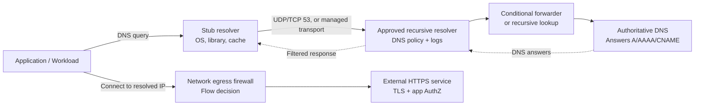
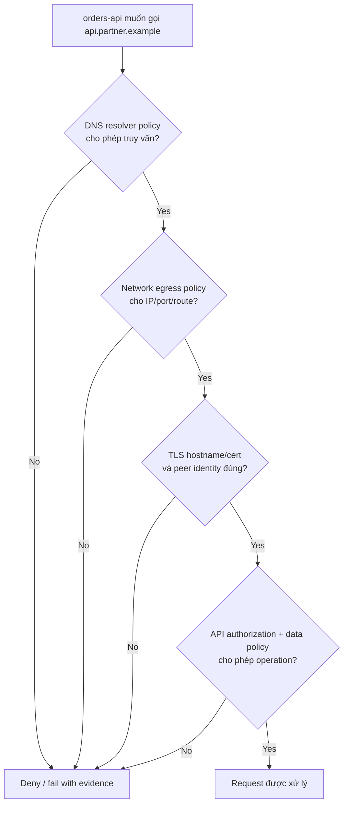
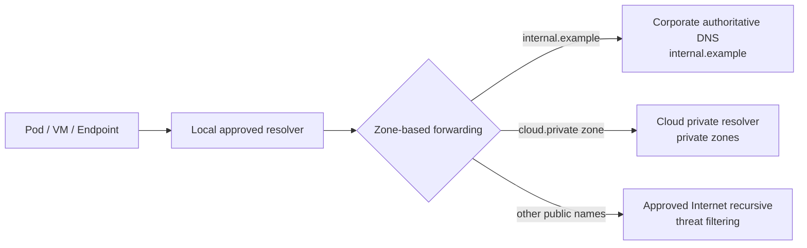
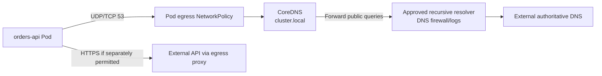
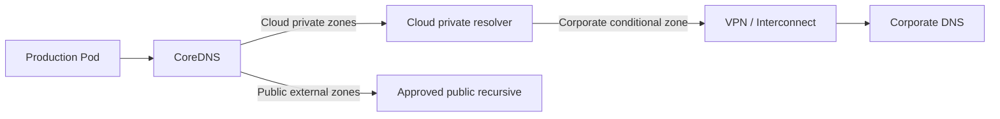
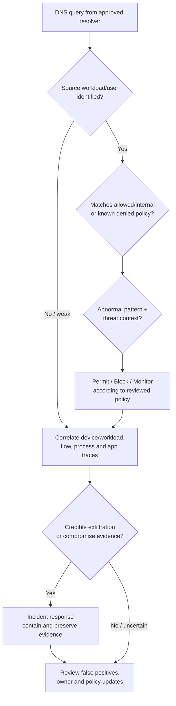
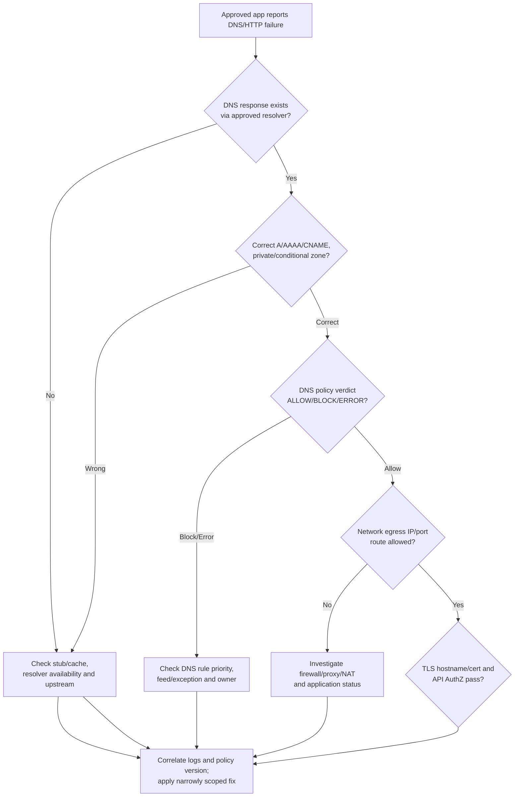

# DNS policy cho outbound request trong kiểm soát egress và chống thất thoát dữ liệu

**DNS policy cho outbound request** là tập hợp quy tắc quyết định **workload/thiết bị nào được truy vấn DNS qua resolver nào, những tên miền hoặc loại truy vấn nào được phép, cách xử lý tên miền rủi ro và cách sử dụng kết quả phân giải trong quyết định cho kết nối outbound**. Nó là một lớp quan trọng của **egress control** và **Data Loss Prevention (DLP)**, nhưng **không phải một firewall hoàn chỉnh**: cho phép truy vấn một tên miền không tự bảo đảm kết nối HTTPS tới địa chỉ thu được là hợp lệ, và chặn DNS không tự chặn mọi kết nối sử dụng địa chỉ IP trực tiếp.

Trong mô-đun **SECURITY_NETWORK_SECURITY**, chính sách DNS egress cần phối hợp với **network segmentation, firewall/NGFW, proxy, VPN/ZTNA, TLS/PKI, IDS/IPS/NDR, bảo vệ mạng container/Kubernetes và cloud**. Một thiết kế hiệu quả phải vừa ngăn **domain độc hại, DNS tunneling, đường resolver không quản lý và việc gửi dữ liệu ra ngoài trái phép**, vừa duy trì những luồng hợp lệ như **DNS nội bộ, service discovery, public SaaS API, DNS của private endpoints và certificate-validation dependencies**.

**Phân biệt xuyên suốt bài:**

- **DNS decision:** client được hỏi resolver nào và resolver có trả kết quả cho tên miền đó không?
- **Network connection decision:** client có được tạo TCP/UDP flow đến đích thực, kể cả IPv4 và IPv6, không?
- **Transport identity decision:** TLS/mTLS có xác minh đúng service/hostname/certificate không?
- **Application/data decision:** principal có được gọi API, tải dữ liệu hoặc gửi bản ghi cụ thể không?

**Một quyết định DNS “ALLOW” chỉ giải đáp được một phần của bốn câu hỏi trên.** Các địa chỉ IP trong ví dụ như **192.0.2.0/24**, **198.51.100.0/24**, **203.0.113.0/24** và **2001:db8::/32** dành cho tài liệu, không phải endpoint cần gọi thật. Chính sách và lệnh minh họa phải được kiểm chứng trên môi trường do tổ chức sở hữu hoặc được cấp phép.

## 1. Mục tiêu học tập

Sau bài học, người học có thể:

1. Giải thích DNS resolution từ **application stub resolver → recursive resolver → authoritative DNS** và chỗ đặt kiểm soát egress.
2. Phân biệt **chính sách đích DNS, chính sách resolver, network firewall và chính sách dữ liệu**.
3. Thiết kế **default deny với explicit allow**, không cho workload tự chọn resolver Internet tùy ý.
4. Hiểu **UDP/TCP 53, DNS over TLS (DoT), DNS over HTTPS (DoH), DNS over QUIC (DoQ)** và những đường DNS có thể vượt quan sát truyền thống.
5. Quản trị **private/split-horizon DNS, conditional forwarding, Kubernetes CoreDNS/NodeLocal DNSCache, cloud resolver và hybrid networks**.
6. Đánh giá **domain allowlist/denylist, FQDN suffix match, CNAME chain, wildcard, DNS cache, TTL, negative cache, DNS rebinding và domain takeover**.
7. Phân biệt **DNSSEC validation, DNS filtering, DNS encryption và TLS hostname verification**.
8. Giải thích vì sao **DNS-only policy** không chặn được ứng dụng dùng **IP trực tiếp hoặc HTTPS tới đích khác**.
9. Nhận biết **DNS tunneling, exfiltration qua query name, high-entropy labels, NXDOMAIN burst và bất thường truy vấn**, đồng thời tránh kết luận chỉ dựa một chỉ số.
10. Xây dựng policy phối hợp **DNS firewall + outbound proxy/egress gateway + workload identity + application AuthZ/DLP**.
11. Đọc các ví dụ **Kubernetes NetworkPolicy** cho DNS, hiểu giới hạn của policy chuẩn khi cần lọc theo FQDN.
12. Lập **đường dẫn giám sát, audit event, policy-as-code, thử nghiệm dương/âm và runbook** khi một tên miền bị chặn hoặc phát hiện dữ liệu rời hệ thống.

## 2. DNS resolution nằm ở đâu trên đường outbound?

Một ứng dụng muốn gọi **api.partner.example** thường hỏi resolver để lấy A/AAAA records, rồi tự tạo kết nối đến địa chỉ IP đã nhận.



**Hai đường đi độc lập về mặt chính sách:** truy vấn DNS đi tới resolver, còn kết nối thực đi tới đích qua route/firewall/proxy. Resolver cho phép domain **không tự tạo ra rule** ở firewall; firewall cho TCP/443 tới Internet có thể cho phép một ứng dụng **gọi IP trực tiếp mà không cần DNS**.

### 2.1. Những điểm thực thi thường gặp

| Điểm | Có thể thực thi gì? | Không tự bảo đảm |
| --- | --- | --- |
| **Endpoint DNS agent/stub policy** | Bắt buộc resolver/nhóm domain, telemetry thiết bị | Tất cả ứng dụng dùng đúng agent, nếu không có tamper protection |
| **Recursive resolver / DNS firewall** | Allow/deny theo domain, threat feed, query type, response policies | Chặn IP-direct hoặc HTTPS đã có địa chỉ |
| **Cloud DNS policy** | Quy tắc phân giải trong VPC/VNet, logging và domain filtering tùy sản phẩm | Tự chặn mọi đường Internet/DoH |
| **Network firewall/SG/NSG** | Hạn chế đích DNS, resolver IP, transport và egress | Hiểu hostname/user/tenant trong mọi flow |
| **DNS-aware CNI policy** | Có thể liên kết DNS query với workload và FQDN egress theo plugin | Semantics portable giữa mọi CNI |
| **Forward proxy / secure web gateway** | Quyết định HTTP(S) destination, identity, URL/risk và logs khi hỗ trợ | Đọc nội dung HTTPS E2E nếu không giải mã được |
| **API gateway / application** | Authorization, data classification, route và payload | Chặn DNS ngoài ứng dụng khi bị compromise |

## 3. Vì sao DNS là bề mặt DLP và an toàn mạng?

DNS là dịch vụ nền tảng, thường được cho phép rộng để ứng dụng hoạt động. Chính tính phổ biến này khiến nó có thể bị lợi dụng.

Các rủi ro cần mô hình hóa:

- **Tra cứu tên miền điều khiển độc hại:** thiết bị bị chiếm cần phân giải domain cho hạ tầng tấn công.
- **DNS tunneling:** dữ liệu được mã hóa/nhúng vào tên truy vấn hoặc các dạng trao đổi DNS để tạo kênh thông tin ngoài dự định.
- **Query-based exfiltration:** application hoặc malware đưa một phần dữ liệu nhạy cảm vào nhãn tên miền rồi hỏi resolver.
- **Shadow DNS/rogue resolvers:** workload dùng public DNS hoặc encrypted DNS ngoài giám sát tổ chức.
- **DNS rebinding/split-horizon confusion:** một tên miền chuyển từ public address sang private/local address trong một luồng ứng dụng nhạy cảm.
- **Stale DNS và cấu hình lỗi:** sai conditional forwarder, cached answer hoặc CNAME không còn owner gây outage hoặc sai đích.
- **Domain impersonation/homograph:** tên giống thương hiệu hoặc domain thay thế dẫn user/workload tới hệ thống không mong muốn.
- **DNS poisoning/spoofing và cache manipulation:** app nhận địa chỉ không đáng tin nếu validation/trust không phù hợp.

### 3.1. DNS exfiltration khác HTTP exfiltration

Nếu dữ liệu được đặt trong **QNAME** của một truy vấn DNS tới domain do attacker điều khiển, thông tin có thể rời host **trước khi** client tạo HTTPS connection. Một firewall chặn kết nối tới IP của attacker **không đảm bảo** đã ngăn query name đi qua DNS recursive resolver.

Ngược lại, DNS firewall chặn domain rủi ro không tự chặn **HTTPS POST** đến một dịch vụ SaaS hợp lệ nhưng bị lạm dụng để upload file nhạy cảm. Đó là lý do **DNS policy phải đứng cùng DLP/application egress controls**.

### 3.2. Mục tiêu thực tế

Không đặt mục tiêu “DNS filtering sẽ ngăn mọi loại thất thoát dữ liệu”. Hãy định nghĩa:

1. **Quản lý đường DNS** để ứng dụng không tự chọn resolver ngoài policy.
2. **Giảm rủi ro truy cập đích** bằng domain classification/blocklist/allowlist có owner.
3. **Phát hiện misuse** từ query content/pattern/volume và nguồn danh tính.
4. **Kết hợp chặn traffic thật và chặn dữ liệu** tại proxy/API/identity/data controls.
5. **Đo được false positives, availability và tính đầy đủ của telemetry**.

## 4. Nguyên tắc thiết kế DNS egress policy

Một baseline có thể dựa trên những nguyên tắc:

1. **Approved resolvers only:** endpoint/workload sử dụng recursive resolvers được quản trị.
2. **Explicit network permissions:** chỉ mở TCP/UDP 53 hoặc encrypted DNS transports tới đích được phê duyệt, không mở mọi nơi.
3. **Policy theo workload hoặc identity:** production payment không cần cùng domain policy với laptop nghiên cứu.
4. **Private resolution riêng:** tên nội bộ/cluster/cloud private endpoints được phân giải qua đường được thiết kế.
5. **Threat filtering và data-aware detection:** chặn domain độc hại đã xác nhận và phát hiện tunneling bất thường.
6. **TLS/DNSSEC đúng trách nhiệm:** kiểm tra response authenticity nơi hỗ trợ, nhưng vẫn bảo vệ kết nối cuối.
7. **IPv4/IPv6 parity:** kiểm soát cả A và AAAA, cổng/route dual-stack.
8. **Không có đường bypass:** direct IP/alternate DNS/DoH/DoT/DoQ hoặc proxy không quản lý cần được xem xét.
9. **Exception có owner, expiry và audit:** tránh wildcard allow tồn tại vĩnh viễn.
10. **Fail behavior rõ ràng:** xử lý resolver outage hoặc policy service unavailable có kế hoạch.
11. **Quan sát end-to-end:** correlation giữa DNS query và flow/app decision.
12. **Privacy by design:** không dùng DNS logs để thu thập dữ liệu cá nhân vượt mục đích.

### 4.1. Không có một allowlist dùng được cho mọi môi trường

Dev/staging, production, CI, payment processor, desktop users và Kubernetes system components có **nhu cầu domain rất khác nhau**. DNS allowlist quá hẹp có thể phá certificate issuance, package updates, identity login, telemetry hoặc private service discovery; quá rộng thì gần như không có tác dụng kiểm soát.

## 5. Ba quyết định độc lập trong một outbound request

Ví dụ **orders-api → https://api.partner.example/v1/status**.



Nếu DNS query được chấp nhận nhưng **TCP connection bị timeout**, không mặc định kết luận DNS policy sai. Nếu TCP/TLS thành công mà API trả **403**, nguyên nhân thường là application authorization. Nếu một app gọi **203.0.113.10** trực tiếp, nó có thể **bỏ qua bước DNS**; vì vậy sơ đồ là luồng phổ biến, không phải mọi kết nối đều đi qua đủ bốn bước.

## 6. Quy định resolver được phép dùng

Một tổ chức nên có **danh sách resolver endpoints được duyệt** với owner, region, IP family, encryption policy, service-level objective và retention.

### 6.1. Những lựa chọn phổ biến

| Resolver model | Khi nào phù hợp | Điều cần quản trị |
| --- | --- | --- |
| **Enterprise recursive resolvers** | On-prem, branch, shared corporate network | ACL, recursion scope, zones, patches, logs |
| **Cloud VPC/VNet resolver** | Workloads trong cloud dùng provider-managed DNS | Service-specific policy, forwarders, logging |
| **CoreDNS trong Kubernetes** | Pod service discovery, external recursive forwarding | CNI policy, upstream resolvers, namespaces |
| **NodeLocal DNSCache** | Giảm latency/load từ Pod DNS | Node/hostNetwork path, per-node cache, policy behavior |
| **Secure DNS agent trên endpoint** | Managed employee laptops/roaming devices | Tamper resistance, browser policy, split DNS |
| **Dedicated DNS security proxy/firewall** | Threat feed và policy tập trung | HA, rule review, false positives |
| **Approved encrypted DNS resolver** | Khi cần bảo vệ truy vấn trên đường không tin cậy | Endpoint identity, transport policy, audit, DoH/DoT coverage |

### 6.2. Không trộn trusted và arbitrary fallback resolver

Cấu hình nhiều resolvers để HA là tốt **khi các resolver có cùng ranh giới chính sách cần thiết**. Nếu resolver chính có domain blocklist còn resolver phụ là public resolver không lọc, outage có thể làm ứng dụng **bypass toàn bộ policy**.

Thiết kế hợp lệ:

- Hai hay nhiều resolvers được kiểm soát và đồng bộ chính sách.
- Có health checks và failover với logs.
- Không tự fallback sang public DNS ngoài danh sách.
- DNS policy được áp ở **nguồn** và/hoặc network enforcement, không chỉ dựa vào cấu hình file.
- Quản lý IPv6 resolver endpoints đồng thời với IPv4.

## 7. DNS stub, recursive và authoritative: phân biệt nguồn logs

**Stub resolver** trên OS/ứng dụng thường nhận yêu cầu từ process rồi chuyển đến recursive resolver. **Recursive resolver** tìm hoặc lấy câu trả lời từ cache. **Authoritative DNS** là nguồn thẩm quyền đối với các records của zone liên quan.

### 7.1. Vì sao vị trí log quan trọng?

- **Client-side log** có thể biết process/Pod/user, nhưng không thấy mọi query nếu app dùng resolver riêng.
- **Recursive resolver log** thấy QNAME và client IP (hoặc NAT/forwarder IP), nhưng không phải lúc nào biết process nguồn.
- **Authoritative DNS bên ngoài** có thể thấy request từ recursive resolver, không thấy endpoint gốc nếu truy vấn được forward/cached.
- **Network flow log** biết source/destination IP:port, nhưng thường không có QNAME plaintext khi encrypted DNS.
- **Application trace** có operation/URL và peer identity, nhưng không phản ánh tất cả DNS queries khi resolver cache.

### 7.2. DNS cache làm lệch số lượng

Một ứng dụng tạo 1.000 HTTPS requests tới cùng hostname không nhất thiết phát 1.000 DNS queries. OS/stub/recursive caches, connection pooling và DNS TTL có thể làm số query thấp hơn nhiều. Ngược lại, một sự kiện DNS query không chứng minh đã có kết nối HTTPS thành công.

**Không dùng tỷ lệ DNS queries so với HTTP requests như một phép so sánh chính xác tuyệt đối.**

## 8. Cổng và giao thức DNS outbound

| Giao thức | Transport/cổng thường gặp | Ý nghĩa | Lưu ý chính sách |
| --- | --- | --- | --- |
| **DNS truyền thống** | **UDP/53** | Truy vấn/response DNS thông thường | Chỉ approved resolver |
| **DNS qua TCP** | **TCP/53** | DNS kích thước lớn, fallback/transport phù hợp | Không chặn bừa để tránh lỗi DNS hợp lệ |
| **DNS over TLS (DoT)** | **TCP/853** | Mã hóa truy vấn DNS trong TLS | Chỉ approved DoT endpoints |
| **DNS over HTTPS (DoH)** | **HTTPS/TCP 443** thông dụng, có thể qua HTTP/3 | DNS payload nằm trong HTTPS | Không thể chặn hết chỉ bằng đóng 853 |
| **DNS over QUIC (DoQ)** | **UDP/853** thông dụng theo chuẩn | DNS qua QUIC có mã hóa | Cần quản lý UDP 853 và các đường biến thể |
| **DNSCrypt/other transports** | Phụ thuộc sản phẩm | DNS trong protocol riêng | Cần inventory endpoint/process |
| **mDNS** | **UDP/5353 multicast** | Service discovery phạm vi local link | Không coi là recursive DNS Internet |
| **LLMNR/legacy name discovery** | Theo giao thức | Local name resolution trong một số môi trường | Quản lý riêng vì spoofing/poisoning risks |

**Không mở toàn bộ port 53 từ mọi workload ra Internet.** TCP/53 có thể hợp lệ ngay cả khi UDP/53 hoạt động; DNSSEC/EDNS(0) và câu trả lời lớn có thể cần TCP fallback. **DoH thường hòa vào HTTPS/443**, nên một rule “deny 53 tới public Internet” là cần thiết nhưng chưa đủ để chặn alternate resolvers.

### 8.1. Các giao thức không bị giới hạn tuyệt đối bởi port mặc định

Ứng dụng có thể dùng encrypted DNS trên endpoint/port khác hoặc đưa DNS-like payload qua một kênh khác. Policy chống bypass cần dựa vào **destination identity, endpoint management, proxy routing và egress restrictions** chứ không chỉ danh sách port cố định.

## 9. DNS over HTTPS/DoT/DoQ: riêng tư và khả năng kiểm soát

Encrypted DNS bảo vệ truy vấn khỏi một số quan sát trên đường truyền giữa client và DNS server, nhưng có thể **làm mất khả năng filtering/ghi log của resolver tổ chức** nếu client dùng dịch vụ bên ngoài không được phê duyệt.

### 9.1. Một chiến lược hợp lệ

- Cho phép DoH/DoT/DoQ **đến resolver enterprise được duyệt** nếu đáp ứng privacy và availability.
- Cấu hình browser/OS/endpoint agent **không tự bật public secure DNS fallback** ngoài policy.
- Dùng **egress firewall/proxy và endpoint control** để hạn chế các resolver không quản lý.
- Khi được phép, kiểm tra **destination TLS identity**, không chỉ IP tĩnh.
- Có chính sách riêng với **BYOD**, vì mức điều khiển endpoint có thể khác managed device.
- Bảo đảm **DNS nội bộ/split-horizon** vẫn phân giải đúng; đừng vô tình gửi tên nội bộ tới public resolver.
- Kiểm tra các đường **HTTP/3/QUIC** khi proxy chỉ giám sát TCP/443.

### 9.2. Không dùng DNS filtering như công cụ giám sát bí mật vô hạn

DNS queries có thể tiết lộ tên dịch vụ nội bộ, website và thói quen của người dùng. Chính sách cần **mục đích an ninh rõ, retention tối thiểu, phân quyền log, masking khi hợp lý và tuân thủ pháp lý/nội quy**.

### 9.3. Khi traffic DoH bị mã hóa

Network sensor nhìn thấy kết nối HTTPS tới DoH resolver có thể không thấy QNAME. Nếu không quản lý resolver hoặc endpoint, **không thể bảo đảm phân loại domain từ dữ liệu L3/L4 thuần**. Hãy kiểm soát **đường egress** và yêu cầu sử dụng approved resolver, không tuyên bố có thể nhìn plaintext DNS trong mọi TLS sessions.

## 10. DNS policy theo nguồn: user, device, workload và zone

Một chính sách áp chung cho toàn dải CIDR thường khó phản ánh nhu cầu thực.

### 10.1. Các nhóm đối tượng

| Source | Nhu cầu DNS | Baseline |
| --- | --- | --- |
| **Production payment workloads** | Internal APIs, processor và service discovery | Resolver riêng, allowlist hẹp, audit |
| **Build/CI runners** | Package registries, artifact service, identity endpoints | Phân tách from runtime, threat filtering |
| **Managed employee endpoints** | Internet + intranet, SSO/MFA, browser | Secure DNS, device posture, privacy |
| **Guest/BYOD** | Internet limited, không lộ internal zones | Resolver/policy tách biệt |
| **Kubernetes system Pods** | Cluster DNS, API/control-plane dependencies | Labels/namespace và trusted resolver |
| **Database nodes** | Phân giải hệ thống thật sự cần | Egress DNS tối thiểu; không wildcard Internet |
| **Monitoring/logging agents** | Telemetry endpoints | Only approved collectors/issuers |
| **Partner VPN users** | Tên ứng dụng B2B được phép | Split DNS chỉ tài nguyên đã duyệt |

### 10.2. Ánh xạ source IP có thể không xác định user

Nếu nhiều clients cùng đi qua NAT hoặc DNS forwarder, resolver chỉ thấy một IP nguồn. Cần thêm **identity-aware DNS agent, resolver client metadata, endpoint telemetry hoặc correlation với network flow** khi sản phẩm cho phép. Không suy chắc user/Pod nào truy vấn chỉ từ public egress IP.

## 11. Split-horizon DNS và vùng nội bộ

**Split-horizon/split-view DNS** cho phép cùng một tên có kết quả khác nhau tùy network/view, hoặc chỉ một số resolvers biết zone private. Điều này thường cần cho **on-prem, VPN, VPC/VNet private endpoints, Kubernetes và hybrid cloud**.

### 11.1. Các yêu cầu quan trọng

- Tên nội bộ được hỏi đúng **private resolver hoặc conditional forwarder**, không gửi bừa lên public recursive.
- Public domain vẫn được giải quyết bằng recursive path được phê duyệt.
- Những zones trùng tên phải có **precedence rõ**.
- Mạng quản trị, production và guest có thể được trả **views khác nhau** theo quyền.
- DNS records private endpoints phải phù hợp **route và certificate hostname**.
- Test hành vi từ **on-prem, VPN, cloud VPC và Kubernetes Pods** riêng.
- Có HA forwarders/resolvers, giảm blast radius khi một đường DNS lỗi.

### 11.2. Split DNS không tạo isolation hoàn chỉnh

Nếu guest không resolve tên tài nguyên nội bộ nhưng vẫn có route tới private IP, guest có thể thử kết nối trực tiếp. **Firewall và app identity** vẫn phải deny.

### 11.3. Internal name leakage

Khi cấu hình forwarding sai, query như **payroll-db.internal.example** có thể bị chuyển tới public recursive DNS. Dù không trả bản ghi, **QNAME có thể làm lộ tên nội bộ**. Xem DNS routing và query logging theo data classification, không chỉ xét response thành công.

## 12. Conditional forwarding và chain of custody của DNS query

Một tổ chức có thể triển khai:



### 12.1. Tại sao cần sơ đồ forwarding?

Khi điều tra một domain bị chặn hoặc leak, cần biết:

1. Client thực sự gửi DNS query tới đâu?
2. Resolver nào xử lý zone, có **cache hit** không?
3. Conditional forwarding có đưa query qua mạng hoặc account nào?
4. Domain filtering thực thi ở **bước nào** trong chain?
5. Logs ở bước đó còn giữ thông tin **source workload** không?
6. DNSSEC validation đặt ở đâu?
7. Nếu upstream thất bại, resolver dùng **fallback path** nào?
8. Response được cache bao lâu và ứng dụng có tự cache khác không?

### 12.2. Không có policy trên đường phụ là bypass

Nếu một forwarder được cho phép nhưng có thể tự chuyển tới arbitrary upstream không giám sát, policy chỉ ở stub có thể bị suy yếu. Cần **egress restrictions ở resolver hosts**, governance của forwarder rules và audit thay đổi.

## 13. DNS firewall: domain categories, reputation và response policy

**DNS firewall** có thể dùng **allowlist/denylist**, domain reputation, threat intelligence, domain age/category hoặc quyết định theo nguồn. Các sản phẩm có semantics khác nhau: từ trả **REFUSED/NXDOMAIN**, thay IP bằng sinkhole, đến ghi log và alert mà không chặn.

### 13.1. Nhóm quy tắc thường có

- **Malware/C2/phishing** domains được xác nhận qua nguồn tin cậy.
- **Known data-exfiltration infrastructure** hoặc domains do tổ chức bảo vệ xác định.
- **Newly observed/unregistered domain risk** theo chính sách và business tolerance.
- **Explicit allow** cho các API, CA/IdP và update services cần thiết.
- **Internal zones** và private endpoint names.
- **Categories** theo chính sách công ty (ví dụ môi trường production không cần truy cập mạng xã hội), có ngoại lệ chính danh.
- **Quarantine/monitor-only mode** khi chưa đủ bằng chứng để block.

### 13.2. Thứ tự allow/deny là vendor-specific

Không suy rằng **allow luôn ưu tiên deny** hoặc ngược lại. Phải xác minh:

- Rule evaluation order/priority.
- Exception semantics.
- CNAME/result-chain handling.
- Regex/wildcard/suffix matching.
- Rule match từ request QNAME hay cả answer IP/CNAME.
- Trạng thái **deny/alert/sinkhole**.
- Cache và policy propagation lag.

**Chỉ có “rule tồn tại” không chứng minh resolver đã áp nó.** Kiểm thử từ nguồn thật, query type thật và quan sát policy verdict.

## 14. Domain allowlist: khớp chính xác và wildcard cẩn thận

Đơn giản hóa policy thành **allow *.example.com** có thể nguy hiểm vì:

- Subdomains có thể do tenant khác hoặc third-party quản lý.
- Một SaaS dùng hostname theo khách hàng, khiến tenant được phép và tenant không được phép cùng suffix.
- Domain có thể bị **delegated NS** ra hệ thống khác.
- Wildcard/suffix match dễ bỏ sót **label boundary**.
- Domain thay owner, bị takeover hoặc trỏ CNAME ra endpoint khác.

### 14.1. So khớp suffix theo nhãn

Khi muốn cho **api.partner.example**, chính sách cần phân biệt:

- **api.partner.example**: exact hostname hợp lệ nếu đã duyệt.
- **svc.api.partner.example**: chỉ khi cho phép subdomains phù hợp.
- **api.partner.example.attacker.test**: **không** thuộc suffix được duyệt.
- **evilpartner.example**: không phải **partner.example**.
- **partner.example.**: FQDN có trailing root dot, resolver/normalization cần xử lý đúng.
- **Unicode/IDNA punycode**: phải canonicalize theo quy tắc sản phẩm, tránh nhìn giống nhưng codepoints khác.

### 14.2. Wildcard không kiểm soát nội dung HTTPS

Ngay cả domain chính thống như **storage.example-saas.net** có thể cho phép nhiều tenants upload file. Domain allowlist giúp reachability, **không chứng minh file được gửi tới tài khoản do công ty sở hữu**. DLP/SaaS API controls và identity authorization vẫn cần thiết.

### 14.3. Ngoại lệ phải có thời hạn

Một exception domain nên có **owner, ticket, workload, action/purpose, QTYPE nếu cần, TTL/expiry, risk acceptance và test evidence**. Tránh wildcard vô hạn để chữa lỗi nhanh.

## 15. CNAME, CDN, TTL và DNS cache drift

Một tên miền có thể trả **CNAME chain** dẫn tới tên khác hoặc nhiều **A/AAAA answers** theo thời gian/region. Đây là hành vi bình thường của CDN/SaaS nhưng làm phức tạp DNS-based egress control.

### 15.1. Các câu hỏi thiết kế

- Rule match **QNAME ban đầu** hay **toàn bộ CNAME chain**?
- CNAME đích có thuộc domain được tin/đơn vị khác không?
- Response chứa A và AAAA nào; client thực tế chọn IP nào?
- Khi TTL hết, app có **tái phân giải**, hay giữ kết nối lâu?
- DNS cache trong app/proxy/OS/recursive có TTL khác nhau?
- Firewall có dynamic IP sets theo DNS answer không? Nếu có, **đồng bộ và race conditions** xử lý ra sao?
- DNS answers khác nhau do GeoDNS, ECS, resolver location hoặc failover?
- Policy có áp khi HTTP client dùng **hard-coded IP** nhưng SNI/Host vẫn là tên được phép?

### 15.2. DNS rebinding

Một domain có thể ban đầu trả public IP rồi đổi sang địa chỉ nội bộ/link-local. Nếu ứng dụng cho user nhập URL và chỉ kiểm tra hostname một lần, điều này có thể trở thành **SSRF/rebinding**. Cần bảo vệ:

1. Kiểm tra URL scheme/host/port theo allowlist có owner.
2. Giới hạn **actual destination IP/range** tại lúc kết nối, kể cả IPv4/IPv6.
3. Chặn private/link-local/metadata targets khi use case không yêu cầu.
4. Giữ TLS certificate/hostname verification.
5. Hạn chế redirect hoặc re-resolve ngoài policy.
6. Có egress gateway hoặc proxy thực thi kết nối thực.

**DNS allowlist riêng không phải giải pháp chống SSRF đầy đủ.**

## 16. DNSSEC, encrypted DNS và TLS: ba tính chất khác nhau

| Cơ chế | Bảo vệ chính | Không tự cung cấp |
| --- | --- | --- |
| **DNSSEC** | Chữ ký xác thực dữ liệu DNS có nguồn gốc và tính toàn vẹn khi validation đúng | Mã hóa truy vấn, chống lộ QNAME, authorization tới API |
| **DoT/DoH/DoQ** | Mã hóa kênh client ↔ DNS endpoint (và xác thực endpoint nếu cấu hình đúng) | Tính đúng của nội dung DNS nguồn gốc nếu không có DNSSEC; data authorization |
| **TLS tới API** | Xác minh server hostname/certificate và bảo vệ transport | Caller authorization, DLP payload, không đảm bảo IP/domain cho phép |
| **mTLS tới API** | Thêm xác minh client identity tại peer | Business permission/idempotency |
| **DNS firewall** | Domain resolution policy, threat filtering | Chặn mọi direct-IP traffic và HTTPS exfil |
| **Network egress firewall** | Địa chỉ/cổng/flow control | Hiểu đầy đủ nội dung HTTPS hoặc đối tượng dữ liệu |

### 16.1. DNSSEC không chứng minh tên miền “an toàn”

DNSSEC có thể chứng minh một bản ghi được ký hợp lệ theo chain of trust, nhưng **domain có chữ ký vẫn có thể do attacker sở hữu**. Ngược lại, một domain không hỗ trợ DNSSEC không tự là độc hại. DNSSEC là **data origin authentication**, không phải content reputation hay egress authorization.

### 16.2. DNSSEC validation và private zones

Các private/split-horizon zones có cấu hình trust riêng; không bật validate theo kiểu làm hỏng toàn bộ internal resolution nếu chưa thiết kế. Cần kiểm tra **trust anchors, forwarding, NSEC/NSEC3 handling, cache và fail behavior** khi triển khai DNSSEC validation.

## 17. Domain đã được phân giải không đồng nghĩa request được phép

Giả sử DNS firewall cho **api.partner.example** và trả **203.0.113.20**. Ứng dụng vẫn có thể:

- Kết nối đến **203.0.113.21** dùng Host header api.partner.example.
- Gọi trực tiếp một IP từ config mà không hỏi DNS.
- Kết nối HTTPS qua **HTTP CONNECT proxy** ngoài quản lý.
- Dùng IP/AAAAs khác do DNS cache hoặc resolver khác.
- Gửi dữ liệu tới **service multi-tenant đã được allowlist** nhưng tenant không được phép.
- Theo HTTP redirect sang hostname khác.
- Bật QUIC/HTTP3 trong khi gateway chỉ kiểm soát TCP.

### 17.1. Thiết kế defense in depth

Một kết nối HTTP(S) nên được kiểm tra bằng:

1. **Nguồn:** workload/user/device identity.
2. **DNS:** allowed resolver và domain policy.
3. **Network:** destination IP, route, port và outbound access.
4. **TLS:** expected hostname/SNI, certificate trust, policy về HTTP authority khi có inspection.
5. **Application:** OAuth/mTLS audience, scopes và resource authorization.
6. **Data:** nội dung/loại file/tenant/destination account phù hợp với DLP.
7. **Logging:** có correlation đủ chứng minh thực tế đã đi đâu.

### 17.2. SNI cũng không phải danh tính tuyệt đối

SNI có thể giúp xác định hostname dự định trong TLS handshake truyền thống, nhưng **không thay TLS certificate validation và HTTP authority/Host checks**; các kỹ thuật như **Encrypted ClientHello (ECH)** có thể làm SNI không còn đọc được ở network middlebox. Cần đánh giá khả năng inspection theo sản phẩm/giao thức thực, không giả định quan sát mọi hostname.

## 18. Kubernetes: chính sách DNS cho Pod egress

Kubernetes Pod thường dùng **Cluster DNS/CoreDNS** để phân giải tên Service và DNS Internet. NetworkPolicy chuẩn hỗ trợ **Pod/namespace selectors, CIDR và protocol/port**, nhưng **không có field FQDN** để allow một domain cụ thể.

### 18.1. Những nguồn và đích cần kiểm kê

- Namespace/Pod/workload/ServiceAccount tạo DNS query.
- **CoreDNS** Pods và Service DNS IP.
- **NodeLocal DNSCache** nếu bật.
- CoreDNS **upstream resolvers** / forward configuration.
- Private DNS zones/conditional forwarding.
- Cloud DNS service endpoints.
- NetworkPolicy ingress vào DNS Pods và egress từ app Pods.
- Alternate DNS clients như custom resolver library/sidecar.

### 18.2. Default deny egress ở namespace ứng dụng

```yaml
apiVersion: networking.k8s.io/v1
kind: NetworkPolicy
metadata:
  name: default-deny-egress
  namespace: orders
spec:
  podSelector: {}
  policyTypes:
    - Egress
```

Policy này cô lập egress của các Pods được chọn **khi CNI hỗ trợ và thực thi NetworkPolicy**. Cấu hình này có thể chặn DNS và toàn bộ dependencies nếu không thêm các allow rules cần thiết. Đừng áp production khi chưa có dependency graph và rollback.

### 18.3. Mở DNS chỉ tới CoreDNS Pods có nhãn được xác minh

```yaml
apiVersion: networking.k8s.io/v1
kind: NetworkPolicy
metadata:
  name: allow-cluster-dns
  namespace: orders
spec:
  podSelector: {}
  policyTypes:
    - Egress
  egress:
    - to:
        - namespaceSelector:
            matchLabels:
              kubernetes.io/metadata.name: kube-system
          podSelector:
            matchLabels:
              k8s-app: kube-dns
      ports:
        - protocol: UDP
          port: 53
        - protocol: TCP
          port: 53
```

**Quan trọng:** Nhãn **k8s-app: kube-dns** chỉ là ví dụ tương thích với nhiều cụm; CoreDNS/cluster cụ thể có thể dùng nhãn khác. Tên namespace và cơ chế DNS proxy/NAT cũng có thể khác. Cần xác minh **CoreDNS Pods, NodeLocal DNSCache, Service ClusterIP, policy evaluation trước/sau DNAT và CNI behavior**.

### 18.4. Hai policies không giải quyết toàn bộ vấn đề

NetworkPolicy trên **không kiểm tra QNAME**. Nó cho phép hỏi CoreDNS bất kỳ domain nào theo policy CoreDNS/upstream; việc phân loại/chặn tên miền phải ở **DNS resolver/filtering layer**. CoreDNS có thể forward ra resolver Internet được phê duyệt; cần policy egress riêng cho **CoreDNS → upstream**, không cho mọi Pod tự truy vấn upstream.

## 19. CoreDNS upstream: một điểm áp DNS security

Trong một cluster, CoreDNS thường phục vụ **Service discovery** và có thể forward các truy vấn không thuộc zone nội bộ đến upstream resolver.

### 19.1. Mô hình luồng



### 19.2. Bảo vệ CoreDNS

- Hạn chế **ai được sửa CoreDNS ConfigMap/Corefile và Service**.
- Giới hạn **egress của CoreDNS tới upstream resolvers được duyệt**.
- Tách private cluster zone khỏi public Internet resolution.
- Kiểm tra cache behavior, negative caching và forwarding loops.
- Quan sát CoreDNS latency, SERVFAIL, NXDOMAIN, recursion/forward errors.
- Không log mọi payload/raw identifiers vô hạn nếu có chứa tên nội bộ/PII.
- Test quorum/HA của upstream recursive resolvers.
- Khi DNS firewall từ chối domain, có **reason code** truy vết từ policy đến query.

### 19.3. Không biến CoreDNS thành forward proxy dữ liệu tùy ý

CoreDNS vẫn xử lý **DNS questions**; nó không nên được cấu hình để tự động trả lời/forward tùy tiện các tên miền private ra public. Đừng dùng Resolver IP làm lý do cho wildcard egress HTTPS của mọi Pods.

## 20. NodeLocal DNSCache và host-network path

Một số cluster bật **NodeLocal DNSCache**: Pod hỏi DNS tại một địa chỉ gần node, cache chuyển tiếp đến upstream. Việc này giảm latency/load nhưng thay đường packet.

### 20.1. Rủi ro khi dùng policy mẫu

- Destination DNS có thể là **node-local/link-local IP**, không phải CoreDNS Pod IP.
- DNS traffic có thể đi qua **hostNetwork/node** và có semantics khác trong CNI.
- Policy dùng podSelector đối với CoreDNS có thể **không match** đường DNS thực.
- Log tại CoreDNS có thể thấy địa chỉ của node/cache thay vì Pod nguồn.
- Một bypass tới public resolver vẫn có thể tồn tại ngoài NodeLocal.
- Khi agent/cache bị lỗi, cơ chế fallback cần được quản trị.

### 20.2. Quy trình kiểm chứng

1. Xem resolver thực từ **/etc/resolv.conf** của test Pod được phép.
2. Xác minh NodeLocal DNSCache config, IP/port và upstream.
3. Kiểm tra **effective dataplane**, DNS policy verdict và source attribution.
4. Thử UDP/TCP 53 qua cached và uncached names.
5. Kiểm tra khi node cache lỗi/khởi động lại.
6. Giữ **default deny với explicit allow** nhưng áp đúng điểm thực thi của CNI.

Không kết luận DNS policy sai chỉ vì một bản manifest mẫu không match topology đang chạy; đồng thời không mở **0.0.0.0/0:53** để “sửa nhanh”.

## 21. FQDN-aware CNI policy: hữu ích nhưng không phải chuẩn Kubernetes

Một số CNI hoặc gateway có khả năng biểu đạt **domain-based egress policy**, đôi khi liên kết DNS query/response với tập IP cho phép.

### 21.1. Cần xác minh tính năng

- FQDN match là **exact name, suffix, glob** hay regex?
- Policy được áp với **DNS proxy/visibility** bắt buộc không?
- Nếu app dùng **custom resolver/DoH**, policy còn hiệu lực không?
- TTL cache và propagation làm IP allowlist cập nhật nhanh thế nào?
- **Shared CDN IP** có cho phép traffic tới tenant/domain khác không?
- Direct IP và **IPv6 AAAA** có bị chặn đúng không?
- **CNAME chains** được xử lý ra sao?
- Controller/policy agent **fail-open hay fail-closed** khi DNS không trả lời?
- Route service mesh, transparent proxy và NAT thay source/destination thế nào?

### 21.2. Không dùng CNI-specific rule như YAML portable

Một rule có tên **toFQDNs**, **DNSPolicy** hoặc tương tự là mở rộng vendor-specific, không phải trường chuẩn **networking.k8s.io/v1 NetworkPolicy**. Nếu cần, ghi rõ **tên CNI, phiên bản, CRD, cơ chế DNS proxy và kiểm thử** trước khi rollout.

## 22. Cloud DNS policy: AWS, Azure và Google Cloud

Mỗi nhà cung cấp có tài nguyên DNS/egress khác nhau. Dưới đây là **khung đánh giá kiến trúc**, không phải khẳng định tên tính năng hoặc khả năng tương đương trên mọi region/SKU tại mọi thời điểm.

| Nền tảng | Thành phần cần tìm hiểu | Điều cần kiểm chứng |
| --- | --- | --- |
| **AWS** | Route 53 Resolver, Resolver DNS Firewall, query logs, VPC endpoints, network firewall/SG/route | Rule group association, VPC scope, domain list semantics, endpoints/forwarding |
| **Azure** | Azure DNS Private Resolver, Private DNS zones, Azure Firewall DNS proxy/FQDN filtering khi được hỗ trợ, NSG/UDR | Resolver forwarding rules, private endpoint DNS, DNS proxy/firewall plan/SKU, egress route |
| **Google Cloud** | Cloud DNS policies/managed zones, query logging, forwarding/inbound/outbound server policies theo khả năng, Cloud NGFW/egress proxy | VPC policy attachment, resolver forwarding, DNS response policies và filtering features hiện có |
| **Kubernetes/managed clusters** | CoreDNS, NodeLocal, cluster DNS settings và cloud resolver integration | CNI enforcement, worker-node routes, provider restrictions |
| **On-prem/hybrid** | Enterprise recursive, DNS firewall, conditional forwarders, VPN/interconnect | Zone ownership, HA, logging, ACL, DNS leak paths |

### 22.1. Không đánh đồng private DNS với DNS security

Một **private DNS zone** chỉ giới hạn phạm vi phân giải theo cấu hình; nó không tự ngăn thiết bị dùng public resolver khác hoặc đưa dữ liệu vào tên truy vấn bên ngoài. Cần **network egress enforcement, resolver policy và data controls**.

### 22.2. AWS: ý tưởng DNS Firewall

Khi dùng **Route 53 Resolver DNS Firewall** trong phạm vi VPC phù hợp, có thể quản trị domain lists/rule groups và policy responses theo tính năng hỗ trợ. Vẫn cần đánh giá:

- Domain categories/allow/deny priority.
- VPC associations và route/resolver flow.
- DNS queries từ workloads có đi qua Resolver thực hay dùng custom resolver?
- Quyền IAM sửa rule groups/associations.
- Logs/metrics, availability và rule updates.
- Đường HTTPS đến public DoH resolvers hoặc direct IP **không tự biến mất**.

### 22.3. Azure: private resolver và firewall là những chức năng khác

**Azure DNS Private Resolver** chủ yếu giải quyết recursive/forwarding trong hybrid/private DNS, không nên mô tả mặc định là DLP engine. Khi cần domain-aware filtering hoặc outbound control phải thiết kế **Azure Firewall DNS proxy, FQDN/application rules hay sản phẩm tương đương** theo khả năng và routing. Kiểm tra endpoint policies, DNS forwarding và việc app có bypass firewall hay không.

### 22.4. Google Cloud: DNS policy không thay egress firewall

**Cloud DNS** hỗ trợ quản trị nhiều dạng public/private zones và forwarding theo cấu hình. Những khả năng domain filtering/security response cụ thể cần xác minh theo dịch vụ/phiên bản thực tế; không mặc định một Cloud DNS policy đơn thuần có thể kiểm tra mọi file upload hoặc DoH request. Tách **DNS observation** khỏi **network firewall/proxy decision**.

## 23. Hybrid DNS, VPC peering và private endpoints

Một hệ thống hybrid có thể phân giải:

- **cluster.local** qua CoreDNS.
- **corp.internal.example** qua DNS on-prem.
- **privatelink.example.service** qua private DNS zone của cloud provider.
- **api.partner.example** qua approved public recursive.
- Một số names qua **conditional forwarding** giữa các VPC/VNet/projects.

### 23.1. Đường đi có thể phức tạp hơn mong đợi



### 23.2. Phải bảo vệ cả chiều forward

- Không cho public resolver hỏi tùy tiện private zones.
- Không để **forwarding loop** giữa on-prem và cloud.
- Bảo vệ resolver endpoints/forwarder bằng network ACL và quyền quản trị.
- Xác minh **private endpoint IP và TLS hostname** đúng, tránh dùng direct-IP workaround.
- Đánh giá DNS response policy với **IPv4/IPv6/NAT64** nếu hybrid có IPv6-only workloads.
- Test failover của DNS forwarders, không tự fallback sang public DNS cho private zones.
- Không cấp một VPC resolver quyền truy cập mọi network nội bộ chỉ vì peering tồn tại.

## 24. DNS64/NAT64, IPv6 và outbound policy

Trong một số mạng IPv6-only, **DNS64** có thể tạo AAAA tổng hợp dựa trên A records để client kết nối IPv4 endpoint thông qua **NAT64**. Đây là một trường hợp cần xem xét riêng:

- IP đích ứng dụng dùng có thể là **IPv6 synthesized address**, không trùng A record quan sát từ resolver khác.
- FQDN/IP allow rules, proxy và logs phải hiểu DNS64/NAT64 path.
- **IPv4 egress deny** chưa chắc kiểm soát hết IPv6 traffic.
- DNSSEC validation và DNS64 có tương tác cần cấu hình theo RFC/implementation.
- Query type AAAA có thể khác rõ với các ứng dụng dual-stack bình thường.
- IPv6 default route **::/0**, firewall và DNS resolver IPv6 cần được quản trị.

**Không cho rằng mọi cloud đều sử dụng cùng DNS64/NAT64 semantics.** Xác minh capability và dataplane của mạng mục tiêu, nhất là Kubernetes và private endpoints.

## 25. DLP bắt đầu từ phân loại dữ liệu và quyền gửi ra ngoài

**Data Loss Prevention (DLP)** không chỉ là tìm một chuỗi giống số thẻ trong DNS query. Nó bắt đầu từ việc xác định **dữ liệu nào được phép rời khỏi ứng dụng, gửi tới tài khoản/đối tác nào, với người phê duyệt nào và qua kênh nào**.

### 25.1. Phân loại dữ liệu trước khi viết domain rule

| Nhóm dữ liệu | Ví dụ | Chính sách egress phù hợp |
| --- | --- | --- |
| **Public** | Tài liệu công khai, thông tin sản phẩm đã xuất bản | Có thể đi tới endpoints được phê duyệt, vẫn cần kiểm tra malware/phishing |
| **Internal** | Tên máy, thông tin topology, mã dự án | Hạn chế đưa vào query names công khai, quản trị private DNS |
| **Confidential** | Dữ liệu khách hàng, hợp đồng, source code nội bộ | Kiểm soát API/account, proxy/DLP, identity và audit |
| **Highly restricted** | Khóa bí mật, tokens, thông tin thanh toán nhạy cảm | Không được đưa vào DNS QNAME, logs hay outbound ngoài quy trình được phép |

Một **domain thuộc danh sách allow** vẫn có thể nhận dữ liệu vượt mức cho phép nếu ứng dụng gửi sai tài khoản SaaS hoặc gửi file nhạy cảm. Do đó DNS allowlisting nên gắn với **destination governance** và **data access policy**, không là cơ chế cấp quyền tài liệu.

### 25.2. “DNS chỉ có tên miền” không đúng với truy vấn tùy ý

Tên truy vấn có thể chứa các label do ứng dụng điều khiển. Nếu một giá trị bí mật bị ghép vào subdomain, resolver và authoritative infrastructure có thể thấy nó theo cơ chế DNS. Các lớp phòng vệ cần:

- Kiểm tra ứng dụng không dùng **user-controlled untrusted data** làm QNAME.
- Giám sát pattern query bất thường mà không thu thập quá mức.
- Chặn kết nối hoặc domain rủi ro theo approved domain policy.
- Không ghi payload nhạy cảm nguyên văn vào DNS logs trong quá trình điều tra.
- Hạn chế quyền workload đối với secret ngay từ nguồn, vì **DLP tại egress là lớp cuối**.

## 26. Dấu hiệu phát hiện DNS tunneling và exfiltration

DNS tunneling có thể dùng DNS như một **kênh truyền thông ngoài mục đích phân giải tên**, trong đó query names, response hoặc chuỗi trao đổi được tạo có chủ đích. Bài học tập trung vào **phát hiện, phòng vệ và kiểm tra chính sách**, không hướng dẫn tạo kênh exfiltration.

### 26.1. Những tín hiệu nên kết hợp

| Tín hiệu | Ý nghĩa khả dĩ | False positive cần xét |
| --- | --- | --- |
| **QNAME length/label count tăng bất thường** | Truy vấn chứa chuỗi dài hoặc cấu trúc không bình thường | Tracking, challenge tokens, service discovery |
| **Nhãn tên miền có entropy cao** | Nội dung máy tạo hoặc mã hóa | CDN cache keys, telemetry IDs, DKIM-like lookups |
| **Nhiều unique subdomains cùng eTLD+1** | Dữ liệu thay đổi liên tục trong QNAME | Per-session hostnames, service telemetry |
| **NXDOMAIN rate cao** | Tên được tạo sai/đoán thử hoặc exfil pattern | DNS misconfiguration, search suffix expansion |
| **Query burst liên tục từ một workload** | Loop, agent bị compromise hoặc kênh dữ liệu | Updater, monitoring, test environments |
| **TXT hoặc loại query khác thường** | Truy vấn phục vụ giao thức riêng hoặc misuse | SPF/DKIM/DMARC, domain verification |
| **Domain mới xuất hiện ở workload nhạy cảm** | Destination ngoài dependency graph | Release hợp lệ hoặc new provider endpoint |
| **No corresponding authorized app flow** | DNS-only communication đáng nghi | Resolver caches, prefetch, negative lookup |
| **DoH tới endpoint không quản lý** | Bypass DNS logs và resolver policy | Browser defaults, người dùng dùng privacy service hợp lệ |
| **Truy vấn lặp với cấu trúc theo thời gian** | Beaconing hoặc exfil channel | Scheduled jobs hoặc health probes |

**Không dùng một ngưỡng entropy/độ dài cố định làm kết luận chắc chắn về exfiltration.** DNS có rất nhiều tên máy tạo hợp lệ. Cần so sánh **baseline theo workload, domain age/ownership, volume, QTYPE, context sự cố và các bằng chứng khác**.

### 26.2. Baseline theo loại workload

Một **static backend không có nhu cầu truy cập Internet** tạo hàng nghìn unique subdomains mỗi phút là bất thường hơn một **browser endpoint** tải website/CDN. Tương tự một mail infrastructure dùng TXT DNS cho SPF/DKIM là hợp lệ, không được block chỉ vì query type là TXT.

### 26.3. Không vội xem NXDOMAIN burst là tấn công

Search suffix Kubernetes có thể khiến nhiều truy vấn nối đuôi, ví dụ một hostname ngắn được thử dưới nhiều search domains. Một cấu hình resolver sai hoặc record vừa bị xóa cũng tạo NXDOMAIN spike. Xem **QNAME patterns, source, negative caching, deployment timeline và authoritative response** trước khi phân loại.

## 27. Dòng xử lý một truy vấn DNS nghi ngờ



### 27.1. Block, monitor hay sinkhole?

Một DNS security product có thể:

- **Allow** và log query.
- **Alert-only** để thu bằng chứng, phục vụ rollout giảm false positive.
- **Block** với response phù hợp theo sản phẩm/zone policy.
- **Sinkhole** trả một địa chỉ kiểm soát thay vì địa chỉ thật theo mục đích nghiên cứu/giám sát có kiểm soát.

**Sinkhole không phù hợp cho mọi ứng dụng và mọi loại query.** Trả địa chỉ giả có thể làm traffic vô tình gửi credentials đến nơi sai hoặc làm mất khả năng phân biệt lỗi nếu không thiết kế kỹ. Nên xem xét **privacy, TLS mismatch, audit, rate limits và legal approvals**.

### 27.2. Khi nào cần cách ly workload?

Nếu có bằng chứng đáng tin về **malicious DNS-based exfiltration**, có thể cần:

1. Chặn DNS queries/destinations ngoài chính sách từ source cụ thể.
2. Hạn chế egress của workload theo runbook.
3. Thu hồi credentials/ServiceAccount quyền rộng nếu nguy cơ lộ.
4. Giữ logs và artifacts có nguồn gốc rõ.
5. Đánh giá traffic qua DoH/IP-direct để xác định đường khác.
6. Khôi phục service bằng deployment sạch và policy đã xác minh.
7. Tránh chặn toàn DNS của mọi hệ thống khi mới chỉ có một tín hiệu chưa chắc chắn.

## 28. Domain reputation, threat intelligence và false positives

Threat feeds hỗ trợ phát hiện nhưng có thể **chậm cập nhật, thiếu ngữ cảnh hoặc nhầm domain hợp lệ**. DNS policy cần có quy trình vòng đời threat intelligence.

### 28.1. Vòng đời nguồn dữ liệu

- Xác định **feed owner, reliability, update frequency và coverage**.
- Phân biệt **domain được xác nhận độc hại** với **suspicious/newly seen**.
- Kiểm tra sự thay đổi owner, domains hết hạn, registrar/hosting.
- Có **exception allow** được review khi false positive ảnh hưởng production.
- Không cho user thường tự override blocklist của security một cách âm thầm.
- Log **version của rule/feed** gây deny để điều tra sau sự cố.
- Theo dõi **time to block**, **false-positive rate**, và **dwell time** của domain rủi ro.

### 28.2. Domain hợp lệ có thể bị lợi dụng

Một attacker có thể sử dụng **cloud storage, paste/site builder hoặc public SaaS đã được allowlist** để nhận dữ liệu. DNS reputation thường thấy hostname của dịch vụ hợp lệ, không biết **tenant/account/URL/object** đang được truy cập. Cần **SaaS governance, CASB/SWG, proxy khi phù hợp, token/audience restrictions, DLP và API authorization**.

## 29. Centralized DNS logging và giới hạn quan sát

Một hệ thống audit DNS tốt trả lời:

- **Ai hoặc workload nào** thực hiện truy vấn?
- Tên miền/QTYPE nào được hỏi?
- Resolver/forwarder nào xử lý?
- Policy rule phiên bản nào quyết định allow/deny?
- Kết quả là A/AAAA/CNAME, REFUSED, NXDOMAIN hay SERVFAIL?
- Query xuất phát từ private zone hay external public zone?
- Flow HTTPS/outbound nào xảy ra sau đó?
- Có đường bypass hoặc client dùng DoH khác policy không?

### 29.1. Một số trường thông dụng

| Field | Giá trị vận hành |
| --- | --- |
| timestamp, timezone, resolver_id | Ghép timeline across hosts |
| src_ip/src_port, node/workload/service_account | Xác định nguồn, khi có bằng chứng |
| qname_canonical, qtype, qclass | Hiểu ý định phân giải |
| response_code, answers | Phân biệt deny, lỗi, cache và kết quả |
| policy_rule_id, action, rule_version | Xác nhận chính sách đã thực thi |
| resolver_path, forwarding_zone | Kiểm tra DNS leak và split horizon |
| client_transport | UDP/TCP/DoT/DoH theo khả năng |
| query/response size, latency | Detection và availability |
| cache_hit, dnssec_validation | Phân biệt cache/validation nếu có |
| flow/session/trace correlation | Liên kết DNS với kết nối thật |
| confidence/data_visibility | Nêu rõ thiếu attribution hoặc encrypted visibility |

### 29.2. Những giới hạn cần ghi rõ

- **Recursive cache hits** làm upstream DNS log không nhận mọi client request.
- NAT/forwarder che source user/Pod.
- Một source có nhiều processes; log IP không chỉ ra process.
- TLS/DoH tới resolver bên ngoài có thể không lộ QNAME tại network sensor.
- Query được gửi **không chứng minh response được sử dụng**.
- Flow logs không tự gắn được một A/AAAA answer với TCP session nếu nhiều connections/cache.
- DNS answer có thể đổi trong TTL, client có thể giữ session lâu.
- Hệ thống có thể không ghi full CNAME/authority answers.

**Không khẳng định attribution hoàn chỉnh khi thiếu nguồn telemetry.** Ghi rõ mức độ tin cậy của kết luận.

## 30. Mẫu sự kiện DNS policy và correlation

```json
{
  "event_time": "2026-11-28T09:30:00Z",
  "event_type": "dns_egress_policy_decision",
  "source": {
    "cluster": "prod-cluster",
    "namespace": "orders",
    "workload": "orders-api",
    "source_ip": "10.20.10.15",
    "identity_confidence": "verified_by_cluster_telemetry"
  },
  "resolver": {
    "id": "corp-dns-a",
    "transport": "udp",
    "destination_port": 53
  },
  "question": {
    "qname": "api.partner.example",
    "qtype": "A"
  },
  "policy": {
    "id": "PROD-ORDERS-DNS-EGRESS",
    "version": 12,
    "action": "ALLOW",
    "rule": "approved-partner-api"
  },
  "response": {
    "rcode": "NOERROR",
    "answers": ["203.0.113.20"],
    "dnssec_validated": null
  },
  "related_flow_id": "flow-demo-001",
  "related_flow_authorization": "verified_separately",
  "sensitive_qname_content_redacted": true
}
```

Đây là **schema tự dựng** để dạy cách thiết kế log, **không phải output mặc định** của AWS Route 53 Resolver, Azure, Cloud DNS, CoreDNS hay SIEM. Giá trị **dnssec_validated: null** biểu thị chưa có bằng chứng; không gán **true** nếu resolver chưa cung cấp tín hiệu validation.

### 30.1. Không log nguyên QNAME nếu nó chứa dữ liệu nhạy cảm

Khi phát hiện QNAME có khả năng chứa thông tin bí mật, SOC có thể cần giữ **bản hash/chuỗi đã che** và nguồn raw được bảo vệ theo incident process, thay vì đưa toàn chuỗi lên dashboard. Không dùng tính năng DLP để vô tình tạo **một kho dữ liệu bị rò rỉ thứ hai**.

## 31. Policy-as-Code: baseline egress DNS độc lập vendor

Đây là **pseudopolicy mô tả mục tiêu**, không phải cấu hình hợp lệ để import vào Kubernetes NetworkPolicy, cloud DNS Firewall hay DNS server cụ thể.

```yaml
policy_id: PROD-DNS-EGRESS-BASELINE
scope:
  environment: production
  workloads:
    - orders-api
    - inventory-api

resolver_access:
  default: deny
  allowed_destinations:
    - id: corp-recursive-a
      transports: ["udp/53", "tcp/53"]
    - id: corp-recursive-b
      transports: ["udp/53", "tcp/53"]
  unmanaged_public_dns: deny
  unmanaged_encrypted_dns: deny
  verify_ipv4_and_ipv6: true

domains:
  internal_zones:
    - suffix: cluster.local
      resolver_view: kubernetes
    - suffix: corp.internal.example
      resolver_view: corporate
  explicitly_allowed:
    - name: api.partner.example
      owner: integrations-team
      purpose: approved-business-api
  security_blocklists:
    - confirmed-malware-domains
    - confirmed-exfiltration-infrastructure
  default_for_external_names: deny_or_review_by_workload

detection:
  monitor_unusual_unique_subdomains: true
  monitor_nxdomain_bursts: true
  monitor_qname_size_entropy: true
  monitor_new_domains_for_sensitive_workloads: true
  correlate_with_process_and_egress_flows: true
  avoid_automatic_severity_from_one_signal: true

actual_connections:
  enforce_egress_firewall_or_proxy: true
  require_tls_hostname_verification: true
  keep_application_authorization: true
  apply_data_classification_dlp: true

governance:
  require_owner_change_approval: true
  exceptions_require_expiry: true
  log_policy_version_and_decision: true
  prevent_direct_ip_and_resolver_bypass: true
  privacy_review_of_dns_logs: true
```

### 31.1. Chính sách riêng cho workload đặc biệt

Một workload như **CI package builder** có thể cần nhiều domain cập nhật; áp allowlist production payment có thể làm build thất bại. Tách **source workload identity, environment và purpose** thay vì nới rộng allowlist toàn tổ chức.

### 31.2. Đừng để quy tắc egress mâu thuẫn

Nếu DNS policy cho một domain nhưng firewall chặn IP, kết nối vẫn bị chặn: cần giải thích đó là do **phối hợp layers**. Nếu firewall cho toàn TCP/443 nhưng DNS policy deny domain, một client IP-direct vẫn có thể gửi dữ liệu. **Policy review phải nhìn toàn bộ chain**.

## 32. Quản trị quyền thay đổi DNS và network policy

Một DNS security control tốt có thể bị vô hiệu nếu quá nhiều principal có quyền đổi resolver, forwarder hoặc policy associations.

### 32.1. Các thao tác nhạy cảm

- Thay DNS resolver addresses trong DHCP, VM, container, browser hoặc endpoint agent.
- Đổi **CoreDNS ConfigMap** hoặc NodeLocal DNSCache upstream.
- Tạo/sửa **conditional forwarding rules** cho private zones.
- Thêm wildcard allow domain vào DNS Firewall.
- Sửa priority/association của DNS policy vào VPC/VNet/project.
- Mở egress TCP/UDP 53, TCP/UDP 853 hoặc HTTPS tới resolver chưa được duyệt.
- Thay SG/NSG/VPC firewall route bỏ qua proxy.
- Tắt query logs, sửa log retention hoặc xóa alert rules.
- Thay DNS private zone/record khiến service đi tới địa chỉ khác.

### 32.2. Least privilege theo vai trò

| Vai trò | Có thể làm | Không nên được mặc định |
| --- | --- | --- |
| Application owner | Yêu cầu bổ sung domain cho service cụ thể | Thay mọi resolver hoặc allow-all egress |
| Network/DNS operator | Quản trị zones/forwarders theo change | Vượt phê duyệt security blocklists |
| Security engineer | Review domain risk và DLP policy | Tự phát hành tất cả workload credentials |
| Platform automation | Triển khai đã duyệt qua IaC | Sửa mọi VPC/project không giới hạn |
| SOC auditor | Đọc logs/alerts theo RBAC | Tắt filter hoặc xóa bằng chứng |
| Break-glass admin | Khôi phục theo quy trình có audit | Dùng như tài khoản vận hành hằng ngày |

### 32.3. Guardrails và drift

Kết hợp **IaC/GitOps review, organization IAM, cloud config monitoring, admission controls và rule expiration automation**. Một rule “temporary allow all external DNS” cần có owner/expiry và cleanup test; nếu không có, nó có thể sống lâu hơn sự cố đã tạo ra nó.

## 33. SLO, availability và fail behavior của DNS controls

DNS là dependency nền tảng. Khi resolver, forwarder hoặc policy decision gặp lỗi, tác động có thể lan rộng tới authentication, service discovery, CI/CD, monitoring và API calls.

### 33.1. Thiết kế trước khi rollout

1. Có **ít nhất các đường resolver dự phòng** phù hợp chính sách và topology.
2. Đo DNS query latency p50/p95/p99 và cache hit ratio theo nguồn.
3. Giám sát SERVFAIL, REFUSED, NXDOMAIN và timeout theo **QNAME/QTYPE/zone** phù hợp.
4. Kiểm tra forwarder loop và DNSSEC validation failures.
5. Có cách phân biệt **security deny** với **temporary authoritative failure**.
6. Xem tác động lên **IdP/PKI/certificate issuance, private endpoints và Kubernetes control plane**.
7. Có plan rollback **đúng rule/scope**, không mở mọi egress.
8. Xác minh behavior khi **resolver primary unreachable** và khi policy backend không sẵn sàng.

### 33.2. Fail closed hoặc cached allow?

Nếu policy service không trả lời, fail-open cho mọi domain có thể mở đường exfiltration. Nhưng fail-closed không kiểm soát có thể gây outage toàn cluster. Thiết kế có thể dùng **approved resolver HA, locally cached policy có TTL giới hạn hoặc exception được duyệt**, với telemetry và quyền cụ thể.

Không hứa mọi DNS client có cùng fail behavior. **Resolver cache, OS stub behavior, NodeLocal DNSCache và browser secure DNS fallback** có thể tạo kết quả khác nhau.

## 34. Metrics và dashboard vận hành DNS egress

| Metric | Câu hỏi vận hành |
| --- | --- |
| **DNS queries/s theo workload** | Source nào phát sinh traffic tăng đột biến? |
| **Allow/deny/monitor verdict counts** | Policy chặn gì, có false positive không? |
| **NXDOMAIN/SERVFAIL/REFUSED rates** | DNS lỗi, block hay sai zone? |
| **Unique FQDN/eTLD+1 per source** | Tên miền mới hoặc subdomains tăng? |
| **QNAME length/entropy distribution** | Bất thường cần điều tra tunneling? |
| **QTYPE mix (A/AAAA/TXT/CNAME...)** | Hành vi thay đổi so với baseline? |
| **Cache hit ratio, forward latency** | Chậm ở stub, recursive hay authoritative? |
| **Unapproved resolver attempts** | App có cố đi direct DNS/DoH? |
| **DNS query to actual outbound flow correlation** | DNS allow có dẫn đến kết nối hợp lệ? |
| **Blocklist/feed age và update failures** | Threat intelligence có stale không? |
| **Policy association coverage** | VPC/VNet/namespace nào chưa được bảo vệ? |
| **Rule exception age/expiry** | Temporary allows có được thu hồi? |
| **IPv4/IPv6 traffic split** | Có AAAA path bypass không? |
| **False positive/incident mean time to resolve** | Security filtering có phá SLO? |

### 34.1. Tránh metrics label cardinality quá cao

Không biến **toàn bộ QNAME, user ID, request ID hoặc random subdomain** thành nhãn metric trong Prometheus. Dùng **normalized zone/category/service/workload** cho metrics, còn query chi tiết để trong log/tracing có access controls và retention.

## 35. Lệnh kiểm tra DNS read-only trên nguồn được phép

Các lệnh dưới đây **chỉ thực hiện trên host/cluster được phép**, nhằm quan sát DNS, không thay firewall, proxy hoặc resolver. Một truy vấn **dig/nslookup** có tạo network packet nên vẫn phải đúng phạm vi được ủy quyền và không dùng query chứa dữ liệu thật nhạy cảm.

### 35.1. Linux: xem DNS và route

```bash
# Resolver endpoints được OS dùng theo cấu hình.
cat /etc/resolv.conf

# Hệ thống có systemd-resolved, khi công cụ sẵn có:
resolvectl status

# Routes để kiểm tra đường IPv4/IPv6 tới resolver/đích minh họa.
ip -4 route show
ip -6 route show

# UDP/TCP sockets khi có quyền đọc.
ss -tun
```

**/etc/resolv.conf có thể trỏ tới local stub** thay vì recursive resolver cuối. Ví dụ tên DNS có thể được xử lý qua systemd-resolved, container runtime hoặc proxy; cần quan sát chain thực.

### 35.2. DNS query types trong lab

```bash
# Tên minh họa. Trong lab, thay bằng domain thuộc quyền quản trị.
dig example.com A
dig example.com AAAA

# Thử fallback TCP tại resolver được quản trị:
dig +tcp example.com A

# Truy vấn tới recursive resolver được phê duyệt:
dig @192.0.2.53 example.com A
```

**192.0.2.53 chỉ là địa chỉ tài liệu**, không có resolver thật. Không tự gọi public resolvers hoặc nội dung nghi ngờ từ một production workload để “test bypass”. Cần đối chiếu **response code và resolver policy verdict**, không chỉ thấy có A/AAAA answer.

### 35.3. Windows PowerShell

```powershell
# DNS servers đang cấu hình trên adapters.
Get-DnsClientServerAddress

# DNS cache cục bộ (nếu quyền cho phép).
Get-DnsClientCache

# Truy vấn thử tới tên miền được cấp phép.
Resolve-DnsName example.com -Type A
Resolve-DnsName example.com -Type AAAA

# Giao diện/route.
Get-NetIPConfiguration
Get-NetRoute -AddressFamily IPv4
Get-NetRoute -AddressFamily IPv6
```

Một DNS answer được cache có thể không tạo query tới resolver tại thời điểm test. Nếu muốn chứng minh policy enforcement, dùng **test name mới do tổ chức sở hữu**, hoặc cơ chế lab/test policy đã được phê duyệt, kết hợp logs.

## 36. Quan sát DNS trong Kubernetes chỉ đọc

```bash
# Kiểm tra service và Pod nhãn của cluster DNS.
kubectl -n kube-system get services -o wide
kubectl -n kube-system get pods -o wide --show-labels

# Kiểm tra NetworkPolicies, DNS egress được phép.
kubectl get networkpolicy --all-namespaces
kubectl -n orders get networkpolicy default-deny-egress -o yaml
kubectl -n orders get networkpolicy allow-cluster-dns -o yaml

# Đọc Pod DNS policy/config từ API khi có quyền.
kubectl -n orders get pods -o yaml

# Xem network/DNS events ở namespace cần điều tra.
kubectl -n orders get events --sort-by=.lastTimestamp
```

**Không đọc Secrets hay in toàn bộ environment variables** của Pods chỉ để debug DNS. Output Pod YAML có thể chứa thông tin nhạy cảm như URLs, image metadata, service account hoặc references; giới hạn chia sẻ và retention.

### 36.1. Trong môi trường sử dụng CoreDNS

Chỉ đọc CoreDNS ConfigMap nếu có quyền và theo runbook:

```bash
# Tên configmap CoreDNS phổ biến, cần xác minh trên cluster thật.
kubectl -n kube-system get configmap coredns -o yaml
```

Corefile có thể chứa private zone names, upstream resolver IP và configuration nội bộ. Không tự sửa forwarder bằng tay để “kiểm tra”, vì một sai cấu hình có thể gây DNS outage toàn cluster.

### 36.2. Kiểm chứng policy ở dataplane

Để xác nhận DNS policy hoạt động, cần ít nhất:

1. Source test Pod đúng namespace/labels.
2. Approved resolver endpoint và blocked resolver endpoint do lab sở hữu.
3. Truy vấn hợp lệ A/AAAA/đôi khi TCP.
4. Truy vấn domain deny thuộc **test zone có quyền**.
5. CNI/DNS resolver logs thể hiện verdict.
6. Test kết nối HTTPS riêng để chứng minh egress control sau DNS.

Không suy “policy pass” chỉ từ việc Kubernetes API trả object có YAML hợp lệ.

## 37. Trình tự điều tra một domain bị chặn nhầm

Một production API đột nhiên không gọi được **api.partner.example** sau DNS policy rollout. Các bước nên làm:



### 37.1. Phân biệt mã lỗi

- **NXDOMAIN**: tên không tồn tại theo view/authority đang hỏi, hoặc policy có thể chủ động trả NXDOMAIN.
- **REFUSED**: resolver từ chối theo cơ chế/policy hoặc cấu hình.
- **SERVFAIL**: lỗi ở quá trình giải quyết như upstream failure/validation/recursion; cần xem logs.
- **Timeout**: network, resolver unavailable, firewall drop hoặc service failure.
- **NOERROR nhưng không có A**: có thể tên tồn tại nhưng không có record của type đã hỏi.
- **TLS unknown_ca/hostname mismatch**: DNS có thể đã trả đúng IP, nhưng trust trên chặng HTTPS sai.
- **HTTP 401/403**: thường authentication/authorization, không phải DNS block.
- **HTTP 429/502/503/504**: rate/gateway/upstream problems, cần tách khỏi resolver.

**Một response code không phải lúc nào chứng minh nguyên nhân duy nhất.** Phải correlates policy verdict, query context và destination flow.

## 38. Incident runbook: nghi ngờ DNS exfiltration

### Bước 1 — Xác nhận tín hiệu

Ghi **source workload/host**, QNAME patterns (đã che dữ liệu nhạy cảm), query rate, recursive resolver, policy verdict, timestamps, flow logs và những thay đổi gần nhất. So sánh với baseline/legitimate telemetry. Không gán ngay nhãn “malware” chỉ vì entropy cao.

### Bước 2 — Khoanh vùng phạm vi

- Cùng domain xuất hiện ở bao nhiêu hosts?
- Chỉ một Pod/process hay nhiều workloads?
- Tên truy vấn có liên quan tới **internal secrets, customer data hoặc source code** không?
- Có endpoint **DoH/DoT/DoQ** ngoài policy hoặc IP-direct egress không?
- Có dấu hiệu **credential compromise/SSRF** hoặc service account quá quyền?
- Request có đi qua **approved resolver** hay bypass?
- Có **authoritative domain ownership** nào liên quan tới đối tác hợp lệ không?

### Bước 3 — Containment tương ứng

Nếu bằng chứng đáng tin:

1. Giới hạn DNS/egress từ source theo network policy đã được duyệt.
2. Chặn known malicious domain/resolver endpoints theo impact/risk.
3. Thu hồi/rotate credentials nghi lộ qua thủ tục ứng phó.
4. Đánh giá cô lập endpoint/Pod, giữ khả năng thu thập forensic evidence.
5. Không phát tán QNAME chứa dữ liệu nhạy cảm vào tickets/chat rộng.
6. Kiểm tra **dịch vụ hợp lệ vẫn hoạt động** hoặc có replacement path.
7. Không chỉ xóa một DNS rule nếu nguồn rò rỉ nằm ở ứng dụng hoặc secret storage.

### Bước 4 — Điều tra nguyên nhân gốc

- Có SSRF/RCE/compromised dependency không?
- Có pipeline hoặc package không tin cậy tạo queries?
- Process nào gửi query thực, có bằng chứng từ host/eBPF/EDR?
- Domain được malware điều khiển hay từ SaaS hợp lệ?
- Data flow vượt policy ở bước **application, resolver hay egress gateway** nào?
- Vì sao DLP/IDS/endpoint control không phát hiện sớm?
- Có **policy drift hoặc rogue DNS configuration** không?

### Bước 5 — Phục hồi và cải tiến

Khôi phục workload bằng artifact đáng tin, thu hồi đặc quyền, sửa DNS egress policy, bổ sung controls cho resolver bypass, cập nhật detection baselines, giữ audit và thực hiện **positive/negative regression tests**. Nếu có khả năng lộ dữ liệu thật, phối hợp **privacy/legal/incident response owners** theo quy trình tổ chức.

## 39. Mười tình huống thực tế

### 39.1. Case A — Một Pod dùng public DNS để vượt filter

**Bối cảnh:** orders-api được cấu hình dùng CoreDNS nhưng một thư viện tự hỏi public resolver khác trên UDP/53. DNS firewall tập trung chỉ giám sát CoreDNS nên không thấy queries đó.

**Phòng vệ:** chặn Pod-to-Internet UDP/TCP 53 ngoài approved resolver, giới hạn CoreDNS upstream, kiểm tra IPv6 DNS, và dùng host/CNI egress visibility.

**Xác minh:** query hợp lệ qua CoreDNS thành công; query tới **unapproved test resolver được lab sở hữu** bị deny và log được source.

### 39.2. Case B — Browser dùng DoH làm mất split-horizon DNS

**Bối cảnh:** laptop managed trong VPN truy vấn tên nội bộ nhưng browser bật secure DNS dùng public DoH endpoint. Tên intranet không phân giải hoặc bị leak ra resolver ngoài.

**Phòng vệ:** endpoint/browser enterprise DNS policy, approved DoH resolver, split DNS configuration và egress controls.

**Xác minh:** domain private chỉ được hỏi resolver/view đúng; khi policy thay đổi, DNS nội bộ vẫn hoạt động và external DoH ngoài danh sách không được dùng.

### 39.3. Case C — DNS tunneling bị nghi ngờ do subdomain bất thường

**Bối cảnh:** một workload ít dùng DNS đột nhiên gửi nhiều unique subdomains dài đến một domain chưa từng xuất hiện.

**Điều tra:** lấy metadata nguồn và log DNS đã redacted, đối chiếu release/job mới, owner domain, threat intelligence, QTYPE, NXDOMAIN và host process evidence.

**Kết quả:** chỉ nâng thành security incident nếu có **nhiều bằng chứng nhất quán**; một thư viện telemetry cũng có thể tạo domain names máy sinh. Nếu xác nhận exfil, containment theo nguồn và đóng đường bypass ngoài DNS.

### 39.4. Case D — Chặn TXT gây lỗi email authentication

**Bối cảnh:** DNS security rule chặn toàn bộ TXT vì “TXT được dùng cho tunneling”, khiến hệ thống liên quan SPF/DKIM/DMARC hoặc domain verification lỗi.

**Bài học:** DNS query type không tự là tín hiệu độc hại. Cần cho queries hợp lệ theo service dependency; detection dựa **nguồn, domain, volume và nội dung pattern**, không chặn mọi TXT vô điều kiện.

### 39.5. Case E — CNAME ra CDN làm firewall FQDN sai

**Bối cảnh:** partner API dùng CNAME chain sang CDN có A/AAAA thay đổi; firewall giữ IP set từ DNS cache cũ nên một vùng bị timeout.

**Khắc phục:** xem DNS answer/TTL chain, actual destination IP và policy synchronization của egress gateway/CNI. Không thêm **allow 0.0.0.0/0:443**; dùng domain-aware proxy với identity/TLS hoặc update mechanism hỗ trợ.

### 39.6. Case F — Private endpoint phân giải ra public IP

**Bối cảnh:** một storage private endpoint được tạo, nhưng workload trong VPC khác nhận A record public do private DNS zone association hoặc conditional forwarder chưa đúng.

**Rủi ro:** traffic có thể đi public route, bị chặn hoặc vượt đường giám sát thiết kế.

**Khắc phục:** xác định **view/zone ownership, VPC link/forwarding, CNAME chains, route và service DNS documentation**. Test private resolution từ từng network và TLS hostname đúng.

### 39.7. Case G — DNS firewall allow domain nhưng DLP vẫn cảnh báo

**Bối cảnh:** app gửi file chứa dữ liệu khách hàng qua HTTPS tới SaaS domain thuộc allowlist. DNS policy không chặn vì hostname hợp lệ.

**Phân tích:** DNS policy làm đúng nhiệm vụ phân giải; vấn đề nằm ở **destination account, user permissions và payload classification**.

**Khắc phục:** SaaS tenant restrictions, identity-aware egress proxy/CASB/DLP, application AuthZ và data classification. Không ngộ nhận DNS allow đồng nghĩa data transfer được phép.

### 39.8. Case H — CoreDNS bị chặn sau default deny egress

**Bối cảnh:** sau khi triển khai NetworkPolicy default deny, ứng dụng lỗi “could not resolve host”.

**Điều tra:** source Pod labels, CoreDNS namespace/labels, CoreDNS Service IP, NodeLocal DNSCache và dataplane DNAT semantics; kiểm tra cả TCP/UDP 53.

**Khắc phục:** mở luồng tới resolver thực theo CNI/cluster topology, giữ default deny cho những đích khác. Test Service names và external approved names.

### 39.9. Case I — DNSSEC validation failure bị hiểu nhầm là domain độc hại

**Bối cảnh:** một domain đối tác bị SERVFAIL sau đổi DNSSEC signing/DS record, trong khi threat-filter logs không có deny.

**Điều tra:** recursive validator logs, trust anchor/DS/DNSKEY, authoritative answers, cache và upstream availability.

**Khắc phục:** phối hợp owner của zone/registrar để sửa chain of trust; không tắt DNSSEC validation toàn tổ chức chỉ để chữa một domain, trừ exception được đánh giá rõ.

### 39.10. Case J — IPv6/DoQ path không nằm trong báo cáo DNS

**Bối cảnh:** firewall chặn public UDP/53 IPv4, nhưng ứng dụng có global IPv6 access và được phép dùng một encrypted resolver ngoài policy.

**Rủi ro:** DNS queries đi ngoài central logging và domain filtering.

**Khắc phục:** kiểm kê **IPv4/IPv6, UDP/TCP 53, DoT/DoQ và DoH**; policy theo endpoint/workload, egress gateway/host firewall và thử đúng đường.

## 40. Ma trận kiểm thử DNS egress và DLP

| ID | Kiểm thử được phê duyệt | Kết quả mong đợi |
| --- | --- | --- |
| **T01** | Workload hợp lệ hỏi approved recursive | Allow và có log/verdict |
| **T02** | Workload dùng public DNS UDP/53 ngoài policy | Deny theo network control |
| **T03** | Workload dùng public DNS TCP/53 ngoài policy | Deny, không có TCP fallback bypass |
| **T04** | Client thử DoT TCP/853 tới endpoint không được duyệt | Deny theo egress design |
| **T05** | Client thử DoQ UDP/853 tới endpoint không được duyệt | Deny/quan sát theo khả năng enforcement |
| **T06** | Managed browser thử public DoH ngoài policy | Endpoint/egress controls ngăn hoặc cảnh báo |
| **T07** | Approved enterprise encrypted DNS resolver | Cho phép với TLS endpoint identity đúng |
| **T08** | CoreDNS internal Service name query | Resolve đúng qua cluster zone |
| **T09** | NodeLocal DNSCache trên node có policy | DNS hoạt động và vẫn không bypass |
| **T10** | CoreDNS được cấu hình upstream sai | Alert/validation chặn policy drift |
| **T11** | Private DNS query được forward đúng zone | Không gửi QNAME private tới public resolver |
| **T12** | Conditional forwarding loop trong lab | Phát hiện/khôi phục không mở fallback public |
| **T13** | Public approved domain A record | NOERROR/answer theo DNS view đúng |
| **T14** | Public approved domain AAAA record | IPv6 DNS/egress policy nhất quán |
| **T15** | Domain blocklist đã xác nhận trong test zone | Block với reason code và log |
| **T16** | Domain benign cùng suffix nhưng không thuộc allowlist | Không bị wildcard allow sai |
| **T17** | Exact host khớp nhưng hostname attacker nối thêm suffix | Không match allow |
| **T18** | Punycode/IDN canonicalization theo test set | Không bị nhầm do Unicode/homograph |
| **T19** | CNAME chain sang domain khác | Policy xử lý theo semantics đã phê duyệt |
| **T20** | A/AAAA thay đổi sau TTL trong lab | IP/FQDN policy không dùng dữ liệu stale ngoài giới hạn |
| **T21** | Client gọi direct IP không có DNS query | Network egress/proxy vẫn chặn nếu trái phép |
| **T22** | HTTPS Host/SNI khác destination dự kiến | TLS/identity/egress policy không bị qua mặt |
| **T23** | HTTP redirect sang domain không được phép | Deny redirect destination theo policy |
| **T24** | SaaS domain được allow nhưng tài khoản đích khác tenant | DLP/tenant AuthZ chặn upload |
| **T25** | TXT record hợp lệ cho dịch vụ đã phê duyệt | Không false-positive chỉ vì QTYPE=TXT |
| **T26** | Burst NXDOMAIN do search suffix trong lab | Phân biệt config lỗi với incident thật |
| **T27** | Test domain tạo high-entropy labels tổng hợp | Alert có ngữ cảnh, không lưu secrets |
| **T28** | Workload thường ít DNS tạo unique subdomains bất thường | Detection có owner/source evidence |
| **T29** | Query tới newly seen domain hợp lệ sau rollout | Review/monitor trước khi block sai |
| **T30** | Workload có custom DNS library | Enforced approved resolver despite library |
| **T31** | Kubernetes policy default deny egress | Không còn direct DNS ra ngoài policy |
| **T32** | Kubernetes allow UDP/TCP 53 tới CoreDNS đúng labels | Pod được phép phân giải |
| **T33** | Kubernetes CNI không hỗ trợ NP | Preflight phát hiện không thực thi |
| **T34** | Pod DNS service IP qua DNAT trong CNI | Test dataplane pass theo topology |
| **T35** | HostNetwork Pod hoặc NodeLocal resolver | Host-level controls và logs đầy đủ |
| **T36** | IPv4 blocked nhưng IPv6 resolver path tồn tại | Không có alternate bypass |
| **T37** | IPv6-only Pod dùng DNS64/NAT64 | DNS và actual connection policy đúng |
| **T38** | Resolver cache hit | Không suy sai thiếu log upstream là bypass |
| **T39** | Resolver chính unavailable | HA hoạt động, không fallback rogue resolver |
| **T40** | DNS firewall policy service outage | Fail behavior phù hợp thiết kế đã duyệt |
| **T41** | DNSSEC-invalid test zone trong lab | Validation failure được phân biệt khỏi threat block |
| **T42** | Cloud private endpoint name sau peering | Đúng private DNS view, TLS và route |
| **T43** | New policy association vào VPC/namespace | Có coverage, owner và logs |
| **T44** | Người không có quyền sửa DNS rule/forwarder | IAM/RBAC deny |
| **T45** | Temporary allow domain hết expiry | Quyền được thu hồi, app phụ thuộc được review |
| **T46** | DNS log chứa nội dung nhạy cảm tổng hợp | Redaction và access controls hoạt động |
| **T47** | Negative test dùng domain lab, có correlation với flow | DNS verdict ≠ authorization của HTTPS được ghi rõ |
| **T48** | Canary rollout một rule chặn mới | Đo false positives, SLO và rollback |
| **T49** | Proxy cho HTTPS nhưng DNS domain bị deny | Không thể dùng IP-direct alternate path để bypass |
| **T50** | Egress gateway/mesh TLS đổi cert | DNS policy và TLS identity kiểm thử riêng |
| **T51** | Endpoint B2B có IPv4/IPv6/region failover | DNS/allowlist/proxy không tự nới trust boundary |
| **T52** | Query logs và incident response giả lập | Có timeline, owner, policy IDs, redacted evidence |

**Các thử nghiệm phải dùng domain, resolver và workload thuộc quyền quản trị hoặc được cho phép.** Không tạo DNS tunneling thật, gửi secrets thật, quét public resolvers hoặc gây tải/DoS vào hệ thống của đối tác để chứng minh policy.

## 41. Những hiểu lầm phổ biến

| Hiểu lầm | Vì sao sai | Cách hiểu đúng |
| --- | --- | --- |
| “DNS firewall chặn mọi exfiltration” | HTTPS/SaaS/direct-IP paths vẫn có | DNS + egress + DLP/API controls |
| “Chặn UDP/53 là hết DNS” | TCP/53, DoH, DoT, DoQ và alternate paths | Quản lý resolver và transports |
| “Chặn TCP/853 là hết encrypted DNS” | DoH thường qua HTTPS/443 | Endpoint/egress policy |
| “Có log DNS là biết process nào đã hỏi” | NAT, forwarder, shared resolver làm mất attribution | Endpoint/workload correlation |
| “Không thấy DNS query nghĩa app không kết nối” | DNS cache, direct IP và connections lâu dài | Quan sát actual flows |
| “Resolver allowed domain nghĩa HTTPS allowed” | Quyết định ở hai tầng khác nhau | Check network/TLS/app |
| “DNSSEC nghĩa domain không độc hại” | DNSSEC chỉ xác thực bản ghi được ký | Reputation và AuthZ riêng |
| “DoH tự động làm web an toàn hơn mọi mặt” | DoH chỉ bảo vệ chặng DNS tới resolver | Vẫn cần TLS, identity và filtering |
| “Public resolver thay resolver nội bộ khi lỗi không sao” | Có thể lộ private QNAME và bypass policy | Approved HA resolvers |
| “Private DNS zone là network segmentation” | Client có thể đi direct IP | Firewall + identity |
| “A record đủ, không cần AAAA” | Dual-stack/IPv6 có đường khác | Test IPv4 và IPv6 |
| “Wildcards an toàn vì cùng suffix” | Multi-tenant/NS delegation/domain takeover | Scoped allow và owner review |
| “Chỉ cần block TXT” | SPF/DKIM/DMARC và verification hợp lệ | Context-aware detection |
| “NXDOMAIN rate cao chắc là malware” | Search suffix/config lỗi cũng tạo nhiều NXDOMAIN | Baseline/source analysis |
| “Entropy cao chắc dữ liệu bị lấy” | Telemetry/CDN names có thể entropy cao | Multi-signal evidence |
| “CNAME trỏ CDN là đáng tin mãi” | Backend/tenant/owner có thể đổi | Actual destination validation |
| “DNS TTL luôn quyết định IP mà app đang dùng” | OS/app caches và connection reuse khác | Kiểm tra data plane |
| “FQDN NetworkPolicy có sẵn trong Kubernetes core” | Native policy không có FQDN selector | CNI/vendor/proxy extension |
| “Có NetworkPolicy manifest nghĩa DNS bị chặn” | CNI có thể không implement, NAT khác | Negative tests |
| “CoreDNS policy đủ để chặn browser DoH” | DoH không nhất thiết qua CoreDNS | Endpoint/egress controls |
| “NodeLocal DNSCache dùng chung policy như CoreDNS Pod” | Node-local path khác ở từng CNI | Xác minh IP/hook thực |
| “NAT egress IP nhận diện một workload” | Nhiều workloads có thể chia sẻ | Workload identity, flow correlation |
| “Public SaaS domain được allow nghĩa tenant đúng” | Multi-tenant hosting | Account/tenant-level DLP |
| “Sinkhole không có tác động phụ” | Có thể chuyển traffic đến địa chỉ khác, gây TLS lỗi | Review response action |
| “Đóng DNS ngoài là giải pháp SSRF hoàn chỉnh” | Direct IP/link-local metadata vẫn có | App + network + IAM |
| “TCP/443 luôn là HTTPS API hợp lệ” | Có DoH, proxies, arbitrary payloads | TLS/application-aware policy |
| “DNS logs không có dữ liệu nhạy cảm” | QNAME có thể chứa internal names/data | Redaction/retention/privacy |
| “Một rule block xong là hoàn tất incident” | Malware/source/alternate path còn | Host IR + credentials + DLP |
| “Azure Private Resolver tự là DNS DLP” | Forwarding khác content inspection | DNS proxy/firewall theo sản phẩm |
| “Mọi cloud DNS policy đều cùng semantics” | Provider/region/SKU khác | Validate feature và enforcement |
| “Gặp SERVFAIL cứ mở all egress DNS” | Có thể DNSSEC hoặc upstream lỗi | Troubleshoot đúng tầng |
| “Chỉ nhìn dashboard resolver là đủ” | Bypass/direct-IP/DoH ngoài resolver | Egress flow/host/proxy telemetry |
| “Tất cả DNS queries phải lưu vĩnh viễn” | Privacy, storage và data minimization | Retention theo mục đích/risk |
| “Policy allow-list càng hẹp thì luôn an toàn hơn” | Có thể phá IdP/CA/updates và tạo workaround | Dependency graph + tests |
| “Policy đẩy lên là dataplane đã cập nhật” | Cache/agents/associations có độ trễ | Runtime verification |

## 42. Checklist triển khai DNS egress policy

- [ ] Có inventory workloads/users/devices, tài nguyên outbound và DNS requirements theo owner.
- [ ] Có danh sách **approved recursive resolvers**, IP family, transport, region và HA.
- [ ] Không cho workloads tự chọn public DNS UDP/TCP 53 ngoài policy.
- [ ] Kiểm soát DoT/DoH/DoQ và browser/OS secure DNS fallback phù hợp thiết bị.
- [ ] Resolver dự phòng có **cùng security policy**, không mở đường rogue fallback.
- [ ] Có forwarders/private DNS zone ownership cho cloud, on-prem và Kubernetes.
- [ ] Split-horizon names không bị leak ra public resolvers.
- [ ] DNS firewall có domain categories/allow-deny semantics được document.
- [ ] Wildcard/suffix matching được review với label boundary, IDNA, delegation và takeover risks.
- [ ] Có chính sách cho CNAME chains, CDN answers, A/AAAA, TTL/cache và DNS rebinding.
- [ ] Có DNSSEC validation strategy, không xem DNSSEC là malware classifier.
- [ ] Có kiểm tra IPv6, DNS64/NAT64 và các path dual-stack nếu dùng.
- [ ] CoreDNS/NodeLocal DNSCache được inventory đúng, gồm CNI/NAT/hostNetwork semantics.
- [ ] Kubernetes NetworkPolicy default deny egress có allow DNS đúng sources và ports.
- [ ] CoreDNS upstream chỉ tới approved resolvers với network/host restrictions.
- [ ] Đã xác nhận FQDN controls có nằm trong sản phẩm/vendor CNI thực dùng hay không.
- [ ] DNS allow không tự tạo quyền HTTPS; có network egress firewall/proxy và TLS identity.
- [ ] App/API thực thi authorization, OAuth/audience, DLP và data classification riêng.
- [ ] Public SaaS access giới hạn đúng tenant/account, không chỉ domain.
- [ ] Không có direct-IP/SSRF/metadata/alternate NIC/proxy bypass ngoài policy.
- [ ] Có DNS query/decision logs với source attribution phù hợp và mức độ tin cậy được ghi rõ.
- [ ] Không lưu QNAME chứa secrets nguyên văn trong dashboard/ticket rộng.
- [ ] Có retention, privacy, access controls và audit cho DNS logs.
- [ ] Monitor NXDOMAIN/SERVFAIL/REFUSED, query rate, unique subdomains, entropy theo baseline.
- [ ] Detection DNS tunneling kết hợp nhiều tín hiệu và kiểm tra false positives.
- [ ] Threat feeds có owner/update monitoring và quy trình xử lý false positive.
- [ ] Policy rules/associations/forwarders được quản trị qua IAM và code review.
- [ ] Có policy-as-code, expiry của exceptions, alerts cho rule drift/rogue DNS.
- [ ] Đã tính đến TLS/PKI/IdP, package registries, telemetry và certificate renewal dependencies.
- [ ] Có HA/fail behavior của resolver/policy backend đã được kiểm thử.
- [ ] Positive tests cho approved domain, private DNS, A/AAAA, UDP/TCP 53 và cloud endpoints.
- [ ] Negative tests cho unapproved resolver, DoH/DoT/DoQ, direct IP và domain deny.
- [ ] Tests bao phủ Kubernetes Pod, NodeLocal, on-prem, VPN, cloud VPC và IPv6 nếu dùng.
- [ ] Có failure-injection lab cho resolver outage, forwarder lỗi và DNSSEC validation.
- [ ] Có ma trận test phân biệt DNS deny, network timeout, TLS failure và API 403.
- [ ] Có runbook false-positive DNS blocks và incident DNS exfiltration.
- [ ] Mọi thay đổi có owner, change ID, canary, rollback và bằng chứng từ actual dataplane.
- [ ] Không chạy test ngoài tài sản/domain/resolver được phép, không gửi secrets thật qua DNS.

## 43. Tổng kết

**DNS policy cho outbound request** là nền tảng quan trọng để kiểm soát **ứng dụng hỏi DNS ở đâu, tên miền nào được phân giải, cơ chế nào phát hiện truy vấn bất thường và làm sao có bằng chứng khi DNS bị lợi dụng để liên lạc hoặc đưa dữ liệu ra ngoài**. Policy phải quản lý **approved resolvers, UDP/TCP 53, encrypted DNS transports, private/split-horizon zones, Kubernetes CoreDNS/NodeLocal, cloud forwarding và IPv4/IPv6**.

Tuy nhiên, **DNS allow/deny không tương đương network egress authorization hoặc DLP**. DNS query được cho phép vẫn có thể dẫn đến HTTPS request sai tenant, còn client dùng direct IP hay alternate DoH có thể bỏ qua quan sát của resolver. Kiến trúc cần phối hợp **DNS filtering + firewall/egress gateway + TLS hostname/mTLS identity + application AuthZ + data classification/DLP + endpoint/host security** và kiểm chứng đường thật bằng logs, flows, audit và positive/negative tests.

Trong mô-đun **SECURITY_NETWORK_SECURITY**, bài học đạt mục tiêu khi **luồng DNS hợp lệ duy trì service discovery và API availability; resolver/domain/egress ngoài chính sách bị chặn; dấu hiệu tunneling hoặc exfiltration được phân tích có ngữ cảnh, không suy diễn; và mỗi quyết định outbound quan trọng đều có bằng chứng kiểm chứng được**.
