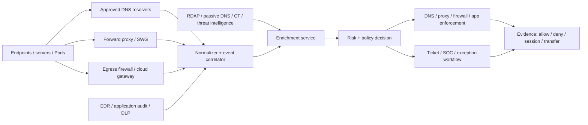
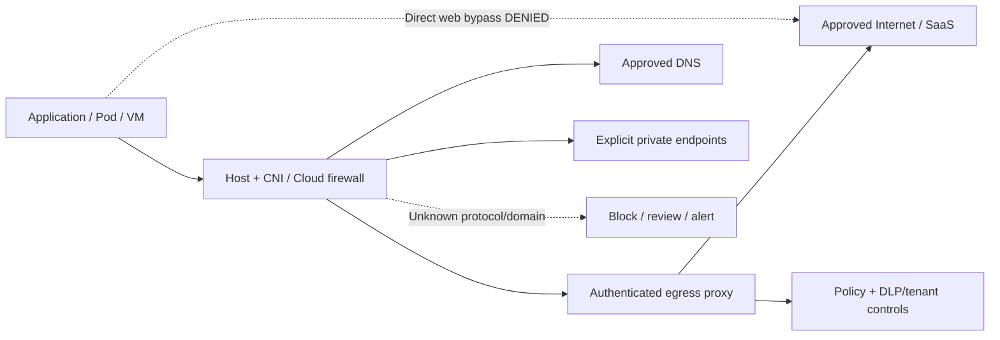
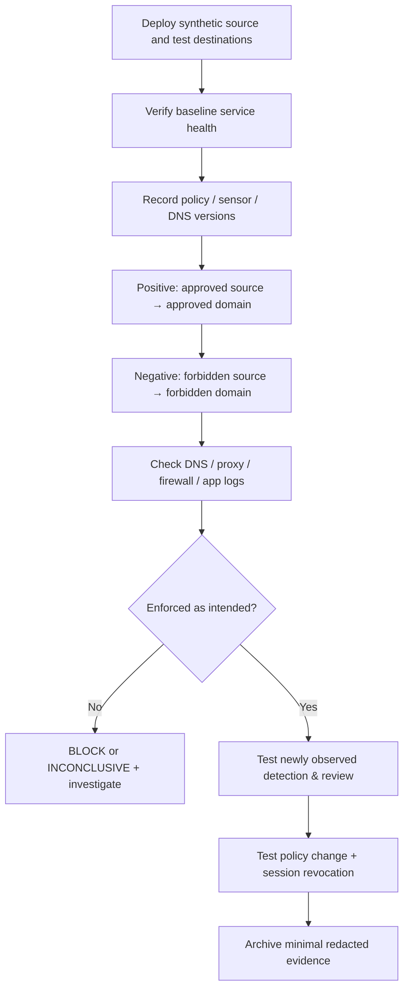

# Xử lý kết nối đến domain mới xuất hiện

## Mục tiêu học tập

Sau bài học, bạn có thể:

1. Phân biệt **domain mới được hệ thống quan sát (newly observed domain)**, **domain mới đăng ký (newly registered domain, NRD)**, **domain mới xuất hiện trong một nhóm workload** và **địa chỉ IP mới**. Biết vì sao những nhãn này không đồng nghĩa “domain độc hại”.
2. Giải thích vai trò của **DNS telemetry, proxy/SWG, firewall, TLS metadata, passive DNS, RDAP, Certificate Transparency, threat intelligence, EDR và ứng dụng** trong việc phát hiện và xác minh một kết nối đến domain lạ.
3. Chuẩn hóa tên miền đúng ngữ cảnh: FQDN, chữ hoa/thường, dấu chấm cuối, IDNA/Punycode, subdomain, CNAME, **Public Suffix List** và domain đăng ký thực tế; tránh nhầm `example.co.uk` với `co.uk`.
4. Thiết kế quy trình **thu thập → chuẩn hóa → so baseline → làm giàu dữ liệu → xếp rủi ro → quyết định → thực thi → xác minh → theo dõi/đóng case** có khả năng kiểm toán.
5. Phân tích dấu hiệu **phishing, domain giả mạo, malware C2, DGA, fast flux, DNS tunneling và data exfiltration**, đồng thời biết giới hạn, false positives và mức tin cậy của từng chỉ báo.
6. Thiết kế quyết định theo nguồn và mức nhạy cảm dữ liệu: **allow, block, quarantine, require review, inspect khi được phép, monitor và time-bound exception**; không tự mở Internet cho mọi workload.
7. Phòng tránh bypass qua **direct IP, DoH/DoT, ECH, QUIC/HTTP/3, IPv6, CDN/shared hosting, proxy exceptions, private routing và alternate egress gateways**.
8. Lập bộ test **positive/negative**, đánh giá detection latency, telemetry coverage, policy drift và khả năng phục hồi khi DNS/threat intelligence/proxy bị lỗi.
9. Viết mô hình phân loại **Python hoàn toàn ngoại tuyến**, đọc risk factors mà không phát DNS query, không tải threat feed và không gửi dữ liệu ra mạng.
10. Xây runbook điều tra và xử lý sự cố phù hợp với bảo mật mạng, kiểm soát egress và chống thất thoát dữ liệu.

## 1. Vấn đề: tại sao kết nối tới domain chưa từng gặp cần được xét?

Một mạng công ty hàng ngày giao tiếp với hàng nghìn tên miền. Nhiều tên miền mới là **hợp pháp**: SaaS bổ sung subdomain, CDN đổi host, API đối tác mới, dịch vụ cập nhật phần mềm hoặc chiến dịch marketing. Nhưng tên miền mới cũng có thể xuất hiện khi:

- Một email lừa đảo đưa người dùng tới trang đăng nhập giả.
- Workload bị compromise tìm cách liên hệ hạ tầng **command-and-control (C2)**.
- Mã độc tạo tên miền bằng **domain generation algorithm (DGA)**.
- Ứng dụng hoặc nhân viên vô tình gửi dữ liệu nhạy cảm tới bên thứ ba chưa phê duyệt.
- Một thư viện mới thêm telemetry, quảng cáo, dependency tải từ endpoint lạ.
- Kẻ tấn công dùng domain mới như điểm trung chuyển, DNS tunneling hoặc exfiltration.

Vấn đề của đội bảo mật không phải “**tự động chặn mọi domain lần đầu được thấy**”, mà là **xử lý kết nối chưa có lịch sử đáng tin theo rủi ro, business need, danh tính nguồn và loại dữ liệu**.

Ví dụ cùng một tên miền mới `api.vendor.example.test`:

| Nguồn | Mục đích | Dữ liệu | Hành động dự kiến |
|---|---|---|---|
| Workload thanh toán đã phê duyệt | Gọi API đối tác mới có change ticket | Business transaction theo scope | Có thể cho phép sau xác minh danh tính đích, quyền và review |
| Database chứa PII | Upload một file nén lớn | Restricted | Chặn và điều tra |
| Endpoint nhân viên | Mở đường dẫn từ email không mong đợi | Chưa rõ | Xét phishing context, cô lập trình duyệt hoặc cảnh báo |
| Máy build CI | Download dependency từ registry có thay đổi chính thức | Artifact | Kiểm vendor release/source, ký số và allowlist |
| Thiết bị EDR quarantined | Liên hệ cùng domain | Không rõ | Chặn đường ra không cần, dùng runbook incident |

Cùng một domain không tạo cùng một kết quả cho mọi nguồn. Bài thuộc chương **Kiểm soát egress và chống thất thoát dữ liệu** của module `SECURITY_NETWORK_SECURITY`: kết hợp phân đoạn, firewall, VPN/ZTNA, IDS/IPS, DNS, xác thực kết nối và cloud security để tạo **hàng rào trước khi dữ liệu hoặc lệnh đi qua trust boundary**.

> **Nguyên tắc nền tảng:** *Mới* là một tín hiệu cần tìm hiểu, không phải một bản án. *Đã tồn tại lâu* cũng không chứng minh an toàn. Chỉ cho phép traffic khi **đích, nguồn, mục đích, đường đi và quyền dữ liệu** đáp ứng chính sách hiện hành.

## 2. Các định nghĩa “mới” không được đánh đồng

| Thuật ngữ | Cách xác định | Điều không thể kết luận |
|---|---|---|
| **Newly observed domain (NOD)** | Lần đầu được một sensor/hệ thống thấy theo phạm vi và retention | Domain vừa mới đăng ký |
| **New-to-organization** | Trước đó chưa có trong log/baseline tổ chức | Không từng xuất hiện trên Internet |
| **New-to-workload/user** | Nguồn cụ thể chưa từng liên hệ domain này | Toàn tổ chức chưa dùng |
| **Newly registered domain (NRD)** | Bằng chứng vòng đời đăng ký gần đây từ registry/RDAP/feed thích hợp | Domain độc hại hoặc chưa từng có traffic |
| **Newly delegated/activated** | Thay đổi DNS/NS/zone, hoặc lần đầu quan sát sử dụng | Thời điểm đăng ký mới |
| **Newly resolved IP** | Domain nay trả IP hoặc IPv6 mới | Tên miền có mới không |
| **Newly issued certificate** | Certificate mới xuất hiện trong CT/PKI logs | Domain mới đăng ký hay certificate đã được deploy |
| **New subdomain** | Tên dưới một parent domain mới xuất hiện trong telemetry | Registered domain parent mới |
| **First seen in passive DNS** | Nguồn passive DNS ghi nhận resolution đầu tiên | First registration time hoặc first global use |
| **Unknown reputation** | Không có verdict từ feed/engine | Không có rủi ro hoặc được phép |

### 2.1. First seen luôn có phạm vi

Một hệ thống ghi `first_seen=2026-11-28` phải diễn giải rõ **“first seen ở đâu?”**:

- Trên DNS recursive resolver công ty.
- Trên SWG/proxy của một chi nhánh.
- Trên một Pod/namespace.
- Trên một endpoint EDR.
- Trong một passive DNS provider.
- Trong một feed domain intelligence thương mại.

Các nguồn khác nhau có **coverage và retention** khác nhau. Nếu hệ thống chỉ giữ log 30 ngày, một domain dùng cách đây hai năm nhưng không dùng 30 ngày gần đây sẽ lại trở thành “new-to-observation-window”.

**Không khẳng định một first-seen timestamp trong log doanh nghiệp là ngày domain được đăng ký.**

### 2.2. Ví dụ về ba mốc thời gian khác nhau

```text
2026-10-03  Domain được đăng ký (theo dữ liệu registry nếu đáng tin).
2026-11-10  Certificate xuất hiện trong CT log.
2026-11-28  Một workload của tổ chức lần đầu hỏi DNS domain.
```

Các mốc này trả lời ba câu hỏi khác nhau:

- Tuổi đăng ký: khoảng từ ngày đăng ký đến thời điểm hiện tại.
- Tuổi certificate: khoảng thời gian từ issuance/observation, không phải tuổi domain.
- Tuổi quan sát trong tổ chức: khi lưu lượng xuất hiện lần đầu trong **phạm vi đo**.

Không dùng ngày của certificate để thay ngày đăng ký khi dữ liệu registry không có.

### 2.3. Domain mới không đồng nghĩa domain đích thực

Một request tới hostname mới có thể:

- Đi qua CNAME tới CDN đã biết.
- Kết thúc tại proxy hoặc SaaS chung nhiều tenants.
- Có redirect từ website hợp pháp sang domain độc hại.
- Có HTTPS certificate tên khác do cấu hình server hoặc multi-tenant host.
- Phát DNS query nhưng **không bao giờ mở kết nối** do timeout, sandbox scan hay blocked DNS.
- Có kết nối thành công nhưng ứng dụng trả 403 do authorization.

Cần giữ **chuỗi sự kiện** để phân biệt query, resolution, TCP/QUIC handshake, TLS validation, HTTP response và data transfer.

## 3. Sơ đồ thu thập, quyết định và thực thi



Đây là **kiến trúc logic**, không quy định một vendor hoặc cho rằng tất cả nguồn telemetry đều có mặt. Cần phân rõ:

- **Sensor/collector:** ghi nhận truy vấn/kết nối.
- **Normalizer:** chuẩn hóa tên, mốc thời gian, identity, trust zone.
- **Enrichment:** thêm evidence về domain từ nguồn đã duyệt.
- **Policy decision point (PDP):** kết hợp nguồn/đích/nguy cơ/business policy.
- **Policy enforcement point (PEP):** DNS, firewall, SWG, egress gateway, application hoặc SaaS control thật sự chặn/cho.
- **Case management:** quản lý triage, exception và audit.
- **Verification:** kiểm traffic thực, không chỉ thấy policy đã xuất bản.

### 3.1. Đặt collector ở vị trí có ý nghĩa

Ở client: DNS queries, proxy requests, endpoint process tree, browser protection.

Ở server: host firewall, workload identity, destination flows, application audit.

Ở cloud: VPC/VNet flow logs, NAT/egress gateway, network firewall và load balancer logs.

Ở Kubernetes: pod/namespace identity từ CNI, NodeLocal DNS/CoreDNS logs, mesh egress và hostNetwork/sidecar-bypass paths.

**Chỉ có DNS log** có thể biết client đã hỏi tên nhưng không biết client đã kết nối/đã gửi dữ liệu. **Chỉ có NAT log** có thể biết IP/port ngoài nhưng không biết hostname hoặc process gốc.

### 3.2. Hai loại nguồn phát hiện

- **Near-real-time path:** DNS policy/SWG/firewall đánh giá trong hoặc gần lúc kết nối, có khả năng deny ngay.
- **Out-of-band analytics:** SIEM/NDR/EDR correlation/threat hunting nhìn lại nhiều event rồi đưa ra block/update policy.

Không hứa **“block trong 0 giây”** nếu phát hiện sau khi network session đã mở; phải có biện pháp thu hồi active sessions/incident containment khi cần.

## 4. Từ FQDN đến registered domain: chuẩn hóa đúng mới so sánh đúng

### 4.1. Chuỗi nhập có thể là URL, hostname, SNI hoặc DNS QNAME

Ví dụ:

```text
Input URL:      https://Login.Example.TEST:443/verify
URL hostname:   login.example.test
DNS QNAME:      login.example.test.
Parent domain:  example.test
HTTP authority: login.example.test:443
```

Các trường này **không tương đương**. Một URL có path/query, authority có thể chứa port, QNAME có trailing dot, trong khi SNI chứa tên server mà client dùng trong TLS handshake (không nhất thiết hiện diện/quan sát được).

Không nên lưu một chuỗi raw làm cả domain, URL, HTTP Host, TLS SNI và IP literal.

### 4.2. Normalization cơ bản

1. Xác định **loại input**: DNS name, URL, proxy CONNECT authority, certificate SAN hay address.
2. Với URL: dùng parser đúng chuẩn để lấy **hostname**, không cắt chuỗi tùy tiện theo `/` hoặc `@`.
3. Xử lý **dấu chấm cuối** trong FQDN với ý nghĩa DNS.
4. DNS names không phân biệt chữ hoa/chữ thường theo phần lớn xử lý thông dụng; dùng chuẩn hóa nhất quán.
5. Với tên Unicode: xử lý IDNA/Punycode theo library/chuẩn phù hợp, ghi representation đã kiểm chứng; không dùng chuỗi confusable để suy identity.
6. Xác minh cú pháp, độ dài labels/FQDN, tên đặc biệt và IP literals theo policy.
7. Xác định **registered domain (eTLD+1)** bằng **Public Suffix List (PSL)** cập nhật — không cắt lấy hai labels cuối một cách máy móc.
8. Giữ **full hostname** lẫn registered domain để phân biệt một subdomain lạ dưới domain lớn.
9. Tránh tự động biến mọi wildcard như `*.example.test` thành trust cho toàn bộ descendants.
10. Lưu raw input tối thiểu có kiểm soát để forensic/correlation, tránh ghi URL chứa tokens.

### 4.3. Public Suffix List là gì?

Với `a.b.example.co.uk`, registered domain có thể là `example.co.uk` chứ không phải `co.uk`. Nhưng với nhà cung cấp multi-tenant, các **private suffix rules** trong PSL ảnh hưởng cách xác định ranh giới đăng ký. Hệ thống cần thống nhất:

- Dùng PSL ICANN section hay cả private section theo mục đích.
- Phiên bản PSL và lần cập nhật cuối.
- Phạm vi key cho risk score: full FQDN, eTLD+1 hay cả hai.
- Những parent domains có thể chứa subdomains do khách hàng tự tạo.

**Registered domain không luôn đồng nghĩa “business owner”**. Một SaaS domain/hosting provider có thể phục vụ nhiều tenant dưới các subdomains khác nhau.

### 4.4. IDNA, Punycode và chữ tương tự nhau

Tên miền có thể dùng các ký tự Unicode trông giống tên thương hiệu (homograph). Trong phân tích:

- Giữ biểu diễn ASCII IDNA và Unicode an toàn khi cần xem xét.
- Dùng thư viện IDNA/UTS #46 phù hợp với ứng dụng và quy tắc hiện hành.
- Không chỉ lowercase Unicode rồi coi đã canonicalized chính xác.
- Gắn warning khi hostname dễ gây nhầm lẫn với protected brand, không kết luận attack chỉ vì có non-ASCII.
- Không dựa vào hiển thị bằng mắt để xác minh ownership.

**Mã Python standard library `"idna"` codec có lịch sử semantics khác IDNA2008 hiện đại**; production nên dùng giải pháp IDNA được cập nhật phù hợp với trình duyệt/identity policy đang kiểm tra.

### 4.5. CNAME và các bản ghi alias

Một chuỗi phân giải có thể là:

```text
api.new-vendor.example.test
    CNAME edge.cdn-provider.example.test
        A    198.51.100.42  (địa chỉ minh họa)
        AAAA 2001:db8::42  (địa chỉ minh họa)
```

Cần lưu:

- Hostname client yêu cầu.
- CNAME chain và đích cuối nếu DNS cho phép quan sát.
- Trả lời A/AAAA, TTL và resolver/source.
- Port/protocol, TLS server identity và proxy authority khi có.
- Threat intel cho **source name** và **DNS answer/IP**, không thay lẫn.
- IPv4 và IPv6 routes/capabilities.

Một IP/CDN dùng chung nhiều domain **không nên bị block hàng loạt** chỉ vì một hostname trong đó đáng ngờ nếu chính sách có cách chặn theo host/tenant an toàn hơn. Trường hợp chỉ có firewall L3/L4, cần đánh giá phạm vi ảnh hưởng của IP deny.

## 5. Thu thập bằng chứng domain age và danh tiếng

### 5.1. Những nguồn enrichment

| Nguồn | Có thể cho biết | Giới hạn điển hình |
|---|---|---|
| **RDAP / registry data** | Registrar, domain registration/renewal events, status theo TLD | Privacy redaction, dữ liệu chậm/thiếu, clock và lifecycle khác TLD |
| **Passive DNS** | Quan hệ domain↔IP, first/last observed, historical resolution | Coverage/retention/sampling khác nhau |
| **Certificate Transparency (CT)** | Chứng thư đã được ghi vào log, SAN names, issuance context | Certificate không chứng minh ownership đáng tin hay active use |
| **DNS resolver logs** | Cụm nội bộ có ai hỏi hostname vào lúc nào | Query không đồng nghĩa kết nối hay data transfer |
| **SWG/forward proxy logs** | Client identity, requested authority/URL nếu nhìn được, decision, bytes | CONNECT tunnel có thể không thấy payload |
| **Firewall/NDR/VPC flow logs** | Source/dest IP/port/protocol/bytes/time, action theo thiết bị | NAT/shared IP không tự cho hostname/process |
| **EDR** | Process/binary/user tạo kết nối, endpoint posture, alerts | Coverage/OS support và độ trễ |
| **Threat intelligence feeds** | Domain category, IOC associations, confidence, timestamps | False positives, stale feeds, collection bias |
| **DNS security / RPZ** | Policy queries bị block/sinkhole và reason | Không chứng minh mọi direct-IP path được chặn |
| **Application/SaaS audit** | Upload/share/export actions, tenant/account/business role | Không thấy mọi protocol/hệ thống ngoài tích hợp |

### 5.2. Ngày đăng ký không phải lúc nào cũng đủ chắc

- Domain có thể đổi chủ, được mua lại hoặc hết hạn rồi đăng ký lại.
- RDAP event timeline có các semantics khác nhau theo registry.
- Domain có thể mới đối với tổ chức nhưng được đăng ký từ lâu.
- Nhà cung cấp có thể dùng subdomain mới dưới domain đăng ký lâu năm.
- Threat actors có thể dùng domain lâu đời/compromised hoặc legitimate service.
- Dữ liệu registry có thể bị hạn chế, trễ hoặc không có.

Nếu `registration_date` không đáng tin hoặc không có, **đừng tự tạo domain age = 0**. Hãy ghi `UNKNOWN` và mức tin cậy của enrichment.

### 5.3. Certificate Transparency không là phán quyết an toàn

Một chứng thư TLS có chữ ký hợp lệ chỉ hỗ trợ xác thực **tên và khóa** theo CA trust khi handshake đúng; nó không phê duyệt hoạt động của website.

Một domain phishing có thể có certificate hợp lệ. Ngược lại, thiếu CT hit không chứng minh domain độc hại: log coverage, loại chứng thư và delay có thể ảnh hưởng.

### 5.4. Threat intelligence phải có nguồn và hạn dùng

Một verdict nên lưu:

```json
{
  "hostname": "api.new-vendor.example.test",
  "source": "synthetic-threat-feed",
  "verdict": "unknown",
  "confidence": "not_assessed",
  "observed_at": "2026-11-28T08:00:00Z",
  "feed_version": "lab-feed-v1",
  "expires_at": "2026-11-29T08:00:00Z"
}
```

Dữ liệu trên là **mô phỏng**, không phải feed thật. `unknown` không bằng `benign`. Hệ thống cần biết khi nào verdict hết hạn và không để verdict cũ ghi đè cảnh báo mới.

## 6. Tạo baseline: mới với ai, trong bao lâu?

### 6.1. Baseline nhiều cấp

Một pipeline hữu ích có thể theo dõi:

- **Global organization first seen:** domain chưa từng xuất hiện trong tổ chức trong thời gian lưu quan sát.
- **Source zone first seen:** lần đầu ở segment production, finance, engineering.
- **Workload first seen:** container/VM/job cụ thể lần đầu tạo kết nối tới host.
- **Identity first seen:** user/service account cụ thể mới liên hệ đích.
- **App category first seen:** lần đầu app process hoặc browser extension gọi host.
- **Time-window novelty:** đích mới trong 24 giờ/7 ngày/30 ngày.
- **Newly registered:** ngày đăng ký recent theo registry/feed riêng.

Một domain có thể là bình thường với nhân viên marketing nhưng **rất bất thường với server database**.

### 6.2. Baseline cần vòng đời

Trạng thái thông dụng:

```text
UNSEEN -> FIRST_OBSERVED -> TRIAGED
       -> APPROVED / DENIED / MONITORED / EXCEPTION
       -> REVALIDATE on expiry, threat changes or owner change
```

Không biến danh sách `APPROVED` thành allowlist vĩnh viễn. Một đích hợp lệ hôm nay có thể đổi chủ, bị compromise hoặc không còn được nghiệp vụ sử dụng.

### 6.3. Vấn đề cold start

Khi mới triển khai sensor hoặc đổi SIEM, hàng nghìn domain quen thuộc sẽ bị gắn “first seen”. Cần:

1. Import baseline từ nguồn đã có nếu được phép và dữ liệu đủ chất lượng.
2. Có **learning/report-only phase** phù hợp mức rủi ro.
3. Dùng business allowlist từ owners, không tự allow toàn bộ “new” trong giai đoạn đầu.
4. Phân biệt sensor mới với domain mới.
5. Ghi `sensor_started_at` và log retention.
6. Giữ hard block cho IOC/high-risk destinations ngay cả khi đang learning.
7. Đo false positive rates và review rule trước khi enforce trên tất cả workloads.

### 6.4. Hostname mới dưới domain cũ

`cdn-173.vendor.example.test` có thể xuất hiện hàng ngày do load balancing. Nếu policy đánh mỗi FQDN mới là nghiêm trọng, báo động sẽ quá tải.

Nhưng **subdomain ngẫu nhiên dài với lượng DNS queries rất lớn từ một server không có nhu cầu** có thể đáng điều tra. Phải kết hợp:

- Registered domain owner/tenant.
- Pattern của subdomain và rate.
- Source process và role.
- CNAME/DNS response.
- Dữ liệu bị trao đổi.
- Historical behavior và vendor documentation.

**Không tự allow tất cả subdomains của domain cũ**: một hosting platform có thể cho bên bất kỳ tự tạo subdomain.

## 7. Những chỉ báo cần đặt trong ngữ cảnh

### 7.1. Các nhóm tín hiệu

| Nhóm | Ví dụ | Ghi chú |
|---|---|---|
| **Domain lifecycle** | NRD, mới active/first seen, mới đổi NS | Dễ sai nếu registry data trễ |
| **Tên miền** | Lookalike thương hiệu, homoglyph, subdomain bất thường | Cần tránh false positives |
| **DNS behavior** | NXDOMAIN bursts, domain distribution, queries có tần suất lạ | DNS tunneling/DGA không chứng minh chỉ từ một chỉ số |
| **Infrastructure churn** | IP/ASN thay đổi nhanh, nhiều A/AAAA, TTL thấp | CDN hợp pháp cũng thay IP/TTL |
| **Threat reputation** | Feed match có confidence/source/time | Feed có thể sai/cũ |
| **Endpoint context** | EDR incident, process mới, unusual parent process | Sensor có giới hạn |
| **Source sensitivity** | DB/secrets/finance/CI/AD/production admin | Mức độ rủi ro khác endpoint thông thường |
| **Connection properties** | TCP/UDP, bytes out, frequency, rare hour | Backup/webhook hợp lệ có thể giống exfil |
| **Proxy HTTP context** | Method/path/status, upload size, tenant | Chỉ có khi giao thức/inspection cho phép |
| **Data classification/DLP** | Restricted upload, secret pattern, export action | False positives/visibility limits |
| **Identity/access** | Unauthorized service principal, revoked device, wrong role | Cần verified identity |
| **Change control** | Approved vendor onboarding, deployment revision | Giúp giảm false positive có căn cứ |

### 7.2. Tín hiệu mạnh và tín hiệu yếu

Ví dụ:

- **Yếu nếu đứng riêng:** domain mới, TTL thấp, đăng ký mới, certificate mới, ít lượt truy cập.
- **Mạnh hơn khi phối hợp:** domain mới + client là database không có approved egress + tiến trình bất thường + lượng outbound cao + proxy/DLP xác nhận sensitive data transfer.
- **Rất cần chú ý:** domain bị feed tin cậy xác nhận nằm trong active C2 campaign, đồng thời endpoint EDR liên quan có active compromise alerts.
- **Không đủ để kết luận exfil:** DNS query nhìn thấy, TCP SYN attempt hoặc SWG block trước khi tạo session.

### 7.3. Đừng mặc định “bất thường = độc hại”

Hợp lệ nhưng dễ bị gắn cờ:

- CI chạy build mới kéo dependency từ package mirror.
- Browser mở domain CDN/telemetry vừa được vendor phát hành.
- Trình duyệt thực hiện prefetch DNS hoặc link preview.
- Phần mềm EDR/MDM đổi endpoint.
- Hệ thống backup gửi batch dữ liệu lớn đúng lịch.
- Một đối tác được bổ sung qua change ticket.
- Một dịch vụ SaaS chuyển sang IPv6.
- Load balancer/CDN sinh subdomain theo từng region.

Điều tra nên bắt đầu bằng **owner, business purpose, source process và thời gian thay đổi** trước khi ra lệnh block diện rộng.

## 8. Các kiểu đe dọa liên quan domain mới

### 8.1. Phishing và brand impersonation

Domain gần giống tên doanh nghiệp hoặc IdP được dùng trong email/phishing link. Rủi ro tăng khi:

- Domain mới được quan sát ngay sau một chiến dịch email lạ.
- Hostname tạo cảm giác thuộc hệ thống đăng nhập/SSO.
- Trang yêu cầu nhập mật khẩu, OTP hoặc tải file không mong đợi.
- Người dùng truy cập từ thiết bị có EDR/browser warning.
- Tên miền dùng ký tự trông giống, thay đổi một vài ký tự hoặc prefix/suffix đánh lừa.

**Kiểm soát:** DNS/SWG deny theo threat intel phù hợp, browser isolation với domain chưa tin, email/IdP protection, phishing-resistant MFA, session revocation và user guidance.

### 8.2. Malware command-and-control

Một tiến trình bị compromise có thể gọi server ngoài qua HTTPS, DNS hoặc một giao thức khác. Dấu hiệu đáng xem:

- Tiến trình không thuộc allowlist của server.
- Kết nối lặp đều hoặc trong khoảng ngẫu nhiên về domain mới.
- EDR có active incident hoặc binary không được phê duyệt.
- Tên đích không liên quan business dependency.
- Proxy bypass hoặc kết nối trực tiếp dù policy bắt proxy.
- Outbound bytes/data pattern khác baseline.

**Không suy** beaconing chỉ từ một kết nối định kỳ: agent updates, telemetry và health checks cũng tuần hoàn.

### 8.3. Domain Generation Algorithm (DGA)

DGA là mô hình tạo nhiều domain ứng viên theo thuật toán; chỉ một phần có thể được đăng ký hoặc trả lời DNS. Dấu hiệu có thể gồm:

- Nhiều QNAME hiếm/khác nhau từ cùng host trong thời gian ngắn.
- NXDOMAIN ratio tăng.
- Chuỗi label có entropy hoặc pattern khác với app dependency bình thường.
- Cùng process phát sinh chuỗi queries bất thường.
- Một subset domain vừa được đăng ký hoặc đã có IOC.

**Độ dài/entropy của hostname đơn lẻ không phải bộ phát hiện DGA đủ chính xác**: CDN tracking, artifact identifiers và dịch vụ hợp lệ cũng có labels dài.

### 8.4. Fast flux và hạ tầng thay đổi nhanh

Một domain có thể trỏ tới nhiều IP, ASNs hoặc thay đổi liên tục, đôi khi liên quan hạ tầng chuyển tiếp độc hại. Tuy nhiên CDN và load-balancing toàn cầu cũng có đặc trưng tương tự.

Điều tra bằng **historical passive DNS, TTL, authoritative DNS, ASN/IP reputation, ownership và use case**, không lấy “nhiều IP” làm án độc hại.

### 8.5. DNS tunneling và exfil qua tên miền

Tên truy vấn DNS có thể mang dữ liệu trong label, dẫn tới các dấu hiệu như:

- Số lượng subdomain duy nhất cao so với parent domain.
- Labels rất dài hoặc entropy cao.
- Tần suất queries bất thường và outbound request ratio lớn.
- DNS records/responses hiếm ở nguồn.
- Domain đích mới nhưng không có business use.

**Phản ứng:** so với whitelist app/EDR behavior, kiểm nguồn DNS và policy, correlate DLP/endpoint/process. Chỉ DNS telemetry không luôn đủ xác nhận nội dung dữ liệu bị gửi.

### 8.6. Dịch vụ chia sẻ dữ liệu hoặc upload trái phép

Một app được phép upload backups tới SaaS account công ty, nhưng domain mới thuộc file-sharing service chưa phê duyệt có thể là exfil path.

Cần nhìn thêm:

- Data classification và business owner.
- Tenant/account SaaS.
- Phương thức HTTP upload/export và object audit (nếu có visibility).
- Content DLP verdict có căn cứ.
- Nguồn có được phép export không.
- Lượng dữ liệu so với backup/reporting baseline.

**Domain mới chỉ là tín hiệu của đường ra; chống thất thoát dữ liệu cần chính sách về nội dung, người dùng và tài nguyên.**

## 9. Xây mô hình rủi ro có thể giải thích

### 9.1. Những thuộc tính đầu vào

```text
Event context:
  source_workload / device / user (verified)
  trust_zone and sensitivity tier
  observed_hostname, registered_domain
  destination IP/ASN and address family
  protocol/port, proxy path
  first_seen_source and timestamp
  domain-registration age (if reliable)
  DNS/HTTP/TLS metadata available
  reputation and feed confidence
  endpoint/EDR posture
  bytes_out / request frequency, if observed
  DLP/data classification, if inspectable
  change approval / business owner
```

### 9.2. Một thứ tự ra quyết định thực tế

1. **Hard gate về nguồn:** unknown/revoked identity, quarantined host, disallowed network zone.
2. **Hard gate về đích:** IOC mức tin cậy cao, known malicious origin, metadata/admin destination trái policy.
3. **Hard gate về dữ liệu:** restricted data export tới đích không được duyệt hoặc DLP high-confidence block.
4. **Kiểm business allowlist:** domain/service có owner, scope, purpose, trust validation và TTL.
5. **Enrichment domain age/novelty/behavior:** nâng risk và chọn inspection/review/monitor nếu cần.
6. **Resource-specific policy:** production DB/secrets xử lý unknown chặt hơn browser wiki.
7. **Result + evidence:** allow, deny, review, quarantine; log lý do và điều kiện để thay đổi verdict.

Không nên có quy tắc “domain age > 30 ngày → safe” hoặc “first seen < 24 giờ → always malicious”.

### 9.3. Ví dụ risk matrix không cần điểm giả chính xác

| Độ nhạy nguồn / tín hiệu | Chỉ first-seen, không threat hit | Có cảnh báo đáng tin | Confirmed malicious/threat context |
|---|---|---|---|
| Low-risk user browsing | Monitor/category policy; browser isolation nếu cần | Review, step-up hoặc block | Block + endpoint triage |
| API workload với approved vendor onboarding | Verify owner/endpoint, allow hẹp | Hold release và điều tra | Block + incident |
| Sensitive database/finance | Default deny tới domain lạ, owner review | Block và triage | Block/isolate theo incident |
| Security updater có signed vendor change | Kiểm vendor bulletin, cert/signature, staged allow | Vendor incident review | Block theo threat response và continuity plan |
| Compromised/quarantined device | Chỉ remediation allowlist | Deny outbound khác | Contain + forensic |

### 9.4. Một “risk score” không phải phép đo chắc chắn

Nếu tổ chức dùng điểm số, nên:

- Công bố feature, weight và phiên bản model.
- Định nghĩa **hard-deny** tách khỏi weighted score.
- Giữ trạng thái `UNKNOWN` khi enrichment không có.
- Đo false positive/false negative trên traffic có ground truth.
- Kiểm concept drift và bias do CDN/region/vendor/OS.
- Ghi confidence và “why” để analyst điều tra.
- Không tự động biến score thấp thành quyền download/upload dữ liệu restricted.

Mô hình học máy có thể hỗ trợ ưu tiên case, nhưng không thay thế **policy review và bằng chứng thực thi** ở trust boundary nhạy cảm.

## 10. Quyết định policy: allow, block, monitor hay review?

### 10.1. Các lựa chọn chính

| Kết quả | Ý nghĩa | Khi phù hợp |
|---|---|---|
| **ALLOW** | Mở flow đúng scope và TTL đã duyệt | Approved vendor hoặc service hợp lệ |
| **BLOCK** | Không cho connection/request tiếp tục | Known malicious, forbidden zone, high-risk data export |
| **REVIEW** | Cần owner/analyst xác minh trước khi mở | Domain mới của production workload chưa rõ lý do |
| **MONITOR** | Cho hoạt động nhưng tăng telemetry theo policy | Low-risk browser traffic, không có threat signals |
| **ISOLATE/QUARANTINE** | Cô lập endpoint/workload hay hạn network | High-confidence compromise liên quan domain lạ |
| **INSPECT** | Kiểm content/URL theo quyền và capability | HTTPS web traffic thuộc phạm vi TLS inspection hợp lệ |
| **LIMITED** | Cho một action/read-only/tenant cụ thể | SaaS app cần hạn chế export |
| **TEMPORARY EXCEPTION** | Rule hẹp, có approver/expiry/audit | Vendor transition hoặc incident continuity |
| **INCONCLUSIVE** | Chưa đủ bằng chứng để xác nhận deny/benign | Missing telemetry, origin down, feed outage |

Không phải mọi sản phẩm hỗ trợ tất cả trạng thái trực tiếp. `REVIEW` có thể được triển khai bằng deny + ticket + follow-up. `INSPECT` không thể dùng với mọi traffic mã hóa/thuộc phạm vi riêng tư.

### 10.2. Hành động nên phụ thuộc nguồn

Một database trong subnet restricted có thể bị **BLOCK tất cả unapproved newly seen domains** trước tiên; một browser trên managed workstation có thể được monitor/sandbox với website thông thường.

Để tránh disruption, hệ thống có thể có **report-only learning stage**, nhưng không được dùng nó làm lý do tắt các hard-deny controls đối với nguồn rủi ro cao.

### 10.3. Thời hạn và quyền sửa quyết định

Mỗi exception cần:

- Source identity/workload/device và môi trường.
- FQDN/registered domain/service/tenant chính xác.
- Protocol/port, IPv4/IPv6 và egress path.
- Business purpose, data classification, owner và approver.
- Expiry, renewal review và rollback.
- Compensating controls khi không thể inspect payload.
- Test cases positive và negative.
- Policy revision/evidence links và audit trail.

**Cho phép domain mới trong một ticket không nên tạo wildcard egress vĩnh viễn** cho toàn tenant hoặc toàn namespace.

## 11. Thực thi: DNS, proxy, firewall và ứng dụng làm gì?

### 11.1. DNS resolver / DNS firewall

Có thể:

- Block/sinkhole một tên đã xác định theo policy.
- Theo dõi DNS queries và first-seen tại resolver.
- Áp category/registered-domain rules khi sản phẩm hỗ trợ.
- Ghi nguồn, query, answer, response code và timestamp.
- Cảnh báo NXDOMAIN bursts hoặc tunneling anomalies.

**Không đủ khi:** client dùng direct IP, cached answers, DoH/DoT không quản lý, resolver ngoài hoặc một protocol không hỏi DNS.

### 11.2. Forward proxy / SWG

Có thể:

- Xác thực client identity và request target.
- Áp domain/category/URL policies theo mức visibility.
- Giới hạn CONNECT hosts/ports.
- Dùng tenant controls, rate limits và upload policy khi hỗ trợ.
- Tích hợp DLP/inspection trong scope được phép.
- Log policy allow/deny, bytes và application context.

**Không đủ khi:** client còn direct Internet path, QUIC/UDP ngoài proxy, TLS tunnel không inspect, HTTP CONNECT authority bị dùng như chứng nhận origin mà không xác minh.

### 11.3. Firewall / network egress gateway

Có thể:

- Chặn new outbound flows tới IP/CIDR/port ngoài baseline.
- Buộc client phải đi tới proxy listener.
- Giới hạn đường tới approved DNS và cloud private endpoints.
- Kiểm IPv4/IPv6, TCP/UDP, NAT routes.
- Áp identity/service policies khi vendor/CNI hỗ trợ.

**Không đủ khi:** dùng IP chung/CDN, cần hiểu SaaS tenant/HTTP method/file content, hoặc chưa kiểm datpath bypass.

### 11.4. Application / SaaS / CASB / DLP

Có thể:

- Chặn upload/share/export dựa trên user/workload role và dữ liệu.
- Chỉ cho phép đúng tenant/account hoặc API resource.
- Lưu business audit và object access.
- Xác minh server identity, TLS và cloud IAM.
- Bổ sung file classification, DLP rule và data movement guard.

**Không đủ khi:** dữ liệu còn đường ra ngoài ứng dụng hoặc policy chưa bao phủ mọi API/client.

### 11.5. Kết hợp các lớp để tạo ranh giới

```text
Source identity + device/workload posture
          |
          v
DNS / service discovery controls
          |
          v
Host/CNI/cloud egress firewall denies direct bypass
          |
          v
Authenticated proxy / gateway (domain/tenant/URL policy)
          |
          v
TLS verification / DLP where appropriate and visible
          |
          v
Application/IAM authorization and data governance
          |
          v
Destination service
```

Sơ đồ mô tả lớp logic, không khẳng định mọi packet đi tuần tự qua tất cả lớp (DNS thường là traffic riêng, gateway có thể tạo kết nối mới, và cloud private API có đường trực tiếp được phê duyệt).

## 12. Những khoảng mù hiện đại: DoH/DoT, ECH, QUIC, IPv6, direct IP

### 12.1. Encrypted DNS: DoH và DoT

- **DoH** truyền DNS queries qua HTTPS, thường TCP/443 và có thể HTTP/3/QUIC tùy deployment.
- **DoT** thường dùng TCP/853, tuy nhiên không nên suy mọi encrypted DNS chỉ có một port.
- Client có thể dùng resolver riêng hoặc proxy; DNS resolver nội bộ sẽ không thấy queries đó.
- Một rule block UDP/53 ngoài approved resolvers **không tự ngăn DoH**.
- SWG/endpoint policy có thể giới hạn DoH endpoints/managed browsers, nhưng shared hosts và encryption complicate classification.
- Không chặn tùy tiện các endpoint hệ thống yêu cầu DNS để bootstrap; phải có fallback/owner.

### 12.2. ECH và SNI

**Encrypted ClientHello (ECH)** có thể che hostname bên trong ClientHello của TLS; người quan sát đường mạng không phải lúc nào cũng thấy origin SNI thật. Vì vậy:

- Đừng suy “không thấy SNI” có nghĩa kết nối bất hợp pháp.
- Đừng dựa hoàn toàn vào SNI để gán verdict domain.
- Sử dụng proxy request target đã xác thực, DNS context, destination policy, application logs và nguồn khác khi có.
- Phải có risk-specific policy khi hostname không quan sát được.
- Không nhầm outer name của ECH với domain ứng dụng thật.

### 12.3. QUIC/HTTP3 và UDP/443

HTTP/3 chạy trên QUIC/UDP. Nếu firewall chỉ buộc TCP/443 qua proxy nhưng cho UDP/443 trực tiếp, một số clients có thể đi đường khác.

Cần:

- Kiểm both TCP/443 and UDP/443.
- Xem proxy/SWG có hỗ trợ QUIC/HTTP3 và có mức policy tương đương không.
- Nếu chặn QUIC để dùng HTTPS/TCP fallback, kiểm service availability và performance.
- Không mặc định fallback tồn tại/hoạt động trong mọi app.
- Ghi protocol trong logs/alerts; đừng gọi một TCP probe là đủ cho UDP.

### 12.4. IPv6, direct IP và alternative route

- `0.0.0.0/0` không bao gồm `::/0`.
- Cloud NAT IPv4 không nhất thiết là đường đi của IPv6.
- Direct IP bypass domain DNS filtering.
- SaaS/CDN có dual-stack; client có thể chọn AAAA thay A.
- VPN split tunnel, private peering, Pod hostNetwork, secondary NIC hoặc DR region có thể đi qua PEP khác.
- Egress policy phải được xác minh theo **tất cả đường đang thực sự reachable**.

### 12.5. “Không thấy” không đồng nghĩa “không xảy ra”

Không có DNS query trong SIEM có thể do cache, DoH, log sampling, resolver outage, direct IP hoặc client khác; không tự kết luận host không tạo kết nối.

Tương tự, không có DLP alert trong CONNECT tunnel không giải mã không có nghĩa payload đã được kiểm sạch. Ghi rõ **visibility level và evidence gaps**.

## 13. Ghép domain mới với nguy cơ thất thoát dữ liệu

### 13.1. Khác biệt giữa “đích lạ” và “dữ liệu đã bị rò”

Giả sử proxy ghi:

```text
source=finance-report-job
destination=reports-new.example.test
status=CONNECT_DENIED
bytes_out=0
reason=UNAPPROVED_NEW_DOMAIN
```

Có thể kết luận **một yêu cầu tới domain chưa duyệt bị từ chối** ở điểm proxy; không thể từ đó khẳng định dữ liệu đã bị rò. Cũng cần biết có **đường direct** khác hay một connection trước đó không.

Ngược lại:

```text
source=finance-report-job
destination=approved-shared-saas.example.test
proxy=ALLOW
upload_bytes=125000000
saas_tenant=unknown
dlp_visibility=none
```

Domain có thể **không mới** nhưng dữ liệu nhạy cảm vẫn có thể bị gửi nhầm sang account/tenant không được duyệt. Đây là lý do phải kết hợp **egress + DLP + SaaS tenant controls + app audit**.

### 13.2. Các mức bằng chứng về data movement

| Quan sát | Có thể nói | Không được nói |
|---|---|---|
| DNS query | Client/sensor đã hỏi tên | Đã kết nối hoặc gửi file |
| TCP SYN/QUIC attempt | Có thử tạo phiên mạng | Origin nhận ứng dụng thành công |
| TLS handshake | Có phiên được mã hóa (nếu logs chứng minh) | Nội dung an toàn hoặc đúng tenant |
| HTTP CONNECT 200 | Proxy lập tunnel | Proxy đã đọc body upload |
| Proxy bytes-out | Có trao đổi bytes theo góc nhìn proxy | Toàn bộ là dữ liệu nhạy cảm hay chắc chắn exfil |
| DLP alert | Dữ liệu/pattern match policy với độ tin cậy nhất định | Không có false positive |
| SaaS upload audit | Upload action đã được ứng dụng ghi nhận | Dữ liệu đã rò ra bên ngoài owner nếu chưa xét tenant/role |
| Confirmed data incident | Kết luận sau kiểm chứng nguồn, dữ liệu, bên nhận | Không được suy từ một tín hiệu đơn lẻ |

### 13.3. Phân loại dữ liệu cần vào quyết định

- **Public:** có thể có luồng ra rộng hơn theo business policy.
- **Internal:** chỉ các đối tác/dịch vụ được duyệt.
- **Confidential:** hạn quyền export/tenant, monitoring/inspection phù hợp.
- **Restricted/regulated:** có thể yêu cầu explicit approval, DLP, tokenization hoặc chặn export.
- **Secrets/private keys:** bảo vệ nghiêm ngặt; pattern match có thể giúp phát hiện nhưng không đảm bảo 100%.

Mỗi loại cần có **data owner, authorized recipients, purpose và retention**. Một tên miền mới chưa được duyệt là lý do để kiểm tra **bên nhận**, nhưng không tự thay quyết định dựa trên nội dung dữ liệu.

### 13.4. Shared SaaS domain và tài khoản cá nhân

Một dịch vụ chia sẻ tệp có thể dùng cùng hostname cho tenant công ty và tài khoản cá nhân. Cần:

1. Biết ứng dụng có thể phân biệt tenant/account ở proxy/CASB/API không.
2. Áp policy theo **tenant hoặc account identifier đã xác minh** nếu yêu cầu.
3. Giới hạn OAuth scopes/API tokens và business identities.
4. Dùng app/endpoint DLP khi HTTPS content không có ở network sensor.
5. Không mở rộng wildcard chỉ vì corporate account đã được phê duyệt.
6. Audit public sharing, file export, download và cross-tenant invitations.

**FQDN allowlist không tự là tenant allowlist.**

## 14. Quy trình triage một domain mới xuất hiện

### 14.1. Bước 0 — Xác thực alert đầu vào

Trước khi điều tra, xác nhận:

- Alert đến từ sensor nào, ở vị trí nào?
- `first_seen` là local/global/registration hay một field không rõ?
- Timestamp theo UTC, clock skew và event ingestion delay?
- Có thể là duplicates hoặc batch replay?
- Domain raw input là DNS QNAME, CONNECT authority hay URL host?
- Đã chuẩn hóa IDNA/Punycode và registered-domain chính xác chưa?
- Sensor coverage có thay đổi (proxy mới, DNS forwarder mới) không?

Một alert phát sinh khi bật proxy lần đầu có thể chỉ là **coverage increase**, không phải chiến dịch malware mới.

### 14.2. Bước 1 — Xác định nguồn và bề mặt dữ liệu

Thu thập có kiểm soát:

- Endpoint/VM/container/Pod ID, namespace, source zone.
- Verified user/workload identity, EDR posture và process attribution.
- Application owner, deployed image/build revision và thay đổi gần đây.
- Business sensitivity: frontend/CI/DB/finance/secrets/admin.
- Data flow expected: đọc tài liệu, đồng bộ, backup, payment, package update.
- Các network attachments, alternate egress paths và NAT attribution.

**Không cần copy toàn bộ file trên endpoint hoặc raw cookies/token** để biết nguồn tạo kết nối.

### 14.3. Bước 2 — Correlate DNS, network và proxy

Dòng thời gian cần phân biệt:

```text
t0  Sensor sees DNS query hostname
t1  Approved resolver returns CNAME -> A/AAAA
t2  Source opens TCP/UDP connection to resolved address
t3  Proxy or firewall makes ALLOW/DENY decision
t4  TLS handshake / server identity validation if applicable
t5  HTTP or application request / response if visible
t6  Bytes transferred / DLP / SaaS object action if visible
```

Một sự kiện có thể không đi qua đầy đủ các bước. Ví dụ DNS answer đã cache, app dùng IP, proxy resolves origin, kết nối fail trước TLS, hoặc metadata do ECH không được nhìn thấy.

Không tự dựng “t6 data upload” khi chỉ có t0 DNS query.

### 14.4. Bước 3 — Làm giàu dữ liệu có nguồn gốc

- RDAP/registry age nếu nguồn đáng tin.
- Passive DNS first/last seen, CNAME/historical IP/ASN.
- CT certificate history và DNS/hosting ownership.
- Threat feeds with confidence/severity/last refreshed.
- DGA/fast-flux/lookalike signals trong ngữ cảnh.
- Sandbox detonation report nếu có quy trình phân tích riêng được duyệt.
- EDR process/publisher/signature và alerts.
- Source app release/change ticket liên quan domain mới.

**Không tự mở URL nghi vấn trong browser nhân viên để xem**; việc tương tác có thể gây rủi ro và thay đổi bằng chứng. Nếu cần phân tích nội dung, dùng sandbox/triage system đã được tổ chức phê duyệt.

### 14.5. Bước 4 — Quyết định sơ bộ theo mức rủi ro

Ví dụ:

| Tình huống | Hành động ban đầu |
|---|---|
| Known malicious với confidence cao, source compromised | Block/contain, mở incident |
| Unknown domain từ DB chứa dữ liệu restricted | Giữ default deny, yêu cầu owner review |
| New approved partner API có ticket | Kiểm endpoint/cert/identity, allow hẹp sau review |
| First-seen CDN host của vendor đã xác minh | Monitor/staged allow với TTL và policy scope |
| User mở unknown domain từ email suspicious | Browser isolation/deny theo phishing policy |
| Telemetry thiếu, resolver lỗi | `INCONCLUSIVE`, không tự đánh benign |
| SaaS tenant không xác định nhưng dữ liệu restricted upload | Block/review dù registered domain lâu năm |

### 14.6. Bước 5 — Có thể đóng case khi nào?

Một case có thể được đánh dấu:

- **BENIGN/APPROVED**: có business owner và evidence phù hợp.
- **MALICIOUS/BLOCKED**: có nguồn xác nhận và PEP verification.
- **FALSE POSITIVE**: detector/rule match sai, có root cause và test sửa.
- **NEEDS MONITORING**: signal yếu, đã có bounded monitoring scope.
- **INCONCLUSIVE**: thiếu bằng chứng để ra verdict.
- **INCIDENT**: có compromise, policy violation nghiêm trọng hoặc data risk cần ứng cứu.

Đóng case cần lưu **kết luận, lý do, evidence, owner, thời hạn re-evaluation và enforcement state**. Một case `BENIGN` không nên tự tạo global allow wildcard.

## 15. Xác minh domain hợp pháp trước khi cấp quyền

### 15.1. Business approval khác threat reputation

Một domain có reputation “không xấu” không cho biết nó có **được công ty phép sử dụng** hay không. Khi mở egress cho ứng dụng:

1. Có application/service owner và nhu cầu nghiệp vụ cụ thể?
2. Domain/hostnames có nằm trong tài liệu nhà cung cấp do kênh đáng tin công bố?
3. Đối tác/tenant/cloud account được định danh rõ?
4. API có mTLS/OAuth/API key/IAM scope phù hợp?
5. Certificate chain/hostname được client xác minh, không trust-all?
6. Có data classification và authorized data recipients?
7. Cần wildcard subdomain hay có thể allow FQDN hẹp?
8. Cần cả IPv4/IPv6/QUIC/UDP hay chỉ TCP/443?
9. Có endpoint health và outage fallback phù hợp?
10. Có audit, expiry và cách revoke?

### 15.2. Xác thực domain ownership theo nguồn có thẩm quyền

Một domain mới có thể xuất hiện từ email/ticket đề nghị “mở firewall gấp”. Không nên dựa duy nhất vào thông tin đính kèm trong chính yêu cầu đó.

Có thể dùng:

- Supplier/vendor documentation đã xác minh qua kênh liên lạc hiện hữu.
- Contract, security contact hoặc domain inventory của đối tác.
- Internal architecture/IaC change record và release owner.
- Registry/RDAP và DNS ownership như **supporting evidence**, không phải duy nhất.
- TLS server identity/PKI verification.
- Cloud service endpoint/tenant/account identity được quản trị.

**Một email mới nói “domain của chúng tôi đổi” có thể là social engineering.** Kiểm qua kênh đã biết trước khi mở allowlist rộng.

### 15.3. Allowlist có scope

```yaml
# PSEUDOCODE: không phải policy chạy trực tiếp trên một vendor.
exception_id: EGRESS-DOMAIN-010
environment: staging
source_workload: payment-service
destination_fqdn: api.partner.example.test
protocol: tcp
destination_port: 443
expected_tls_name: api.partner.example.test
business_purpose: validated-partner-integration
allowed_data_class: internal-business
approved_by: security-reviewer
owner: payments-team
valid_until_utc: "2026-12-10T00:00:00Z"
require_proxy: true
require_destination_validation: true
require_identity_authorization: true
audit: true
```

Mẫu không có hiệu lực cho đến khi policy engine thực thi. `source_workload` cũng phải dựa vào verified identity/network source phù hợp, không chỉ một trường tự khai.

### 15.4. Khi phải cho phép wildcard

Wildcard như `*.vendor.example.test` có thể cần cho endpoint sinh động. Nhưng đánh đổi:

- Có thể bao gồm subdomain do khách hàng/tenant khác tạo.
- Một subdomain bị takeover hoặc compromise sẽ nằm trong scope.
- CNAME tới CDN/shared hosting có thể làm trust assumption khác.
- Wildcard matching phải có semantics chính xác để không match domain ngoài phạm vi.
- Phải có owner, review schedule và monitoring.

Giải pháp: chỉ allow wildcard được vendor xác minh, kết hợp **tenant/auth/data policy**, và hạn đối tượng nguồn. Không mở wildcard parent domain quá rộng vì tiện.

## 16. False positive và negative: phát hiện chưa chắc chính xác

### 16.1. Nguồn false positive

- Vendor đổi CDN domain hoặc chứng thư.
- Endpoint cập nhật Windows/macOS/Linux/EDR/MDM.
- Browser prefetch/link preview và DNS cache refresh.
- Package manager/CI download phiên bản mới.
- New region edge hostname.
- Traffic hợp lệ sau khi bật sensor mới.
- RDAP feed thiếu dữ liệu.
- Subdomain động dưới SaaS tenant hợp lệ.
- DLP match pattern trông giống secret nhưng là dữ liệu giả.
- DNS queries từ security scanners hoặc sandbox được ủy quyền.

### 16.2. Nguồn false negative

- Attacker dùng domain lâu năm hoặc website hợp pháp bị compromise.
- Direct IP và DoH/DoT không được sensor quan sát.
- ECH/QUIC/HTTPS tunnel che thuộc tính.
- Exfil qua approved SaaS tenant/account không được kiểm.
- Session đã được mở trước khi policy cập nhật.
- Resolver/proxy logs bị mất hoặc sampling.
- NAT/egress shared IP không map đúng source.
- Registry age feed cũ hoặc không có.
- Malware sử dụng domain đã nằm allowlist.
- Mã hóa/compress dữ liệu khiến DLP không phát hiện nội dung.

### 16.3. Không dùng đơn độc DNS lexical heuristics

Tên dài và khó đọc có thể là: hash của artifact, tracking ID, CDN object, distributed tracing hoặc DGA. Tên ngắn và rõ ràng có thể là phishing.

Trước khi kết luận:

- Xem **registered parent** và quyền tạo subdomains.
- So **frequency, NXDOMAIN ratio, process, source workload**.
- Xem known vendor telemetry patterns.
- Dùng reputation/behavior và data context.
- Đo precision/recall/false discovery rate với tập mẫu đã xác minh.
- Cho phép analyst override có audit, không hardcode tất cả “weird name = malicious”.

## 17. DNS policy: chặn đúng tên mà không tạo vùng mù

### 17.1. Nguyên tắc dành cho resolver được quản trị

- Client chỉ được query approved recursive resolvers theo yêu cầu.
- DNS policy ghi nguồn/hostname/timestamp/decision hợp lý.
- Ưu tiên nhận diện domain IOC với confidence/TTL.
- Kiểm cả UDP/TCP 53 nếu dùng DNS truyền thống.
- Đánh giá DoH/DoT/DoQ/OS-managed secure DNS riêng theo capability.
- Có resolver HA, monitoring và fallback được duyệt.
- Không gửi full query logs hoặc dữ liệu riêng tới feed bên thứ ba tùy tiện.
- Chặn policy phải cân nhắc **DNS cache/negative caching** và phản ứng của app.

### 17.2. Các loại DNS action

| Action | Ý nghĩa | Giới hạn |
|---|---|---|
| NXDOMAIN | Trả tên không tồn tại | Cache âm có thể ảnh hưởng sau khi un-block |
| REFUSED | Từ chối trả lời | Client có thể retry hoặc fallback resolver |
| Sinkhole | Trả IP do đội bảo mật quản lý để ghi nhận | Không dùng collector như endpoint Internet chung; tránh lộ dữ liệu nhạy cảm |
| Policy redirect | Chuyển client tới trang cảnh báo khi phù hợp | HTTPS/HSTS/cert có thể khiến redirect không có UX như mong đợi |
| Monitor-only | Ghi sự kiện để điều tra | Không chặn exfil trong thời gian monitor |
| Allow | Trả DNS theo policy | Không tự phê duyệt web/app action |

DNS action **không phải bằng chứng network deny toàn diện** nếu client có direct-IP/path khác. Nếu sinkhole được triển khai, phải có phân quyền log và mục đích rõ; không dùng nó để thu payload nhạy cảm trái quyền.

### 17.3. DNS rebinding và phân giải sai ngữ cảnh

Một hostname được allow có thể được resolver trả các IP khác nhau qua thời gian hoặc vùng. Với proxy hoặc URL fetcher:

1. Phân loại domain và endpoint owner.
2. Resolve qua resolver được duyệt.
3. Validate returned A/AAAA và CNAME chain theo policy.
4. Hạn các private/link-local/metadata addresses trái mục đích.
5. Xử lý redirects và DNS changes/re-resolution đúng trust boundary.
6. Chặn direct bypass ngoài PEP.
7. Xác minh TLS hostname của origin khi dùng HTTPS.

Không chỉ kiểm tên một lần rồi cho ứng dụng tự kết nối tới IP bất kỳ do nó chọn.

## 18. Proxy/SWG: policy hostname, reputation và upload data

### 18.1. CONNECT authority không tự chứng minh đích

Một client có thể yêu cầu:

```text
CONNECT api.partner.example.test:443 HTTP/1.1
```

Proxy có thể chặn/allow theo authority và chính sách client, nhưng:

- Authority do **client yêu cầu**.
- Proxy cần resolve/route và xác minh đích theo cách phù hợp.
- TLS tunnel thuần không cho proxy đọc request body.
- Proxy có thể không thấy HTTP Host bên trong encrypted tunnel.
- Khi ECH được dùng, cleartext SNI có thể không tiết lộ origin thật.

Nếu tổ chức cần kiểm **SaaS tenant, upload nội dung hoặc method**, phải dùng inspection hợp lệ hoặc layer **CASB/app/endpoint DLP** tương ứng.

### 18.2. Khi domain mới nhưng traffic đã thuộc CDN được duyệt

Một proxy có thể cho phép CDN category hoặc vendor domain. Trước khi cập nhật allowlist:

- Có verified vendor relationship và app dependency?
- Hostname xuất hiện qua CNAME nào và tenant nào?
- HTTP API route/Host headers có bảo vệ chống co-hosted tenants?
- Có nguy cơ **domain takeover** hoặc subdomain do user tự tạo?
- Proxy có áp đúng user/workload identity?
- Lượng dữ liệu có phù hợp business use?
- Có direct-path egress ngoài proxy không?

### 18.3. HTTPS inspection có giới hạn

Chỉ khi proxy terminate TLS hợp lệ theo chính sách mới có thể xét HTTP content. Cần:

- Enterprise CA trust, origin certificate verification.
- Scope hợp pháp/được thông báo; exempt các luồng nhạy cảm.
- Bảo vệ inspection CA private keys.
- Hiểu certificate pinning, client-auth mTLS và non-HTTP protocols.
- Audit quyền xem nội dung và log redaction.
- Không dùng `--insecure` như cách giải quyết mismatch.

**Không kiểm được payload** phải được ghi là `UNINSPECTED` hoặc tương đương, không tự đổi thành “DLP clean”.

## 19. Firewall và đường ra tập trung: bảo đảm domain policy không bị bypass

### 19.1. Bảo vệ ở L3/L4 và network routes

Một network firewall có thể chặn:

- Workload → Internet trực tiếp ngoài approved proxy.
- Workload → unapproved DNS resolver.
- Workload → metadata/admin/private IP trái policy.
- UDP/443 ngoài egress gateway được duyệt.
- IPv6 direct traffic bỏ qua IPv4 NAT/firewall.
- Khác source zone: database không có lý do Internet thông thường.

Nhưng firewall **chỉ match IP/port** có thể không phân biệt hostname mới ở shared CDN IP. Cần proxy/DNS/app policies để thu hẹp mà không phá các dịch vụ khác.

### 19.2. Bản đồ đường ra



Bản đồ này phải được đối chiếu với thực tế routing:

- NAT Gateway có thể là bước chuyển địa chỉ chứ không phải content filter.
- Cloud egress firewall/SG/NSG áp rule theo khác nhau; cần xem effective behavior.
- Kubernetes Service CIDR/Pod IP có thể đi route khác host.
- HostNetwork/privileged containers có thể không đi cùng sidecar network policy.
- VP(N)/private peering/DR path có thể bypass egress proxy.
- DNS resolution có thể diễn ra tại client hoặc proxy tùy hình thức.
- Active sessions có thể tồn tại sau policy change tùy conntrack/PEP.

### 19.3. Không biến egress proxy thành open relay

Tập trung proxy đòi:

- Client authentication hoặc source controls đáng tin.
- Hạn requested host/port/protocol.
- Không cho CONNECT tùy ý tới private metadata/admin endpoints.
- User/workload ownership và audit.
- HA, rate/connection limits và monitoring.
- Policy versioning, rollback và event logs.
- Không log raw bearer tokens/credentials.

## 20. Kubernetes, containers và cloud workloads

### 20.1. Pod DNS query không nhất thiết là app Internet flow

Một Pod có thể hỏi DNS qua CoreDNS, nhưng:

- DNS của nó có thể đi qua node-local cache.
- Application dùng IP trực tiếp hoặc DoH.
- Pod NetworkPolicy không tự áp cho node image-pull traffic.
- Service mesh egress gateway chỉ bao phủ workload/path được enroll.
- CNI có thể áp policy ở trước/sau Service DNAT theo implementation.
- Một NetworkPolicy khác có thể mở thêm egress do ngữ nghĩa **additive allow**.
- HostNetwork/sidecar-bypass traffic có semantics khác.

Để truy nguồn domain mới tới **đúng workload**, tương quan CNI/Pod/namespace/process và DNS/proxy timestamps.

### 20.2. Policy giới hạn workload chỉ được gọi proxy và DNS

Ví dụ **minh họa**, chỉ dùng với CNI chuẩn hỗ trợ NetworkPolicy, labels và network topology đúng như mô tả:

```yaml
apiVersion: networking.k8s.io/v1
kind: NetworkPolicy
metadata:
  name: report-job-egress
  namespace: reports
spec:
  podSelector:
    matchLabels:
      app: report-job
  policyTypes:
    - Egress
  egress:
    - to:
        - namespaceSelector:
            matchLabels:
              kubernetes.io/metadata.name: security
          podSelector:
            matchLabels:
              app: approved-egress-proxy
      ports:
        - protocol: TCP
          port: 3128
    - to:
        - namespaceSelector:
            matchLabels:
              kubernetes.io/metadata.name: kube-system
          podSelector:
            matchLabels:
              k8s-app: kube-dns
      ports:
        - protocol: UDP
          port: 53
        - protocol: TCP
          port: 53
```

Điều phải kiểm:

1. Pod `app=report-job` có bị chọn đúng không?
2. Proxy pods/namespace labels đúng không?
3. DNS thực là CoreDNS Pods hay NodeLocalDNS/khác?
4. Có policy egress khác cùng chọn Pod và allow thêm không?
5. CNI thực thi đúng trên Pod-to-Pod/Pod-to-Internet data path không?
6. App dùng explicit proxy config nhưng có còn direct route khác không?
7. Egress proxy có giới hạn domain/tenant, hay allow-all sau khi workload đến proxy?
8. Các dependencies (secrets, CA, telemetry) đã được mô tả đầy đủ chưa?

**NetworkPolicy chuẩn không có field filter domain/FQDN trực tiếp**. Một số CNI/vendor CRDs hỗ trợ domain-aware policy riêng; phải xác minh syntax/limitations và data path theo sản phẩm.

### 20.3. Cloud VPC/VNet và NAT

- NAT Gateway/Cloud NAT thường xử lý SNAT, **không tự quyết định domain là benign**.
- Route tables/firewalls/private endpoints quyết định đường ra có qua PEP không.
- Một service chạy trong private subnet vẫn có thể đi Internet qua NAT nếu có route và không bị filter.
- Cloud service tags/prefix lists hỗ trợ maintenance nhưng không tự bảo vệ **SaaS tenant/content**.
- DNS query logs và VPC flow logs có vai trò bổ sung, không đồng nhất.
- Shared egress public IP làm attribution khó; cần map nguồn trước NAT.
- IPv6 có thể đi route khác IPv4; kiểm `::/0` và cloud network policy.
- Cross-account peering/private links có trust boundaries như Internet egress.

### 20.4. Serverless và managed services

Một số runtime serverless có DNS/network egress qua managed infrastructure, không như một VM có iptables truy cập trực tiếp. Cần xác định:

- Runtime có VPC attachment/private connectivity hỗ trợ không?
- Cloud policy/IAM logs có đủ source identity không?
- HTTP client có đi qua proxy đã duyệt không?
- Dịch vụ SaaS/internal API có application allowlist riêng không?
- Runtime có fixed outbound IP hay NAT không?
- Logs cần từ cloud provider hay application instrumentation?

Không giả định một firewall rule ở một subnet sẽ bao phủ **mọi managed service** nằm ngoài data plane đó.

## 21. Operational analytics: nhóm sự kiện và ưu tiên xử lý

### 21.1. Correlate nhiều tên miền theo một nguyên nhân

Một browser có thể liên hệ 20 hostnames cho một SaaS page load; một CI release có thể tải nhiều artifact/CDN hosts; một EDR update có thể thay cả domain groups.

Thay vì tạo 20 tickets, có thể nhóm theo:

- Source device/workload/verified identity.
- Process/app release ID.
- Registered domain / validated vendor owner.
- DNS CNAME chain/connection timeframe.
- Related change ticket/deployment.
- Domain IOC/behavior patterns.
- Shared network route/proxy policy version.

**Nhóm theo registered domain quá rộng có thể che subdomain takeover hoặc multi-tenant issues**. Cần giữ full FQDN và raw evidence khi cần.

### 21.2. Prioritization queue

| Priority | Ngữ cảnh | Phản ứng |
|---|---|---|
| **P1 — Immediate incident** | Active compromise/confirmed malicious C2, sensitive exfil evidence | Contain/notify SOC theo SLA |
| **P2 — High risk** | DB/finance/server mới gửi tới unknown domain, weak/missing business justification | Default deny, owner review và nhanh chóng triage |
| **P3 — Needs investigation** | Newly registered + rare process + chưa rõ owner, không có confirmed data transfer | Hold/monitor scoped theo policy |
| **P4 — Routine onboarding** | Vendor domain mới có change ticket và TLS/identity valid | Staged allow sau review |
| **P5 — Expected novelty** | Verified CDN subdomain rotation, approved client/tenant | Baseline update với expiry/audit |

Đây là **mẫu phân loại**, mỗi tổ chức phải map tới incident severity/cadence và classification riêng. P1 không có nghĩa chắc chắn “đã xảy ra exfil”; cần nói chính xác confirmed fact nào.

### 21.3. Confidence và thiếu dữ liệu

Một case phải có cả:

- `risk_level`: mức ảnh hưởng nếu giả định rủi ro đúng.
- `confidence`: độ tin cậy của bằng chứng.
- `coverage`: có thấy DNS/proxy/network/app endpoint không.
- `decision`: hiện allow/deny/review.
- `evidence_status`: confirmed/inconclusive.
- `business_owner` và change context.

Không ép tất cả vào một số integer mà mất lý do.

### 21.4. Chống alert fatigue

- Suppress duplicates theo cùng source/hostname/time window nhưng giữ event count.
- Whitelist có owner/expiry, không một danh sách tên miền “trusted forever”.
- Gắn vendor/CDN patterns đã xác minh.
- Deduplicate sensor restart/cold start events.
- Ưu tiên unusual source/data class hơn số lượng raw DNS hits.
- Theo dõi analyst false-positive feedback và recall.
- Quản lý threat feed expiry; sửa sai block không được trì hoãn vô hạn.

## 22. Dữ liệu, log schema và bảo vệ quyền riêng tư

### 22.1. Schema incident record minh họa

```json
{
  "event_id": "egress-domain-lab-010",
  "observed_at": "2026-11-28T09:30:00Z",
  "sensor_id": "dns-resolver-lab-a",
  "sensor_started_at": "2026-10-01T00:00:00Z",
  "tenant_id": "training-tenant",
  "source_zone": "restricted-reports",
  "source_workload": "finance-report-job",
  "source_identity_verified": true,
  "hostname": "new-upload.example.test",
  "registered_domain": "example.test",
  "domain_first_seen_scope": "organization",
  "domain_first_seen_at": "2026-11-28T09:29:59Z",
  "registration_age_days": null,
  "registration_age_confidence": "unknown",
  "resolver_response": "NOERROR",
  "protocol": "tcp",
  "destination_port": 443,
  "tls_visibility": "connect-tunnel-metadata-only",
  "bytes_out_observed": 0,
  "data_classification": "restricted",
  "risk_level": "high",
  "confidence": "medium",
  "policy_id": "egress-domain-gate-v1",
  "decision": "BLOCK",
  "enforcement_evidence": "proxy-deny-event",
  "exfiltration_confirmed": false,
  "correlation_id": "case-lab-010"
}
```

Đây là **dữ liệu giả lập**, không phải schema mặc định của DNS/SWG/EDR nào. `registration_age_days=null` nghĩa **không có bằng chứng xác định**, không thay bằng 0.

### 22.2. Tối thiểu hóa dữ liệu

DNS/URL logs có thể tiết lộ hoạt động cá nhân hoặc token nhúng trong URL. Chính sách cần:

- Chỉ giữ hostname và metadata cần thiết thay vì full URL/query khi không cần.
- Redact `Authorization`, session cookies, API keys, password/private key.
- Giới hạn quyền truy cập theo SOC/helpdesk/audit roles.
- Dùng privacy-aware aggregation cho báo cáo theo người dùng/thiết bị.
- Quản lý retention, legal hold, data residency và deletion.
- Không tự đẩy hostname nhạy cảm/internal FQDN vào reputation service bên ngoài nếu chưa duyệt.
- Phân biệt log username với workload identity được xác minh.
- Bảo vệ allowlist/business vendor inventory vì cũng có thể tiết lộ kiến trúc hệ thống.

### 22.3. Audit decision vs enforcement

Một policy engine ghi `BLOCK` chưa đủ nếu client đã mở active tunnel hoặc chuyển qua gateway khác. Cần:

```text
decision_id + policy_revision
  -> enforcement request to DNS / SWG / firewall
  -> PEP acknowledgment and rule version
  -> new connection negative test / flow evidence
  -> active session handling if necessary
  -> incident closure decision
```

Không suy **“no observed bytes”** là bằng chứng không có transfer trên mọi đường; visibility phải được ghi rõ.

## 23. Exception management và chính sách vòng đời domain

### 23.1. Domain approval không phải trust vĩnh viễn

Các điều kiện khiến domain phải xét lại:

- Business/vendor ownership đổi.
- Domain hết hạn, bị bỏ hoặc transfer chủ.
- IOC mới có confidence cao.
- Certificate/TLS identity không còn đúng.
- Proxy thấy tenant/account sai.
- Workload đổi use case hoặc data classification.
- Domain đổi CNAME/IP sang private/link-local trái policy.
- Exception hết hạn hoặc owner rời công ty.
- Domain không còn được sử dụng.
- Một release mới làm tăng bytes/methods/ports bất thường.

### 23.2. Quy trình bổ sung domain mới

1. Yêu cầu có **ticket, owner, business purpose và dữ liệu gửi đi**.
2. Xác minh vendor/domain qua kênh đáng tin.
3. Rà DNS/RDAP/CT/reputation và source/workload legitimacy.
4. Xác định **FQDN/subdomain/tenant** chứ không tự chọn wildcard.
5. Xác định egress path, protocol, destination port và SSL/TLS requirements.
6. Xác định network rule và application/data controls tối thiểu.
7. Chạy thử positive request hợp lệ và negative out-of-scope.
8. Cập nhật IaC/proxy policy, lưu revision và deploy staged.
9. Xác minh runtime PEP thực thi trên IPv4/IPv6/UDP/direct paths theo scope.
10. Ghi expiry/review interval, metrics và notify owner khi anomaly.
11. Khi không dùng nữa, revoke và kiểm flow thực sự bị từ chối.

### 23.3. Theo dõi domain expiry và takeover risk

Không chỉ tăng risk với **domain mới đăng ký**; một domain đang được allow nhưng bị bỏ quên/hết hạn có thể bị bên khác kiểm soát sau đó. Cần:

- Domain ownership tracking cho vendor/owned domains quan trọng.
- Review bỏ tên miền không còn cần.
- Certificate/endpoint health và TLS hostname validation.
- Vendor lifecycle/change notification.
- Không vô tình trust toàn parent domain nếu một subdomain riêng bị takeover.

Không tự kiểm tra takeover bằng cách đăng ký/bắt giữ domain của bên khác; chỉ kiểm qua thông tin và quy trình được ủy quyền.

## 24. Vận hành ổn định: outage, HA và fail behavior

### 24.1. Các phụ thuộc có thể lỗi

- Resolver/recursive DNS và DNS policy engine.
- Proxy/SWG/egress gateway và cloud routes.
- Threat intelligence provider timeout.
- RDAP/passive DNS enrichment quota/rate limit.
- SIEM/event bus/stream processing backlog.
- EDR agent hoặc process attribution thiếu.
- Application health, SaaS/CDN outage.
- Certificate authority/JWKS/IdP availability.
- Policy rollout tới multi-AZ/multi-region.
- NAT state/port exhaustion hoặc connection pool issues.

Một domain có vẻ “không được phép” đôi khi chỉ vì **threat feed timeout**, không phải có verdict malicious.

### 24.2. Fail behavior theo mức nhạy

| Tình huống | Ứng dụng ít nhạy cảm | Restricted database/production admin |
|---|---|---|
| Domain mới, không threat hit, owner chưa rõ | Browser isolation/monitor hoặc review | Default deny + owner approval |
| Domain age data unavailable | Không coi malicious/benign, xét context | Hold/deny unapproved egress |
| Threat feed lỗi | Dùng last-known rules có TTL nếu policy duyệt | Không tự allow unknown destinations |
| Proxy một AZ mất | Failover sang PEP có same policy | Failover kiểm bảo toàn controls |
| DNS resolver lỗi | Approved secondary resolver | Không fallback arbitrary public DNS |
| Logging/SIEM bị trễ | Alert coverage issue | Không đóng case thiếu evidence |
| Known malicious IOC | Block + incident | Block/isolate theo runbook |
| Vendor endpoint mới khi update critical | Review và staged narrow allow | Business continuity exception có approval/expiry |

**Không có một câu trả lời fail-open/fail-closed cho mọi use case**, nhưng việc một PEP lỗi không nên tự mở đường direct Internet egress cho workload chứa dữ liệu restricted.

### 24.3. High availability và policy consistency

- Proxy/resolvers có dự phòng và health monitoring.
- Policy versions nhất quán giữa AZ/region/tenant.
- Khi failover, traffic vẫn qua approved inspection/enforcement.
- Threat feed cache có expiry; không giữ malicious override mãi khi đã xác minh false positive.
- Khi policy update, xử lý active sessions và stale DNS caches.
- Log buffer/retention có giới hạn, không mất dữ liệu điều tra quan trọng.
- Có circuit breaker để tránh enrichment API gây nghẽn các request hợp lệ.
- Theo dõi latency, throughput, DNS query rates, CONNECT count và deny events.

### 24.4. Canary trước khi chặn diện rộng

1. Chạy **report-only** để hiểu baseline trên workload không nhạy cảm.
2. Phân loại hard-deny domains và approved dependencies.
3. Deploy deny/review controls cho một source zone/canary.
4. Kiểm DNS, cert renewal, IdP, EDR, CI/CD và telemetry hoạt động.
5. So app p95 latency, errors và timeout với baseline.
6. Test direct-path deny cùng lúc proxy allow.
7. So policy parity IPv4/IPv6, TCP/UDP và DR gateway.
8. Rollback hẹp nếu outage nhưng không bỏ hard block high-risk.
9. Mở rộng policy sau khi có owner/security sign-off.

**Mục tiêu rollout là giảm exfil risk mà không tự tạo sự cố lớn do policy chưa hiểu luồng hợp lệ.**

## 25. Ba tình huống mẫu: phân loại và xử lý

### 25.1. Tình huống A — Database liên hệ một domain chưa được duyệt

**Bối cảnh:** Database chứa dữ liệu khách hàng chỉ được phép backup tới repository nội bộ. Một sensor ghi nhận DNS query tới `backup-upload.example.test`, lần đầu xuất hiện ở vùng database.

**Điều đã biết:** source zone nhạy cảm, domain không có trong egress allowlist và không có change ticket.

**Điều chưa biết:** DNS query có dẫn tới kết nối không? Domain đã được đăng ký bao lâu? Có process nào tạo truy vấn? Có dữ liệu nào thật sự rời host chưa?

**Quy trình:**

1. Giữ default deny của database tới destinations ngoài baseline.
2. Xác minh sensor first-seen scope, event time, nguồn Pod/VM.
3. Correlate DNS với firewall/NAT/proxy logs, process/EDR và bytes observed.
4. Rà backup job revisions, scheduler và service owner.
5. Tra enrichment qua nguồn được phép; không tự mở website nghi vấn.
6. Nếu có EDR active incident hoặc observed data transfer trái policy, kích hoạt incident response.
7. Nếu là endpoint backup mới hợp lệ, yêu cầu formal onboarding và narrow allow với TLS/identity kiểm chứng.
8. Test denied direct path và approved backup flow sau thay đổi.

**Kết luận không được phép:** “DNS query là exfil confirmed”. Cần bằng chứng chuyển dữ liệu/incident riêng.

### 25.2. Tình huống B — SaaS đổi CDN domain

**Bối cảnh:** Sau bản cập nhật trình duyệt/ứng dụng, hàng trăm endpoints bắt đầu truy cập `static-edge-57.saas-vendor.example.test`, nằm dưới parent vendor đã được dùng lâu.

**Điều đã biết:** Nhiều nguồn cùng thời điểm, app version mới, hostname trước đó chưa xuất hiện trong org logs.

**Rủi ro khi chặn mù:** người dùng không tải được app, upload bị lỗi hoặc workflow hỏng.

**Quy trình:**

1. Xác định vendor release note/endpoint documentation qua kênh tin cậy.
2. Xem CNAME chain, cert TLS, service identity và DNS/flow records.
3. Kiểm liệu subdomain thuộc cùng tenant/đường SaaS được duyệt.
4. Xem data movement; domain static asset không được tự cấp quyền upload.
5. Kiểm test từ managed endpoint canary, không áp wildcard toàn parent ngay.
6. Nếu hợp lệ, cập nhật baseline/allow scoped có owner/review interval.
7. Giữ monitoring các hostname mới khác và kiểm direct bypass.

**Kết luận:** first-seen không đủ để block. Có thể là **benign domain novelty** được xác minh qua ứng dụng và vendor ownership.

### 25.3. Tình huống C — DNS queries bất thường từ máy nhân viên

**Bối cảnh:** EDR có alert suspicious process; DNS resolver ghi rất nhiều tên con khác nhau dưới `sync-telemetry.example.test`, một số trả NXDOMAIN. Không có trong inventory phần mềm đã duyệt.

**Điều đã biết:** sự kết hợp process bất thường, DNS query volume và domain mới có thể làm risk cao.

**Điều chưa biết:** các queries có mang dữ liệu hoặc thuộc malware không? Có phải một agent update hợp lệ gặp lỗi DNS không?

**Quy trình:**

1. Correlate process, command context ở mức cần thiết và EDR verdict.
2. Xác minh domain owner, binary signature và software inventory.
3. Theo dõi query rate, label patterns, RR types/response codes.
4. Chặn domain/nguồn theo risk policy và yêu cầu SOC xét containment nếu có compromise evidence.
5. Bảo toàn logs theo forensic procedure; không tự decode hoặc công bố payload nhạy cảm.
6. Kiểm alternate DoH/DoT/direct paths và DNS policy coverage.
7. Sau khi có kết luận, cập nhật detector hoặc allowlist có scope.

**Kết luận:** DGA/DNS tunneling là **giả thuyết cần điều tra**, không tự thành confirmed chỉ nhờ high NXDOMAIN hoặc long labels.

### 25.4. Tổng hợp khác biệt

| Tình huống | Rủi ro chính | Phản ứng ban đầu |
|---|---|---|
| Database → unknown domain | Exfil/unauthorized dependency | Default deny + urgent owner triage |
| SaaS CDN mới | False positive, availability | Verify vendor + canary/staged allow |
| Endpoint DNS anomaly + EDR alert | C2/DGA/DNS tunneling | Correlate + contain theo mức tin cậy |

## 26. Lab Python ngoại tuyến: ra quyết định đối với domain mới

### 26.1. Mục tiêu và giới hạn

Lab mô phỏng **decision logic** bằng dữ liệu cố định trong bộ nhớ:

- Không gọi DNS/RDAP/CT/threat feed.
- Không mở HTTP, TCP/UDP, không tạo packet hoặc sửa firewall.
- Không tạo/đọc token, private key hay dữ liệu riêng.
- Không kết luận security của một domain thực.
- Không chạy mã trong bước viết nội dung; mã là ví dụ người học có thể tự xem và thử trong lab được phép.

Các hostname `*.example.test` là **địa chỉ minh họa**, không phải IOC hay endpoint live.

### 26.2. Chính sách giả định

- Source identity phải được verifier xác minh; không tin boolean do client gửi trong production.
- Known malicious hoặc endpoint EDR active high-risk là **hard block**.
- Data export restricted tới unapproved destination bị block.
- Direct web egress ngoài approved proxy bị block.
- Source thuộc restricted zone không được mở unknown domain.
- Domain đã được business approved trong scope có thể allow, nhưng nếu inspection bắt buộc mà DLP unavailable thì yêu cầu review.
- New-to-org domain từ nguồn low-risk không có threat hit → review.
- Domain không mới nhưng vẫn unknown business need → monitor/review theo context.
- NRD age chỉ tăng chú ý; domain mới đăng ký không tự là malware.

### 26.3. Code Python mô phỏng

```python
from dataclasses import dataclass
from typing import Optional

SECONDS_PER_DAY = 86400
NEW_WINDOW = 7 * SECONDS_PER_DAY


@dataclass(frozen=True)
class Observation:
    source: str
    source_verified: bool
    restricted_source: bool
    hostname: str  # Đã chuẩn hóa và xác thực schema từ collector
    protocol: str
    destination_port: int
    through_approved_proxy: bool
    first_seen_at: int
    registered_age_days: Optional[int]
    approved_business_destination: bool
    known_malicious: bool = False
    active_edr_incident: bool = False
    data_label: str = "internal"
    attempting_export: bool = False
    dlp_result: str = "NOT_REQUIRED"


def decide(event: Observation, now: int):
    # Giả định events đến từ trusted collector/policy data service.
    # Không cho client tự ghi source_verified / DLP result.
    if not event.source_verified:
        return "BLOCK_UNVERIFIED_SOURCE"

    if event.known_malicious or event.active_edr_incident:
        return "BLOCK_HIGH_RISK"

    if event.dlp_result == "BLOCK":
        return "BLOCK_DLP"

    if (event.data_label == "restricted"
            and event.attempting_export
            and not event.approved_business_destination):
        return "BLOCK_UNAPPROVED_DATA_EXPORT"

    # Trong lab, mọi HTTPS/TCP443 public đều buộc đi qua proxy.
    if (event.protocol != "tcp"
            or event.destination_port != 443
            or not event.through_approved_proxy):
        return "BLOCK_EGRESS_PATH"

    if event.approved_business_destination:
        if (event.data_label == "restricted"
                and event.attempting_export
                and event.dlp_result != "PASS"):
            return "REVIEW_DLP_VISIBILITY"
        return "ALLOW_APPROVED"

    if event.restricted_source:
        return "BLOCK_UNAPPROVED_RESTRICTED_SOURCE"

    # timestamp tương lai hoặc không có lịch sử đáng tin
    # không được tự coi domain benign.
    if event.first_seen_at > now:
        return "REVIEW_TIMESTAMP_ANOMALY"

    age = now - event.first_seen_at
    if age <= NEW_WINDOW:
        return "REVIEW_NEW_TO_ORG"

    if (event.registered_age_days is not None
            and event.registered_age_days <= 7):
        return "REVIEW_NEWLY_REGISTERED"

    return "MONITOR_UNKNOWN_DESTINATION"


NOW = 2_000_000


def sample(**changes):
    values = {
        "source": "managed-browser",
        "source_verified": True,
        "restricted_source": False,
        "hostname": "unknown.example.test",
        "protocol": "tcp",
        "destination_port": 443,
        "through_approved_proxy": True,
        "first_seen_at": NOW - 3600,
        "registered_age_days": None,
        "approved_business_destination": False,
    }
    values.update(changes)
    return Observation(**values)


cases = [
    (sample(), "REVIEW_NEW_TO_ORG"),
    (
        sample(approved_business_destination=True),
        "ALLOW_APPROVED",
    ),
    (
        sample(source_verified=False),
        "BLOCK_UNVERIFIED_SOURCE",
    ),
    (
        sample(known_malicious=True),
        "BLOCK_HIGH_RISK",
    ),
    (
        sample(active_edr_incident=True),
        "BLOCK_HIGH_RISK",
    ),
    (
        sample(dlp_result="BLOCK"),
        "BLOCK_DLP",
    ),
    (
        sample(data_label="restricted", attempting_export=True),
        "BLOCK_UNAPPROVED_DATA_EXPORT",
    ),
    (
        sample(through_approved_proxy=False),
        "BLOCK_EGRESS_PATH",
    ),
    (
        sample(protocol="udp"),
        "BLOCK_EGRESS_PATH",
    ),
    (
        sample(restricted_source=True),
        "BLOCK_UNAPPROVED_RESTRICTED_SOURCE",
    ),
    (
        sample(first_seen_at=NOW + 10),
        "REVIEW_TIMESTAMP_ANOMALY",
    ),
    (
        sample(first_seen_at=NOW - 60 * SECONDS_PER_DAY,
               registered_age_days=2),
        "REVIEW_NEWLY_REGISTERED",
    ),
    (
        sample(first_seen_at=NOW - 60 * SECONDS_PER_DAY,
               registered_age_days=None),
        "MONITOR_UNKNOWN_DESTINATION",
    ),
    (
        sample(
            approved_business_destination=True,
            data_label="restricted",
            attempting_export=True,
            dlp_result="UNAVAILABLE",
        ),
        "REVIEW_DLP_VISIBILITY",
    ),
    (
        sample(
            approved_business_destination=True,
            data_label="restricted",
            attempting_export=True,
            dlp_result="PASS",
        ),
        "ALLOW_APPROVED",
    ),
    (
        sample(
            restricted_source=True,
            approved_business_destination=True,
        ),
        "ALLOW_APPROVED",
    ),
]


for index, (event, expected) in enumerate(cases, 1):
    observed = decide(event, NOW)
    assert observed == expected, (
        index, event.hostname, observed, expected
    )
    print(index, event.hostname, observed)
```

**Kỳ vọng:** 16 assertions đúng với thứ tự rules giả định. Mã này chưa được thực thi tại bước soạn bài.

### 26.4. Tại sao mô hình này không được dùng trực tiếp ở production?

Mô hình cố ý đơn giản hóa:

- `hostname` là chuỗi đã chuẩn hóa; chưa xác minh IDNA, Public Suffix List, URL parsing, DNS/HTTPS binding.
- `source_verified` là giả định về kết quả verifier đáng tin; boolean do HTTP client tự khai không hợp lệ.
- `known_malicious` có thể sai/stale; cần confidence, provenance và expiry.
- `registered_age_days` có thể unknown; không suy registry ownership.
- `through_approved_proxy` là giả định, không được xác minh bằng route/firewall test.
- `dlp_result=PASS` không chứng minh đã inspect đủ nội dung trừ khi có coverage/capability evidence.
- Logic không xử lý SaaS tenant, QUIC, IPv6, DNS rebinding, CNAME chain, ECH, private routes hay active sessions.
- Hệ thống thật cần policy exceptions có owner/expiry, telemetry và data classification verified.
- Code không thay application IAM, TLS server verification hoặc DLP đúng nơi quan sát nội dung.

### 26.5. Bài tập mở rộng

1. Thêm `tenant_id` cho nguồn và SaaS recipient.
2. Thêm `first_seen_scope` (organization/workload/source zone) và sensor start date.
3. Nếu log retention 7 ngày, phân biệt “new-to-window” với “domain mới đăng ký”.
4. Thêm risk confidence và trusted feed expiry.
5. Thêm hard gate cho direct-IP hoặc private/link-local destination trái policy.
6. Thêm registered domain chuẩn hóa theo PSL, nhưng không tự viết parser PSL bằng split.
7. Thêm allowlist theo app owner/workload/port/method, không chỉ boolean.
8. Thêm IPv6/QUIC separate path và approved UDP egress gateway.
9. Thêm DLP `UNINSPECTED` khác `PASS`.
10. Thêm cảnh báo for anomalous bytes-out nhưng không tự xác nhận exfil.
11. Thêm exception có expiry và approver; expired exception phải deny/review.
12. Thêm event ordering: IOC mới không bị cache benign cũ ghi đè.
13. Thêm `proxy_rule_version` và mismatch với expected configuration.
14. Thêm `origin_healthy` vào negative test verdict.
15. Thêm rule ứng dụng bị compromise nhưng destination là domain được duyệt.
16. Thêm rule approved CDN dynamic hostname dựa trên verified vendor, không global allow.
17. Thêm kiểm sensor cold start và SIEM query delay.
18. Thêm mô hình revoke sessions sau domain mới bị block.
19. Thêm `business_change_ticket` với status/owner để giảm false positives.
20. Thêm privacy-aware logging không lưu URL query/tokens.

## 27. Thiết kế bài kiểm thử thực hành trong lab được phép

### 27.1. Phân biệt kết quả tests

- **PASS:** dữ liệu nguồn/đích được kiểm soát; policy deny/allow phù hợp và có bằng chứng PEP/app.
- **BLOCK:** có sai lệch nghiêm trọng, domain trái policy reachable hoặc sensitive export không bị chặn.
- **WARN:** một rủi ro nhỏ có owner và remediation plan phù hợp.
- **INCONCLUSIVE:** thiếu telemetry, origin không khỏe, sensor outage, không xác minh đường mạng.
- **N/A:** trường hợp không áp dụng, có lý do (ví dụ lab không bật IPv6/QUIC).

**Timeout từ một hostname không tồn tại không chứng minh firewall chặn domain.** Để test deny, nên dùng **endpoint lab đang hoạt động** và kiểm PEP deny evidence.

### 27.2. Dữ liệu thử an toàn

Tạo riêng trong lab được phê duyệt:

- Approved test domain/hostname phục vụ HTTP hoặc HTTPS với CA tin cậy trong lab.
- Unapproved test hostname vẫn resolve và endpoint hoạt động; tuyệt đối không thuộc bên thứ ba.
- Synthetic text được gắn nhãn `restricted-test` nhưng **không phải PII thật, token hoặc private key thật**.
- Hai source zones: workload được phép và workload bị cấm.
- DNS resolver, proxy/SWG, firewall và log collector của lab.
- Cùng một registered domain có hai subdomains để thử per-FQDN policy.
- IPv4/IPv6 test addresses do lab sở hữu nếu hỗ trợ.
- Fake threat feed với IOC/hạn dùng và bản ghi false positive có phê duyệt.

### 27.3. Dòng thử nghiệm



### 27.4. Nguyên tắc tránh tác động thật

- Không dùng phishing domain hoặc malware C2 thật để “thử”.
- Không gửi file chứa dữ liệu khách hàng ra domain nào.
- Không chạy port scan hoặc truy vấn dữ liệu hệ ngoài thẩm quyền.
- Không tắt firewall/EDR hoặc đổi DNS resolver của máy production.
- Không làm thay đổi allowlist toàn doanh nghiệp để hoàn tất lab.
- Không lưu bearer tokens hoặc URL chứa secrets trong evidence.

## 28. Ma trận nghiệm thu phát hiện và xử lý domain mới

| ID | Tình huống | Kết quả mong đợi |
|---|---|---|
| T01 | DNS resolver tổ chức lần đầu thấy hostname lab | Ghi đúng first seen scope/time |
| T02 | Domain từng có trong global log, lần đầu ở DB zone | Đánh dấu new-to-zone riêng |
| T03 | Domain trước đây quan sát nhưng quá retention window | Không kết luận vừa đăng ký |
| T04 | Sensor vừa bật và có hàng nghìn new domains | Nhận diện cold start |
| T05 | Domain mới đăng ký với RDAP đủ evidence | Ghi registration age và provenance |
| T06 | RDAP không có created date | UNKNOWN, không tự đặt 0 |
| T07 | CT có cert mới nhưng domain cũ | Không đổi thành NRD |
| T08 | Passive DNS mới thấy nhưng sensor coverage hẹp | Không gọi global first-ever |
| T09 | FQDN chứa trailing dot/case khác | Chuẩn hóa consistency |
| T10 | Unicode/IDNA hostname | Chuẩn hóa có giới hạn, flag nếu parser không hỗ trợ |
| T11 | `example.co.uk` | eTLD+1 theo PSL, không lấy `co.uk` |
| T12 | Shared public suffix/hosting tenant | Không suy parent = owner |
| T13 | Known vendor CNAME sang CDN | Ghi chain, không tự đánh malicious |
| T14 | FQDN đổi A/AAAA | Kiểm route/TTL, không tự đổi domain age |
| T15 | Newly observed domain từ CI job có approved release | Review change/owner và narrow allow |
| T16 | Browser prefetch DNS không kết nối | Không kết luận data transfer |
| T17 | Resolver query bị DNS policy block | Ghi BLOCK và evidence, không confirmed exfil |
| T18 | TCP connect attempt tới domain mới bị firewall deny | Ghi attempted blocked flow |
| T19 | CONNECT tunnel mở nhưng HTTPS app auth fail | Phân lớp đúng, không gán egress deny |
| T20 | Domain mới từ finance DB ngoài baseline | Default deny + owner triage |
| T21 | Source identity không được xác minh | Không cấp allow mới |
| T22 | Known malicious IOC có nguồn/TTL tin cậy | Block/incident phù hợp |
| T23 | Reputation unknown | Không tự coi benign |
| T24 | Feed benign nhưng EDR high-risk active | Hard gate/incident theo policy |
| T25 | DGA-like queries + high NXDOMAIN | Correlate process/behavior, không confirm từ entropy |
| T26 | Fast flux-like IP changes thuộc CDN hợp lệ | Tránh false positive sau vendor validation |
| T27 | Lookalike IdP domain trong phishing campaign | Block/triage theo nguồn đáng tin |
| T28 | Long labels dưới domain mới | Flag với context, không auto-malware |
| T29 | DNS tunneling hypothesis, không thấy data payload | Chỉ ghi suspicious, không confirmed exfil |
| T30 | Restricted file export tới unknown domain | Block theo DLP/data policy |
| T31 | Restricted export tới approved domain nhưng sai tenant | Tenant-aware policy deny |
| T32 | Allowed domain, user không có export role | Application authorization deny |
| T33 | DLP cannot inspect CONNECT payload | Không báo “inspected clean” |
| T34 | DLP high-confidence secret match từ lab synthetic data | Block/alert theo scoped rule |
| T35 | Domain approved đúng workload nhưng source khác | Source-scoped policy deny |
| T36 | Domain approved ở staging, chưa approved prod | Prod deny |
| T37 | Approval cho FQDN riêng, sibling hostname khác | Sibling không tự allow |
| T38 | Wildcard domain có subdomain user-controlled | Review/limit tenant risk |
| T39 | Direct-IP HTTPS từ workload proxy-only | Firewall deny |
| T40 | Unknown DNS resolver UDP/TCP 53 | Deny theo DNS policy |
| T41 | Arbitrary DoH trên approved HTTPS port | SWG/endpoint controls cần coverage |
| T42 | DoT TCP/853 ngoài baseline | Deny theo policy |
| T43 | IPv4 direct egress bị chặn | PASS với PEP evidence |
| T44 | IPv6 direct egress chưa được kiểm soát | BLOCK policy parity |
| T45 | UDP/443/HTTP3 bypass proxy | Deny hoặc policy tương đương |
| T46 | ECH che inner SNI | Không gán outer SNI thành verified origin |
| T47 | Domain resolve sang link-local/private trái policy | Deny destination validation |
| T48 | CNAME chain sang IP shared CDN | Không blanket block mọi tenant nếu có lựa chọn hẹp |
| T49 | Kubernetes Pod egress default deny | CNI actually enforces |
| T50 | NetworkPolicy thứ hai allow egress rộng | Phát hiện additive policy gap |
| T51 | HostNetwork/unmeshed Pod đi ngoài gateway | Phát hiện và chặn/approve |
| T52 | Node pull image thành công khi Pod egress deny | Không nhầm node route với Pod egress |
| T53 | Cloud NAT có Internet route không firewall | Không đánh PASS egress deny |
| T54 | Cloud second AZ/region bỏ qua proxy | Detect route drift |
| T55 | Proxy policy chỉ có một instance cập nhật | Detect inconsistent PEP |
| T56 | Policy BLOCK nhưng long-lived tunnel còn | Test revoke/session handling |
| T57 | Threat intel verdict hết hạn | Re-evaluate, không tự dùng vĩnh viễn |
| T58 | EDR event mới bị ghi đè bằng healthy cache cũ | Preserve active risk state |
| T59 | Domain exception hết hạn | Revoke và negative test PASS |
| T60 | Vendor domain được approve từ email không xác minh | Reject/verify trusted channel |
| T61 | SaaS endpoint mới có documented owner | Staged scoped allow và logging |
| T62 | Proxy/IdP outage | Không fail-open sensitive source |
| T63 | DNS approved resolver outage | Approved fallback/recovery path |
| T64 | SIEM thiếu logs | Coverage alert, case INCONCLUSIVE nếu thiếu evidence |
| T65 | Negative probe timeout vì origin down | INCONCLUSIVE, không PASS giả |
| T66 | Positive approved path mất kết nối | Investigate availability trước negative verdict |
| T67 | Domain mới được dùng hợp lệ ở DR region | Policy parity và failover validation |
| T68 | Data log chứa raw token trong URL | Redact/security finding |
| T69 | Domain từ thiết bị BYOD | Privacy, identity và app-tier policy áp dụng |
| T70 | Tạo allowlist rộng bằng eTLD+1 ở shared hosting | Review/deny wildcard |
| T71 | Browser không hỏi DNS do cache | Không suy không kết nối |
| T72 | Source dùng cùng NAT public IP | Correlate pre-NAT workload identity |
| T73 | Một hostname tạo nhiều alerts trong một phút | Deduplicate, vẫn giữ event counts |
| T74 | Unknown domain nhưng no business owner | Giữ review/deny theo sensitivity |
| T75 | No data transfer evidence, policy deny đã enforce | Không xác nhận exfil |
| T76 | App upload tới SaaS tenant công ty có auth đúng | Allow theo data classification |
| T77 | App upload tới account cá nhân trên cùng host | Tenant policy deny |
| T78 | Domain mới thuộc EDR vendor update | Vendor verification và scoped allow |
| T79 | User account bị revoked nhưng domain approved | User/app authorization deny |
| T80 | Domain lạ trên critical incident endpoint | Containment theo SOC policy |
| T81 | Egress policy từ PR chưa deploy | Declared PASS không phải enforcement PASS |
| T82 | Domain age=unknown nhưng risk score coi là zero-safe | Phát hiện sai logic |
| T83 | Cert hợp lệ nhưng vendor ownership không xác minh | Không tự allow |
| T84 | PEP deny log nhưng direct path còn reachable | BLOCK bypass |
| T85 | Health/metrics traffic sau deny rollout | Không phá monitoring |
| T86 | Analyst override không approver/expiry | Không cấp exception |
| T87 | Lưu policy revision, timestamp, evidence và owner | Audit PASS |
| T88 | Privacy filter log URL query và bearer token | Không giữ secrets |
| T89 | Re-enrollment/incident close làm risk state thay đổi | Re-evaluate policy đúng |
| T90 | Backout rule sau false positive | Kiểm deny security boundary vẫn giữ |

Ma trận **90 trường hợp tham khảo**, không phải checklist cần áp dụng nguyên vẹn cho mọi sản phẩm. Chọn tình huống có liên quan tới network/identity/traffic của hệ thống; ghi `N/A` với lý do rõ. Đặc biệt, một **DNS deny** không chứng minh mọi direct IP/DoH/IPv6 egress đã bị chặn.

## 29. Những thước đo cần theo dõi

### 29.1. Chất lượng phát hiện

- **New-domain alert rate:** số first-seen events theo source/zone, điều chỉnh theo sensor coverage.
- **Triage precision:** tỉ lệ alerts điều tra xác nhận hữu ích (với nguồn ground truth).
- **False-positive rate:** tỉ lệ hoạt động hợp lệ bị chặn/cần review nhầm.
- **False-negative discovery:** sự kiện exfil/C2 được xác nhận nhưng detector novelty không phát hiện.
- **Time to detect:** từ event xảy ra tới alert (phân biệt observed/ingested).
- **Time to decision:** từ alert tới policy decision được approved.
- **Time to enforce:** từ decision tới PEP deny + active sessions xử lý.
- **Time to restore:** từ false positive tới controlled allow + service restored.

### 29.2. Chất lượng dữ liệu

- DNS/proxy/firewall/EDR coverage theo subnet/cluster/device.
- Tỉ lệ events thiếu source identity, hostname, protocol hoặc timestamps.
- Tỉ lệ domain age unavailable/uncertain.
- Passive DNS/RDAP/CT enrichment age/failure.
- Threat feed update success, stale IOC count.
- IPv6/QUIC/direct-IP observation coverage.
- DLP content visibility (inspected/not inspected/unknown).
- Clock skew và duplicate/event-order errors.
- Policy versions across all PEP instances.

### 29.3. Chất lượng vận hành

- Số approved exceptions theo owner và ngày hết hạn.
- Số wildcard allowlists không có tenant controls.
- Số domain lâu không sử dụng nhưng còn allow.
- Tỉ lệ software/EDR/IdP updates thất bại do egress gate.
- Proxy/DNS P95 latency và packet loss theo nguồn.
- Số blocked direct-path bypass attempts.
- Số incident C2/exfil liên quan newly observed destination.
- Số customer-impacting false block releases và thời gian khôi phục.

**Metric cần được gắn diễn giải với phạm vi sensor/retention**. Một hệ thống “thấy nhiều domain mới hơn” sau khi tăng coverage có thể là kết quả tốt về visibility, không phải an ninh đột nhiên xấu đi.

## 30. Troubleshooting: tên miền bị chặn, ứng dụng lỗi hay signal sai?

### 30.1. Phân loại triệu chứng

| Triệu chứng | Khả năng cần xem | Cách kiểm |
|---|---|---|
| Domain bị coi mới sau SIEM migration | Baseline window/sensor cold start | `sensor_started_at`, retention, historical records |
| DNS trả NXDOMAIN | Domain không tồn tại thật hoặc policy sinkhole | Resolver response/policy/authoritative evidence |
| Proxy trả HTTP 407 | Client proxy authentication | Auth provider, verified principal |
| Proxy trả HTTP 403 | Destination/identity/category policy | Proxy rule ID/decision, không vội sửa app |
| HTTPS handshake fail | TLS trust/SNI/SAN/inspection CA/pinning | Certificate verification và proxy path |
| Origin trả HTTP 401/403 | Application/IAM authorization | App logs, user role/tenant |
| Kết nối timeout | Firewall/routing/origin health/DNS | Positive health + flow/PEP evidence |
| DNS query có mà không có TCP | Prefetch, policy deny, app behavior | Connect attempts/EDR/process |
| TCP có mà không có DNS query | Cache, direct IP, resolver khác, DoH | Network paths và DNS visibility |
| Lưu lượng IPv6 ngoài proxy | IPv6 egress route chưa enforce | IPv6 firewall/route/PEP |
| QUIC traffic không trong TCP proxy logs | UDP/443 path | UDP controls, HTTP/3 gateway |
| CNAME/CDN đổi liên tục | Vendor infrastructure | CNAME chain/TTL/owner |
| Domain thuộc vendor nhưng SWG chặn | Category/NRD rule quá rộng | Owner validation, scoped exception |
| Threat feed đánh malicious nhưng vendor nói hợp lệ | False positive hoặc compromise | Independent triage, confidence/source |
| DLP nói “none detected” trên tunnel | Có thể không inspect | TLS visibility logs |
| Traffic đến domain lạ tăng vọt từ DB | Misconfiguration hoặc compromise | Source process, job/version, data class |
| DNS tunneling classifier alert | DGA/telemetry pattern khác bình thường | Process/EDR/NXDOMAIN/context |
| Rule mới cập nhật nhưng một AZ còn allow | PEP config drift | Version/hash và negative test ở AZ đó |
| Chặn domain mới gây EDR offline | Update endpoints chưa inventory | Vendor allowlist, bootstrap egress |
| Case đóng nhưng domain tiếp tục bị block | Caches/negative DNS TTL/rollout delay | All resolvers/PEPs, TTL, client recheck |

### 30.2. Quy trình debug ngắn

1. Xác định **expected source/app/owner/hostname** và timestamp.
2. Kiểm đã chuẩn hóa domain và phân biệt NOD/NRD.
3. Kiểm DNS query, resolver response, CNAME, A/AAAA và cache.
4. Kiểm process/EDR, source identity và deployment revision.
5. Kiểm network route, firewall, proxy, QUIC/IPv6 và active session.
6. Kiểm TLS server identity, proxy CONNECT và HTTP/app authorization.
7. Kiểm DLP/content visibility, SaaS tenant và data classification.
8. Đối chiếu threat feeds/RDAP/CT với confidence và expiry.
9. Tìm approved business changes và vendor ownership.
10. Chọn narrow policy fix/exception hoặc incident response.
11. Re-test đúng **source zone → destination** ở cả allow và deny.
12. Lưu case decision, evidence và owner/expiry.

### 30.3. Không làm để “hết lỗi” bằng cách xóa ranh giới

- Không allow `0.0.0.0/0` hoặc `::/0` cho mọi production Pods.
- Không tắt DoH/QUIC/IPv6 bừa bãi nếu ảnh hưởng ứng dụng chưa được đánh giá.
- Không tắt TLS hostname verification hoặc dùng `curl -k` làm security PASS.
- Không tắt DNS logging/EDR/SWG/DLP để hệ thống bớt alerts.
- Không cấu hình proxy open relay hoặc `CONNECT ANY` không auth.
- Không lấy URL từ email nghi vấn để mở trực tiếp trên máy người phân tích.
- Không copy cookies/token/PII vào ticket phục vụ triage.
- Không block nguyên ASN/CDN khi có lựa chọn hạn theo FQDN/tenant chính xác hơn.
- Không kết luận malicious chỉ vì domain mới đăng ký.
- Không kết luận safe chỉ vì domain có certificate hợp lệ hoặc đã tồn tại lâu.

## 31. Runbook khi nghi có C2 hoặc data exfil qua domain mới

### Giai đoạn A — Xác nhận và bảo toàn bằng chứng

1. Tạo incident/case ID, nguồn, owner, environment và UTC timeline.
2. Xác định alert type: newly observed, NRD, threat feed, DGA-like, DLP hoặc EDR.
3. Ghi domain normalized/raw theo mức cần, registered-domain và source of first-seen.
4. Kiểm source device/Pod/process, user/workload identity và sensitivity.
5. Thu DNS/EDR/proxy/firewall/cloud/app logs theo quyền.
6. Kiểm DNS response, CNAME/IPv4/IPv6, protocol/port, bytes và session outcome.
7. Ghi có **chuyển dữ liệu thành công** không, chưa xác định hay bị chặn.
8. Không in private keys/tokens hoặc raw confidential files vào incident ticket.
9. Cân nhắc legal/privacy requirements trước khi inspect nội dung.

### Giai đoạn B — Containment có kiểm soát

10. Nếu IOC/threat confidence đủ cao, chặn domain/đích/nguồn tại PEP phù hợp.
11. Kiểm **mọi đường**: DNS, proxy, direct IP, IPv6, UDP/QUIC, cloud/private routes.
12. Với endpoint compromised, phối hợp EDR isolation; với Pod/VM, theo incident/change control.
13. Thu hồi compromised credentials/cloud tokens theo loại/lifecycle.
14. Dừng upload/share/export của account/tenant SaaS không được phép khi phù hợp.
15. Giữ approved security dependencies như IdP, EDR, DNS, CA, SIEM ở phạm vi cần.
16. Kiểm active connections/tunnels; policy deny new session có thể chưa ngắt session cũ.
17. Ghi PEP policy revision và **verification evidence**, không chỉ rule request.

### Giai đoạn C — Điều tra nguyên nhân và phạm vi ảnh hưởng

18. Correlate EDR process tree, user action, change ticket và cloud/app audit.
19. Phân loại bên nhận dữ liệu và loại dữ liệu theo data owner.
20. Xác minh domain ownership, RDAP/CT/passive DNS/threat intel với confidence.
21. Phân biệt attempted connection, delivered HTTP request, transfer, DLP hit, confirmed exfil.
22. Rà các domain liên quan, redirects, CNAME/CDN và alternate paths; không block quá rộng không có evidence.
23. Kiểm false positive: vendor update, CI artifacts, backups, legitimate SaaS.
24. Phối hợp incident classification, compliance và notification theo quy định.

### Giai đoạn D — Phục hồi và phòng tái diễn

25. Khắc phục nguyên nhân: route bypass, allowlist rộng, app export auth, DNS policy, compromised endpoint.
26. Revoke hoặc thu hẹp exceptions, kiểm stale wildcard allowances.
27. Kiểm positive business flows (DNS, auth, telemetry, API) đã hoạt động.
28. Kiểm negative flows từ nguồn bị cấm có firewall/proxy evidence.
29. Xác minh DLP visibility/tenant controls ở đích hợp lệ.
30. Kiểm HA/DR/IPv6/QUIC parity và incident detection metrics.
31. Lưu lessons learned, policy-as-code guardrails và coverage improvements.
32. Đóng incident với owner approval, evidence và review date.

**Không kết luận “đã bị đánh cắp dữ liệu” từ DNS query đơn lẻ; cũng không coi thiếu log là bằng chứng không có exfil.** Khi không đủ thông tin, ghi rõ giới hạn quan sát.

## 32. Những anti-pattern làm sai quyết định

| Anti-pattern | Vì sao sai | Cách sửa |
|---|---|---|
| “Domain chưa thấy = malware” | Novelty không là verdict | Kết hợp source/behavior/threat evidence |
| “Domain tuổi cao = safe” | Compromise và domain takeover có thể xảy ra | Continuous review, endpoint/app context |
| “Certificate mới = domain mới đăng ký” | Hai lifecycle độc lập | RDAP/registry và CT tách trường |
| “Passive DNS first seen = global first use” | Coverage của feed không toàn Internet | Ghi first-seen scope/source |
| “No reputation hit = benign” | Feed không bao phủ hết | UNKNOWN và risk-specific policy |
| Chỉ lấy 2 labels cuối làm registered domain | PSL như `co.uk` | Dùng PSL cập nhật |
| Nhầm eTLD+1 với tenant owner | Shared hosting/private suffix | Verify tenant/subdomain ownership |
| Bỏ IDNA/Punycode handling | Homograph/mismatch, bypass | Chuẩn hóa bằng library phù hợp |
| Allow `*.provider.example` vì một FQDN hợp lệ | Mở cả tenant khác | Narrow allow và tenant restrictions |
| Chỉ check DNS query | Không biết connection/exfil | Correlate proxy/network/app |
| Chỉ check firewall IP | Không biết hostname/SaaS tenant | Proxy DNS/HTTP/app policy |
| Block toàn CDN IP vì một hostname | Tạo outage rộng | Host/tenant-aware controls khi khả thi |
| Không kiểm IPv6/QUIC | Alternate paths | Address-family/protocol parity |
| Chặn TCP/853 và cho rằng đã chặn DoH | DoH có thể qua HTTPS/QUIC | Layered DNS/endpoint/SWG controls |
| Dựa hoàn toàn SNI trong ECH era | Inner origin có thể bị che | Trusted proxy/DNS/application context |
| Proxy config variable = enforced | Client có thể direct Internet | Network firewall deny bypass |
| NAT gateway = firewall | NAT không lọc content/domain | Route qua approved PEP |
| NetworkPolicy YAML = enforced | CNI hoặc selector có thể sai | Runtime negative tests |
| Mọi CNAME alias đều trust parent | Target/ownership có thể khác | Validate chain và destination |
| Auto-block theo entropy | CDN/tracking IDs cũng khó đọc | Behavior + process + owner |
| Allow domain từ email “vendor changed” | Social engineering | Verify trusted vendor channel |
| Dùng live malicious website để test | Tạo rủi ro và mất thẩm quyền | Synthetic lab endpoints |
| Đọc URL suspect trên analyst browser | Nguy cơ click/credential | Approved sandbox workflow |
| Không có log = không có egress | Caching/DoH/direct paths | Visibility coverage tests |
| CONNECT tunnel = full-content DLP | Không giải mã payload | Honest inspection state |
| Proxy 403 = network firewall deny | Policy layers khác | Inspect response/PEP reason |
| DNS timeout = deny PASS | Resolver/origin có thể down | Positive health + deny log |
| Shared NAT IP làm user identity | Nhiều nguồn dùng chung | Pre-NAT/proxy auth correlation |
| Alert mỗi subdomain CDN | Alert fatigue | Grouping + verified vendor baselines |
| One-click allow không owner/expiry | Nợ exception lâu dài | Narrow scope và expiry |
| IOC feed không có TTL | Verdict stale | Re-evaluate và version feed |
| DLP chặn mọi file lớn | Backups hợp lệ bị hỏng | Data classification/business context |
| Đóng incident khi chỉ block một hostname | Active sessions/alternate paths còn | End-to-end containment verification |

## 33. Câu hỏi ôn tập và đáp án

**Câu 1 — Domain mới xuất hiện.** Một hostname được DNS resolver nhìn thấy lần đầu hôm nay. Có thể nói nó mới đăng ký hôm nay không?

**Đáp án:** Không. Đây là first seen trong phạm vi resolver, không phải registration event. Cần dữ liệu RDAP/registry thích hợp.

**Câu 2 — NRD.** Tên miền đăng ký hôm qua có tự động độc hại không?

**Đáp án:** Không. Domain age là signal; phải xem nguồn, mục đích, threat reputation và hành vi.

**Câu 3 — Domain tuổi cao.** Một domain đã tồn tại 8 năm có thể được malware sử dụng không?

**Đáp án:** Có. Domain có thể bị compromise/takeover hoặc được attacker mua lại.

**Câu 4 — First seen scope.** “Global first seen” của một passive DNS feed có bao quát toàn Internet không?

**Đáp án:** Không mặc định. Nó phản ánh coverage/retention của feed; cần mô tả phạm vi.

**Câu 5 — CT.** Chứng thư mới có chứng minh website vừa được đăng ký không?

**Đáp án:** Không. Certificate issuance và domain registration khác nhau.

**Câu 6 — eTLD+1.** Tại sao không lấy hai labels cuối của `a.example.co.uk`?

**Đáp án:** Vì public suffix có thể gồm nhiều labels như `co.uk`; phải dùng PSL.

**Câu 7 — IDNA.** Username hoặc hostname có ký tự Unicode nhìn giống thương hiệu thì làm gì?

**Đáp án:** Chuẩn hóa/hiển thị an toàn và review lookalike evidence; không tự kết luận malicious chỉ vì Unicode.

**Câu 8 — CNAME.** Domain mới trỏ tới CDN đã biết thì tự an toàn không?

**Đáp án:** Không. CDN có thể shared tenants; cần xác minh vendor/tenant, resource và TLS/app context.

**Câu 9 — DNS query.** Truy vấn DNS tới domain lạ chứng minh file đã upload chưa?

**Đáp án:** Chưa. Cần network/proxy/app/DLP evidence.

**Câu 10 — TCP connect.** Một kết nối thành công chứng minh data exfil chưa?

**Đáp án:** Chưa. Kết nối chỉ là transport; cần thông tin về dữ liệu/bên nhận.

**Câu 11 — DLP visibility.** Proxy tạo HTTPS CONNECT tunnel nhưng không giải mã. Có biết payload sạch không?

**Đáp án:** Không. Chỉ biết metadata/bytes trong mức thấy được; nội dung không được inspect.

**Câu 12 — DNS tunneling.** QNAME dài/entropy cao có tự chứng minh tunneling không?

**Đáp án:** Không. Cần correlation process, volume, query distribution, business context và evidence.

**Câu 13 — DGA.** Một host có nhiều NXDOMAIN queries liên tiếp chắc chắn nhiễm malware không?

**Đáp án:** Không. Đây là indicator cần điều tra, không phải confirmed diagnosis.

**Câu 14 — Fast flux.** Domain đổi IP thường xuyên là malicious?

**Đáp án:** Không mặc định. CDN/anycast/load balancing cũng thay; xem historical/ASN/owner.

**Câu 15 — False positives.** Một vendor cập nhật CDN khiến nhiều first-seen alerts. Hành động đúng?

**Đáp án:** Verify vendor source và app release, staged scoped allow/baseline, giữ monitoring thay vì chặn cả parent domain.

**Câu 16 — Sensitive workload.** Database chứa PII hỏi domain không trong baseline. Policy nên làm gì đầu tiên?

**Đáp án:** Giữ default deny và owner/SOC triage theo mức rủi ro, không auto-allow vì cần “Internet”.

**Câu 17 — SaaS tenant.** Cùng hostname phục vụ tài khoản cá nhân và tổ chức. FQDN allow có đủ không?

**Đáp án:** Không. Cần tenant-aware controls, app IAM và DLP phù hợp.

**Câu 18 — Source identity.** Hai Pods qua một NAT public IP. Có thể xác định Pod nguồn từ IP public không?

**Đáp án:** Không chắc. Cần pre-NAT flow attribution và workload/proxy identity.

**Câu 19 — CNAME chain.** Một hostname được allow, cuối cùng phân giải sang metadata/link-local. Cần làm gì?

**Đáp án:** Validate resolved addresses/redirect paths và chặn vùng nhạy cảm ngoài use case, không chỉ so tên trước DNS.

**Câu 20 — DNS bypass.** Client dùng IP trực tiếp, DNS firewall có thấy truy vấn không?

**Đáp án:** Không nhất thiết. Network/proxy/endpoint controls phải xử lý direct-IP.

**Câu 21 — DoH.** Chặn DNS UDP/53 ngoài công ty có tự chặn DoH không?

**Đáp án:** Không. DoH có thể đi trên HTTPS; cần endpoint/SWG/network policy có coverage.

**Câu 22 — IPv6.** IPv4 default deny nhưng IPv6 không có rule. An toàn chưa?

**Đáp án:** Chưa. Kiểm đường egress IPv6 và `::/0`.

**Câu 23 — QUIC.** Firewall chỉ chặn direct TCP/443. QUIC UDP/443 có thể làm gì?

**Đáp án:** Tạo đường HTTPS khác nếu UDP cho phép; cần QUIC-aware PEP hoặc controlled block/fallback.

**Câu 24 — ECH.** Không quan sát được cleartext SNI. Có tự coi traffic malicious không?

**Đáp án:** Không. Dùng context/PEP khác và risk policy khi thiếu visibility.

**Câu 25 — Policy action.** Domain first-seen từ browser low risk và từ restricted DB có thể ra hai quyết định khác nhau?

**Đáp án:** Có. Source sensitivity và data classification ảnh hưởng quyết định.

**Câu 26 — RDAP unavailable.** Không có registration date thì có nên đặt domain age = 0?

**Đáp án:** Không. Ghi UNKNOWN với provenance/confidence rõ.

**Câu 27 — Case closure.** Analyst xác minh domain hợp lệ. Có nên allow `*.example.test` cho mọi Pods mãi mãi?

**Đáp án:** Không. Quy định đúng source/FQDN/tenant/port/TTL, review và audit.

**Câu 28 — Enforced deny.** PEP policy đã ghi BLOCK nhưng network still reachable qua IP trực tiếp. Gate PASS không?

**Đáp án:** Không. Đây là bypass cần sửa rồi negative-test lại.

**Câu 29 — Timeout.** Probe tới domain test bị timeout nhưng server test cũng đang down. Có bằng chứng firewall deny không?

**Đáp án:** Không. INCONCLUSIVE; cần positive origin health và PEP logs/counters.

**Câu 30 — IOC severity.** Threat feed báo malicious nhưng report đã hết hạn. Có nên tin vĩnh viễn?

**Đáp án:** Không. Re-evaluate từ nguồn đáng tin, giữ incident controls theo severity trong lúc xác minh.

**Câu 31 — False negative.** Domain nằm allowlist nhưng malware dùng nó để exfil. Detector novelty có phát hiện không?

**Đáp án:** Có thể không. Phải có DLP, app authorization, tenant controls và behavior analytics.

**Câu 32 — EDR.** Máy có active high-severity incident nhưng domain mới nằm vendor allowlist. Có nên tự cho traffic?

**Đáp án:** Không. Active risk hard gates/containment thường cần ưu tiên, ngoại trừ remediation path rõ.

**Câu 33 — Policy drift.** Rule đã update trên một proxy, proxy khác vẫn allow. Cần kiểm gì?

**Đáp án:** Policy revision và enforcement trên từng PEP/AZ/region; không chỉ Git hoặc một console.

**Câu 34 — Privacy.** Domain log chứa URL có token đăng nhập. Có nên copy nguyên sang ticket?

**Đáp án:** Không. Redact tokens/queries, giữ metadata cần thiết và quyền đọc phù hợp.

**Câu 35 — Phân tích chứng cứ.** SWG ghi `CONNECT_DENIED`, có thể khẳng định dữ liệu không rời tổ chức qua bất kỳ đường nào chưa?

**Đáp án:** Không. Chỉ khẳng định deny ở đường đó trong evidence scope; còn direct routes, active sessions hoặc sensor gaps.

**Câu 36 — Toàn bộ quy trình.** Thứ tự xử lý domain mới nên gồm gì?

**Đáp án:** Validate signal và first-seen scope → identify source/trust zone → DNS/network/proxy correlation → enrich có provenance → business/threat context → risk decision → PEP enforcement → positive/negative verification → monitor/revalidate → audit/close case.

## 34. Checklist triển khai và điều tra

- [ ] Đã định nghĩa rõ “new”: tổ chức, nguồn, workload, time window hay registration.
- [ ] Có sensor start time và retention để tránh false positives do cold start.
- [ ] Không suy first seen = registration date hoặc certificate issuance.
- [ ] Chuẩn hóa hostname/URL/DNS QNAME/authority đúng từng loại.
- [ ] Dùng Public Suffix List cập nhật để tính registered domain khi cần.
- [ ] Có IDNA/Punycode handling và review homograph phù hợp.
- [ ] Giữ full FQDN, eTLD+1, CNAME chain và resolved A/AAAA khi có quyền quan sát.
- [ ] Domain reputation có source, confidence, observed time và expiry.
- [ ] RDAP/passive DNS/CT thiếu dữ liệu được ghi UNKNOWN, không tự coi benign.
- [ ] Có baseline theo org/zone/workload/identity và change approval.
- [ ] Có dữ liệu source process/EDR hoặc biết rõ visibility gap.
- [ ] Phân biệt DNS query, connection attempt, successful TLS/HTTP, bytes, data transfer.
- [ ] DGA/fast-flux/long-label/NXDOMAIN được đánh giá cùng context, không dùng heuristic đơn độc.
- [ ] Domain lookalike và phishing context có review của đội phù hợp.
- [ ] Sensitive workloads default deny unapproved external destinations.
- [ ] User browser flow có chính sách theo resource/device/user risk, không block mù mọi domain mới.
- [ ] Business domain onboarding cần owner, source, destination, port, data class, TTL.
- [ ] Vendor domain change được xác minh qua kênh tin cậy, không chỉ email mới.
- [ ] Wildcard allow được review multi-tenant/domain takeover risks.
- [ ] Proxy/SWG xác thực nguồn và không là open relay.
- [ ] HTTP CONNECT authority không bị dùng như proof of origin hoặc proof of DLP.
- [ ] DNS firewall không là lớp duy nhất nếu direct IP/DoH/DoT còn.
- [ ] IPv4 và IPv6 egress policy được so sánh thực tế.
- [ ] QUIC/HTTP3/UDP 443 và non-HTTP protocols nằm trong threat model.
- [ ] ECH/SNI visibility gap được xử lý theo policy, không tự kết luận malicious.
- [ ] CNI/Kubernetes NetworkPolicy rules có test enforcement; không chỉ YAML.
- [ ] NetworkPolicy additive rules/hostNetwork/mesh bypass được rà.
- [ ] Cloud NAT không bị hiểu là domain/content firewall.
- [ ] Cloud/private endpoints/metadata/peering có source/destination least privilege.
- [ ] Registered-domain allow không tự cấp quyền SaaS tenant.
- [ ] DLP/data classification được dùng nơi có visibility và legal authorization.
- [ ] Không xác nhận exfil từ một query/CONNECT attempt hoặc bytes không rõ nội dung.
- [ ] Có chính sách xử lý threat feed stale và enrichment timeout.
- [ ] Có trạng thái review/inconclusive và cách tiếp tục điều tra.
- [ ] Có quy trình exception/expiry, không để allowlist rộng vĩnh viễn.
- [ ] Log/case record có event time, first-seen scope, identity, policy version, reason và evidence.
- [ ] Không ghi raw secrets, private keys, cookies hoặc URL queries nhạy cảm trong audit.
- [ ] Positive tests xác minh approved business flow hoạt động.
- [ ] Negative tests dùng healthy lab origin + PEP deny logs, không chỉ timeout.
- [ ] Kiểm policy parity qua AZ/region/DR, IPv4/IPv6 và TCP/UDP.
- [ ] Kiểm session revoke khi IOC mới xuất hiện sau khi connection đã mở.
- [ ] Có monitor alert fatigue, false positives, feed coverage và latency phát hiện/chặn.
- [ ] Có runbook containment phối hợp SOC/network/app/data owners.
- [ ] Có kế hoạch rollback/HA bảo toàn hard-deny boundaries và essential services.
- [ ] Có review định kỳ domain approvals, owner changes và unused allowances.
- [ ] Bài học được gửi QA chuyên môn ở giai đoạn STEP 6 NEW trước khi xuất bản.

## 35. Tài liệu tham khảo

- [NIST SP 800-41 Rev. 1 — Guidelines on Firewalls and Firewall Policy](https://csrc.nist.gov/pubs/sp/800/41/r1/final): xây chính sách egress và ranh giới firewall.
- [NIST SP 800-207 — Zero Trust Architecture](https://csrc.nist.gov/pubs/sp/800/207/final): quyết định truy cập theo nguồn, tài nguyên và điểm thực thi.
- [NIST SP 800-53 Rev. 5 — Security and Privacy Controls](https://csrc.nist.gov/pubs/sp/800/53/r5/upd1/final): information flow enforcement, audit, data protection và least privilege.
- [NIST SP 800-61 Rev. 3 — Incident Response Recommendations](https://csrc.nist.gov/pubs/sp/800/61/r3/final): chuẩn bị, phát hiện, phản ứng và cải tiến xử lý sự cố; tra phiên bản đang áp dụng.
- [MITRE ATT&CK — Application Layer Protocol: DNS](https://attack.mitre.org/techniques/T1071/004/): bối cảnh DNS được dùng cho communications C2 và detection.
- [MITRE ATT&CK — Exfiltration Over C2 Channel](https://attack.mitre.org/techniques/T1041/): ví dụ data exfil qua kênh điều khiển.
- [MITRE ATT&CK — Domain Generation Algorithms](https://attack.mitre.org/techniques/T1568/002/): hạ tầng tên miền động trong một số chiến thuật C2.
- [MITRE ATT&CK — Fast Flux DNS](https://attack.mitre.org/techniques/T1568/001/): cơ chế fast flux và detection context.
- [ICANN — Registration Data Access Protocol (RDAP)](https://www.icann.org/rdap): dữ liệu đăng ký domain và yêu cầu triển khai.
- [IANA — RDAP Bootstrap Service Registry](https://www.iana.org/assignments/rdap-dns/rdap-dns.xhtml): tìm RDAP servers theo registry/TLD.
- [Public Suffix List](https://publicsuffix.org/): xác định public suffix và ranh giới registered domain theo use case.
- [RFC 5890 — Internationalized Domain Names in Applications (IDNA): Definitions](https://www.rfc-editor.org/rfc/rfc5890): tên miền quốc tế hóa và khái niệm.
- [RFC 5891 — IDNA2008 Protocol](https://www.rfc-editor.org/rfc/rfc5891): xử lý nhãn DNS quốc tế hóa theo IDNA.
- [Unicode — UTS #46: Unicode IDNA Compatibility Processing](https://www.unicode.org/reports/tr46/): compatibility processing cho hostname quốc tế hóa.
- [RFC 7480 — HTTP Usage in RDAP](https://www.rfc-editor.org/rfc/rfc7480): quy ước truy cập RDAP qua HTTP.
- [RFC 7483 — JSON Responses for RDAP](https://www.rfc-editor.org/rfc/rfc7483): cấu trúc dữ liệu RDAP.
- [RFC 1034 — Domain Names: Concepts and Facilities](https://www.rfc-editor.org/rfc/rfc1034): nền tảng DNS và tên miền.
- [RFC 1035 — Domain Names: Implementation and Specification](https://www.rfc-editor.org/rfc/rfc1035): DNS wire format/resource records.
- [RFC 7858 — DNS over TLS](https://www.rfc-editor.org/rfc/rfc7858): encrypted DNS transport DoT.
- [RFC 8484 — DNS Queries over HTTPS](https://www.rfc-editor.org/rfc/rfc8484): DoH.
- [RFC 9460 — Service Binding and Parameter Specification via DNS](https://www.rfc-editor.org/rfc/rfc9460): SVCB/HTTPS DNS resource records.
- [RFC 8446 — TLS 1.3](https://www.rfc-editor.org/rfc/rfc8446): TLS handshake, confidentiality và certificate authentication.
- [RFC 9110 — HTTP Semantics](https://www.rfc-editor.org/rfc/rfc9110): HTTP CONNECT và request semantics.
- [RFC 9114 — HTTP/3](https://www.rfc-editor.org/rfc/rfc9114): HTTP/3 qua QUIC.
- [RFC 9000 — QUIC: A UDP-Based Multiplexed and Secure Transport](https://www.rfc-editor.org/rfc/rfc9000): QUIC transport.
- [RFC 2606 — Reserved Top Level DNS Names](https://www.rfc-editor.org/rfc/rfc2606): những domain `.test`, `.example` dành cho minh họa.
- [Kubernetes — Network Policies](https://kubernetes.io/docs/concepts/services-networking/network-policies/): phạm vi egress policies và ngữ nghĩa additive allow.
- [OWASP — SSRF Prevention Cheat Sheet](https://cheatsheetseries.owasp.org/cheatsheets/Server_Side_Request_Forgery_Prevention_Cheat_Sheet.html): validate destination và hạn chế request tới private/metadata.
- [CISA — Cybersecurity Performance Goals](https://www.cisa.gov/cross-sector-cybersecurity-performance-goals): những năng lực bảo mật, monitoring và access control ở mức chương trình.
- **Tài liệu DNS/SWG/CASB/EDR/firewall/CNI/cloud thật của tổ chức:** đối chiếu license, phiên bản, detection features, log field semantics, routing và enforcement capabilities trước khi áp ví dụ.
- **Quy định privacy/retention, điều khoản vendor và data classification nội bộ:** áp khi log DNS/URL, gửi tên miền sang enrichment provider và điều tra nội dung.

**Ghi nhớ:** **Domain lần đầu được hệ thống nhìn thấy không có nghĩa domain vừa đăng ký hoặc độc hại; domain lâu đời cũng không tự đáng tin.** Xử lý đúng là **xác minh phạm vi first-seen, chuẩn hóa IDNA/eTLD+1, tương quan DNS–proxy–firewall–EDR–ứng dụng, bổ sung thông tin có nguồn/timestamp, đánh giá theo độ nhạy nguồn và dữ liệu, thực thi allow/deny/review có scope, kiểm IPv6/QUIC/DoH/direct-IP, lưu bằng chứng và xét lại các exceptions theo thời hạn**. Chỉ khi kiểm thử end-to-end chứng minh điểm thực thi chặn đúng đường ra mới có thể kết luận kiểm soát egress hoạt động trong phạm vi đã thử.
