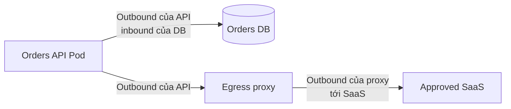
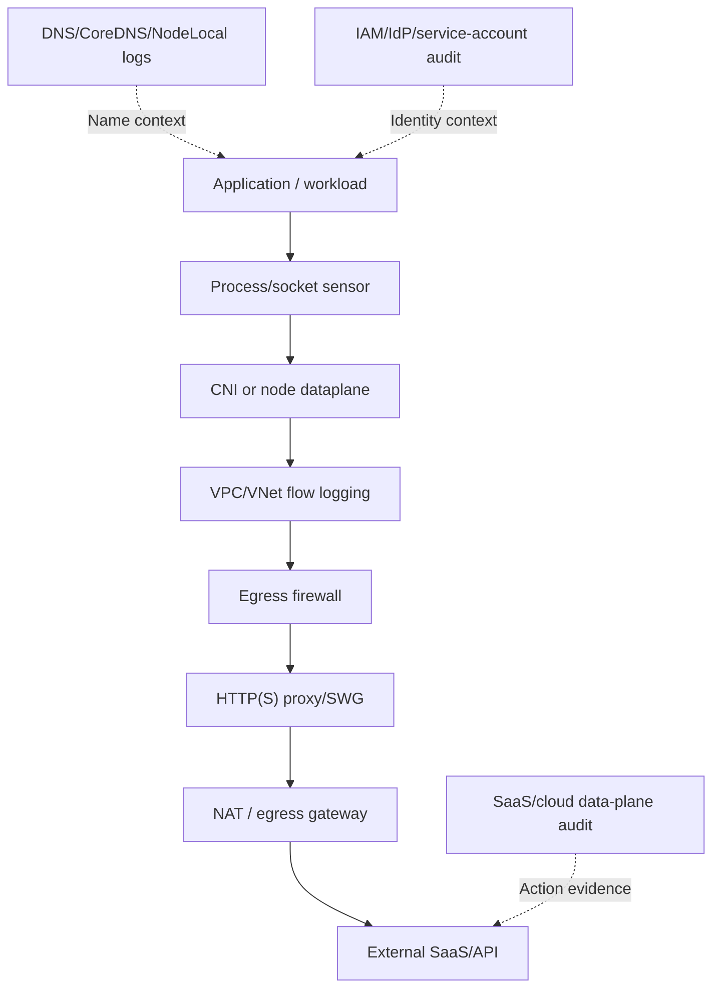
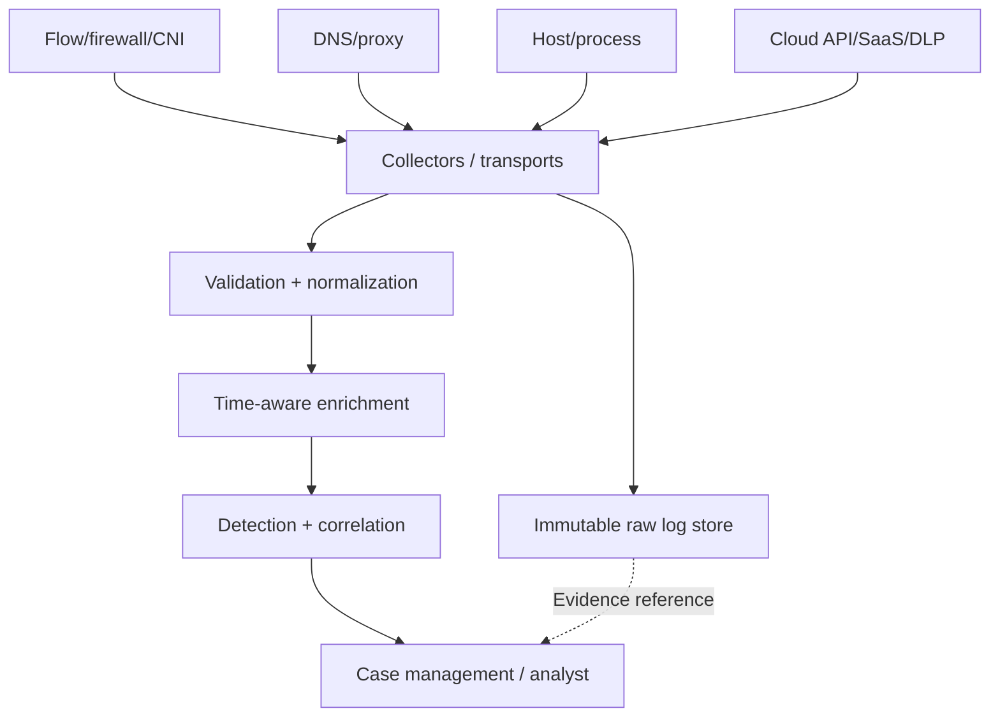
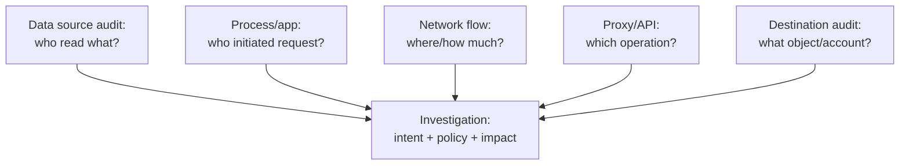

# Egress logging và điều tra bất thường: từ nhật ký lưu lượng đến bằng chứng sự cố

## 1. Egress logging giải quyết câu hỏi nào?

Một máy chủ trong private subnet có thể không mở bất kỳ cổng inbound công khai nào nhưng vẫn **chủ động khởi tạo kết nối** tới Internet, API đối tác, dịch vụ cloud hoặc máy khác trong mạng nội bộ. Khi outbound traffic thay đổi, đội an ninh cần phân biệt **nghiệp vụ hợp lệ, lỗi triển khai, hành vi bị lạm dụng và sự cố bảo mật**.

Ví dụ một SOC nhận thông báo:

```text
2026-11-28 08:45:12 UTC
source      = 10.42.17.8
destination = 198.51.100.24:443
protocol    = TCP
action      = ACCEPT
bytes       = 18673412
```

Đây chỉ là **bản ghi minh họa** với IP đích thuộc dải tài liệu `198.51.100.0/24`, không phải bằng chứng về một sự kiện thực. Bản ghi chưa đủ để kết luận **ai gửi, ứng dụng nào, dữ liệu gì, request có hoàn tất không hoặc có vi phạm chính sách không**. Cần trả lời thêm:

1. `10.42.17.8` ở thời điểm đó thuộc **VM, Pod, container, NAT client hay proxy** nào?
2. Ai là **workload owner** và ứng dụng có được phép gọi đích này không?
3. Địa chỉ `198.51.100.24` tương ứng tên miền, SaaS tenant, cloud resource hoặc gateway nào tại thời điểm kết nối?
4. Log `ACCEPT` đến từ **thiết bị/chính sách nào**? Nó chứng minh firewall cho traffic qua, chứ có chứng minh upload thành công?
5. Số bytes là **gửi, nhận hay tổng**? Có sampling/aggregation không?
6. Đây là backup, build artifact, CDN change, lỗi retry hay một hành vi liên quan **data exfiltration/command-and-control**?
7. Có thể liên hệ **DNS, proxy, process, cloud API, DLP và identity logs** để kiểm chứng giả thuyết không?

**Egress logging** là thu thập và duy trì bằng chứng về lưu lượng được hệ thống **khởi tạo đi ra** khỏi một ranh giới. **Điều tra bất thường** là đánh giá có căn cứ khi traffic lệch baseline/chính sách. Không phải tất cả egress bất thường đều độc hại; ngược lại, một sự cố có thể ẩn trong luồng đã được cho phép.

Trong mô-đun **SECURITY_NETWORK_SECURITY**, kỹ năng này kết nối **firewall/segmentation, VPN, IDS/IPS/NDR, DNS, TLS/QUIC, cloud networking, Kubernetes, Zero Trust và Data Loss Prevention (DLP)**.

### 1.1. Mục tiêu học tập

Sau bài này, người học có thể:

- Xác định **điểm quan sát**, phạm vi và giới hạn của từng loại egress log.
- Chuẩn hóa bản ghi theo **time, source identity, destination, protocol, direction, verdict, bytes, connection và policy**.
- Tương quan **NAT, load balancer, proxy, DNS, Pod/VM lifecycle, cloud IAM/SaaS audit** để định danh đúng nguồn và đích.
- Xây **baseline có bối cảnh**, phát hiện anomalies và kiểm soát false positives.
- Thực hiện quy trình triage/phân tích bằng chứng trước khi kết luận **C2, data exfiltration hoặc misconfiguration**.
- Thiết kế **log pipeline, privacy, retention, kiểm thử khả năng quan sát** và playbook ứng phó sự cố.

## 2. Phạm vi egress: phải nói rõ ranh giới của sự kiện

Một network flow có thể là outbound đối với đối tượng này và inbound với đối tượng khác:



Các chiều cần phân biệt:

| Ranh giới | Ví dụ outbound | Nguồn log phù hợp |
|---|---|---|
| Process | Java mở kết nối TCP tới DB | host/runtime process+socket events |
| Pod/namespace | Pod gọi API khác hoặc Internet | CNI/eBPF/NetworkPolicy flow telemetry |
| VM/NIC | EC2/VM kết nối resolver hoặc SaaS | VPC/VNet flow logs, host firewall |
| VPC/VNet | traffic ra peering, transit, VPN, Internet | route/firewall logs, flow records |
| Proxy/gateway | proxy thiết lập upstream session | proxy access/connect decision logs |
| Cloud API/resource | job upload object hoặc gọi IAM action | data-plane audit/resource logs |
| SaaS tenant | user share/export dữ liệu ra ngoài tenant | SaaS audit/DLP/CASB logs |

**North-south** là traffic qua biên nội bộ–bên ngoài; **east-west** là kết nối giữa workloads/vùng. Egress cần được quan sát **ở cả hai**, vì attacker có thể di chuyển sang shared proxy hoặc một server có quyền outbound rộng trước khi truyền dữ liệu ra ngoài.

### 2.1. Data plane và control plane

- **Data-plane logs:** flows, DNS, proxy requests, HTTP uploads, application interactions.
- **Control-plane logs:** ai sửa SG/NSG/firewall, routes, NetworkPolicy, DNS config, IAM, service accounts, proxy allowlists.

Một traffic anomaly có thể do **policy vừa thay** chứ không phải malware. Ngược lại, kẻ có quyền control plane có thể nới route để tạo đường bypass. Điều tra nghiêm túc phải ghép **cả traffic lẫn lịch sử thay đổi chính sách**.

## 3. Bốn loại sự thật khác nhau trong log

Một sai lầm nguy hiểm là coi tất cả log là bằng chứng về cùng một điều.

| Log ghi nhận | Có thể khẳng định | **Không thể tự khẳng định** |
|---|---|---|
| Firewall `ACCEPT` | traffic khớp quy tắc cho phép tại điểm thực thi đó | remote application đã nhận hoặc xử lý dữ liệu |
| Firewall `REJECT/DENY` | policy/sensor báo không cho traffic theo ngữ nghĩa của nó | tất cả đường thay thế đều bị chặn |
| DNS `NOERROR` với A/AAAA | resolver trả một địa chỉ theo dữ liệu thời điểm đó | client thật sự kết nối tới IP hoặc đích được ủy quyền |
| DNS `NXDOMAIN` | resolver báo tên không tồn tại theo ngữ cảnh query | attacker exfil hoặc toàn bộ DNS hỏng |
| TCP `ESTABLISHED` | handshake kết nối hình thành ở điểm quan sát phù hợp | business request thành công hoặc dữ liệu nhạy cảm đã truyền |
| Proxy `200` | upstream/proxy request thành công theo lớp nó log | user có quyền dữ liệu business |
| Proxy `CONNECT 200` | proxy đồng ý lập tunnel | HTTP body bên trong tunnel có thể được đọc |
| Cloud API `PutObject` success | service API ghi object theo audit semantics | dữ liệu có nhạy cảm hay mục đích có được duyệt |
| DLP alert | classifier/policy phát hiện một dấu hiệu | chắc chắn đã có exfil hoặc dữ liệu bị lộ trọn vẹn |
| Process `connect()` event | process đã yêu cầu một kết nối | routing/TLS/application action đã hoàn tất |

**Khái niệm quan trọng:** *Observation ≠ attribution ≠ causation ≠ confirmed impact*. Muốn kết luận dữ liệu bị chuyển đi cần biết **nguồn dữ liệu, luồng truyền, kết quả tại đích và ngữ cảnh cho phép**, trong phạm vi bằng chứng có thể thu thập hợp pháp.

### 3.1. “Denied” có thể chỉ là một phần của bức tranh

Một gói bị chặn bởi policy A không có nghĩa source bị ngăn mọi đường outbound: có thể còn **proxy, IPv6, peering, private endpoint, cloud managed service hoặc hostNetwork**. Ngược lại, cùng kết nối có thể bị log nhiều lần ở các points khác nhau, không được đếm mỗi dòng là một connection độc lập.

### 3.2. “Bytes” phụ thuộc schema

Một số flow logs dùng tổng bytes **trong một record/aggregation interval**, một số phân hướng gửi/nhận, một số ghi dữ liệu chỉ sau TCP termination, và có **sampling**. Không được cộng số bytes từ các tầng NAT→firewall→proxy thành “tổng dữ liệu exfil” vì một payload có thể bị quan sát **nhiều lần**.

## 4. Xây bản đồ điểm quan sát trước khi dựng cảnh báo

Một tuyến thực có thể chứa nhiều điểm quan sát:



**Sơ đồ khái niệm, không phải đường packet bắt buộc.** Có topology không có proxy, có dịch vụ dùng private endpoint bỏ NAT, có flow same-node không đi VPC firewall và có managed serverless traffic theo đường riêng.

### 4.1. Bảng vantage point

| Nơi quan sát | Điểm mạnh | Blind spots thường gặp |
|---|---|---|
| Application instrumentation | biết request/action/tenant/business outcome | code thiếu logs, client library khác |
| Process/socket eBPF/audit | ghép process/container/socket | privileges, dropped events, process exit nhanh |
| CNI policy engine | Pod identity, L3/L4 verdict | DNS/Service NAT, hostNetwork, policy implementation |
| VPC/VNet flow | NIC/5-tuple/volume, network scope | không có HTTP body/user ID, sampling/aggregation |
| Central firewall | policy/rule/verdict/route visibility | bypass paths, encryption, asymmetric routing |
| NAT | pre/post translation mapping nếu có log | nhiều clients một IP, port reuse, retention |
| Proxy/SWG | domain, CONNECT/HTTP action, user context nếu tích hợp | direct/UDP, tunnels, privacy constraints |
| DNS resolver | requested name/RCODE/answers | cached queries, DoH/direct IP, NodeLocal |
| IAM/cloud API logs | API principal/resource/action | không bao hết generic TCP transfers |
| SaaS/DLP | sharing, upload, tenant/data classification | coverage/delay, encrypted/unmanaged channels |

### 4.2. Câu hỏi cho mỗi sensor

1. **Traffic nào thực sự đi qua hoặc chịu giám sát?**
2. **Nguồn/đích được ghi trước hay sau NAT?**
3. Có **IPv6, UDP, QUIC, TCP, direct/proxy, private endpoints** không?
4. Log là **flow aggregate, per-packet, process event hay application request**?
5. Có **sampling, delayed delivery, dropped events, retention giới hạn** không?
6. Có thể ánh xạ tới **workload identity và đúng thời điểm** không?
7. “ACCEPT/REJECT” được định nghĩa tại **chính điểm nào**?

Không nắm các thuộc tính này thì dashboard rất dễ tạo **kết luận chính xác giả**.

## 5. Taxonomy các nguồn log trong kiến trúc egress

### 5.1. Network flow logs

Thường quan sát **source/destination IP, ports, IP protocol, direction, timestamps, bytes/packets và action/verdict khi được cung cấp**. Đây là đầu vào tốt để thấy destination mới, volume spike, flows bị chặn và các đường mạng bất thường.

### 5.2. Host/runtime telemetry

Quan sát **PID/process executable, parent process, container ID, exec/exit, socket bind/connect**. Nó có giá trị khi nhiều processes trên một VM hoặc nhiều Pods dùng cùng địa chỉ node/NAT.

### 5.3. DNS logs

Cho biết **QNAME, QTYPE, response/RCODE, resolver, cache/forwarding behavior theo sensor**. Dùng để ngữ cảnh hóa IP, domain novelty và sự cố DNS. Không được coi DNS query như một kết nối HTTPS đã xảy ra.

### 5.4. Proxy/application gateway logs

Có thể thấy **request method, URL/host, CONNECT destination, user session, rule ID, response code và transfer sizes** tùy protocol và TLS inspection mode. Những trường này phải được bảo vệ vì có thể chứa dữ liệu nhạy cảm.

### 5.5. Cloud API/SaaS/DLP audit

Cho biết ai **đọc/xuất/ghi/chia sẻ** dữ liệu tới object, SaaS tenant hoặc third-party integration. Rất quan trọng khi domain **đã được cho phép** nhưng tài nguyên/tenant đích sai.

### 5.6. Policy/control-plane audit

Các thay đổi **route, firewall, egress proxy config, IAM role, Kubernetes NetworkPolicy, DNS settings, SaaS OAuth grants** giúp xác định liệu sự cố phát sinh sau một thay đổi hoặc attacker nới policy.

## 6. Cloud flow logs: đọc đúng phạm vi thay vì mặc định mọi packet đều được ghi

### 6.1. AWS

**Amazon VPC Flow Logs** có thể được cấu hình ở phạm vi VPC/subnet/network interface theo tính năng, chọn loại traffic và định dạng fields, xuất tới đích hỗ trợ. VPC flow logs mô tả **network flow metadata**, không ghi HTTP body, tên user AWS IAM hoặc toàn bộ nội dung packet.

Những điểm cần lưu ý:

- Các fields và action semantics phải đối chiếu **record format/log version** được cấu hình.
- Flow logs có **aggregation windows**; timestamps không nhất thiết chính xác bằng timestamp ứng dụng.
- Có thể xuất hiện **`SKIPDATA`** hoặc chỉ báo bỏ qua records theo điều kiện service/capacity; xem tài liệu của version thực.
- Action `ACCEPT` không bảo đảm HTTPS/API call hoàn tất; SG/NACL và security services khác có thể tác động.
- Nếu traffic qua NAT Gateway, kết quả nhìn tại **ENI của workload và tại thành phần NAT** có thể khác; cần mapping.
- Traffic qua **VPC endpoints/private paths** có đặc tính theo dịch vụ và interface; không mặc định đi cùng Internet egress point.
- **CloudTrail data events** cho các tài nguyên có hỗ trợ và được bật có thể giúp xác nhận operations, khác VPC Flow Logs.

### 6.2. Google Cloud

**VPC Flow Logs** của Google Cloud cung cấp network metadata trong những phạm vi workload/network được hỗ trợ với **sampling/aggregation**, tùy cấu hình version và loại nguồn. Không được coi mọi dòng missing là không có traffic.

- Xem **flow sampling, aggregation interval, metadata annotations, labels và export destination**.
- **Cloud NAT logs** có phạm vi và logging mode riêng; cần đối chiếu pre/post NAT.
- **Firewall Rules Logging/Cloud NGFW logging** (nếu cấu hình) phản ánh quyết định tại firewall, không phải thay cho VPC flow log.
- **Cloud Audit Logs** phục vụ identity/API/resource actions; các log loại Data Access có thể cần cấu hình và giới hạn dữ liệu.
- **Private Service Connect, serverless/VPC integration** và các đường Google-managed APIs không nên bị suy là cùng một path trong mọi sản phẩm.

### 6.3. Microsoft Azure

Trong Azure, **Virtual Network Flow Logs** và các network/firewall diagnostic logs tương ứng (phạm vi/tính năng theo deployment) hỗ trợ quan sát flows ở VNet/resources. Những triển khai cũ có thể sử dụng **NSG Flow Logs**; cần theo dõi tài liệu lifecycle/migration của nền tảng thay vì thiết kế mới chỉ dựa vào một loại log legacy.

- Đối chiếu **VNet/NSG/NIC/route association và logger scope**.
- **Azure Firewall logs** có network/application/rule decisions và khả năng quan sát theo SKU/config.
- **NAT Gateway metrics/telemetry** không mặc nhiên cung cấp per-user/process audit.
- **Azure Activity Logs** ghi control-plane events; resource-specific diagnostic logs/Entra sign-ins/service audit cung cấp context khác.
- Với **Private Link/Private Endpoint**, cần xem cả data-plane resource audit và đường private/public thay thế.

### 6.4. Không dùng một câu truy vấn giống nhau cho mọi cloud

Tên trường, sampling, kích thước aggregation windows, NAT identity và meaning của `ACCEPT` thay đổi giữa providers và record schema. Nên tạo **normalized schema** nhưng vẫn giữ **raw original record + schema/version** để điều tra hoặc xác minh lại khi cần.

## 7. Host và runtime network logging: ai thực sự gọi `connect()`?

Flow log từ VPC thấy một VM/ENI. Nếu VM chạy nhiều processes/containers, cần thêm **host-level context**:

- Process name/executable hash, PID, parent PID và process start time.
- Container ID, image digest, orchestrator workload owner.
- Socket tuple, protocol và timestamps.
- User/UID/service account, permissions, namespace nếu phù hợp.
- Child process được spawn từ Java/Node/Python/shell/script không như baseline.
- DNS lookup/process origin theo khả năng sensor.

### 7.1. PID không đủ bền vững

**PID được tái sử dụng** và chỉ có ý nghĩa trong **PID namespace + host + time**. Một log có PID 101 hôm nay không thể ghép bừa với PID 101 sau vài phút hoặc từ node khác. Tốt hơn là dùng **process start timestamp/execution ID + container/host identity**.

### 7.2. Process events khác flow completion

Event `connect()` có thể xuất hiện dù kết nối thất bại. Muốn biết network policy có cho qua không và ứng dụng có gửi dữ liệu không, cần ghép với **kernel socket state, flow/proxy logs và application outcome**.

### 7.3. eBPF, audit và hạn chế

eBPF/runtime sensors có thể quan sát network behavior không cần cài `ss` vào mọi application image, nhưng cần xem **kernel support, privileges, sampling/dropped events, container identity mapping, restart/loss of telemetry**. Một agent có quyền host cao cũng là tài sản nhạy cảm cần kiểm soát.

### 7.4. Không đọc process command line vô điều kiện

Command-line/env có thể chứa **password, API token, signed URLs**. Telemetry nên hash/redact arguments hoặc chỉ lưu những fields thật sự cần, áp RBAC/retention thay vì đẩy toàn `/proc` ra SIEM.

## 8. Kubernetes egress logs: CNI identity không đồng nghĩa Kubernetes API state

Một Pod có thể được chọn bởi NetworkPolicy nhưng không nhất thiết bị chặn theo kỳ vọng nếu **CNI không hỗ trợ/enforce hoặc có đường bypass**.

Để điều tra cần ít nhất:

| Bằng chứng | Mục tiêu |
|---|---|
| Pod UID/namespace/name | định danh Pod chính xác, tránh nhầm tên được tái dùng |
| Container IDs/images | biết binary/runtime version |
| ServiceAccount/workload identity | principal dùng cloud/service APIs |
| Pod IP/node/time interval | map IP→Pod tại thời điểm flow |
| NetworkPolicy objects và labels | intended authorization |
| CNI dataplane verdicts | effective allow/deny từ plugin thực |
| DNS/NodeLocal path | biết resolver thật sự được gọi |
| Service/EndpointSlice/NAT | phân biệt VIP với backend/endpoint |
| hostNetwork/hostPort/sidecars | nhận diện đường khác network namespace thông thường |
| IPv4/IPv6 and protocol | không bỏ sót dual-stack/UDP/QUIC |

### 8.1. NetworkPolicy cộng dồn

Standard Kubernetes NetworkPolicies mô tả **allow rules**; nhiều policies chọn cùng Pod thường **cộng dồn**, không có một deny rule chuẩn phủ định mọi allow khác. Nếu default-deny đã được áp nhưng Pod vẫn gọi đích, kiểm tra **policy khác, CNI implementation, node-local traffic và identity mapping** trước khi kết luận attacker bypass.

### 8.2. Service IP và NAT

Một flow từ Pod đến Service ClusterIP có thể được dataplane chuyển tới backend Pod IP. **Địa chỉ thấy ở từng logger** có thể khác tùy thời điểm DNAT/SNAT và CNI. Phải lưu cả original/destination-translated tuples khi có, thay vì coi chúng là hai kết nối hoàn toàn độc lập.

### 8.3. Shared namespace và sidecar

Trong Pod Kubernetes bình thường, containers chia sẻ **network namespace**, nhưng không nhất thiết chia sẻ PID namespace. A container có thể kết nối tới sidecar listener qua loopback; host/runtime sensor phải định danh **Pod UID + container process owner** để tránh gán một egress flow do proxy sidecar thực hiện cho ứng dụng mà không kiểm tra.

## 9. DNS logs: tên đã được hỏi, không phải bằng chứng đã gửi dữ liệu

DNS có giá trị lớn khi egress log chỉ chứa IP. Nhưng một query bản thân không chứng minh connection:

```text
Pod orders-api
  DNS query: api.partner.example.com
  DNS response: 203.0.113.25
  Later TCP flow: 203.0.113.25:443
  Proxy log: approved partner request
  API audit: successful operation
```

Các IP trên thuộc dải tài liệu; chuỗi sự kiện minh họa một phương pháp **tương quan nhiều tầng**, không phải quan hệ nhân quả chắc chắn nếu chưa xác minh times/IDs.

### 9.1. Những gì DNS logs có thể thiếu

- Application/OS/CoreDNS/**NodeLocal DNSCache** có thể trả từ cache mà không forward query tới logger trung tâm.
- Client có thể dùng **IP trực tiếp**, custom resolver hoặc **DoH/DoT**.
- Một hostname có thể trả nhiều A/AAAA records, CDN IPs có thể thay.
- DNS answer có TTL và có thể bị client cache vượt kỳ vọng theo runtime.
- DNS logs có thể đến từ NAT resolver chung, không thấy origin Pod/user.
- Search paths và `ndots` có thể tạo queries đến nhiều biến thể tên.

### 9.2. Điều tra DNS phải giữ thứ tự thời gian

Không nên dùng **DNS answer hiện tại** để gán ngược một outbound flow từ tuần trước. Cần DNS response và resolver/cache view **tại thời điểm flow**, hoặc đánh dấu suy luận về hostname là *uncertain* nếu không có bằng chứng lịch sử.

### 9.3. DNS tunneling detection

Các dấu hiệu như **high QPS, QNAME dài, subdomain unique ratio cao, entropy cao, NXDOMAIN nhiều hoặc domain mới** có thể hỗ trợ nhận diện rủi ro. Nhưng các hệ thống telemetry, CDN, verification và service discovery cũng có patterns tương tự. Cần kết hợp **source process, domain ownership, baseline, policy verdict và dữ liệu truyền thực tế**.

### 9.4. Giới hạn quyền riêng tư

DNS queries có thể tiết lộ tên dịch vụ, sản phẩm hoặc hành vi của user. Full query logging cần **mục đích điều tra rõ, retention giới hạn, phân quyền, redaction và audit người truy cập**.

## 10. Proxy, SWG và HTTPS tunnel logs

Một HTTP(S) proxy thường có thông tin **client identity, authority/destination, method, response code, policy rule, bytes và latency** theo cấu hình.

### 10.1. `CONNECT` không phải upload HTTP thành công

```text
Client -> Proxy: CONNECT api.partner.example.com:443
Proxy  -> Client: 200 Connection Established
Client <-> Server: TLS tunnel
```

**`CONNECT 200` chỉ chứng minh proxy đã chấp nhận lập tunnel** theo semantics của proxy. Nếu proxy chỉ chuyển bytes, nó không đọc được HTTPS body và không tự biết user đã upload file hay API nào đã được gọi.

### 10.2. Nếu proxy terminate TLS

Một giải pháp TLS inspection có thể ghi **HTTP method, URL, content classification, upload attributes hoặc DLP verdict** khi sản phẩm hỗ trợ và theo policy. Tuy nhiên interception phải xử lý **CA trust, mTLS/certificate pinning, ECH/QUIC, quyền riêng tư, credentials, availability, logging và jurisdiction**. Không áp giải mã tùy tiện lên mọi traffic chỉ để làm phong phú log.

### 10.3. Direct bypass và `NO_PROXY`

Một workload có thể cấu hình `NO_PROXY`, bỏ proxy hoặc dùng UDP/443/private endpoint. Nếu proxy log không có traffic, **đừng kết luận workload không outbound**. Kiểm tra **routes, firewall policy, host/CNI telemetry và destination-side evidence**.

### 10.4. Header identity và source attribution

Proxy có thể truyền identity headers/assertions. Phải bảo đảm **header provenance**: loại client-supplied identity headers, xác thực session và không gắn user từ `X-Forwarded-For` nếu trusted proxy chain chưa được kiểm chứng.

## 11. TLS, QUIC, ECH: metadata nhìn được và giới hạn

Egress traffic ngày nay phần lớn đi qua TLS/HTTPS/QUIC. Cần hiểu **điểm nào thấy gì**:

| Chỉ dấu | Có thể quan sát ở đâu | Giới hạn |
|---|---|---|
| Source/dest IP, ports, packets | host, CNI, firewall/flow logs | NAT, proxy và shared destinations |
| DNS QNAME/response | resolver có telemetry | cache, direct IP, DoH/DoT |
| TLS ClientHello/SNI | một số passive sensors trong một số phiên | ECH có thể che tên đích thật; không phải tất cả metadata rõ |
| TLS cert/peer identity | client/proxy terminating TLS, logs tại endpoint | passive view thay đổi với TLS 1.3/QUIC |
| HTTP method/path/body | application hoặc proxy giải mã có quyền | thường không hiển thị ở L3/L4 passive sensor |
| HTTP/3 transaction | endpoint/QUIC-aware proxy/application | QUIC dùng UDP và mã hóa |
| Upload bytes | proxy/app/destination logs theo định nghĩa | overhead, retries, chunks và compression |

### 11.1. Không đo “bytes truyền ra” bằng một view duy nhất

- TCP retries làm **network bytes > payload application**.
- Encryption và protocol framing thêm overhead.
- Compression khiến size file trước upload khác bytes on wire.
- Streaming/chunked uploads có nhiều requests.
- Network flow logs có sampling/aggregation.
- Multi-path/proxy có thể ghi lại cùng transaction nhiều lần.

Với nghi exfiltration, chỉ đưa ra **range/estimate với giả định** nếu thiếu application/destination audit, thay vì một con số chính xác giả.

### 11.2. SNI, HTTP Host và account ownership

Hostname/SNI có thể chứng minh client đã yêu cầu **một virtual host** khi nhìn được, nhưng không chứng minh **đúng tenant/bucket/resource** thuộc tổ chức. Cloud/SaaS API audit, headers/URLs ở điểm được phép giải mã và destination resource policies thường cần thiết để xác định đích nghiệp vụ.

### 11.3. QUIC không phải lỗi logging

Nếu sensor chỉ hỗ trợ TCP/443, một sự tăng UDP/443 có thể là HTTP/3 rollout hợp lệ. Nhưng nếu chính sách đòi mọi web traffic qua authenticated egress proxy, cần kiểm tra **QUIC support, enforcement và fallback paths**, không chỉ tắt alert.

## 12. Cloud API và SaaS logs: khi destination được phép nhưng action sai

Nhiều sự cố xảy ra **không phải tới domain lạ**, mà tới một cloud provider/SaaS **được tổ chức sử dụng**:

```text
Workload -> approved cloud API endpoint
  but authenticated as unexpected principal
  or writes to unapproved account/bucket/container
  or performs unexpected data export/share action
```

Do vậy egress investigation cần:

- **Cloud IAM/API audit:** principal, action, resource, result, timestamp, request ID nếu có.
- **Object storage data-plane logs:** object/key/bucket/container operations theo capability và logging configuration.
- **SaaS tenant audit:** sharing, export, link permission, account identity, integration app.
- **DLP/CASB:** data classification hits, policy decisions, matched channels.
- **Application logs:** source dataset, business owner, expected export job/recipient.

### 12.1. Private endpoints vẫn cần resource identity

Một private endpoint có thể chuyển traffic tới **cloud API hợp lệ**, nhưng không tự chứng minh object nằm trong **organization-approved bucket/tenant**. Xem **IAM/resource/endpoint/org restrictions và effective service policy**; một `ACCEPT` ở VPC không thay được data-plane audit.

### 12.2. Audit coverage phải được xác nhận

Cloud API logs có thể chia **management/control-plane vs data-plane**, một số nhóm events cần bật riêng hoặc chịu chi phí/retention. Không mặc định `PutObject`, export hoặc SaaS sharing đều xuất hiện trong dashboard chung chỉ vì cloud logging đã bật.

### 12.3. Approved SaaS destination chưa đủ

Policy cho `storage-provider.example` không chứng minh upload được phép nếu người dùng gửi tới **personal tenant** thay vì corporate tenant. Điều tra phải xác minh **resource owner, authenticated SaaS account, operation và data classification**.

## 13. Chuẩn hóa log: các trường tối thiểu nên giữ

Một pipeline nhận log từ nhiều công cụ thường chuẩn hóa vào schema chung nhưng **giữ raw event** để kiểm lại. Ví dụ schema:

| Field chuẩn | Ý nghĩa | Lưu ý |
|---|---|---|
| `event_time_utc` | thời điểm sự kiện tại nguồn | có thể khác ingest time |
| `ingest_time_utc` | thời điểm pipeline nhận | đo delay, không thay source event time |
| `source_system` / `schema_version` | logger và phiên bản | đảm bảo đọc đúng semantics |
| `event_kind` | flow, DNS, proxy, exec, IAM, DLP... | không hợp nhất sai các loại |
| `observation_point` | ENI, gateway, CNI, DNS, app | điểm trước/sau NAT |
| `src_ip` / `src_port` | tuple nguồn theo sensor | có thể là địa chỉ đã NAT |
| `dst_ip` / `dst_port` | tuple đích theo sensor | có thể là Service VIP hoặc backend |
| `protocol` / `ip_family` | TCP/UDP/ICMP, IPv4/IPv6 | không suy chỉ từ port |
| `direction` | inbound/outbound theo logger | phải định nghĩa ranh giới |
| `decision` / `rule_id` | allow/deny/other, policy | chỉ có ở sensor hỗ trợ |
| `bytes_out` / `bytes_in` | bytes theo semantics sensor | không invent nếu chỉ có bytes tổng |
| `packets_out` / `packets_in` | tương tự packets | có thể null |
| `flow_start/end` | cửa sổ aggregation | không đồng nghĩa app transaction |
| `src_workload_id` | VM/Pod UID/container/process identity | kèm time mapping/confidence |
| `user_or_service_principal` | identity đã được xác minh | không dùng client-declared text |
| `dst_hostname` / `dns_qname` | hostname theo provenance | có thể không quan sát |
| `dst_resource_id` / `tenant_id` | cloud/SaaS resource | thường cần audit join |
| `request_id` / `trace_id` | nối với app/API action | provenance, không tin request ID tự khai |
| `attribution_confidence` | mức độ chắc chắn | tránh biến suy luận thành fact |
| `raw_event_ref` | pointer/hash tới bản gốc | hỗ trợ kiểm chứng |

### 13.1. JSON record minh họa

```json
{
  "schema": "security.egress.flow.v1",
  "event_kind": "network_flow",
  "source_system": "example-vpc-flow",
  "source_schema_version": "example-1",
  "event_time_utc": "2026-11-28T08:45:12Z",
  "ingest_time_utc": "2026-11-28T08:45:50Z",
  "observation_point": "workload-nic",
  "direction": "egress",
  "src_ip": "10.42.17.8",
  "src_port": 53124,
  "dst_ip": "198.51.100.24",
  "dst_port": 443,
  "protocol": "tcp",
  "ip_family": "ipv4",
  "decision": "allow_at_this_enforcement_point",
  "rule_id": "example-egress-policy-004",
  "bytes_total": 18673412,
  "bytes_out": null,
  "bytes_in": null,
  "sampled": null,
  "source_workload_id": null,
  "destination_tenant_id": null,
  "attribution_confidence": "unresolved",
  "raw_event_ref": "example-immutable-event-pointer"
}
```

Đây là **schema do bài học định nghĩa**, không phải event có sẵn trong AWS/GCP/Azure. `null` có chủ đích: **không tự suy bytes_out hay tenant** nếu logger không cung cấp.

### 13.2. Normalization không được làm mất sự thật nguồn

- Giữ giá trị **raw action**, ví dụ `ACCEPT`, và ánh xạ vào `decision` có nguồn.
- Giữ **field missing/null** thay vì điền mặc định `ALLOW` hoặc 0.
- Giữ **sampling rate/aggregation window**, nếu có.
- Tách **observed** vs **enriched** vs **analyst-inferred** fields.
- Nếu threat intelligence mới gắn một IP là rủi ro, ghi **enrichment source/time**, không viết đè địa chỉ/hostname gốc.

## 14. Tương quan NAT/SNAT: tìm nguồn thật khi nhiều workload dùng một IP

Khi đi qua NAT, một flow có thể chuyển từ:

```text
Before SNAT:
  10.42.17.8:53124 -> 198.51.100.24:443

After SNAT:
  203.0.113.10:61204 -> 198.51.100.24:443
```

Các IP công cộng trong ví dụ thuộc dải tài liệu. Một proxy có thể mở **kết nối upstream mới**, chứ không chỉ dịch địa chỉ/cổng.

### 14.1. Correlation key thực tế

Đối chiếu **protocol + địa chỉ/port trước/sau NAT + destination tuple + time interval + thiết bị/NAT gateway ID**, có thể thêm session/flow ID do sản phẩm phát. Không nên chỉ join theo `src_ip` hoặc `dst_ip`:

- Nhiều clients có chung public IP.
- **NAT source port** có thể được tái sử dụng qua thời gian.
- Các kết nối song song tới cùng đích vẫn phân biệt nhờ ports/session mappings.
- Clock skew và aggregation windows làm timestamp không khớp tuyệt đối.
- Proxy có thể multiplex/connection-pool nên không có mapping 1:1 giữa client connection và upstream connection.

### 14.2. Nếu thiếu NAT translation logs

Chỉ có public egress IP ở remote log thì **không thể khẳng định một Pod/user cụ thể**. Có thể dùng bằng chứng bổ sung từ internal flow logs, proxy auth, request IDs, app logs và workload lifecycle, nhưng phải ghi rõ **confidence/alternatives**.

### 14.3. IPv6 và không NAT

Trong IPv6 có thể không có NAT theo kiến trúc, nhưng **privacy addresses, prefix changes, workload moves và firewall/proxy** vẫn khiến “một IP = một người” là suy luận sai. Cần giữ IPv6 nguyên dạng trong schema và kiểm effective routes.

## 15. Xây “danh tính kết nối” chính xác hơn 5-tuple

**5-tuple** thường là:

```text
(source IP, source port, destination IP, destination port, transport protocol)
```

Nó có ích để phân biệt các flows trên một điểm quan sát, nhưng **chưa đủ cho toàn bộ vòng đời một request**:

- Các kết nối mới có thể **tái sử dụng cùng 5-tuple** sau khi phiên cũ kết thúc.
- Proxy/NAT làm **thay các trường**.
- HTTP/2/HTTP/3 có thể **multiplex nhiều requests** qua một kết nối.
- HTTP keepalive có thể dùng **một kết nối cho nhiều business actions**.
- QUIC có cơ chế connection ID và connection migration; 5-tuple có thể thay mà logical connection vẫn tiếp tục.
- Một DNS query có thể trả nhiều địa chỉ hoặc nhiều requests cùng sử dụng một tên.

### 15.1. Thêm context để tránh join sai

Một khóa tương quan tốt tùy nguồn có thể gồm:

```text
sensor_id / observation_point
  + 5-tuple as observed
  + flow/session/connection ID when available
  + start/end time interval
  + pre/post NAT mapping where available
  + workload/process identity
  + request/trace ID for application actions
```

**Không có một khóa dùng được cho mọi provider.** Cần mô hình data lineage từ event nguồn qua enrichment để người phân tích biết **độ tin cậy**.

### 15.2. Event duplication

Một luồng có thể xuất hiện ở host sensor, CNI, VPC flow logger, firewall, proxy và destination. Nếu gom tất cả rồi `SUM(bytes)`, kết quả có thể **đếm nhiều lần**. Giữ riêng metrics theo vantage point, chỉ tổng hợp ở một lớp nhất quán hoặc có mô hình loại trùng được kiểm chứng.

### 15.3. Chú ý ICMP và transport khác TCP/UDP

Một số traffic egress có protocol không có cổng TCP/UDP, ví dụ ICMP hoặc các giao thức IP khác. Schema nên cho phép `src_port/dst_port = null`; không gán cổng 0 giả rồi biến thành một TCP connection.

## 16. Thời gian trong forensic: event time, ingest time và thứ tự nhân quả

Một cuộc điều tra thường ghép DNS, flow, IAM, proxy và API logs từ **nhiều đồng hồ**. Thời gian ghi log có thể lệch vì:

- Clock skew giữa host/VM/container/proxy và cloud services.
- Flow logs có **aggregation windows** chứ không phải timestamp chính xác của request.
- Batch export hoặc SIEM queue gây **ingestion delay**.
- Network buffer/agent retry và sensor drop events.
- Time zone/format parsing sai, daylight saving ở một số khu vực.
- Application log ghi thời điểm kết thúc request, network log ghi lúc bắt đầu flow.

### 16.1. Ba thời điểm nên phân biệt

| Field | Ý nghĩa |
|---|---|
| `event_time` | thời điểm nguồn cho rằng sự kiện xảy ra |
| `first_observed_time` / `flow_start` | bắt đầu quan sát một flow theo sensor |
| `ingest_time` | SIEM/data lake nhận và lưu record |

Khi **sắp xếp timeline**, ưu tiên event time với độ lệch được biết, đồng thời hiển thị **confidence interval/aggregation period**. Không suy “proxy request xảy ra trước IAM grant” chỉ từ hai timestamps lệch vài giây khi các nguồn chưa được đồng bộ.

### 16.2. Clock correlation cần được kiểm soát

- Dùng UTC và ISO 8601 rõ offset trong canonical records.
- Theo dõi NTP/time sync health ở những thành phần có kiểm soát.
- Lưu **timezone và raw timestamp** nếu parser có thể lỗi.
- Theo dõi **late-arriving events** và reprocessing window.
- Dùng request IDs/trace IDs khi có để củng cố timeline.

### 16.3. Retrospective enrichment

Khi một domain/IP bị threat intelligence gán rủi ro hôm nay, có thể tìm lại các flows cũ. Nhưng **đánh dấu thời điểm enrichment** và không nói “IP này đã là C2 tại thời điểm cũ” nếu nguồn tình báo không có lịch sử chứng minh.

## 17. Thiết kế egress logging pipeline: thu thập, chuẩn hóa, giữ bằng chứng



Một pipeline đáng tin cần:

1. **Inventory sources và enable logging đúng scope**; không giả định mọi thứ có log mặc định.
2. **Authentication/encryption** cho log transports, least privilege cho collectors.
3. **Schema validation**, parse errors monitoring và dead-letter handling.
4. **Deduplication khi có basis đáng tin**, không xóa records cần forensic.
5. **Immutable/protected raw retention** để kiểm bản gốc và provenance.
6. **Canonical normalization + source-specific fields** với version rõ.
7. **Time-aware enrichment** cho Pod/VM/NAT/identity/destination inventory.
8. **Detections và case metadata** có thể truy ngược raw event.
9. **Data governance** vì logs có thể chứa thông tin nội bộ và cá nhân.
10. **Capacity, cost và failure plans** để telemetry không âm thầm mất khi traffic tăng.

### 17.1. Log transport và backpressure

Một pipeline có thể chạy ở chế độ near-real-time hoặc batch. Nếu collector/backpressure quá tải:

- Nguồn có thể **drop events**, buffer hoặc retry theo sản phẩm.
- SIEM có thể nhận events **trễ hoặc out-of-order**.
- Số records hiện ra ít hơn **không có nghĩa traffic giảm**.

Nên theo dõi **collector health, export latency, queue depth, rejection, parse error, dropped event counters và source heartbeat**. Một dashboard phát hiện mạng không đáng tin nếu chính đường logging thường xuyên bị mất.

### 17.2. Raw vs curated stores

- **Raw:** giữ payload gốc, parser version và source metadata; hạn chế truy cập, retention theo policy.
- **Curated:** schema chuẩn để tìm kiếm, alert, dashboard.
- **Enriched:** thêm entity labels, threat intel, business ownership, data sensitivity **với nguồn và time validity**.

Không ghi đè raw `src_ip` bằng NAT-resolved Pod name mà không giữ chuỗi ánh xạ; về sau có thể phát hiện mapping sai.

### 17.3. Chống log tampering

Nếu attacker có quyền sửa log pipeline hoặc xóa records, khả năng forensic giảm. Dùng **access separation, immutable/retention locks khi phù hợp, integrity controls, audit reader/admin actions và backup metadata**; nhưng cũng phải tuân thủ chính sách xóa dữ liệu cá nhân khi pháp luật yêu cầu.

## 18. Log retention, quyền riêng tư và dữ liệu điều tra

Network/security logs có thể ghi:

- User IDs, device IDs, IP addresses.
- Domain names thể hiện dịch vụ/sức khỏe/quy trình kinh doanh.
- URLs, query parameters hoặc upload metadata.
- Tên bucket, object keys, project names và customer identifiers.
- Command-line arguments đôi khi chứa tokens/secrets.

### 18.1. Thiết kế retention theo mục đích

Không có **một số ngày lưu log** phù hợp mọi tổ chức. Xác định theo:

| Yếu tố | Ảnh hưởng |
|---|---|
| Threat detection window | có cần điều tra hồi tố nhiều tuần/tháng? |
| Data sensitivity và privacy | log có PII/secret hay chỉ aggregate flow metadata? |
| Quy định/hợp đồng | nghĩa vụ bảo quản/xóa, jurisdiction |
| Investigation value | DNS query raw so với aggregate metrics |
| Storage/query cost | khả năng mở rộng lâu dài |
| Legal hold | bảo toàn bằng chứng khi có sự cố theo quy trình |
| Access model | SOC analyst, platform admin, DLP/privacy officer |

### 18.2. Phân tầng dữ liệu

- **Hot tier:** dữ liệu gần thời gian thực cho alert và triage.
- **Warm/cold tier:** dữ liệu lịch sử được phân quyền/đánh chỉ mục phù hợp.
- **Aggregated metrics:** QPS, volumes, distinct destinations theo service, giảm rủi ro privacy.
- **Case evidence:** subset cần thiết có integrity/chain-of-custody để điều tra.

### 18.3. Không log bí mật chỉ để cải thiện detection

Không khuyến nghị ghi **Authorization headers, cookies, passwords, private keys, full payload** vào egress telemetry một cách mặc định. Nếu cần content inspection trong phạm vi hợp pháp, xử lý theo **DLP workflow bảo mật**, masking và hạn chế reviewers.

### 18.4. Bảo vệ log người dùng cuối

Không suy diễn hành vi cá nhân từ shared IP/metadata thiếu tin cậy. Khi điều tra user, cần **mức bằng chứng phù hợp, nguyên tắc tối thiểu hóa dữ liệu và quy trình phân quyền**.

## 19. Baseline: “bình thường” phải gắn đúng workload và lịch nghiệp vụ

Một rule “mọi outbound >100 MB là bất thường” thường gây nhiễu:

- Backup cuối tháng có thể truyền vài GB hợp lệ.
- Một web server có thể gửi nhiều response bytes tới người dùng.
- Một worker chỉ cần gửi metrics vài KB có thể bất thường với upload 20 MB.
- Build runner hoặc patch service có lịch download lớn.
- CDN endpoints và cloud API IPs có thể đổi thường xuyên.

### 19.1. Baseline theo cohort

```text
cohort =
  service/workload role
  + environment (dev/staging/production)
  + deployment/version
  + node/region/zone where relevant
  + normal schedule/job type
  + destination category or business partner
  + protocol and direction
```

Metrics có thể gồm:

- Egress bytes (theo chiều và vantage point rõ).
- Number of flows, duration, connection rate.
- Distinct destination domains/IPs/**accounts/tenants**.
- First-seen destinations theo service.
- DNS query count/RCODE, unique subdomain ratio.
- Outbound process count và new exec ancestry.
- Cloud API upload/export actions, DLP policy verdict.
- Frequency of deny events và proxy bypass attempts.

### 19.2. Khung giờ và mùa vụ

Một workflow có thể chạy **mỗi đêm, tuần, tháng, quý hoặc dịp DR**. Baseline tốt phân biệt:

- Batch/reporting windows.
- Business hours và timezone.
- Release/rollout/certificate rotation.
- Recovery/failover và autoscaling.
- Planned data migrations.

Không lấy **một ngày quan sát** rồi áp làm giới hạn cứng cho toàn bộ hoạt động.

### 19.3. Robust statistics và rủi ro drift

Có thể dùng **median, median absolute deviation (MAD), percentiles và rolling windows** thay mean/stddev nếu traffic lệch mạnh. Nhưng:

- Baseline có thể bị **poisoned** nếu training data đã chứa hành vi độc hại.
- Dịch vụ thay đổi tính năng hợp lệ cần cập nhật dependency map và baseline.
- Không đủ samples cho low-volume service thì một anomaly score có thể kém tin cậy.
- Threshold numeric nên đi cùng **policy context** (đúng tenant, đúng process, đúng action).

### 19.4. Một baseline record mẫu

```yaml
# Baseline metadata minh họa; không phải policy chạy được.
service: orders-api
environment: production
deployment_version: v2
owner: commerce-team
approved_destinations:
  - order-db
  - internal-dns
  - payment-provider
  - telemetry-collector
historical_windows:
  - ordinary_business_hours
  - nightly_batch
observed_metric_definitions:
  outbound_bytes: bytes_from_source_vantage_only
  new_destination: not_in_approved_inventory
  dns_novelty: distinct_domains_by_source_role
exclusions:
  - approved_migration_change_windows
revision_review_required: true
```

## 20. Các nhóm detection dùng cho outbound

| Nhóm | Dấu hiệu | Bằng chứng nâng độ tin cậy |
|---|---|---|
| **New destination** | workload kết nối tới IP/domain/account chưa được phê duyệt | dependency inventory, owner và deploy change |
| **Volume anomaly** | outbound bytes hoặc export count tăng mạnh | process, schedule, app/destination audit |
| **Beacon-like pattern** | nhiều kết nối nhỏ theo chu kỳ tới một peer | process lineage, DNS/HTTP metadata, threat context |
| **Protocol drift** | DB/job tạo UDP/443 hoặc new TCP port | application version, QUIC rollout, policy |
| **DNS anomaly** | nhiều QNAME hiếm/dài, NXDOMAIN spike | resolver path, source identity, domain owner |
| **Proxy bypass** | flow Internet không qua required PEP | route/NAT/proxy logs + firewall rule |
| **Cross-account transfer** | storage write/export tới account khác | IAM/resource audit, business approval |
| **Suspicious process egress** | unapproved executable tạo outbound | container digest, binary hash, host EDR |
| **Lateral movement** | web tier gọi admin/DB services ngoài dependency | destination auth/firewall logs |
| **Policy drift** | egress allow-all xuất hiện mới | control-plane audit, IaC diff |
| **Credential misuse** | service token xuất hiện từ nguồn bất thường | API identity events, token audience, session |
| **DLP signal** | restricted data export/share | classifier confidence, content owner, actual outcome |

### 20.1. Kết hợp policy-based và anomaly-based

**Policy violation** thường có điều kiện rõ: `source=orders-api` nhưng `destination=nonapproved-storage-account`. **Anomaly** như volume tăng gấp 10 chỉ nói “khác bình thường”; không đủ để gắn intent.

Tốt nhất là ưu tiên điều tra khi có **đa tín hiệu độc lập**: destination mới + process lạ + cloud API operation không hợp lệ + DLP match, thay vì chỉ một số bytes.

### 20.2. Dùng severity dựa trên impact và độ tin cậy

Một alert:

```text
severity = asset sensitivity
         × confirmed policy violation
         × evidence confidence
         × potential/observed data impact
         × ability to contain
```

Biểu thức này là **mô hình tư duy**, không phải công thức toán học bắt buộc. Tổ chức có thể xây scoring cụ thể nhưng phải tránh kết quả thiếu minh bạch.

### 20.3. Alert không được tự áp block hàng loạt

Một rule mới có false positives có thể vô hiệu hóa backup, SSO hoặc payment services. **Automatic response** nên phân tầng theo confidence/criticality, có approval/rollback và scoped action; không tự chặn cả VPC khi chỉ một DNS anomaly cần phân tích.

## 21. Beaconing và liên lạc định kỳ: nhận diện mà không khẳng định quá mức

Một số C2 channels dùng kết nối nhỏ, lặp theo thời gian. Detection có thể phân tích:

- **Khoảng cách giữa các kết nối** tới cùng destination/role.
- Periodicity với **jitter tolerance**, tránh đòi interval tuyệt đối.
- Đồng nhất của **request sizes, duration, protocol và response patterns**.
- Domain/endpoint mới hoặc ít gặp trong service baseline.
- Mối quan hệ **process ancestry, startup time, deployment changes**.
- Network allow/deny behavior và retries sau timeout.

### 21.1. Các trường hợp hợp lệ dễ gây nhầm

- Application health checks.
- Telemetry/metrics exporters.
- SaaS polling/long-polling.
- Certificate renewal probes.
- Message queue consumers và WebSocket keepalives.
- Service mesh control-plane connectivity.
- Cloud instance agent/endpoint protection heartbeat.

**Phải so với business dependency**, không gắn nhãn C2 chỉ vì traffic lặp 60 giây.

### 21.2. Tạo biểu đồ inter-arrival

```text
Source: reporting-worker
Destination role: unknown
Observed egress times (UTC):
  08:00:05
  08:01:07
  08:02:04
  08:03:09

Hypothesis: periodic callback
Required validation:
  source process and owner
  deployment/service schedule
  destination identity and account
  signed application/release changes
  proxy/app outcome and data volume
```

Ví dụ này chỉ minh họa **nhóm nghi vấn cần điều tra**, không phải chữ ký C2 đặc trưng. Không xây detection chỉ dựa vào bốn timestamp.

### 21.3. Low-and-slow

Một lượng nhỏ dữ liệu lặp nhiều ngày có thể ít nổi bật trên threshold theo giờ. Cần có **rolling windows dài**, số destination distinct, cumulative sensitive exports và chính sách retention đủ cho retrospective analysis; đồng thời tránh xâm phạm privacy không cần thiết.

## 22. Large upload và data exfiltration: phân biệt volume với nội dung

Phát hiện upload bất thường thường bắt đầu từ:

- Nhiều **outbound bytes** tới destination mới.
- Một cloud `PutObject`/upload/export action không nằm trong lịch.
- SaaS file share ra external recipient.
- DLP nhận diện restricted content trong channel có inspection.
- Tăng đọc dữ liệu ở database **đồng thời** tăng outbound transfer.
- Process mới có outbound activity sau khi đọc secrets/files.

### 22.1. Tại sao flow logs chưa đủ?

Một TCP connection có thể truyền:

- TLS negotiation rồi thất bại.
- Stream upload bị cắt giữa chừng.
- Response download lớn khiến total bytes cao.
- Retries/chunked uploads qua nhiều flows.
- Traffic của nhiều requests hợp lệ do HTTP/2 multiplexing.

**Nếu logger không tách `bytes_out`/`bytes_in`, không được coi `bytes_total` là bytes exfil.** Nếu tách được cũng chưa biết **payload có nhạy cảm** hoặc server đã xử lý thành công.

### 22.2. Các lớp cần đối chiếu



Một kết luận “confirmed unauthorized data transfer” nên có **ít nhất một đường bằng chứng đủ mạnh** về operation/destination và policy/data context, không chỉ một IP reputation hit.

### 22.3. Hợp lệ nhưng ngoài baseline

Backup, data migration, DR restoration, analytics export, CI artifact upload, CDN caching hoặc customer bulk download đều có thể tạo volume cao. **Owner approval, change ticket, destination ownership, IAM policy và data classification** giúp phân biệt.

### 22.4. Exfil qua allowed SaaS

Khi traffic tới domain được cho phép, thông tin quan trọng có thể là **tenant/account/object/recipient**. Egress firewall theo domain không thể tự xác minh user upload vào **corporate tenant** hay **personal tenant**; cần SaaS/DLP/API audit và restriction tương ứng.

## 23. DNS anomaly: phân tích tần suất, tên miền và lỗi resolver

Các detection hữu ích:

| Chỉ số | Có thể báo gì? | Giải thích hợp lệ cần kiểm |
|---|---|---|
| Unique subdomains/domain cao | beacon/exfil-like naming | cache busting/CDN/validation |
| QNAME length tăng | dữ liệu trong labels hoặc naming scheme mới | TXT verification, hashed resources |
| NXDOMAIN tăng | generated names không tồn tại | search path/`ndots`/typos, code regression |
| High query rate | resolver stress, unusual discovery | application retries, outage |
| First-seen registered domain | new dependency/C2 risk | vendor/provider rotation |
| New resolver IP | DNS policy bypass | NodeLocal migration, failover |
| DoH/DoT usage new | endpoint thay đổi | browser/app legitimate privacy feature |
| Query-to-connect mismatch | DNS curiosity/no follow-up | prefetching, cache, blocked traffic |

### 23.1. Đơn vị đo đúng

Phân tích từ **source workload/process** thay vì chỉ public NAT IP hay CoreDNS Pod IP. Nếu NodeLocal cache tập trung queries của nhiều workloads, cần thêm client attribution từ CNI/host để tránh alert sai.

### 23.2. Tên miền có thể tiết lộ dữ liệu

DNS logs chứa QNAME raw có thể vô tình lưu **sensitive labels**. Dùng hashing/anonymization/controlled access khi phù hợp; alert chỉ lưu metadata tổng hợp nếu không cần full QNAME cho forensic.

### 23.3. Truy vấn public ngoài cluster

Không forward private Kubernetes service names ra public resolver để “khắc phục NXDOMAIN” không qua review: có thể rò internal topology. Khi điều tra, xem **CoreDNS/NodeLocal forwarding, search domains, resolver policy và client libraries**.

## 24. Allowed service nhưng sai tài khoản: egress anomaly ở cấp resource

Một workload chỉ được backup tới **organization backup account** có thể vẫn kết nối cùng cloud storage API endpoint nếu job config bị đổi sang tài khoản khác.

### 24.1. Dữ liệu phải có trong case

```text
workload identity
  + cloud API request principal
  + destination resource/account/tenant
  + operation type (read/export/write/share)
  + action result and request ID
  + data classification and job/business owner
  + network path evidence
```

### 24.2. VPC endpoint không chứng minh resource ownership

Private Link/Private Endpoint/Private Service Connect hoặc API service perimeter theo khả năng sản phẩm giúp kiểm **đường đi hoặc ranh giới dịch vụ**; nhưng quyền thao tác phải được chứng minh bằng **IAM/resource/endpoint/org policy và data-plane logs**. Không được suy network private = data không rời tổ chức.

### 24.3. Tenant-aware alerts

Gắn allowlist **organization IDs, storage accounts, project IDs, recipient domains, sanctioned SaaS tenants** với owner/expiry. Với cloud provider có shared endpoints, **domain alone** là chỉ số quá thô.

### 24.4. OAuth applications và SaaS integrations

Một OAuth integration có scope rộng có thể đọc/xuất dữ liệu hợp lệ về mặt token nhưng ngoài ý định business. Kết hợp **IdP/OAuth grant audit, API operation logs, DLP/SaaS controls** và review app permissions.

## 25. Lateral movement, SSRF và proxy bypass: phân loại động cơ

Không phải mọi anomaly outbound là data exfil.

**Lateral movement:** web tier tạo kết nối đến admin service/DB không thuộc dependency. Kiểm **source role, destination role, port, auth attempts, east-west policy verdicts**.

**SSRF:** server có thể bị client điều khiển URL để gọi private metadata endpoint hoặc tài nguyên khác. Kiểm **incoming request ID, URL-validation logs, outgoing connect events, redirects và cloud metadata protections**.

**Proxy bypass:** workload có Internet route trực tiếp dù policy bắt buộc qua secure web gateway. Kiểm **proxy access logs so với host/CNI/VPC flows**, direct route, `NO_PROXY` và UDP/443.

**Policy drift:** một allow-all SG/NSG/NetworkPolicy được thêm; kiểm **control-plane audit và resource identity** thay vì chỉ alert destination novelty.

### 25.1. Tìm nguyên nhân, không chỉ mẫu lưu lượng

Một bất thường có thể xuất hiện vì:

- Nâng cấp SDK/proxy hoặc bật HTTP/3.
- DR/failover đổi nguồn/destination path.
- Triển khai một sidecar.
- User có tài khoản mới hoặc thay tenant.
- DNS/service registry đổi IP.
- Malware/process injection.
- Bị lạm dụng OAuth credential.
- Lỗi application retry storm.

Cần so **thời điểm bắt đầu** với **deployment, configuration, IAM, DNS, network và vendor changes**.

## 26. Threat intelligence: nguồn làm giàu, không phải kết luận sự cố

IP/domain reputation, ASN, domain age, known malware infrastructure hoặc MITRE ATT&CK mappings có thể giúp ưu tiên. Nhưng:

- Cloud/CDN IPs được chia sẻ giữa nhiều tenants.
- IP từng độc hại có thể được gán lại.
- Danh sách có thể có false positives, stale entries hoặc thiếu coverage.
- Threat actor có thể dùng **dịch vụ phổ biến được phép**, không phải “IP xấu”.
- Domain registration/WHOIS data có privacy protections.
- Không có hit reputation **không chứng minh an toàn**.

### 26.1. Lưu metadata enrichment

```yaml
# Enrichment record minh họa.
indicator: "example-domain.invalid"
indicator_type: domain
source: internal-ti-feed
observed_at_utc: "2026-11-28T09:00:00Z"
source_valid_from_utc: "2026-11-27T00:00:00Z"
assessment: requires_contextual_review
confidence: medium
expiration_policy: refresh-or-remove
```

`example-domain.invalid` là tên dành cho tài liệu. Không nên gắn threat intel “malicious” cố định vào raw network event nếu nguồn không có history/time validity.

### 26.2. ATT&CK mapping

Các alerts outbound có thể liên quan **Command and Control, Exfiltration, Discovery hoặc Lateral Movement**, nhưng một event không tự chứng minh tactic/technique. Chỉ gắn mapping khi có **quan hệ hành vi và điều kiện** theo tài liệu MITRE ATT&CK hiện hành, không dùng technique IDs như nhãn trang trí.

## 27. Quy trình điều tra egress anomaly có thể lặp lại

### Bước 1 — Bảo vệ bản ghi ban đầu

Ghi **alert ID, time window, nguồn detector, rule/query version, evidence refs, normalized record và raw source pointers**. Nếu có nghi compromise, tuân thủ quy trình lưu giữ chứng cứ trước khi chỉnh sửa hệ thống.

### Bước 2 — Xác minh tín hiệu

- Có **traffic thật** hay chỉ parser/clock issue?
- Là `ACCEPT`/`REJECT` ở **điểm nào**?
- Có sampling hoặc records bị mất không?
- Connection/operation đã **hoàn tất** hay chỉ là attempt?
- Source và destination có đổi qua NAT/proxy không?

### Bước 3 — Xác định danh tính nguồn

Tương quan **Pod UID/VM instance/NIC, IP allocation timeline, NAT mapping, process/container ID, service account, user session và workload owner**. Ghi các mapping là **observed vs inferred** với confidence.

### Bước 4 — Xác định đích

Kiểm **DNS response tại thời điểm flow, TLS/proxy host, IP owner, cloud resource/SaaS tenant ID, service account/recipient** và destination policy. Đừng chỉ dựa vào reverse DNS hoặc reputation hiện tại.

### Bước 5 — So với dependency/policy

Người/ứng dụng có **lý do được phê duyệt** để gửi tới đích và thực hiện hành động đó không? Có ticket/deploy/backup/DR window phù hợp không?

### Bước 6 — Đánh giá tác động

Có dữ liệu **được đọc/xuất/ghi/chia sẻ**? Gắn với application/API/DLP/SaaS/cloud audit và data owner. Nếu chỉ có flow bytes, nói rõ **không thể xác nhận nội dung**.

### Bước 7 — Phân loại và quyết định

- **Approved expected behavior**.
- **Approved but anomalous** (đổi volume/đích cần cập nhật baseline).
- **Configuration drift/outage/retry storm**.
- **Policy violation/unauthorized transfer**.
- **Suspected compromise**.
- **Confirmed incident** với bằng chứng đủ mạnh.
- **Insufficient evidence** cần thu thêm log đúng quyền.

### Bước 8 — Containment và đóng case

Nếu có căn cứ, chặn **đúng flow/destination/principal**, thu hồi credential, tạm dừng job hoặc cô lập workload theo incident authority. Sau khắc phục, thêm detection/test và bảo vệ logs. Ghi **lý do kết luận, bằng chứng phản chứng, giới hạn và next actions**.

## 28. Xây giả thuyết và phản chứng: điều tra khác tìm dấu hiệu để xác nhận suy đoán

Một điều tra viên nên viết **nhiều giả thuyết có thể kiểm tra**, thay vì quyết định ngay traffic “trông như C2” rồi chỉ tìm bằng chứng ủng hộ.

| Giả thuyết | Bằng chứng ủng hộ | Bằng chứng phản bác/giảm mức độ |
|---|---|---|
| Bản upload thuộc backup hợp lệ | trùng lịch backup, job identity, approved bucket, successful backup log | đích ngoài allowlist, job owner không xác nhận |
| Thay đổi endpoint của vendor | vendor notice, approved change, cert/hostname hợp lệ | destination không thuộc vendor, process lạ |
| Retry storm do upstream outage | nhiều timeouts/errors, service incident, không có successful API operation | các requests thành công với dữ liệu bất thường |
| DNS exfiltration | QNAME patterns lạ + process không thuộc baseline + domain ngoài chính sách | hệ thống content verification được owner xác nhận |
| C2-like callback | periodic flow + suspicious process lineage + unrelated destination | metrics/health agent đã ký, đúng approved telemetry |
| Cross-tenant data transfer | cloud API logs xác nhận bucket/tenant ngoài organization | đích thuộc đối tác đã ký hợp đồng và có approval |
| Proxy bypass | direct TCP/UDP flow khi policy bắt buộc proxy | đích nằm trong approved direct exception |
| Parser/NAT attribution error | mapping chỉ theo shared IP, clock skew, duplicate flows | Pod/process/session IDs và NAT logs khớp chặt |

### 28.1. Evidence grading

Một phân loại thực dụng:

1. **Direct observation:** raw API audit ghi operation và resource, hoặc process event có ID hợp lệ.
2. **Corroborated observation:** flow + NAT mapping + app request IDs + destination audit nhất quán.
3. **Inference:** IP/domain enrichment có confidence chưa đủ, không có request-level corroboration.
4. **Unverified lead:** threat intel hit, anomaly score hoặc log đơn lẻ thiếu provenance.

Không phải mọi sự kiện đều có thể xác nhận đến mức 1; ghi **uncertainty** rõ là một kết quả điều tra có chất lượng.

### 28.2. Kết luận mẫu

```text
Observed:
  reporting-worker made 63 TCP connections to a new endpoint
  within the selected time window.

Corroborated:
  Pod UID and process lineage match the recently deployed export job.
  Destination account belongs to an approved partner.

Not established:
  Exact content of bytes transferred; the proxy did not inspect TLS body.

Disposition:
  Approved behavior, update destination inventory after owner review.
```

**Không thay phần “Not established” bằng khẳng định dựa trên trực giác.**

## 29. Truy vấn SQL mẫu: từ log chuẩn hóa đến danh sách cần triage

Các truy vấn dưới đây dùng **schema học thuật** của mục 13 trong một bảng `egress_events`. **Chỉ là ví dụ SQL đọc dữ liệu**; cột, kiểu timestamp, hàm JSON, identifier và engine có thể khác giữa BigQuery, Athena, PostgreSQL, ClickHouse, Splunk hoặc SIEM.

### 29.1. Top destinations theo workload

```sql
-- SQL gần chuẩn; CHỈ SELECT trên bảng đã được cấp quyền.
-- bytes_total có thể gồm inbound+outbound theo logger.
SELECT
    source_workload_id,
    dst_ip,
    dst_port,
    protocol,
    COUNT(*) AS flow_records,
    SUM(COALESCE(bytes_total, 0)) AS observed_total_bytes
FROM egress_events
WHERE event_kind = 'network_flow'
  AND event_time_utc >= TIMESTAMP '2026-11-28 00:00:00'
  AND event_time_utc <  TIMESTAMP '2026-11-29 00:00:00'
GROUP BY source_workload_id, dst_ip, dst_port, protocol
ORDER BY observed_total_bytes DESC;
```

**Cảnh báo:** `observed_total_bytes` là tổng bytes theo **record semantics**. Nếu records từ nhiều sensors, sampling hoặc overlapping windows, phải **lọc cùng observation_point/source** trước khi xem đó là traffic volume. Không dùng tổng này để khẳng định lượng dữ liệu nhạy cảm đã rời tổ chức.

### 29.2. Đếm denied flows, gắn đúng nơi thực thi

```sql
SELECT
    observation_point,
    rule_id,
    source_workload_id,
    dst_ip,
    dst_port,
    COUNT(*) AS denied_records
FROM egress_events
WHERE event_kind = 'network_flow'
  AND decision = 'deny_at_this_enforcement_point'
  AND event_time_utc >= TIMESTAMP '2026-11-28 00:00:00'
  AND event_time_utc <  TIMESTAMP '2026-11-29 00:00:00'
GROUP BY observation_point, rule_id, source_workload_id,
         dst_ip, dst_port
ORDER BY denied_records DESC;
```

Một denied record có thể lặp do **retry storm** hoặc bị chặn ở một point nhưng vẫn có đường khác. Mục tiêu truy vấn là chọn case, không phải chứng minh chắc mọi egress tới đích đã bị chặn.

### 29.3. “First-seen destination” cần inventory lịch sử

```sql
-- Phân tích địa chỉ đích mới theo source role trong hai cửa sổ.
-- Ví dụ sử dụng NOT EXISTS; cần kiểm kỳ quan sát và null mapping.
SELECT DISTINCT
    recent.source_workload_id,
    recent.dst_ip,
    recent.dst_port,
    recent.protocol
FROM egress_events AS recent
WHERE recent.event_kind = 'network_flow'
  AND recent.event_time_utc >= TIMESTAMP '2026-11-28 00:00:00'
  AND recent.event_time_utc <  TIMESTAMP '2026-11-29 00:00:00'
  AND NOT EXISTS (
      SELECT 1
      FROM egress_events AS older
      WHERE older.event_kind = 'network_flow'
        AND older.source_workload_id = recent.source_workload_id
        AND older.dst_ip = recent.dst_ip
        AND older.dst_port = recent.dst_port
        AND older.protocol = recent.protocol
        AND older.event_time_utc >= TIMESTAMP '2026-11-01 00:00:00'
        AND older.event_time_utc <  TIMESTAMP '2026-11-28 00:00:00'
  );
```

**Giới hạn:** “IP chưa từng thấy” không đồng nghĩa “domain mới” vì CDN/cloud IP rotation. Đồng thời nếu source_workload_id null hoặc workload mới triển khai, kết quả có thể nhiễu. Nên đối chiếu **DNS hostname, approved vendor/service inventory và time-aware workload attribution**.

### 29.4. Phát hiện destination ngoài danh sách đã duyệt

Hãy lưu `approved_destinations` với **source role, destination resource identity, protocol, effective_from/to và approval owner**. Chỉ join theo IP khi policy thực sự dựa IP. Ví dụ SQL chỉ minh họa **ý tưởng phân tích**:

```sql
SELECT
    f.source_workload_id,
    f.dst_resource_id,
    COUNT(*) AS unapproved_observed_records
FROM egress_events AS f
WHERE f.event_kind = 'network_flow'
  AND f.dst_resource_id IS NOT NULL
  AND NOT EXISTS (
      SELECT 1
      FROM approved_destinations AS a
      WHERE a.source_workload_id = f.source_workload_id
        AND a.destination_resource_id = f.dst_resource_id
        AND a.valid_from_utc <= f.event_time_utc
        AND f.event_time_utc < a.valid_until_utc
  )
GROUP BY f.source_workload_id, f.dst_resource_id;
```

Nếu `dst_resource_id` chỉ được suy từ IP reputation, không đủ để gắn cảnh báo **confirmed policy violation**. Việc nâng từ IP→cloud resource/tenant cần nguồn audit phù hợp; kết quả thiếu attribution phải được hiển thị riêng.

### 29.5. Query không thay chứng cứ gốc

Khi mở case cần lưu **query text/version, time window, data source, sampling/filter assumptions, result hash hoặc export reference**. Nếu có late-arriving events, chạy lại và ghi rõ khác biệt.

## 30. Correlation query: tránh JOIN làm tạo ra chứng cứ giả

Giả sử có ba bảng:

```text
flow_events:
  observed_tuple, source_host, time interval, bytes, raw_ref

nat_translations:
  original_tuple, translated_tuple, time interval, gateway_id

process_connections:
  original_tuple, host_id, process_execution_id, time interval
```

Sai lầm thường gặp:

```text
JOIN flow_events.dst_ip = dns_answers.ip
  without a time window or resolver/client context

JOIN flow_events.src_ip = pod_inventory.current_ip
  when Pod IP was reassigned after the event

JOIN flow_events.translated_src_ip = user_session.public_ip
  when many users share NAT
```

### 30.1. Nguyên tắc join

1. Join bằng **flow/translation ID** nếu sản phẩm cung cấp.
2. Nếu không, dùng **5-tuple + gateway/host + overlap time window** và kiểm uniqueness.
3. Kiểm tra **many-to-one/many-to-many**, không tự chọn bản ghi “gần nhất” mà không ghi confidence.
4. Với Pod IP, dùng **interval mapping** từ kubelet/CNI/orchestrator events, không dùng inventory hiện tại.
5. Với DNS, dùng **historic DNS records và TTL/resolver context** khi có.
6. Với application action, dùng **authenticated request/trace IDs** và endpoint-side logs.
7. Giữ **unmatched** để điều tra logging gaps; không tự bỏ hàng không join được rồi nói đã phân tích đủ.

### 30.2. Hai mức báo cáo

- **Certain:** xác minh được workload/process hoặc API principal và destination resource qua bằng chứng trực tiếp.
- **Probable/uncertain:** chỉ có khớp IP/time hoặc domain enrichment; trình bày phạm vi sai số, có thể là nhiều sources.

Không dùng một câu khẳng định “Pod X đã gửi file Y” nếu dữ liệu mới chứng minh “Pod X có network flow tới một IP mà SaaS Y từng dùng”.

## 31. Dashboard và alert: thiết kế câu hỏi vận hành

Dashboard nên trả lời **điều gì mới, ở đâu, ai có thể bị ảnh hưởng và có cần hành động không**.

### 31.1. Các panel hữu ích

| Panel | Đọc theo chiều nào | Cảnh báo |
|---|---|---|
| Top egress bytes | source workload/environment, destination category | không cộng multiple vantage points |
| First-seen destinations | service × hostname/account, release version | CDN/rolling deploy noise |
| Denied connections | policy ID × source × destination | retries/DoS tự tạo |
| Outbound protocols | TCP/UDP/other, port, IPv4/IPv6 | HTTP/3/QUIC migration |
| DNS query anomalies | source/namespace × QNAME patterns/RCODE | privacy, search-path noise |
| Proxy bypass | flows without required proxy, route evidence | private exceptions |
| SaaS export actions | principal × tenant/account × data class | audit coverage và eventual consistency |
| Cloud resource operations | IAM identity × resource × action | management/data logs khác nhau |
| Process-level new egress | process hash/parent × new destination | authorized diagnostics |
| Sensor health | coverage, sampling, export lag, dropped events | blind spot không được che |
| Investigation lifecycle | mean time to triage, confirmed cases, open blockers | số alerts không đồng nghĩa chất lượng |

### 31.2. Ngưỡng nên gắn workload

Một rule `egress_bytes > 1 GB` có thể bỏ qua việc một pod gửi 20 MB **trái policy** trong khi lại alert backup 200 GB **đúng lịch**. Kết hợp **sensitivity, source role, destination owner, action type, baseline, anomaly score và policy violation**.

### 31.3. Alert payload

```yaml
# Alert schema minh họa.
alert_id: EGRESS-ANOMALY-012
time_window_utc: "2026-11-28T08:00:00Z/2026-11-28T09:00:00Z"
source:
  workload: reporting-worker
  environment: production
  attribution_confidence: high
destination:
  category: unknown-external
  account_identity: unresolved
signal:
  type: first_seen_destination_with_volume_change
  policy_conflict: needs_validation
raw_event_refs: [example-ref-1, example-ref-2]
enrichment:
  source: inventory-and-threat-intelligence
  evaluated_at_utc: "2026-11-28T09:03:00Z"
next_action: validate_deployment_and_destination_owner
```

**Không điền `status: compromised` chỉ từ anomaly detection.** Alert cần dẫn tới investigation, không phải áp một kết luận đạo đức hay kỹ thuật lên workload.

## 32. Case study 1: lưu lượng lớn từ NAT IP chung

### 32.1. Bối cảnh

Security gateway ghi `203.0.113.10` gửi hàng trăm MB tới một service HTTPS chưa có trong allowlist danh nghĩa. IP này là egress NAT của một nhóm **Kubernetes worker nodes**.

### 32.2. Kết luận sai thường gặp

“Pod `payments-api` bị compromise vì nó chạy trên node dùng IP NAT đó.” Một node có thể chạy nhiều Pods; nhiều nodes hoặc workloads có thể chia sẻ gateway.

### 32.3. Quy trình đúng

1. Lấy **flow 5-tuple, protocol, start/end interval, NAT mapping/gateway ID**.
2. Ghép internal source IP/port từ trước SNAT, nếu records tồn tại.
3. Ánh xạ source IP theo thời gian sang **Pod UID, node, container ID**, tránh lấy Pod hiện tại.
4. Đối chiếu process connect event/sidecar proxy logs.
5. Kiểm tra DNS/proxy hostname, SaaS/resource tenant và request outcome.
6. Ghi **confidence** nếu translation logs thiếu/không unique.
7. So sánh với job schedule, releases và allowed dependency.

### 32.4. Kết quả giả định

Trace cho thấy flow thuộc **monthly reporting export job đã phê duyệt**, đúng account và API action; đích là CDN endpoint mới. Cập nhật inventory/detection exception có review và expiry thay vì gắn nhãn malicious.

### 32.5. Bài học

**Public NAT IP không phải principal.** Muốn tránh false attribution cần pre/post translation, workload lifecycle và application/resource audit.

## 33. Case study 2: upload tới dịch vụ cloud được phép nhưng sai tenant

### 33.1. Bối cảnh

Một backup worker chỉ được ghi vào bucket tổ chức. Firewall cho outbound HTTPS tới cloud storage provider, có private endpoint. Anomaly xuất hiện sau deployment: object uploads tăng, nhưng source/destination domain vẫn thuộc provider được duyệt.

### 33.2. Vì sao proxy/FQDN log không đủ?

`storage-provider.example` có thể phục vụ **nhiều accounts/tenants**. Private endpoint mô tả đường đi, chưa chứng minh target object thuộc organization. Cần:

- Data-plane cloud audit hoặc storage access logs nếu được bật/hỗ trợ.
- Workload principal/service account và role policy.
- Object/bucket/container/account ID thực.
- Job configuration/manifest và change history.
- Data classification và authorization từ business owner.
- Outcome của upload, không chỉ network ACCEPT.

### 33.3. Kết quả giả định

Audit cho biết job thực hiện write tới account không thuộc approved list. Đây có thể là **misconfiguration hoặc unauthorized transfer**, cần đánh giá **ai sửa config và dữ liệu nào đã chuyển** trước khi xác định compromise.

### 33.4. Khắc phục

- Tạm ngừng transfer ngoài chính sách theo incident authority.
- Giới hạn identity/resource/endpoint policy, khóa destination account.
- Bảo toàn logs và xác định object-level impact.
- Thêm test “approved provider nhưng unapproved account” vào CI/staging.
- Theo dõi cả private/public alternate paths.

### 33.5. Bài học

**Egress anomaly có thể nằm ở tầng tài nguyên, không phải IP/domain.** Chỉ số bytes hoặc firewall verdict không đủ thay SaaS/IAM/API audit.

## 34. Case study 3: DNS query spike và hiểu nhầm exfiltration

### 34.1. Bối cảnh

SOC thấy một workload Java gửi hàng nghìn queries DNS đến các tên dài, nhiều `NXDOMAIN`. Cùng lúc dịch vụ báo latency tăng và có nhiều retries.

### 34.2. Hai giả thuyết

**H1: DNS-based exfiltration.** Source process cố gửi dữ liệu qua QNAME tới domain lạ.

**H2: Resolver misconfiguration.** `ndots`, search domains và retries khiến client gọi external names rồi gửi nhiều biến thể vào CoreDNS; upstream timeout gây retry storm.

### 34.3. Phân biệt bằng bằng chứng

- Truy vấn QNAME và registered domains; có chứa cấu trúc lạ hoặc khớp search suffixes?
- Source là application process nào, có deployment/config change không?
- Queries đi qua **CoreDNS/NodeLocal** hay custom resolver?
- Có outbound direct DNS/DoH, process lạ hoặc cloud API data reads không?
- Có tăng latency/upstream SERVFAIL, Pod restarts và client timeout không?
- Dữ liệu nhạy cảm có xuất hiện ở destination audit hoặc content-inspection channel (trong phạm vi được phép) không?

### 34.4. Kết quả giả định

Kết quả xác nhận **SDK retry bug + search-path amplification**, không có evidence data transfer trái phép. Nhóm sửa resolver usage/retry backoff, giảm log noise và giữ anomaly alert với ngưỡng theo workload.

### 34.5. Bài học

**Nhiều query lạ chưa phải kết luận DNS exfil**. Phân tích kỹ thuật protocol, client config và application changes giúp tránh containment sai.

## 35. Case study 4: periodic callback sau triển khai sidecar

### 35.1. Bối cảnh

Sau rollout một sidecar observability mới, IDS phát hiện nhiều outbound connections ngắn, gần đều mỗi phút tới một host chưa xuất hiện trong workload baseline. Một rule beaconing tạo alert high severity.

### 35.2. Triage

1. Ghép process socket events với Pod UID/container owner.
2. Xem image digest/signature/version của sidecar.
3. Kiểm tra deployment mutation/admission audit và owner approval.
4. Xác nhận hostname thuộc **approved telemetry collector** và TLS identity phù hợp.
5. Kiểm chứng network policy, dữ liệu xuất đi có được redact không và collector access control.

### 35.3. Kết quả giả định

Đây là **agent heartbeat hợp lệ** nhưng change process chưa cập nhật egress inventory. Alert không phải C2; cần cập nhật documentation, policy owner và kiểm tra data minimization của telemetry.

**Không nên tắt mọi beacon detector**; điều chỉnh theo process/workload identity, destination ownership và release change, giữ khả năng phát hiện sidecar giả mạo.

## 36. STRIDE threat modeling cho hệ thống egress logging

Logging pipeline cũng là **tài sản bảo mật** có thể bị giả mạo, tấn công, gây gián đoạn hoặc làm rò dữ liệu.

| STRIDE | Kịch bản | Ảnh hưởng | Phòng vệ |
|---|---|---|---|
| **Spoofing** | attacker gửi log giả mạo source workload | gán nhầm trách nhiệm | authenticated collectors, provenance, immutable raw |
| **Spoofing** | cùng NAT IP bị gán là cùng user | false attribution | time-aware session/NAT correlation |
| **Tampering** | sửa/xóa firewall/proxy records | mất evidence | append-only/protected storage, audit admin access |
| **Tampering** | enrichment ghi đè raw event | kết luận sai về đích | raw+normalized lineage, versioned enrichment |
| **Repudiation** | thiếu IAM/API audit của transfer | không chứng minh ai thao tác | enable appropriate data-plane logs, request IDs |
| **Information disclosure** | SIEM chứa URLs/tokens/PII | log thành nguồn leak | redaction, least privilege, encryption, retention |
| **Information disclosure** | full DNS query logs tiết lộ hệ thống nội bộ | topology/privacy exposure | access controls, aggregate where possible |
| **Denial of Service** | retry storm làm collector đầy queue | mất log đúng lúc sự cố | capacity, monitoring, bounded queues, fail-mode plan |
| **Denial of Service** | misconfigured detection tự block IdP/DNS | outage | staged automation, approval, canary |
| **Elevation of privilege** | CI operator chỉnh network/logging policy | mở đường exfil/che log | IAM separation, approvals, drift detection |
| **Elevation of privilege** | sensor privileged bị compromise | host exposure | hardened agents, least privileges, updates |

### 36.1. Khả năng không đủ bằng chứng cũng là rủi ro

Nếu hệ thống chỉ có firewall flows mà không có **API/data logs**, investigator có thể biết kết nối xảy ra nhưng **không xác định được data impact**. Thiết kế forensic readiness cần được làm **trước sự cố**, với chi phí, privacy và availability được review.

## 37. Playbook ứng phó khi phát hiện outbound bất thường

### Giai đoạn A — Tiếp nhận và xác định tính đáng tin của alert

1. Ghi **alert ID, detector version, time window, nguồn log, observation point, raw event refs**.
2. Đánh giá sensor health, sampling, clock skew, duplicate flows và parse errors.
3. Đặt **scope theo workload/environment** và xác định owner.
4. Kiểm tra mức **business criticality/data sensitivity** trước khi chọn response.
5. Tách sự kiện **denied attempt, allowed connection, successful API operation và confirmed data transfer**.

### Giai đoạn B — Xây timeline

- Source identity: host/Pod UID/process/service account/user session theo thời điểm.
- NAT/proxy translation hoặc nhiều kết nối hop.
- DNS resolution lịch sử, TLS/proxy authority, cloud tenant.
- Related deployment/config/IAM/route changes.
- DLP/SaaS/cloud data-plane operations.
- Data source access, exports và destination-side logs trong phạm vi được phép.

Đánh dấu **observed / inferred / unavailable**, không biến thiếu thông tin thành xác nhận.

### Giai đoạn C — Quyết định containment

Theo incident commander/owner có thẩm quyền, cân nhắc:

| Phương án | Khi phù hợp | Rủi ro vận hành |
|---|---|---|
| Chặn một destination/account cụ thể | đã xác minh đích trái policy | ảnh hưởng app khác dùng shared IP/CDN |
| Thu hồi workload/user token | nghi compromise hoặc token misuse | long-lived sessions/async jobs cần kiểm tra |
| Hạn chế egress một workload/namespace | có evidence nguồn cụ thể | có thể chặn DNS/IdP/backup |
| Tạm dừng job/export/share link | unauthorized data movement | gián đoạn nghiệp vụ, cần approval |
| Cô lập endpoint/Pod/VM | dấu hiệu compromise nghiêm trọng | mất volatile evidence, availability |
| Rollback route/proxy policy | policy drift tạo bypass | phụ thuộc failover/DR |
| Tăng telemetry có thời hạn | evidence chưa đủ | privacy, CPU, cost, log volume |

**Không chặn một cloud/CDN IP dùng chung** khi chưa xét tác động tới các workload hợp lệ. Không “disable all egress” trên toàn cluster chỉ để xử lý một alert chưa đủ bằng chứng.

### Giai đoạn D — Khắc phục

1. Khôi phục policy đúng với **source/destination/identity** và data authorization.
2. Sửa application/CI config, DNS, proxy, IAM, NetworkPolicy hoặc cloud resource policy nếu bị drift.
3. Rotate compromised credentials, audit downstream effects nếu có.
4. Rebuild/redeploy workloads khi có supply-chain/process compromise.
5. Kiểm tra direct bypass/IPv6/QUIC/private paths.
6. Test **allowed flows** và **denied flows** bằng dữ liệu giả ở staging/canary.

### Giai đoạn E — Đóng case

- Ghi kết luận, mức confidence, evidence references và **các giả thuyết đã bác bỏ**.
- Nêu data impact đã **xác nhận** và những gì **không xác nhận được**.
- Ghi owner, policy/version, detector adjustments và follow-up deadline.
- Kiểm tra telemetry sau remediation có còn hoạt động.
- Làm post-incident review và cập nhật runbook.

## 38. Evidence preservation và chain of custody

Trong sự cố nghi data exfiltration, nhóm bảo mật có thể cần phối hợp **SOC, IR, pháp lý, data protection và business owners**. Không phải mọi alert đều là vụ án pháp lý; quy trình chứng cứ phải **tương xứng mức độ** và tuân thủ pháp luật/chính sách tổ chức.

### 38.1. Ghi provenance

```yaml
# Evidence manifest minh họa.
case_id: IR-EGRESS-DEMO-001
evidence_id: FLOW-LOG-SET-001
source_system: approved-flow-log-store
source_schema_version: example-1
collected_by_role: incident-responder
collected_at_utc: "2026-11-28T09:30:00Z"
time_window_utc: "2026-11-28T08:00:00Z/2026-11-28T09:00:00Z"
collection_method: read-only-query-export
raw_record_count: 63
hash_algorithm: SHA-256
content_hash: "<hash-calculated-from-exported-evidence>"
storage_location: approved-restricted-evidence-vault
access_classification: restricted-investigation
```

Đây là **manifest ví dụ**, `<hash-calculated-from-exported-evidence>` là placeholder, không phải hash thật. Một hash chứng minh **tính nhất quán của nội dung so với bản đã hash**, không tự xác minh log gốc chưa từng bị sửa trước khi thu thập.

### 38.2. Những nguyên tắc quan trọng

- Lưu **raw logs**, phiên bản schema/parser, query và thời điểm trích xuất.
- Ghi **ai truy cập hoặc chuyển giao evidence**, lúc nào, mục đích gì.
- Nếu cần hash, dùng thuật toán phù hợp và lưu hash bên ngoài artifact khi policy yêu cầu.
- Bảo vệ timestamps, time zone, aggregation windows, sensor versions.
- Không sửa nguyên bản log để mask PII rồi gọi đó là raw original; tạo **bản dẫn xuất/redacted** riêng, giữ liên kết provenance.
- Tránh làm thay đổi system state chỉ để xem process trên production; dùng approved forensic workflow.
- Giữ retention/legal hold nếu có, đồng thời tôn trọng privacy và data minimization.

### 38.3. Không nhận diện đích chỉ từ WHOIS hoặc reverse DNS

WHOIS/RDAP hoặc reverse DNS có thể hữu ích để gợi ý owner, nhưng không đủ chứng minh API account/tenant. Cloud/CDN IP chia sẻ tài nguyên; cần **TLS/app/API audit** và domain→IP mapping tại thời điểm sự kiện.

## 39. Kiểm thử khả năng quan sát: chứng minh các log thật sự có đủ dữ liệu

Một logging architecture có thể được “cấu hình bật” nhưng **không ghi được** những luồng cần kiểm. Vì vậy phải test bằng các workload và destination **thuộc phạm vi được phép**.

### 39.1. Ma trận nghiệm thu

| Test case | Kỳ vọng | Bằng chứng |
|---|---|---|
| Flow TCP approved | có record với tuple/time đúng sensor | raw flow + app outcome |
| Flow TCP denied | có policy verdict tương ứng | rule ID + CNI/firewall |
| UDP egress | có quan sát hoặc ghi rõ coverage gap | UDP record + route |
| DNS UDP/53 | có resolver query khi không cache | DNS logging |
| DNS TCP/53 | không bị bỏ qua trong logging | TCP query + resolver |
| NodeLocal DNSCache hit | xác định trung tâm có thể không thấy query | node metrics/query test |
| Application direct IP | flow được thấy dù không có DNS event | host/CNI/flow |
| HTTP CONNECT | tách tunnel established và HTTP action | proxy logs |
| HTTPS traffic không TLS inspection | không giả có body/URL | schema null/visibility label |
| HTTP/3 UDP/443 | coverage đúng hoặc gap được ghi | QUIC-capable sensor/flow |
| IPv6 outbound | có capture theo family và correct route | IPv6 flow and firewall |
| NAT shared IP | xác định đúng client qua mapping | pre/post NAT/time |
| NAT port reuse khác thời gian | không join nhầm source | time-window correlation |
| Proxy mở upstream connection mới | không gộp cứng 5-tuple | authenticated request/session IDs |
| Pod restart và IP tái sử dụng | map đúng Pod UID lịch sử | orchestrator events |
| Sidecar tạo outbound | gắn đúng container/process owner | runtime evidence |
| hostNetwork Pod | có node-level coverage/exception | host policy and logs |
| Service ClusterIP→Pod IP | giữ mapping đúng NAT point | CNI/service translation logs |
| VPC endpoint traffic | có data-plane API audit khi cần | resource request logs |
| SaaS approved domain, wrong tenant | phát hiện account policy violation | SaaS/tenant audit |
| Cloud upload with synthetic data | ghi object/action/identity nếu service hỗ trợ | test API audit |
| Cloud API denied by IAM | phân biệt network allow và API deny | IAM/resource result |
| New destination alert | phát đúng source/environment | detection + inventory |
| Scheduled backup large upload | không tự kết luận exfil | change ticket + business audit |
| Retry storm | nhận diện lỗi và deduplicate | error logs and rate |
| DNS search-path amplification | phân biệt với DNS exfil hypothesis | resolver configuration + queries |
| Process connect() but no TCP handshake | không coi transfer thành công | host event + network result |
| Flow ACCEPT but app TLS fails | tách network policy và TLS | application/proxy logs |
| One flow observed at 3 sensors | tránh cộng bytes ba lần | source-specific aggregation |
| Missing log source heartbeat | cảnh báo telemetry outage | sensor health |
| Collector queue overflow | cảnh báo drops/backpressure | pipeline metrics |
| Late-arriving events | timeline reprocessing đúng | event vs ingest timestamps |
| Parser schema version change | validation/error alert | schema registry/test |
| Policy changed outside IaC | detect control-plane drift | audit and policy diff |
| Threat intel label expiration | enrichment có source/time | enrichment metadata |
| Source workstation behind VPN NAT | không gán chỉ theo shared IP | session mapping |
| DLP synthetic marker | classifier verdict có privacy-safe evidence | approved DLP lab |
| Containment scoped to one workload | policy được thực thi, app khác không ảnh hưởng | negative/positive tests |
| Log evidence export | raw hash/provenance/access audit | evidence manifest |
| Long-lived flow after token revoke | thấy behavior và policy effect | session/API/network timeline |

### 39.2. Vì sao positive và negative tests đều cần?

**Positive test:** luồng hợp lệ hoạt động và được ghi với attribution đúng.  
**Negative test:** luồng trái policy bị chặn/ghi đúng verdict, không có alternate path.  
**Coverage test:** một logger bị tắt/sampling/NodeLocal cache có bị phát hiện thiếu telemetry không?

Mọi test cần **expected/actual, scope, owner, evidence refs, policy version và môi trường được cấp quyền**. Không sử dụng dữ liệu khách hàng/secret thật để tạo hành vi nghi exfiltration.

### 39.3. Một bản ghi test

```yaml
# Mô tả test theo mục đích đào tạo, không phải firewall rule.
test_id: EGRESS-LOG-012-NAT-ATTRIBUTION
environment: authorized-staging
source:
  workload: reporting-worker
  pod_uid: example-pod-uid
destination:
  type: controlled-synthetic-service
  owner: security-lab
expected:
  firewall_flow_record: present
  nat_mapping: accurate_or_explicitly_unavailable
  pod_identity_mapping: time_correct
  api_outcome: recorded_separately
  attribution_confidence: documented
  no_real_sensitive_data: true
evidence:
  - raw_flow_log_ref
  - nat_mapping_ref
  - pod_lifecycle_ref
  - test_service_request_log_ref
result: PENDING
```

## 40. Triển khai detection và logging theo giai đoạn

### Giai đoạn 1 — Inventory và xác định yêu cầu

- Liệt kê **critical workloads, network paths, data classifications, owners**.
- Liệt kê existing sources: firewall, flow, DNS, proxy, endpoint, IAM/SaaS/DLP.
- Xác định các **bài toán cần trả lời**: C2, exfil, lateral movement, proxy bypass, wrong tenant.
- Kiểm tra logging licensing, privacy, data access, retention và chi phí.

### Giai đoạn 2 — Xây pipeline và telemetry health

- Enable ở **scope đại diện**, xác minh sources và schema versions.
- Lưu raw logs có provenance.
- Chuẩn hóa time/tuple/protocol/decision/bytes semantics.
- Thiết lập alerts cho **sensor down, parse failure, ingestion delay, dropped events**.
- Xây mapping inventory lịch sử (Pod/VM/NAT/identity).

### Giai đoạn 3 — Baseline bằng môi trường thực nhưng giới hạn

- Thu traffic theo **nhiều chu kỳ nghiệp vụ**, không một ngày.
- Ghi approved destinations, accounts, export workflows và releases.
- Tách cohort Production, staging, dev và batch.
- So sánh false positives với owners trước khi chặn.
- Định nghĩa các bài test để đánh giá **attribution quality**.

### Giai đoạn 4 — Alert, triage và containment có kiểm soát

- Dùng rule **policy violation có owner** trước các anomaly scores khó giải thích.
- Dùng multi-signal correlation để nâng confidence.
- Ghi playbook và responder roles.
- Chỉ tự động block những tình huống **confidence cao, impact đã hiểu và rollback nhanh**, theo chính sách tổ chức.
- Test IdP/DNS/backup/DR paths và availability.

### Giai đoạn 5 — Vận hành liên tục

- Review detections khi đổi image/CNI/cloud service/proxy/TLS/QUIC.
- Cập nhật source coverage và expired policy exceptions.
- Diễn tập điều tra NAT/NodeLocal/private endpoint/SaaS tenant.
- Theo dõi cả detection effectiveness và **log pipeline reliability**.
- Thực hiện post-incident tuning có version, test regression và review privacy.

## 41. KPI đo hiệu quả giám sát outbound

| KPI | Diễn giải | Tránh đo sai |
|---|---|---|
| **Egress sensor coverage** | tỷ lệ workload/paths có sensor phù hợp | đếm tool đã mua thay vì path thực |
| **Attribution coverage** | tỷ lệ events gắn source workload identity đủ tin cậy | gán NAT IP cho một user |
| **Destination ownership coverage** | phần trăm flows biết approved destination/tenant | chỉ nhìn generic IP/CDN |
| **Critical API data-audit coverage** | tài nguyên quan trọng có logs action/identity | nhầm control-plane logs với data-plane |
| **Ingestion delay percentiles** | khoảng thời gian source→SIEM | chỉ dùng timestamp của SIEM |
| **Dropped/invalid event rate** | telemetry reliability | coi missing logs là no traffic |
| **Raw evidence retention compliance** | khả năng kiểm lại sự kiện với privacy constraints | giữ vô hạn mọi query PII |
| **Time-aware NAT mapping completeness** | khả năng truy ngược sau SNAT | join theo IP mà thiếu port/time |
| **Detection precision** | tỷ lệ alert được xác minh đúng theo nhãn | “closed” không đồng nghĩa true positive |
| **Confirmed incident recall estimates** | khả năng tìm lại sự cố đã biết qua tests/retrospective | giả định đã tìm tất cả sự cố thực |
| **Time to triage** | từ alert đến phân loại đầu tiên | không phản ánh chất lượng bằng chứng |
| **Time to contain** | từ xác nhận đến giảm reachability/impact | rule đổi nhưng long-lived flow vẫn chạy |
| **False containment rate** | số phản ứng làm gián đoạn workload hợp lệ | tự động block được xem là luôn tốt |
| **Policy drift detection latency** | thời gian nhận ra rule/network path thay ngoài quy trình | kiểm IaC mà bỏ effective state |
| **Case evidence completeness** | event có source/target/policy/outcome references | chỉ có một flow record |
| **Analyst feedback incorporation** | false positives/confirmed cases được dùng tuning | tắt toàn rule vì một false positive |

### 41.1. Không nhầm alert count với security maturity

Nhiều alerts có thể do pipeline noisy; ít alerts có thể do thiếu telemetry. Trưởng thành thể hiện qua **đúng phạm vi quan sát, attribution đáng tin, khả năng kết luận có bằng chứng, response phù hợp và privacy/compliance**.

## 42. Những hiểu lầm phổ biến

1. **“Flow ACCEPT nghĩa file đã upload thành công.”** Chỉ là verdict tại điểm quan sát.
2. **“Flow REJECT chứng minh mọi đường outbound đều bị chặn.”** Có thể có proxy/route/IPv6 bypass.
3. **“Bytes trong VPC Flow Logs là số bytes dữ liệu nhạy cảm bị đánh cắp.”** Không biết payload hoặc direction nếu schema không hỗ trợ.
4. **“Cộng bytes từ host, CNI và proxy là tổng lưu lượng.”** Có thể đếm trùng cùng flow.
5. **“Một public NAT IP là một người dùng.”** NAT có nhiều clients/port mappings.
6. **“Pod IP hiện tại xác định Pod đã dùng IP đó tuần trước.”** Pod IP có thể tái sử dụng.
7. **“PID bằng nhau nghĩa cùng process.”** Phải có namespace/host/start time.
8. **“DNS query chứng minh TCP connection xảy ra.”** DNS lookup và network connect là sự kiện khác.
9. **“Không thấy DNS query nghĩa workload không dùng hostname.”** Cache/DoH/NodeLocal có thể che.
10. **“Reverse DNS hiện tại chứng minh hostname của flow cũ.”** Cần historical mapping/provenance.
11. **“CONNECT 200 nghĩa proxy biết URL upload và body.”** Tunnel có thể end-to-end encrypted.
12. **“SNI luôn nhìn rõ trong TLS 1.3/QUIC.”** ECH và protocol context làm hạn chế visibility.
13. **“UDP/443 luôn là traffic đáng ngờ.”** HTTP/3/QUIC có thể hợp lệ.
14. **“Mọi cloud flow log đều full fidelity, không sampling.”** Cấu hình và provider semantics khác.
15. **“Azure NSG flow logging loại cũ là lựa chọn bất biến.”** Xem product lifecycle và supported flow logging hiện hành.
16. **“Private endpoint đồng nghĩa data không thể tới account ngoài.”** IAM/resource/tenant vẫn cần kiểm.
17. **“Traffic tới SaaS domain được duyệt thì mọi upload đúng chính sách.”** Tenant/recipient/object có thể sai.
18. **“Một alert DLP luôn xác nhận exfil.”** Classifier có false positives và outcome khác nhau.
19. **“IP reputation hit là bằng chứng malware/C2.”** IP chia sẻ/tái cấp và intel có stale entries.
20. **“Periodic traffic nghĩa C2.”** Metrics, heartbeat, polling và renewals cũng định kỳ.
21. **“DNS QNAME dài nghĩa DNS tunneling.”** Một số dịch vụ hợp lệ dùng tên dài.
22. **“Traffic tăng sau deploy chắc chắn do mã độc.”** Bản cập nhật/backup/retry cũng thay volume.
23. **“Không có cảnh báo nghĩa không có exfil.”** Detections có coverage và false negatives.
24. **“Không có log nghĩa không có traffic.”** Sampling, dropped events, proxy bypass, ingestion gap.
25. **“Một dòng log đủ biết người dùng và dữ liệu.”** Cần cross-layer correlation.
26. **“Thời điểm ingest là thời điểm kết nối.”** Có aggregation và queue delay.
27. **“Join theo source IP là chính xác.”** Cần tuple/time/NAT/identity.
28. **“Mọi 5-tuple ánh xạ duy nhất một HTTP request.”** Keepalive/multiplexing/QUIC.
29. **“Cùng destination IP đồng nghĩa cùng SaaS tenant.”** CDN và cloud API endpoints dùng chung.
30. **“NetworkPolicy có trong API nghĩa CNI đã enforce.”** Phải kiểm dataplane/negative tests.
31. **“Một sensor đặt ở firewall thấy mọi east-west traffic.”** Same-node/private paths có thể bypass.
32. **“Có logging là đủ, không cần bảo vệ quyền sửa policy.”** Control-plane compromise tạo/che đường egress.
33. **“Thêm toàn bộ payload vào SIEM là tốt nhất.”** Privacy, secrets và performance rủi ro.
34. **“Lưu log càng lâu càng an toàn.”** Cần retention theo mục đích và quy định.
35. **“Chỉ cần chặn một IP để đóng incident.”** Cần root cause, credential/data impact và alternate paths.
36. **“Alert auto-block luôn tốt hơn analyst triage.”** False positives có thể cắt dịch vụ trọng yếu.
37. **“Chỉ test denied flow là đủ nghiệm thu.”** Phải test valid flows và coverage.
38. **“Một record YAML normalized là raw evidence.”** Phải giữ original bytes/schema/provenance.
39. **“Gắn ATT&CK label nghĩa đã xác nhận technique.”** Mapping cần bằng chứng hành vi.
40. **“Case đóng vì chưa đủ log là ‘không có sự cố’.”** Đúng phải ghi **insufficient evidence**.

## 43. Câu hỏi tự kiểm tra và bài tập thực hành

**Câu 1.** Tại sao flow log `ACCEPT` không thể tự chứng minh một upload thành công? Hãy nêu ba sources cần thêm.

**Câu 2.** Phân biệt outbound của Pod, VM, VPC và SaaS tenant. Một flow có thể là east-west egress trong ranh giới nào?

**Câu 3.** Khi không có `bytes_out` mà chỉ có `bytes_total`, những kết luận nào về exfiltration là không hợp lệ?

**Câu 4.** Lập bảng điểm quan sát gồm host, CNI, VPC, NAT, proxy, DNS, cloud API và DLP; mỗi điểm thấy gì, không thấy gì?

**Câu 5.** Vì sao hai users sau cùng NAT IP không thể được phân biệt chỉ bằng flow log ở Internet edge?

**Câu 6.** Một source Pod IP nay thuộc Pod khác. Bạn cần dữ liệu lịch sử gì để gắn egress event đúng Pod UID?

**Câu 7.** Tại sao join DNS query với flow IP phải xét time/TTL/resolver context?

**Câu 8.** Mô tả giới hạn của HTTP `CONNECT`, TLS 1.3, ECH và QUIC đối với passive network logging.

**Câu 9.** Vì sao VPC flow logs, proxy logs và cloud data-plane audit không thể thay thế hoàn toàn lẫn nhau?

**Câu 10.** Phân biệt policy violation (ngoài allowlist) với anomaly (lệch baseline). Khi nào chúng trùng nhau?

**Câu 11.** Một worker tạo periodic connections mỗi phút. Hãy nêu ít nhất năm explanations hợp lệ trước khi nghi C2.

**Câu 12.** DNS NXDOMAIN tăng sau release. Bạn phân biệt search-path amplification với DNS tunneling ra sao?

**Câu 13.** Một backup job gửi tới cloud API đã duyệt. Làm sao biết object được ghi vào account/bucket được phép?

**Câu 14.** Vì sao một private endpoint không tự cung cấp đầy đủ DLP/tenant restrictions?

**Câu 15.** Giải thích ba loại timestamp cần trong pipeline và hậu quả nếu dùng ingest time làm event time.

**Câu 16.** Vì sao không thể cộng bytes ở ba sensors để xác nhận lượng data exfil?

**Câu 17.** Đưa ra quy trình xử lý alert khi source workload ID null, NAT logs thiếu và chỉ còn public destination.

**Câu 18.** Một sensor ngừng gửi log đúng lúc xảy ra an ninh. Làm sao phát hiện telemetry gap?

**Câu 19.** Những logs nào có nguy cơ chứa PII, tokens, object names và nội dung dữ liệu? Cần cách bảo vệ nào?

**Câu 20.** Khi nào có thể phân loại case `insufficient evidence` thay vì `false positive` hoặc `confirmed incident`?

**Bài tập A — Vantage point:** vẽ ít nhất ba đường egress (VM→NAT→Internet; Pod→proxy→SaaS; worker→private storage API). Đánh dấu pre/post NAT, identity và dữ liệu thu được ở mỗi sensor.

**Bài tập B — Normalization:** tạo 20 synthetic events với schema của mục 13: flow accepted, denied, DNS, proxy CONNECT, cloud object write và DLP alert. Ghi `null` khi thiếu fields.

**Bài tập C — NAT correlation:** giả lập ba Pods dùng một NAT IP, source port translation và một Pod IP tái sử dụng. Thiết kế time-aware joins, thể hiện records không thể phân giải nguồn.

**Bài tập D — SQL:** chạy các truy vấn **SELECT** trên dữ liệu giả để tìm top destinations, denied flows và first-seen IPs. Giải thích ba cách kết quả có thể gây false positives.

**Bài tập E — Beaconing:** dùng synthetic timestamps cho health agent và một flow ngoài contract; so sánh intervals, process identity, domain owner và release changes. Không gọi kết quả chỉ từ periodicity.

**Bài tập F — SaaS tenant:** mô hình hai storage accounts dùng chung cloud API hostname. Viết detection phát hiện write ra account không được duyệt bằng **cloud data-plane audit**, không chỉ domain match.

**Bài tập G — Kubernetes:** trên **cluster staging được cấp phép**, kiểm tra Pod UID, NetworkPolicy, CNI enforcement, DNS/NodeLocal và sidecar path. Tạo negative test tới synthetic disallowed endpoint.

**Bài tập H — Evidence:** viết một case report phân biệt observed, corroborated, inferred, unknown; kèm query version, raw evidence refs và timeline với clock skew.

**Bài tập I — Pipeline resilience:** giả lập queue delay/schema change/sensor outage trong lab, đo parser errors, missing heartbeat, late events và ảnh hưởng detection.

**Bài tập J — Incident playbook:** với 4 case studies ở bài, chọn containment phạm vi nhỏ nhất, positive/negative tests sau recovery và điều kiện đóng case.

**Bài tập K — STRIDE:** mô hình hệ thống có firewall, NAT, proxy, SIEM, cloud API logs và DLP. Phân tích attacker đã chiếm IAM admin hoặc log collector có thể che hành vi ra sao; đưa ra kiểm soát, không thực hiện tấn công.

**Bài tập L — Privacy:** soạn logging policy cho user browsing/SaaS data: fields được phép lưu, redaction, access roles, retention, audit analyst và tiêu chí legal hold.

## 44. Tổng kết

**Egress logging và điều tra bất thường** không chỉ là bật flow logs rồi lọc IP lạ. Một điều tra có chất lượng phải phân biệt **network-policy verdict, connection state, API operation, dữ liệu thực sự được truyền và quyền của chủ thể**. Nhiều sự cố xảy ra qua **destination đã được duyệt** nhưng sai SaaS tenant/cloud account; ngược lại, nhiều outbound anomalies đến từ **retry, CDN rotation, backup, sidecar hoặc migration hợp lệ**.

Hệ thống cần **bản đồ điểm quan sát** từ host/process, CNI, VPC/VNet, NAT, firewall, DNS, proxy, IAM/SaaS/DLP đến application logs; **schema chuẩn vẫn giữ raw evidence**; correlation theo **time-aware 5-tuple + NAT + Pod/VM/workload identity + resource ID**; baseline theo **service/environment/schedule**, detection kết hợp policy violations và anomalies. Phải quản lý **sampling, ingest delay, duplicate flows, blind spots, IPv6/UDP/QUIC, privacy, retention và log tampering** như những yếu tố ảnh hưởng trực tiếp độ tin cậy.

Mục tiêu cuối cùng là trả lời có bằng chứng: **ai hoặc workload nào tạo kết nối, tới tài nguyên nào, vì sao hành vi khác dự kiến, có quyền gửi loại dữ liệu đó không, dữ liệu có thực sự rời ranh giới không, và hành động khắc phục có chặn đúng đường sai mà giữ hệ thống hoạt động không?** Khi chưa có bằng chứng, cần ghi **độ bất định**, không thay bằng một kết luận chắc chắn giả.

**Tài liệu tham khảo để đọc sâu:** NIST SP 800-92 (*Guide to Computer Security Log Management*); NIST SP 800-61 (*Computer Security Incident Handling/Incident Response guidance*); NIST SP 800-207 (*Zero Trust Architecture*); NIST SP 800-41 (*Guidelines on Firewalls and Firewall Policy*); MITRE ATT&CK (*Command and Control*, *Exfiltration*, *Lateral Movement*, *Defense Evasion*); OWASP *Logging Cheat Sheet*, *SSRF Prevention Cheat Sheet* và *API Security Top 10*; tài liệu chính thức AWS *VPC Flow Logs*, *VPC Reachability Analyzer*, *CloudTrail* (management/data events), *Network Firewall* và *VPC Endpoints*; Google Cloud *VPC Flow Logs*, *Cloud NAT Logs*, *Cloud Firewall Rules Logging*, *Cloud Audit Logs* và *Private Service Connect*; Microsoft Azure *Virtual Network Flow Logs*, *Azure Firewall Logs*, *Azure Activity Logs*, *Private Link* và tài liệu lifecycle NSG Flow Logs; Kubernetes *NetworkPolicy*, *Service/EndpointSlice*, *Pod* và *Audit* documentation; CoreDNS/NodeLocal DNSCache documentation; CNCF CNI/eBPF observability guidance; TLS/QUIC RFCs và tài liệu logging/DLP/SaaS của sản phẩm mà tổ chức thật sự triển khai.
