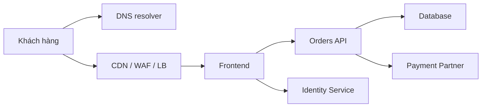
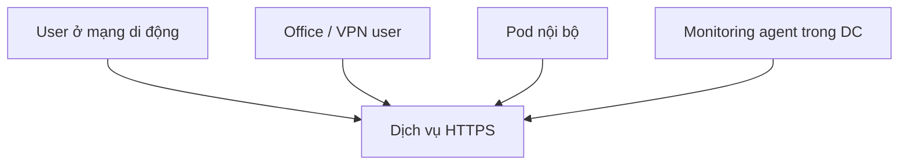
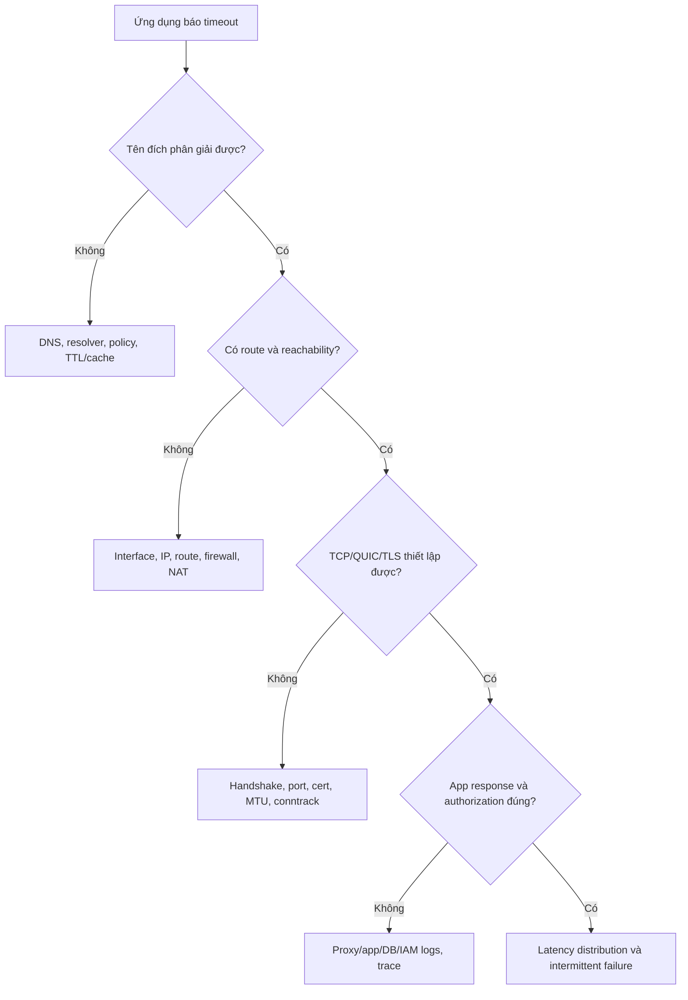
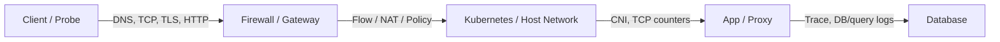
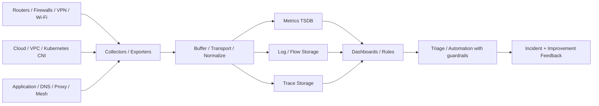
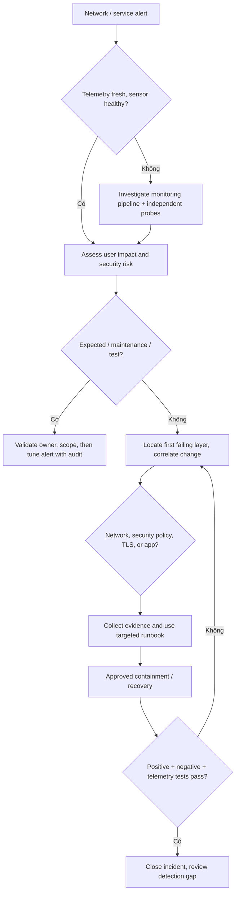

# Mục tiêu của network monitoring: nhìn thấy, đánh giá và bảo vệ hệ thống mạng

Một cửa hàng trực tuyến có website vẫn mở được nhưng khách hàng không thanh toán được. Dashboard CPU máy chủ bình thường, firewall không báo lỗi, còn nhân viên hỗ trợ nhận phản ánh “trang rất chậm”. Lỗi có thể nằm ở DNS, tuyến đường Internet, kết nối tới dịch vụ thanh toán, mất gói giữa các node, TLS handshake, proxy, database hoặc chính ứng dụng. Nếu chỉ có chỉ số thiết bị “đang bật”, đội vận hành **không biết người dùng thực sự có đang sử dụng được dịch vụ hay không**.

**Network monitoring (giám sát mạng)** là quá trình thu thập, phân tích, đối chiếu và sử dụng dữ liệu về hạ tầng, đường truyền, kết nối, dịch vụ và lưu lượng để trả lời những câu hỏi có giá trị vận hành và bảo mật. Giám sát không chỉ vẽ biểu đồ băng thông hoặc kiểm tra một IP có trả lời `ping`: mục tiêu là **phát hiện sớm vấn đề, đánh giá mức ảnh hưởng, hỗ trợ khôi phục, giảm rủi ro xâm nhập và cải thiện kiến trúc theo bằng chứng**.

Bài học thuộc chương **Giám sát mạng và telemetry** của module **SECURITY_NETWORK_SECURITY**. Nội dung liên kết kiến thức về phân đoạn mạng, firewall, VPN, IDS/IPS, xác thực kết nối, DNS, mạng không dây, cloud và container với khả năng phân tích lưu lượng, nhận diện mối đe dọa, giám sát xâm nhập và xây dựng kiến trúc mạng an toàn.

Sau bài học, bạn có thể:

1. Trình bày các **mục tiêu cốt lõi của network monitoring**: tính sẵn sàng, chất lượng, hiệu năng, an ninh, khắc phục sự cố, năng lực, thay đổi và kiểm chứng tuân thủ.
2. Phân biệt **monitoring**, **telemetry**, **observability**, **troubleshooting**, **detection** và **incident response**.
3. Chuyển mục tiêu nghiệp vụ thành **SLI/SLO, chỉ số, nguồn dữ liệu và ngưỡng cảnh báo** có thể kiểm chứng.
4. Chọn đúng góc nhìn: thiết bị, interface, route, flow, DNS/TLS, ứng dụng, người dùng và hệ thống bảo mật.
5. Giải thích khi nào sử dụng metrics, logs, traces, flow records, packet capture, synthetic probes và passive observation.
6. Nhận biết các điểm mù của SNMP, NetFlow/IPFIX, sFlow, SPAN/TAP, cloud flow logs và telemetry trong Kubernetes.
7. Thiết kế pipeline thu thập, lưu trữ, tương quan và cảnh báo với chính sách bảo mật và quản lý chi phí dữ liệu.
8. Phân biệt sự cố mạng với sự cố DNS, TLS, application, identity hoặc database bằng quy trình điều tra.
9. Lập bài thực hành có positive/negative controls, đánh giá độ tin cậy của dữ liệu và xây dựng runbook.

> **Quy ước:** Toàn bộ tên mạng, IP, hostname, bản ghi log và số liệu minh họa trong bài là giả định; không phải dữ liệu đo được từ hệ thống thực. Các câu lệnh có thể quan sát thông tin nhạy cảm, chỉ sử dụng trong lab hoặc môi trường được cấp phép. Không chạy scans, capture payload hay thay cấu hình monitoring trên production khi chưa có phê duyệt và giới hạn dữ liệu.

## 1. Network monitoring trả lời những câu hỏi nào?

Một chương trình giám sát hữu ích bắt đầu từ **câu hỏi và hành động**, không bắt đầu từ việc cài phần mềm vẽ dashboard.

### 1.1. Tám nhóm mục tiêu

| Mục tiêu | Câu hỏi cần trả lời | Kết quả mong muốn |
|---|---|---|
| **Availability** | Người dùng/ứng dụng có đi đến dịch vụ được không? | Phát hiện mất kết nối và khôi phục đúng ưu tiên |
| **Performance** | Độ trễ, jitter, loss, throughput có đáp ứng nhu cầu không? | Chất lượng ổn định và biết nơi suy giảm |
| **Reliability** | Kết nối có chập chờn, timeout, retry hoặc phụ thuộc một đường không? | Nhận biết lỗi gián đoạn và single point of failure |
| **Security** | Có lưu lượng trái chính sách, dò quét, lateral movement hoặc exfiltration không? | Phát hiện hành vi đáng ngờ và hỗ trợ containment |
| **Troubleshooting/IR** | Lỗi bắt đầu từ đâu, lúc nào, ảnh hưởng gì, do thay đổi nào? | Giảm thời gian phát hiện/chẩn đoán/khôi phục |
| **Capacity** | Đường truyền, firewall, NAT, DNS, proxy có sắp quá tải không? | Lập kế hoạch nâng cấp đúng lúc |
| **Change validation** | Sau deploy/đổi route/policy, các luồng hợp lệ và bị cấm còn đúng không? | Phát hiện regression nhanh |
| **Evidence/governance** | Có bằng chứng về kết nối, chính sách và sự kiện cần thiết không? | Audit, tuân thủ, điều tra và cải tiến |

Các nhóm có liên quan nhưng không thay thế nhau. Một đường mạng **còn hoạt động** có thể có độ trễ cao; một kết nối **nhanh** có thể đang mang dữ liệu trái phép; nhiều flow **bị từ chối** có thể chứng minh firewall hoạt động đúng, không nhất thiết hệ thống đang lỗi.

### 1.2. Kịch bản thương mại điện tử



Một câu hỏi **“Website có hoạt động?”** đòi nhiều quan sát:

- Domain có phân giải đúng ở nhiều resolver và vị trí người dùng?
- HTTPS handshake hợp lệ, certificate còn hạn?
- CDN/LB/WAF có đưa request tới frontend đúng endpoint?
- `frontend` có gọi `orders-api` được không?
- API có quyền và đường kết nối tới database/payment partner?
- Tỷ lệ lỗi, độ trễ và retry đang thay đổi thế nào?
- Firewall/NetworkPolicy có chặn **luồng không được phép**, đồng thời cho luồng nghiệp vụ?

Chỉ báo `router uptime = 100%` không đủ kết luận toàn bộ chuỗi này khỏe.

### 1.3. Quan sát phải dẫn đến quyết định

```text
Business outcome
   ↓
Question / risk
   ↓
SLI or detection requirement
   ↓
Telemetry source / collection point
   ↓
Baseline / threshold / correlation
   ↓
Alert, investigation or capacity decision
   ↓
Action and post-action validation
```

Nếu một metric không dẫn tới quyết định, hành động hoặc giải thích cụ thể, nên xem lại chi phí thu thập/lưu trữ của nó trước khi thêm vào dashboard.

## 2. Monitoring, telemetry, observability và security detection

### 2.1. Các khái niệm gần nhau

| Thuật ngữ | Trọng tâm | Ví dụ |
|---|---|---|
| **Telemetry** | Dữ liệu được đo/phát ra từ hệ thống | Interface counters, flow records, DNS logs, traces |
| **Monitoring** | Theo dõi trạng thái và so với điều kiện quan tâm | Cảnh báo packet loss > ngưỡng trong một khoảng |
| **Observability** | Khả năng suy luận trạng thái nội bộ từ dữ liệu bên ngoài | Tìm nguyên nhân latency qua route, gateway, app và DB |
| **Troubleshooting** | Quá trình chẩn đoán và loại trừ giả thuyết | So DNS, TCP handshake, TLS và application response |
| **Security detection** | Phát hiện hành vi đáng ngờ/threat patterns | Pod web đột nhiên gọi nhiều host management ports |
| **Incident response** | Tổ chức điều tra, containment, remediation, recovery | Cô lập workload, thu hồi token, giữ flow evidence |

Telemetry là **nguyên liệu**; monitoring là **cách sử dụng thường xuyên**; observability nhấn mạnh **khả năng giải thích cả những tình huống chưa dự đoán trước**. Không có bảo đảm rằng cứ thu thật nhiều logs là có observability tốt: dữ liệu thiếu identity, timestamp hoặc coverage vẫn có thể không trả lời được nguyên nhân.

### 2.2. Monitoring có thể chủ động và thụ động

- **Active monitoring:** hệ thống chủ động tạo một lượng nhỏ traffic thử nghiệm như DNS lookup, HTTP request, TCP handshake, synthetic transaction, kiểm tra route hoặc đo latency có kiểm soát.
- **Passive monitoring:** quan sát traffic và events thật từ interfaces, flow exports, logs, packet captures, proxies, IDS/IPS hoặc application instrumentation.

Hai loại bổ sung cho nhau:

| Phương pháp | Điểm mạnh | Giới hạn |
|---|---|---|
| Active probe | Kiểm tra trải nghiệm ngay cả khi traffic thật ít; phù hợp SLO ở một điểm đo | Probe không đại diện mọi users/path/IPv4/IPv6; có thể bị rate-limit |
| Passive flows/logs | Phản ánh workload và đường traffic thật | Không thấy một đường **không có traffic**; có sampling và điểm mù |
| Phối hợp | Probe phát hiện giảm chất lượng, flows/traces giúp truy nguyên | Cần đồng bộ thời gian, identity và dữ liệu |

### 2.3. Bốn câu hỏi giám sát khác nhau

Một website trả `200 OK` ở synthetic probe **không tự chứng minh**:

1. Mọi người dùng đều truy cập được từ các ISP/quốc gia.
2. Mọi chức năng nghiệp vụ như checkout đều thành công.
3. Mọi workload được phép gọi đúng đối tượng.
4. Các nguồn trái phép đã bị từ chối.

Do đó, monitoring phải kết hợp **positive checks** cho đường hợp lệ, **negative checks** cho security policy và telemetry phục vụ điều tra.

## 3. Mục tiêu availability: không chỉ kiểm tra thiết bị “up”

### 3.1. Ba mức tính sẵn sàng

| Cấp quan sát | Câu hỏi | Ví dụ tín hiệu |
|---|---|---|
| **Thiết bị/interface** | Thiết bị, link, tunnel, BGP neighbor còn hoạt động? | Interface oper status, tunnel session, routing adjacency |
| **Đường kết nối** | Source A còn tới được destination B bằng protocol cần thiết? | TCP connect, DNS lookup, mTLS handshake |
| **Dịch vụ/người dùng** | Chức năng cuối cùng có hoạt động? | Login, search, checkout, success/latency SLI |

Thiết bị `up` nhưng application `down` là tình huống hoàn toàn có thể xảy ra. Ngược lại, một switch port xuống có thể không gây gián đoạn người dùng nếu lưu lượng đã chuyển qua link dự phòng.

### 3.2. Monitoring cần nhìn từ đúng vị trí



Nếu probe đặt ngay trong datacenter vẫn thành công nhưng người dùng di động lỗi do DNS/CDN/ISP, một dashboard từ DC sẽ báo xanh. Nên chọn **vantage points** theo những nhóm người dùng và đường truy cập quan trọng:

- External/public Internet.
- Văn phòng/chi nhánh, VPN hoặc ZTNA.
- Region/AZ/cloud VPC khác nhau.
- Kubernetes nodes/pods và ứng dụng nội bộ.
- Đường dự phòng và DR site.

Không cần probe mọi địa điểm trên thế giới; chọn các điểm có **ý nghĩa rủi ro** và đánh dấu phạm vi chưa bao phủ.

### 3.3. Health checks ở nhiều tầng

```text
Ping / ICMP reply
    ≠ TCP listener accepted
    ≠ TLS handshake correct
    ≠ HTTP API succeeded
    ≠ Business transaction succeeded
```

ICMP có thể bị chặn hoặc rate-limited, nên **ping fail không luôn là dịch vụ down**; ping thành công cũng không chứng minh HTTPS hợp lệ. Một synthetic checkout được kiểm soát có giá trị hơn `ping` khi cần đánh giá trải nghiệm thanh toán, nhưng phải dùng **giao dịch giả, không phát sinh thanh toán thật**.

### 3.4. SLI availability

Ví dụ định nghĩa cho dịch vụ API:

\[
\text{Availability SLI}
= \frac{\text{số request hợp lệ có kết quả thành công}}
{\text{tổng số request hợp lệ thuộc phạm vi SLI}}
\times 100\%.
\]

Phải định nghĩa rõ **request hợp lệ**: request nào bị loại, cách xử lý user-cancelled, bot, health checks, retry, các lỗi 4xx do user gây ra và lỗi upstream. Không lấy một tỷ lệ từ hệ thống A rồi so với SLO của hệ thống B có denominator khác.

Ví dụ: 99.900 requests được đánh giá thành công trên 100.000 requests thuộc phạm vi ⇒ availability SLI = **99,9%**. Đây là phép tính minh họa, **không phải chỉ số thực tế**.

### 3.5. Thời gian gián đoạn và error budget

Nếu đặt SLO availability 99,9% trong một cửa sổ 30 ngày với cách đo dựa theo thời gian:

\[
30 \times 24 \times 60 \times (1 - 0{,}999) = 43{,}2\text{ phút}.
\]

Số 43,2 phút là **error budget lý thuyết theo thời gian của cửa sổ 30 ngày**, không tự tương đương budget request-based SLO và không tính các ngoại lệ đo lường khác. Monitoring phải hỗ trợ đánh giá **budget consumption/burn rate** theo định nghĩa SLO thực tế.

### 3.6. Reliability của failover

Một mạng có hai đường Internet, hai BGP peers hoặc hai VPN tunnels chưa chắc tự chuyển tuyến nhanh/đúng:

- Theo dõi trạng thái từng đường và thời gian failover.
- Kiểm tra routing convergence và packet loss trong chuyển đổi.
- Đo khả năng của đường dự phòng khi đường chính mất.
- Xác định lỗi chung: cùng nhà mạng, nguồn điện, route controller, firewall state.

**Khả dụng do dự phòng phải được kiểm chứng bằng thử nghiệm được phê duyệt**, không chỉ bằng sơ đồ có hai mũi tên.

## 4. Mục tiêu performance: chất lượng kết nối có đủ cho ứng dụng?

### 4.1. Những chỉ số cốt lõi

| Metric | Ý nghĩa | Sai lầm cần tránh |
|---|---|---|
| **Latency** | Thời gian một packet/request đi đến nơi hoặc hoàn tất | Nhầm RTT với one-way delay |
| **Jitter** | Biến thiên độ trễ theo thời gian | Coi ping trung bình là đủ cho thoại/video |
| **Packet loss** | Tỷ lệ packet không tới/không được phản hồi theo phép đo | Suy mất gói từ ICMP rate-limit |
| **Throughput** | Lượng dữ liệu truyền thực tế trong một đơn vị thời gian | Nhầm throughput với link capacity |
| **Utilization** | Mức tải so với tốc độ interface được định nghĩa | Dùng một giá trị 5 phút để bỏ qua microburst |
| **Errors/discards** | Frame errors, queue drops, buffer exhaustion | Gộp tất cả counter vào “network down” |
| **Retransmissions** | TCP gửi lại segments do ACK/timeout/fast recovery | Mọi retransmission đều là do congestion |
| **Connection setup** | DNS + TCP + TLS và app negotiation delay | Đổ lỗi cho mạng khi chính auth/server chậm |

### 4.2. Ví dụ VoIP/video vs API

VoIP có thể nhạy với **jitter, one-way delay và packet loss**. API giao dịch có thể nhạy với **p95/p99 request latency, timeout, retries, TLS handshake**. Bulk backup lại chủ yếu quan tâm **throughput, congestion và completion window**.

Không dùng một ngưỡng `latency > 100 ms` chung cho mọi hệ thống. Cần xác định **business SLO**, protocol, path và baseline.

### 4.3. Đọc percentiles đúng

Một API có:

```text
Median latency (p50):   25 ms
p95:                   180 ms
p99:                   650 ms
Mean:                   80 ms
```

Thì median đẹp không loại trừ các requests rất chậm ở đuôi phân phối. Khi người dùng phản ánh “thỉnh thoảng bị treo”, phân phối p95/p99 và correlated retries/timeouts có thể quan trọng hơn average.

**Không tính trung bình các p95/p99 của nhiều instance như thể đó là percentile toàn hệ thống.** Muốn percentile tổng hợp cần histogram/distribution có cùng đơn vị và bucket/schema phù hợp; còn client-side và server-side latency có thể khác.

### 4.4. Throughput và capacity

Với interface 1 Gbit/s, traffic vào trung bình 600 Mbit/s:

\[
\text{Utilization}_{\text{avg}}
= \frac{600}{1000}\times100\%=60\%.
\]

Tuy nhiên 60% trung bình có thể vẫn kèm **microbursts** làm đầy buffers/drop packets. Các thiết bị/exporter lấy mẫu 1–5 phút có thể không thể nhìn thấy những đỉnh ngắn. Cần kết hợp queue drops, fine-grained telemetry khi hỗ trợ và application symptoms.

### 4.5. RTT khác one-way latency

`ping` thường đo **round-trip time (RTT)**. Không chia đôi RTT rồi tuyên bố đó là độ trễ một chiều thực tế khi hai chiều có route hoặc queue khác nhau. Đo one-way delay cần đồng bộ thời gian và công cụ đo phù hợp; vẫn phải tính clock error và path asymmetry.

### 4.6. TCP, UDP và QUIC

- **TCP:** quan sát handshake, retransmits, RTO, resets, congestion window (nếu có), connection setup và server latency.
- **UDP:** không có TCP handshake; ứng dụng phải tự thể hiện loss/jitter/sequence hoặc dùng phép đo phù hợp.
- **QUIC/HTTP/3:** thường chạy trên UDP/443 với phần lớn thông tin transport được mã hóa; network flow records không đọc được đầy đủ HTTP semantics.

Một firewall thấy UDP/443 tăng không đủ kết luận đó là tấn công hoặc data exfiltration; cần service identity, endpoint, traffic profile và các tín hiệu bổ sung.

## 5. Mục tiêu security: nhìn thấy hành vi trái kỳ vọng và hỗ trợ phản ứng

Security monitoring không đơn giản là “bật IDS để có alert”. Cần mô tả **tài sản cần bảo vệ, những hành vi cần phát hiện, nguồn bằng chứng và hành động tương ứng**.

### 5.1. Những mục tiêu bảo mật cụ thể

| Mục tiêu | Dấu hiệu/telemetry hữu ích | Hành động có thể hỗ trợ |
|---|---|---|
| Phát hiện quét/lateral movement | Nhiều đích/ports bất thường từ cùng workload | Điều tra process, identity và phạm vi |
| Phát hiện exfiltration | Egress tới destination chưa duyệt, data volume/pattern đổi đột ngột | So endpoint, proxy/IAM/app logs |
| Kiểm chứng segmentation | Expected DENY và CNI/firewall rule verdict | Xác nhận policy thực thi hoặc tìm bypass |
| Phát hiện DNS abuse | Truy vấn bất thường, domains lạ, NXDOMAIN/entropy tăng | DNS/EDR correlation, review resolver |
| Phát hiện authentication anomalies | VPN/ZTNA failures, mTLS errors, token misuse | Xác minh danh tính/session/issuer |
| Phát hiện thay đổi hạ tầng trái phép | BGP route changes, firewall allow-all, public LB mới | Audit, risk assessment, rollback |
| Cảnh báo giám sát bị suy giảm | IDS agent offline, flow export mất, log pipeline stale | Khôi phục telemetry, đánh giá exposure |

**Không suy một kết nối lạ là độc hại chỉ từ IP hoặc port.** Một ứng dụng mới deploy hoặc backup job cũng có thể sinh traffic khác baseline. Detection cần context, độ tin cậy của tín hiệu và xác minh.

### 5.2. Monitoring vs IDS/IPS/NDR/SIEM

- **Network monitoring:** đánh giá trạng thái, chất lượng, hành vi, reachability và rủi ro.
- **IDS:** phát hiện patterns/tín hiệu xâm nhập; có thể dựa signature, protocol anomalies hoặc hành vi.
- **IPS:** ngoài phát hiện còn có thể thực thi blocking tại điểm được triển khai.
- **NDR:** phân tích network telemetry để tìm hành vi bất thường, lateral movement, C2/exfiltration theo khả năng sản phẩm.
- **SIEM:** tập trung/tương quan events/logs từ nhiều nguồn, hỗ trợ rule/alert/incident workflow.

Chúng có thể chia sẻ cùng telemetry, nhưng **monitoring tốt không đồng nghĩa IDS/IPS bao phủ mọi luồng**. Đặc biệt traffic TLS/QUIC mã hóa làm giảm khả năng inspect payload nếu không có decryption và quyền phù hợp.

### 5.3. Security monitoring phải biết điều gì là được phép

Một flow từ `frontend` tới `database:5432` có thể bất thường dù chỉ gồm một connection. Ngược lại, một worker đọc DB hàng nghìn lần có thể là hành vi hợp lệ.

```text
Asset inventory + allowed-flow matrix
         +
Observed network telemetry
         +
Workload / user identity
         +
Context (deploy, maintenance, business)
         ↓
Detection / investigation / action
```

Không tự động huấn luyện danh sách allow chỉ từ **mọi observed traffic**: nếu traffic lúc baseline đã bao gồm một cuộc dò quét, hệ thống sẽ hợp thức hóa nó.

### 5.4. Chặn đúng cũng cần được giám sát

Một `NetworkPolicy` hoặc firewall block từ source không được phép là **tín hiệu kiểm soát đang hoạt động**, không nhất thiết một incident. Cần nhận diện:

- Expected denies trong positive/negative test.
- Unexpected denies gây gián đoạn ứng dụng.
- Unexpected allows do policy broad hoặc đường bypass.
- Một source tăng tần suất thử các forbidden destinations.

**Cảnh báo về failure of detection** quan trọng không kém alert detection: nếu CNI flow exporter/IDS sensor ngừng hoạt động, không có alert không có nghĩa mạng đang an toàn.

## 6. Mục tiêu troubleshooting: rút ngắn thời gian xác định nguyên nhân

### 6.1. Phân biệt triệu chứng và nguyên nhân

Khi người dùng báo “vào web rất chậm”, đừng mặc định network bandwidth không đủ. Những tình huống có thể cho triệu chứng giống nhau:

| Triệu chứng | Nguyên nhân có thể | Tín hiệu phân biệt |
|---|---|---|
| DNS lookup timeout | Resolver unreachable, policy chặn DNS, server quá tải | DNS request/response, resolver health, egress policy |
| TCP connection timeout | Route, firewall drop, packet loss, listener không phản hồi | SYN/SYN-ACK, flow verdict, route, listener |
| TCP refused/reset | Service không listen, proxy/host trả RST, port sai | TCP flags, service/host logs |
| TLS handshake failure | Certificate/CA/SNI/version/mTLS identity | TLS alert, proxy logs, certificate metadata |
| HTTP 502/503 | Gateway không tới upstream, endpoints unready, backend lỗi | Gateway logs, EndpointSlice, upstream health |
| HTTP 401/403 | Authentication/authorization hoặc WAF | Identity logs, gateway/app reason |
| HTTP 200 nhưng chậm | DB query, app lock, congestion, connection pool | Distributed trace, DB latency, network RTT |
| Chỉ một khu vực lỗi | ISP/path/CDN/DNS/geography | Multi-vantage probes, traceroute/routing, CDN logs |

Giám sát giúp thu hẹp giả thuyết và xác định **bước đầu tiên thất bại**, thay vì đổi nhiều thứ cùng lúc rồi không biết thay đổi nào thực sự sửa được lỗi.

### 6.2. “Mạng” có nhiều lớp



Mỗi nhánh gợi ý nguồn dữ liệu; không nhất thiết phép thử nào cũng áp dụng được cho mọi giao thức. Ví dụ UDP/QUIC không dùng TCP three-way handshake.

### 6.3. Giảm MTTR là kết quả, không phải số lượng dashboard

Các mốc có thể đo:

- **Detection time:** từ khi tác động bắt đầu đến lúc tín hiệu giám sát nhận thấy.
- **Triage time:** từ cảnh báo đến khi xác định phạm vi và ưu tiên.
- **Diagnosis time:** đến khi có giả thuyết đủ bằng chứng và phạm vi nguyên nhân.
- **Containment/recovery time:** đến khi giảm hoặc chấm dứt ảnh hưởng.
- **Verification time:** xác nhận dịch vụ phục hồi và không tạo lỗ hổng.

MTTD/MTTR có nhiều định nghĩa trong tổ chức; cần công bố **start/end timestamps và điều kiện đo**. Không so chỉ số của hai đội khi một đội tính MTTR từ alert, đội khác từ khi người dùng đầu tiên bị ảnh hưởng.

### 6.4. Monitoring phải lưu được trạng thái trước sự cố

Một incident có thể chỉ xảy ra vài phút. Nếu:

- Metrics chỉ được tổng hợp mỗi 15 phút,
- Logs đã bị xoay,
- Flow exporter gửi bản ghi trễ hoặc bị drop,
- Không có topology/route/policy version trước change,

thì đội vận hành rất khó truy nguyên. Cần lựa chọn **sampling interval, retention, timestamp, labels, change events và aggregation** theo tốc độ xảy ra sự cố và yêu cầu điều tra, trong giới hạn chi phí và quyền riêng tư.

## 7. Mục tiêu capacity: dự đoán điểm nghẽn trước khi ảnh hưởng người dùng

### 7.1. Không chỉ theo dõi bandwidth

Một firewall/proxy/VPN concentrator có thể bị giới hạn bởi:

- Concurrent connections và connection setup rate.
- NAT/conntrack table capacity.
- CPU cho TLS/IPsec encryption.
- Packet-per-second, small packet overhead.
- Memory/queue/buffer limits.
- Session/license/tunnel limits.
- Logging/export throughput.
- DNS requests per second và cache hit ratio.
- Control-plane capacity như BGP routes, policy updates hoặc CNI endpoint count.

Một interface mới chạy 40% băng thông vẫn có thể overload CPU vì xử lý TLS connections nhỏ.

### 7.2. Một ví dụ capacity planning

```text
Link nominal capacity:            1 Gbit/s
Current weekday peak:           700 Mbit/s
Growth estimate:                 10% / month
Business threshold for review:  80% sustained utilization
```

Nếu growth thực sự gần 10%/tháng và không thay đổi kiến trúc, dự đoán tháng kế tiếp:

\[
700 \times 1{,}10 = 770 \text{ Mbit/s}.
\]

Sau hai tháng:

\[
700 \times 1{,}10^2 = 847 \text{ Mbit/s}.
\]

Như vậy ngưỡng review 800 Mbit/s có thể bị vượt trong khoảng **hai tháng** theo giả định minh họa. Nhưng capacity planning không chỉ tuyến tính: traffic seasonality, traffic mix, compression, burst, CDN caching và thay đổi ứng dụng có thể làm dự báo sai.

### 7.3. Planning cho failover

Hai đường WAN mỗi đường 1 Gbit/s và mỗi đường chịu 700 Mbit/s ở thời điểm cao điểm không nhất thiết đáp ứng được **mất một đường**: 1,4 Gbit/s tổng tải không thể tự chuyển hết sang 1 Gbit/s nếu không có giảm tải hoặc giới hạn.

Giám sát capacity cần đo:

1. Tải bình thường và tải đỉnh.
2. Headroom sau khi mất một thành phần (N-1) theo thiết kế.
3. Độ trễ/packet loss và ứng dụng ở trạng thái degraded.
4. Thời gian khôi phục, ưu tiên QoS và rate limiting.

### 7.4. Phát hiện trend và saturation

Biểu đồ dài hạn hữu ích cho:

- Ngày/giờ cao điểm, mùa vụ.
- Trạng thái đủ/thiếu headroom qua từng region.
- Dự đoán port/link/firewall/NAT session exhaustion.
- So sánh sau thay đổi routing, CDN, compression hoặc network policies.
- Lựa chọn nâng cấp đúng thành phần thay vì nâng cấp mọi thiết bị.

Không chỉ dựa vào throughput trung bình; khi user complaints xuất hiện, cần **p95/p99, burst windows và drop metrics** theo khả năng exporter.

## 8. Bản đồ nguồn dữ liệu: mỗi loại telemetry nói được gì?

### 8.1. Sáu họ dữ liệu quan trọng

| Loại | Dữ liệu điển hình | Giỏi trả lời | Không đủ để trả lời |
|---|---|---|---|
| **Metrics** | Time series counters, gauges, histograms | Tình trạng và xu hướng, SLO, capacity | Ai đã gửi một request cụ thể nếu thiếu labels/logs |
| **Logs/events** | Syslog, firewall decisions, auth events | Điều gì xảy ra, lỗi gì, policy change | Toàn bộ packet path nếu không thu tại đủ điểm |
| **Flow records** | Source/dest IP, port, protocol, bytes, timestamps | Ai nói chuyện với ai, bao nhiêu, khi nào | Full payload, HTTP URL/JWT do TLS mã hóa |
| **Traces** | Spans/calls giữa dịch vụ | Request chậm tại hop nào | Mọi packet bị drop trước instrumentation |
| **Packets/PCAP** | Headers và payload tại capture point | Protocol-level timing/retransmission/handshake | Toàn topology hoặc plaintext khi traffic mã hóa |
| **Synthetic probes** | DNS/TCP/TLS/HTTP/transaction test | Đường nào còn hoạt động từ điểm đo | Full user population và root cause chỉ từ pass/fail |

**Không có nguồn nào là “nguồn sự thật duy nhất” cho mọi câu hỏi.** Nên kết hợp ít nhất hai loại độc lập ở những services có độ quan trọng cao.

### 8.2. Góc nhìn endpoint, network và application



Một gateway thấy request vào nhưng backend không ghi log:

- Gateway có thể đã reject trước khi forward.
- Route/NetworkPolicy có thể drop giữa gateway và Pod.
- App có thể không có endpoint hoặc instrumentation.

Phải xác định **điểm đặt sensor** và xem missing events là do **không có traffic** hay do sensor không nhìn thấy.

## 9. Metrics: từ interface counters tới SLI và cảnh báo

### 9.1. Counter, gauge và histogram

| Kiểu | Mô tả | Ví dụ |
|---|---|---|
| **Counter** | Giá trị thường tăng, reset khi process/thiết bị restart | Octets received, packets dropped, request errors |
| **Gauge** | Giá trị hiện thời có thể tăng hoặc giảm | Active connections, CPU%, current BGP peers |
| **Histogram/distribution** | Phân bố số quan sát theo buckets/series | Request latency, packet size, connection setup time |

Đối với counters, không nên chỉ lấy `counter_t2 - counter_t1` mà bỏ qua **reset/wrap/counter discontinuity**. Sử dụng công cụ hiểu reset/wrap và quan sát exporter uptime. Đối với histogram, bucket boundaries, sample count và label cardinality phải được quản lý.

### 9.2. Ví dụ chuyển byte counter thành băng thông

Giả sử counter octets tăng 75.000.000 octets trong 10 giây:

\[
\text{bps} = \frac{75{,}000{,}000 \times 8}{10}
  = 60{,}000{,}000 \text{ bit/s} = 60 \text{ Mbit/s}.
\]

Đây là mức **trung bình trong cửa sổ 10 giây**, không phải peak tức thời. Nếu counter reset, đổi interface, wrap hoặc có missing samples thì phép tính cần được xử lý tương ứng.

### 9.3. Mẫu truy vấn time-series dạng PromQL

Trong một hệ thống Prometheus có sẵn metric tương thích:

```promql
# Ví dụ rate trung bình của octets inbound (đơn vị bit/s).
rate(ifHCInOctets[5m]) * 8
```

Tuy nhiên `ifHCInOctets` là tên **SNMP MIB object**, không đảm bảo exporter đặt metric đúng như vậy hay có đủ labels trong môi trường thật. Có thể cần dùng exporter-specific metric như `ifHCInOctets{...}` hoặc transform phù hợp. Truy vấn trên chỉ minh họa nguyên tắc lấy `rate` của counter rồi đổi octets → bits.

Với tỷ lệ HTTP errors, nếu đã có counters theo service:

```promql
# Ví dụ logic; tên metric và labels phải thay theo instrumentation thật.
sum(rate(http_requests_total{service="orders-api",status=~"5.."}[5m]))
/
sum(rate(http_requests_total{service="orders-api"}[5m]))
```

**Cần bảo vệ trường hợp mẫu số bằng 0**, thiếu data hoặc một metric có cardinality/sampling khác. Một HTTP 5xx ratio không tự là mạng lỗi; phải liên kết gateway/DB/network telemetry.

### 9.4. Missing metrics cũng là tín hiệu

Khi một exporter ngừng gửi metric, một số dashboard có thể:

- Hiển thị giá trị cuối cùng và trông “ổn”.
- Hiển thị khoảng trống hoặc `no data`.
- Tính trung bình chỉ trên các instances còn báo cáo.
- Không kích hoạt ngưỡng vì series đã biến mất.

Monitoring cần cảnh báo **`up`/scrape errors, missing expected targets, exporter queue drops, stale heartbeats**, và phân biệt *thiết bị thật sự không hoạt động* với *hệ thống giám sát không còn quan sát được*.

### 9.5. Label cardinality và chi phí

Không nên dùng `source_ip`, `request_id`, `user_id` hoặc `pod_uid` không giới hạn làm labels cho mọi time series: cardinality tăng rất nhanh, gây tốn RAM/storage và giảm độ tin cậy của Prometheus-like backends.

Giữ labels có tính phân nhóm ổn định như `service`, `cluster`, `region`, `interface`, `policy_action`; đưa high-cardinality identifiers vào logs/traces/flow storage có index/retention phù hợp.

### 9.6. Đồng bộ thời gian

Metrics, logs và flow records chỉ tương quan tốt khi **clocks có độ lệch được biết và đủ nhỏ** cho mục tiêu phân tích. Dùng NTP/chrony/PTP theo yêu cầu; lưu timestamp kèm timezone/UTC và nhận biết event-time vs ingestion-time.

Ví dụ một firewall gửi log chậm 90 giây không có nghĩa request của ứng dụng xảy ra muộn 90 giây. Nếu không phân biệt event timestamp và collector receipt timestamp, timeline incident sẽ sai.

## 10. Logs, syslog, events và cấu hình thay đổi

### 10.1. Một log hữu ích nên chứa gì?

```json
{
  "timestamp": "2026-11-28T09:15:00Z",
  "device": "fw-edge-demo",
  "event_type": "network_policy_decision",
  "source": "192.0.2.10",
  "destination": "198.51.100.20",
  "protocol": "TCP",
  "destination_port": 443,
  "action": "DENY",
  "policy_id": "block-unapproved-egress",
  "collector_received_at": "2026-11-28T09:15:01Z"
}
```

Đây là **schema minh họa** do bài viết tạo, không phải định dạng mặc định của một firewall cụ thể. Nhiều thiết bị không ghi `policy_id`, không giữ source workload identity, có NAT hoặc timestamp resolution khác.

### 10.2. Syslog và structured logs

Syslog được dùng rộng rãi để xuất events từ routers, firewalls, switches, Linux services; định dạng, severities và transport có nhiều biến thể. Chất lượng phụ thuộc:

- Thiết bị có phát events cần thiết?
- Collector có nhận với transport bảo vệ phù hợp?
- Đã chuẩn hóa timestamp, device identity, event fields?
- Có log loss/dropped messages khi collector quá tải?
- Event severity có nghĩa nhất quán giữa vendors?
- Retention, access control, encryption và audit exports?

Không mặc định **UDP syslog** đảm bảo delivery hoặc confidentiality. Khi cần độ tin cậy/bảo mật cao, cân nhắc transport có xác thực/mã hóa theo khả năng nguồn và collector, queue buffering và test mất kết nối.

### 10.3. Sự kiện thay đổi quan trọng không kém packet events

Trong troubleshooting:

```text
09:00 new firewall policy applied
09:02 BGP neighbor flaps
09:03 DNS timeouts increase
09:04 HTTP 502 spike
```

Timeline này chỉ là **một giả thuyết nhân quả**; cùng lúc xảy ra không tự chứng minh firewall change gây BGP flap. Cần đối chiếu config diff, affected path, event logs và phép thử khẳng định.

Thu:

- Firewall/ACL/NetworkPolicy changes.
- Route/BGP/SD-WAN changes.
- VPN/identity/MFA/session config changes.
- DNS resolver/zone/certificate/JWKS rotations.
- Kubernetes Deployment/Service/Ingress/EndpointSlice changes.
- Cloud SG/NSG/IAM/network attachment updates.

### 10.4. Không ghi dữ liệu bí mật để “có đủ logs”

Không log:

- Passwords, API keys, full bearer tokens, VPN pre-shared keys.
- Private certificates/keys, session cookies.
- Đầy đủ application payload hoặc PII ngoài nhu cầu.

Thay bằng verified identity reference, token issuer/audience metadata theo chính sách, request ID, decision reason và policy version. Bảo vệ cả logs backup và quyền truy cập SIEM/observability platform.

## 11. Flow telemetry: NetFlow, IPFIX, sFlow và cloud flow logs

### 11.1. Flow record là gì?

Một network flow thường được nhóm theo các thuộc tính như **source IP, destination IP, source/destination port, protocol** và có thể thêm interface, VRF, direction, NAT, sampling metadata hoặc observation domain.

```text
Flow:
  src_ip: 10.244.1.10
  src_port: 53122
  dst_ip: 10.244.2.20
  dst_port: 5432
  proto: TCP
  first_seen: 09:00:00.100Z
  last_seen: 09:00:04.900Z
  packets: 13
  bytes: 2380
```

Flow records **không mặc định cho biết process, user, JWT principal hoặc nội dung SQL**. Trong cloud/Kubernetes, cần enrich với Pod UID, service account, ENI/instance và địa chỉ trước/sau NAT khi dữ liệu có thể thu được.

### 11.2. Phân biệt các công nghệ

| Công nghệ | Tính chất chính | Lưu ý |
|---|---|---|
| **NetFlow** | Xuất thống kê luồng từ exporter | Phiên bản và fields khác nhau, không nhất thiết có payload |
| **IPFIX** | Chuẩn mở dạng template/information elements | Phụ thuộc fields do exporter hỗ trợ |
| **sFlow** | Thường sampling packets cùng interface counters | Phải hiểu sampling rate, không coi mẫu là toàn bộ traffic |
| **Cloud VPC/VNet flow logs** | Dữ liệu network được cloud provider cung cấp | Aggregation, action field và visibility khác theo provider |
| **CNI flow visibility** | Flow metadata gắn Pod/namespace/policy verdict khi CNI hỗ trợ | Không phải mặc định mọi Kubernetes cluster |

**Flow export ≠ packet capture.** Với flow export, khó phân tích chính xác từng retransmission/TLS alert nếu fields không chứa chúng. Ngược lại, packet capture có thể quá chi tiết và nhạy cảm cho nhu cầu trend/capacity.

### 11.3. Sampling và mất dữ liệu

Một sFlow exporter sample 1/1000 packets không đảm bảo **một kết nối ngắn 5 packets sẽ được nhìn thấy**. Các flow exporters cũng có active/inactive timeouts, resource limits và khả năng bị drop export khi hệ thống quá tải.

Khi hỏi “có chắc không có traffic từ Pod A đến DB?”:

- Không thấy flow trong **sampled flow data** không chứng minh tuyệt đối không có traffic.
- Một flow được chính sách chặn trước điểm export có thể không xuất hiện ở sensor phía sau.
- Exporter/collector failure tạo điểm mù.
- NAT/encapsulation có thể làm source/destination khác kỳ vọng.

Muốn chứng minh một forbidden path được chặn, cần **test có kiểm soát tại điểm enforcement và bằng chứng phù hợp**, không chỉ thiếu flow record.

### 11.4. Một ví dụ correlation

```text
09:10:01Z  CNI flow: frontend Pod UID=A → database Pod UID=B
09:10:01Z  Verdict: DROPPED (egress policy)
09:10:02Z  Runtime log: process attempted TCP connect
09:10:02Z  Application log: connection timeout
```

Đây là **sơ đồ dữ liệu giả lập**. Nó giúp nhận ra timeout **đúng do policy** thay vì DB chết, nhưng chỉ nếu Pod UID/time/policy verdict được thu thật và chính xác.

### 11.5. Gắn flow với response business

Một IP có thể bị tái cấp cho Pod khác. Flow tại 09:10 phải được map với Pod UID sở hữu IP **tại 09:10**, không phải Pod hiện giữ IP. Khi có NAT, mapping còn cần node/NAT session/egress gateway state; khi truy cập qua gateway, application caller có thể là khác network source IP.

**Thời gian, identity và điểm đo quan trọng hơn số lượng flow records.**

## 12. Packet capture và protocol analysis: dùng khi thật sự cần

### 12.1. Khi nào PCAP giúp ích?

Packet capture có thể hỗ trợ phân tích:

- TCP SYN/SYN-ACK/ACK, resets, retransmissions.
- DNS queries/responses khi DNS không mã hóa và capture point thấy được.
- TLS handshake metadata/certificates theo phiên bản và khả năng thấy thông tin.
- ICMP errors, fragmentation, MTU/PMTUD issues.
- VLAN, tunnel encapsulation, routing/forwarding behavior.
- Giao thức custom bị lỗi hoặc thiết bị trả frame bất thường.

Nhưng **traffic được mã hóa** thường không để lộ application payload cho người chỉ có PCAP; với TLS 1.3 và QUIC, nhiều trường từng thấy được ở các phiên bản cũ đã được mã hóa.

### 12.2. Capture đặt ở đâu?

```text
Client ──[Capture A]──> Gateway ──[Capture B]──> Pod
                         |
                         +──[Capture C]──> External service
```

Capture A thấy client-side flow; Capture B thấy flow sau proxy/NAT; Capture C có thể thấy gateway identity khác client ban đầu. Nếu underlay dùng VXLAN, capture tại switch có thể thấy **outer node IPs/UDP tunnel** thay vì Pod headers ở bên trong.

Một PCAP đơn lẻ không chứng minh hop nào đã drop packet nếu capture point không bao phủ đường đó. Phải kết hợp timestamps, route/NAT state và logs.

### 12.3. Ví dụ lệnh đọc/troubleshooting trong lab

```bash
# Chỉ chạy trong máy/namespace được phép với traffic thử cụ thể.
# Hiển thị interface/address/routing trước, không thay đổi cấu hình.
ip -br address
ip route
ss -ltn

# Ví dụ CAPTURE có giới hạn trong lab; thay IFACE và peer IP thật.
# -c dừng sau 20 packets, -s 96 giới hạn snaplen để giảm thu payload.
# Vẫn có thể thấy metadata nhạy cảm, cần quyền/phê duyệt.
sudo tcpdump -i IFACE -nn -c 20 -s 96 \
  'host 192.0.2.10 and tcp port 443'
```

**Lưu ý:** Đây là command minh họa với documentation IP; nó sẽ không giúp nếu không có traffic lab phù hợp. Bản thân `tcpdump` cũng có thể cần root/capabilities và bị giới hạn trong container. Không capture traffic của người dùng ngoài quyền, không thu full payload/credentials để kiểm tra một lỗi L3/L4 đơn giản.

### 12.4. SPAN/TAP, offload và encrypted overlays

SPAN/mirror ports có thể:

- Drop mirrored packets khi lưu lượng mirror vượt capacity.
- Không thấy traffic khác virtual switch/host path.
- Ghi packet khác với packet app nhận do NIC offload/segmentation.
- Thấy only outer tunnel traffic, không giải mã overlays.

TAP phù hợp một số bài toán nhưng cũng chỉ quan sát **đường vật lý nó được đặt**. Cần ghi capture coverage/quality, packet loss và privacy controls, tránh coi PCAP là toàn cảnh mạng.

### 12.5. Khi nào không nên dùng PCAP?

Nếu mục tiêu là tính weekly bandwidth trend, SNMP/interface metrics hoặc flow records thường phù hợp hơn. Nếu cần xác minh ai sửa firewall rule, **configuration audit logs** hữu ích hơn packet payload. Nếu cần biết user không có quyền đọc order, **application authorization logs** có ích hơn L3 capture.

Chọn **nguồn dữ liệu tối thiểu nhưng đủ trả lời câu hỏi**, giảm overhead và rủi ro riêng tư.

## 13. Kiến trúc thu thập telemetry: từ nguồn tới hành động

### 13.1. Các thành phần điển hình



Không phải sản phẩm nào cũng đòi tất cả thành phần; có môi trường dùng managed services hoặc collector trực tiếp. Sơ đồ nhấn mạnh các bước trách nhiệm:

1. **Instrumentation/source:** ai tạo ra dữ liệu và ở đâu?
2. **Collection:** pull/scrape, push/export, agent, gateway, cloud service hay span instrumentation?
3. **Transport:** dữ liệu có bảo mật và delivery controls đủ cho mục tiêu không?
4. **Processing:** normalize units, timestamp, identity, redaction, enrichment, sampling.
5. **Storage:** retention, cost, query performance, access control.
6. **Analysis:** SLO, dashboards, detections, anomaly/correlation.
7. **Action:** alert, ticket, on-call, incident response, change validation.

**Một pipeline hiện đầy đủ trên sơ đồ nhưng không có ai chịu trách nhiệm xử lý alert vẫn chưa đạt mục tiêu monitoring.**

### 13.2. Push, pull và streaming

| Hình thức | Ví dụ | Đánh đổi |
|---|---|---|
| **Pull/scrape** | Prometheus scrape exporter endpoint | Dễ biết target nào không scrape được; cần network reachability tới targets |
| **Push/export** | Syslog, NetFlow/IPFIX, OTLP export | Phù hợp nơi collector không pull được; cần buffering và queue metrics |
| **Streaming telemetry** | Device gNMI/subscription hoặc event stream | Độ trễ thấp hơn polling trong các tình huống phù hợp; phụ thuộc vendor/transport |
| **Cloud managed export** | Flow logs/audit events đổ vào log/storage service | Có thể trễ/aggregate, cấu hình riêng theo platform |

Monitoring cần đánh giá **data freshness**: dữ liệu có thể đến sau incident vài phút, hoặc metrics từ thiết bị bị mất khi thiết bị offline. Cần phân biệt *thời gian sự kiện* với *thời gian nhận dữ liệu*.

### 13.3. Polling và streaming có giới hạn khác nhau

Poll SNMP/interface counters mỗi 60 giây có thể đủ cho trend nhưng không thấy chính xác microburst vài mili-giây. Streaming/event-driven dữ liệu nhanh hơn có thể giúp, nhưng tăng traffic, cardinality/storage và yêu cầu xử lý.

Chọn interval theo:

- Thời gian phát hiện yêu cầu.
- Tốc độ biến đổi tín hiệu.
- Khả năng exporter/device và mạng quản trị.
- Chi phí lưu trữ.
- Độ nhạy của dữ liệu.
- Các giới hạn có thể đo thật về sampling/drops.

Không giảm scrape interval cho tất cả interfaces xuống một giây nếu không biết collector/device có chịu nổi.

### 13.4. Resilience của hệ thống giám sát

Nếu mạng gặp outage, giám sát có thể **mất cùng đường truyền mà nó đang quan sát**. Cần xem:

- Collector có nằm cùng failure domain với đối tượng giám sát?
- Có local buffering/spooling và backpressure khi upstream mất?
- Queue có thể đầy và drop events?
- Có collector/receiver dự phòng cho các critical sites?
- Có out-of-band management/monitoring cho thiết bị biên?
- Có phát hiện exporter/sensor ngừng gửi?

Không đặt **toàn bộ giám sát và cảnh báo chỉ trong cùng cluster** nếu mất cluster đồng thời khiến cảnh báo cũng không gửi được. Có thể dùng external synthetic monitoring/managed endpoint và monitoring plane riêng ở mức độ phù hợp.

### 13.5. Dữ liệu định danh và topology

Một collector ghi `source_ip=10.244.1.15` sẽ có giá trị điều tra cao hơn khi enrich:

```text
time → Kubernetes Pod UID → namespace → service account
     → node/AZ → service owner → policy version
```

Nhưng enrichment chỉ đáng tin nếu **đúng thời điểm** và nguồn dữ liệu được bảo vệ. Pod IP tái sử dụng, cloud ENI đổi attach, NAT và proxies có thể tạo mapping sai khi chỉ dùng snapshot hiện tại.

### 13.6. Sampling, aggregation và storage tiering

Một thiết kế thường cân nhắc:

- Metrics high resolution trong cửa sổ ngắn để troubleshooting.
- Metrics downsampled cho trend dài hạn.
- Flow records lưu theo độ chi tiết và thời hạn liên quan điều tra.
- Structured logs đủ phân biệt security/operational events.
- Trace sampling điều chỉnh theo lỗi, latency hoặc service importance.
- PCAP chỉ lưu có mục tiêu, thời gian ngắn và quyền truy cập chặt.

Khi downsample/aggregate, đừng tuyên bố vẫn có thể trả lời chính xác “mỗi packet” hoặc “request nào” nếu dữ liệu thô đã bị loại bỏ.

## 14. Monitoring theo tầng: Layer 1 đến Layer 7 và control plane

### 14.1. OSI/TCP-IP là bản đồ chẩn đoán, không phải phân loại cứng mọi lỗi

| Tầng/phạm vi | Điểm giám sát | Metric/event ví dụ |
|---|---|---|
| Physical/link | Optical, Ethernet, Wi-Fi radio, interface | Link up/down, CRC/errors, signal quality, retransmissions |
| L2 switching | VLAN, STP, MAC/ARP/ND | MAC flaps, loops, broadcast storms, ARP anomalies |
| L3 routing | IP, routes, BGP/OSPF, VRF, VPN tunnel | Adjacency changes, route withdrawals, reachability |
| L4 transport | TCP/UDP/QUIC, NAT/firewall sessions | SYN failures, RTT, retransmits, session exhaustion |
| L5–L7 service | DNS, TLS, HTTP, gRPC, application | Lookup time, cert errors, 4xx/5xx, p95 latency |
| Control plane | Config, IAM, policies, CNI controllers | Route/policy change, certificate rotation, controller health |

Một sự cố có thể xuất hiện ở nhiều tầng: ví dụ route thay đổi làm TCP timeout, gateway trả HTTP 503 và application SLO giảm. Monitoring tốt nối được các bằng chứng thay vì mở ba incident tách rời.

### 14.2. Đặc điểm của BGP/OSPF/VPN

Theo dõi:

- Neighbor/adjacency state changes, flapping và thời điểm reset.
- Prefix counts, received/advertised routes và bất thường route changes.
- Next hop/reachability, route selection và route convergence.
- VPN tunnel establishment, rekey failures, latency/loss.
- BGP policy/filtering và thay đổi advertised prefixes khi có quy trình quan sát.

**BGP session `Established` không chứng minh traffic được định tuyến đúng tới mọi application.** Có thể route không được import, next hop không reachable, prefix bị leak hoặc firewall chặn. Phải kiểm tra route/path cùng synthetic service tests.

### 14.3. Cân bằng tải và proxy

Giám sát load balancer cần:

- Healthy/unhealthy upstream endpoints.
- Queued/active connections, retries, backend selection.
- TLS handshake success/failures.
- HTTP 502/503/504, backend error rate.
- Latency tách **client → gateway** và **gateway → backend**.
- Policy/WAF decisions và certificate expiry.

Một HTTP `503` ở load balancer có thể do **không có backend khỏe**; không nhất thiết do Internet path. Cần backend health và Service/EndpointSlice evidence.

### 14.4. DNS, DHCP và IP address management

Các mục tiêu:

- DNS response success/latency, SERVFAIL/NXDOMAIN theo domain và source.
- Recursive resolver health, upstream dependencies, DNSSEC validation status khi có.
- DHCP lease allocation success/failure, exhausted address pools.
- Duplicate IP, ARP/ND anomalies, IP conflict và address churn.
- Resolver policy changes và unusual query destinations.

**NXDOMAIN không mặc nhiên là lỗi hoặc tấn công**: một application có thể hỏi tên không tồn tại do lỗi cấu hình, search suffix hoặc probing hợp lệ. Đánh giá tần suất/baseline, source và critical services.

### 14.5. Network access control và Wi-Fi

Wi-Fi monitoring cần nhìn nhiều hơn “AP vẫn online”:

- Client association/authentication failures, RADIUS/802.1X/EAP outcomes.
- Signal strength (RSSI), SNR, airtime utilization, channel interference.
- Retransmission rate, roaming/handoff time và client disconnects.
- DHCP/DNS từ client sau khi association.
- SSID/VLAN segmentation, guest isolation và rogue AP alerts theo hệ thống.

Chỉ số RSSI tốt nhưng client không lấy được DHCP lease sẽ gây cảm nhận “Wi-Fi không hoạt động”. Giám sát cần nối **radio → 802.1X → DHCP → DNS → ứng dụng**.

### 14.6. Firewall, IDS/IPS và WAF

Quan sát:

- Allow/deny theo chính sách, source/destination/workload.
- Session table/NAT capacity, packet drops, CPU và failover.
- IPS signature/anomaly alerts, false positives, rule tuning.
- WAF rule triggers, block/challenge rates, backend impact.
- Thay đổi rule, policy disable/override, certificate và logging gaps.

**Một lượng lớn firewall deny không đồng nghĩa hệ thống bị compromise.** Có thể là scanners ngoài Internet, malformed retries hoặc legitimate traffic bị chặn do change; cần phân biệt theo path, source identity, asset criticality và bằng chứng tầng ứng dụng.

## 15. Hybrid, cloud và Kubernetes: monitoring trong môi trường phân tán

### 15.1. Data plane được phân tán hơn

Một request có thể đi qua:

```text
Branch Wi-Fi
   → SD-WAN / VPN
   → Cloud gateway / transit hub
   → Cloud firewall / load balancer
   → Kubernetes Service VIP / CNI
   → Service mesh proxy
   → Application / managed database
```

Mỗi hop có owner, công nghệ và nguồn telemetry khác nhau. Để tìm một lỗi end-to-end, cần **bản đồ topology phụ thuộc dịch vụ**, không chỉ topology mạng vật lý.

### 15.2. Cloud networking

Trong AWS/Azure/GCP hoặc nền tảng tương đương, nguồn thường là:

- VPC/VNet flow logs theo khả năng và phạm vi provider.
- Cloud firewall/SG/NSG policy config + events.
- Transit/peering/VPN route and connection health.
- Managed Load Balancer metrics/logs.
- IAM/control-plane audit logs cho network changes.
- Private endpoint/managed database connection metrics.
- Synthetic probes từ nhiều regions và network paths.

Không giả định các cloud flow log products có **cùng fields, sampling, aggregation, delivery latency hoặc nghĩa của `ACCEPT/REJECT`**. Đọc semantics của provider và đối chiếu với packet/connection tests khi cần.

### 15.3. Kubernetes monitoring

Với Kubernetes:

```text
Kubernetes API:
  Pod/Node/Deployment/Service/EndpointSlice state

CNI:
  Pod-to-Pod flow metadata and NetworkPolicy verdict (if supported)

Node:
  Interface, route, conntrack, CPU, packet drop counters

Service mesh/ingress:
  mTLS/authz decisions, HTTP/gRPC requests, upstream metrics

Application:
  Business SLI, traces, logs, IAM/DB errors
```

**Pod IP thay đổi thường xuyên.** Khi truy một flow từ 08:05 cần map IP → Pod UID tại **08:05**, không phải Pod hiện đang dùng địa chỉ đó. Service VIP và NAT có thể khiến một observer thấy node IP thay vì Pod IP.

### 15.4. NetworkPolicy có thực sự chặn?

Một policy `default-deny-all` có mặt trong Kubernetes API chỉ nói rằng object đã được lưu. Nếu CNI không enforce hoặc một policy khác allow rộng, source trái quyền vẫn có thể kết nối.

Monitoring mục tiêu ở đây là:

1. **Coverage:** CNI nodes/endpoints nào đang có policy enforcement?
2. **Intended ALLOW:** frontend → orders có hoạt động?
3. **Intended DENY:** frontend → database bị chặn **tại policy**?
4. **Bypass:** direct Pod IP/hostNetwork/NodePort/IPv6/public route có mở ngoài ý định?
5. **Availability:** DNS, metrics, ingress và mTLS có bị ảnh hưởng khi siết policy?

Không kết luận chính sách tốt chỉ vì negative `curl` timeout; đích có thể không listen hoặc DNS sai. Cần **positive control và CNI verdict** khi hệ thống hỗ trợ.

### 15.5. Service mesh và identity

Service mesh có thể xuất:

- Source/destination service/namespace.
- mTLS peer principal/trust domain.
- HTTP status, latency, retry và request routing.
- AuthorizationPolicy decisions.
- Certificate expiration, issuance/rotation problems.

Nhưng chỉ thấy các flows **qua datapath được mesh xử lý**. Một Pod không sidecar/waypoint hoặc một host/NodePort direct path có thể không xuất hiện trong L7 mesh logs. Kết hợp CNI/host/cloud logs và kiểm tra coverage.

### 15.6. Dịch vụ managed và giới hạn trách nhiệm

Với managed database hoặc SaaS API, đội vận hành có thể không có packet capture phía trong nhà cung cấp. Hãy dùng:

- Client-side connection/DNS/TLS metrics.
- Managed service status, connection error logs và service metrics.
- Cloud network flow/endpoint logs khi có.
- Synthetic transaction và app traces.
- Provider incident status và support evidence nếu cần.

Không tự kết luận **nhà cung cấp lỗi** từ một timeout khi chưa loại trừ route, SG/NSG, DNS và client configuration.

## 16. Từ metric đến cảnh báo: ngưỡng, baseline và độ ưu tiên

### 16.1. Một cảnh báo tốt cần hành động rõ

Một rule không chỉ có threshold mà còn có:

```text
What:            symptom / SLI / policy condition
Who:             affected service / owner / on-call
Where:           site, region, namespace, network path
Severity:        user impact or security risk
Since:           timestamp and duration window
Evidence:        relevant metrics/log links and change events
Runbook:         first checks and safe remediation
Escalation:      when/who if unresolved
Recovery:        when to close and what to re-test
```

Nếu alert chỉ nói `interface utilization 80%`, on-call không biết nên làm gì. Có thể alert quan trọng hơn là “primary + backup WAN không còn đủ failover capacity cho checkout SLO”.

### 16.2. Static thresholds và dynamic baselines

| Cách | Khi dùng | Rủi ro |
|---|---|---|
| Static threshold | Giới hạn kỹ thuật rõ: interface down, cert sắp hết hạn | Không phù hợp traffic seasonality |
| Baseline theo giờ/ngày | Traffic có mùa vụ/định kỳ | Baseline có thể học cả hành vi độc hại |
| Rate-of-change | Sudden spike/drop trong vài phút | Deploy/backup có thể tạo false positives |
| SLO/error budget | Liên hệ trực tiếp tác động người dùng | Phải có SLI/denominator chính xác |
| Correlated signals | Ví dụ loss + errors + user latency | Phức tạp, cần time/identity alignment |

Đối với security, một kết nối duy nhất tới endpoint admin rất nhạy cảm có thể đáng cảnh báo dù chưa vượt ngưỡng thống kê. Ngược lại, nhiều denied port scans từ Internet chưa chắc cần đánh thức on-call mỗi lần.

### 16.3. Ngưỡng nhiều cửa sổ thời gian

Một thiết kế thường dùng:

- **Fast burn**: suy giảm nghiêm trọng trong cửa sổ ngắn.
- **Slow burn**: lỗi nhỏ nhưng kéo dài.
- **Capacity trend**: dự báo vượt ngưỡng trong tương lai.
- **Sudden anomaly**: route/policy change hoặc traffic tăng đột biến.

Các cửa sổ phải phù hợp SLO, business impact và tốc độ hành động. Không dùng mọi alert một cửa sổ cố định 5 phút.

### 16.4. Tránh alert fatigue

Những nguồn noise thường gặp:

- Cùng một router down tạo 200 interface/device alerts.
- Link dự phòng fail nhưng user không bị tác động, lại page toàn công ty.
- DNS NXDOMAIN tăng do benign search suffix behavior.
- Firewall deny từ Internet scanners được ghi mỗi lần.
- Exporter mất data tạm thời làm threshold được đánh giá sai.
- Đội triển khai maintenance không có change context.

Giảm noise bằng **deduplication, dependency-aware grouping, severity routing, maintenance windows, hysteresis, suitable `for` duration và incident ownership**. Tuy vậy không suppress alert bảo mật nghiêm trọng chỉ vì nó xảy ra trong maintenance window; cần rule phê duyệt và audit.

### 16.5. Phân loại severity theo tác động

Ví dụ:

| Tình huống | Severity gợi ý | Vì sao |
|---|---|---|
| Checkout unreachable ở đa số regions | Critical | User-facing business function down |
| Primary WAN mất nhưng backup ổn định | Warning/High tùy headroom | Mất redundancy, chưa chắc outage |
| Database management port mở từ Internet | Critical security | Exposed high-value control surface |
| Một interface unused có errors | Low | Chưa có service impact |
| Security flow telemetry mất ở production | High | Mất khả năng phát hiện và điều tra |
| TLS certificate dự kiến hết hạn sau 14 ngày | Warning/Planning | Còn thời gian xử lý trước impact |

Đây là **minh họa**, không phải thang severity chuẩn. Cần dùng impact, urgency, exposure, SLO và mô hình rủi ro của tổ chức.

### 16.6. Alert phải tự xác nhận khi hồi phục

Recovery không chỉ là metric rơi xuống dưới ngưỡng. Cần kiểm tra:

1. User-facing SLI/transactions hoạt động.
2. Những links/routes/peers quan trọng đã ổn định.
3. Failover/headroom vẫn đạt kỳ vọng.
4. Logs/metrics đã trở lại; không phải dashboard xanh do mất dữ liệu.
5. Security negative tests không bị mở rộng sau remediation.

### 16.7. Một ví dụ cảnh báo có ngữ cảnh

```yaml
# PSEUDOCODE GIẢ LẬP, không phải schema Alertmanager/Prometheus hợp lệ.
alert_name: checkout_connectivity_degraded
service: checkout
condition:
  synthetic_success_ratio_below: 0.98
  window: 5m
  minimum_samples: 20
correlation:
  - dns_resolution_latency
  - ingress_5xx_rate
  - upstream_connect_failures
  - vpn_and_bgp_health
notify: oncall-checkout
runbook: "Identify first failed layer and compare last network change"
```

Không dùng một ví dụ pseudo-code để tạo alert thật mà chưa chuyển nó sang tool/schema hiện hữu và kiểm thử bằng dữ liệu. `minimum_samples` quan trọng vì một tỷ lệ 50% tính từ 2 requests có mức tin cậy vận hành khác 50% từ 10.000 requests.

## 17. Dashboard thiết kế theo đối tượng ra quyết định

### 17.1. Các lớp dashboard

| Đối tượng | Câu hỏi | Widget/metric hữu ích |
|---|---|---|
| Business/SRE | Dịch vụ của người dùng có khỏe không? | Success rate, p95/p99, regional synthetic SLO |
| Network team | Lỗi nằm trên path/link/routing nào? | Interface drops, BGP/VPN, path tests, queue utilization |
| Security/SOC | Có hành vi trái chính sách không? | Unexpected egress, deny anomalies, IAM/policy changes |
| Platform/Kubernetes | Node/CNI/service networking có khỏe không? | CNI health, EndpointSlices, DNS, pod flows |
| Capacity planners | Khi nào vượt headroom hoặc N-1? | Peaks, percentiles, growth, sessions, forecast |
| Incident commander | Ai bị ảnh hưởng, khi nào, thay đổi gì? | Incident timeline, affected services, status/owner |

### 17.2. Tránh “dashboard nhiều biểu đồ nhưng ít câu trả lời”

Một dashboard chỉ có:

```text
Router CPU | Link Mbps | Ping RTT | Generic error count
```

không cho biết **checkout thất bại ở đâu**. Nên thêm:

```text
Checkout success + regional probes
DNS resolution success/latency
Ingress gateway 5xx / backend healthy endpoints
Orders API upstream connect/TLS errors
Payment partner connection success
Network drop/policy verdict on affected path
Recent route/SG/NetworkPolicy changes
```

Nếu nhiều nguồn phải dùng dashboard khác nhau, cần link theo **service identity, time range và incident ID**.

### 17.3. “Golden signals” có cần áp đúng nguyên mẫu?

Bốn tín hiệu thường được nhắc tới là **latency, traffic, errors, saturation**. Chúng là khởi đầu tốt cho dịch vụ, nhưng network security còn cần:

- Policy allow/deny, forbidden-path tests.
- Route/peer changes và exposure.
- Identity/TLS/mTLS failures.
- Flow export and sensor coverage.
- Unexpected east–west destinations.
- Incident evidence completeness.

**Không dùng bốn golden signals như một checklist bảo mật đầy đủ**.

### 17.4. Topology và service dependency graph

Một bản đồ hiệu quả nên phân biệt:

- **Physical topology:** ports, optics, switches, WAN links, data centers.
- **Logical network topology:** subnets, VLAN, VRF, VPC/VNet, routes, VPN, SG.
- **Service topology:** frontend → API → DB/partner identity.
- **Policy topology:** traffic đi qua firewall/NetworkPolicy/mesh/gateway ở đâu.

Nếu chỉ có topology vật lý, không thể biết một HTTP request bị kẹt ở JWT authentication. Nếu chỉ có service map, không thể thấy một WAN link đang saturation. Kết hợp theo mục đích điều tra.

## 18. Mười hai tình huống cho thấy mỗi mục tiêu giám sát cần dữ liệu khác nhau

### Tình huống A — Ping thành công nhưng website không truy cập được

**Bối cảnh:** NOC thấy ICMP RTT 10 ms, switch/router interface không lỗi; người dùng báo HTTPS timeout.

**Giả thuyết:** DNS lỗi, TCP/443 bị chặn, TLS certificate hết hạn, ingress gateway không có healthy endpoints hoặc backend quá tải. ICMP path có thể khác HTTPS path.

**Nguồn cần xem:** DNS probe theo domain; TCP connect success; TLS validation; gateway response codes; backend health; route/firewall/NAT logs.

**Mục tiêu:** Phát hiện **service availability**, không chỉ device availability. Sửa nguyên nhân ở bước đầu tiên thất bại, không nâng cấp link khi chưa có bằng chứng bottleneck.

### Tình huống B — Video call giật dù băng thông trung bình thấp

**Bối cảnh:** WAN utilization trung bình 35%, nhưng cuộc gọi có tiếng giật và video đứng hình.

**Giả thuyết:** Jitter, packet loss, microburst, Wi-Fi contention, roaming hoặc QoS mismatch; cũng có thể lỗi ứng dụng/video codec.

**Nguồn cần xem:** RTP/RTCP/ứng dụng QoE metrics nếu có, queue drops, wireless retries/RSSI/SNR, probe jitter/loss theo điểm đo, interface bursts.

**Mục tiêu:** Đo **performance theo nhu cầu ứng dụng**. Không xem 35% bandwidth là bằng chứng đường truyền tốt.

### Tình huống C — BGP Established nhưng một dịch vụ mất kết nối

**Bối cảnh:** VPN và BGP neighbor báo healthy, nhưng chi nhánh không gọi được một API nội bộ.

**Giả thuyết:** Một prefix bị filter/withdraw, next-hop sai, asymmetric route, firewall chặn hoặc DNS hướng sai VPC.

**Nguồn cần xem:** Routing table/effective route, advertised/received prefixes, BGP changes, per-destination synthetic TCP/TLS tests, firewall denies.

**Mục tiêu:** Giám sát **actual path availability**, không dừng tại trạng thái control-plane.

### Tình huống D — DNS query timeout sau bật default-deny

**Bối cảnh:** Kubernetes namespace được áp egress default-deny, ứng dụng bắt đầu `lookup timeout`.

**Giả thuyết:** Thiếu allow UDP/TCP 53, resolver là NodeLocal DNSCache thay vì CoreDNS Pod hoặc CNI không xử lý đúng đường DNS đã giả định.

**Nguồn cần xem:** Source Pod `/etc/resolv.conf`, resolver IP, DNS query logs, CNI flow verdict, NetworkPolicy changes, Service endpoints.

**Mục tiêu:** Monitoring phục vụ **change validation** và giảm MTTR. Không gỡ mọi deny rule khi chỉ cần mở resolver được phê duyệt.

### Tình huống E — Firewall logs đầy “DENY” nhưng checkout vẫn ổn

**Bối cảnh:** Các flow bị chặn tăng mạnh vào database; không có tăng 5xx của checkout.

**Giả thuyết:** Negative security tests được lịch chạy, một workload bị lỗi retry hoặc có scan/lateral movement thật.

**Nguồn cần xem:** Source Pod UID/process, expected test schedule, destination DB identity, flow verdict, EDR/runtime events và application logs.

**Mục tiêu:** Phân biệt **security control success** với threat hoặc availability incident; không đánh thức mọi on-call chỉ vì deny count tăng.

### Tình huống F — Một node trong cluster không có flow logs

**Bối cảnh:** Dashboard flow count giảm sau khi node autoscale; user-facing metrics vẫn ổn.

**Giả thuyết:** CNI/flow exporter chưa enroll, không có permissions, agent crash hoặc log pipeline queue đầy.

**Nguồn cần xem:** Node inventory, DaemonSet/CNI endpoint coverage, exporter health, collector ingestion counts, queue/drop metrics.

**Mục tiêu:** Giám sát **chính hệ thống giám sát**. Không xem flow count giảm là lưu lượng tấn công đã biến mất.

### Tình huống G — API chậm nhưng network RTT bình thường

**Bối cảnh:** Synthetic TCP RTT 8 ms, trong khi HTTP p99 tới 2 giây.

**Giả thuyết:** DB slow query, thread pool/connection pool, upstream retry, JWT issuer call, GC/CPU hoặc server queue.

**Nguồn cần xem:** Request traces, HTTP latency histograms, DB metrics, proxy upstream timing, runtime logs và network loss.

**Mục tiêu:** Network monitoring phải hỗ trợ **loại trừ hợp lý lỗi mạng**, không quy mọi chậm thành packet loss.

### Tình huống H — Một client Wi-Fi có sóng khỏe nhưng không vào được mạng

**Bối cảnh:** AP thấy RSSI tốt, nhưng một số thiết bị không có Internet.

**Giả thuyết:** 802.1X/EAP authentication failure, RADIUS reject, DHCP exhaustion, captive portal, DNS hoặc VLAN ACL.

**Nguồn cần xem:** AP association states, RADIUS logs, DHCP pool/lease events, gateway route/DNS tests từ client VLAN.

**Mục tiêu:** Theo dõi **trải nghiệm truy cập đầu-cuối**, không chỉ radio signal.

### Tình huống I — Firewall NAT sessions cạn nhưng interface chưa bão hòa

**Bối cảnh:** Throughput ~40% nominal capacity, người dùng bắt đầu lỗi thiết lập TCP connections.

**Giả thuyết:** Conntrack/session limit, port exhaustion, excessive short-lived requests, DDoS hoặc leaked connections.

**Nguồn cần xem:** Active sessions, session setup rate, NAT pool metrics, drop reason, TCP SYN failures, source patterns.

**Mục tiêu:** Capacity monitoring phải bao gồm **stateful resources**, không chỉ Mbps.

### Tình huống J — Thay SG làm mở database từ một môi trường khác

**Bối cảnh:** Terraform change mở inbound TCP/5432 cho một CIDR rộng. Application health không đổi.

**Nguy cơ:** Hệ thống vẫn available nhưng **security posture suy giảm**.

**Nguồn cần xem:** Cloud IAM/config audit, effective SG/NSG rules, flow tests Dev → Prod DB và DB authorization logs.

**Mục tiêu:** Phát hiện **unintended reachability** và xác minh policy bằng negative tests, không đợi ứng dụng thất bại mới cảnh báo.

### Tình huống K — Người dùng ở một region lỗi, synthetic probe nội bộ báo xanh

**Bối cảnh:** Office và internal probes bình thường, người dùng từ một ISP/region gặp HTTPS handshake timeout.

**Giả thuyết:** CDN/edge route, DNS resolver difference, peering issue, Internet path packet loss hoặc certificate chain từ một edge node.

**Nguồn cần xem:** Synthetic probes từ region/ISP khác nhau, DNS answers, TLS certificates, CDN access logs, external BGP/route state khi quan sát được.

**Mục tiêu:** Availability monitoring phải đặt vantage points tương ứng **những đối tượng sử dụng dịch vụ**.

### Tình huống L — Nhiều request bị trả 403 sau chuyển gateway nhưng mạng vẫn thông

**Bối cảnh:** TCP/TLS và mesh mTLS thành công; các clients nhận HTTP 403 khi gọi API.

**Giả thuyết:** JWT audience/scope sai, AuthorizationPolicy quá chặt, source principal đổi sang gateway, ứng dụng đúng khi từ chối user không có quyền.

**Nguồn cần xem:** Gateway/proxy authorization decision, peer principal, JWT verification outcome **đã được xác minh**, request path/method, application audit.

**Mục tiêu:** Tách **network connectivity** khỏi authentication/authorization; không tắt TLS hoặc firewall để sửa lỗi phân quyền.

### 18.13. Bảng quy đổi tình huống thành câu hỏi

| Tình huống | Mục tiêu chính | Tín hiệu ưu tiên |
|---|---|---|
| A, K | Service availability / regional coverage | DNS/TCP/TLS/HTTP probes đa vantage |
| B, G | Quality of experience | Jitter/loss, app latency histogram, traces |
| C, D | Path/change validation | BGP/route/policy change + targeted probes |
| E, J, L | Security and authorization | Flow verdict, IAM/config audit, auth logs |
| F | Telemetry reliability | Exporter/collector health, missing targets |
| H | User access experience | Wi-Fi/RADIUS/DHCP/DNS chain |
| I | Capacity planning | NAT sessions, connection setup, drop reasons |

**Bài học rút ra:** “Mục tiêu giám sát” quyết định **phương pháp đo và ngữ cảnh**, chứ không phải chỉ loại thiết bị được cài exporter.

## 19. Lab: thiết kế giám sát một dịch vụ và kiểm chứng phát hiện sự cố

### 19.1. Mục tiêu thực hành

Lab minh họa hệ thống gồm một client thử nghiệm, DNS resolver lab, HTTP API lab, một gateway/firewall mô phỏng và một hệ thống thu logs/metrics. Có thể dùng môi trường sandbox được cho phép, không cần tạo service công khai.

Khi hoàn thành, người học phải có:

- Danh sách **business/network/security questions** cần trả lời.
- Mỗi câu hỏi có **SLI/metric, source, vantage point, expected healthy behavior**.
- Biên bản thử nghiệm **ALLOW và DENY**, cùng negative control cho việc sensor mất dữ liệu.
- Một dashboard/runbook mô tả khả năng khôi phục.

### 19.2. Mô hình

```text
            [Client lab]
                |
             [DNS]
                |
       [Policy-aware Gateway]
                |
            [Orders API]
                |
         [Mock Database]

Monitoring:
  synthetic DNS/TCP/TLS/HTTP probes
  gateway allow/deny logs
  interface/flow telemetry if available
  application latency and error counters
  telemetry collector health
```

**Mock database** chỉ cần là test listener trong isolated lab. Không dùng database, payment service hay bearer credentials production.

### 19.3. Bảng định nghĩa SLI

| ID | Câu hỏi | Cách đo | Ngưỡng/phạm vi minh họa |
|---|---|---|---|
| AV-01 | API còn gọi được? | `GET /ready` từ client lab | >=99% synthetic success trong lab window |
| AV-02 | DNS còn phân giải? | Query hostname API tại approved resolver | Response success theo test records |
| AV-03 | TLS identity có đúng? | Verified HTTPS handshake | Cert/hostname/trust chain hợp lệ |
| PF-01 | API có nhanh? | Request latency histogram | p95 <= 300 ms cho lab baseline |
| PF-02 | Network path ổn? | Latency/loss probe từ client lab | Theo baseline đã xác minh |
| SEC-01 | Client trái quyền tới DB? | Test TCP connection có giới hạn | Expected DENY tại enforcement |
| SEC-02 | Gateway thay policy? | Config/IAM audit log | Alert có owner/policy diff |
| TEL-01 | Telemetry có còn hoạt động? | Exporter heartbeat + ingest freshness | Không mất expected updates |

Ngưỡng AV-01/p95 là **giá trị lab minh họa**, không phải chuẩn khuyến nghị cho mọi ứng dụng. Thực tế phải thống nhất SLI definition, denominator, sampling interval và error budget.

### 19.4. Commands kiểm tra không thay đổi hệ thống

Chỉ chạy trong lab đã cấp phép với hostname/IP thực, không trên hệ thống khác:

```bash
# 1. Xác định routes và DNS resolver hiện tại.
ip -br address
ip route
cat /etc/resolv.conf

# 2. Query record lab; thay hostname theo môi trường thử.
dig orders.lab.example.test A +time=2 +tries=1

# 3. Đo các giai đoạn cơ bản của HTTPS.
# Thay FQDN thật, TLS trust chain phải hợp lệ; không dùng -k.
curl --max-time 8 --silent --show-error \
  --output /dev/null \
  --write-out 'dns=%{time_namelookup} tcp=%{time_connect} tls=%{time_appconnect} total=%{time_total} status=%{http_code}\n' \
  https://orders.lab.example.test/ready
```

Các biến `%{time_*}` trong `curl` là **mốc tính từ khi bắt đầu request**, không phải mỗi trường tự là độ dài giai đoạn riêng. Ví dụ để ước lượng TLS handshake interval, cần xét chênh lệch `time_appconnect - time_connect` trong bối cảnh request/connection được thiết lập mới và có yếu tố như proxy/QUIC; không diễn giải chúng như absolute one-way latency.

`orders.lab.example.test` là **hostname ví dụ**; bài không tạo DNS record/API thật. Nếu không có lab, không thực thi command rồi suy tên không resolve là “network down”.

### 19.5. Flow tests và sensors

Nếu môi trường có segmentation policy thật:

```text
Positive control:
  Authorized client → Orders API TCP/443: ALLOW
  API server listener healthy: YES

Negative test:
  Unauthorized client → Mock DB TCP/5432: DENY

Sensor control:
  A labeled, permitted test flow appears in expected flow logs
  Exporter status and collector freshness are healthy
```

Nếu **không thấy negative flow** ở collector, đó không nhất thiết là PASS: packet có thể bị chặn trước sensor, hoặc exporter đang mất dữ liệu. Muốn chứng minh DENY phải kiểm tra **enforcement event/flow verdict** ở điểm phù hợp và **positive test** tới cùng destination/port từ source được phép.

### 19.6. Ma trận 24 phép kiểm thử

| Mã | Tình huống | Kết quả hoặc bằng chứng mong đợi |
|---|---|---|
| **NM-01** | API HTTPS valid request | Success, latency log và request ID |
| **NM-02** | DNS lookup approved name | Resolver response được ghi |
| **NM-03** | DNS lookup tên không tồn tại trong zone lab | NXDOMAIN được phân biệt với timeout |
| **NM-04** | API test server tắt trong lab | Alert availability, backend unready có evidence |
| **NM-05** | TLS certificate mismatch ở test endpoint | Handshake fail, không tắt verification |
| **NM-06** | TCP port chưa listen trong lab | Phân biệt refused/reset với policy drop |
| **NM-07** | Test authorized flow qua gateway | ALLOW log và response hợp lệ |
| **NM-08** | Test forbidden flow tới mock DB | DENY evidence và positive control |
| **NM-09** | Thay policy để cho flow trái quyền trong lab | Detection of unexpected ALLOW |
| **NM-10** | Packet loss/jitter được mô phỏng có kiểm soát | Quality SLI phản ánh suy giảm |
| **NM-11** | HTTP latency tăng do app sleep trong lab | App trace cho thấy server delay, không đổ cho link |
| **NM-12** | DNS resolver thay record/TTL trong lab | Probe phát hiện thay đổi endpoint khi phù hợp |
| **NM-13** | Interface octet counter reset ở thiết bị mô phỏng | Rate computation không báo traffic âm |
| **NM-14** | Exporter ngừng gửi trong lab | Monitoring báo missing telemetry, không báo khỏe |
| **NM-15** | Collector queue đầy được mô phỏng | Drop/lag alert, không giả rằng logs đã thu đủ |
| **NM-16** | Flow exporter sampling thấp | Biên bản ghi limitation về short flows |
| **NM-17** | Long-running TCP connection trong lab | Phân biệt active/inactive flow export delays |
| **NM-18** | Pod IP bị tái cấp sau restart trong lab | Historical UID/IP map đúng event timestamp |
| **NM-19** | Thay route trong sandbox với approval | Route change xuất hiện trong timeline, path tests phản ánh |
| **NM-20** | Synthetic probe tại hai vantage points | Nhận diện local vs shared-path failure |
| **NM-21** | IPv4 works nhưng IPv6 failed trong dual-stack lab | Giám sát báo coverage khác nhau |
| **NM-22** | Wi-Fi test client 802.1X auth failure trong lab | Phân biệt radio from RADIUS/DHCP |
| **NM-23** | Security flow từ source bất thường (synthetic approved event) | Detection correlated với owner/context, không auto-block sai |
| **NM-24** | Runbook incident drill, rollback và phục hồi | SLO + policy DENY + telemetry đều được xác minh |

**NM-04, NM-09–NM-12, NM-14–NM-24** có thể yêu cầu fault injection hoặc quyền đặc biệt. Chỉ thực hiện trong isolated lab được phê duyệt, không cố tạo outage/capture người dùng thật. Nếu không có khả năng, ghi `NOT RUN`, không tô PASS bằng suy đoán.

### 19.7. Mẫu biên bản kiểm tra

```text
Test ID: NM-08
Purpose: Confirm unauthorized client cannot reach mock DB
Environment: approved lab
Source identity: <verified-client-identity>
Destination: <approved-mock-db-ip>:5432

Expected:
  Unauthorized → Mock DB = DENY
  Authorized → Same Mock DB = ALLOW

Required evidence:
  [ ] Listener healthy at test time
  [ ] Source and destination verified
  [ ] Enforcement point and policy version
  [ ] Connection result + relevant policy verdict
  [ ] Flow exporter/collector healthy
  [ ] Timestamps and time synchronization

Result: PASS / FAIL / INCONCLUSIVE
Analyst/owner:
Observations:
Cleanup:
```

### 19.8. Một báo cáo tổng kết lab có giá trị

Báo cáo nên trả lời:

1. Những mục tiêu monitoring nào đã được đo?
2. Những luồng hợp lệ nào đã chứng minh hoạt động?
3. Những luồng trái chính sách nào đã chứng minh bị chặn?
4. Có sensor/metric nào không đủ coverage hoặc data freshness?
5. Dashboard/alert nào thực sự giúp phân biệt lỗi network với app/auth?
6. Cần cải thiện ngưỡng, logs, identity enrichment hay runbook ở đâu?

Mục tiêu cuối cùng không phải “có 24 phép thử” mà là **một chuỗi bằng chứng lặp lại được** từ giả thuyết tới quyết định và hành động.

## 20. Runbook: phản ứng khi network monitoring phát hiện sự cố

### 20.1. Không bắt đầu bằng việc thay cấu hình

Khi alert xuất hiện, một quy trình đơn giản có thể là:

1. **Xác minh tín hiệu:** alert xuất phát từ metric/log nào? Dữ liệu còn mới và collector còn khỏe không?
2. **Định phạm vi:** service, user group, location, region/AZ, site, namespace và những dependencies nào bị ảnh hưởng?
3. **Đánh giá mức độ:** availability/SLO, security exposure, dữ liệu nhạy cảm và thời gian cần xử lý.
4. **Dựng timeline:** lỗi bắt đầu lúc nào, có deploy/route/policy/CA/JWKS/IAM changes không?
5. **Định vị bước đầu tiên thất bại:** DNS, route, TCP/TLS, gateway, application, DB hoặc auth.
6. **Kiểm chứng giả thuyết:** dùng synthetic probes, flow verdict, logs, traces và positive controls phù hợp.
7. **Contain/restore:** thay đổi nhỏ nhất được phê duyệt, có kế hoạch rollback và evidence.
8. **Xác nhận phục hồi:** user SLO + security negative tests + collector health.
9. **Hậu kiểm:** root cause, missing signals, alert tuning, policy/design improvements.

Đối với security event có nghi vấn xâm nhập, bảo toàn bằng chứng và quyền IR có thể được ưu tiên trước một thay đổi làm mất logs. Đối với outage nghiêm trọng, khôi phục dịch vụ theo runbook có thể cần thực hiện song song với điều tra.

### 20.2. Sơ đồ xử lý



Đây là sơ đồ quyết định tổng quát. Một số events khẩn cấp như lộ public admin port có thể cần containment **ngay** theo quyền và runbook đã được phê duyệt, trước khi xác định toàn bộ root cause.

### 20.3. Runbook A — Network path outage

```text
Signal:
  Synthetic DNS/TCP/HTTPS success declines
  Gateway 5xx increases

Check:
  1. Compare multi-vantage probes.
  2. DNS resolution and effective route per vantage.
  3. Firewall/CNI/LB policy and recent changes.
  4. Backend listeners and healthy endpoints.
  5. TLS and app authorization evidence.

Action:
  Correct only validated failing component.

Recovery:
  User transaction SLI recovers.
  Critical routes and backups healthy.
  Security DENY tests still pass.
```

### 20.4. Runbook B — Suspected lateral movement

```text
Signal:
  Web workload unexpectedly connects to many internal ports
  or attempts restricted DB/admin destinations.

Check:
  1. Source workload identity and event-time Pod/VM mapping.
  2. Process/runtime context; planned jobs/deploys.
  3. Destination classification and exact flow verdict.
  4. Identity/token/ServiceAccount privilege changes.
  5. Successful app/DB actions and possible exfil paths.

Containment:
  Restrict affected identity/flows under IR authority.
  Preserve evidence and rotate compromised credentials as needed.

Recovery:
  Forbidden connections fail at intended enforcement point.
  Legitimate critical flows still work.
  Logs and detections remain operational.
```

Không tự động suy một anomaly là incident nghiêm trọng mà không xác minh, nhưng cũng không đợi đủ packet payload nếu evidence có nguy cơ khai thác rõ ràng. Security response phải phù hợp mức rủi ro, thời gian và quyền của đội ứng phó.

### 20.5. Runbook C — Telemetry mất dữ liệu

```text
Signal:
  Expected exporters no longer report
  Freshness of flow data exceeds objective
  Collector queue drops increase

Check:
  1. Devices/pods still exist? Are source clocks correct?
  2. Exporter/service health and network path to collector.
  3. Credentials/TLS permissions and rotations.
  4. Backpressure, storage quota, ingest service saturation.
  5. Collector failover and buffer retention.

Action:
  Restore collection safely; do not mark zero events as healthy.

Recovery:
  Expected targets/fields return.
  Freshness and data quality pass verification.
  Gaps in security visibility are documented.
```

### 20.6. Runbook D — Alert bùng nổ sau thay đổi

```text
Signal:
  Hundreds of interface, gateway or app alerts appear at once.

Check:
  1. Are these children of one shared dependency outage?
  2. Did collector fail, causing no-data alerts?
  3. Was there an approved change/deploy?
  4. Are critical business/security SLOs actually affected?

Action:
  Group correlated alerts; preserve high-confidence security signals.
  Use root-cause-oriented incident owner and actionable runbook.

Recovery:
  Root issue fixed and dependent alarms resolved.
  Alert grouping tuned without suppressing future real incidents.
```

### 20.7. Runbook E — Capacity risk

```text
Signal:
  NAT sessions approach limit;
  or queue drops/latency grow at peak.

Check:
  Trend vs seasonality and known traffic changes.
  Throughput, pps, concurrent connections, TLS CPU.
  Failover/N-1 headroom and traffic asymmetry.

Action:
  Capacity remediation by owner: optimization, limit/retry tuning,
  scaling, routing or planned upgrade.

Recovery:
  Saturation and errors reduced, business SLI meets target,
  fallback capacity validated.
```

### 20.8. Sự cố security và availability có thể đối nghịch

Ví dụ egress firewall vừa chặn một API partner hợp lệ do policy sai, trong khi cũng đang chặn nhiều destinations trái phép. Một thao tác **mở toàn Internet TCP/443** có thể khôi phục business traffic nhưng làm mất phân đoạn.

Runbook cần:

- Xác định đúng approved partner endpoint và identity.
- Chọn allow rule tối thiểu hoặc egress proxy được giám sát.
- Ghi thời hạn/owner/audit của ngoại lệ.
- Chạy lại **positive test** tới partner và **negative test** tới destinations trái quyền.
- Theo dõi user-facing SLI và policy telemetry sau thay đổi.

### 20.9. Mẫu incident note

```text
Incident ID:
Start time (event vs detection):
Affected users/services/regions:
Business SLI and security exposure:
Initial alert / data freshness:
First failing layer:
Evidence sources and limitations:
Relevant changes / policy versions:
Root-cause hypothesis and verification:
Containment / recovery action:
Positive recovery checks:
Negative policy regression checks:
Telemetry health after recovery:
Outstanding issues / owners / due dates:
```

Một báo cáo “cảnh báo đã hết” chưa đủ nếu nguyên nhân là **exporter không còn gửi data**, hoặc app hoạt động lại do ai đó mở một rule allow-all không được phê duyệt.

## 21. Chất lượng dữ liệu, bảo mật telemetry và những sai lầm phổ biến

### 21.1. Monitoring cũng là một hệ thống cần được bảo vệ

Collectors, dashboards, log stores và alert rules có thể tiết lộ:

- IP nội bộ, topology, security group/rule IDs.
- Usernames, service accounts, application paths.
- Dữ liệu cá nhân trong request URLs hoặc payload.
- Indicators về vị trí/số lượng asset.
- Evidence liên quan incidents/credentials.

Cần:

- RBAC/service accounts theo least privilege.
- TLS hoặc cơ chế transport protection tương ứng.
- Secrets management cho SNMPv3, exporter credentials, cloud IAM, collector tokens.
- Encryption at rest và audit truy cập log.
- Retention/data minimization, redaction và deletion policies.
- Phân tách quyền xem dashboard tổng hợp và raw packet/security logs.

Không lưu toàn bộ traffic payload chỉ để có biểu đồ băng thông.

### 21.2. SNMP security

Với SNMP, dùng authentication và encryption khi môi trường hỗ trợ, điển hình **SNMPv3 authPriv** trong mạng quản trị đáng tin. SNMPv1/v2c community strings không cung cấp bảo mật như credential có xác thực/mã hóa; không công bố community strings hoặc mở SNMP tới Internet.

Giám sát:

- Ai có quyền query/export?
- Đường collector ↔ device và ACL management.
- Có device CPU/resource impact do polling không?
- Có exporter/authentication failure và mất dữ liệu không?

### 21.3. Data quality là một metric

| Khía cạnh | Câu hỏi cần theo dõi |
|---|---|
| **Completeness** | Bao nhiêu assets/interfaces/workloads có sensor? |
| **Freshness** | Events đến sau thực tế bao lâu? |
| **Accuracy** | Units/timestamps/counters đã được normalize đúng? |
| **Coverage** | Sensor thấy đúng path hay chỉ một phần traffic? |
| **Identity** | Flow có map đúng source workload tại event time? |
| **Consistency** | Các systems dùng cùng service/region labels không? |
| **Integrity** | Events có bị sửa/xóa hoặc mất khi truyền/lưu không? |
| **Privacy** | Có thu thập dữ liệu nhạy cảm ngoài nhu cầu không? |

Dashboard không thể đáng tin hơn nguồn dữ liệu và các transformations tạo ra nó.

### 21.4. Hai ví dụ lỗi diễn giải dữ liệu

**Ví dụ 1:** `0 denied flows` sau khi thay firewall → “không ai cố truy cập trái quyền”.

Sai nếu sensor đang offline, export sampling mạnh hoặc drop nằm trước điểm quan sát.

**Ví dụ 2:** “RTT ping trung bình 5 ms” → “website load time 5 ms”.

Sai vì DNS, TCP/TLS, HTTP, gateway, application, DB và content size chưa được tính.

### 21.5. Các sai lầm vận hành thường gặp

| Ngộ nhận | Thực tế |
|---|---|
| “Monitoring = ping” | Ping chỉ là một signal L3/ICMP từ một vantage. |
| “Thiết bị up nên dịch vụ up” | Service có thể lỗi DNS/TLS/backend/auth. |
| “Không có alert = không có incident” | Sensor coverage/freshness và rule logic có thể thiếu. |
| “Nhiều metrics hơn luôn tốt hơn” | Cardinality, cost và noise có thể làm độ tin cậy giảm. |
| “Đo băng thông là đủ cho performance” | Phải xem loss/jitter/latency/queue/pps/sessions. |
| “p95 trung bình của các instances = p95 tổng” | Percentiles không thể cộng/trung bình tùy tiện. |
| “NetFlow cho biết payload HTTP” | Flow metadata thường không có application payload. |
| “Không thấy sample nghĩa không có packet” | Sampling/collection gaps làm mất visibility. |
| “PCAP tại một interface cho thấy cả network path” | Chỉ có vantage point và encapsulation nhất định. |
| “Cloud ACCEPT nghĩa user được app cho phép” | Network permission khác IAM/app authorization. |
| “Một HTTP 403 luôn do firewall” | 403 thường là L7 auth/policy, cần component source. |
| “DNS NXDOMAIN luôn là tấn công” | Có nhiều nguyên nhân hợp lệ/cấu hình lỗi. |
| “BGP Established nghĩa route đúng hết” | Prefix/next hop/filtering vẫn có thể sai. |
| “Mất IPv4 là dịch vụ down hoàn toàn” | Dual-stack có thể hoạt động khác theo address family. |
| “Private subnet không cần giám sát egress” | NAT/proxy/private endpoint/IPv6 vẫn tạo đường đi. |
| “Kubernetes có NetworkPolicy nghĩa policy enforce” | CNI support và đường traffic phải được kiểm chứng. |
| “Một timeout chứng minh security DENY” | Có thể là DNS/route/listener; cần positive control. |
| “Mất exporter chỉ làm dashboard trống” | Còn tạo blind spot cho detection/incident evidence. |
| “Severity = mức cao nhất của counter” | Phải căn cứ business/security impact và response urgency. |
| “Tắt log để tăng performance là xong” | Có thể làm mất khả năng phát hiện/điều tra; cần tối ưu/guardrails. |

### 21.6. Data minimization và forensic readiness không mâu thuẫn

Có thể bảo đảm forensic readiness bằng **metadata đúng và đủ**: timestamp, workload identity, flow action, service endpoints, policy/version, request ID và protected audit. Không phải mọi incident đều cần payload capture. Khi cần PCAP sâu, phải có phê duyệt, giới hạn target/time/snaplen và bảo vệ chain of custody theo quy trình.

### 21.7. Không tự động sửa network trên một alert mơ hồ

Một số automation có ích:

- Tạo ticket với evidence/context.
- Chạy thêm approved low-rate synthetic probes.
- Tương quan change logs và topology.
- Gợi ý rollback đã kiểm thử.

Nhưng auto-block nguồn, flush routes, restart CNI hoặc mở firewall dựa trên một anomaly không chắc chắn có thể gây outage hoặc tạo lỗ hổng mới. Hành động thay policy/routing/credentials nên có **nguồn dữ liệu đáng tin, scope, quyền và rollback** tương xứng với rủi ro.

## 22. Câu hỏi ôn tập và đáp án định hướng

### Câu 1. Mục tiêu cốt lõi của network monitoring là gì?

**Định hướng:** Biết dịch vụ/mạng có sẵn sàng, đạt chất lượng, hoạt động đúng chính sách, có rủi ro bất thường và có đủ bằng chứng để phát hiện, khôi phục, lập kế hoạch và cải tiến. Không chỉ kiểm tra IP có trả lời ping.

### Câu 2. Telemetry khác monitoring và observability ở đâu?

**Định hướng:** Telemetry là dữ liệu đo; monitoring sử dụng tín hiệu để theo dõi điều kiện đã quan tâm; observability giúp suy luận tình trạng và nguyên nhân từ dữ liệu kết hợp, kể cả vấn đề chưa có alert riêng.

### Câu 3. Vì sao router và switch đều up mà ứng dụng có thể down?

**Định hướng:** DNS, route cụ thể, firewall, TLS certificate, load balancer upstream, app/DB authorization hoặc backend có thể lỗi dù interface up.

### Câu 4. Tại sao cần synthetic probe ở nhiều vantage points?

**Định hướng:** Vì người dùng có đường Internet/ISP/CDN/region/VPN khác nhau; một probe nội bộ không đại diện tất cả đường.

### Câu 5. SLI availability 99,9% có mặc định bằng 43,2 phút downtime trong 30 ngày không?

**Định hướng:** Chỉ tương đương nếu SLO được định nghĩa theo tỷ lệ thời gian trong 30 ngày và giả định tương ứng. Với request-based SLI, cách tính và denominator khác.

### Câu 6. Packet loss khác RTT và jitter ra sao?

**Định hướng:** Loss là mất/không phản hồi gói theo phép đo; RTT là thời gian đi và về; jitter phản ánh biến thiên delay. Cách đo và ảnh hưởng từng ứng dụng khác nhau.

### Câu 7. Một ping RTT 10 ms có chứng minh HTTPS request chỉ mất 10 ms không?

**Định hướng:** Không. HTTPS còn DNS, TCP/TLS, proxy, backend processing và response transmission; ping cũng có thể đi đường khác.

### Câu 8. Tại sao utilization trung bình 35% vẫn có thể gây chậm?

**Định hướng:** Microbursts, queue drops, congestion, PPS/session capacity, Wi-Fi retransmissions hoặc application issues có thể làm trải nghiệm kém.

### Câu 9. Tại sao trung bình p99 của hai instance không phải p99 toàn hệ thống?

**Định hướng:** Percentile dựa trên phân phối các quan sát; cần gom histograms/samples tương thích, không cộng trung bình các percentiles.

### Câu 10. SNMP interface counter nên được xử lý thế nào để tính bps?

**Định hướng:** Dùng chênh lệch octets theo thời gian rồi nhân 8; xử lý counter reset/wrap, missing samples và time interval. Không dùng giá trị octets tuyệt đối làm throughput.

### Câu 11. Metrics, logs và flows có trả lời giống nhau không?

**Định hướng:** Metrics tốt cho trend/SLO; logs tốt cho events/decisions; flows cho ai kết nối ai, volumes/time. Cần phối hợp với traces/PCAP theo câu hỏi.

### Câu 12. NetFlow/IPFIX và packet capture khác gì?

**Định hướng:** Flow records thường là metadata/counters/timestamps của nhóm kết nối; PCAP chứa packet bytes tại capture point. Flow không cho full payload mặc định, PCAP cũng không tự giải mã TLS/QUIC.

### Câu 13. Vì sao không nhìn thấy một flow trong sampled sFlow chưa chứng minh flow không tồn tại?

**Định hướng:** Sampling có thể bỏ qua toàn bộ gói của short flow; exporter/collector còn có gaps và packet path khác sensor.

### Câu 14. Một PCAP ở underlay VXLAN có chắc thấy Pod IPs không?

**Định hướng:** Không. Có thể chỉ thấy outer node IP/UDP tunnel; cần chọn đúng capture point và hiểu encapsulation/visibility.

### Câu 15. Tại sao cần đồng bộ thời gian cho firewall, DNS, app và CNI logs?

**Định hướng:** Để dựng timeline nguyên nhân/chuyển biến và map IP/Pod UID tại event time; clock skew hoặc ingestion delay có thể dẫn tới kết luận sai.

### Câu 16. “Không có security alerts” có đủ chứng minh không bị xâm nhập không?

**Định hướng:** Không. Sensor có thể offline, policies không cover traffic, rules bỏ sót hành vi hoặc collector mất data. Cần coverage/freshness monitoring.

### Câu 17. Firewall có 10.000 denied flows mỗi phút có phải luôn là incident không?

**Định hướng:** Không. Có thể là Internet scans hoặc negative tests. Đánh giá source, destination, asset criticality, pattern, identity và context.

### Câu 18. Tại sao monitoring capacity phải đo NAT sessions và PPS ngoài Mbps?

**Định hướng:** Stateful devices có thể cạn session table/ports hoặc CPU packet processing trước khi link bandwidth đầy.

### Câu 19. BGP peer `Established` có bảo đảm API reachability không?

**Định hướng:** Không. Prefix filtering, next hop, route specificity, firewall hoặc DNS/app vẫn có thể gây lỗi; cần targeted path/service probes.

### Câu 20. Khi Wi-Fi RSSI tốt nhưng client không vào mạng, nên xem gì?

**Định hướng:** RADIUS/802.1X, DHCP lease, VLAN segmentation, DNS và gateway path; chỉ nhìn signal strength chưa đủ.

### Câu 21. `RequestAuthentication`/mTLS hay NetworkPolicy có phải dữ liệu giống flow logs không?

**Định hướng:** Không. CNI NetworkPolicy kiểm soát L3/L4; mesh mTLS xác thực peer và L7 authorization quyết định HTTP requests; flow log thường không biết JWT/user nếu không được enrich.

### Câu 22. Vì sao một HTTP 403 không nên bị coi là network timeout?

**Định hướng:** 403 là response L7 thường thể hiện authorization/policy decision; network transport đã đến component phản hồi. Cần xác định gateway/proxy/app nào tạo response.

### Câu 23. Mất flow exporter mà biểu đồ dropped connections giảm về 0 nghĩa là gì?

**Định hướng:** Có thể là data missing chứ không phải an toàn hơn; cần alert health/freshness và independent probes.

### Câu 24. Tại sao source IP sau NAT có thể gây hiểu sai khi điều tra?

**Định hướng:** Nhiều workloads dùng chung NAT IP, Pod IP còn được tái cấp. Cần map identity/UID, NAT session và timestamp.

### Câu 25. Có thể dùng một cửa sổ đo 5 phút để biết mọi microburst không?

**Định hướng:** Không. Cửa sổ dài có thể che những đỉnh rất ngắn; theo dõi queue drops, high-frequency telemetry nếu thực sự cần và device có thể xuất.

### Câu 26. Khi nào nên dùng packet capture thay vì chỉ flow logs?

**Định hướng:** Khi phải xem protocol handshake/packet ordering/retransmissions/MTU ở một điểm đo cụ thể; cần giới hạn time/target/metadata vì privacy và overhead.

### Câu 27. Những chỉ số nào giúp theo dõi chính telemetry pipeline?

**Định hướng:** Collector/exporter health, missing targets, queue depth, drops, ingest lag, freshness, clock skew, data quality và storage quota.

### Câu 28. Vì sao negative security test cần positive control?

**Định hướng:** Một kết nối tới destination timeout vì server không listen không chứng minh firewall deny. Phải xác nhận destination hoạt động từ nguồn được phép và xem policy verdict khi có.

### Câu 29. Giám sát một link dự phòng đang down nhưng traffic vẫn chuyển tốt có cần alert không?

**Định hướng:** Có thể cần cảnh báo mất redundancy/capacity N-1 dù chưa là outage; severity phụ thuộc headroom và rủi ro business.

### Câu 30. Để nhận biết policy change gây sự cố, ngoài flow logs cần gì?

**Định hướng:** Change/audit timeline, effective routes, policy version, deployment metadata, service SLI và traffic tests trước/sau. Tương quan thời gian không tự chứng minh nguyên nhân.

### Câu 31. Tại sao TLS 1.3/QUIC làm packet monitoring khó hơn?

**Định hướng:** Nhiều thông tin handshake/application được mã hóa, đặc biệt QUIC trên UDP; cần endpoint/proxy traces, connection metadata và identity-aware telemetry.

### Câu 32. Khi capacity planning, N-1 headroom có nghĩa gì?

**Định hướng:** Hệ thống vẫn có đủ năng lực khi mất một thành phần quan trọng theo failure scenario đã định; tính cả sessions, CPU, QoS và business SLO, không chỉ throughput danh nghĩa.

### Câu 33. Tại sao không nên dùng request ID làm Prometheus label cho mọi request?

**Định hướng:** High-cardinality series làm tăng tài nguyên và có thể suy giảm monitoring; đặt request IDs trong logs/traces, dùng labels theo nhóm ổn định cho metrics.

### Câu 34. Muốn đánh giá network monitoring thành công, cần chứng minh điều gì?

**Định hướng:** Các tín hiệu phù hợp mục tiêu nghiệp vụ/bảo mật, có coverage/freshness, phát hiện/suy luận sự cố đúng, hỗ trợ khôi phục, capacity planning và cả ALLOW/DENY tests; alert có owner/runbook và phản hồi giúp cải tiến.

## 23. Checklist xây dựng chương trình network monitoring hiệu quả

### 23.1. Mục tiêu và rủi ro

- [ ] Mỗi dịch vụ quan trọng có owner, user journeys và business SLO phù hợp.
- [ ] Đã xác định mục tiêu availability, performance, security, incident response, capacity và change validation.
- [ ] Có SLI và denominator rõ ràng; biết dữ liệu được đo theo thời gian, request hay kết nối.
- [ ] Đã phân biệt thiết bị “up”, path reachable và business transaction thực sự thành công.
- [ ] Có danh sách assets, data classification và critical paths cần giám sát.
- [ ] Có threat model cho lateral movement, unexpected egress, DNS abuse, public exposure và credential misuse.
- [ ] Security monitoring xem **policy effectiveness** chứ không chỉ số alert IDS.

### 23.2. Coverage và vantage points

- [ ] Có topology physical, logical network và service dependency với owner rõ ràng.
- [ ] Đặt probes từ Internet/ISP/chi nhánh/VPN/ZTNA/region/AZ/Kubernetes paths quan trọng.
- [ ] Thiết kế quan sát north–south và east–west, không chỉ Internet gateway.
- [ ] Đã xác định sensor đặt trước/sau NAT, LB, CNI, tunnel/overlay và service mesh.
- [ ] Có monitoring cả IPv4 và IPv6 khi hệ thống dual-stack.
- [ ] DNS, TLS, TCP/UDP/QUIC, routing/BGP/VPN, Wi-Fi và application layers có tín hiệu tương ứng với nhu cầu.
- [ ] Biết những đường nào traffic không đi qua sensor/proxy đang dùng.
- [ ] Cloud managed services/private endpoints và external partner APIs có monitoring phía client/endpoint phù hợp.

### 23.3. Telemetry và chất lượng dữ liệu

- [ ] Đã chọn đúng metrics, logs, flows, traces, packet capture và synthetic probes theo câu hỏi.
- [ ] Interface counters được chuyển thành rates đúng, xử lý reset/wrap/missing samples.
- [ ] Histogram/percentile được tổng hợp đúng, không lấy trung bình p95/p99 tùy tiện.
- [ ] Sampling/flow export timeouts và packet drops được ghi nhận như coverage limitations.
- [ ] Có exporter/collector health, scrape success, ingestion lag/freshness và queue/drop alerts.
- [ ] Đồng bộ thời gian, lưu cả event time và ingestion time khi cần.
- [ ] Có lịch sử Pod UID/IP, node/VM/NAT bindings để correlation đúng thời điểm.
- [ ] Log normalization giữ source/destination identity, protocol/port, action, policy version và error classification nếu nguồn hỗ trợ.
- [ ] Data retention, downsampling, storage cost và query performance được kiểm soát.
- [ ] Không coi “không có logs” là “không có traffic” khi sensor có thể mất dữ liệu.

### 23.4. Availability và performance

- [ ] Theo dõi DNS lookup, TCP connection, TLS handshake, HTTP/gRPC và business success theo đúng user path.
- [ ] Có per-region/per-vantage availability và latency checks cho critical user groups.
- [ ] Theo dõi p50/p95/p99, timeouts, retries, queue drops, loss và jitter phù hợp ứng dụng.
- [ ] Theo dõi throughput, link utilization, pps, concurrent sessions, NAT capacity và CPU TLS/IPsec.
- [ ] Biết headroom trong normal và failover/N-1 scenarios.
- [ ] Theo dõi BGP neighbor, prefixes/next hops và actual service reachability, không chỉ session state.
- [ ] Có cảnh báo cert expiry, DNS resolver failure và backend healthy endpoint count.
- [ ] Có capacity trends và dự báo rõ giả định, không bỏ qua seasonality/microbursts.

### 23.5. Security, segmentation và identity

- [ ] Có approved flow matrix để phân biệt unexpected east–west/egress với traffic hợp lệ.
- [ ] Firewall/CNI/NetworkPolicy/SG/WAF/IDS events được liên kết tới service/workload identity khi khả thi.
- [ ] Có positive traffic tests cho luồng được phép và negative tests cho luồng phải bị chặn.
- [ ] Negative test có positive control và policy enforcement verdict khi hệ thống hỗ trợ.
- [ ] Có cảnh báo thay policy allow-all, mở public origin, hostNetwork/NodePort hoặc routing/peering bất thường.
- [ ] Theo dõi mTLS peer identity, JWT/auth policy failures ở đúng L7 point khi có service mesh.
- [ ] Không giả nguồn IP sau NAT là user/workload identity đầy đủ.
- [ ] Kiểm soát quyền IAM/RBAC sửa network/policy và audit thay đổi.
- [ ] Có IR process cho credential compromise, lateral movement và exfiltration qua allowed flows.

### 23.6. Alerting và vận hành

- [ ] Mỗi cảnh báo quan trọng có owner, severity, impact, runbook và escalation.
- [ ] Alert rules phân biệt user-impacting failure với degraded redundancy và expected denies.
- [ ] Có static/dynamic thresholds, multi-window evaluation và min sample size phù hợp.
- [ ] Dedup/group related alarms để giảm noise nhưng không suppress tín hiệu bảo mật nghiêm trọng.
- [ ] Có maintenance/change context và post-deploy validation tự động trong phạm vi được duyệt.
- [ ] Biết MTTD/MTTR tính từ mốc nào, theo dõi cải thiện trên incidents thật.
- [ ] Khi remediation hoàn thành, xác minh SLO **và security negative regressions**.
- [ ] Có alternative/out-of-band telemetry path khi network/site chính gặp outage.
- [ ] Có thử nghiệm collector/agent failure và quy trình phát hiện monitoring blind spot.

### 23.7. Quyền riêng tư và an toàn hệ thống giám sát

- [ ] SNMPv3/authenticated+encrypted management transport được sử dụng khi phù hợp; SNMP access giới hạn theo mạng quản trị.
- [ ] Collector/exporter/API credentials được quản lý an toàn, rotate và audit.
- [ ] Logs/traces không chứa raw bearer tokens, passwords, private keys hoặc PII không cần thiết.
- [ ] PCAP có phê duyệt, giới hạn time/target/snaplen và quyền truy cập.
- [ ] Storage/transport bảo vệ dữ liệu bằng encryption/RBAC/retention phù hợp.
- [ ] Không để dashboards/log APIs public hoặc cấp truy cập vượt trách nhiệm.
- [ ] Monitoring changes được versioned/reviewed; mất log/export không được coi là an toàn.

### 23.8. Quyết định nhanh: cần đo gì?

| Câu hỏi thực tế | Đo đầu tiên | Bằng chứng bổ sung |
|---|---|---|
| “Website có hoạt động?” | Multi-vantage HTTPS/business probes | DNS/TLS/LB/backend logs |
| “Tại sao app chậm?” | End-to-end p95/p99 và traces | RTT/loss/queue/DB/proxy metrics |
| “Wi-Fi báo connected nhưng không vào mạng?” | Association + 802.1X + DHCP + DNS | Client-path probes và gateway logs |
| “Tuyến dự phòng còn tốt không?” | Route/peer state + failover SLI | Capacity N-1, synthetic traffic |
| “Có lateral movement?” | Unexpected source→destination flows | Runtime, identity, policy verdict, app audit |
| “Egress bị mở rộng trái phép?” | Policy/config audit + negative tests | NAT/proxy/IPv6 path monitoring |
| “Đã bật default deny có hiệu lực chưa?” | CNI policy state + denied test | Positive control và alternate path checks |
| “Đã mất telemetry chưa?” | Collector/exporter freshness | Independent probes và expected target inventory |
| “Khi nào phải nâng cấp link/firewall?” | Trend saturation, pps, session headroom | Peak/failover forecast, user SLI |
| “Sự cố có khôi phục hoàn toàn không?” | Business SLO recovered | Security negative tests, monitoring health |

**Ghi nhớ:** Mục tiêu của network monitoring không phải tạo ra càng nhiều biểu đồ càng tốt. Một chương trình hiệu quả cần **đo được tính sẵn sàng và chất lượng từ góc nhìn người dùng, phát hiện rủi ro bảo mật, hỗ trợ tìm nguyên nhân, dự báo năng lực và kiểm chứng thay đổi**. Dữ liệu phải có phạm vi quan sát rõ, đủ mới, gắn được với danh tính và đường truyền đúng, được bảo vệ và dẫn tới hành động. Khi biết **điều gì phải hoạt động, điều gì phải bị chặn, ai chịu trách nhiệm và bằng chứng nào chứng minh kết quả**, network monitoring trở thành nền tảng cho vận hành và kiến trúc mạng an toàn.
