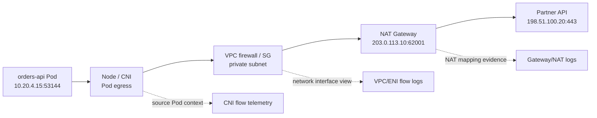
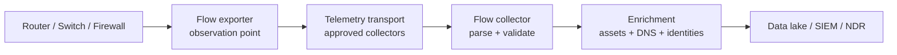
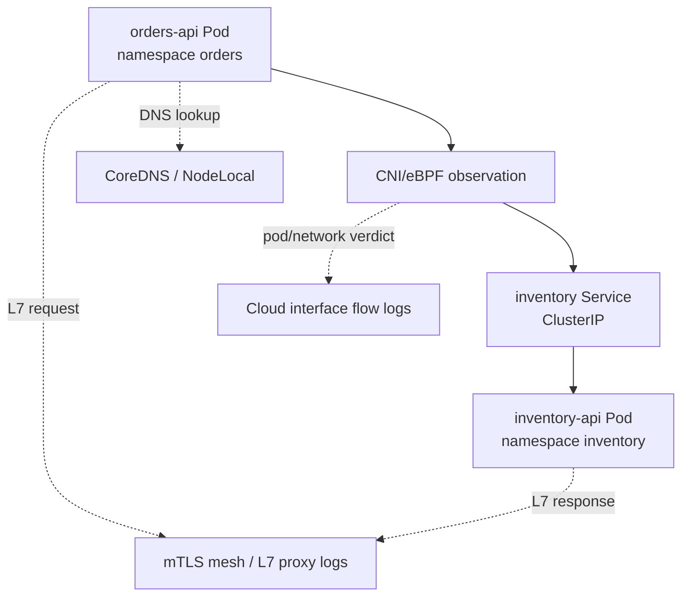
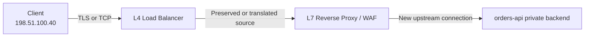
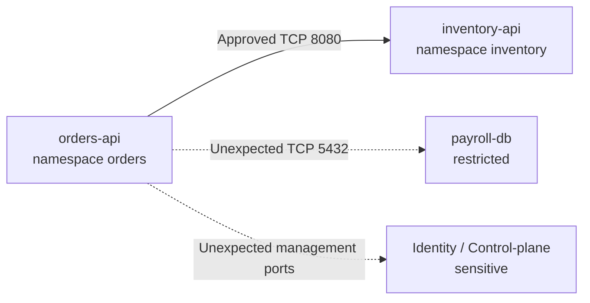
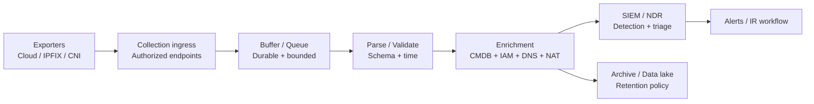

# Flow log và metadata của kết nối trong giám sát an ninh mạng

**Flow log** là bản ghi mô tả hoạt động truyền thông mạng ở mức **luồng (flow)** hoặc tại một điểm quan sát, chẳng hạn nguồn/đích, giao thức, cổng, thời điểm, số packet/byte, interface và quyết định cho phép/từ chối khi có dữ liệu. **Metadata của kết nối** là những thuộc tính giúp giải thích **ai nói chuyện với ai, khi nào, ở đâu, theo giao thức nào và qua ranh giới mạng nào**, không nhất thiết bao gồm nội dung gói tin.

Trong bảo mật mạng, flow telemetry giúp phát hiện **lateral movement, outbound bất thường, dịch vụ lộ ngoài ý định, traffic không phù hợp chính sách, DDoS, beaconing và dấu hiệu thất thoát dữ liệu**. Tuy nhiên, một flow record cho biết TCP/443 có traffic **không đồng nghĩa** nội dung là HTTP hợp lệ, TLS được xác thực đúng hoặc tài liệu nhạy cảm đã bị gửi đi. Tương tự, một record **ACCEPT** ở security group không chứng minh ứng dụng trả 200, còn **REJECT** không tự chỉ ra quy tắc firewall nào nếu nguồn log không cung cấp rule ID.

Bài học thuộc chương **Giám sát mạng và telemetry**, trong mô-đun **SECURITY_NETWORK_SECURITY**: phân đoạn mạng, firewall, VPN, IDS/IPS, DNS security, bảo vệ kết nối, hạ tầng container/Kubernetes/cloud và phân tích lưu lượng để xây dựng mạng an toàn. Trọng tâm là **khả năng quan sát traffic dựa trên flow records và kết nối tới context nhận diện tài sản**, kết hợp những nguồn thông tin khác để đưa ra đánh giá bảo mật có bằng chứng.

Tất cả IP minh họa bên ngoài dùng các dải tài liệu **192.0.2.0/24, 198.51.100.0/24, 203.0.113.0/24** và **2001:db8::/32**. Các host, tài khoản và bản ghi log trong bài đều giả định. Lệnh kiểm tra và thí nghiệm chỉ dành cho tài sản/cluster/network do người học quản trị hoặc được phép kiểm tra.

## 1. Mục tiêu học tập

Sau bài học, người học có thể:

1. Giải thích **flow, connection, session, packet và metadata** và phân biệt flow log với **PCAP, IDS alert, DNS query log, HTTP access log, TLS log và application trace**.
2. Đọc **5-tuple** gồm source IP, source port, destination IP, destination port và IP protocol; bổ sung **direction, timestamps, interface, bytes/packets và action** đúng ngữ cảnh.
3. Hiểu các cơ chế **NetFlow, IPFIX, sFlow, cloud VPC/VNet flow logs, host/eBPF/CNI flow telemetry**, bao gồm điểm khác nhau giữa sampled và aggregated data.
4. Giải thích ảnh hưởng của **sampling, aggregation window, active/inactive timeout, packet loss, clock skew, flow direction và asymmetry** đến kết luận.
5. Phân tích đường **DNAT, SNAT, NAT gateway, load balancer, proxy, VPN và service mesh** để tìm đúng nguồn/đích gốc.
6. Ghép địa chỉ IP/port với **asset inventory, cloud resource ID, Kubernetes namespace/Pod/service identity và danh tính người dùng** theo thời gian.
7. Sử dụng **DNS, TLS, firewall, IDS/IPS, API audit và application logs** để xác minh giả thuyết từ flow metadata.
8. Nhận biết dấu hiệu liên quan **port scanning, beaconing, lateral movement, unusual egress, data exfiltration, DDoS và chính sách mạng bị nới quá rộng**.
9. Viết **schema chuẩn hóa, event JSON, truy vấn phân tích phòng vệ và baseline detection** mà không suy diễn vượt quá dữ liệu.
10. Thiết kế **log pipeline, retention, access control, encryption, privacy và chi phí/cardinality management**.
11. Lập **quy trình troubleshooting, positive/negative tests và incident runbook** cho flow logging.
12. Nêu rõ **những điều không thể kết luận từ một flow record** và cách đo mức độ tin cậy của bằng chứng.

## 2. Phân biệt packet, flow, connection và session

Các khái niệm liên quan nhưng không đồng nghĩa:

| Khái niệm | Bản chất | Ví dụ | Giới hạn |
| --- | --- | --- | --- |
| **Packet** | Một đơn vị dữ liệu đi trên mạng | Một IP packet chứa TCP segment | Không mô tả toàn bộ giao dịch |
| **Flow** | Nhóm packet cùng khóa phân loại tại exporter/điểm quan sát, trong cửa sổ thời gian | Source → destination, protocol, ports | Quy tắc grouping/timeout phụ thuộc exporter |
| **TCP connection** | Trạng thái transport ở hai endpoint qua handshake và đóng/reset | Một TCP connection tới TCP/443 | Có thể chuyển nhiều HTTP requests/streams |
| **UDP conversation** | Chuỗi datagrams được coi có liên quan theo logic hoặc timeout | DNS queries đến resolver UDP/53 | UDP không có handshake TCP |
| **Application session** | Trạng thái ở tầng ứng dụng/user | Đăng nhập web với cookie/token | Một session có thể dùng nhiều kết nối |
| **Request / RPC** | Một thao tác logic | GET /orders/123, gRPC GetStock | Nhiều requests có thể share connection |
| **PCAP** | Dữ liệu các packets quan sát được | Headers và có thể cả payload | Dung lượng/riêng tư cao; capture có thể thiếu |
| **Flow log** | Bản ghi tổng hợp hoặc sự kiện flow | 5-tuple, action, bytes, timestamps | Thường không có payload và identity end-user |

### 2.1. Một flow không luôn là một connection

Một exporter có thể tạo **nhiều flow records** cho cùng TCP connection khi thời gian hoạt động vượt **active timeout**. Ngược lại, một cloud flow log có thể **gộp traffic theo aggregation window** và khóa phân loại tương ứng. Vì vậy:

- **Đếm flow records** không tự là số phiên TCP đã mở.
- Một connection dài có thể được xuất thành nhiều records.
- Một HTTP/2 connection có thể mang nhiều HTTP requests/gRPC streams.
- Khi retransmissions hoặc sampling xảy ra, byte/packet counts có thể khác logs ở tầng ứng dụng.

### 2.2. Luồng đơn hướng hay song hướng?

Một số exporters mặc định báo **unidirectional flow**: chiều client → server và server → client có thể là hai records riêng với 5-tuple đảo chiều. Một số hệ thống khác lưu **bidirectional session**, có fields riêng cho chiều đi/về. Không gộp hai records chỉ vì source/destination đảo nhau nếu chúng thuộc **các thời điểm, NAT domains hoặc flows khác**.

## 3. 5-tuple: khóa mô tả kết nối cơ bản

Một tuple thường gồm:

```text
Source IP       = 10.20.4.15
Source port     = 53144
Destination IP  = 198.51.100.20
Destination port= 443
IP protocol     = 6 (TCP)

5-tuple:
(10.20.4.15, 53144, 198.51.100.20, 443, TCP)
```

**Source port 53144** ở ví dụ là cổng tạm (ephemeral) của client, không phải một dịch vụ được công bố. **Destination port 443** là gợi ý traffic có thể là HTTPS/TLS, **không chứng minh** payload là HTTP hợp lệ hoặc peer có certificate đúng.

### 3.1. Những field mở rộng thường cần

| Field | Vai trò |
| --- | --- |
| **flow_start / flow_end** | Xác định khoảng thời gian theo điểm quan sát |
| **ingress/egress interface, VPC/subnet** | Biết nơi packet được nhìn thấy |
| **direction / observation point** | Phân biệt traffic đi vào/ra interface và chiều quan sát |
| **bytes / packets** | Khối lượng được exporter đếm theo định nghĩa |
| **TCP flags / connection state** | Hỗ trợ phân biệt SYN/RST/FIN nếu nguồn có |
| **action / verdict / reason** | Cho phép/chặn hoặc chính sách tương ứng khi log hỗ trợ |
| **NAT original/translated addresses** | Phân biệt trước/sau dịch địa chỉ |
| **resource ID / owner / tags** | Gắn IP vào asset theo thời gian |
| **sampling rate / aggregation interval** | Biết dữ liệu có mất bớt/được tổng hợp không |
| **exporter/collector ID, schema version** | Hiểu vendor, nguồn và cách giải mã |
| **source/destination workload identity** | Khi CNI/mesh/agent cung cấp |
| **capture confidence / missing fields** | Ngăn suy diễn khi log thiếu hoặc không chắc |

### 3.2. IP protocol number

- **6**: TCP.
- **17**: UDP.
- **1**: ICMPv4.
- **58**: ICMPv6.

Đối với ICMP, source/destination **port** không có ý nghĩa như TCP/UDP; một số schema dùng trường trống, giá trị quy ước hoặc fields type/code. Không giải thích port=0 là “ứng dụng ở cổng 0” khi protocol là ICMP.

### 3.3. IPv6 và các luồng không dùng TCP/UDP

Một network dual-stack có thể ghi IPv4 và IPv6 flow records. Cần lưu **địa chỉ IPv6 đầy đủ, protocol, extension/header context nếu có** và tránh assumptions về port, NAT hoặc default gateway giống IPv4. Một flow giữa hai IPv6 global addresses không tự là “public Internet”: xem route, firewall và asset ownership.

## 4. Vị trí quan sát: cùng một kết nối có nhiều bản ghi

Giả sử orders-api trong private subnet gọi một SaaS API qua NAT gateway:



Có thể quan sát được:

- Tại Pod/CNI: **10.20.4.15:53144 → 198.51.100.20:443**.
- Tại NAT ngoài: **203.0.113.10:62001 → 198.51.100.20:443**.
- Ở API gateway: client có thể là **IP NAT** hoặc **proxy** chứ không phải Pod.
- Trong mesh: proxy thấy **workload identity** ở một chặng riêng, không phải mọi hop.

**Mỗi log đều có thể đúng về điểm quan sát của nó**. Bài toán điều tra là nối các quan sát theo **time, original/translated tuple, connection identity, resource ID và trace context**, không chọn một source IP rồi kết luận đó là user cuối.

## 5. Data plane, control plane và telemetry plane

Mạng có ít nhất ba lớp thông tin cần phân biệt:

1. **Data plane:** packets/flows đi qua interface, bridge, tunnel, proxy hoặc firewall.
2. **Control plane:** routes, security policies, service discovery, certificates và cấu hình.
3. **Telemetry plane:** export, collect, enrich, store, query và alert về lưu lượng.

Một rule Kubernetes NetworkPolicy/API object nằm ở **desired control-plane state**. Một CNI flow verdict là **bằng chứng thực thi của dataplane** nếu exporter/hook có phạm vi phù hợp. Một alert SIEM chỉ là **kết quả xử lý telemetry**, có thể chịu lỗi parsing, enrichment và detection logic.

### 5.1. Log có thể thiếu dù traffic tồn tại

Không phải mọi traffic được ghi: **sampling, dropped exports, CNI coverage, interface exclusions, offload, hostNetwork, private endpoints, encrypted tunnels hoặc sai log attachment** có thể làm telemetry thiếu. Vì vậy "**không thấy flow**" không đồng nghĩa "**không có packet**" nếu chưa chứng minh phạm vi thu thập và health của pipeline.

## 6. NetFlow: xuất metadata về các luồng

**NetFlow** là họ cơ chế export thông tin flow được nhiều thiết bị mạng sử dụng. **NetFlow v5** có định dạng record tương đối cố định cho IPv4 traffic theo tính năng phiên bản; **NetFlow v9** đưa vào **template-based export** cho fields linh hoạt hơn.

### 6.1. Mô hình exporter và collector



**Exporter** theo dõi/ghi nhận traffic và gửi flow records. **Collector** nhận, giải mã, chuẩn hóa. Cần bảo vệ cả **đường export, danh tính thiết bị, parsing và độ tin cậy của time/source metadata**.

### 6.2. Những hạn chế

- Dữ liệu NetFlow **không mặc định có packet payload**.
- Chữ “flow” không thống nhất **timeout, direction và byte counter** giữa vendors.
- **NetFlow v5** không biểu đạt đầy đủ IPv6; kiểm tra khả năng phiên bản/exporter trước khi xem coverage.
- Chỉ nhận **NetFlow v9 template/data** phải quản lý template lifecycle và exporter/domain ID.
- Sampling có thể làm estimates có sai số; nếu sampling cấu hình khác nhau theo interfaces, so sánh raw flow counts sẽ lệch.

### 6.3. Mỗi exporter cần metadata riêng

Hãy thu thập ít nhất **device/interface ID, observation domain, exporter address, version, template status, sampling configuration, clock sync, export health** và owner. Một record không biết đến từ interface nào rất khó dùng để kết luận chiều inbound/outbound.

## 7. IPFIX: chuẩn template-based flow export

**IP Flow Information Export (IPFIX)** là chuẩn mở được mô tả trong bộ RFC như **RFC 7011** và tài liệu liên quan. Nó sử dụng các **Information Elements** với định nghĩa trường và templates để xuất dữ liệu từ observation points.

### 7.1. Vì sao templates quan trọng?

Trong template-based export, collector không thể giải nghĩa data records chính xác nếu thiếu template khớp **exporter/observation domain/template ID/transport session context** theo protocol. Ví dụ data bytes có thể là octetDeltaCount, packetDeltaCount, địa chỉ IPv6, interface ID hoặc trường vendor-specific, tùy template.

### 7.2. Các khả năng

IPFIX có thể hỗ trợ:

- IPv4/IPv6 source/destination và transport ports.
- Packet/octet counts, flow start/end times.
- TCP flags hoặc other protocol metadata khi exporter cung cấp.
- Interface IDs, VLAN, next hop, observation point.
- NAT events/fields nếu có định nghĩa và exporter hỗ trợ.
- Vendor-specific Information Elements có enterprise identifiers.

**Không mặc định mọi IPFIX exporter gửi tất cả fields**. Một flow record thiếu TCP flags không có nghĩa packet không có TCP flags; đó có thể là **schema/feature limitation**.

### 7.3. Transport và bảo mật

Việc truyền IPFIX có thể sử dụng các transport được chuẩn/implementation hỗ trợ. Không suy rằng mọi UDP export đều được mã hóa hoặc xác thực. Tại thiết kế production, cần **segregated telemetry network, collector allowlist, transport protection/identity, integrity checks và loss monitoring**, hoặc cơ chế bảo vệ khác phù hợp.

## 8. sFlow và packet sampling

**sFlow** là cơ chế lấy mẫu traffic và counters, có thể xuất **sampled packet headers** và interface statistics tùy agent/device. Nó khác flow cache kiểu NetFlow vì thường không dựng mỗi TCP connection thành một record đầy đủ.

### 8.1. Ưu điểm

- Chi phí tương đối phù hợp để quan sát **mạng tốc độ cao**, nơi lưu mọi packet/flow có thể tốn kém.
- Hữu ích cho **traffic mix, top talkers, volume trends và capacity monitoring**.
- Nếu agent cung cấp sampled headers, có thể thấy thông tin packet-level ở mức mẫu mà không cần full PCAP.

### 8.2. Giới hạn

- **Rare events** có thể không được chọn vào sample.
- Không thể coi một sampled flow là toàn bộ số requests.
- Không nên đo **exact scan attempts hoặc exact bytes per user** từ raw samples nếu chưa tính sampling/estimation.
- Các sampled packet headers có thể chứa **thông tin nhạy cảm**, phải có privacy safeguards.
- Sampling rates có thể thay đổi theo interface hoặc thời điểm.

### 8.3. Flow sampling không giống log filtering

- **Sampling tại data plane:** chỉ một phần packets/flows được quan sát.
- **Sampling ở pipeline:** exporter đã ghi event nhưng collector/backend chỉ giữ một phần.
- **Filtering:** cố ý giữ/bỏ events theo tiêu chí.
- **Aggregation:** hợp nhiều events/packets vào một bản ghi thống kê.

Các cách này ảnh hưởng khác nhau tới khả năng phát hiện truy cập hiếm, điều tra forensic và số lượng counts.

## 9. Cloud flow logs: VPC, VNet và các dịch vụ tương tự

Cloud flow logs thường thu thập metadata ở một số tầng **virtual network interfaces, VPC/VNet/subnet/VM hoặc firewall** tùy sản phẩm. Chúng hữu ích để theo dõi traffic trong cloud mà không phải đặt packet sensor trên mỗi VM.

| Nền tảng | Dịch vụ/khả năng cần xác minh | Lưu ý |
| --- | --- | --- |
| **AWS** | **VPC Flow Logs**, các cấu hình record fields và destination như logging service/object storage | Record có thể có action, log-status và interface/resource context; không là full packet trace |
| **Azure** | **Virtual network flow logging**, network security/firewall logging phù hợp theo sản phẩm và trạng thái dịch vụ hiện hành | Khả năng và vòng đời dịch vụ flow logs có thể thay đổi; cần kiểm tra collector/format/resource scope đang được dùng |
| **Google Cloud** | **VPC Flow Logs**, aggregation/sampling và VPC network context | Logs có thể được sampled/aggregated; chưa chắc biểu thị toàn packet |
| **Kubernetes/cloud-managed** | CNI dataplane, cluster flow visibility, cloud LB/NAT/Firewall logs | Pod identity không luôn hiện trong cloud NIC log |
| **On-prem/virtualization** | Switch/router exporters, firewall session logs, hypervisor vSwitch telemetry | Thiếu cloud resource IDs; cần CMDB và device identity |

### 9.1. Không đánh đồng ACCEPT với thành công ứng dụng

Một log **ACCEPT** ở VPC/security group thường nói traffic đáp ứng chính sách tại **điểm quan sát cụ thể**, không chắc TCP handshake hoàn tất hoặc API trả 200. Một **REJECT** có thể do policy ở tầng đó, nhưng để biết **rule nào** đôi khi phải dùng firewall policy logs, cấu hình tại thời điểm và topology.

### 9.2. Không log ở mọi điểm

Một số managed endpoints, private network services, packet drops trước observation point hoặc traffic nội bộ có phạm vi logging khác nhau. Xác minh **attachment scope, inclusion/exclusion, aggregation settings, supported fields và log delivery health** cho từng nhà cung cấp.

### 9.3. Version và format matters

Các log fields giữa regions, sản phẩm và phiên bản có thể khác. Với bài học này, không giả định một field như **tcp-flags, pkt-srcaddr, rule-id hoặc bytes_sent/received** luôn xuất hiện trong mọi record. **Xử lý missing fields bằng null + provenance**, không bịa giá trị 0.

## 10. Mẫu cloud flow record: đọc đúng giới hạn

Ví dụ dưới đây là **dòng dạng VPC flow log được đơn giản hóa**, không phải output trực tiếp từ một tài khoản cloud:

```text
version account-id interface-id srcaddr dstaddr srcport dstport protocol packets bytes start end action log-status
2 123456789012 eni-demo001 10.20.4.15 198.51.100.20 53144 443 6 18 4250 1795850100 1795850160 ACCEPT OK
```

**Giải thích:**

- Record chứa **source/destination IP:port** và protocol **6 = TCP**.
- **18 packets, 4.250 bytes** là lượng exporter báo cho record/window đó; không chắc là response payload, không phải số byte toàn user request.
- **start/end** là thời gian record theo schema/điểm quan sát, không phải lúc transaction hoàn thành.
- **ACCEPT** là traffic được cho qua tại policy layer liên quan; không nói TLS certificate đúng.
- **eni-demo001/account-id** giúp gắn ngữ cảnh cloud resource nếu mapping tại thời điểm còn chính xác.
- **OK** là trạng thái logging trong ví dụ, không có nghĩa ứng dụng “OK”.

### 10.1. Timestamp và múi giờ

Nhiều flow formats dùng **Unix epoch seconds**, trong khi những logs khác dùng ISO 8601 milliseconds/nanoseconds. Chọn một **canonical UTC timestamp** và lưu cả **raw timestamp, field unit, clock source** để tránh đặt nhầm những events cách nhau hàng năm.

### 10.2. Source IP có thể thuộc node hoặc NAT

Đặc biệt trong Kubernetes, cloud NIC record có thể thấy **node IP**, không phải Pod IP, tùy CNI routing, SNAT và data path. Không gán source=Pod chỉ vì request xảy ra gần thời điểm Pod được deploy.

## 11. Host-based flow telemetry: conntrack, kernel và eBPF

Các agents trên host hoặc cơ chế kernel networking có thể quan sát kết nối gần workload hơn thiết bị mạng ở biên.

### 11.1. Conntrack

**Connection tracking** quản lý trạng thái của một số luồng/packets phục vụ firewall/NAT. Nó giúp hiểu **original tuple, reply tuple, translated addresses và connection state** khi nguồn dữ liệu chứa các thông tin đó.

Điều cần nhớ:

- Conntrack entry không phải application request log.
- Entry có thể bị evict/time out; không hiện mọi traffic đã từng tồn tại.
- TCP state inference có thể không phản ánh đầy đủ xử lý ứng dụng.
- Kernel modules, offload, protocols, memory limits và namespace có thể ảnh hưởng visibility.
- Host access tới conntrack tables thường yêu cầu quyền cao; nên hạn chế logs/permissions.

### 11.2. eBPF-based observability

Một số systems dùng **eBPF** để thu flow/packet/connection events tại kernel hooks, đôi khi gắn **process/PID/cgroup/Kubernetes identity**.

Ưu điểm: gần workload, giúp liên kết process với IP flow, đánh giá CNI policy verdict hoặc timing. Giới hạn:

- Hooks và khả năng tùy **kernel version, CNI, host/network namespace, privilege model**.
- Không phải mọi packet path đều qua hook đã gắn (hardware offload, SR-IOV, secondary interfaces).
- Một **PID** có thể được tái sử dụng; cần process start/container identity tại thời điểm event.
- Data-plane sensor có thể bị áp lực CPU/memory; phải test overhead và loss.
- Có thể thu **sensitive metadata**, cần RBAC và data minimization.

### 11.3. Host logs bổ trợ network flow logs

Nếu router thấy **10.20.4.15 → 198.51.100.20**, host agent biết process **orders-api** đã tạo socket. Hai nguồn ghép lại đáng tin hơn chỉ một phía, nhưng vẫn không tự biết payload có chứa dữ liệu nhạy cảm.

## 12. Kubernetes/CNI flow telemetry và workload identity

Trong Kubernetes, một Pod IP chỉ tồn tại trong một khoảng thời gian và có thể được tái sử dụng. Muốn điều tra, phải gắn flow với **cluster, namespace, Pod UID, workload owner, service account, node, IP assignment interval và labels tại thời điểm**.

### 12.1. Luồng thường gặp



**Kubernetes Service ClusterIP** có thể được DNAT tới Pod endpoint; CNI flow records trước/sau DNAT hoặc service translation có thể khác. Nếu source/destination ở record không khớp Service IP mà ứng dụng gọi, đó không tự là tấn công.

### 12.2. Các field nên thu

| Field | Ý nghĩa |
| --- | --- |
| cluster_id, node_id | Xác định control plane/host |
| src_namespace, src_pod_uid | Nhận diện Pod nguồn có thời hạn |
| src_workload_kind/name | Deployment/DaemonSet/Job đứng sau Pod |
| src_service_account | Principal ứng dụng tại Kubernetes |
| dst_namespace, dst_pod_uid | Đích workload nếu xác định được |
| service_name/port và backend target | Phân biệt VIP và endpoint |
| policy_id/verdict | NetworkPolicy hoặc CNI-specific policy quyết định |
| original/translated tuple | NAT/service forwarding |
| connection direction, protocol | Hiểu hook/luồng |
| identity_confidence | Chỉ ra mapping trực tiếp hay suy từ IP |

### 12.3. CNI supports policy ≠ all flows logged

Một CNI có thể thực thi NetworkPolicy nhưng **không bật flow visibility**, hoặc chỉ ghi một phần verdicts theo cấu hình. Một số sản phẩm có UI riêng cho **L3/L4 flows, DNS, HTTP visibility**. Không giả định Kubernetes NetworkPolicy API tự xuất NetFlow/IPFIX hoặc audit flow events.

### 12.4. HostNetwork, node-originated traffic và SR-IOV

Không quy mọi flow trong node về Pod mặc định. **hostNetwork Pods, node agents, privileged processes và secondary SR-IOV interfaces** có thể dùng dataplane/observability khác. Nếu monitoring chỉ gắn vào veth chính, báo cáo “không có flow” ở interface phụ có thể là thiếu coverage.

## 13. NAT và translation: original tuple khác translated tuple

**SNAT** thay source address/port; **DNAT** thay destination. NAT gateways, load balancers, service proxies và node networking có thể thay tuple trước hoặc sau observation point.

Ví dụ:

```text
Original Pod egress:
  10.20.4.15:53144 -> 198.51.100.20:443

After SNAT at shared gateway:
  203.0.113.10:62001 -> 198.51.100.20:443

Return traffic at external interface:
  198.51.100.20:443 -> 203.0.113.10:62001

Reverse translated toward Pod:
  198.51.100.20:443 -> 10.20.4.15:53144
```

Để xác định source Pod cần **NAT mapping record, timestamp, connection tracking, resource/owner mapping** hoặc telemetry trước NAT. **NAT public IP không xác định một workload duy nhất** khi nhiều VMs/Pods cùng chia sẻ.

### 13.1. Port translation không bền vững

NAT có thể thay source ephemeral port. Một cổng như **62001** không mã hóa user ID và có thể được tái sử dụng sau thời gian nhất định. Nếu điều tra một kết nối cũ, phải dùng **mốc thời gian chính xác và log translation có retention đủ**, không chỉ tra port hiện tại.

### 13.2. NAT và IPv6

Một số IPv6 networks dùng routing trực tiếp hoặc NAT64, không phải mọi luồng IPv6 đều qua NAT44. Nếu có **DNS64/NAT64**, kết quả DNS và địa chỉ backend có thể khác giữa các góc nhìn. Cần xác định **address family, translator, original/translated IP và actual route**.

## 14. Load balancer và reverse proxy làm thay đổi nguồn quan sát

Một kết nối ngoài Internet tới ứng dụng có thể đi qua:



### 14.1. L4 và L7 khác nhau

- Một **L4 proxy/LB** có thể NAT hoặc giữ source IP tùy chế độ.
- Một **L7 reverse proxy** thường tạo connection mới tới backend; backend TCP peer có thể là proxy IP.
- HTTP headers **X-Forwarded-For/Forwarded** chỉ được tin khi proxy chain có trust boundary và header sanitation.
- **PROXY protocol** là một cơ chế chuyển thông tin nguồn theo cấu hình; không bật ngẫu nhiên với backend không hiểu hoặc nguồn không tin.

### 14.2. Ghép logs để điều tra nguồn thật

Cần tương quan **edge flow log, LB access log, WAF event, backend flow log, request ID, TLS identity và app audit**. Nếu chỉ có backend record, không thể kết luận Internet client là một **Pod ingress-gateway** chỉ vì source address ở backend là IP proxy.

## 15. VPN, overlay, tunneling và encrypted transport

Traffic qua **IPsec, WireGuard, GRE, VXLAN, Geneve, SSL VPN hoặc service mesh mTLS** có thể tạo hai lớp quan sát:

1. **Outer flow:** gateway/tunnel endpoint IP và UDP/TCP/ESP protocol.
2. **Inner flow:** IP/ports của workload thực, chỉ thấy nếu sensor nằm trước mã hóa/sau giải mã hoặc có telemetry từ endpoint/tunnel stack.

### 15.1. Ví dụ

Một tunnel WireGuard giữa hai gateways có thể hiển thị **gateway-A:UDP/51820 → gateway-B:UDP/51820** ở underlay. Không thể từ flow log ngoài tunnel suy chính xác application **orders-api → inventory-api** nếu không có inner telemetry/NAT mapping.

### 15.2. Những điều cần kiểm chứng

- Log được thu **trước hay sau encryption/encapsulation**?
- Firewall quyết định trên **outer hay inner packets**?
- CNI hoặc VPN gateway có export **inner flow events** không?
- Cùng một application flow có bị double count ở hai observation points?
- **Tunnel metadata và workload identity** có được ghép chính xác qua time không?

**Encryption bảo vệ payload** nhưng không loại bỏ hoàn toàn metadata. Đồng thời **flow log ở underlay không chứng minh có thể đọc traffic trong tunnel**.

## 16. Flow direction: ingress, egress, forward và return traffic

Một record có thể dùng **ingress/egress** theo interface của sensor, không theo nghĩa business “request inbound/outbound” toàn hệ thống.

Ví dụ một packet đến Pod:

- Ingress với **network interface của Pod**.
- Egress với **interface của router phía trước**.
- Có thể xuất hiện ở **cả hai sensors**.

### 16.1. Sai lầm khi đọc field direction

- Thấy **egress** ở gateway rồi kết luận Pod đang exfiltrate.
- Thấy source port=443 rồi coi đó là client outbound, trong khi có thể là **server response**.
- Chỉ thấy chiều trả lời nên kết luận **đây là server bắt đầu connection**.
- Gộp logs có observation points khác mà không chuẩn hóa direction.
- Dùng **bi-directional byte counters** như unidirectional và đếm đôi.

**Định nghĩa direction phải theo exporter schema/observation point**. Ghi rõ trong canonical event.

## 17. Flow timeout, aggregation và record lifecycle

Flow exporters có thể dùng:

- **Active timeout:** xuất record sau một khoảng khi flow vẫn đang hoạt động.
- **Inactive timeout:** xuất record khi không còn packet trong khoảng thời gian.
- **End-of-flow event:** export theo TCP FIN/RST hoặc logic tương ứng khi hỗ trợ.
- **Aggregation window:** gộp traffic theo khoảng và khóa phân loại.

### 17.1. Tác động tới detection

Một TCP connection dài tới database có thể tạo nhiều records mỗi vài phút. Nếu detector tính **connections per second** bằng số records, có thể tạo false alert. Ngược lại, một kết nối rất ngắn có thể rơi vào sampling gaps.

### 17.2. Ví dụ phân biệt

```text
True observed connection:
  09:00:00 -> 09:12:30 TCP session

Exporter active timeout: 300 seconds (hypothetical)
  Record A: 09:00:00 - 09:05:00
  Record B: 09:05:00 - 09:10:00
  Record C: 09:10:00 - 09:12:30

Result:
  3 flow records ≠ 3 separate TCP connections.
```

Con số **300 giây** chỉ để minh họa; sản phẩm có timeout khác nhau.

## 18. Sampling và ước lượng lưu lượng

Giả sử exporter lấy mẫu **1 packet trong 100 packets** theo kỹ thuật sampling được chọn. Không thể đơn giản áp tỷ lệ này vào mọi loại statistic và đòi kết quả chính xác tuyệt đối.

### 18.1. Các rủi ro

- Một scan ngắn có thể không xuất hiện.
- Một flow lớn được chọn nhiều samples, làm estimation phụ thuộc thuật toán.
- Sampling đồng nhất theo packet khác sampling theo flow.
- Sampling tại exporter khác **log sampling ở collector**.
- Low-volume exfil có thể lọt qua vì thiếu samples.
- Khi thiết bị quá tải, sampling rate hoặc drop behavior có thể thay đổi.

### 18.2. Cách trình bày an toàn

Nếu có sampling, ghi:

```text
observation_sampling:
  type: packet_sampling
  configured_rate: "1/100"
  effective_rate_verified: false
  normalized_bytes_estimated: true
  confidence: "depends_on_exporter_and_traffic_distribution"
```

Không tuyên bố "**đã truyền chính xác 100 MB**" từ estimate không có error bounds. Khi cần forensic chính xác, phải tìm **nguồn đầy đủ hơn hoặc packet/counter data** theo quyền và privacy controls.

## 19. Packet/byte counters: chính xác trong phạm vi nào?

Một record báo **bytes=4,250** có thể là:

- Bytes IP-level mà exporter đếm.
- Bytes ở interface data link theo thiết kế.
- Only one direction.
- Aggregated value over an interval.
- Estimated after sampling.
- Payload bytes hoặc không, tùy schema.

### 19.1. Những câu hỏi tối thiểu

1. Counter là **cumulative hay delta**?
2. Tính byte trên **IP packet, Ethernet frame, transport payload** hay layer khác?
3. Record một chiều hay hai chiều?
4. Có **retransmissions** và duplicates được tính không?
5. Counter đã nhân sampling factor chưa?
6. Có log **dropped packets** bị bỏ khỏi bộ đếm không?
7. Có khả năng **counter wrap/overflow**?
8. Độ dài cửa sổ aggregation và time unit là gì?

### 19.2. Bytes không bằng dữ liệu bị đánh cắp

Một flow outbound lớn là **tín hiệu** cần xem xét, không phải bằng chứng đã rò rỉ tài liệu mật. Có thể là backup hợp lệ, container image pull, telemetry upload hoặc replication. Cần kết hợp **source identity, destination owner, protocol, object transfer/audit logs, DLP/data classification** và business context.

## 20. TCP flags và điều có thể suy từ transport metadata

Nếu nguồn flow log xuất **TCP flags**, có thể suy một phần trạng thái:

| Flag | Ý nghĩa ở transport | Cảnh báo diễn giải |
| --- | --- | --- |
| **SYN** | Bắt đầu thiết lập kết nối TCP | SYN có thể bị retransmit, không chứng minh handshake hoàn tất |
| **ACK** | Xác nhận dữ liệu/segment theo TCP | Có ở nhiều giai đoạn, không là “application accepted” |
| **FIN** | Endpoint muốn kết thúc một chiều kết nối | Không tự là lỗi |
| **RST** | Reset connection | Có thể do ứng dụng, proxy, firewall hoặc lỗi mạng |
| **PSH** | Gợi ý xử lý dữ liệu nhận theo TCP | Không chỉ ra nội dung dữ liệu |
| **ECE/CWR** | Dấu hiệu ECN/congestion handling | Cần context congestion/network |

**Flags có thể được OR-aggregated** trong một flow record, không giữ thứ tự packets. Vì vậy một record có SYN+ACK+FIN không tương đương **PCAP đầy đủ của handshake**.

### 20.1. SYN-only và scanning

Nhiều SYN-only records tới nhiều ports/hosts có thể gợi ý **port scanning hoặc reachability probing**, nhưng cũng có thể do health checker, misconfiguration hoặc partial capture. Cần **asset owner, time distribution, approved scanners, response evidence và policy verdict**.

### 20.2. UDP flow không có TCP handshake

UDP/53, QUIC/443, mDNS và nhiều giao thức khác có thể tạo flow records theo timeout. Không gán **TCP connection state** cho chúng. Một flow UDP được ghi log chưa chắc có response, và một query/response DNS có thể dùng source port/timing riêng.

## 21. Timestamp, late arrival và clock synchronization

Một hệ thống điều tra thường kết hợp:

- Network device/exporter clock.
- Collector receive time.
- Cloud flow log event start/end.
- DNS resolver query time.
- Kubelet/CNI host event time.
- Proxy/access log time.
- Application trace/span start/end.

### 21.1. Trường cần tách rõ

| Trường | Ý nghĩa |
| --- | --- |
| **event_start_time** | Khi exporter quan sát đầu flow/interval |
| **event_end_time** | Khi exporter đánh dấu cuối flow/interval |
| **export_time** | Khi exporter gửi record |
| **ingest_time** | Khi pipeline nhận record |
| **index_time** | Khi lưu/index hoàn tất |
| **clock_skew_estimate** | Mức sai số thời gian được biết |
| **aggregation_interval** | Thời gian gộp data |
| **source_timezone/unit** | Cách chuyển về UTC |

### 21.2. Đừng sắp xếp theo ingest time rồi kết luận causal order

Một log DNS có thể đến collector sau flow log TCP dù query xảy ra trước. Một VPC flow log có thể được chuyển tới kho trễ hơn application trace. Để điều tra sequence, cần **event time, time uncertainty window và ID correlation** thay vì chỉ sort theo thời điểm lưu log.

### 21.3. NTP/PTP và đồng bộ

Thiết kế clock synchronization thích hợp và monitor offset. Nếu một node lệch giờ vài phút, detector "**kết nối tới IP sau khi token bị thu hồi**" có thể đưa ra timeline sai. Cần biểu diễn **độ tin cậy theo sai số**, đặc biệt khi quyết định điều tra ảnh hưởng tới người dùng.

## 22. Asset attribution: một địa chỉ IP thuộc ai vào thời điểm đó?

Trong cloud và Kubernetes, **IP có vòng đời động**. Pod có thể bị xóa rồi IP được tái cấp, VM có thể được thay mới, ENI di chuyển, NAT thay port.

### 22.1. Asset inventory tối thiểu

- Cloud account/project/subscription và region/VPC/VNet.
- Interface/resource ID, subnet, security group/NSG, owner.
- Kubernetes cluster, namespace, Pod UID, Pod IP assignment start/end, node.
- Workload owner (Deployment/Job), ServiceAccount và labels tại **event time**.
- DNS hostname/service endpoint nếu có bằng chứng.
- NAT mapping ID/ports hoặc flow correlation key.
- CMDB/service catalog và data classification.
- Change/deployment ID để xem service vừa được cập nhật.

### 22.2. Nguy cơ IP reuse

Một log lúc **10:00** ghi source=10.20.4.15 thuộc Pod A; lúc **11:00** cùng IP có thể thuộc Pod B. Nếu analyst tra **Pod IP hiện tại** rồi gán cho log cũ, kết luận sai. Cần **historical identity/time-bound mappings**, không dùng snapshot hiện tại thay quá khứ.

### 22.3. Confidence tiers

- **Verified:** record trực tiếp từ CNI/agent có Pod UID, resource ID và event timestamp.
- **Correlated:** network tuple khớp NAT/identity log ở cùng thời gian đủ chặt.
- **Inferred:** mapping suy từ current IP/DNS hoặc asset inventory không có lịch sử.

Không báo "đã xác định chắc user Alice" nếu chỉ biết flow đi từ **VPN shared NAT IP**.

## 23. DNS metadata và flow correlation

DNS logs bổ sung **QNAME/QTYPE/answer/TTL/resolver** cho flow log, giúp suy ra **có khả năng ứng dụng định kết nối tới domain nào**.

### 23.1. Quy trình correlation cơ bản

1. Lấy flow **source workload, destination IP, start/end time**.
2. Tìm DNS query/response của **cùng source hoặc resolver path** trong thời gian liên quan.
3. Đối chiếu **A/AAAA/CNAME answers** với destination IP.
4. Xác minh **cache, TTL, NAT và resolver location**.
5. Nếu flow qua proxy, tìm **proxy destination hostname/HTTP authority**.
6. Kiểm tra TLS SNI/certificate nếu nguồn log phù hợp và privacy cho phép.
7. Đánh dấu **confidence**, không tuyên bố DNS query chứng minh đích của mọi connection.

### 23.2. Tại sao kết quả chỉ là khả năng?

- Nhiều domains có thể trỏ về cùng CDN IP.
- Một app có thể dùng **IP trực tiếp**, không DNS.
- DNS cache có thể tồn tại trước cửa sổ log.
- Client/recursive resolvers có thể nằm sau NAT chung.
- HTTPS proxy có thể tự resolve hostname, nên DNS query phát từ proxy.
- DNS answers thay đổi theo region/ECS/time.
- TLS ECH có thể che SNI khỏi network observer.
- Kết nối có thể được giữ lâu sau thời điểm DNS lookup.

**DNS + flow là correlation**, không phải một bằng chứng mã hóa rằng hostname đó chắc chắn là ứng dụng đích.

## 24. TLS metadata, SNI và giới hạn mã hóa

Flow record L3/L4 thường **không chứa TLS handshake**. Một sensor hoặc proxy chuyên biệt có thể bổ sung:

- TLS version/cipher suite (khi quan sát được).
- Server Name Indication (SNI) nếu không bị ẩn.
- Certificate subject/SAN/issuer/fingerprint theo khả năng capture.
- mTLS client certificate/workload identity nếu proxy có context.
- Handshake error/alert information.
- JA3/JA4 hoặc TLS client fingerprint theo công cụ và dữ liệu quan sát.

### 24.1. Không đọc payload từ lưu lượng mã hóa

Khi có TLS, một flow TCP/443 chỉ cho thấy metadata ở tầng được quan sát. Không có cơ sở nói đã thấy **URL path, JSON body, token hoặc file upload** từ NetFlow/IPFIX thuần. Muốn có HTTP-level logs phải có **application/proxy telemetry** ở điểm có quyền quan sát.

### 24.2. ECH và HTTP/3

**Encrypted ClientHello (ECH)** có thể che tên SNI mục tiêu ở một số kết nối TLS; **HTTP/3/QUIC** dùng UDP/443. Sensor chỉ nhìn TCP/443 hoặc parser TLS truyền thống có thể bỏ sót. Cần cập nhật **coverage, protocol decoders và egress architecture**, không coi thiếu SNI là bằng chứng traffic đáng ngờ.

### 24.3. TLS fingerprint không định danh người dùng chắc chắn

Nhiều clients có thể có cùng TLS fingerprint; fingerprint thay đổi theo browser/version/library và có thể bị bắt chước. Sử dụng như **một tín hiệu hỗ trợ**, không thay **identity, certificate verification hoặc authorization logs**.

## 25. Kết hợp flow logs với firewall, IDS/IPS, WAF và application traces

Không có một nguồn telemetry nào trả lời toàn bộ câu hỏi an ninh. Các lớp bổ sung nhau:

| Nguồn | Câu hỏi có thể trả lời | Giới hạn điển hình |
| --- | --- | --- |
| **Flow logs** | Ai/địa chỉ nào có traffic đến đích nào, thời gian và volume bao nhiêu? | Không có payload/HTTP context đầy đủ |
| **Firewall policy logs** | Rule hoặc zone policy nào cho phép/từ chối flow? | Có thể thiếu principal và business action |
| **IDS/IPS alerts** | Có signature/hành vi bất thường tại điểm inspection? | False positive; mã hóa/coverage có thể hạn chế |
| **DNS resolver logs** | Domain nào được hỏi và nhận answer nào? | Caching, NAT, DoH và proxy làm mất attribution |
| **TLS/mTLS proxy logs** | Peer/hostname/trust identity có hợp lệ không? | Không tự có object-level permissions |
| **WAF logs** | HTTP request nào vi phạm rule/chính sách L7? | Thường chỉ traffic qua WAF |
| **Service mesh telemetry** | Service identity, HTTP/gRPC route, policy và retries? | Chỉ traffic thực đi qua mesh point |
| **Application audit** | User/tenant/action/resource được cho phép hay từ chối? | Có thể không thấy network bypass hoặc packet drops |
| **Cloud IAM/audit** | Ai sửa firewall, route, network interface và quyền? | Không phải bản ghi từng packet |
| **Endpoint/EDR logs** | Process/binary nào tạo kết nối? | Agent/OS coverage và quyền host |

### 25.1. Ví dụ kết luận có mức tin cậy

- **Flow log:** orders-api tạo nhiều kết nối TCP/443 tới địa chỉ chưa thấy trước.
- **DNS:** tên đích có vẻ là CDN được ứng dụng sử dụng.
- **Proxy:** TLS xác thực đúng domain thuộc package registry.
- **CI log:** release đang kéo container images theo kế hoạch.
- **Kết luận:** khả năng traffic hợp lệ cao; vẫn xác minh policy và payload classification theo nhu cầu.

Nếu chỉ nhìn **volume/địa chỉ chưa thấy trước**, hệ thống có thể báo nhầm là exfiltration.

### 25.2. Ba loại bằng chứng

1. **Configuration:** route, NetworkPolicy, SG/NSG, IAM, proxy rules.
2. **Enforcement:** firewall/CNI verdict, dropped flow, connection event.
3. **Application:** authn/authz decision, transaction/HTTP status và nội dung đã xử lý theo audit an toàn.

Một flow **ACCEPT** tại mạng chưa chứng minh **authorization ở ứng dụng**.

## 26. Phát hiện port scanning và reconnaissance từ flow metadata

Một pattern thường gặp là **một source thử nhiều đích hoặc nhiều cổng trong cửa sổ ngắn**, có tỷ lệ phản hồi thấp hoặc nhiều flow bị chặn.

### 26.1. Các dạng phân tích

- **Vertical scan:** một nguồn thử nhiều ports trên cùng destination IP.
- **Horizontal scan:** một nguồn thử cùng port trên nhiều destination IPs.
- **Low-and-slow discovery:** kết nối hiếm nhưng rải rác trong thời gian dài; cần baseline dài hơn và enrichment.
- **Cloud inventory scanning hợp lệ:** vulnerability scanner hoặc asset discovery đã được phê duyệt có thể tạo pattern tương tự.

### 26.2. Trường phân tích cần có

```text
grouping:
  source_workload_or_ip
  destination_ip_count
  destination_port_count
  unique_destination_subnets
  time_window
  tcp_flags_when_available
  allow_reject_counts
  response_evidence
  asset_owner
  approved_scanner_exception
```

### 26.3. Không kết luận chỉ từ nhiều ports

Một Kubernetes node agent, health checker hoặc monitoring probe có thể kết nối tới nhiều ports/hosts theo thiết kế. Một flow log được sampled có thể thiếu responses, làm tăng giả tạo tỷ lệ kết nối “không thành công”. Đối chiếu **approved scanning windows, inventory, source service account, process identity và firewall rules**.

### 26.4. Kiểm thử phòng vệ

Trong lab được phép, tạo **các kết nối TCP nhỏ đến một nhóm ports do lab quản lý**, có danh sách allow/deny, rồi kiểm tra hệ thống có nhận diện source, tách allow/reject, ghi lý do rule và không mặc định timeout là firewall deny. Không quét dải Internet hoặc sinh tải lớn.

## 27. Phát hiện lateral movement và kết nối nội bộ ngoài dependency graph

**Lateral movement** là di chuyển từ workload/host đã tiếp cận sang hệ thống khác. Với flow logs, tín hiệu hữu ích thường là **đường east–west mới**, nhất là đến tài nguyên nhạy cảm.



### 27.1. Detection logic

1. Chuẩn hóa source identity, destination resource và timestamp.
2. Xác định **approved source–destination–port/protocol edges** tại thời điểm đó.
3. Tìm observed edges không có owner/allow rule.
4. Phân biệt **ACCEPT vs REJECT** và số lần thử.
5. Kiểm tra rollout, debugging session, JIT approval và scanner.
6. Tăng severity nếu đích là **secret manager, payroll-db, Kubelet, API server, RDP/SSH hoặc backup infrastructure**.
7. Correlate host/EDR và IAM logs trước khi kết luận compromise.

### 27.2. Chặn không đồng nghĩa đã có xâm nhập

Nhiều **REJECT** tới cổng quản trị có thể là misconfigured health probe hoặc app sai route. Một **ACCEPT** tới unexpected database là đáng điều tra nhưng chưa chứng minh dữ liệu bị đọc. Giữ phân biệt **network access, authentication và data access**.

## 28. Beaconing và callback traffic

Một hệ thống bị chiếm có thể tạo **kết nối outbound định kỳ** tới một đích cố định để kiểm tra lệnh hoặc báo trạng thái. Flow metadata có thể thấy **tần suất, chu kỳ và khối lượng**.

### 28.1. Các tín hiệu

- Một source workload gọi cùng destination ngoài dependency graph theo chu kỳ.
- Nhiều sessions ngắn, packet/byte counts tương tự qua các cửa sổ.
- Destinations mới xuất hiện vào ban đêm hoặc sau deployment bất thường.
- Cùng đích xuất hiện trên nhiều endpoints không liên quan.
- Flow tới domain/IP nằm trong threat intelligence có độ tin cậy cao.
- Cố kết nối lặp lại sau các **REJECT** hoặc khi network gateway lỗi.

### 28.2. Tránh false positives

Các tác vụ **telemetry exporter, health check, certificate renewal, time sync và polling SaaS** cũng tạo traffic định kỳ. Ngoài ra, sampling/aggregation có thể tạo khoảng cách thời gian giả. Cần kiểm tra process/Pod owner, dependency graph, DNS/TLS identity, response evidence và deploy timeline.

### 28.3. Không “dịch” bytes thành lệnh điều khiển

Flow log chỉ cho thấy lượng dữ liệu tương đối tại điểm quan sát; nó **không cung cấp C2 commands** nếu không có thêm payload/HTTP/proxy evidence hợp lệ.

## 29. Dấu hiệu data exfiltration từ flow metadata

Một burst outbound lớn hoặc traffic liên tục tới endpoint lạ có thể là dấu hiệu **data movement**, không nhất thiết là data loss.

### 29.1. Câu hỏi trước khi báo sự cố

1. Source là **user endpoint, backup job, CI runner, database hay application**?
2. Destination là **approved SaaS, CDN, object storage tenant, partner hoặc IP chưa có owner**?
3. Bytes được đếm là **outbound payload, IP-level bytes hay bidirectional aggregate**?
4. Flow qua **NAT/proxy** nào; một egress IP đại diện cho bao nhiêu workloads?
5. Có **DNS QNAME, TLS identity, HTTP request và DLP event** tương ứng?
6. Có **planned backup, data migration, image pull hoặc release**?
7. Dữ liệu có rời **địa bàn/tenant/quyền** được phép không?
8. Nếu traffic được mã hóa, có nguồn được phép nào xác nhận **file/object type**?
9. Record có sampling khiến bytes là **estimate**?
10. Có đường **IPv6/DoH/alternate interface** ngoài sensor không?

### 29.2. Baseline theo workload và thời gian

Một database backup job gửi 80 GB mỗi đêm có thể hợp lệ; một authentication service bình thường chỉ gửi vài MB/ngày nhưng bất ngờ gửi 10 GB tới destination mới có ưu tiên điều tra cao hơn. **Threshold tuyệt đối** phải đi cùng **data class, expected behavior, change window và target trust**.

### 29.3. Flow log không thay DLP

Để xác nhận thất thoát dữ liệu, cần bằng chứng khác như **object access audit, application transaction log, approved proxy DLP verdict hoặc database export event**. Chỉ dựa bytes sẽ không biết loại dữ liệu, quyền người nhận hoặc số records đã bị xuất.

## 30. DDoS và traffic flooding: nhận diện theo tần suất và phân bố

Flow telemetry hỗ trợ phát hiện **số sources, destinations, protocols và traffic volume tăng bất thường**, gồm volumetric floods và connection attempts.

| Pattern | Gợi ý | Điều phải kiểm tra |
| --- | --- | --- |
| Nhiều nguồn tới một public service | Inbound DDoS có thể xảy ra | CDN/WAF/LB logs, rate, source diversity, capacity |
| Một source tới nhiều đích/ports | Scan hoặc misconfiguration | Health checks, approved scanner |
| UDP traffic lớn tới một dịch vụ | Traffic flood hoặc workload hợp lệ | Protocol, rate, baseline, response |
| Nhiều SYN không hoàn tất | SYN flood hoặc routing issues | Flags coverage, retransmit, responses |
| Nhiều rejected flows | Policy đang chặn traffic không mong muốn | Log volume, firewall counters |
| Connection explosion sau deploy | Bug/retry storm | Deployment/SDK retry, pooling |

### 30.1. Sampling hữu ích nhưng có giới hạn

Trên đường backbone, sampled telemetry có thể cho thấy **volume trends** nhưng muốn xử lý exact attacker IP hoặc connection errors cần biết ước lượng và phạm vi quan sát. Không tạo blocklist dài chỉ từ sample ít events.

### 30.2. Kết hợp phòng vệ

DDoS xử lý bằng **edge mitigation, CDN/WAF, L4 filtering, rate limits, autoscaling có kiểm soát và runbook**, không chỉ bật SIEM alert. Flow log hỗ trợ quyết định và kiểm chứng tác động mitigation.

## 31. Theo dõi phân đoạn mạng và policy drift

Flow logs giúp **chứng minh segmentation còn hiệu lực** sau thay đổi ứng dụng, routes, firewall hoặc CNI.

| Source | Destination | Port | Expected | Actual evidence |
| --- | --- | --- | --- | --- |
| orders-api | inventory-api | TCP/8080 | Allow | Flow allowed + app 200 |
| orders-api | payroll-db | TCP/5432 | Deny | Policy drop hoặc no route theo kiến trúc |
| dev app | production admin | TCP/443 | Deny | Firewall/PEP deny |
| metrics-server | Kubelet | TCP/10250 | Allow theo quyền | Flow + TLS/AuthZ |
| public Internet | etcd | TCP/2379 | Deny | Edge firewall/route evidence |
| payment app | approved egress proxy | TCP/443 | Allow | Proxy + mTLS logs |
| payment app | arbitrary Internet IP | TCP/443 | Deny | Egress firewall deny |

### 31.1. “Không thấy traffic” chưa chứng minh deny

Cần **negative test hợp lệ** hoặc enforcement evidence cho đường không được phép. Có thể không có traffic vì ứng dụng chưa thử, exporter chưa bật hoặc sampling bỏ sót. Kiểm chứng bằng **denied attempts ở lab, policy verdict hoặc route verification**.

### 31.2. Alert khi xuất hiện new edge

Một rule phân tích có thể cảnh báo khi có **source workload → destination service/port** mới so với approved dependency graph. Bổ sung **deployment change IDs, JIT exception và release owner** để tránh cảnh báo sai.

## 32. Baseline và detection engineering không dựa một ngưỡng

Các tín hiệu cần baseline theo:

- Application type: API, database, desktop, CI runner, DNS resolver.
- Environment: dev/staging/prod, subnet/namespace.
- Time: giờ làm việc, batch window, backup/DR drills.
- Seasonality: ngày đầu tháng, cuối quý, sự kiện lớn.
- Workload scale: replicas, autoscaling, failover.
- Upstream dependencies, DNS and egress allowlists.
- Sampling coverage và pipeline health.
- User/tenant access patterns.
- Change events và emergency maintenance.

### 32.1. Rule phát hiện dạng giả mã

```text
detection_candidate:
  source_workload: orders-api
  destination_outside_approved_graph: true
  observed_records_above_baseline: true
  destination_risk: needs_review
  enrich:
    - deployment_change_id
    - src_service_account
    - firewall_verdict
    - tls_peer_identity_when_available
    - resolver_qname_when_correlated
  response:
    - notify_security_owner
    - preserve_raw_event_ids
    - validate_before_automatic_block
```

Đây không phải rule SIEM thực thi trực tiếp. Các thresholds phải được đặt và đo trên môi trường cụ thể. Một alert nên nêu **evidence, coverage, identity confidence, known benign explanations và next step**.

## 33. Chuẩn hóa event schema và provenance

Mỗi vendor có fields khác nhau. Một **canonical flow event** giúp truy vấn trên nhiều nguồn nhưng phải giữ **raw record và provenance**, không ép field trống thành 0.

### 33.1. JSON tự dựng

```json
{
  "event_time_start": "2026-11-28T09:10:00Z",
  "event_time_end": "2026-11-28T09:11:00Z",
  "ingest_time": "2026-11-28T09:12:05Z",
  "event_type": "network_flow",
  "schema_version": "example-1",
  "source_system": {
    "vendor": "example-cloud",
    "product": "virtual-network-flow-logs",
    "exporter_id": "eni-demo-001",
    "observation_point": "private-node-interface",
    "aggregation_seconds": 60,
    "sampling": {
      "enabled": false,
      "verified": false
    }
  },
  "flow": {
    "source_ip": "10.20.4.15",
    "source_port": 53144,
    "destination_ip": "198.51.100.20",
    "destination_port": 443,
    "ip_protocol_number": 6,
    "direction_relative_to_interface": "egress",
    "packets_reported": 18,
    "bytes_reported": 4250,
    "byte_count_basis": "not_confirmed",
    "verdict": "ACCEPT",
    "verdict_scope": "network_interface_policy",
    "tcp_flags": null,
    "nat_original_tuple": null,
    "nat_translated_tuple": null
  },
  "enrichment": {
    "cloud_resource_id": "vm-demo-01",
    "cluster_id": "prod-demo",
    "source_namespace": "orders",
    "source_pod_uid": "pod-demo-uid",
    "source_workload": "orders-api",
    "identity_mapping_method": "historical_ip_allocation",
    "identity_confidence": "correlated",
    "destination_owner": "approved-partner-api"
  },
  "correlation": {
    "dns_qname": null,
    "trace_id": null,
    "related_proxy_log_id": null
  },
  "quality": {
    "parse_status": "ok",
    "collector_loss_suspected": false,
    "clock_skew_known": false
  },
  "sensitive_payload_logged": false
}
```

**Đây là schema tự dựng**, không phải output mặc định của cloud/CNI/NetFlow/IPFIX. **sampling.enabled=false** nhưng **verified=false** cho thấy chưa có bằng chứng đo độc lập. Không xem một interface verdict là authorization toàn hệ thống.

### 33.2. Nguyên tắc chuẩn hóa

1. **Giữ raw event** và source ID để forensic review.
2. Tách original/translated tuple khi có NAT.
3. Lưu protocol number và tên thân thiện.
4. Chuẩn hóa UTC nhưng giữ raw timestamp/unit.
5. Không biến missing fields thành deny/allow hoặc zero.
6. Gắn schema/parser version và exporter/template ID.
7. Lưu sampling, aggregation và observation point.
8. Enrich asset mappings theo **event time**, không current owner.
9. Có identity confidence và link về raw evidence.
10. Bảo vệ PII theo retention và access policy.

## 34. Pipeline telemetry: exporter đến dashboard



### 34.1. Các lớp cần bảo vệ

- Chỉ nhận exporter có danh tính/nguồn được phép.
- Có **rate limits, buffering, malformed record rejection**.
- Segregate telemetry network khi phù hợp.
- Bảo vệ transport/collector identity theo khả năng exporter.
- Áp **RBAC, secret rotation, certificate management và audit**.
- Monitor **template consistency, exporter restarts, collector loss**.
- Có deduplication khi pipeline retry delivery, không đếm duplicate event là flow mới.

### 34.2. Enrichment và raw data

Nếu tại ingest chưa biết source IP thuộc Pod nào, khi có Kubernetes audit log có thể enrich lại theo **IP assignment interval**. Luôn giữ **raw record và enrichment confidence/version**.

### 34.3. Dung lượng và chi phí

Flow logs rất lớn, nhất là cloud/Kubernetes tốc độ cao. Thiết kế **tiered retention**, giới hạn indexing, kiểm soát cardinality và sampling minh bạch. Không bật full packet capture cho toàn mạng chỉ vì muốn chi tiết hơn.

## 35. Integrity và quản trị quyền truy cập telemetry

Flow telemetry dùng trong security incidents, nên cần bảo vệ **xuất xứ, toàn vẹn và thời gian**:

- **Exporter identity**: biết sự kiện đến từ thiết bị/account nào.
- **Transport protection**: giảm spoofing/tampering và unauthorized export.
- **Append-only/audit-capable storage** nếu cần evidence.
- **Time provenance**: NTP/clock health, raw/event/ingest timestamps.
- **Least-privilege log access**: ai được đọc/query/export.
- **Retention/legal hold**: theo IR và quy định.
- **Pipeline monitoring**: phát hiện dropped events/parser errors.
- **Change audit**: ai đã tắt logging, đổi sampling hoặc giảm coverage.

### 35.1. Telemetry cũng có thể bị thao túng

Một attacker có quyền host hoặc control plane có thể cố **tắt agent, đổi labels, tạo noise, sửa clocks hoặc ngắt export**. Cần **out-of-band cloud audit/source-silent alert**, không coi vắng log từ host bị chiếm là dấu hiệu an toàn.

### 35.2. SIEM là tài sản nhạy cảm

Kho flow logs tập hợp IP, hostname, identity, dịch vụ và hành vi. Hãy bảo vệ **query/export RBAC, MFA, encryption, audit và retention** như một hệ thống chứa dữ liệu nhạy cảm.

## 36. Quyền riêng tư và tối thiểu hóa dữ liệu

Flow logs thường không có payload, nhưng **metadata kết nối vẫn có thể là dữ liệu cá nhân hoặc nhạy cảm**:

- IP thiết bị, địa chỉ VPN và nguồn truy cập của người dùng.
- Hostnames hệ thống nội bộ, topology, tên workloads và service accounts.
- Thời gian/địa điểm hoạt động của nhân viên hoặc contractors.
- User/tenant identity có thể được enrichment thêm từ gateway/audit.
- DNS domain và app endpoint có thể tiết lộ hành vi sử dụng.
- Sampled packet headers từ một số công cụ có thể chứa dữ liệu ngoài phạm vi 5-tuple.

### 36.1. Quy tắc privacy by design

1. Chỉ thu fields cần cho **security/operations use case** có chủ sở hữu.
2. Hạn chế retention theo phân loại dữ liệu và yêu cầu pháp lý.
3. Mask/pseudonymize ở dashboard cho nhóm không cần raw identity.
4. Bảo vệ raw logs, exports, forensic cases và incident attachments.
5. Phân biệt **troubleshooting** với việc theo dõi hoạt động cá nhân; tuân thủ chính sách.
6. Tránh ghi credentials, payload bí mật hoặc URLs có token.
7. Audit **ai đã query/xuất dữ liệu gì**.
8. Có quy trình legal hold/xóa/giới hạn truy cập theo yêu cầu hợp lệ.

### 36.2. Không coi flow metadata là không nhạy cảm

Một internal IP hoặc tên database có thể đủ để tiết lộ thiết kế sản phẩm. Nếu thiết bị export sFlow packet headers hoặc proxy bổ sung HTTP path, nguồn telemetry có thể chứa nhiều hơn 5-tuple. Phải xác minh **actual schema/fields** trước khi công bố scope privacy.

## 37. Truy vấn phân tích mẫu: đếm đúng event và tránh suy diễn

Các ví dụ sau dùng **SQL minh họa, chỉ đọc**, với bảng giả định **canonical_flow_events**. Chúng không được đảm bảo chạy nguyên trạng trên mọi SIEM, BigQuery, Athena, Kusto hay PostgreSQL. Cần chỉnh kiểu thời gian, schema và quyền truy vấn theo công nghệ thật.

Giả định:

```text
canonical_flow_events(
  event_time_start TIMESTAMP,
  source_system STRING,
  source_workload STRING,
  source_ip STRING,
  destination_ip STRING,
  destination_port INTEGER,
  ip_protocol_number INTEGER,
  reported_bytes BIGINT,
  verdict STRING,
  sampling_verified BOOLEAN
)
```

### 37.1. Top destination ports của một workload

```sql
SELECT
  destination_port,
  COUNT(*) AS record_count,
  SUM(reported_bytes) AS sum_reported_bytes
FROM canonical_flow_events
WHERE event_time_start >= TIMESTAMP '2026-11-28 00:00:00'
  AND event_time_start < TIMESTAMP '2026-11-29 00:00:00'
  AND source_workload = 'orders-api'
  AND source_system = 'approved-cni-exporter'
  AND ip_protocol_number = 6
GROUP BY destination_port
ORDER BY record_count DESC;
```

**record_count không là số TCP connections**, và tổng **reported_bytes** chỉ có ý nghĩa theo counters của một observation point. Việc lọc **source_system** giúp tránh đếm lại cùng traffic xuất hiện ở nhiều sensors; vẫn phải xác minh sampling và directional semantics.

### 37.2. Tìm đích ngoài dependency graph có thời hạn

Giả sử bảng **approved_dependencies(source_workload,destination_ip,destination_port,valid_from,valid_to)** đã được quản trị.

```sql
SELECT
  f.source_workload,
  f.destination_ip,
  f.destination_port,
  COUNT(*) AS observed_records
FROM canonical_flow_events AS f
LEFT JOIN approved_dependencies AS d
  ON d.source_workload = f.source_workload
 AND d.destination_ip = f.destination_ip
 AND d.destination_port = f.destination_port
 AND f.event_time_start >= d.valid_from
 AND f.event_time_start < d.valid_to
WHERE f.event_time_start >= TIMESTAMP '2026-11-28 00:00:00'
  AND f.event_time_start < TIMESTAMP '2026-11-29 00:00:00'
  AND d.source_workload IS NULL
GROUP BY f.source_workload, f.destination_ip, f.destination_port
ORDER BY observed_records DESC;
```

Đây chỉ là **danh sách candidate new edges**. CIDR, DNS/CDN, IP reuse, NAT và service owner thay đổi có thể khiến IP-based allowlist sai. Nếu có thể, dùng **destination resource/service identity** cùng historical mappings.

### 37.3. So sánh verdict có phạm vi

```sql
SELECT
  source_workload,
  verdict,
  COUNT(*) AS flow_record_count
FROM canonical_flow_events
WHERE event_time_start >= TIMESTAMP '2026-11-28 00:00:00'
  AND event_time_start < TIMESTAMP '2026-11-29 00:00:00'
  AND source_system = 'approved-cni-exporter'
  AND verdict IN ('ACCEPT', 'REJECT')
GROUP BY source_workload, verdict;
```

Truy vấn chỉ tính **counts**, không phải tỷ lệ thành công ứng dụng. Nếu ACCEPT/REJECT bị sampling hoặc lọc khác nhau, phải ghi hạn chế khi so sánh. **Không dùng một truy vấn SQL làm bằng chứng tấn công khi chưa có context.**

## 38. Lệnh quan sát network metadata trên Linux

Các lệnh sau là **read-only trên host được ủy quyền** và phụ thuộc công cụ được cài đặt.

### 38.1. Local sockets, interfaces và routing

```bash
# TCP listeners
ss -lnt

# TCP sessions hiện tại, theo quyền account
ss -tn

# Địa chỉ và interface counters
ip -br addr
ip -s link show

# Routes IPv4/IPv6
ip -4 route show
ip -6 route show
```

**ss -tn** là ảnh chụp tại một thời điểm, không là lịch sử tất cả connections. Connection đã đóng có thể không còn hiển thị. Để điều tra hôm qua hoặc tuần trước, cần **logs đã lưu**.

### 38.2. tcpdump chỉ là công cụ bổ sung có phạm vi

```bash
# Chỉ dùng trên interface và endpoint lab đã được phê duyệt;
# giới hạn packet count, không ghi file PCAP.
tcpdump -n -i eth0 -c 20 'host 198.51.100.20 and tcp port 443'
```

**tcpdump** có thể yêu cầu quyền cao và packet headers/payloads quan sát được có thể chứa dữ liệu nhạy cảm. **eth0** và IP minh họa không nhất thiết tồn tại ở host. Không chạy trên hạ tầng ngoài quyền, không bật capture toàn mạng, không gửi PCAP vào ticket rộng.

### 38.3. Điểm cần đối chiếu

- Interface nào đang phát flow? Có interface phụ không?
- Port nào là listener, port nào là ephemeral client port?
- Địa chỉ đang thấy là original hay sau NAT?
- Tunnel/host routing có dùng network namespace riêng?
- Một flow được thấy tại host nhưng không xuất hiện trong SIEM có thể do **exporter/collector coverage**, không phải host không có traffic.

## 39. Lệnh Kubernetes quan sát cấu hình và workload metadata

```bash
# Pods hiện tại và nhãn/địa chỉ
kubectl -n orders get pods -o wide --show-labels
kubectl -n inventory get pods -o wide --show-labels

# Service VIP và Pod endpoints
kubectl -n inventory get services -o wide
kubectl -n inventory get endpointslices

# Các NetworkPolicies đang khai báo
kubectl get networkpolicies --all-namespaces
kubectl -n orders get networkpolicy -o yaml

# Node placement và sự kiện
kubectl get nodes -o wide
kubectl -n orders get events --sort-by=.lastTimestamp
```

Lệnh trên chỉ là **current configuration/snapshot**, không chứng minh historical Pod ownership hay CNI policy enforcement. Một **NetworkPolicy YAML tồn tại không có nghĩa traffic chắc đã bị chặn**, nhất là khi plugin CNI không thực thi hoặc flow đi qua hostNetwork/secondary interface.

### 39.1. Quan sát network agent nếu được cấp quyền

```bash
# Placeholder, thay bằng tên Pod agent thực tế đã được phê duyệt.
kubectl -n kube-system logs pod/approved-network-agent --since=10m
```

Tên **approved-network-agent** không phải Pod có sẵn. Không tự sửa DaemonSet, CNI hooks hoặc bật debug capture toàn cluster chỉ để đọc logs. Lệnh **logs** có thể trả metadata nhạy cảm, nên cần quyền và data handling phù hợp.

### 39.2. Historical identity không có trong mọi API snapshot

Nếu Pod A đã xóa, **kubectl get pods** hiện tại không thể chứng minh nó là chủ nhân IP tại một thời điểm trước. Cần **Kubernetes audit/events, CNI historical telemetry và cloud resource inventory** được lưu đủ thời gian.

## 40. Quy trình quan sát cloud flow logs an toàn

Cloud vendors có **API, CLI, log format và quyền khác nhau**; các khả năng và vòng đời dịch vụ có thể thay đổi. Thay vì phụ thuộc một lệnh vendor-specific chưa kiểm chứng phiên bản, sử dụng checklist đọc:

1. Xác định **cloud account/project/subscription và region**.
2. Tìm **VPC/VNet, subnet/NIC/firewall resource** liên quan.
3. Kiểm tra **flow logging enabled**, sampling, aggregation, destination và retention.
4. Xác minh scope **inclusion/exclusion/observation point**.
5. Lấy records trong một **cửa sổ nhỏ có quyền đọc**.
6. Đọc raw schema/version và nghĩa của action/verdict.
7. Kiểm tra **late arrival, skipped/dropped records, template/collector health**.
8. Map IP tới **resource tại event time**.
9. Correlate NAT/LB, Kubernetes/host firewall, DNS/TLS và app logs.
10. Không kết luận **“không có packet”** nếu source logging/sampling chưa được xác minh.

### 40.1. Kịch bản minh họa

```text
Asset:         vm-demo-01
Time UTC:      09:10:00 - 09:11:00
Observed flow: 10.20.4.15:53144 -> 198.51.100.20:443
Observation:   outbound private NIC
Verdict:       ACCEPT at this logging layer
NAT:           shared gateway likely; verify mapping
DNS:           approved partner name correlation to investigate
TLS:           peer certificate/application proxy evidence needed
App AuthZ:     not inferable from flow alone

Initial finding:
  A network layer allowed a reported flow.
  It does not establish data contents, end-user identity,
  correct TLS certificate, or resource authorization.
```

## 41. Tám tình huống điều tra bằng flow metadata

### 41.1. Case A — Egress burst sau release

**Bối cảnh:** orders-api gửi nhiều GB tới một địa chỉ Internet mới sau deployment. SIEM cảnh báo khả năng data exfiltration.

**Điều tra:** historical Pod UID, release ticket, NAT mapping, DNS/TLS proxy, destination owner, image/backup activity, byte counter semantics và sampling.

**Kết luận khả dĩ:** đồng bộ dữ liệu hoặc image pull được phê duyệt. Giữ evidence và cải thiện baseline; không tắt toàn bộ detection chỉ vì một false positive.

### 41.2. Case B — VM dev thử nhiều internal management ports

**Bối cảnh:** VM ở dev tạo SYN đến SSH/RDP/database ports trong production.

**Điều tra:** source process/asset owner, policy verdict, unique port/host counts, approved scanner window, EDR logs.

**Phản ứng:** khi có dấu hiệu xâm nhập thực, cô lập đúng VM/source theo IR runbook. Nhiều REJECT có thể cho thấy firewall đang hoạt động; không đồng nghĩa attacker đã vào được hệ thống đích.

### 41.3. Case C — IP bị tái sử dụng dẫn đến sai attribution

**Bối cảnh:** flow từ hôm qua gán cho payments-api vì hiện tại Pod này mang IP 10.20.4.15; hôm qua IP đó thuộc batch-reporter.

**Nguyên nhân:** enrichment tra current Pod mapping thay cho historical allocation.

**Khắc phục:** lưu Pod UID/validity interval và re-enrich events theo thời điểm, giảm false positives.

### 41.4. Case D — Cloud ACCEPT nhưng app vẫn timeout

**Bối cảnh:** cloud flow log ghi ACCEPT tới inventory-api TCP/8080, nhưng HTTP request lỗi.

**Khả năng:** return path, CNI NetworkPolicy, listener, mTLS, backlog, readiness hoặc app timeout.

**Khắc phục:** lấy **CNI verdict, Service endpoints, TCP/proxy/app logs, LB health**; không mở SG rộng chỉ vì network layer đã ACCEPT.

### 41.5. Case E — Một connection bị đếm ba lần

**Bối cảnh:** detector báo ba database connections trong 15 phút; NetFlow có ba records liền nhau trên cùng tuple.

**Nguyên nhân:** **active timeout** chia một connection dài thành nhiều flow records.

**Khắc phục:** kiểm tra exporter timeout, start/end, TCP/host session và dùng metric đúng đối tượng.

### 41.6. Case F — Cloud log chỉ thấy worker node IP

**Bối cảnh:** NAT gateway báo egress cao từ node, không xác định được Pod.

**Nguyên nhân:** node SNAT/CNI route làm cloud layer không thấy Pod IP.

**Khắc phục:** ghép CNI/eBPF telemetry, Pod UID, historical assignment và conntrack/NAT evidence. Nếu chưa đủ, chỉ báo kết luận ở **node-level**.

### 41.7. Case G — VPN tunnel che workload traffic

**Bối cảnh:** flow log underlay chỉ thấy lượng lớn packets giữa hai gateways.

**Giải thích:** đây là **outer encrypted tunnel traffic**, không chứa bản ghi của từng app bên trong.

**Khắc phục:** inner flow telemetry ở endpoints/gateway có quyền, correlate tunnel time, không tắt encryption để dễ quan sát.

### 41.8. Case H — Dashboard giảm 80% records sau đổi collector

**Bối cảnh:** interface counters không giảm nhưng SIEM gần như không có network traffic.

**Khả năng:** IPFIX templates mất, export destination sai, collector packet loss, parser reject, quotas hoặc log sampling.

**Khắc phục:** đo **exporter output → network receive → parser accept → storage**, kiểm tra source-silent alerts trước khi kết luận traffic đã giảm.

## 42. Runbook điều tra một flow bất thường

### Bước 1 — Thu nhận và bảo toàn bằng chứng

Lưu **alert ID, timestamps UTC, raw event references, 5-tuple, observation point, record schema, sampling, aggregation, verdict, byte/packet counts và asset owner**. Không sao chép credentials hay payload nhạy cảm vào ticket.

### Bước 2 — Kiểm tra chất lượng nguồn

- Exporter/sensor có hoạt động tại thời điểm đó không?
- Data sampled hay full flow?
- Parser có nhận đúng protocol/time unit/ports không?
- Có duplicate/dropped/delayed records?
- Clock skew bao nhiêu?
- Counters là unidirectional hay bidirectional?
- NAT/LB/proxy có biến đổi tuple?
- IP đã bị tái sử dụng chưa?

### Bước 3 — Xác định principal và dependency

Gắn **workload/user/host identity** qua historical mappings; đối chiếu source–destination–port với approved dependency graph và privilege. Nếu chỉ suy từ IP hoặc DNS, ghi **confidence=inferred/correlated**, không giả định verified.

### Bước 4 — Bổ sung bằng chứng

Đối chiếu DNS responses/TTL, TLS identity, firewall/CNI policy verdict, WAF/IDS, HTTP status, app AuthZ, cloud IAM, Kubernetes audit và EDR process event. Phân biệt **network allowed** với **data accessed**.

### Bước 5 — Phản ứng và containment

Nếu có đủ bằng chứng và rủi ro cao:

1. Cô lập **nguồn/đích tối thiểu** theo IR approval.
2. Giới hạn network access ngoài dependency cần thiết.
3. Thu hồi credentials nghi lộ và bảo toàn logs.
4. Bảo vệ DNS/PKI/IdP/telemetry để tránh mất khả năng vận hành.
5. Không kết luận data loss khi chưa có app/object/DLP evidence.
6. Giữ phân biệt traffic lỗi do config và malicious behavior.

### Bước 6 — Khôi phục và cải tiến

Chạy **positive/negative regression tests**, cập nhật baseline/detection, ghi false positives, coverage gaps, owners, timeline và lessons learned. Không coi một alert đóng là sự cố đã được chữa khi flow logging vẫn thiếu.

## 43. Data quality và coverage SLO

| Thành phần | Metric/kiểm tra |
| --- | --- |
| **Exporter availability** | Số nguồn kỳ vọng vs nguồn đang gửi |
| **Collection throughput** | Exported, received, parsed, stored records/s |
| **Template health** | NetFlow v9/IPFIX templates missing/expired |
| **Parser correctness** | Invalid records, unknown schema/fields |
| **Sampling awareness** | Sampling rate được ghi và kiểm chứng |
| **Clock quality** | Offset và event-time vs ingest-time lag |
| **Loss** | Queue overflow, collector packet loss, skipped logs |
| **Aggregation** | Interval, timeout và direction metadata |
| **Enrichment** | % events có historical resource/workload identity |
| **NAT mapping** | % egress flows có original/translated correlation |
| **Coverage** | % nodes/interfaces/namespaces trong phạm vi |
| **Security/privacy** | Log access audits, retention compliance |
| **Detection outcomes** | True/false positives, mean time to triage |

### 43.1. Source-silent alerts

Nếu một node/CNI exporter ngừng gửi telemetry, hệ thống phải biết dựa vào **expected data/heartbeat**, không giả định toàn network đã an toàn vì flow record count xuống 0.

### 43.2. Missing data phải hiển thị

Khi collector chỉ nhận 70% exports, không trình bày tổng volume như thể đã có toàn bộ dữ liệu. Báo cáo cần **coverage score, missingness annotations** và lưu ý về sampling.

## 44. Ma trận kiểm thử flow log và connection metadata

| ID | Kiểm thử trên tài sản/lab được phép | Kết quả mong đợi |
| --- | --- | --- |
| **T01** | TCP flow hợp lệ | 5-tuple/ports/protocol được parse đúng |
| **T02** | UDP flow đến resolver lab | Không gán TCP handshake state |
| **T03** | ICMPv4/ICMPv6 events | Không hiểu port=0 là TCP service port |
| **T04** | IPv6 traffic trên interface dual-stack | Địa chỉ IPv6 được lưu đúng |
| **T05** | TCP session dài hơn active timeout | Không đếm thành nhiều connections |
| **T06** | Flow ngắn theo inactive timeout | Exporter ghi event theo đúng thiết kế |
| **T07** | Bidir vs hai unidirectional records | Không double count bytes |
| **T08** | NetFlow v5 IPv4 | Collector giải mã đúng phạm vi phiên bản |
| **T09** | IPFIX template update/restart | Collector không giải mã nhầm records |
| **T10** | sFlow sampled packet headers | Estimate/uncertainty được ghi |
| **T11** | Rare connection không xuất hiện vì sampling | Không suy absent-traffic chắc chắn |
| **T12** | Packet loss trên đường exporter trong lab | Alert source/collector loss |
| **T13** | Exporter ngừng gửi có phê duyệt | Source-silent alert và change correlation |
| **T14** | Clock skew giả lập | Correlation thể hiện độ bất định |
| **T15** | Late-arriving log | Xử lý event-time window phù hợp |
| **T16** | Duplicate log do retry delivery | Dedup không tạo flow mới |
| **T17** | Traffic qua SNAT | Có original/translated mapping |
| **T18** | NAT ephemeral port reuse | Không gán nhầm source theo thời gian |
| **T19** | LB L4 thay source | Chuẩn hóa đúng observation point |
| **T20** | Proxy L7 tạo upstream connection mới | Backend IP không bị hiểu là user cuối |
| **T21** | Untrusted X-Forwarded-For header | Không coi là verified client identity |
| **T22** | VPN encrypted tunnel | Không suy inner payload từ outer flow |
| **T23** | Kubernetes Service DNAT | Mapping Service IP/Pod endpoint chính xác |
| **T24** | Pod IP reuse | Historical Pod UID enrichment đúng |
| **T25** | hostNetwork/DaemonSet traffic | Identity node/host rõ |
| **T26** | SR-IOV/secondary interface | Coverage gap được phát hiện |
| **T27** | NetworkPolicy ACCEPT | App AuthZ vẫn được đánh giá riêng |
| **T28** | NetworkPolicy deny | Có CNI verdict hoặc bằng chứng chặn đúng |
| **T29** | Cloud ACCEPT nhưng app 403 | Không kết luận authorization thành công |
| **T30** | Cloud REJECT không có rule ID | Không bịa tên firewall rule |
| **T31** | Port scan mẫu trong lab | Detection có evidence và confidence |
| **T32** | Approved vulnerability scanner | False-positive handling đúng phạm vi |
| **T33** | New east–west edge | Alert kèm workload/owner |
| **T34** | New edge do release được duyệt | Correlate change event |
| **T35** | Health-check định kỳ | Không tự báo malware beacon |
| **T36** | Synthetic beacon pattern có phép | Alert, không suy packet payload |
| **T37** | Approved backup egress lớn | Baseline phân biệt exfil |
| **T38** | Unusual egress tới lab destination | Alert và triage theo context |
| **T39** | DNS trả CDN IP cho nhiều hostnames | Không gán hostname chắc chắn |
| **T40** | TLS ECH và HTTP/3/QUIC | Ghi visibility limitation |
| **T41** | Mesh mTLS identity logs | Ghép flow trong đúng trust scope |
| **T42** | Burst traffic nhỏ được phê duyệt | Monitor trend/sampling và không gây hại |
| **T43** | Segmentation negative test | Có enforcement evidence, không chỉ absence |
| **T44** | SG/route ngoài IaC thay đổi | Cloud audit/flow correlation |
| **T45** | Malformed flow record | Parser reject và monitor loss |
| **T46** | Record thiếu byte counter | Giữ null thay vì 0 |
| **T47** | Storage quota gần đầy | Alert, không silently drop |
| **T48** | User thiếu quyền đọc raw logs | RBAC deny và audit |
| **T49** | Event có IP/user nhạy cảm | Masking/retention đúng |
| **T50** | Multi-source incident correlation | Raw IDs, timeline và confidence đủ |
| **T51** | Collector rollback sau lỗi | Phục hồi không sửa firewall prod |
| **T52** | Traffic qua interface phụ | Quan sát được hoặc báo blind spot |
| **T53** | Cloud resource thay sau failover | Historical mapping không sai |
| **T54** | Sampled byte estimate | Không trình bày exact byte |
| **T55** | TCP retransmissions | Không coi bytes là unique payload |
| **T56** | App activity nhưng SIEM không có flow | Phát hiện coverage/collector gap |

**Positive tests** chứng minh flow hợp lệ được ghi đúng; **negative tests** chứng minh policy deny cùng bằng chứng thực thi. Không quét mạng ngoài quyền, tạo tải phá hoại hoặc gửi dữ liệu thật nhạy cảm để kiểm thử telemetry.

## 45. Những hiểu lầm thường gặp

| Hiểu lầm | Vì sao sai | Cách hiểu đúng |
| --- | --- | --- |
| “Một flow record bằng một TCP connection” | Timeout/aggregation chia/gộp | Theo exporter semantics |
| “Nhiều records nghĩa nhiều user requests” | HTTP/2 multiplex, active timeout | Dùng L7/application logs |
| “Flow log chứa payload” | Thường chỉ metadata | PCAP/L7 logs là lớp khác |
| “Port 443 chứng minh HTTPS an toàn” | Port không xác thực TLS/identity | TLS/proxy evidence |
| “ACCEPT nghĩa user có quyền” | Chỉ network decision | Application AuthZ riêng |
| “REJECT chắc do rule X” | Nhiều nguồn không có rule ID | Policy/config correlations |
| “Không có log nghĩa không có traffic” | Sampling/coverage gaps | Source health/negative tests |
| “IP luôn thuộc một Pod” | IP reuse | Historical Pod UID |
| “Public NAT IP xác định một user” | Shared SNAT | NAT mapping/time |
| “Node IP là Pod IP” | CNI SNAT/routing | Host/CNI logs |
| “LB source IP là client gốc” | Proxy tạo connection mới | LB chain + audit |
| “X-Forwarded-For luôn đáng tin” | Có thể giả mạo | Trusted proxies |
| “Flow egress là dữ liệu xuất ngoài Internet” | Direction relative to interface | Observation scope |
| “Cộng mọi bytes từ mọi sensors là volume chuẩn” | Double counting | Dedup/counter semantics |
| “Sampled byte là exact transfer” | Estimate có sai số | Sampling-aware reporting |
| “UDP có TCP handshake” | UDP connectionless | Timer-based flows |
| “SYN nghĩa TCP handshake xong” | Có thể chưa có SYN-ACK | Response evidence |
| “TCP flags giữ thứ tự packets” | Có thể OR-aggregated | PCAP khi thật cần |
| “Large flow chắc chắn là exfil” | Backup/updates hợp lệ | DLP/ownership context |
| “Periodic flow chắc chắn là beacon” | Health checks/polling tương tự | Multi-signal detection |
| “Scan không cần asset inventory” | Authorized scanners | Approval/owner context |
| “DNS query chứng minh flow tới hostname” | CDN/cache/direct IP | Confidence-based correlation |
| “TLS fingerprint là danh tính người dùng” | Chia sẻ/bắt chước | Identity logs |
| “VPN flow lộ traffic bên trong tunnel” | Chỉ outer metadata | Inner sensor/endpoint |
| “Cloud flow logs ghi mọi traffic” | Scope và sampling | Coverage inventory |
| “NetFlow v9/IPFIX có record cố định” | Template-based | Template lifecycle |
| “sFlow giữ toàn bộ packets” | Sampled | Sampling awareness |
| “Kubernetes NetworkPolicy tự có flow logs” | Tùy CNI | Data-plane logging |
| “Cùng IP trên cloud và mesh là cùng identity” | NAT/proxy contexts | Historical provenance |
| “Ingest time là packet time” | Export lag | Event time, clock skew |
| “Missing field có thể điền 0” | Null khác số 0 | Preserve missingness |
| “Càng nhiều logs càng an toàn” | Cost/privacy/quality | Purposeful collection |
| “Metadata không nhạy cảm” | IP/identity/topology có thể nhạy cảm | Access/retention |
| “SIEM alert luôn đúng” | Detection heuristics có false positives | Evidence triage |
| “Dashboard vẫn hiện thì exporter vẫn khỏe” | Silent source | Health metrics |
| “Flow logs có thể thay firewall” | Quan sát không là enforcement | Defense in depth |

## 46. Checklist thiết kế và vận hành flow telemetry

- [ ] Có mục tiêu security use case và định nghĩa **flow/connection/request/session**.
- [ ] Inventory observation points: VPC/VNet/NIC/router/firewall/CNI/host/VPN/proxy.
- [ ] Biết cloud account, subnet, node, cluster/service owner.
- [ ] Có 5-tuple, protocol, timestamps, direction và observation point.
- [ ] Biết source là unidirectional hay bidirectional.
- [ ] Biết byte/packet counter basis, retransmission và sampling.
- [ ] Có active/inactive timeout, aggregation interval và schema version.
- [ ] Exporter identity và IPFIX/NetFlow templates được quản trị.
- [ ] Có metric exported/received/parsed/stored để phát hiện loss.
- [ ] Có source-silent alerts; không suy no log là no traffic.
- [ ] Đồng hồ exporter/host được giám sát; lưu event vs ingest timestamps.
- [ ] Historical mappings IP→VM/ENI/Pod UID/service identity.
- [ ] NAT original/translated tuple và proxy/LB trust chain khi cần.
- [ ] VPN/overlay inner telemetry nếu use case yêu cầu.
- [ ] IPv4/IPv6, TCP/UDP/ICMP, QUIC được hỗ trợ đúng mức.
- [ ] Kubernetes CNI/hostNetwork/secondary NIC coverage được kiểm chứng.
- [ ] DNS, TLS/mTLS, firewall, IDS/WAF, app AuthZ logs được correlate.
- [ ] Không suy nội dung HTTPS từ flow metadata.
- [ ] Network allow khác data permission; có application audit.
- [ ] Baseline/dependency graph cho scan, beaconing, lateral movement, exfil, DDoS.
- [ ] Chấp nhận false positives từ scanner, backup, CI và telemetry.
- [ ] Không kết luận mất dữ liệu chỉ từ byte counters.
- [ ] Có provenance và confidence trong event enrichment/alerts.
- [ ] Raw logs được bảo vệ, parser không làm mất missingness.
- [ ] Có RBAC query/export, encryption, audit, retention và privacy review.
- [ ] Không thu credentials/private keys/payload nhạy cảm trong flow pipeline.
- [ ] Có alert khi tắt logging, đổi sampling/retention hoặc giảm scope.
- [ ] Có cost plan, storage tiers và cardinality controls.
- [ ] Có positive/negative tests cho các flows đã cấp phép và policy deny.
- [ ] Test NAT, LB, VPN, CNI, IPv6, hostNetwork, failover và time-based identities.
- [ ] Có regression tests sau exporter/collector/agent upgrades.
- [ ] Có runbook triage theo 5-tuple, source, identity, DNS/TLS/app evidence.
- [ ] Có canary/rollback cho telemetry pipeline.
- [ ] Mọi test trên tài sản được ủy quyền, không tạo traffic phá hoại.

## 47. Quy trình triển khai flow telemetry theo giai đoạn

### 47.1. Xác định mục tiêu trước khi bật logs

- Cần phát hiện lateral movement hay DLP, hay chủ yếu troubleshooting?
- Cần quan sát ở **node/Pod identity** hay đủ NIC/subnet?
- Có yêu cầu near-real-time hay chấp nhận vài phút trễ?
- Cần lưu raw records bao lâu và ai được xem?
- Có network paths nào qua NAT, tunnel, mesh, IPv6, SR-IOV?
- Baseline volume/chi phí như thế nào?

### 47.2. Vẽ bản đồ coverage

Đánh dấu sensors trên đường **client→edge→LB→proxy→app**, **Pod→Service→Pod**, **workload→NAT→Internet**, **VPN outer/inner**, **multi-interface**. Xác định nơi đã có dữ liệu đủ và nơi còn blind spots.

### 47.3. Thiết kế schema và enrichment

Chọn canonical event, historical asset mapping, NAT/DNS/TLS correlations, đồng hồ và confidence. Không dùng current DNS/IP snapshot thay lịch sử.

### 47.4. Canary và chứng minh dữ liệu đúng

- Bật telemetry cho một phạm vi hẹp được phê duyệt.
- Xác minh exporter/collector template, sampling, lag và log health.
- Chạy flow test hợp lệ và policy deny test.
- Kiểm tra double counting theo observation point.
- Đo false positives, privacy, CPU/network overhead và chi phí.
- Mở rộng theo cluster/account/region khi đủ bằng chứng.

### 47.5. Vận hành liên tục

Theo dõi **source-silent, storage capacity, parser failures, drift, access audit và logs retention**. Review approved dependency graph và các đường mới sau VPC peering/CNI/service mesh changes. Duy trì runbooks để đảm bảo alerts có thể chuyển thành quyết định bảo vệ an toàn.

## 48. Tổng kết

**Flow log và metadata của kết nối** cung cấp góc nhìn **source, destination, protocol, port, thời gian, lượng traffic và quyết định mạng** tại từng observation point. NetFlow/IPFIX, sFlow, cloud VPC/VNet flow logs và host/CNI/eBPF telemetry có **schema, sampling, aggregation và khả năng quan sát khác nhau**; không thể coi mọi record là một TCP connection hay so raw byte counts bất chấp nguồn.

Phân tích đúng đòi hỏi hiểu **direction, NAT original/translated tuple, load balancer/proxy, IPv4/IPv6, tunnel, flow timeouts, event time và historical asset mapping**. Flow logs hỗ trợ nhận diện **reconnaissance, lateral movement, beaconing, unusual egress, DDoS và policy drift**, nhưng **không tự chứng minh nội dung HTTPS, danh tính user cuối, API authorization hay dữ liệu đã bị lấy đi**. Phải kết hợp **DNS, TLS/mTLS, firewall/IDS, application audit, IAM và DLP**.

Trong mô-đun **SECURITY_NETWORK_SECURITY**, một hệ thống giám sát đáng tin phải có **coverage được kiểm chứng, dữ liệu có provenance, enrichment theo thời gian, detection có ngữ cảnh, bảo vệ log/privacy, incident runbook và positive/negative tests**. Tiêu chí thành công là **biết đã quan sát được gì, còn thiếu gì, từng kết luận dựa trên bằng chứng nào và dùng telemetry để bảo vệ các đường kết nối thực tế**.
