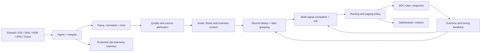
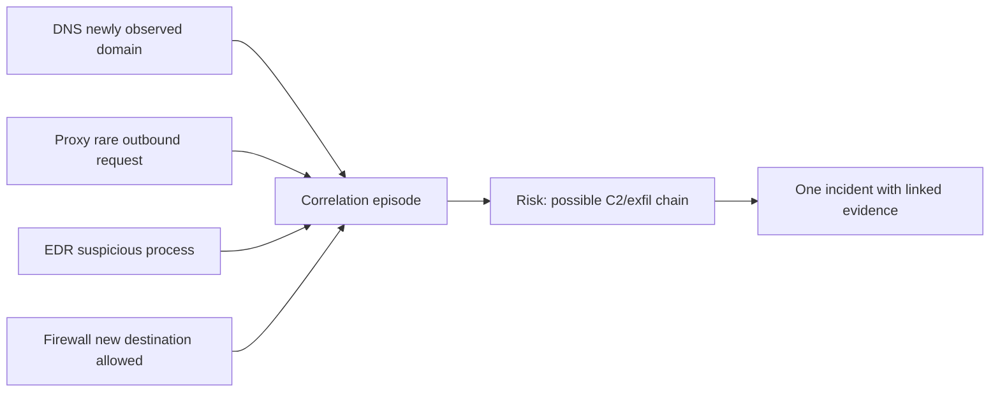

# Giảm nhiễu trong cảnh báo mạng

## Mục tiêu học tập

Sau bài học, bạn có thể:

1. Phân biệt **nhiễu cảnh báo**, **false positive**, **true positive lặp lại**, **sự kiện trùng**, **sự kiện hợp lệ nhưng cần ghi nhận**, **false negative** và **sự cố có ảnh hưởng thực**.
2. Giải thích vì sao mạng hiện đại sinh quá nhiều tín hiệu từ **firewall, IDS/IPS, NDR, NetFlow/IPFIX, DNS, proxy, VPN/ZTNA, EDR, Kubernetes, cloud flow logs và SIEM**; không xem giảm số lượng thông báo là mục tiêu duy nhất.
3. Thiết kế pipeline **thu thập → chuẩn hóa → kiểm chất lượng → bổ sung ngữ cảnh → loại trùng → nhóm tương quan → xếp ưu tiên → điều phối case → phản hồi học hỏi**.
4. Chọn **khóa deduplication**, **cửa sổ thời gian**, **grouping/correlation key**, **ngưỡng**, **hysteresis** và **cooldown** mà vẫn giữ bằng chứng cần thiết và phát hiện các sự cố mới.
5. Hiệu chỉnh một quy tắc phát hiện theo **mức độ rủi ro của tài sản, hành vi nguồn, kết quả kiểm soát, threat intelligence, phạm vi quan sát và tính thời điểm**.
6. Áp dụng suppression, allowlist, maintenance window và exception có **owner, lý do, phạm vi, thời hạn, audit và kiểm thử âm tính**, không tạo vùng mù vĩnh viễn.
7. Phân biệt **SOC alert**, **observability signal**, **incident**, **case**, **page**, **ticket** và lý do vì sao một alert đã được nhóm không nên xóa raw telemetry.
8. Đo **precision, false-positive rate, recall, false-negative risk, alert-to-incident ratio, MTTD, MTTA, MTTR, triage time và telemetry coverage** với định nghĩa mẫu số phù hợp.
9. Phân tích mô hình thực tế: internal vulnerability scans, DNS NXDOMAIN spikes, IDS signatures, DDoS/connection bursts, NAT/IPv6 identity collision, cloud/Kubernetes churn và log pipeline replay.
10. Thực hành **mô hình Python ngoại tuyến** xử lý các sự kiện giả lập, viết ma trận nghiệm thu và runbook xử lý khi detector quá ồn hoặc bị giảm độ nhạy.

## 1. Bài toán: 20.000 cảnh báo không đồng nghĩa 20.000 cuộc tấn công

Trong một hệ thống có nhiều nguồn telemetry, một kết nối hoặc một đợt hoạt động có thể bị ghi nhận đồng thời bởi:

- Firewall trên host, firewall biên và cloud network firewall.
- IDS/IPS có nhiều signature phát hiện trên cùng gói tin hoặc phiên.
- NDR trên TAP/SPAN, virtual network mirroring hoặc sensor ở nhiều điểm.
- DNS resolver báo domain đáng ngờ hoặc NXDOMAIN lặp lại.
- Proxy/Secure Web Gateway chặn hostname, URL hoặc CONNECT request.
- VPN/ZTNA ghi lại thiết bị, phiên, ngắt kết nối và authentication failure.
- EDR ghi nhận process/network context trên endpoint.
- SIEM chạy rule dựa trên log đã được gửi vào, có thể tái phát alert giống nguồn.
- Hệ thống vận hành ghi timeout, retry, 401/403, 5xx hoặc kết nối bị reset.

Một tác nhân quét một máy chủ bằng nhiều cổng có thể sinh hàng trăm alerts; một bản cập nhật proxy có thể tạo hàng nghìn lỗi TLS hợp lệ; một job quét lỗ hổng nội bộ có quyền có thể trông giống một cuộc quét xâm nhập.

Nếu gửi từng alert tới người trực ca, đội SOC phải dành phần lớn thời gian để đóng những trường hợp giống nhau. Điều đó có thể làm chậm phát hiện xâm nhập thực sự.

Nhưng **giảm số cảnh báo xuống một phần mười** không tự chứng minh bảo mật tốt lên. Nếu một quy tắc bị tắt làm bỏ sót lateral movement, ransomware hoặc exfiltration, dashboards có thể rất “yên tĩnh” trong khi rủi ro tăng.

**Mục tiêu đúng:** giảm khối lượng thông báo **không tạo thêm thông tin quyết định**, giữ **dấu vết và độ phủ phát hiện**, đồng thời tăng khả năng ưu tiên những hành vi gây rủi ro thật.

> **Nguyên tắc:** **Giảm nhiễu ở lớp điều phối cảnh báo, không tùy tiện xóa tín hiệu gốc.** Một sự kiện được deduplicate khỏi hàng đợi thông báo vẫn phải có thể được truy tìm qua số lần xuất hiện, thời gian, nguồn và bằng chứng, trong phạm vi retention/nguồn dữ liệu cho phép.

### 1.1. Ví dụ nhanh

Giả sử firewall ghi 900 lần cùng một Pod thử tới một IP không được phép trên TCP/443 trong 5 phút.

- **Sự kiện gốc (raw events):** có thể là 900 bản ghi.
- **Phát hiện:** một hoạt động bị policy deny liên tục.
- **Notification:** có thể chỉ cần **một** thông báo ban đầu và một cập nhật về tần suất.
- **Incident:** có thể là một case hoặc chưa phải incident, tùy context.
- **Bằng chứng:** giữ count, first/last seen, source identity, destination, deny action và sample references.
- **Escalation:** nếu cùng Pod chuyển sang hàng chục đích hoặc nguồn bị EDR đánh dấu compromised, hệ thống cần **nâng ưu tiên** hoặc mở case khác, không mãi im lặng vì đã thấy IP trước đó.

### 1.2. Liên hệ module bảo mật mạng

Bài thuộc chương **Giám sát mạng và telemetry**, trong module `SECURITY_NETWORK_SECURITY` về các lớp phòng vệ, phân đoạn, firewall, VPN, IDS/IPS, DNS, wireless, cloud security, giám sát xâm nhập và kiến trúc mạng an toàn.

Giảm nhiễu phải hiểu **đường mạng thực**: nguồn có thể ở Kubernetes Pod, NAT gateway hoặc VPN client; một IP công khai có thể đại diện nhiều workloads; một cảnh báo IDS có thể là traffic đã bị chặn, trong khi một kết nối được phép ra domain lạ có thể quan trọng hơn.

## 2. Thuật ngữ: sự kiện, detection, alert, case và incident

| Khái niệm | Ý nghĩa | Không suy ra |
|---|---|---|
| **Raw event** | Bản ghi do sensor/app phát sinh tại thời điểm quan sát | Đã có hành vi nguy hiểm |
| **Log ingestion record** | Bản ghi đã đến pipeline phân tích | Sự kiện mới: có thể replay/trùng |
| **Detection** | Quy tắc/mô hình chỉ ra điều kiện bất thường/đe dọa | Đã xác nhận sự cố |
| **Alert** | Đối tượng cần attention/triage do detection tạo | Phải gửi page riêng cho từng event |
| **Notification/page** | Tín hiệu gửi người trực qua chat, email, pager | Phải đại diện một incident riêng |
| **Case** | Hồ sơ để điều tra và gom bằng chứng | Đã xác nhận malicious |
| **Incident** | Sự việc an ninh được phân loại theo quy trình tổ chức | Luôn có nhiều cảnh báo |
| **False positive (FP)** | Detector phát hiện/đánh giá sai trường hợp theo tiêu chí và ground truth | Tín hiệu gốc chắc chắn vô giá trị |
| **True positive (TP)** | Detection đúng theo định nghĩa rule/ground truth | Mỗi lần lặp cần notification |
| **False negative (FN)** | Hành vi thuộc phạm vi detection cần phát hiện nhưng bị bỏ sót | Có thể đo đủ chỉ từ alert logs |
| **True negative (TN)** | Hành vi không thuộc loại cần cảnh báo và detector không báo | Tất cả benign traffic đều phải được lưu/đếm chi tiết |
| **Benign true positive** | Phát hiện đúng hành vi, nhưng hoạt động được phê duyệt hoặc không cần SOC intervention | Phát hiện sai về mặt kỹ thuật |
| **Duplicate alert** | Nhiều thông báo cho cùng hiện tượng theo định nghĩa tương đương | Nhiều events tuyệt đối vô hại |
| **Alert fatigue** | Sự quá tải khiến người vận hành bỏ qua/chậm xử lý alerts | Chỉ xảy ra khi có FP |
| **Suppression** | Quy tắc không tạo/không gửi một số alerts mới trong scope xác định | Dữ liệu gốc nên bị xóa |
| **Deduplication** | Nhận diện records/alerts trùng và biểu diễn hợp nhất | Có thể gom mọi alerts chung IP |
| **Correlation** | Kết nối nhiều tín hiệu có quan hệ để tạo bối cảnh/tình huống | Mọi tín hiệu cùng timestamp là một attack |
| **Enrichment** | Thêm asset owner, business role, threat intel, identity, change ticket | Tất cả dữ liệu bổ sung đều chính xác/mới |

### 2.1. “Ồn” không phải đồng nghĩa “sai”

Một signature IDS có thể phát hiện **đúng** hàng nghìn probes bị firewall chặn. Đó không phải FP theo nghĩa signature, nhưng có thể là **một phát hiện bị lặp lại** và không cần hàng nghìn lần paging.

Một scanner hợp lệ của đội an ninh cũng có thể bị rule “port scan detected” phát hiện đúng. Hành vi quét là thật; business context quyết định đây là hoạt động được duyệt, **không phải kết luận IDS đo sai**.

Ngược lại, một alert “malware C2 confirmed” phát ra do parser hiểu nhầm log có thể là FP cần sửa **rule hoặc parser**, không chỉ thêm suppression.

### 2.2. Ba thứ cần tính riêng

1. **Số raw events**: phản ánh volume/telemetry.
2. **Số detection episodes/cases có ý nghĩa**: phản ánh vấn đề cần điều tra.
3. **Số pages/tickets gửi người trực**: phản ánh tải công việc.

Khi tuning, giữ cả ba chỉ số. Một quy tắc gom 500 events vào 1 case là giảm notification noise; nó **không có nghĩa traffic đã giảm 500 lần**.

## 3. Nguồn gốc nhiễu trong telemetry mạng

### 3.1. Nhiễu từ dữ liệu đầu vào

- Collector gửi **duplicate** do retry/at-least-once delivery.
- Agent mất mạng rồi replay backlog cũ.
- Log forwarder đổi parser hoặc timezone.
- Một số sensor quan sát cùng gói tin trên nhiều TAP/SPAN.
- NAT/Proxy làm mất source identity, tạo nhóm không đúng.
- Cloud flow logs có **aggregation/sampling**; thời gian ghi khác thời gian packet.
- DNS cache/prefetch tạo truy vấn nhưng không có connection.
- IPv4/IPv6 dual-stack tạo hai đường quan sát cho một hoạt động ứng dụng.
- Clock skew giữa thiết bị và SIEM khiến event vào sai window.
- Container/Pod đổi IP hoặc node khi autoscale, gây churn.
- Health check/retry/timeout tạo volume lớn nhưng ít thông tin mới.

### 3.2. Nhiễu từ detection rules

- Signature quá rộng, match trên traffic benign.
- Severity mặc định cao dù attack đã bị chặn và không có impact.
- Một rule tạo alert trên **mỗi packet** thay vì một tập hành vi.
- Nhiều rules khác nhau cùng phát hiện một hoạt động mà không liên kết.
- Domain/IP threat feed cũ, confidence không rõ hoặc hết hạn.
- Anomaly threshold không tính baseline theo nhóm service.
- Không phân biệt scanner được duyệt với reconnaissance bên ngoài.
- Không phân biệt test/staging với production.
- Đánh đồng network timeout với attack.
- Sử dụng một static threshold cho hệ thống có nhịp ngày/đêm hoặc batch jobs.

### 3.3. Nhiễu từ điều phối và quy trình

- Cùng case được gửi nhiều kênh: email, chat, pager và ticket.
- Paging alert mức low/medium như incident critical.
- Reopen mỗi 5 phút khi điều kiện chưa hết.
- Incident đã có owner nhưng alert mới vẫn tạo case khác.
- Không có cooldown hoặc trạng thái acknowledged/investigating.
- Một maintenance event tạo hàng nghìn exceptions không có phạm vi.
- SOAR tự chạy playbook trên mỗi bản ghi lặp mà không idempotency.
- Phản hồi từ analyst không quay lại detector/asset inventory.

## 4. Kiến trúc pipeline giảm nhiễu đúng lớp



Trong một kiến trúc thật, raw logs có thể được giữ trong SIEM/log lake theo retention, hoặc tại nguồn phù hợp. Tên các bước không yêu cầu mua một sản phẩm duy nhất.

**Trình tự thực thi nên bảo toàn bằng chứng:** ingestion quality và parser validation trước khi tính fingerprint; enrichment trước risk scoring; grouping trước paging; feedback sau triage.

### 4.1. Ranh giới an toàn

- **Đầu vào không đáng tin tuyệt đối:** logs có thể bị thiếu, giả mạo, gửi trễ hoặc chứa payload do attacker điều khiển.
- **Nguồn identity:** hostname, label và địa chỉ IP không nhất thiết đủ xác thực user/workload.
- **Đồng hồ:** event time khác ingest time; không dùng thời gian nhận làm thời gian xảy ra khi điều tra.
- **Policy:** thay suppression rule cần review như thay detection logic.
- **Bằng chứng:** giảm notification nhưng không tùy tiện xóa event hoặc telemetry theo cách làm mất khả năng điều tra.
- **Độ phủ:** một dashboard giảm alerts cũng có thể vì sensor chết; phải theo dõi heartbeat/ingestion separately.

### 4.2. Phân chia control plane, data plane và analytics

| Mặt phẳng | Thành phần | Điều cần kiểm |
|---|---|---|
| **Data/enforcement** | Firewall, IPS, EDR containment, DNS resolver, ZTNA PEP | Traffic được allow/deny/thực thi thế nào |
| **Telemetry** | Sensors, TAP/SPAN, flow exporter, log pipeline | Event có thật, đầy đủ và đúng thời điểm không |
| **Analytics** | Parser, SIEM, NDR, detection engine, enrichment | Rule có đúng semantics/correlation không |
| **Operations** | Case management, paging, SOAR, change ticket | Ai xử lý, tình trạng, hạn hồi đáp |
| **Governance** | Detection owner, risk acceptance, privacy, retention | Ai được suppress và khi nào phải rà lại |

**Đừng nhầm giảm alert với thay đổi policy chặn traffic.** Một rule suppress 900 firewall denied connections không mở firewall; ngược lại, tắt signature IPS có thể làm thay đổi cả **khả năng phòng vệ**, không chỉ số trang paging.

## 5. Chuẩn hóa schema trước khi loại trùng

### 5.1. Những trường tối thiểu

Một network alert normalized có thể có:

| Trường | Ý nghĩa |
|---|---|
| `event_id` | ID nguồn nếu thực sự duy nhất theo producer |
| `sensor_id` và `sensor_type` | Nguồn có phát record và coverage ở đâu |
| `event_time` | Thời điểm xảy ra theo sensor |
| `ingest_time` | Thời điểm pipeline nhận record |
| `rule_id` + `rule_version` | Detector/semantics tạo alert |
| `source_identity` | User/Pod/workload/device đã được xác minh khi có |
| `src_ip`, `src_port`, `dst_ip`, `dst_port`, `transport` | Bối cảnh 5-tuple/flow khi có |
| `network_zone`, `environment` | Segmentation production/staging/DMZ etc. |
| `direction`, `action` | Ingress/egress, allow/deny/reset/detected |
| `hostname`/DNS QNAME/SNI/HTTP authority | Tên ở đúng layer, không hoán đổi |
| `flow_id`/`session_id` | Nối các record cùng flow/session nếu có |
| `signature/category` | Loại detection và version |
| `event_count`, `first_seen`, `last_seen` | Tần suất và thời gian nhóm |
| `threat_evidence`, `asset_criticality` | Enrichment có provenance/TTL |
| `disposition` | Benign, TP, FP, unknown, investigating |
| `original_event_ref` | Liên kết tới bản ghi gốc không lộ secret |

Không phải sensor nào cũng hỗ trợ tất cả trường; **trường không có phải được ghi là unknown**, không suy fabricated ID từ một IP NAT chung.

### 5.2. Ví dụ event dạng JSON giả lập

```json
{
  "event_id": "fw-raw-lab-001",
  "sensor_id": "fw-egress-a",
  "sensor_type": "firewall",
  "event_time": "2026-11-28T04:00:00Z",
  "ingest_time": "2026-11-28T04:00:02Z",
  "source": {
    "zone": "payments",
    "namespace": "billing",
    "workload": "payment-api",
    "identity_verified": true,
    "ip": "10.20.10.7"
  },
  "destination": {
    "ip": "198.51.100.20",
    "port": 443,
    "transport": "tcp"
  },
  "rule_id": "egress-unapproved-destination",
  "rule_version": "2",
  "action": "deny",
  "severity": "medium",
  "flow_id": "lab-flow-1001",
  "case_id": null,
  "raw_ref": "immutable-log-pointer-lab-001"
}
```

Sự kiện này chỉ giả lập. `198.51.100.0/24` thuộc dải địa chỉ tài liệu, không là đích tấn công thực. `identity_verified=true` chỉ được đặt khi có **hệ xác minh danh tính đáng tin**, không phải vì container tự khai tên.

### 5.3. Bốn thao tác chuẩn hóa thường gặp

1. **Timestamp:** lưu theo UTC với độ chính xác, nguồn đồng hồ, độ lệch nếu biết; phân biệt sensor/collector receipt.
2. **Network addresses:** phân biệt IPv4/IPv6, IPv4-mapped IPv6 khi parser/API cần; giữ đúng address family và zone.
3. **L3/L4 semantics:** transport, direction, action, pre/post NAT addresses, TCP flags hoặc flow state nếu nguồn cung cấp.
4. **Application context:** DNS QNAME, proxy CONNECT host, HTTP Host, SNI, TLS certificate identity là các loại bằng chứng khác nhau.

### 5.4. Không normalize quá mức

- Trộn `dst_port=22` với `dst_port=443` có thể che dịch chuyển kỹ thuật tấn công.
- Trộn `deny` với `allow` làm mất thông tin enforcement outcome.
- Trộn IPv6 và IPv4 chỉ vì cùng hostname có thể che bypass.
- Trộn hai tenants dùng chung SaaS domain làm sai scope.
- Bỏ namespace/cluster khi 2 service accounts cùng tên có thể tạo identity collision.
- Trộn `probe-only` với `successful-transfer` khiến severity đánh giá sai.

## 6. Chất lượng telemetry là điều kiện tiên quyết

### 6.1. Trước khi tuning phải xác nhận nguồn có khỏe không

Một detector không phát cảnh báo có thể vì:

- IDS sensor không nhận SPAN/TAP traffic.
- Firewall exporter bị rate-limit, log sampling hoặc drop.
- Collector backlog/replay vượt giới hạn.
- NTP lệch làm tất cả events rơi ngoài correlation window.
- Pipeline parser fail sau schema upgrade.
- Index/storage đầy, retention thay đổi.
- Sensor bị disable trong maintenance nhưng không re-enable.
- CNI cloud region mới chưa bật flow logging.
- Source IP sau NAT không còn gắn với workload.
- Proxy đang fail-open hoặc client đi direct egress path.

Vì thế mỗi dashboard noise reduction nên có **ingestion health/coverage**. “Không có alerts” khi source mất telemetry là **giảm khả năng nhìn thấy**, không phải thành công.

### 6.2. Các kiểm tra chất lượng

| Kiểm tra | Ý nghĩa | Khi fail |
|---|---|---|
| Sensor heartbeat/freshness | Nguồn còn gửi telemetry | Alert pipeline health |
| Expected event rate | Volume so với baseline theo thời điểm | Điều tra spikes hoặc silent gaps |
| Parser failure rate | Tỷ lệ không parse được trường bắt buộc | Giữ raw + repair, không drop âm thầm |
| Duplicate ingestion rate | Retry/replay đã tăng? | Dedup theo producer ID và investigate |
| Event time vs ingest lag | Độ trễ và out-of-order | Điều chỉnh watermark, không tùy tiện tăng suppression |
| Missing source identity | NAT/correlation thất bại? | Gắn uncertain identity và giảm tự động đóng |
| Rule version consistency | Sensor dùng signature set nào? | Detect configuration drift |
| Network coverage | IPv4/IPv6, cloud/AZ/VPC, Kubernetes nodes | Có blind spots cần xử lý |
| Deny/allow semantics | Sensor ghi policy enforcement hay detection-only? | Không suy đã chặn nếu chỉ detect |
| Log integrity & access | Raw evidence có bị sửa/xóa ngoài quyền? | Escalate audit/control issue |

## 7. Deduplication: bỏ thông báo trùng nhưng giữ hành vi

### 7.1. Hai loại trùng khác nhau

**Record duplicate**: cùng sự kiện được gửi nhiều lần do retry/log fan-out. Có thể loại trùng bằng **ID nguồn được định nghĩa duy nhất** và scope producer, cùng retention TTL theo pipeline.

**Semantic duplicate alert**: nhiều sự kiện thật nhưng chỉ mô tả cùng một episode cần xử lý, ví dụ 700 firewall denies từ cùng workload tới cùng đích trong 10 phút. Không nên xóa chúng như thể chỉ có 1 packet; nên **gom thành một alert với count, first/last seen và các bằng chứng tổng hợp**.

### 7.2. Fingerprint phù hợp theo rule

Một fingerprint không có công thức chung cho tất cả detection. Ví dụ với firewall deny:

```text
(
  detector_family="egress-deny",
  rule_id,
  environment,
  source_zone,
  verified_workload_identity OR scoped_source_ip,
  destination_ip + destination_port + transport,
  action="deny"
)
```

Với DNS NXDOMAIN flood có thể group theo **source + parent domain + detection type + time window**, giữ count/unique subdomains/NXDOMAIN ratio.

Với scan nhiều ports từ một nguồn, nếu fingerprint chứa `dst_port` sẽ tạo một alert mỗi port; nếu bỏ port hoàn toàn lại mất bằng chứng multiport scan. Cách hợp lý là **group scan episode theo source/destination/trust zone**, đồng thời lưu **distinct port count, set/range và tốc độ scan**.

### 7.3. Những thuộc tính không nên tự bỏ

- Source user/workload/tenant/cluster khi có verified identity.
- Mức nhạy asset và direction.
- Detection type/severity và trạng thái enforcement.
- Change/trust context: approved scanner hay unknown source.
- Event time và last seen.
- Sequence của các pha tấn công (scan → brute force → access → data transfer).
- Sự kiện xuất hiện ở destination mới/sensitive hơn.
- State chuyển từ deny sang allow hoặc từ detection-only sang block.

**Nếu fingerprint quá thô, cùng một chữ “scan” có thể gom cả một bảo trì bình thường và một lateral-movement incident.**

### 7.4. Sliding window, tumbling window và episode timeout

- **Tumbling window**: chia theo các khoảng cố định, ví dụ từng 5 phút. Một hoạt động liên tục qua ranh giới có thể thành nhiều alerts.
- **Sliding window**: đánh giá trong khoảng trượt, hữu ích cho ngưỡng “N lần trong 5 phút”; cần bảo vệ khỏi counting phức tạp/cardinality.
- **Session/episode window**: một nhóm tiếp tục khi có event đến gần thời điểm cuối; có TTL/cooldown và max duration rõ.
- **Watermark**: chính sách chấp nhận event-time trễ/out-of-order; không phải cách xóa mọi sự kiện đến muộn.

Cần chọn theo hành vi. Brute-force threshold 10 phút không nên áp y nguyên cho DNS fast flux hay firewall long-lived flow.

### 7.5. Một thông báo vẫn có nhịp cập nhật và nâng cấp

Thay vì gửi 500 pages, có thể:

```text
t0        New episode alert: 25 denied connections / minute
t0+5m     Update case count: 220 denies, 5 min active
t0+10m    New destination in restricted zone -> risk escalated
t0+15m    EDR high severity incident -> page immediately
t0+20m    Source isolated -> case remains with evidence
```

**Cooldown không được ngăn escalation khi tình huống thay đổi đáng kể**.

## 8. Multi-signal correlation: từ 5 cảnh báo thành 1 tình huống có nghĩa

### 8.1. Ví dụ attack chain



Một DNS domain lần đầu được thấy có thể không đáng page. Nhưng cùng máy có EDR active malware alert, proxy bắt đầu gửi nhiều bytes và firewall ghi outbound allowed, tập bằng chứng cần được nâng ưu tiên.

### 8.2. Correlation không chỉ dựa vào trùng thời điểm

Những thuộc tính hữu ích:

- Verified endpoint/process/workload identity.
- IP mapping theo thời gian khi DHCP/NAT/VPN.
- Session/flow ID, source/destination zone.
- Application owner và change ticket.
- Alert type và dependency graph.
- Threat intelligence IOC, hash/process và campaign context.
- Dữ liệu flow: bytes, duration, TCP flags, successful vs blocked.
- User identity, device posture và access role.
- Timestamps trong causal window hợp lý.

Những quan hệ **chỉ trùng IP public NAT, hostname SaaS chung, tên Pod tái sử dụng hoặc cùng phút** có thể là yếu và cần confidence score chứ không tự merge case.

### 8.3. Correlation key có thứ bậc

Một thiết kế có thể dùng:

1. **High confidence:** cùng verified workload/device ID hoặc session ID.
2. **Medium confidence:** cùng source scoped IP + namespace/VPC + thời gian lease/NAT mapping.
3. **Low confidence:** cùng public NAT IP, shared DNS resolver, generic proxy IP.

Chỉ group tự động theo high-confidence keys cho hành vi nhạy cảm; low-confidence relationships có thể **gợi ý liên quan** để analyst xem, không làm merge evidence không thể tách.

### 8.4. Sequence và khoảng thời gian

Một detection chain kiểu:

```text
Host A: new process execution
  -> DNS rare/new domain
  -> 10-minute persistent HTTPS connection
  -> suspicious outbound volume
```

Nếu các events xảy ra trong một cửa sổ nhân quả có lý do, có thể tăng risk. Nhưng nếu sự kiện đầu tiên là bản ghi backlog phát muộn từ hôm trước, correlation theo **ingest_time** có thể tạo chuỗi sai.

**Hãy ưu tiên event_time có validation, latency budget và out-of-order handling**, đồng thời ghi rõ những gaps.

## 9. Noise reduction bằng context: tài sản, chủ sở hữu và mức rủi ro

### 9.1. Asset criticality ảnh hưởng priority

Không nên xem 100 firewall denies từ máy test ngang với 1 successful unauthorized SSH trên production domain controller.

Bảng ví dụ:

| Nguồn/đích | Hành vi | Độ ưu tiên minh họa |
|---|---|---|
| Sandbox canary scanner | TCP port-scan theo approved schedule | Low/log, không page |
| Production database | Outbound to unknown Internet IP | High, triage |
| Externally exposed web server | Repeated blocked TCP SYN | Aggregate, xem attack scale |
| Admin management subnet | Successful anomalous SSH/RDP connection | High/critical nếu trái policy |
| Employee workstation | DNS lookup CDN mới từ approved browser | Low/monitor theo context |
| EDR quarantined host | Repeated outbound C2 indicators | Critical/incident |
| SaaS sanctioned app | Legitimate backup data transfer | Monitor baseline, không tự exfil incident |
| Kubernetes workload | New port exposed/cross-namespace connection | Priority theo service, change và policy |

**Số sự kiện không thể thay trực tiếp cho mức nguy cơ**. Một hành vi đơn lẻ có tác động cao cần vượt qua threshold và dedup gate được cấu hình cho những trường hợp lặp lại.

### 9.2. Business context giúp giảm true-positive noise

Dữ liệu có thể bổ sung:

- Approved vulnerability scan job và scanner identity.
- Release deployment/maintenance window có ticket.
- Approved vendor updates/backup schedule.
- Load test run ID và nguồn traffic.
- Network topology change, failover exercise.
- Known service health checks và retries.
- Identity provisioning/scheduled certificate rotation.

Context cần **nguồn và thời hạn**. Không tin client có header `X-Approved-Scanner: true` hoặc Pod label tự khai nếu policy cần bảo đảm identity.

### 9.3. Tránh “approved identity = mọi hành vi đều được bỏ qua”

Scanner được phép quét các subnets nhất định và trong cửa sổ đã phê duyệt. Nếu cùng scanner bắt đầu kết nối đến secrets store ngoài scope hoặc gửi dữ liệu tới Internet, suppression phải **không** bao phủ những hoạt động đó.

Một approved backup job cũng có thể bị compromise. Context giúp giải thích, không phải immunity card cho nguồn.

## 10. Detection rule tuning: sửa rule trước khi thêm suppressions

### 10.1. Chẩn đoán vấn đề ở đúng lớp

| Vấn đề | Cách xử lý ưu tiên |
|---|---|
| Parser hiểu nhầm timestamp/IP/port | Sửa parser, schema tests và replay |
| Rule match hành vi benign phổ biến | Thêm điều kiện detection, validate trên historical samples |
| Rule đúng nhưng 10.000 alerts/episode | Alert grouping và rate-limit notification |
| Rule có severity quá cao | Dùng asset/impact/action context, review severity |
| Feed IOC đã cũ | Kiểm feed age/confidence, revoke stale entries |
| Một sensor gửi duplicate raw records | Record-ID dedup và pipeline reliability repair |
| Approved scan tạo cảnh báo lặp | Narrow exception theo scanner identity, scope, time |
| Anomaly model drift do rollout | Rebaseline có change context, canary test |
| Source identity thiếu sau NAT | Sửa correlation/flow attribution, không group chung mọi user |
| SOC queue quá tải dù detection đúng | Routing, tiering, ownership và automation idempotent |

### 10.2. Tune rule theo vòng lặp khoa học

1. Định nghĩa detection intent: hành vi nào thật sự muốn thấy?
2. Chọn **historical events** đại diện gồm benign, malicious đã xác minh, rare cases và changes.
3. Xem phần trăm alerts theo source/asset/rule.
4. Phân tích FP, duplicate, benign TP và unknown riêng.
5. Đề xuất điều kiện mới hoặc grouping.
6. Chạy replay/simulation **không tác động production**.
7. Kiểm test cases đã xác nhận malicious vẫn phát hiện, nhất là high-risk.
8. Review với detection owner + SOC/network team.
9. Deploy canary/report-only và đo thay đổi precision/recall/coverage.
10. Promote khi đạt tiêu chí, ghi policy version/change ticket.
11. Theo dõi drift và rollback nếu missed detections tăng.

### 10.3. Không “tune” bằng cách xóa ground truth khó chịu

Nếu 70% alerts từ một rule là benign vì scanner maintenance, không nên **xóa toàn bộ dữ liệu scanner** khỏi evaluation dataset rồi báo precision tăng. Cần báo:

- Precision raw và precision sau grouping.
- Tỷ lệ alerts được suppress có căn cứ.
- Số benign episodes vs malicious episodes.
- Detection recall trên các nhóm có rủi ro.
- Coverage của environments, protocols và tenants.
- Những điều kiện mà suppression sẽ không còn được áp.

Một dashboard tốt phải ghi rõ **metrics before/after cùng population**, tránh đo hai tập nguồn khác nhau.

## 11. Ngưỡng, baseline và hành vi thay đổi theo thời gian

### 11.1. Static threshold không hợp cho mọi mạng

Rule kiểu “hơn 100 failed connections trong 5 phút” có thể bình thường với proxy health checks nhưng nghiêm trọng với một IoT device chỉ liên hệ một server.

Thay vì ngưỡng toàn cục, có thể tách:

- VPC/namespace, source service, tài sản criticality.
- Working hours vs scheduled batch windows.
- Protocol và app behavior (DNS, HTTPS, SSH/RDP).
- Source role (scanner, edge proxy, database, employee laptop).
- Traffic type (deny, allow, handshake failure, bytes transferred).
- Deploy/release/DR context.

### 11.2. Baseline theo seasonality

- Giờ làm việc vs ban đêm.
- Weekday vs weekend.
- End-of-month finance jobs.
- Vulnerability scans theo lịch.
- Backup và batch processing.
- Business campaigns, sales peak, release days.
- Cloud autoscaling và cluster rebuilds.

Baselines phải được cập nhật có kiểm soát. Không tự học lại toàn bộ baseline trong lúc attack kéo dài; một attacker có thể làm hành vi bất thường dần trở thành “bình thường” (baseline poisoning).

### 11.3. Hysteresis và cooldown

Nếu rate ngưỡng:

- **Bật cảnh báo** khi quá 150 events/5 phút.
- **Đóng trạng thái** khi dưới 70 events/5 phút liên tiếp trong 10 phút.
- **Cooldown thông báo** 15 phút khi case đã có owner.

Đây là số **minh họa**, cần hiệu chỉnh theo traffic thực. Hysteresis tránh trạng thái bật/tắt liên tục quanh threshold; cooldown ngăn spam nhưng không chặn escalation khi có IOC high-confidence hoặc asset critical.

### 11.4. Khi nào dùng quantile, EWMA hoặc robust statistics?

Có thể dùng:

- **Quantiles**: chọn threshold gần phân vị cao của baseline, cần kiểm mùa vụ và tail risk.
- **EWMA**: làm mượt tốc độ, nhạy với thay đổi liên tục theo mức alpha.
- **Median/MAD**: bền hơn với outliers so với mean/std trong một số dữ liệu.
- **Change-point detection**: phát hiện chuyển trạng thái so với baseline.
- **Rate of change**: phát hiện burst/tăng đột ngột.
- **Distinct counts**: IP/port/hostnames duy nhất thay vì raw event count.

Các mô hình đều có assumptions, cần đo false positives và missed detections. Không áp “ML anomaly score” mà không có explainability, drift monitoring và fallback khi model không khỏe.

## 12. Phân loại mức độ ưu tiên và routing tới đúng người

### 12.1. Một alert cần hai nhãn: severity và confidence

- **Severity/impact**: nếu hành vi đúng thì ảnh hưởng tới tài sản/dữ liệu bao nhiêu?
- **Confidence**: bằng chứng xác thực/đầy đủ/đáng tin tới đâu?

Ví dụ “potential exfil” ở production database có impact cao nhưng confidence thấp khi chỉ có DNS query; có thể urgent triage nhưng chưa tuyên bố confirmed data theft.

### 12.2. Ma trận routing minh họa

| Impact | Confidence | Hành động gợi ý |
|---|---|---|
| Critical | High | Page on-call + incident, retention evidence |
| High | Medium | Urgent case + analyst verification |
| High | Low | Priority investigation, explicit gaps, không auto-dismiss |
| Medium | High | Triage queue, auto-enrichment, group |
| Low | Low | Monitor/aggregate; review nếu pattern đổi |
| Approved maintenance | Verified | Scoped suppression hoặc ticket update, không global drop |
| Sensor unhealthy | Any | **Telemetry health incident**, không kết luận “không bị tấn công” |

Một organization có thể có bảng khác theo asset/data risk và staffing. Các từ `critical`/`high` phải dựa trên taxonomy nội bộ để không gây hiểu nhầm.

### 12.3. Page khác case khác dashboard

- **Page:** cần con người phản ứng ngay; có owner/on-call và escalation.
- **Case/ticket:** cần điều tra nhưng không nhất thiết đánh thức người trực ngoài giờ.
- **Dashboard/trend:** dùng phân tích dài hạn, capacity và tuning.
- **Automated enrichment:** thu các thuộc tính đáng tin trong phạm vi dữ liệu/pháp lý, có timeout/cache.
- **SOAR containment:** chỉ thực hiện khi preconditions rõ, authorization và rollback; tránh tự động isolate hàng loạt do rule sai.

Một SOC có thể giữ 900 raw events, 1 case, 2 case updates và 1 page lúc risk tăng. Đó là một kết quả tốt nếu **không mất detection quan trọng**.

## 13. Suppression, mute, maintenance và exception: dùng đúng phạm vi

### 13.1. Tên gọi không đồng nghĩa

| Cơ chế | Ý nghĩa | Đề phòng |
|---|---|---|
| **Dedup alert** | Hợp nhất thông báo cùng episode, vẫn giữ counts/evidence | Gom quá rộng làm mất sự cố mới |
| **Notification cooldown** | Không page nhiều lần trong khoảng được duyệt | Không che escalation/critical alerts |
| **Scoped suppression** | Không tạo/trình một số alerts khi điều kiện đã xác minh | Không suppress toàn rule/tenant vô hạn |
| **Maintenance mute** | Tạm ngưng page trong cửa sổ bảo trì cụ thể | Không tắt hard-block/incident detection |
| **Benign behavior allowlist** | Nhận diện hành vi hợp lệ đã kiểm chứng | Có thể bị lợi dụng nếu source bị compromise |
| **Rule disabled** | Dừng detection hoặc action ở một số nơi | Tạo blind spot rõ; cần change review |
| **Source log filtering** | Không thu/giữ một số bản ghi từ đầu | Có thể phá forensic/compliance; chỉ dùng khi retention/quyền cho phép |
| **Rate-limit notifications** | Hạn lượng thông báo, giữ counts và overload signal | Attacker có thể flood để che sự kiện mới |
| **Case acknowledgement** | Người chịu trách nhiệm đã nhận case | Không chứng minh incident đã giải quyết |
| **Risk acceptance** | Chủ rủi ro chấp nhận điều kiện có giới hạn | Không miễn trách nhiệm giám sát và review |

**Ưu tiên giảm nhiễu ở notification/routing**, sau đó grouping, sau đó sửa logic phát hiện nếu đã có bằng chứng; **tắt sensor hoặc bỏ raw logs** thường là lựa chọn cuối cùng, cần phân tích impact và retention.

### 13.2. Một exception đủ an toàn phải có gì?

```yaml
# PSEUDOCODE: không phải cấu hình thực thi trực tiếp trên SIEM.
exception_id: NET-NOISE-EX-011
detection_family: authorized-network-scanning
environment: staging
source_identity: vuln-scanner-lab-a
source_identity_verified: true
destination_zone: test-subnet-a
approved_ports: [22, 80, 443]
allowed_window_utc:
  start: "2026-11-28T01:00:00Z"
  end: "2026-11-28T03:00:00Z"
maintenance_ticket: CHANGE-LAB-011
owner: security-engineering
approver: detection-owner
effect: suppress_repeated_pages_only
keep_raw_events: true
keep_episode_summary: true
hard_escalation_override: true
expires_at_utc: "2026-11-29T00:00:00Z"
review_after: completed-scan
```

Cần xác minh:

- Identity scanner được xác thực ở nguồn đáng tin, không chỉ IP tự khai.
- Đích, cổng, protocol và thời gian đúng ticket.
- Suppression chỉ áp **detection có nghĩa liên quan hoạt động duyệt**, không che EDR high-risk hoặc data exfil.
- Rule có expiry; hết hạn tự trở lại kiểm soát cũ.
- Một lần quét sai vùng/secrets host làm suppression **không match**.
- Số events đã group/suppress và thông tin owner vẫn được ghi.

### 13.3. Quy tắc không được âm thầm tắt

Một số tín hiệu nên được xem xét để **override suppression/cooldown** theo chính sách:

- Confirmed malware/known active C2 từ feed có độ tin cậy cao.
- Successful unauthorized admin access tới crown-jewel assets.
- DLP confirmed restricted data export hoặc evidence đáng tin về exfiltration.
- Security agent/sensor tampering và telemetry coverage loss diện rộng.
- Active lateral movement hoặc privileged identity compromise.
- Traffic bất thường **ngoài approved maintenance scope** dù source là scanner.
- Incident severity tăng do target/allow-action mới.
- Mối quan hệ nhiều tín hiệu mới xác nhận một chuỗi tấn công.

Đây là **mẫu guardrail**, không phải mọi high-severity vendor alert đều đáng pager. Ngay cả ngoại lệ khẩn cấp cũng cần xử lý false positive bằng triage và evidence.

### 13.4. Shadow evaluation khi áp suppression

Khi suppress notification, vẫn có thể chạy một luồng **shadow metrics**:

```text
raw_matches = 12,400
deduplicated_episodes = 42
notifications_sent = 3
suppressed_notifications = 39
critical_overrides = 1
covered_assets = 580
telemetry_missing_assets = 2
```

Các con số minh họa. Điều cần thấy là **detector vẫn match, episodes vẫn tính, nguy cơ vẫn được rà**, chứ không chỉ số “3 notification” trông đẹp.

## 14. Scanner được phê duyệt: ví dụ giảm cảnh báo mà không mở đường tấn công

### 14.1. Nguồn hợp lệ có thể tạo hành vi giống reconnaissance

Một scanner kiểm tra port 22/80/443 trên 1.000 servers có thể phát sinh:

- IDS “port scan” signatures.
- Firewall denies trên ports không phục vụ.
- Login/handshake failures.
- DNS/PTR queries.
- Alert “new source contacting management zone”.
- CPU/network spikes và application WAF logs.

Nếu scanner được phê duyệt, mục tiêu không phải dừng mọi detection — nó còn giúp xác minh sensor coverage — mà là **tránh pages lặp vô ích** trong scope đã duyệt.

### 14.2. Cách xác minh approved scan

1. Có job/ticket/mục đích và owner đúng.
2. Source host/agent identity xác minh.
3. Khoảng thời gian bắt đầu/kết thúc được duyệt.
4. Destination subnets/assets và ports được giới hạn.
5. Chế độ scanning có phù hợp change control và production risk không.
6. Mức độ ảnh hưởng ứng dụng và timeout thresholds.
7. Alerts còn dùng để kiểm network posture và coverage không.
8. Kết quả scan/điểm bất thường có được chuyển về team có trách nhiệm không.

### 14.3. Ví dụ quyết định

| Sự kiện | Có match exception? | Hành động |
|---|---|---|
| Scanner đúng ID quét staging test zone trong giờ | Có | Group + log + không page từng port |
| Scanner đúng ID quét production DB ngoài ticket | Không | Alert theo zone critical |
| Nguồn IP giống scanner nhưng identity không verified | Không đủ | Review/alert, không tự suppress |
| Scanner trong giờ bảo trì gửi file ra unknown SaaS | Không | Exfil/egress alert bình thường |
| Scanner xuất hiện với EDR high-risk incident | Hard override | Escalate |
| Scanner tiếp tục quét sau expiry | Không | New episode/owner review |
| Scanner quét trong scope nhưng gây service outage | Security/availability event | Escalate vận hành/incident |

### 14.4. Không giả định tool signature không bao giờ bị lạm dụng

Một server scanner có thể bị chiếm quyền. Nếu suppression chỉ dựa trên **source IP** mà mạng NAT chia sẻ, attacker có thể lợi dụng để giảm khả năng được chú ý. Tận dụng workload/service identity, asset ownership và change windows để giữ scope càng hẹp càng tốt.

## 15. IDS/IPS: trùng signature, độ nhạy và kết quả chặn

### 15.1. Nhiều signatures có thể cùng match

IDS/IPS có thể phát hiện từ:

- TCP flags/flow anomalies.
- HTTP parser/URI/user-agent signatures.
- DNS/TLS metadata.
- Protocol decoding, malformed packets.
- Threat intel signature/domain/IP.
- Repeated requests hay scan heuristics.

Một request có thể match nhiều signatures cùng lúc. **Không nên chỉ group theo source IP**; cần phân biệt attack family và asset, đồng thời nối các signatures vào một episode nếu chúng cùng mô tả một chuỗi hành vi.

### 15.2. “Detected” khác “blocked”

Một IPS có thể báo:

- `alert`: quan sát match.
- `drop`: packet/flow bị chặn (theo engine/action log).
- `reject`: cơ chế từ chối theo protocol.
- `pass`/bypass: traffic không được inspection trong phạm vi rule.

Ngữ nghĩa chính xác phụ thuộc engine, data path và cấu hình. **Alert IDS không tự chứng minh cuộc tấn công đã đi qua, nhưng cũng không tự chứng minh đã bị ngăn**.

Với một loạt blocked exploit probes:

- Giữ số lần và nguồn, evidence của action=blocked.
- Không page cho mỗi probe khi không có impact.
- Tăng ưu tiên nếu mục tiêu đặc biệt nhạy cảm, xuất hiện successful exploitation indicator, hoặc traffic từ trusted internal host.
- Không tự tắt IPS rule nếu rule đang chặn khai thác thật.

### 15.3. Cách tune signature hiệu quả

1. Xác định original signature intent và protocol parser version.
2. Lấy samples traffic hợp lệ và malware/exploit test cases được phê duyệt.
3. Kiểm source/dest/service context, port mapping và TLS visibility.
4. Xem signature có match request pattern quá chung không.
5. Điều chỉnh condition/sub-signature/reputation scope, nếu engine hỗ trợ.
6. Thử trên pcap/test corpus **có quyền**, không truy cập traffic người dùng trái chính sách.
7. So số episodes, severity, missed known detections.
8. Apply canary hoặc alert-only trước khi IPS block rules thay đổi.
9. Theo dõi engine health, performance, packet drops và SSL inspection gaps.
10. Có rollback nếu legitimate traffic tăng false positives.

### 15.4. Packet loss là một nguyên nhân “giảm nhiễu” giả

Khi một IDS sensor quá tải, số alerts có thể giảm vì **packet drops**, không phải threat giảm. Cần đo sensor capture drops, throughput, CPU, fan-out và network tap coverage. Một rule tune làm giảm CPU đúng là có ích, nhưng vẫn phải chứng minh detection coverage trên các traffic mẫu.

## 16. Firewall và cloud flow alerts: correlation theo source và kết quả

### 16.1. Một kết nối có thể được ghi nhiều lần

- Host firewall ghi outbound deny.
- Subnet firewall ghi cùng packet deny.
- Cloud network firewall cũng ghi reject.
- SIEM rule chạy trên cả ba nguồn.
- Traffic analyzer dựng flow từ netflow records.

Một packet không nên tạo **năm incidents độc lập** nếu tất cả có cùng causal episode. Có thể group bằng verified source/dest/time/transport và giữ **sensor-specific observations**.

Nhưng lưu ý: hai firewalls ở hai zones khác nhau có thể báo **hai enforcement decisions khác nhau**; không được xóa chi tiết làm mất khả năng biết policy nào thực sự chặn.

### 16.2. NAT/proxy và source attribution

| Ngữ cảnh | Rủi ro correlation sai | Cách xử lý |
|---|---|---|
| Nhiều Pods qua Node SNAT | Chung public/source NAT IP | Dùng Pod UID, namespace, node/NAT mapping theo thời gian |
| Nhiều employees qua SWG | Proxy IP đại diện tất cả users | Dùng verified proxy client identity/session |
| VPN clients đổi IP | DHCP/reassignment theo thời gian | Dùng user/device/VPN lease/session ID |
| SaaS shared IP/CDN | Nhiều domains một IP | Giữ hostname/tenant/HTTP context khi có |
| Dual-stack clients | IPv4 và IPv6 flows trông khác | Map device identity, không auto-merge mất distinction |
| Multi-region cloud | IP trùng trong private address spaces | Include VPC/VNet/account/cluster ID |
| Kubernetes Pod restart | Tên Pod/ngắn hạn thay IP | Dùng stable workload owner và Pod UID cho event |
| DHCP reuse | Một IP sau nhiều giờ thuộc host khác | Dùng lease timeline, timestamp |

### 16.3. Một firewall deny burst có thể là misconfiguration

Ứng dụng đổi endpoint DNS/port nhưng egress policy chưa cập nhật có thể tạo hàng nghìn denies. Trước khi gắn malware:

- Xem deployment/change event và app error rate.
- Kiểm destination owner, hostname/port và TLS identity.
- So với baseline của workload.
- Kiểm EDR/anomaly indicators độc lập.
- Xác minh firewall rule và approved business dependency.
- Khi sửa, cấp **narrow allow** với owner/ticket, không mở `0.0.0.0/0` toàn mạng.

Một detector tốt có thể gắn label **operational misconfiguration** thay vì security incident; vẫn nên giữ thông tin sai lệch chính sách.

## 17. DNS và proxy: tránh báo động hàng loạt do tên miền động

### 17.1. DNS không chứng minh kết nối

Một QNAME mới trong resolver có thể do browser prefetch hoặc caching, không có TCP/QUIC session. Một alert “domain new = exfil” từ DNS query đơn lẻ dễ tạo noise và false conclusions.

Hãy kết hợp:

- Nguồn/process/identity.
- QNAME/registered-domain bằng PSL/IDNA normalization.
- DNS response, NXDOMAIN/NOERROR, CNAME chain.
- Flow/proxy connection thành công hay bị deny.
- Domain reputation/registration evidence với timestamp.
- DLP/SaaS object audit nếu cần xác định data movement.

### 17.2. NXDOMAIN spikes và DGA-like behavior

| Signal | Có thể do | Điều cần kiểm |
|---|---|---|
| 1.000 NXDOMAIN từ một máy | DGA, bad resolver config, automation bug | Process, entropy, unique parent domains, EDR |
| Nhiều subdomain random dưới vendor CDN | Tracking/artifact IDs hoặc DNS tunneling | Vendor ownership, traffic shape, process |
| Nhiều QNAME first-seen sau rollout | Client upgrade, new CDN, malware | Change ticket, destinations, host roles |
| DNS retries đều mỗi 5s | Health check với service down | Resolver health, app logs |
| Query volume tăng sau DNS cache TTL giảm | Hợp lệ, misconfig hoặc attack | TTL/source patterns |
| DoH traffic không vào DNS logs | Browser secure DNS hoặc bypass | Endpoint/proxy/network coverage |

Entropy hoặc độ dài label **không đủ** xác nhận DGA/tunneling. Group theo parent domain cần giữ per-subdomain diversity, request rate và outcome để không che nội dung bất thường.

### 17.3. Proxy TLS failures

Một rollout certificate hoặc truststore có thể tạo:

- 502/503/504 proxy errors.
- TLS handshake failure.
- Certificate hostname/trust errors.
- Repeated CONNECT retries.
- DNS resolution errors.
- Authentication 407 loops.

Những alert này có thể được group thành **một service degradation episode** sau khi xác minh cause, nhưng không nên tự tắt TLS validation hoặc hạ severity cho tất cả errors. Nếu một subset lỗi tập trung ở **high-risk domain** hoặc một client bị EDR compromise, vẫn cần case riêng.

### 17.4. ECH, DoH, HTTP/3 và IPv6 là visibility limits

- Encrypted ClientHello (ECH) có thể che tên máy chủ bên trong TLS.
- DoH/DoT có thể không hiển thị ở DNS resolver được quản trị.
- HTTP/3 dùng QUIC/UDP, có thể đi qua path không giống HTTP/1.1/TCP.
- IPv6 có thể được route bên ngoài IPv4 NAT/inspection gateway.
- HTTPS CONNECT tunnel không cho proxy tự đọc payload nếu không terminate TLS hợp lệ.

Một detector có ít alerts hơn sau khi client chuyển sang QUIC/DoH **có thể là giảm độ nhìn thấy**. Phải đo coverage và không coi sự im lặng đó là giảm nguy cơ.

## 18. DDoS, brute-force và high-volume traffic

### 18.1. Volume lớn có hai cách nhìn

Trong một DDoS burst, số packets/requests tăng nhanh. Mục tiêu SOC không phải gửi page cho mỗi packet, mà là xem:

- Attack onset/end times.
- Protocol, layer, source distribution, destination/port.
- Impact lên service latency, 5xx, saturation và availability.
- CDN/WAF/IPS mitigation action.
- Rate/bot-score/ASN/geography context (không suy malicious chỉ từ địa lý).
- Sự thay đổi pattern, hiệu quả mitigation và residual traffic.

Có thể giữ **một incident DDoS chính** cùng các episode con và timeline, không tạo hàng nghìn page. Nhưng nếu xuất hiện target mới (ví dụ management API) hoặc kết hợp credential attack, phải **escalate riêng**.

### 18.2. Brute-force login/SSH

Đối với failed-authentication bursts:

- Group theo source identity/IP scoped, target account/service, protocol và window.
- Giữ số tài khoản, attempts và success events.
- Không để 10.000 failed logins che **một successful login** sau chuỗi thất bại.
- Phân biệt service account cấu hình sai mật khẩu và password spraying nhiều tài khoản.
- Correlate MFA, IAM, VPN identity/EDR, không chỉ firewall TCP connection count.

Một rule “suppress 401 nếu đã có 100 lỗi” có thể che account takeover thành công nếu không có **success override**.

### 18.3. Health check và retry storms

Sau outage, clients retry ồ ạt tạo 5xx/timeouts:

- Nhóm theo **downstream service + release/incident time** khi có evidence.
- Giữ separate view của unauthorized access, TLS trust issues và security attacks.
- Dùng backoff/jitter ở clients để giảm chính traffic, không chỉ giảm alerts.
- Bảo đảm observability của dependent services không bị mất.
- Không đóng incident chỉ vì page count giảm khi proxy bị tắt.

## 19. VPN/ZTNA, Wi-Fi và network access telemetry

### 19.1. Lỗi xác thực lặp có thể là vận hành hoặc attack

Các nguồn:

- VPN client credential expired/cached password cũ.
- MDM/device certificate rotation.
- 802.1X/RADIUS/EAP-TLS failure do CA/trust thay đổi.
- Captive portal/roaming mạng không dây.
- MFA push fatigue/phishing.
- Password spraying hoặc compromised account.
- ZTNA posture stale và session renewal.
- Wireless AP roaming, DHCP lease churn.

Một rule chỉ “100 authentication failures” dễ phân loại sai. Cần **user/device identity, target, connection result, certificate reason, timing, nguồn mạng và successful follow-up**.

### 19.2. Correlate đúng sự kiện

```text
09:00 Device certificate rotated
09:01 500 Wi-Fi 802.1X errors, same EAP validation reason
09:02 New devices mostly cannot connect
09:05 Certificate chain configuration rolled back
09:06 Auth success rate returns
```

Có thể gom thành **một incident về PKI/Wi-Fi availability**, nhưng các attempt từ account lạ hoặc management zone khác vẫn cần nhìn riêng.

### 19.3. Không dùng danh tính giả

- MAC address có thể randomized/spoofed.
- Một IP VPN có thể tái cấp cho người dùng khác.
- SSID chỉ là network name, không phải verified client identity.
- User-agent/header do client tự gửi không đủ.
- Một RADIUS `Access-Reject` không chứng minh malicious attempt.

Chỉ suppress theo verified user/device/certificate/controller session và scope đã kiểm.

## 20. Cloud và Kubernetes: event churn do kiến trúc động

### 20.1. Vì sao cloud sinh nhiều tín hiệu tương tự?

- VM autoscaling và ephemeral IPs.
- Nodes/pods bị recreate, rolling updates.
- Service discovery và DNS names thay đổi.
- Security group/NACL policy changes.
- Container image pulls, registry redirects và cloud metadata access.
- Load balancer health checks.
- Cross-AZ/region failover.
- Kubernetes NetworkPolicy/CNI updates.
- Egress gateway/SNAT khiến source attribution khác.
- Managed services sinh log theo aggregation period.

**Một mới-đích hay mới-IP sau deployment chưa chắc là security incident**, nhưng có thể là policy drift; cần xem change/IaC context và application owner.

### 20.2. Pod identity và thời gian tồn tại

Ví dụ:

```text
Pod name: payments-7f9d5d-a1b2c
Pod UID:  0a1b2c... (chỉ ví dụ)
Namespace: billing
Owner: Deployment/payments
ServiceAccount: payments-sa
Node: node-03
Pod IP: 10.42.3.18
```

Khi Pod restart hoặc reschedule, IP/UID có thể đổi. Với một network incident, nên giữ cả:

- Pod UID cho event cụ thể.
- Stable controller/workload identity nếu verified.
- Namespace, cluster/tenant, owner và service account.
- Time-bound Pod-IP mapping.
- CNI policy decision và flow path.

**Một ServiceAccount name không là khóa toàn cluster**; phải xét namespace/cluster và credential verification nếu dùng làm identity chính.

### 20.3. Kubernetes NetworkPolicy và IDS

Một policy egress/ingress có thể khiến nhiều `deny` events. Cần xác minh:

- CNI đang enforce, policies match đúng Pods.
- Standard NetworkPolicy là additive allow, không có native FQDN/app identity selector.
- HostNetwork traffic được xử lý khác ở nhiều CNI.
- DNS/CoreDNS/NodeLocal DNS path có thể khác pod-to-pod.
- Namespace mới có label khác khiến policy deny.
- App rollout làm thay destination port.
- Flow logs post-NAT có đủ source attribution không.

Không “giảm nhiễu” bằng cách tạo `allow all egress` để firewall ngừng ghi denies. Sửa đúng dependency và policy, hoặc group denied episodes.

### 20.4. Threat context không mất giá trị vì workload ephemeral

Một container vừa được deploy có thể tạo bất thường **outbound tới Internet**. Đừng suppress mọi traffic của Pods mới chỉ vì cluster có autoscaling. Thêm deployment revision/approved destination context, vẫn giữ critical alerts về C2, secrets access, lateral movement và exfiltration.

## 21. Pipeline reliability: retry, replay, late events và cardinality

### 21.1. At-least-once delivery có thể tạo duplicate

Một queue/log forwarder đảm bảo gửi ít nhất một lần có thể phát lại bản ghi khi retry sau timeout. Nếu event có stable producer ID, có thể dùng key:

```text
(sensor_id, immutable_event_id, producer_epoch)
```

trong một retention window được kiểm soát. Nếu event ID được reset sau restart, cần producer epoch/sequence semantics phù hợp, không tự tin hai events ID giống là cùng record.

**Hash toàn JSON raw không chắc là khóa tốt**: timestamp ingest hoặc các trường annotation khác nhau có thể làm cùng event hash khác nhau; ngược lại các sự kiện thật có payload giống hệt nhau.

### 21.2. Event-time vs processing-time

```text
Event A occurs:  10:00:00
Event B occurs:  10:00:02
Event C occurs:  10:00:04

A arrives SIEM: 10:00:01
C arrives SIEM: 10:00:05
B arrives SIEM: 10:03:00 (collector retry)
```

Nếu correlation chỉ dựa processing-time, B có thể bị group thành incident khác hoặc tạo chuỗi thời gian sai. Cần:

- Event timestamp validation/clock skew monitoring.
- Bounded out-of-order allowance/watermarks.
- Late-event update hoặc new evidence attachment policy.
- Không để dữ liệu quá trễ tự thay đổi quyết định containment đã đóng.
- Audit ai/tại sao case được reopen.

### 21.3. Tránh state vô hạn và cardinality explosion

Fingerprint theo `src_ip × dst_ip × dst_port × signature × user × hostname` có thể tạo hàng triệu keys dưới scan/DDoS. Cần:

- TTL/state eviction và memory limits có metrics.
- Cardinality limits theo nguồn/rule.
- Aggregation ở levels phù hợp (source-to-target episode).
- Giữ heavy hitters/unique counts trong phạm vi cho phép.
- Backpressure và overflow fallback: **đưa overflow alert** thay vì drop im lặng.
- Phân biệt “high volume because attack” với “pipeline cannot keep up”.

### 21.4. Idempotent incident creation và SOAR

Khi một detector retry mở case, dùng **idempotency key** dựa trên stable episode identity để không tạo hàng chục tickets. Nhưng:

- New severity escalation phải cập nhật case và page.
- New distinct target có thể mở subcase hoặc episode khác.
- Case closure/reopen có quy tắc rõ.
- SOAR playbook phải kiểm authorization/asset criticality trước khi isolate.
- Rate-limit notifications không được làm mất hành động containment được chấp thuận.
- Cần log automation outcome và rollback khi case là false positive.

## 22. Bảng quyết định giảm nhiễu theo loại sự kiện

| Loại tín hiệu | Có thể giảm bằng | Không được bỏ |
|---|---|---|
| Firewall repeated deny same source/dest | Dedup window, count/time update | New target, allow transition, critical asset |
| Approved scanner port scans | Scoped maintenance exception | Wrong scope/time, identity unverified |
| IDS repeated blocked signatures | Attack-family grouping | Successful exploit indicator, IPS disabled |
| DNS NXDOMAIN burst | Group by source/parent + unique count | DGA/tunneling behavior và EDR correlation |
| Proxy TLS handshake errors after cert rollout | Correlate change event + service incident | Suspicious origin/cert mismatch nhóm khác |
| VPN password failures | Group by user/device/realm/window | Success after failures, spraying cross-users |
| DDoS L3/L7 requests | Episode + rate/impact dashboards | New target or mitigation failure |
| Kubernetes Pod restart/IP churn | Stable workload context, UID for forensic | Unexpected egress, namespace identity shift |
| Cloud flow logs replay | Producer-ID dedup, time validation | Distinct flows và changed actions |
| EDR high-severity alerts | Case correlation | Independent critical compromises |
| SIEM alert for missing logs | Group health incident by sensor family | Each newly uncovered critical zone |
| DLP restricted export | Case grouping with evidence | Fresh file/tenant/recipient, successful export |

**Một rule có thể dùng nhiều kỹ thuật:** record dedup, behavior correlation, asset-aware severity và notification cooldown, nhưng không mặc định suppress toàn bộ.

## 23. Pseudocode policy-as-code có guardrails

### 23.1. Mẫu chính sách ý định

```yaml
# PSEUDOCODE ONLY — không phải rule syntax của Sigma, Suricata,
# Splunk, Elastic, Sentinel hay SOAR engine cụ thể.
policy_id: network-alert-noise-v1
owner: detection-engineering
default_behavior:
  preserve_raw_evidence: true
  preserve_counts_and_time_range: true
  preserve_source_attribution: true
  do_not_suppress_critical_escalation: true

raw_record_dedup:
  key: [sensor_id, immutable_event_id]
  ttl_seconds: 86400
  on_key_missing: retain_and_tag_identity_uncertain

episodes:
  egress_policy_denies:
    key:
      - environment
      - source_verified_identity
      - destination_ip
      - destination_port
      - transport
      - action
    window_seconds: 300
    keep_fields: [count, first_seen, last_seen, distinct_flows]
    page_initial_when: risk_high
    escalate_on:
      - target_becomes_critical
      - new_threat_intel_hit
      - action_changes_to_allow
      - edr_active_incident
      - abnormal_data_transfer

suppression:
  approved_scanning:
    require_verified_scanner_identity: true
    require_change_ticket: true
    require_destination_scope: true
    require_time_window: true
    suppress: repeated_pages_only
    keep_episode_summary: true
    expires_automatically: true

routing:
  critical_high_confidence: page_and_incident
  high_medium_confidence: urgent_triage
  low_contextual: aggregate_and_monitor
  telemetry_gap: alert_coverage_owner

safety:
  validate_negative_detection_tests: true
  stage_canary_before_global: true
  measure_false_negatives: true
  rollback_on_coverage_loss: true
```

Các khóa trên là **mô tả ý định**. Để dùng thực tế, phải dịch sang engine tương ứng, xác nhận tính năng, state handling, user access, retention và policy version.

### 23.2. Chính sách là một artifact cần review

Một pull request tuning nên kèm:

- Rule ID, intent, code owner và target environments.
- Trước/sau: số alerts, episodes, pages, triage hours.
- Có hay không thay đổi khả năng **prevent** nếu engine là IPS.
- Corpus replay: labeled TP/FP, edge cases, critical tests.
- Sensor coverage/lag không đổi hoặc đã giải thích.
- Thời hạn/owner cho suppression mới.
- Plan rollout, rollback và monitoring thresholds.
- Tác động riêng tư khi enrichment thêm user/process context.

Không coi “giảm 80% alert volume” là đủ để merge một rule suppress critical evidence.

## 24. Đo hiệu quả giảm nhiễu mà không đánh mất phát hiện

### 24.1. Precision và recall

Với tập đánh giá có ground truth về **đúng đơn vị** (ví dụ detection episodes, không trộn với individual packets):

\[
\operatorname{Precision} = \frac{TP}{TP + FP}
\]

\[
\operatorname{Recall} = \frac{TP}{TP + FN}
\]

\[
\operatorname{FPR} = \frac{FP}{FP + TN}
\]

\[
F_1 = 2\cdot\frac{\operatorname{Precision}\cdot\operatorname{Recall}}
{\operatorname{Precision}+\operatorname{Recall}}
\]

Nếu mẫu số bằng 0 thì tỷ số **không được xác định** trong tập đo đó, không tự đặt bằng 100%.

**Recall khó đo** vì cần biết sự cố thật mà detector **bỏ sót**; không thể lấy toàn bộ alerts làm ground truth để kết luận “FN=0”. Cần incident retrospectives, purple-team tests được phép, labeled corpus và kiểm source coverage.

### 24.2. Ví dụ so sánh trước/sau

| Chỉ số trên cùng tập 1.000 episodes có nhãn | Trước tuning | Sau tuning |
|---|---:|---:|
| Malicious episodes (ground truth) | 40 | 40 |
| TP được phát hiện | 36 | 35 |
| FN bỏ sót | 4 | 5 |
| Benign episodes | 960 | 960 |
| FP bị báo | 144 | 45 |
| TN | 816 | 915 |
| Alerts TP+FP | 180 | 80 |
| Precision | 20% | 43,75% |
| Recall | 90% | 87,5% |

Bảng là **ví dụ toán học**. Precision tăng nhưng recall giảm một chút: cần xem **một episode mới bị bỏ sót thuộc loại nào**. Nếu là ransomware lateral movement/production exfil, thay đổi có thể không chấp nhận dù giảm nhiều noise.

### 24.3. Alert volume reduction khác detection improvement

Nếu 10.000 raw alerts được gom thành 300 episodes mà không thay detector matching, thì đây chủ yếu là **notification/case management improvement**, không phải thay recall/precision của detector gốc một cách thần kỳ.

Báo riêng:

- Raw detection matches.
- Deduplicated episodes.
- Cases opened.
- Pages delivered.
- Cases validated true malicious/benign.
- Suppressed notification count by rule.
- Escalation overrides.
- Confirmed detections missed.
- Sensor/pipeline health.

### 24.4. MTTD, MTTA, MTTR và backlog

- **MTTD (Mean Time To Detect):** thời gian từ điểm khởi đầu được định nghĩa đến khi phát hiện; cần biết ground-truth start time, không suy chỉ từ alert_time.
- **MTTA (Mean Time To Acknowledge):** từ alert/page đến khi người chịu trách nhiệm xác nhận.
- **MTTR:** tùy tổ chức có thể nghĩa *Mean Time To Respond/Resolve/Remediate*; phải ghi định nghĩa dùng.
- **Triage effort:** thời gian thực/analyst xử lý một case/episode.
- **Backlog aging:** số cases chờ quá SLA và tuổi phân bố.
- **Noise rate:** tỷ lệ pages không yêu cầu hành động mới hoặc nhóm trùng, với định nghĩa rõ.

Các giá trị trung bình có thể che tail latency; báo thêm p50/p90/p95 và cohort theo severity nếu phù hợp.

### 24.5. Guardrail metrics tối thiểu

1. Critical TP recall và high-impact scenario coverage không giảm dưới tiêu chí duyệt.
2. Sensor heartbeat, traffic coverage, parser success và backlog ổn.
3. Noisy rule giảm pages nhưng **raw count/case evidence** còn.
4. Không có suppressions vô thời hạn hoặc missing owner.
5. Những new targets/severity increases vẫn tạo escalation.
6. False-negative findings được review và khắc phục.
7. SOC time-to-triage và acknowledgement cải thiện.
8. Application availability không bị ảnh hưởng do policy prevent thay đổi ngoài dự kiến.

## 25. Lab Python ngoại tuyến: record dedup, episode grouping và critical override

### 25.1. Đề bài

Trong lab này, các sự kiện là dữ liệu **giả lập trong bộ nhớ**. Không đọc PCAP, không gọi API, không mở socket, không query DNS, không thay rule SIEM/IDS/IPS/firewall và **không chạy mã trong bước tạo tài liệu**.

Ta mô phỏng ba điều kiện:

1. Một log forwarder gửi cùng record ID hai lần: chỉ **một** event gốc được tính.
2. Một episode firewall deny có nhiều events: tạo một nhóm và tăng count, không page liên tục.
3. Khi xuất hiện một **critical asset, EDR incident hoặc severity critical** trong episode: phát **PAGE** lần đầu, dù nhóm đang ở cooldown hoặc sự kiện phát sinh từ scanner được phê duyệt.
4. Approved scanner trong **đúng scope** không page khi chỉ scan bình thường; vượt scope với severity cao sẽ page.
5. Một destination mới hoặc trạng thái action đổi từ deny sang allow: tạo episode độc lập.
6. Một cửa sổ thời gian khác: tạo episode mới để tránh gom vô hạn.
7. Không dùng `source IP` chung sau NAT làm identity cho mọi nguồn trong hệ production: code ở đây giả định nguồn đã được chuẩn hóa đủ.

### 25.2. Dữ liệu và code

```python
from dataclasses import dataclass
from typing import Dict, FrozenSet, Tuple

WINDOW_SECONDS = 300  # Ví dụ: tumbling window 5 phút


@dataclass(frozen=True)
class NetworkEvent:
    sensor_id: str
    event_id: str
    event_time: int  # Giây, chuẩn hóa từ event timestamp
    environment: str
    family: str
    source: str
    destination: str
    port: int
    transport: str
    action: str
    severity: str
    source_verified: bool = True
    critical_asset: bool = False
    edr_active_incident: bool = False
    approved_scanner: bool = False
    scope_match: bool = False


class NoiseReducer:
    def __init__(self):
        self.seen_record_ids = set()
        self.episodes: Dict[Tuple, dict] = {}

    @staticmethod
    def episode_key(e: NetworkEvent):
        # Scanner episode gom nhiều ports, nhưng giữ tập ports
        # trong evidence; firewall-deny vẫn tách theo destination port.
        port_key = None if e.family == "scan" else e.port
        source_key = (
            e.source if e.source_verified
            else "unverified:" + e.source
        )
        return (
            e.event_time // WINDOW_SECONDS,
            e.environment,
            e.family,
            source_key,
            e.destination,
            port_key,
            e.transport,
            e.action,
        )

    def ingest(self, e: NetworkEvent):
        # Record duplicate: chỉ khi sensor_id + event_id là
        # cặp định danh duy nhất theo hợp đồng producer.
        record_key = (e.sensor_id, e.event_id)
        if record_key in self.seen_record_ids:
            return "RECORD_DUPLICATE", None
        self.seen_record_ids.add(record_key)

        key = self.episode_key(e)
        if key not in self.episodes:
            self.episodes[key] = {
                "count": 0,
                "first_seen": e.event_time,
                "last_seen": e.event_time,
                "ports": set(),
                "paged": False,
            }

        episode = self.episodes[key]
        episode["count"] += 1
        episode["first_seen"] = min(
            episode["first_seen"], e.event_time
        )
        episode["last_seen"] = max(
            episode["last_seen"], e.event_time
        )
        episode["ports"].add(e.port)

        approved_maintenance = (
            e.family == "scan"
            and e.source_verified
            and e.approved_scanner
            and e.scope_match
        )

        critical_override = (
            e.critical_asset
            or e.edr_active_incident
            or e.severity == "critical"
        )

        should_page = (
            critical_override
            or (e.severity == "high" and not approved_maintenance)
        )

        if should_page and not episode["paged"]:
            episode["paged"] = True
            return "PAGE_ESCALATION", episode["count"]

        if episode["count"] == 1:
            return "NEW_EPISODE", episode["count"]

        return "EPISODE_UPDATE", episode["count"]


def sample(event_id: str, *, sensor_id="fw-a",
           event_time=1000, family="egress-deny",
           source="orders-api",
           destination="198.51.100.20",
           port=443, transport="tcp",
           action="deny", severity="medium",
           approved_scanner=False, scope_match=False,
           critical_asset=False, edr_active_incident=False,
           source_verified=True):
    return NetworkEvent(
        sensor_id=sensor_id,
        event_id=event_id,
        event_time=event_time,
        environment="staging",
        family=family,
        source=source,
        destination=destination,
        port=port,
        transport=transport,
        action=action,
        severity=severity,
        approved_scanner=approved_scanner,
        scope_match=scope_match,
        critical_asset=critical_asset,
        edr_active_incident=edr_active_incident,
        source_verified=source_verified,
    )


tests = [
    # First firewall deny: one episode.
    (sample("fw-001"), "NEW_EPISODE"),
    # Producer retry: same sensor/event ID, not a second event.
    (sample("fw-001"), "RECORD_DUPLICATE"),
    # Real repeated flow event: update count, no new page.
    (sample("fw-002", event_time=1020), "EPISODE_UPDATE"),
    # Critical context emerges: must page immediately.
    (sample("fw-003", event_time=1040, critical_asset=True),
     "PAGE_ESCALATION"),
    # Already paged; further matching event is an update.
    (sample("fw-004", event_time=1045), "EPISODE_UPDATE"),
    # Approved scan: multiport events are grouped.
    (sample("scan-001", sensor_id="ids-a",
            event_time=1100, family="scan", source="scanner-a",
            destination="10.20.30.40", port=22,
            approved_scanner=True, scope_match=True),
     "NEW_EPISODE"),
    (sample("scan-002", sensor_id="ids-a",
            event_time=1110, family="scan", source="scanner-a",
            destination="10.20.30.40", port=80,
            approved_scanner=True, scope_match=True),
     "EPISODE_UPDATE"),
    # Same scanner, but operation is outside approved scope.
    (sample("scan-003", sensor_id="ids-a",
            event_time=1120, family="scan", source="scanner-a",
            destination="10.20.30.40", port=443, severity="high",
            approved_scanner=True, scope_match=False),
     "PAGE_ESCALATION"),
    # No repeated page if the episode was already escalated.
    (sample("scan-004", sensor_id="ids-a",
            event_time=1130, family="scan", source="scanner-a",
            destination="10.20.30.40", port=8080,
            approved_scanner=True, scope_match=True),
     "EPISODE_UPDATE"),
    # New destination creates a distinct episode.
    (sample("fw-005", destination="198.51.100.21"),
     "NEW_EPISODE"),
    # Later fixed time window also creates a new episode.
    (sample("fw-006", event_time=1400),
     "NEW_EPISODE"),
    # Change to allowed connection is distinct and high risk.
    (sample("fw-007", action="allow", severity="high"),
     "PAGE_ESCALATION"),
]

reducer = NoiseReducer()

for index, (event, expected) in enumerate(tests, 1):
    outcome, count = reducer.ingest(event)
    assert outcome == expected, (
        index, outcome, expected
    )
    print(index, outcome, count)

assert len(reducer.episodes) == 5
assert len(reducer.seen_record_ids) == 11
assert sum(
    item["count"] for item in reducer.episodes.values()
) == 11
```

### 25.3. Kết quả kỳ vọng

**12 tình huống**, với 11 record IDs duy nhất sau khi bỏ một duplicate, sẽ tạo **5 episodes**:

- Episode firewall denies ban đầu gom 4 events và page khi critical context xuất hiện.
- Episode scanner gom 4 events thuộc cùng nguồn và đích, có evidence về nhiều ports; vượt scope gây page.
- Destination mới tạo một episode riêng.
- Cửa sổ thời gian khác tạo một episode riêng.
- Chuyển sang action=`allow` tạo một episode riêng và page do severity=high.

**Lưu ý:** Mã chỉ minh họa logic. Nó chưa được chạy trong quy trình tạo bài; “kỳ vọng” không phải báo cáo test thực thi.

### 25.4. Giới hạn phải được thiết kế thêm cho hệ production

- `seen_record_ids` là set không có TTL, cần storage/eviction và restart persistence.
- `event_id` phải có hợp đồng duy nhất; nhiều producer có thể reset IDs.
- `episode_key` dùng **fixed tumbling windows**, có thể tách hoạt động ở mép cửa sổ.
- Không có watermark và xử lý out-of-order event-time thật.
- `critical_asset` và `edr_active_incident` được tin như dữ liệu synthetic; thực tế cần provenance và freshness.
- Approved scanner scope phải xét network targets/ports/ticket/time, không chỉ boolean.
- State dict không có cardinality limit, backpressure và incident lifecycle.
- Không có confirmed exploit, DLP, IAM, flow/session correlation hoặc asset graph.
- `source` là tên logic; production cần verified workload/device identity và NAT/lease mapping theo thời gian.
- Nếu một critical event mới xuất hiện **sau khi** một episode đã page, hệ thống thật vẫn cần **escalation update** phù hợp, không chỉ chặn duplicate page; lab giữ một lần page/episode để giản lược.
- Không có con đường publish/correlation tới SIEM/SOAR/PEP; không có thay đổi mạng thật.

**Không dùng code lab như engine SOC production hoặc công cụ chặn traffic.** Đây là mô hình để hiểu key/window và guardrails.

### 25.5. Bài tập mở rộng

1. Đổi tumbling window sang session episode timeout với max duration.
2. Thêm late events/watermark và test event_time đến sai thứ tự.
3. Lưu `severity_max` và phát escalation **mỗi khi mức nguy cơ tăng**, không chỉ lần page đầu.
4. Thêm source device + Pod UID + cluster/tenant ID để chống collision.
5. Thêm approved scanner scopes theo port/CIDR/UTC interval.
6. Thêm suppression TTL có owner và signed change context.
7. Thêm log store/retention, giữ event IDs cho forensic.
8. Thêm sensor heartbeat và alert khi ingestion đột ngột bằng 0.
9. Thêm checksum/sequence để phân biệt retry và events có payload giống nhau.
10. Thêm synthetic DNS NXDOMAIN bursts và distinct QNAME count.
11. Thêm true positives/false positives labeled corpus và tính precision/recall.
12. Thêm correlation nhiều source sensors với confidence levels.
13. Thêm alert when source identity unverified nhưng destination critical.
14. Thêm IPv6 routes và phân biệt IPv4-mapped addresses.
15. Thêm rate-limit có overflow alarm thay vì silent drop.
16. Thêm idempotency key cho SOAR containment và case creation.
17. Thêm privacy redaction cho user/token/URL query.
18. Thêm two-phase canary rollout và automated rollback triggers.

## 26. Ma trận nghiệm thu giảm nhiễu end-to-end

| ID | Tình huống | Kết quả mong đợi |
|---|---|---|
| T01 | Một raw log được gửi 2 lần với cùng immutable event ID | Record dedup, count 1 |
| T02 | Hai events khác ID nhưng cùng payload | Không vội xóa record thật |
| T03 | Một nguồn gửi 900 firewall denies/5 phút tới cùng đích | Một episode, count/time đầy đủ |
| T04 | Cùng source/target nhưng TCP deny và allow | Tách episodes/action |
| T05 | Source khác chung NAT IP | Không merge nếu verified identity khác |
| T06 | Pod thay IP sau restart | Giữ UID mapping và stable workload context |
| T07 | Hai clusters có private IP trùng | Include cluster/VPC/tenant |
| T08 | IPv4 và IPv6 cùng hostname | Không làm mất address-family path |
| T09 | IDS 3 signatures cùng packet/flow | Correlate thành case nhưng giữ signatures |
| T10 | IDS signature báo alert-only | Không suy traffic bị blocked |
| T11 | IPS báo drop, EDR confirmed compromise | Escalate theo incident context |
| T12 | Sensor IPS packet drop tăng, alerts giảm | Trigger telemetry health alarm |
| T13 | SIEM parser đổi schema làm thiếu dst_port | Alert parser failure và ngăn bogus grouping |
| T14 | Log forwarder retry/replay backlog | Producer-ID dedup và audit lag |
| T15 | Event arrive trễ 3 phút | Watermark/late-event handling đúng |
| T16 | Event_time tương lai do clock skew | Quarantine/review timestamp, không silent ignore |
| T17 | Collector backlog tăng, events im lặng | Health/latency alarm |
| T18 | Service mới deploy tạo DNS queries lặp | Change-aware baseline, vẫn giữ new egress risks |
| T19 | DNS NXDOMAIN burst do config lỗi | Aggregate, owner correction |
| T20 | DNS NXDOMAIN burst cùng EDR DGA alert | Escalate suspicious activity |
| T21 | First-seen domain nhưng no connection | Không gán data transfer |
| T22 | DoH làm DNS resolver không thấy query | Coverage flag, không claim no activity |
| T23 | QUIC/UDP traffic không trong TCP proxy logs | Coverage parity và alert sensor gap |
| T24 | IPv6 direct path ngoài firewall | Critical blind spot review |
| T25 | Approved vuln scanner trong ticket scope | Group, không page trùng |
| T26 | Scanner cùng identity ngoài ticket window | Không suppress |
| T27 | Scanner dùng wrong destination subnet | Không suppress |
| T28 | Scanner đúng source nhưng source identity chưa verified | Không trust exception |
| T29 | Scanner phát C2 indicator high confidence | Hard override/page |
| T30 | Scanner trong scope gửi restricted file trái mục đích | DLP/egress alert vẫn hoạt động |
| T31 | Maintenance ticket hết hạn | Suppression tự ngừng |
| T32 | Một exception không có owner | Reject/fail review |
| T33 | Suppression file cấu hình được nhưng chưa deploy | Không tuyên bố effective |
| T34 | Policy update chưa đến một SIEM replica | Detect drift |
| T35 | Correlation với source IP NAT dùng chung | Low confidence, không auto-merge |
| T36 | Cùng source mở đích production critical mới | New episode/escalation |
| T37 | High severity mới trong cooldown | Critical override page |
| T38 | Một incident đã acknowledged vẫn có repeated events | Update counts/evidence, không spam |
| T39 | Một case đóng rồi hành vi tái diễn ngoài episode TTL | New case/reopen có trace |
| T40 | DDoS tạo hàng triệu requests | Bounded state + aggregate, overflow alert |
| T41 | DDoS chuyển target sang management API | Tách hoặc escalate |
| T42 | Brute-force failed auth theo một user | Group, giữ count/time |
| T43 | Một successful login sau failed bursts | Override/correlate takeover concern |
| T44 | Password spraying tới nhiều users | Group đúng distribution, không nhầm một password loop |
| T45 | VPN device certificate rotation lỗi | Maintenance context, PKI incident |
| T46 | 802.1X auth failure từ device chưa đăng ký | Không suppress theo MAC đơn thuần |
| T47 | Legitimate health checks tạo 5xx sau outage | Correlate vận hành, giữ app security alerts |
| T48 | App backup upload lớn theo lịch | Không tự xem exfil |
| T49 | DB upload large file tới unapproved SaaS | High-risk alert không bị suppress |
| T50 | DLP sensitive export match nhưng proxy tunnel metadata-only | Không claim inspected clean |
| T51 | Cloud flow logs sampling được tăng | Metrics ghi sampling/coverage change |
| T52 | New AZ/region không bật logs | Coverage alert |
| T53 | New Kubernetes namespace thay pod selectors | Detect policy/log coverage drift |
| T54 | Node image pull events không phải Pod egress | Attribution chính xác |
| T55 | NDR sees one flow from two TAPs | Source-aware dedup, retain sensor evidence |
| T56 | Threat feed IOC đã hết TTL | Review/refresh verdict |
| T57 | Malicious domain dùng shared CDN IP | Không blanket-group/block unrelated traffic |
| T58 | Raw alerts 10k → episodes 100 | Counts preserved, không claim traffic dropped |
| T59 | Pages giảm nhưng critical recall giảm | Block tuning/rollback |
| T60 | Pages giảm do sensor offline | Fail health gate |
| T61 | Canaries trong replay still detected | Positive detection regression PASS |
| T62 | Authorized scanner test không tạo page storm | Suppression scope PASS |
| T63 | Bad actor dùng scanner-like behavior ngoài scope | Detection vẫn phát |
| T64 | Rule version mới chỉ chạy staging | Không suy production coverage |
| T65 | Correlation event_time bị lệch | Flag clock skew |
| T66 | Multiple clients share same SaaS hostname | Không trộn user/session identity |
| T67 | Quá nhiều unique fingerprint keys | Bounded memory, overflow alarm |
| T68 | Partial enrichment timeout | Không auto-dismiss critical alert |
| T69 | Raw log có bearer tokens/URL query | Redaction, restricted access |
| T70 | Analyst marks benign rule | Feedback with evidence, not global ignore |
| T71 | FP alert được khắc phục bằng parser fix | Replay corpus và regression |
| T72 | TP but approved maintenance | Record benign TP label và exception scope |
| T73 | False negative discovered via incident retrospective | Add regression case + report recall |
| T74 | Precision denominator bằng 0 | Report undefined, không giả 100% |
| T75 | Labeled dataset trước/sau khác population | Không claim precision comparison hợp lệ |
| T76 | Pipeline ingest backlog trong DR | Health + late-event recovery |
| T77 | SIEM outage và failover | Replayed records dedup, alerts không mất |
| T78 | Page routing tới on-call nhóm sai | Owner/route test, escalation đúng |
| T79 | SOAR retry tạo nhiều incident tickets | Idempotency bảo đảm một case |
| T80 | SOAR isolation failed nhưng case marked closed | Enforcement/automation evidence kiểm |
| T81 | One alert thuộc nhiều attack techniques | Preserve distinct signals và correlation |
| T82 | Incident critical mới trong cùng IP/time | Không bị rule dedup quá thô che |
| T83 | Firewall deny spike do app configuration | Chuyển operational ownership có evidence |
| T84 | Firewall deny spike cùng EDR compromise | Security escalation |
| T85 | Change window không đúng giờ UTC | Suppression không match |
| T86 | Suppression record được duyệt nhưng thiếu expiry | Reject/timebox |
| T87 | Tuning tăng latency detection vượt SLA | Rollback/review |
| T88 | Rate-limit notification nhưng case updates bị mất | Fail audit/test |
| T89 | Case severity theo impact và confidence | Reason codes/audit rõ |
| T90 | Giảm noise xong, SOC triage time thực sự giảm | Measure with comparable cohort |

Ma trận **90 tình huống tham khảo**, cần chọn theo công nghệ và vùng mạng của tổ chức. Một trường hợp không áp dụng phải được ghi `N/A` với lý do; một lần timeout hoặc không có alert **không tự là PASS** khi sensor/đích có thể không hoạt động.

## 27. Runbook triage một quy tắc quá ồn

### Giai đoạn A — Đừng vội tắt rule

1. Xác định rule ID/version, sensor, source zones, severity và behavior intent.
2. Kiểm telemetry health, parser/version changes và ingestion replay.
3. Đo raw events, unique event IDs, episodes, pages, cases và severity distribution.
4. Lấy tập mẫu có cơ sở: nhiều nguồn/khung giờ/tài sản, không chỉ một event.
5. Gắn labels: FP, true-positive malicious, true-positive benign, duplicate, unknown.
6. Đánh giá một số cases có rủi ro cao và những vùng chưa có visibility.
7. Xác định impact nếu rule bị suppress hoàn toàn trong 24h.
8. Ghi change ticket và detector owner, tham khảo SOC/network/app teams.

### Giai đoạn B — Xác định root cause

9. Nếu duplicate ingestion, sửa producer ID/retry/state handling.
10. Nếu parser bug, sửa mapping/timestamp/IP/port/action và regression tests.
11. Nếu benign maintenance, thiết kế exception scoped/expiring.
12. Nếu signature quá rộng, tune condition hoặc enrich context.
13. Nếu alert trên mỗi packet, đổi notification sang episode/correlation.
14. Nếu severity quá cao, tách impact/confidence và page routing.
15. Nếu cloud/Kubernetes churn, thêm workload owner/deploy context.
16. Nếu nguồn telemetry quá tải, scale/repair sensor và kiểm drops.

### Giai đoạn C — Validate và deploy

17. Tạo historical replay dataset gồm verified threats, benign và edge cases.
18. So precision/recall hoặc detection scenario coverage theo same population.
19. Đặc biệt test critical override, new source/target, allow transition và cross-tenant boundaries.
20. Giữ raw events, counts, first/last seen, sensor evidence và policy version.
21. Apply canary/report-only đối với thay đổi detection trước khi production.
22. Theo dõi alert/episode/page rates, MTTD, coverage và app SLO.
23. Promote hoặc rollback theo rule cụ thể; không global suppression.
24. Lưu quyết định, người duyệt, expiry và review date.

### Giai đoạn D — Sau rollout

25. Kiểm số events/cases thực tế chứ không chỉ chat notifications.
26. Kiểm các known malicious test cases vẫn phát hiện.
27. Kiểm telemetry lag/packet drops không tăng.
28. Xem analyst triage feedback và examples mới.
29. Hết maintenance, thu hồi exceptions và negative test.
30. Đánh giá lại khi có major release, network architecture change hoặc threat pattern mới.

**Không đóng vấn đề chỉ với câu “đã hết ồn”.** Cần chỉ ra đã sửa nguồn nhiễu nào và bằng chứng rằng khả năng phát hiện quan trọng vẫn còn.

## 28. Runbook khi giảm nhiễu gây bỏ sót sự cố

### Giai đoạn A — Nhận diện khoảng mù

1. Xác định incident hoặc threat scenario không được detector phát hiện.
2. Kiểm timeline: event thật → sensor → ingest → parser → rule → grouping → routing → case.
3. Xác định event bị **mất**, **không match**, **group sai**, **suppress sai** hay **page sai**.
4. Ghi đúng thời điểm thay policy, change ticket và rollout region.
5. Kiểm sensor heartbeat/coverage, packet drops, backlog và clock drift.
6. Bảo toàn raw telemetry và case evidence theo retention/quyền.

### Giai đoạn B — Containment và rollback hẹp

7. Khôi phục rule/policy hoặc vô hiệu hóa đúng exception gây blind spot.
8. Không tắt tất cả tuning controls nếu chỉ một fingerprint sai.
9. Với active security incident, theo SOC plan chặn/contain nguồn/đích bị ảnh hưởng.
10. Kiểm active sessions và app/identity controls nếu policy thay đổi ở PEP.
11. Phối hợp on-call và application owners khi rollback có rủi ro availability.
12. Ghi rollback outcome, không chỉ PR merge.

### Giai đoạn C — Regression và hậu kiểm

13. Viết test case mô phỏng missed scenario trên lab/recorded events được phép.
14. Sửa key/grouping/threshold/rule logic có thể giải thích.
15. Kiểm cả positive và negative scenario với same dataset.
16. Xem FP giảm bao nhiêu so với detection loss và SLO impact.
17. Rà những cases/campaigns khác bị cùng suppression ảnh hưởng.
18. Kiểm multi-AZ/region sensor parity.
19. Bổ sung alert for suppression overflow và telemetry health.
20. Cập nhật playbook, owner và review interval.

**False negative thường không hiện ra trong dashboard alerts**. Incident retrospectives và detection validation là nguồn cần thiết để tìm những gì pipeline đã bỏ qua.

## 29. Dashboards và báo cáo cho SOC, Detection Engineering và Platform

### 29.1. Dashboard cho ca trực

- Critical/high-priority open cases và thời gian chờ.
- Active incidents với threat confidence/asset impact.
- Top noisy rule families theo pages và episodes.
- Rule recently tuned, exception sắp hết hạn.
- Recent critical overrides trong cooldown windows.
- Telemetry coverage/heartbeat và parser health warnings.
- Case ownership, escalation SLA và next action.

### 29.2. Dashboard cho Detection Engineering

- Raw matches → dedup records → episodes → pages theo rule/version.
- Phân loại FP/benign TP/malicious TP/unknown qua labeled cases.
- Precision/recall nơi có ground truth, test corpus coverage.
- Alert counts theo environment, business service, source asset.
- Distinct sources/targets và top cardinality patterns.
- Suppression counts và expiry.
- Replay/late-arrival/backpressure metrics.
- Drift giữa SIEM rules/IDS signatures/production configurations.

### 29.3. Dashboard cho Network/Platform

- Firewall rule denies vs permitted traffic theo service.
- Sensor packet drops, flow exporter health.
- DNS resolver query success/latency và NXDOMAIN rate.
- VPN/802.1X/PKI health anomalies và certificate-change correlation.
- NAT/egress attribution gaps.
- Cloud VPC/VNet/region coverage và CNI policy.
- Proxy TLS failure, 407/502/504 rates, IPv4/IPv6/QUIC parity.
- Network maintenance windows và high-impact alerts.

### 29.4. Tránh tối ưu nhầm KPI

Một dashboard chỉ khen nhóm có **ít alerts nhất** dễ khiến rule bị tắt hoặc severity bị hạ. Nên kết hợp:

- SOC workload và triage efficiency.
- **Detection effectiveness** và missed-scenario retrospectives.
- Telemetry completeness.
- Prevention policy outcomes khi có IPS/firewall.
- Tác động người dùng/ứng dụng.
- Phần việc thực tế đã giải quyết, không chỉ số trang paging.

## 30. Quyền riêng tư, log integrity và chi phí thu thập

### 30.1. Không để noise reduction thành lý do bỏ audit

Raw network telemetry có thể chứa địa chỉ, usernames, URL paths/queries, DNS names, application identifiers và đôi khi payload. Cần:

- Data minimization theo mục tiêu điều tra.
- Mask/redact secrets, bearer tokens, cookies, private keys và PII không cần.
- RBAC, separation of duties và access audits trên log store.
- Retention, encryption at rest/in transit và legal hold theo chính sách.
- Không đưa raw private hostnames/URLs sang public enrichment service tùy tiện.
- Đảm bảo aggregated episode vẫn có pointers/evidence IDs để forensic.
- Giảm duplicate storage khi có bằng chứng, không xóa mọi bản ghi cùng payload.

### 30.2. Chi phí và tính hiệu quả

High-volume firewall/flow logs có thể rất đắt. Có thể tối ưu:

- Lưu raw high-risk events lâu hơn lower-risk theo policy.
- Batch/aggregate logs tại nguồn **nếu** vẫn giữ các thuộc tính cần detection.
- Sampling có documented rate và kiểm impact tới rare-event detection.
- Separate cold storage cho forensic, hot data cho triage.
- Early quality validation để giảm event parser failures.
- Tight field selection, không in full payload mặc định.
- Sử dụng count/min/max/unique sets với bounded memory trong streaming.

**Sampling không phải miễn phí về detection:** nếu một cuộc tấn công chỉ tạo vài events hiếm, sampling có thể bỏ qua chúng. Những critical sources thường cần mức fidelity khác.

### 30.3. Giữ lineage và khả năng giải thích

Mỗi case/episode nên có:

```text
case_id
detector_id/version
source event refs
normalization version
dedup fingerprint/version
correlation policy/version
enrichment sources/expiry
decision/routing reason
suppression or exception ID
analyst disposition
timeline of updates
```

Nếu không biết vì sao 100 alerts trở thành một case, đội điều tra khó phân biệt tuning hợp lệ với blind spot.

## 31. Triển khai tuần tự và rollback an toàn

### 31.1. Giai đoạn 1 — Inventory/measure

- Lập danh mục detection owners và sources.
- Đo baseline alert volume theo rule, sensor, environment, asset.
- Kiểm coverage/heartbeat và parser quality.
- Xác định top contributors vào SOC workload.
- Phân loại noise nguyên nhân và lấy labeled data samples.
- Chọn thay đổi ít rủi ro trước: record duplicates, paging duplicates.

### 31.2. Giai đoạn 2 — Shadow/replay

- Thiết kế fingerprint/group/window với lý do và owner.
- Chạy replay trên events được phép; không tác động live firewall/IPS.
- Kiểm malicious regression cases và negative scenarios.
- So TP/FP/unknown theo **cùng tập dữ liệu**.
- Thử sensor outages, late events, clock skew, NAT identity collisions.
- Đặt suppression expiry, critical override và overflow alarm.
- Rà privacy/retention của enrichment fields.

### 31.3. Giai đoạn 3 — Canary

- Chạy trên staging hoặc một phần source zones.
- Giữ old/new rule decisions song song nếu sản phẩm hỗ trợ.
- Đo MTTD, precision proxies/actual labels, page rate, backlog.
- Review SOC analyst feedback, no missing critical threat scenarios.
- Kiểm SIEM/IDS/IPS version parity và case routing.
- Xử lý exceptions theo timebox.
- Promote sau approval rõ ràng.

### 31.4. Giai đoạn 4 — Bảo trì định kỳ

- Revalidate thresholds khi application topology/traffic đổi.
- Kiểm rule owners và expired suppressions hàng kỳ.
- Kiểm replay corpus có threat patterns mới.
- Audit những incidents không có alert đi trước.
- Rà sensor coverage multi-region/IPv6/QUIC và packet loss.
- Cập nhật on-call runbooks và SOAR idempotency.
- Rút kinh nghiệm từ false positive và false negative.
- Có rollback plan cho mọi change gây giảm critical detection coverage.

## 32. Các anti-pattern phổ biến

| Anti-pattern | Vì sao nguy hiểm | Cách thay |
|---|---|---|
| “Ít alerts là SOC tốt” | Có thể sensor ngừng hoạt động | Đo coverage và detection |
| Tắt rule IPS vì nhiều pages | Có thể mất prevention | Group alert trước, review IPS action riêng |
| Xóa raw logs sau dedup | Mất forensic/retention | Giữ source refs, count/time |
| Fingerprint chỉ theo source IP | NAT/shared proxy/lease reuse collision | Verified identity + environment/time |
| Group scan chỉ theo IP, bỏ tất cả target ports | Mất multiport behavior | Lưu unique ports và distribution |
| Group deny và allow cùng nhau | Che policy bypass/successful access | Include action/flow state |
| Suppress approved scanner toàn thời gian | Source bị compromise hoặc quét trái scope | Change-window/target/port/identity |
| Cho wildcard exception không expiry | Tạo blind spot vĩnh viễn | Time-boxed reviewed rule |
| Dùng hostname tự khai làm verified identity | Dễ spoof | Trusted inventory/credential |
| Chỉ xét ingest_time | Replay/lag tạo episode giả | Event-time và watermark |
| Không đo duplicate ingestion | Gán blame sai cho rule | Producer-ID dedup và pipeline health |
| Không giới hạn state cardinality | Memory exhaustion/alert drop | TTL/limits/overflow alarms |
| Cooldown che mọi critical alerts | Escalation bị trễ | Critical override và risk change handling |
| Chuyển severity của mọi IDS alerts sang low | Che true severe incidents | Contextual impact/confidence |
| Có EDR alert nhưng không nối DNS/firewall | Mất attack chain | Multi-signal correlation |
| DNS first seen = malicious | SaaS/CDN churn | Threat and business context |
| Nhiều NXDOMAIN = DGA confirmed | Misconfig, retry, software hợp lệ | EDR/process/timing correlation |
| NAT source IP = một người dùng | IP đại diện nhiều clients | Pre-NAT/session attribution |
| Pod IP = workload ổn định | Pod reschedule/identity churn | Pod UID + owner + cluster |
| Không kiểm IPv6/UDP/QUIC | Blind spots | Multi-protocol coverage |
| DDoS page mỗi packet | On-call saturation | Incident aggregation/rate dashboard |
| Brute force group bỏ successful login | Che account takeover | Success override |
| Suppress trong maintenance cả EDR incident | Tạo blind spot | Exception scopes và hard gates |
| Lọc source logs chỉ để giảm tiền | Bỏ rare critical evidence | Retention tiers/sampling analysis |
| Đổi test dataset trước/sau | So precision sai | Same labeled population |
| FP thấp nhưng FN không đo | Không biết missed attacks | Incident retrospective/purple tests |
| MTTD đo từ ingest thay vì event start | Bỏ lộ detection delay | Rõ mốc/clock quality |
| SOAR mở ticket mỗi retry | Incident duplicates | Idempotency keys |
| Dùng raw log chứa token cho enrichment | Credential leakage | Sanitization/RBAC |
| “Không có alert” sau failover | Có thể không có telemetry | Sensor health validation |
| Suppression file có nhưng không audit | Không biết ai đã tắt | Change owner/version/expiry |

## 33. Câu hỏi ôn tập và đáp án

**Câu 1 — Nhiễu là gì?** Một firewall ghi 500 blocked packets do cùng một nguồn. Có chắc 500 FP?

**Đáp án:** Không. Có thể 500 true events/true-positive denies thuộc một episode. Nên group notification nhưng giữ counts, first/last seen và evidence.

**Câu 2 — Dedup record.** Vì sao cùng JSON payload chưa chắc là cùng event?

**Đáp án:** Hai packet/flows thật có thể có các trường giống nhau. Ưu tiên stable producer event IDs với scope và sequence semantics rõ.

**Câu 3 — Nhiều sensors.** Một IDS và một firewall cùng thấy flow; có được xóa một source không?

**Đáp án:** Không tùy tiện. Có thể correlate cùng case nhưng giữ sensor-specific evidence và action.

**Câu 4 — FP vs benign TP.** Scanner được duyệt bị rule scan báo đúng. Đây luôn là FP?

**Đáp án:** Không. Hành vi scan là thật; với business context đây có thể là benign TP không cần page.

**Câu 5 — False negative.** Không có alert trong SIEM có chứng minh không có attack không?

**Đáp án:** Không. Có thể detector bỏ sót hoặc sensor không thu được traffic.

**Câu 6 — Một case.** 10.000 raw alerts thành 1 incident có nghĩa network chỉ có 1 event?

**Đáp án:** Không. Số events và episodes/notifications là các phép đếm khác nhau.

**Câu 7 — NAT.** Vì sao không group mọi alerts theo public egress IP?

**Đáp án:** IP có thể đại diện nhiều workloads/users qua NAT/proxy; cần attribution trước NAT hoặc verified identity.

**Câu 8 — Pod.** Pod IP thay đổi khi rolling update. Nên correlate theo gì?

**Đáp án:** Pod UID, namespace, cluster, owner/controller và time-bound IP mapping theo use case.

**Câu 9 — DNS.** NXDOMAIN spike có chứng minh DGA không?

**Đáp án:** Không. Cần process/EDR/baseline/unique parent domains và behavior context.

**Câu 10 — IDS.** Signature match có chứng minh exploit thành công không?

**Đáp án:** Không. Cần engine action, flow outcome, host/app evidence; match có thể bị block hoặc FP.

**Câu 11 — IPS.** Tắt một rule IPS để giảm pages có thể thay đổi gì ngoài notification?

**Đáp án:** Có thể mất khả năng chặn traffic; cần review data/enforcement plane và tác động prevention riêng.

**Câu 12 — Event time.** Log bị forward trễ 5 phút nhưng rule dùng ingest_time. Rủi ro?

**Đáp án:** Correlation time/sequence sai, tạo episode giả hoặc bỏ chuỗi sự kiện. Dùng event-time validation và watermark.

**Câu 13 — Cooldown.** Một incident critical mới xuất hiện trong khoảng mute. Có nên đợi hết mute?

**Đáp án:** Không theo guardrail critical override; phải xét ngay khi risk tăng hoặc tình huống mới.

**Câu 14 — Scanner.** Scanner được duyệt quét ngoài subnet trong ticket. Suppression có nên match?

**Đáp án:** Không. Exception phải giới hạn source, target, port, environment và time.

**Câu 15 — Hysteresis.** Vì sao dùng ngưỡng bật cao hơn ngưỡng tắt?

**Đáp án:** Giảm alert flapping quanh threshold và giúp episode ổn định, trừ critical conditions cần immediate override.

**Câu 16 — Risk.** Một successful unauthorized admin login có ít events hơn 1.000 firewall denies. Điều nào ưu tiên?

**Đáp án:** Theo impact và confidence, successful unauthorized admin access thường cần escalation cao hơn, không chỉ theo count.

**Câu 17 — Approved maintenance.** Có được suppress toàn bộ EDR alerts trong giờ kiểm thử?

**Đáp án:** Không. Chỉ nhóm detection thuộc scope được phê duyệt; active high-risk incident là trường hợp cần override.

**Câu 18 — Precision.** TP=30, FP=70 trên một tập alerts có nhãn. Precision bằng bao nhiêu?

**Đáp án:** 30%, với cùng đơn vị events/episodes đã định nghĩa.

**Câu 19 — Recall.** TP=90, FN=10. Recall bao nhiêu?

**Đáp án:** 90%. Nhưng cần ground truth để nhận diện FN, không thể tính chỉ từ alerts.

**Câu 20 — Denominator.** Detector không báo bất cứ gì. Có thể khẳng định precision=100%?

**Đáp án:** Không. Nếu TP+FP=0 thì precision không xác định trong tập đó.

**Câu 21 — MTTD.** Có thể tính MTTD chính xác chỉ từ lúc SIEM nhận log không?

**Đáp án:** Không. Cần xác định khi nào hành vi/sự cố bắt đầu và thời điểm detection, cộng clock/ingest latency.

**Câu 22 — Source health.** Alert volume giảm 90% sau khi sensor packet drops tăng. Đây là tuning thành công?

**Đáp án:** Không. Nhiều khả năng mất coverage, cần sửa sensor/capture path.

**Câu 23 — Proxy.** TLS error tăng sau certificate rollover. Nên tắt TLS verify để giảm noise?

**Đáp án:** Không. Sửa CA/chain/SNI/hostname hoặc app config, rồi group related operational alerts.

**Câu 24 — DDoS.** Có nên page mỗi HTTP request bị WAF chặn không?

**Đáp án:** Không. Aggregate theo campaign/impact nhưng giữ đủ rate/target/mitigation evidence và escalation.

**Câu 25 — Password spraying.** Group failed logins của một account có thể bỏ sót điều gì?

**Đáp án:** Spraying nhiều accounts; cần distinct accounts và source correlation, cùng success events.

**Câu 26 — EDR.** Một firewall deny episode được group rồi EDR xác nhận malware. Cần làm gì?

**Đáp án:** Escalate case/page theo confidence/impact, không để dedup/cooldown che tín hiệu mới.

**Câu 27 — False positives.** Giảm FP bằng cách xóa benign samples khỏi test dataset có hợp lệ không?

**Đáp án:** Không cho so sánh before/after. Phải dùng cùng population và báo source changes.

**Câu 28 — Cloud.** Autoscaling Pods làm nhiều IP mới; có nên suppress mọi new connections?

**Đáp án:** Không. Bổ sung deployment/verified workload identity context và vẫn phát hiện unexpected egress.

**Câu 29 — Rủi ro dữ liệu.** Một domain được approved nhận restricted upload sai tenant. Detector có được bỏ qua không?

**Đáp án:** Không. Destination allowlist không thay DLP/app IAM và data owner controls.

**Câu 30 — SIEM outage.** Không có alerts trong vùng DR sau failover. Cần làm gì?

**Đáp án:** Xác minh source/collector/transport/parser/route health và coverage parity, không tự đánh giá DR an toàn.

**Câu 31 — Logging.** Muốn giảm chi phí, có thể xóa toàn bộ packet logs ở critical zone không?

**Đáp án:** Chỉ khi có retention/detection impact assessment và controls thay thế được duyệt; không cắt mù.

**Câu 32 — SOAR.** Một alert retry tạo năm ticket. Sửa ở đâu?

**Đáp án:** Idempotency key và incident lifecycle handling, giữ evidence và separate escalation.

**Câu 33 — Scope.** Một alert từ IP NAT không có user mapping có thể auto-merge vào case của một nhân viên không?

**Đáp án:** Không nên; confidence thấp, cần time-bound attribution.

**Câu 34 — Exception expiry.** Suppression cho scanner đã hết hạn. Có được giữ theo “last known good” vô hạn không?

**Đáp án:** Không. Revalidate/renew với owner, scope và approvals; mặc định rule áp bình thường khi hết hạn.

**Câu 35 — Đo thành công.** Hai metrics nào không thể thiếu bên cạnh pages giảm?

**Đáp án:** Detection effectiveness (critical scenario coverage/TP recall) và telemetry health/coverage; thêm SOC triage time để đo lợi ích vận hành.

**Câu 36 — Quy trình.** Nêu thứ tự cải thiện một noisy rule.

**Đáp án:** Kiểm sensor/parser quality → phân loại noise/ground truth → sửa detection/dedup/grouping → thêm context và scope exception → replay tests cả TP/FN → canary → đo pages, MTTD/recall/coverage → promote và review.

## 34. Checklist triển khai và nghiệm thu

- [ ] Đã phân biệt raw event, detection, alert, page, case và incident trong metrics.
- [ ] Không coi số pages thấp là đủ để kết luận an toàn.
- [ ] Có danh mục sensors (firewall, IDS/IPS, NDR, DNS, proxy, VPN, EDR, cloud, CNI) và owners.
- [ ] Có heartbeat/ingestion health, lag, parser error, packet-drop monitoring.
- [ ] Event timestamps chuẩn UTC và có đánh giá clock skew/out-of-order.
- [ ] Source identity và NAT/proxy/VPN/Pod lease mappings có provenance rõ.
- [ ] Log schema chuẩn hóa action, protocol, port, address family, rule version, zone.
- [ ] Không trộn deny/allow, detection/prevention hoặc critical/noncritical action trong một fingerprint quá rộng.
- [ ] Có stable producer IDs cho record dedup, TTL và replay semantics.
- [ ] Semantic dedup vẫn giữ event count, distinct sources/targets/ports và first/last seen.
- [ ] Fingerprint có phân biệt cluster, environment, tenant, workload identity khi cần.
- [ ] Có window type/size, late-event policy, state eviction và overflow alerts.
- [ ] Correlation dùng identity và causal evidence, không chỉ shared NAT IP/timestamp.
- [ ] Các tín hiệu high confidence/critical có đường override cooldown/suppression.
- [ ] New targets, successful access, data export và EDR compromise có thể nâng mức ưu tiên.
- [ ] Approved scanners/maintenance exemptions có verified identity, scope/time/ticket/owner/expiry.
- [ ] Không có suppressions global hoặc không thời hạn chưa được phê duyệt.
- [ ] Không tắt IDS/IPS enforcement chỉ để giảm notifications.
- [ ] Known benign behavior có business context, vẫn được revalidate.
- [ ] IDS packet drops/visibility loss được cảnh báo độc lập.
- [ ] DNS NXDOMAIN/DGA/rare-domain heuristics không tự được xem là confirmed attack.
- [ ] Proxy TLS/CONNECT errors được phân loại đúng network/auth/app layer.
- [ ] IPv6/QUIC/DoH/hostNetwork/secondary cloud region coverage được kiểm.
- [ ] Cloud autoscaling, Kubernetes churn và NAT source attribution được xử lý.
- [ ] Auth fail bursts được correlate với successful login và account distribution.
- [ ] DDoS alerts có episode summaries và impact/mitigation metrics.
- [ ] SIEM/SOAR case creation idempotent và có escalation/closure logic.
- [ ] Detector owners ghi rõ severity vs confidence và routing on-call.
- [ ] Raw evidence được bảo vệ, có references và retention đúng chính sách.
- [ ] URL queries/tokens/private keys/PII được redacted theo privacy controls.
- [ ] Labeled corpus có malicious, benign, duplicate, sensor outage và clock skew cases.
- [ ] Trước/sau tuning dùng cùng evaluation population và cùng unit of analysis.
- [ ] Precision/recall/FPR được tính khi có denominators/ground truth hợp lệ.
- [ ] Critical FN scenarios và time-to-detect không tăng vượt tiêu chí phê duyệt.
- [ ] Có MTTD, MTTA, MTTR và backlog metrics với định nghĩa rõ.
- [ ] Alert volume reduction được báo riêng raw matches, episodes, cases và pages.
- [ ] Pilot/canary trước rollout; version parity qua cluster/region/AZ.
- [ ] Có rollback trigger khi packet loss, coverage gap hoặc missed detections tăng.
- [ ] SOC/Network/Platform có runbook triage và tuning owner.
- [ ] Suppression expiry/review và analyst feedback được theo dõi định kỳ.
- [ ] Không đóng một noisy rule chỉ vì đã hết pages; có evidence detection coverage.
- [ ] Bài học sẽ trải qua QA chuyên môn ở STEP 6 NEW trước khi xuất bản.

## 35. Tài liệu tham khảo

- [NIST SP 800-94 — Guide to Intrusion Detection and Prevention Systems (IDPS)](https://csrc.nist.gov/pubs/sp/800/94/final): nguyên tắc IDS/IPS, signature, anomaly, event management và limitations.
- [NIST SP 800-137 — Information Security Continuous Monitoring (ISCM)](https://csrc.nist.gov/pubs/sp/800/137/final): continuous security monitoring, information quality và governance.
- [NIST SP 800-61 Rev. 3 — Incident Response Recommendations](https://csrc.nist.gov/pubs/sp/800/61/r3/final): phát hiện, ứng cứu và cải thiện incident response.
- [NIST SP 800-207 — Zero Trust Architecture](https://csrc.nist.gov/pubs/sp/800/207/final): policy context, identity và bảo vệ theo resource.
- [MITRE ATT&CK — Enterprise Techniques](https://attack.mitre.org/techniques/enterprise/): phân loại hành vi tấn công, detection engineering và attack chains.
- [MITRE ATT&CK — Network Service Discovery](https://attack.mitre.org/techniques/T1046/): phân tích reconnaissance/lateral movement ở network layer.
- [MITRE ATT&CK — Brute Force](https://attack.mitre.org/techniques/T1110/): bối cảnh authentication failure và credential attacks.
- [MITRE ATT&CK — Application Layer Protocol: DNS](https://attack.mitre.org/techniques/T1071/004/): DNS communication và hành vi cần correlate.
- [MITRE ATT&CK — Exfiltration Over C2 Channel](https://attack.mitre.org/techniques/T1041/): hành vi exfil và data-flow evidence.
- [Suricata Documentation](https://docs.suricata.io/en/latest/): event/flow metadata, IDS/IPS rules và EVE JSON schema (xác minh theo phiên bản).
- [Zeek Documentation](https://docs.zeek.org/en/current/): network transaction logs, connection identifiers và script-based analysis.
- [Sigma Documentation](https://sigmahq.io/docs/): quy tắc phát hiện có thể tái sử dụng và định nghĩa fields/detection semantics.
- [OpenTelemetry — Observability primer](https://opentelemetry.io/docs/concepts/observability-primer/): logs, metrics, traces và correlation context.
- [Open Cybersecurity Schema Framework (OCSF)](https://ocsf.io/): chuẩn schema cybersecurity events và data normalization.
- [Kubernetes — Network Policies](https://kubernetes.io/docs/concepts/services-networking/network-policies/): network isolation, policy semantics và CNI assumptions.
- [Kubernetes — Logging Architecture](https://kubernetes.io/docs/concepts/cluster-administration/logging/): log collection và cluster logging paths.
- [AWS — VPC Flow Logs](https://docs.aws.amazon.com/vpc/latest/userguide/flow-logs.html): flow record visibility, aggregation và log limitations.
- [Microsoft Learn — Virtual network flow logs](https://learn.microsoft.com/en-us/azure/network-watcher/vnet-flow-logs-overview): network flow logging theo phạm vi Azure.
- [Google Cloud — VPC Flow Logs](https://cloud.google.com/vpc/docs/flow-logs): sampling, aggregation và cloud flow metadata.
- [RFC 7011 — Specification of the IP Flow Information Export (IPFIX) Protocol](https://www.rfc-editor.org/rfc/rfc7011): flow export và semantics ở network telemetry.
- [RFC 3339 — Date and Time on the Internet: Timestamps](https://www.rfc-editor.org/rfc/rfc3339): timestamp representation và UTC offsets.
- [RFC 8446 — TLS 1.3](https://www.rfc-editor.org/rfc/rfc8446): encrypted transport và visibility limitations.
- [RFC 9000 — QUIC: A UDP-Based Multiplexed and Secure Transport](https://www.rfc-editor.org/rfc/rfc9000): QUIC/UDP characteristics ảnh hưởng telemetry.
- **Tài liệu SIEM/SOAR/NDR/IDS/IPS/EDR/firewall/cloud/CNI cụ thể của tổ chức:** cần kiểm schema, license/capability, rule versions, sampling, ingestion và data-plane enforcement.
- **Chính sách retention, privacy, change management và incident severity nội bộ:** áp dụng khi lưu raw logs, enrich identity và tạo/sửa suppressions.

**Ghi nhớ:** **Giảm nhiễu cảnh báo mạng không phải là tắt phát hiện, xóa log hoặc hạ mức độ nguy hiểm cho mọi cảnh báo.** Cách làm đúng là **xác minh sức khỏe telemetry, chuẩn hóa danh tính và thời gian, phân biệt record duplicate với true repeated events, nhóm episodes và attack chains, thêm asset/business context, đặt thresholds/cooldowns có critical overrides, giới hạn exceptions theo owner/scope/TTL, đo precision/recall lẫn coverage và kiểm nghiệm trên scenarios độc hại đã biết**. Chỉ khi số pages giảm **mà khả năng phát hiện sự cố quan trọng và bằng chứng điều tra vẫn được bảo toàn**, hệ thống giám sát mạng mới thực sự hiệu quả hơn.
