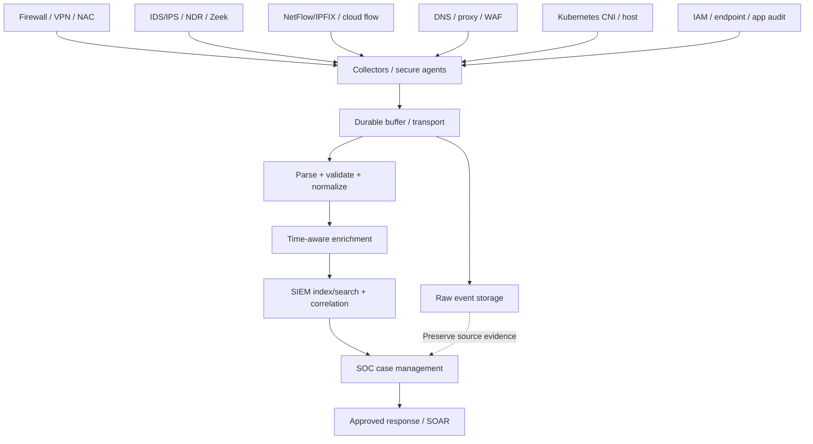
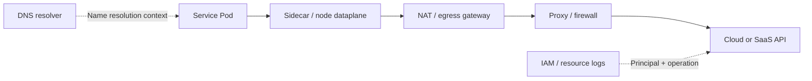
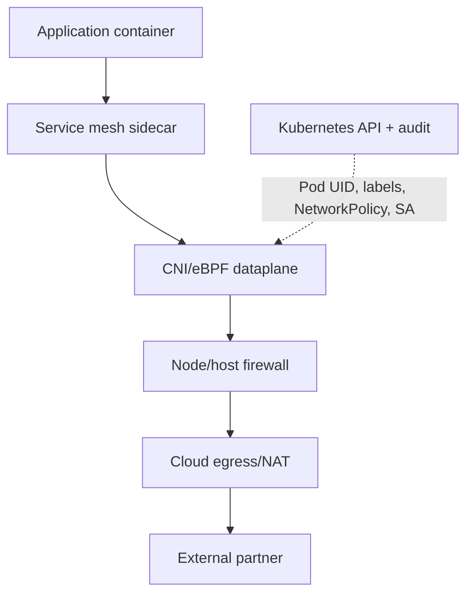
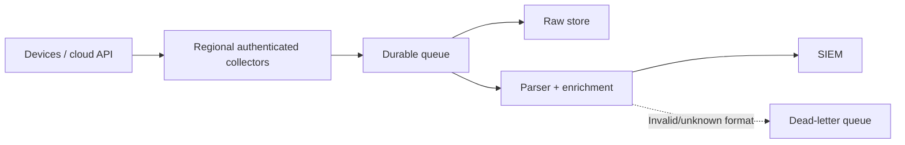
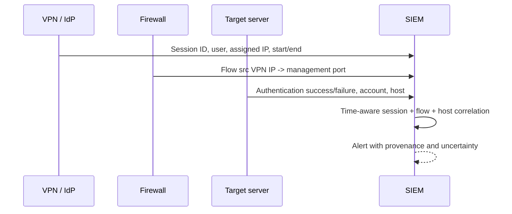
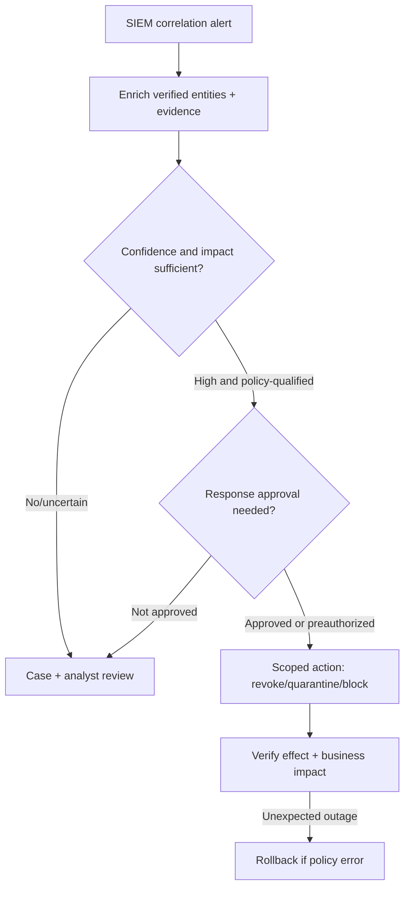

# Tích hợp network event vào SIEM: kiến trúc thu thập, chuẩn hóa, tương quan và ứng phó

## 1. Vì sao phải đưa sự kiện mạng vào SIEM?

Một hệ thống doanh nghiệp có thể triển khai firewall, VPN, IDS/IPS, DNS security, WAF và nhiều lớp phân đoạn mạng nhưng vẫn gặp khó khăn khi xảy ra sự cố: **dữ liệu về cùng một hành vi nằm rải rác ở nhiều thiết bị và không cùng định dạng**.

Ví dụ giả định:

```text
10:05:01  VPN gateway: user A kết nối và nhận địa chỉ 10.200.12.8
10:05:12  Firewall: 10.200.12.8 -> 10.50.7.9:445, ALLOW
10:05:13  IDS: phát hiện dấu hiệu truy cập SMB bất thường
10:05:17  Windows/EDR: một tiến trình mới mở kết nối mạng
10:05:20  IAM: quyền truy cập file share được sử dụng
```

Nếu chỉ đọc log firewall, người phân tích chưa chắc biết **user nào đứng sau VPN IP**. Nếu chỉ xem IDS, một chữ ký có thể chỉ ra **nghi vấn**, không khẳng định khai thác thành công. Để có bức tranh đáng tin, cần kết hợp network events, identity/session mapping, endpoint và application audit.

**SIEM (Security Information and Event Management)** giúp thu thập, lưu trữ, tìm kiếm, chuẩn hóa, liên kết và phát hiện các dấu hiệu an ninh từ nhiều nguồn. Trong mô-đun **SECURITY_NETWORK_SECURITY**, việc tích hợp network telemetry vào SIEM là cầu nối giữa **quan sát lưu lượng**, **phòng vệ mạng nhiều lớp**, **truy vết sự cố** và **phản ứng có kiểm soát**.

> **Nguyên tắc trung tâm:** Một sự kiện mạng là **bằng chứng tại một điểm quan sát**, không mặc nhiên là chân lý về người dùng, dữ liệu đã truyền hoặc mức độ thành công của tấn công. SIEM phải bảo tồn nguồn và ngữ nghĩa của bằng chứng khi tương quan.

### 1.1. Mục tiêu học tập

Sau bài này, người học có thể:

1. Mô tả đường đi **network sensor → collector → transport/buffer → parser → normalized schema → enrichment → SIEM detection → case/response**.
2. Phân biệt ý nghĩa và giới hạn của **firewall, IDS/IPS, NetFlow/IPFIX, DNS, proxy, VPN, TLS, cloud flow logs và Kubernetes/CNI**.
3. Xây **event contract** có thời gian, nguồn, đích, direction, protocol, policy verdict, identity, sampling và provenance.
4. Tương quan **NAT, DHCP, VPN address pools, Pod IP, load balancer, proxy, DNS và application requests** đúng theo thời điểm.
5. Thiết kế detection rules, correlation windows, baselines, suppression, severity và kiểm thử false positives.
6. Bảo vệ ingestion pipeline, kiểm soát retention/privacy, đo data quality và triển khai SIEM ổn định.
7. Viết runbook điều tra, mẫu truy vấn và ma trận nghiệm thu có thể áp dụng trong môi trường được cấp phép.

## 2. Network monitoring, telemetry, SIEM, NDR, IDS/IPS và SOAR khác nhau thế nào?

| Thành phần | Câu hỏi chính | Đầu ra điển hình | Giới hạn |
|---|---|---|---|
| **Network monitoring** | Mạng có hoạt động, nghẽn hoặc mất gói không? | throughput, loss, latency, interface counters | không tự kết luận hành vi độc hại |
| **Network telemetry** | Thiết bị và luồng mạng quan sát thấy sự kiện gì? | flows, DNS records, logs, counters, packet metadata | có thể thiếu identity/business context |
| **IDS** | Có dấu hiệu traffic khớp chữ ký/hành vi nghi vấn không? | alert + metadata | alert không tự chứng minh khai thác thành công |
| **IPS** | Traffic nào bị chính sách ngăn/cắt? | block/drop verdict và threat alert | một block không chứng minh mọi đường khác bị chặn |
| **NDR** | Hành vi mạng nào bất thường ở nhiều hosts/flows? | anomaly/detection, entity behavior | baseline, model và coverage có giới hạn |
| **SIEM** | Các nguồn sự kiện cùng nói gì về an ninh và chủ thể? | search, correlation, detection, cases | không trực tiếp quan sát flow ngoài nguồn được tích hợp |
| **SOAR** | Bước xử lý/approval/response nào có thể được điều phối? | playbook, ticket, action audit | tự động sai có thể gây outage |
| **XDR/EDR** | Endpoint/process/identity và nhiều signals hỗ trợ kết luận gì? | host detection, process lineage | không thay mọi network/source-of-truth |
| **Observability stack** | Dịch vụ hoạt động như thế nào? | metrics, traces, logs, SLO | một HTTP 500 không mặc nhiên là sự cố an ninh |

Các sản phẩm trên có thể **trùng tính năng**; tên gọi không thay việc kiểm tra **khả năng cụ thể, schema, logs và điểm thực thi**. SIEM có giá trị khi tạo **bối cảnh và evidence chain**, không phải chỉ vì đưa mọi log vào một dashboard.

### 2.1. Event, alert, incident không đồng nghĩa

- **Event:** một điều đã được logger quan sát hoặc ghi nhận.
- **Detection/alert:** điều kiện đã chọn các events cần xem xét.
- **Incident:** vụ việc có căn cứ và mức tác động được xác định theo quy trình tổ chức.

Hàng nghìn firewall denies có thể thuộc một lỗi retry; một cloud API export thành công tới tenant sai có thể tạo ít network events nhưng vẫn có tác động lớn.

## 3. Kiến trúc tham chiếu từ nguồn tới case



Đây là **mô hình chức năng**. Một SIEM có thể tích hợp collector, parser, data lake và case management trong cùng sản phẩm; tổ chức khác dùng pipeline/broker độc lập. Không bắt buộc phải mua từng thành phần của sơ đồ.

### 3.1. Mặt dữ liệu và mặt điều khiển

**Data plane:** log events được gửi qua agents/collectors tới lưu trữ và detection pipeline.

**Control plane:** quản lý **nguồn nào được bật, parsing rules, schema mappings, routing, credentials, policy phiên bản, retention và detection deployments**.

Nếu attacker có quyền sửa **SIEM collection filter** hoặc tắt source logging, họ có thể che hoạt động dù firewall vẫn nhận packet. Cần audit và bảo vệ **cả data plane lẫn control plane**.

### 3.2. Vai trò của raw events

Canonical schema giúp tìm kiếm thống nhất nhưng parser có thể sai. Giữ **raw source payload, source type/version, ingest metadata và integrity controls** để người điều tra xác minh một trường “normalized” đến từ đâu.

## 4. Bản đồ điểm quan sát và phạm vi thực

Một request có thể đi qua **nhiều lớp**:



Tùy kiến trúc có thể **không có một số hop**, hoặc traffic private endpoint/same-node không đi qua central firewall. Do đó mỗi nguồn log phải ghi:

1. **Vantage point**: ENI/NIC, interface, container, node, proxy listener, firewall policy, resolver hay cloud API.
2. **Coverage**: IPv4/IPv6, TCP/UDP/ICMP, nội bộ/Internet, unicast/multicast nếu có.
3. **Direction semantics**: egress của NIC? outbound của Pod? client→proxy?
4. **NAT stage**: địa chỉ trước hay sau DNAT/SNAT?
5. **Sampling/aggregation**: packet, flow, request, query hay rollup.
6. **Visibility**: có payload, certificate, hostname, request path hay chỉ 5-tuple?
7. **Logging gaps**: drop/skip events, retention, unsupported protocols và source downtime.

### 4.1. Một flow xuất hiện nhiều lần không phải nhiều cuộc tấn công

Cùng một connection có thể tạo events ở host, CNI, VPC, firewall và proxy. Khi tổng hợp bytes, nếu cộng tất cả sẽ **đếm trùng**. SIEM nên giữ **observation_point** và source-specific flow ID/tuple/time để tránh suy số bytes bị exfil lớn hơn thực tế.

### 4.2. Traffic không thấy cũng chưa phải không tồn tại

Không có flow trong SIEM có thể do **source không bật, CNI bypass, hostNetwork, log sampling, collector quá tải, IPv6 path, NodeLocal DNS cache hoặc sai index/time filter**. Mọi kết luận “không có truy cập” cần nói rõ mức coverage.

## 5. Chọn network event sources dựa trên use case

| Source | Dữ liệu đáng giá | Detection/use case |
|---|---|---|
| Firewall/security group/NSG | src/dst, protocol, policy verdict, rule ID | denied path, drift, lateral movement |
| IDS/IPS | signature, rule ID, flow, severity, protocol metadata | exploit attempt, suspicious payload/behavior |
| NDR | entity behavior, baseline deviation, flow context | scan, beaconing, unusual service dependencies |
| NetFlow/IPFIX/sFlow | flow/packet sampling, volume, timing, tuple | traffic spikes, new destinations, large flows |
| DNS/CoreDNS | qname, qtype, rcode, answers, latency | new domains, DNS tunneling hypotheses, resolver health |
| HTTP proxy/SWG | host/URL metadata, auth, CONNECT, policy | unapproved SaaS, proxy bypass, risky downloads |
| WAF/API gateway | HTTP route, action, rule, client identity | exploit attempts, abnormal API use |
| VPN/remote access | authenticated principal, device, assigned tunnel IP/time | source attribution và remote access |
| NAC/802.1X | MAC/device session, network admission, VLAN | endpoint presence/context |
| Cloud VPC/VNet flow | ENI/VNIC/5-tuple, bytes, action theo schema | egress, cross-subnet/network anomaly |
| Kubernetes CNI/eBPF | Pod UID, namespace, network policy verdict | Pod east-west/egress control |
| Host/EDR | process exec/connect, file activity, endpoint identity | gắn network flow với process |
| IAM/SaaS/data-plane audit | principal, API action, resource, result | xác minh exfil/permission misuse |

### 5.1. Ưu tiên bằng giả thuyết bảo mật

Nếu mục tiêu là “phát hiện download malware sau SSRF”, flow logs cần kết hợp **host process/app request và proxy**. Nếu mục tiêu là “user từ VPN truy cập server quản trị”, cần **VPN IP assignment + firewall + admin authentication**. Nếu muốn xác nhận “dữ liệu sang cloud storage ngoài tenant”, **cloud API/DLP resource audit** quan trọng hơn một DNS record.

### 5.2. Chiến lược tối thiểu

Khi ngân sách/khả năng ingestion có hạn, bắt đầu từ **critical assets + nguồn có giá trị điều tra cao**, ví dụ:

- Perimeter/segmentation firewall và VPN authentication.
- DNS/security resolver telemetry.
- Critical IDS/IPS alerts và NDR high-confidence findings.
- Cloud API/data-plane operations nhạy cảm và IAM changes.
- Critical east-west workloads và admin endpoints.
- CNI/host events ở những namespaces/services có dữ liệu nhạy cảm.

Không thể cam kết “đủ coverage” chỉ từ danh sách chung: **asset inventory và threat model** của môi trường phải quyết định mức ưu tiên.

## 6. Firewall events: đọc policy verdict đúng nghĩa

Firewalls thường log **allow/deny/drop/reject**, cùng source/destination, protocol/port, interface/zone, policy rule, connection/session ID và time theo từng thiết bị.

### 6.1. Không gộp các loại verdict thành một nhãn mơ hồ

| Event | Ý nghĩa thường gặp | Điều cần kiểm |
|---|---|---|
| **ALLOW/ACCEPT** | traffic được phép tại điểm thực thi này | kết nối/API có thành công không, có firewall khác không |
| **DROP** | packet/flow bị bỏ theo policy/cơ chế | logging point, lý do, retries |
| **REJECT** | từ chối và có thể phản hồi lỗi | không coi là authentication denial |
| **RESET/TERMINATE** | thiết bị có thể cắt connection | server/client outcome, session semantics |
| **THREAT/IPS BLOCK** | rule an ninh kích hoạt action | signature confidence, actual exploit impact |
| **NO_LOG** | không có event được ghi | không đồng nghĩa traffic không xảy ra |

Mỗi vendor định nghĩa action theo schema. Parser phải giữ **raw vendor action** đồng thời mapping sang canonical outcome với độ chắc chắn.

### 6.2. Source zone, destination zone và rule ID

Lưu rule ID/version, interface, VRF/VLAN, source/destination zone nếu có. Khi điều tra một allow sau policy change, cần truy ngược **rule nào đã cho phép**, không chỉ lưu `ALLOW`.

### 6.3. Stateful sessions

Một số firewalls log khi **session start**, một số khi **session end**, một số cả hai. Bytes thường xuất hiện ở end record hoặc được cập nhật định kỳ. Không mặc định `bytes=0` trên start record nghĩa không truyền dữ liệu.

## 7. IDS/IPS: alert là tín hiệu, không phải bản án

Các engines như **Suricata, Snort** hoặc thiết bị NDR/IPS có thể phát events khi traffic khớp chữ ký, hành vi hoặc protocol anomaly.

### 7.1. Thuộc tính nên giữ

- Engine/vendor/version, signature/rule ID, signature revision.
- Timestamp, src/dst, protocol, flow ID, direction.
- Severity/priority/category theo engine, không ép thành risk score thống nhất thiếu căn cứ.
- Alert action, drop/blocked state nếu engine thực sự làm inline IPS.
- Event protocol context (HTTP, DNS, TLS, file) theo mức sensor thấy.
- Sensor/interface/tenant/network segment và packet sample reference nếu có.

### 7.2. Ví dụ alert Suricata EVE JSON rút gọn

```json
{
  "timestamp": "2026-11-28T09:02:11.123456+00:00",
  "event_type": "alert",
  "src_ip": "10.30.4.7",
  "src_port": 51922,
  "dest_ip": "198.51.100.40",
  "dest_port": 443,
  "proto": "TCP",
  "flow_id": 123456789,
  "alert": {
    "signature_id": 9000001,
    "rev": 1,
    "signature": "LAB Synthetic Egress Test Alert",
    "category": "Policy Test",
    "severity": 2
  }
}
```

Ví dụ **synthetic event** theo hình dạng EVE thông dụng, không phải chữ ký Suricata thực được kiểm chứng. Không import `signature_id` minh họa để kết luận nó thuộc rule set nào.

### 7.3. Cảnh báo có thể đến từ traffic hợp lệ

Payload khớp một pattern có thể phát sinh trong **security testing được cấp quyền, ứng dụng legacy, false positive hoặc traffic đã bị chặn trước đích**. Muốn xác nhận compromise cần **application outcome, target logs, host events và alert context**.

### 7.4. IPS block không chứng minh toàn mạng an toàn

Một IDS ở passive mode có thể chỉ **alert**, không block. Một IPS inline có thể chặn traffic trên **một path**, nhưng attacker vẫn có thể dùng alternate route hoặc protocol khác. Phải ghi **detection mode/engine action/enforcement point**.

## 8. Zeek và protocol analytics: nguồn metadata giàu ngữ cảnh

**Zeek** có thể phân tích network protocols và sinh **structured logs** như connection, DNS, HTTP, TLS/SSL hoặc các log chuyên biệt tùy scripts/packages, version và traffic visibility.

### 8.1. Phân biệt logs của Zeek

| Log class (tên phổ biến) | Dữ liệu | Use case |
|---|---|---|
| `conn` | orig/resp addresses, ports, proto, duration, bytes, state | new peer, high-volume flow |
| `dns` | query, QTYPE, response info, rcode | new domain, DNS anomalies |
| `http` | request method/host/URI/status khi nhìn được | URL-based analytics trong cleartext/terminated paths |
| `ssl`/TLS-related | TLS version, SNI/cert metadata theo khả năng | TLS configuration/anomalies |
| `files` | metadata về file được thấy trong protocol | file transfer analysis, không mặc định có mọi payload |
| `notice` | thông báo hành vi/sự kiện từ policies/scripts | alert enrichment |

### 8.2. Zeek `uid` vs IP tuple

Zeek `uid` là identifier hữu ích để liên kết records **cùng logical connection trong phạm vi sensor/log context**, không thay thế end-to-end request ID hoặc user identity. Trên nhiều sensors, cần thêm **sensor ID/time/tuple**. IP addresses trước/sau NAT và encrypted protocols có thể làm đối chiếu khó.

### 8.3. Không coi Zeek là full packet capture

Zeek có thể chạy trên mirrored traffic và phân tích protocol, nhưng logs không đồng nghĩa **PCAP đầy đủ**. Nếu cần packet evidence, phải có **capture được cấp phép với retention/privacy/capacity phù hợp**, hoặc nhận rằng không thể tái tạo payload đã mã hóa từ metadata.

## 9. NetFlow, IPFIX, sFlow: quan sát flow với giới hạn riêng

Các dạng **flow telemetry** cho phép phân tích traffic mà không lưu mọi packet. Cần phân biệt:

| Công nghệ | Khái niệm | Điểm cần biết |
|---|---|---|
| NetFlow (các phiên bản) | flow records được exporter thiết bị tạo | field set phụ thuộc phiên bản/thiết bị |
| **IPFIX** | chuẩn hóa xuất flow information dùng templates/Information Elements | phải nhận đúng templates, enterprise-specific fields |
| **sFlow** | kiến trúc sampling và counter reporting | không đồng nghĩa full flow accounting |

### 9.1. Template và version quan trọng

Một collector IPFIX có thể nhận **template records** và **data records**; nếu mất template hoặc collector parser sai enterprise fields, SIEM có thể đọc sai ports/bytes. Theo dõi **template state, exporter ID, sequence/loss, schema version và invalid messages**.

### 9.2. Sampling làm thay ý nghĩa volume

Sampling 1:N có thể giúp ước tính traffic nhưng **không chứng minh mọi flow nhỏ đã được nhìn thấy**. Khi có scaling/estimation, log phải ghi **sampling policy/rate** và kết quả là **ước lượng**. Không dùng sample không đầy đủ để kết luận chắc không có low-and-slow exfil.

### 9.3. Flow record không cho payload hay user identity

Từ một flow record có thể biết **đường và cường độ giao tiếp**, nhưng không biết nội dung file hoặc cloud tenant. Kết hợp DNS, proxy, host, IAM và application data-plane logs để đánh giá tác động.

## 10. DNS logs: nguồn hostname, không phải bằng chứng đã truy cập đích

DNS logs có thể chứa **QNAME, QTYPE, RCODE, answer, resolver/server, query time, cache/forward stats** theo implementation.

### 10.1. Lý do cần DNS trong SIEM

- Điều tra **new domains, suspected DNS exfiltration, suspicious TXT/long subdomains**.
- Xác định hostname mà process/Pod quan tâm gần thời điểm outbound flow.
- Giải thích app không kết nối được do DNS timeout/NXDOMAIN/SERVFAIL.
- Phát hiện bypass tới **resolver không được phép** hoặc DoH/DoT endpoints theo khả năng.
- Tạo baseline approved service discovery.

### 10.2. Không ánh xạ IP thành domain một cách vĩnh viễn

DNS answers thay bởi **TTL, load balancing, CDN, split-horizon, resolver và thời điểm**. Một bản ghi DNS hiện tại không chứng minh IP đích của flow tuần trước đã được phân giải từ cùng domain.

### 10.3. Các đường DNS log có thể không thấy

- Local OS/application caches.
- **NodeLocal DNSCache** hoặc caching layer khác.
- Direct IP destinations.
- Custom DNS, DoH/DoT hoặc DNS library riêng.
- Query được forward từ resolver chung, làm mất origin principal.

Khi join DNS→network flow, giữ **source resolver/client context, timestamp window và attribution confidence**; không ép mọi IP có một hostname duy nhất.

## 11. Proxy, WAF và VPN events: người dùng và phiên xuất hiện ở đâu?

### 11.1. HTTP(S) proxy/SWG

Một proxy có thể ghi **client identity, proxy auth, request method, destination host, HTTP status, CONNECT authority, policy ID và response size**. Tuy nhiên **CONNECT 200** chỉ nói proxy đã cấp tunnel; không tự biết application data trong TLS tunnel nếu không terminate và có inspection phù hợp.

### 11.2. WAF/API gateway

WAF có thể ghi rule match, URI, HTTP method, bot/threat signals và action. Một WAF block không chứng minh backend đã bị khai thác. Ngược lại, API call được WAF allow vẫn phải qua **application authentication và object-level authorization**.

### 11.3. VPN/Zero Trust Network Access

Để gắn firewall source IP với user, cần **VPN session/assigned IP/timestamps**, IdP authentication, MFA và device posture khi có:

```text
principal + device + VPN session ID
   ↕ time-bounded address mapping
assigned VPN IPv4/IPv6 address
   ↕ network flow / firewall log
requested resource and action
```

Không gán **VPN pool IP** cho user hiện tại khi điều tra flow cũ; IP có thể được cấp lại. Ghi **session start/end và clock skew**.

### 11.4. NAC/802.1X và Wi-Fi

NAC events có thể cho biết thiết bị/user được vào **SSID/VLAN/dACL** và thời gian. Chúng là context về **network admission**, không tự cấp quyền đến application/data. Một source ở corporate Wi-Fi vẫn phải được xác thực/ủy quyền khi gọi API.

## 12. TLS và QUIC: SIEM nên biết giới hạn visibility

Lưu lượng có TLS thường chỉ lộ **network metadata** cho passive sensors; một số TLS handshake fields có thể quan sát tùy protocol/version và cấu hình.

| Thông tin | Có thể thấy ở đâu | Lưu ý |
|---|---|---|
| IP/port/protocol, bytes, duration | L3/L4 flow sensor | NAT và sampling |
| SNI trong một số TLS ClientHello | TLS-aware sensor khi không bị che | **ECH** có thể giấu tên thật |
| Server certificate identity | TLS endpoint hoặc phù hợp với sensor/version | TLS 1.3/QUIC bảo vệ nhiều handshake fields |
| HTTP method/path/body | terminating proxy, server logs hoặc nơi giải mã được cấp quyền | passive encrypted flow không có |
| HTTP/3/QUIC metadata | QUIC-aware sensor/endpoint | UDP/443, encryption, connection migration |
| JA3/JA4-like TLS fingerprint | sensor hỗ trợ, theo definition/version | heuristic, không phải identity hoặc chữ ký malware chắc chắn |

### 12.1. Không dùng SNI như user identity

SNI (khi nhìn được) cho biết hostname client yêu cầu trong handshake, **không chứng minh account/tenant hoặc hành động API**. Một SaaS host có thể phục vụ nhiều tổ chức. Cloud API/DLP/backend logs là nguồn xác minh tài nguyên.

### 12.2. TLS inspection có chi phí và hệ quả

Nếu tổ chức giải mã traffic tại proxy theo chính sách, phải đánh giá **quyền riêng tư, CA/key security, certificate pinning/mTLS compatibility, latency, credentials exposure, ECH/QUIC và jurisdiction**. Không khuyến nghị ghi mọi HTTPS payload vào SIEM chỉ để tăng detection data.

### 12.3. Mã hóa không chứng minh vô hại

Một kết nối TLS hợp lệ tới service được phê duyệt vẫn có thể chuyển dữ liệu trái policy tới **tenant sai**. Điều tra cần **identity, resource, action và data classification**.

## 13. Network events trên AWS, Google Cloud và Azure

### 13.1. AWS

Các nguồn thường có giá trị:

- **VPC Flow Logs:** flow metadata cho VPC/subnet/network interface được cấu hình; không phải PCAP hoặc HTTP request log.
- **AWS Network Firewall logs:** network/threat/flow insights theo cấu hình logging và rule sets.
- **Route 53 Resolver query logs:** DNS queries tại các resolver/phạm vi hỗ trợ khi đã bật.
- **CloudTrail management/data events:** chủ thể thực hiện thay đổi network/IAM hoặc data API operation; một số data events cần enable và scope riêng.
- **Elastic Load Balancing access logs** khi sản phẩm/load balancer hỗ trợ và đã cấu hình.
- **WAF logs**, VPC endpoints/resource audit theo dịch vụ.
- **VPN/Direct Connect/Transit Gateway** liên quan logs/metrics theo tính năng cụ thể.

VPC Flow Logs có **record format, version, aggregation intervals và trạng thái mất dữ liệu** theo cấu hình. Có thể thấy fields khác nhau ở ENI workload và thiết bị NAT/endpoint; giữ nguyên semantics raw để đối chiếu.

### 13.2. Google Cloud

Nguồn thường cân nhắc:

- **VPC Flow Logs** theo loại tài nguyên và scope hỗ trợ, với sampling/aggregation cần ghi rõ.
- **Firewall Rules Logging / Cloud NGFW** theo policy và log configuration.
- **Cloud NAT logs** về translation/connection events trong phạm vi được bật.
- **Cloud DNS logging** và resolver telemetry theo feature.
- **Cloud Audit Logs** cho API/resource actions, gồm Data Access khi được hỗ trợ/bật.
- **Cloud Load Balancing/Cloud Armor logs**, các dịch vụ proxy/endpoint tương ứng.
- **GKE audit/CNI dataplane telemetry** nếu có triển khai.

Không suy **một flow log** đồng nghĩa tất cả packets/requests đều xuất hiện. Đánh giá **sampling rate, aggregation window, resource metadata, time lag và liên kết tới IAM principal**.

### 13.3. Azure

Nguồn cần xét theo deployment/product lifecycle:

- **Virtual Network Flow Logs** và network diagnostic logs hiện được hỗ trợ.
- **Azure Firewall** network/application/threat intelligence logs tùy SKU/policy.
- **NSG/network telemetry legacy** nếu môi trường cũ còn dùng, lưu ý lịch thay thế/khả dụng theo tài liệu nền tảng.
- **Azure Activity Logs** về control-plane changes và resource-specific diagnostic logs.
- **Entra sign-in/identity logs**, VPN Gateway/ExpressRoute/Private Link observations theo khả năng.
- **Application Gateway/WAF, Azure DNS, AKS/CNI và data-plane resource audit**.

Tên resource, log categories, query schema và dịch vụ logging có thể thay theo sản phẩm/phiên bản. Một bài học không thể coi các query trong ba cloud là **copy-paste tương đương**.

### 13.4. Cloud API được phép nhưng sai tài nguyên

Giả sử backup job gọi đúng cloud storage API trên private endpoint. VPC flow có thể báo `ACCEPT`, nhưng chỉ **API data events/resource logs** mới giúp xác nhận **bucket/account/object/action** và kết quả theo dịch vụ. SIEM phải lưu ý phân biệt **network authorization** và **data-plane authorization**.

## 14. Kubernetes, CNI, containers và service mesh

Trong Kubernetes, source IP không phải danh tính bền:

- Pod có thể **restart, thay node, dùng lại IP**.
- Một node chạy nhiều Pods; NAT có thể hợp traffic.
- Pod containers thường chia sẻ **network namespace**, nhưng process namespaces có thể khác.
- **Service ClusterIP, DNAT, EndpointSlice, hostNetwork, NodeLocal DNSCache, sidecar/service mesh** thay đổi đường đi.
- NetworkPolicy semantics phụ thuộc **CNI implementation** và các allow rules có tính cộng dồn.

### 14.1. Những fields nên lưu

| Metadata | Vai trò trong SIEM |
|---|---|
| `cluster_id` | phân biệt các cluster dùng cùng CIDR/name |
| `namespace` | ranh giới tên/organization, không phải identity đủ |
| `pod_uid` | gắn Pod theo vòng đời, tránh dùng name/IP duy nhất |
| `pod_ip` + validity interval | map flow theo thời điểm |
| `node_id` | correlate host/CNI/NAT |
| `container_id` + image digest | process attribution và build context |
| `service_account` / workload identity | AuthN/API resource context |
| `deployment/owner_reference` | nguồn phát sinh workload theo policy |
| `network_policy_id` + verdict | policy thực tế cho phép/từ chối |
| `service/endpoint metadata` | ClusterIP→backend association |
| `sidecar/mesh identity` | nhận biết proxy vs application flow |

### 14.2. Sơ đồ các điểm log



Không phải mọi cluster có service mesh và không phải mọi Pod traffic đi qua từng điểm; đây là **sơ đồ quan sát mẫu**.

### 14.3. Pod IP lookup phải time-aware

Không làm:

```text
find current Pod where pod.ip == old_flow.src_ip
→ conclude that current Pod generated the old flow
```

Làm:

```text
find Pod UID with matching
  cluster + network namespace/node
  + source IP
  + event timestamp within Pod's lifetime
  + CNI/host flow context when available
```

Nếu IP đã được tái sử dụng hoặc thiếu events, **đánh dấu attribution chưa đủ**.

### 14.4. NetworkPolicy log không tự là ingress/egress firewall kết luận cuối

Rule được Kubernetes API chấp nhận nhưng CNI không enforce, flow bypass node/hostNetwork hoặc policy khác allow vẫn có thể làm đường đi khác dự kiến. Nên tích hợp **policy intent từ API** và **policy verdict từ dataplane** với test traffic có kiểm soát.

## 15. Các đường ingest network events vào SIEM

| Cách truyền | Dùng khi | Những việc cần thiết kế |
|---|---|---|
| **Syslog UDP** | thiết bị legacy hoặc môi trường chấp nhận loss | mất gói/không ack; tránh dùng làm kênh bằng chứng duy nhất |
| **Syslog TCP** | thiết bị hỗ trợ stream có backpressure ở mức transport | framing, reconnect, queue, TLS ngoài TCP nếu cần bảo mật |
| **Syslog over TLS** | network appliance tới collector qua kênh xác thực | CA/truststore, mutual auth theo khả năng, certificate rotation |
| **Structured JSON logs** | Suricata EVE, Zeek JSON, cloud exports | schema version, escape/encoding, record boundaries |
| **HTTPS ingestion API** | cloud/SaaS/agent pull hoặc push | authentication, pagination, cursor, rate limits, retries, idempotency |
| **Event streaming/broker** | nhiều sources, burst traffic, durable buffer | partition/order, replay, duplicates, retention |
| **Agent/sidecar/daemonset** | host/Kubernetes logs và metadata enrichment | privileges, CPU/memory, updates, failure isolation |
| **Cloud-native event export** | managed logging→SIEM/cloud data lake | subscriptions, permissions, cost, delivery semantics |
| **File tail/rotation collection** | appliance/legacy host local logs | rotation, checkpoints, partial records, disk pressure |
| **OpenTelemetry logs/OTLP** | ứng dụng/agent hỗ trợ standard telemetry | resource attributes, semantic conventions, security controls |

**Không có transport nào tự bảo đảm exactly-once end-to-end** trong mọi lỗi. Cần hiểu delivery guarantees, khả năng retry/replay và dedup strategy.

### 15.1. Syslog over UDP và độ tin cậy

UDP có thể thuận tiện cho appliances nhưng **không ack, retransmit hoặc backpressure ở mức ứng dụng theo syslog UDP đơn giản**. Mất gói lúc traffic spike khiến SIEM thiếu bằng chứng đúng khi cần. Nếu buộc dùng, nên có local buffer/relay, thiết kế monitoring source health và ghi nhận risk.

### 15.2. Syslog TCP và TLS

TCP giảm một số loss trên đường truyền, nhưng ứng dụng vẫn phải xử lý **sender crash, collector downtime, queue overflow, record framing và retries**. TLS giúp bảo vệ kênh khi xác thực certificate đúng; không tự chứng minh log bên trong là thật nếu thiết bị đã bị chiếm.

### 15.3. Pull API và cursor

Khi SIEM chủ động lấy logs từ SaaS/cloud:

- Dùng **least-privilege API credential**.
- Hỗ trợ **pagination, checkpoint/cursor và backfill**.
- Cho phép **late events** và API eventual consistency.
- Xử lý 429/rate limiting bằng retry/backoff hợp lý.
- Không tự bỏ dữ liệu vì clock/time filter sai.
- Kiểm soát cursor nếu source bị reset hoặc API trả results trùng.

## 16. Syslog RFC và các định dạng log phổ biến

**Syslog** không nhất thiết là một định dạng giống nhau ở mọi sản phẩm. Các môi trường có thể gặp:

- **RFC 3164-style legacy syslog** với format và semantics không nhất quán.
- **RFC 5424 syslog** với structured fields và header chuẩn hơn.
- **RFC 5425 syslog over TLS** cho một kiểu vận chuyển được định nghĩa.
- **CEF/LEEF** hay vendor-specific key-value/JSON được đóng gói trong syslog message.
- Product-native event APIs với schema riêng.

### 16.1. Ví dụ RFC 5424-like

```text
<134>1 2026-11-28T09:12:03Z fw01.example.com edge-fw 1024 fw-accept [example@32473 rule="allow-partner" policy="v12"] src=10.20.3.4 dst=198.51.100.10 spt=50841 dpt=443 proto=tcp action=allow
```

Đây là **minh họa cấu trúc**, không phải bản ghi thực hay bảo đảm tương thích mọi parser/product. Phân tách PRI, VERSION, TIMESTAMP, HOSTNAME, APP-NAME, PROCID, MSGID, STRUCTURED-DATA và MSG theo chuẩn tương ứng. Không đơn giản `split(" ")` để parse toàn bộ vì structured data/quoted values có thể chứa khoảng trắng và ký tự escape.

### 16.2. Ví dụ CEF-like

```text
CEF:0|ExampleVendor|ExampleFirewall|1.0|D-1001|Egress connection allowed|3|src=10.20.3.4 dst=198.51.100.10 spt=50841 dpt=443 proto=tcp act=allow
```

CEF có cú pháp header/extensions và escaping riêng; sample này chỉ minh họa. **Không lấy priority header** làm severity chuẩn thống nhất giữa các sản phẩm nếu chưa map rõ.

### 16.3. Parser cần xử lý gì?

1. UTF-8/encoding và invalid characters.
2. Multiline/record framing, length prefixes hoặc line delimiters theo transport.
3. Quoted values, escaped delimiters, structured data và vendor extensions.
4. IP/IPv6, ports, booleans, timestamps, bytes, action enumerations.
5. Schema version changes và optional/missing fields.
6. Raw event preservation khi không parse được.

**Không nên bỏ event lỗi parse mà không có cảnh báo.** Lưu dead-letter stream có kiểm soát và phân loại source/version để sửa.

## 17. Collectors, relays, buffers và cơ chế giao hàng

Mô hình ingest thực tế:



### 17.1. Vì sao cần buffer?

Network events có thể tăng vọt khi xảy ra **scan, DDoS, firewall policy change, DNS retry storm hoặc deployment**. Nếu parser/SIEM indexer chậm, buffer giúp tách tốc độ sản xuất events và tốc độ tiêu thụ.

Nhưng buffer hữu hạn; phải đo **queue depth, oldest event age, disk free, retry count, consumer lag, drop count và throughput**.

### 17.2. Delivery semantics

- **At-most-once:** có thể mất event nhưng ít duplicate.
- **At-least-once:** retry có thể tạo duplicate, cần event IDs/dedup.
- **Effectively-once:** xây ở application bằng idempotent writes/keys và replay logic, không tự nhận “exactly once” nếu chưa kiểm chứng mọi hops.

Một firewall log event không nhất thiết có **global unique ID**. Khi tạo synthetic ingest ID/hash cần lưu **source ID, raw payload, timestamp/sequence/offset**, và ghi nhận rủi ro collision khi source events trùng nhau.

### 17.3. Replay và backfill

SIEM có thể index lại historical events khi sửa parser hoặc tiếp nhận late logs. Detection phải tránh **bắn lại hàng nghìn alerts cũ** như sự kiện mới nếu không có policy cho backfill. Ghi rõ **event time vs ingest time**, rule version và replay marker.

### 17.4. Không làm hỏng hoạt động firewall

Một security appliance không nên bị ảnh hưởng availability chỉ vì SIEM endpoint offline. Thiết kế **local queue, failover collectors và logging delivery behavior** theo khả năng sản phẩm; không để synchronous logging gây nghẽn data path ngoài chủ ý vận hành.

## 18. Bảo mật kênh ingest: SIEM là mục tiêu nhạy cảm

**Network log chứa topology, IP, DNS names, user sessions, security rules và dấu hiệu incident**. Nếu collector hoặc transport bị chiếm, attacker có thể **đọc, làm giả, sửa, xóa hoặc flood events**.

Các kiểm soát:

- Authenticated senders bằng **mTLS, signed API requests, agent credentials hoặc cloud IAM** theo tính năng.
- TLS transport và **certificate validation**, không tắt xác minh để “gửi được log”.
- Least-privilege tokens/service accounts, secrets rotation và scope theo source.
- **Network segmentation** giữa appliances, collectors, brokers và SIEM.
- Source allowlist / device registry, kiểm soát **log spoofing**.
- Rate limiting/quotas hợp lý; chống một nguồn flood làm mất logs của hệ thống khác.
- Collector hardening, patching, image provenance và privilege minimization.
- Audit thay đổi **log forwarding config, pipeline transforms, parsing rules, index permissions và retention**.
- Encryption at rest, read access theo vai trò và protection của raw evidence.

### 18.1. Không tin header `device_id` do bất cứ client nào khai

Nếu collector nhận HTTP JSON từ Internet với trường `device_id: core-fw-01`, nó **không tự chứng minh** source là firewall thật. Cần xác thực client principal/certificate/API credential rồi ánh xạ sang **registered source identity** do server quản lý.

### 18.2. mTLS cũng có vòng đời

Collector trust anchors, agent certificates, expiry/revocation, CA/key rotation và time synchronization phải được giám sát. Một certificate hết hạn có thể làm pipeline ngừng thu logs dù mạng còn hoạt động.

### 18.3. Ngăn SIEM trở thành đường dữ liệu ra ngoài

Một agent log có thể chứa secrets nếu app ghi sai. Không tự chuyển toàn bộ raw logs tới bên thứ ba không có data-processing approval. Dùng **filter/redaction tại nguồn hoặc điểm ingest**, quyền dữ liệu và retention phù hợp.

## 19. Parsing: giữ nguyên semantics thay vì chỉ đổi tên trường

Một event:

```text
src=10.20.3.4 dst=198.51.100.10 action=accept bytes=22000
```

chưa xác định:

- `bytes` là gửi, nhận hay cả hai.
- `action=accept` là firewall allow hay application accept.
- IP trước hay sau NAT.
- Protocol có phải TCP không.
- Timestamp của event là start, end hay aggregation window.
- Flow đã hoàn tất hay connection attempt.

Parser tốt **không tự điền**:

```text
bytes_out=22000
http_status=200
data_exfiltrated=true
authenticated_user="alice"
```

chỉ vì một flow có `bytes=22000` và được allow. Các fields không quan sát được phải là **null/unknown**.

### 19.1. Tách ba tầng thông tin

- **Observed:** fields ghi trực tiếp từ sensor và raw provenance.
- **Derived:** tính toán từ fields có rules rõ, như duration hoặc mapping protocol number→name.
- **Enriched/inferred:** asset role, identity association, threat intel, domain ownership, tenant mapping với source/time/confidence.

Tách tầng giúp analyst trả lời một kết luận đến từ **network evidence hay inventory suy luận**.

### 19.2. Chuẩn hóa action

Không ép tất cả actions vào `allow/deny` nếu product có `monitor-only`, `alert-only`, `reset`, `drop-packet`, `block-flow`, `challenge`, `bypass`. Giữ **vendor_action** và mapping chi tiết theo product/version.

### 19.3. Parser regression

Mỗi source version cần **fixtures** cho IPv4/IPv6, missing fields, multiline, escaped content, action variants, size/time edge cases. Một firmware update thay field name có thể khiến SIEM **đột ngột mất một detection** dù log vẫn chảy vào collector.

## 20. Schema chung: ECS, OCSF, CIM và mô hình tự định nghĩa

Để tương quan đa sản phẩm, tổ chức có thể dùng:

- **Elastic Common Schema (ECS):** quy ước trường/event categories nếu nền tảng pipeline hỗ trợ.
- **Open Cybersecurity Schema Framework (OCSF):** mô hình lớp sự kiện/an ninh với phiên bản/schema mappings.
- **Splunk Common Information Model (CIM):** chuẩn field/tags/data models trong các môi trường tương ứng.
- **OpenTelemetry semantic conventions:** attributes/resource context cho logs/metrics/traces trong các use cases được hỗ trợ.
- **Canonical event contract nội bộ:** chọn fields tối thiểu, kèm adapters theo vendor.

**Không thể gắn nhãn “OCSF” hoặc “ECS” rồi dùng field tùy ý mà vẫn coi là tương thích**. Phải chọn **schema version, class/category, enum semantics, expected types và mapping tests**. Thay schema có thể ảnh hưởng tất cả detections/dashboards.

### 20.1. Nguyên tắc chọn schema

1. Hỗ trợ **raw log reference và source/schema version**.
2. Định nghĩa **time, event type, source, destination, network direction và action**.
3. Có fields cho **users/workloads/assets** nhưng không invent khi unknown.
4. Có **bytes/packets với direction và sampling semantics**.
5. Hỗ trợ **IPv6, protocol number và non-TCP ports null**.
6. Có **rule identity/producer, observation point, confidence/provenance**.
7. Bảo đảm **index/search** phục vụ use cases và data governance.
8. Kiểm schema upgrade và backward compatibility.

### 20.2. Không chuẩn hóa quá mức

Những fields riêng của IDS (signature ID), Zeek (uid), NetFlow (template ID), VPN (session ID) hay cloud (ENI/tenant) có thể **cực kỳ quan trọng để điều tra**. Có common fields nhưng vẫn giữ **vendor/source-specific extension fields**.

## 21. Event contract đề xuất để SIEM tích hợp network traffic

Một schema trung gian có thể gồm:

| Nhóm | Trường | Quy tắc |
|---|---|---|
| Provenance | `source_system`, `device_id`, `sensor_id`, `raw_event_ref` | không nhận client tự gắn identity chưa xác minh |
| Format | `schema_version`, `vendor_format`, `event_type` | parse theo đúng version |
| Timing | `event_time_utc`, `ingest_time_utc`, `flow_start/end` | không dùng ingest làm event time |
| Network | `src_ip/port`, `dst_ip/port`, `protocol`, `ip_family` | pre/post NAT nếu có |
| Direction | `direction`, `network_zone`, `observation_point` | ranh giới rõ ràng |
| Decision | `vendor_action`, `normalized_action`, `rule_id` | không ép tất cả thành allow |
| Volume | `bytes_out`, `bytes_in`, `bytes_total`, `packets` | null khi không quan sát; sampling metadata |
| Identity | `user_id`, `device_id`, `workload_id`, `pod_uid`, `process_execution_id` | xác minh bằng IdP/runtime |
| DNS/TLS/HTTP | `dns_qname`, `tls_sni`, `http_host`, `request_id` | source/visibility cụ thể |
| Destination | `dst_resource_id`, `dst_tenant_id`, `service_owner` | enrichment có provenance |
| Security | `signature_id`, `detection_rule_id`, `severity` | severity scale theo nguồn |
| Data quality | `sampling_rate`, `aggregation_window`, `parse_status`, `drop_indicator` | phục vụ coverage |
| Analysis | `attribution_confidence`, `enrichment_version` | tách observed vs inferred |

### 21.1. JSON event minh họa

```json
{
  "schema_version": "security.network.v1",
  "event_type": "network_flow",
  "source_system": "lab-edge-firewall",
  "sensor_id": "edge-01",
  "raw_event_ref": "restricted-raw-event/example-001",
  "event_time_utc": "2026-11-28T09:12:03Z",
  "ingest_time_utc": "2026-11-28T09:12:19Z",
  "observation_point": "pre-nat-firewall-interface",
  "direction": "egress",
  "src_ip": "10.20.3.4",
  "src_port": 50841,
  "dst_ip": "198.51.100.10",
  "dst_port": 443,
  "protocol": "tcp",
  "ip_family": "ipv4",
  "vendor_action": "ACCEPT",
  "normalized_action": "allow_at_observation_point",
  "rule_id": "allow-approved-partner-v12",
  "bytes_total": 22000,
  "bytes_out": null,
  "bytes_in": null,
  "sampling_rate": null,
  "workload_id": null,
  "user_id": null,
  "dst_tenant_id": null,
  "attribution_confidence": "unresolved"
}
```

Đây là **schema học thuật** không thuộc một SIEM vendor; không import như bản ghi OCSF/ECS chính thức. `198.51.100.0/24` là dải IP tài liệu. `null` có nghĩa trường không xác định từ nguồn này, **không phải 0 hoặc false**.

### 21.2. Giữ raw event và mapping version

Lưu `parser_id/version`, `source product/version`, mapping table, test fixtures, raw reference và event hash nếu phù hợp. Nếu sau này phát hiện lỗi parser, có thể **replay/re-normalize** mà không bịa lại dữ liệu gốc.

## 22. Timestamps, event time, ingest time và log correlation

Một sự kiện có thể xảy ra trước khi SIEM thấy nó:

```text
09:12:03 Event occurred on firewall
09:12:05 Device queued syslog locally
09:12:11 Collector received
09:12:19 SIEM indexed record
```

Với flow logs còn có thể có **aggregation window**; các thiết bị có **clock skew**. Khi SIEM join events theo thời gian, phải:

- Chuẩn hóa **UTC và timezone/offset**, giữ raw timestamp.
- Lưu `event_time` và `ingest_time` riêng.
- Nêu **window bắt đầu/kết thúc** của flow.
- Giám sát NTP/time sync, event lateness, out-of-order delivery.
- Xác định **detection lookback window** đủ cho API/cloud delivery delay.
- Đánh dấu **replay/backfill** không tự coi là new active attack.
- Dùng **request/session/flow IDs** để bổ trợ timestamps.

### 22.1. Clock skew gây kết luận sai

Nếu log VPN trễ 5 phút và firewall đúng giờ, SIEM có thể gán một IP vào sai **VPN session**. Với DHCP/Pod IP tái sử dụng, kết luận attribution sai có thể nghiêm trọng hơn mất một alert.

### 22.2. Không cố đúng đến miligiây khi source là rollup

Một flow record tổng hợp trong 1 phút không chứng minh packet cụ thể đến trước một identity event cách đó 0,3 giây. Ghi confidence và điều kiện overlap thay vì sắp timeline như thể mọi sự kiện có precision giống nhau.

## 23. Chống duplicate, schema drift và missing events

Trong thực tế, retries/replay hoặc nhiều collectors có thể tạo sự kiện trùng. Ngược lại, log có thể bị mất khi queue đầy hoặc parser lỗi.

### 23.1. Khi nào deduplicate?

Chỉ dedup khi có **stable event ID** hoặc khóa được kiểm chứng (source, log sequence, raw hash, time/tuple) và hiểu cơ chế nguồn. Hai firewall denies giống nhau có thể là **hai packets/retries thật**, không nên xóa tùy tiện.

### 23.2. Detect schema drift

Một firmware cập nhật:

```text
old: source_ip, destination_ip, action
new: srcIp, dstIp, disposition
```

Nếu parser không cập nhật, SIEM có thể tiếp tục nhận logs nhưng **trường normalized_action trở thành null**, làm rule không còn match. Theo dõi:

- Required-field null rate theo source/version.
- Parse/validation error rate.
- New/unmapped enum values.
- Loss of timestamp parsing.
- Volume và event-type distribution đột ngột thay.

### 23.3. Sensor-heartbeat và data pipeline SLIs

Đo:

| SLI | Ý nghĩa |
|---|---|
| Source heartbeat age | lần gần nhất thiết bị/collector gửi tín hiệu |
| Events per source per interval | volume giảm/tăng bất thường |
| Ingest latency percentiles | độ trễ thực trước detection |
| Parse success rate | phần trăm records parse được |
| Required-field completeness | src/dst/action/time đủ cho rules không |
| Dropped/skipped events | nguồn/collector/queue mất dữ liệu |
| Queue backlog/oldest age | nguy cơ late detection |
| Index freshness | dữ liệu đã search được chưa |
| Detection execution health | rule chạy đúng cadence không |
| Raw retention verification | có thể đọc lại bằng chứng gốc không |

**Không có alert khi pipeline mất dữ liệu** là một loại sự cố vận hành an ninh. Monitoring của SIEM phải có những tín hiệu này, không chỉ dashboard threat alerts.

## 24. Enrichment theo thời gian: từ IP đến tài sản và principal

Một bản ghi flow nói:

```text
src=10.42.17.8:53124 dst=10.50.7.9:445
```

Muốn hiểu ai, ở đâu, cần join:

- **DHCP lease/IPAM**: địa chỉ thuộc thiết bị nào **trong khoảng thời gian nào**.
- **VPN logs**: IP pool được gán cho user/device/session nào lúc đó.
- **NAT translation**: pre/post source tuple, gateway, time.
- **Kubernetes API/CNI**: Pod UID/node/container tại thời điểm.
- **Cloud inventory/CMDB**: instance ID, NIC, auto-scaling group, owner, environment.
- **IdP/IAM**: principal, session, role và thời hạn.
- **Proxy/trace IDs**: request và ứng dụng nào.
- **Data classification**: tài nguyên/zone có mức nhạy cảm gì.

### 24.1. Tại sao không join theo IP hiện tại?

`10.42.17.8` hôm nay có thể thuộc Pod khác hôm qua; VPN pool IP có thể được tái cấp, DHCP lease hết hạn, cloud autoscaling thay ENI. Nếu SIEM dùng **current asset lookup** cho historical flow, nó có thể gán nhầm một cảnh báo cho người dùng/ứng dụng khác.

### 24.2. Tương quan NAT

```text
Before SNAT:
  10.42.17.8:53124 -> 198.51.100.10:443

After SNAT:
  203.0.113.20:60142 -> 198.51.100.10:443
```

Tương quan cần **gateway ID + protocol + pre/post tuples + time overlap + optional session/translation ID**, không chỉ public NAT IP. Với proxy, kết nối upstream có thể là **connection mới** và không có mapping 1:1.

### 24.3. Entity resolution và confidence

| Loại liên kết | Độ tin cậy điển hình | Ghi chú |
|---|---|---|
| Authenticated API principal/request ID | cao nếu nguồn đáng tin | kiểm đúng token/session semantics |
| NAT translation entry có time/tuple | cao trong phạm vi log đầy đủ | port reuse và clock skew |
| Pod UID + lifecycle interval | cao khi orchestrator/CNI mapping đúng | kiểm node/cluster |
| Historical DNS answer + time | trung bình, tùy cache/resolver | hostname không luôn duy nhất |
| Reverse DNS/WHOIS hiện tại | chỉ là gợi ý | không chứng minh owner quá khứ |
| Threat intel IP reputation | gợi ý rủi ro | không chứng minh identity hay impact |

Lưu **source, timestamp, confidence và alternatives** khi enrichment thay đổi, thay vì ghi đè fields observed.

## 25. Thiết kế correlation rules: từ event đơn lẻ tới giả thuyết kiểm chứng được

SIEM correlation không chỉ là đếm events. Một rule tốt phải có **threat hypothesis, dữ liệu đầu vào, logic, scope, thời gian, ngoại lệ, output và cách xác minh**.

Ví dụ giả thuyết:

> “Một VPN user không thuộc nhóm quản trị tạo nhiều kết nối đến management ports trên nhiều server Production trong thời gian ngắn.”

Các điều kiện cần:

1. VPN session/assigned IP được xác minh, có **user/device/time interval**.
2. Network flow/firewall events có src/dst ports, action và timestamps.
3. CMDB/asset inventory đánh dấu **destination là Production admin server**.
4. Identity/group policy chỉ ra principal **không có grant phù hợp**.
5. Rule lọc authorized vulnerability scan và change windows, nhưng không áp ngoại lệ vô thời hạn.
6. Alert có evidence refs và chỉ báo **attempted / allowed / confirmed successful login**.

### 25.1. Event correlation khác causal proof

Hai sự kiện xảy ra gần nhau không chứng minh sự kiện A gây ra B. Firewall allow + IDS alert cùng IP/time có thể thuộc **hai flows khác nhau** sau NAT. Khi có session/flow IDs hoặc target authentication logs, mức độ chắc chắn cao hơn.

### 25.2. Rule contract

```yaml
# Mô hình quy tắc học thuật, KHÔNG phải syntax chạy được của vendor.
rule_id: NET-CORRELATION-ADMIN-LATERAL-001
owner: soc-network-detection
hypothesis: non_admin_remote_session_scans_admin_services
source_event_types:
  - vpn_session_assignment
  - firewall_flow
  - asset_inventory
window_minutes: 10
entity_key: verified_vpn_session_and_source_asset
filters:
  destination_asset_class: prod_admin
  destination_ports: [22, 3389, 445]
  distinct_destination_threshold: 5
  excluded_approved_scanners: by_expiring_inventory_record
outputs:
  - evidence_refs
  - session_id
  - source_identity_confidence
  - impacted_destinations
  - rule_version
response: analyst_triage_required
```

Lệnh và trường ở đây phục vụ thiết kế; không copy vào SIEM rồi coi là rule đã được deploy. Cần chuyển sang syntax/capability tương ứng của sản phẩm.

### 25.3. Source coverage là điều kiện của detection

Nếu VPN logs thiếu, rule có thể chỉ báo “IP trong VPN pool tạo flows” chứ **không biết user**. Thay vì tự gán bằng inventory hiện tại, cần **ghi identity_unresolved** và giảm confidence.

## 26. Những use case correlation network security đáng ưu tiên

| Use case | Tín hiệu chính | Bằng chứng bổ trợ | Sai lệch thường gặp |
|---|---|---|---|
| **East-west port scanning** | một source→nhiều ports/hosts trong thời gian ngắn | process/host, scanner allowlist | vulnerability scans, service discovery |
| **Unauthorized management access** | SSH/RDP/SMB từ source không thuộc role | VPN/IdP, target auth logs | jump host hợp lệ, admin maintenance |
| **IDS exploit alert** | signature + matching flow | WAF/backend/EDR/server errors | signature false positive |
| **Malware C2 hypothesis** | new destination, repeated callbacks, process lạ | DNS, EDR, threat intel, proxy | agents/health heartbeat |
| **Potential exfil** | egress spike/new dest | data-plane API/DLP, read/export action | backup, approved migration |
| **DNS anomaly** | high QNAME novelty/NXDOMAIN | CoreDNS/NodeLocal, app retries | search-domain amplification |
| **Proxy bypass** | direct external flow không qua required PEP | routes, proxy access log, CNI | approved private access exception |
| **Cloud account misuse** | approved API, wrong tenant/resource | IAM, data operations, org allowlist | approved partner transfer |
| **Policy drift** | firewall/network policy thay ngoài IaC | control-plane audit, GitOps diff | emergency change có ticket |
| **VPN credential misuse** | session bất thường + resource access | device posture, MFA, EDR | NAT/proxy location noise |
| **TLS downgrade/legacy protocol** | TLS metadata không theo baseline | endpoint configs, approved exception | legacy integration |
| **DDoS/traffic exhaustion** | sudden flow/packet/connection spikes | interface metrics, LB/WAF, errors | flash crowd, load test |
| **Sensitive DNS exfil hypothesis** | long unique QNAMEs + abnormal process | approved resolver, data access | domain verification/telemetry |
| **Unauthorized cloud admin endpoint** | metadata/service control API call | workload identity, host process | managed agent/SDK behavior |

### 26.1. Ưu tiên detection theo hậu quả

Một query tới domain mới từ **critical payroll database** có thể đáng điều tra hơn vài nghìn DNS queries từ test environment. Severity nên xét **asset sensitivity, policy violation, confidence, potential impact và actual outcome**, không chỉ event count.

### 26.2. Không biến ATT&CK thành checklist thiếu chứng cứ

**MITRE ATT&CK** giúp nhóm hành vi theo tactics/techniques như Discovery, Lateral Movement, Command and Control hoặc Exfiltration. Việc rule gắn ATT&CK mapping chỉ là **giả thuyết detection**, không chứng minh technique đã xảy ra. Chỉ dùng IDs/version từ tài liệu được kiểm chứng khi triển khai sản phẩm thực.

## 27. Truy vấn mẫu với schema chuẩn hóa: chọn đúng dữ liệu để điều tra

Các ví dụ SQL dưới dùng **bảng giả định** `network_events` theo event contract trong mục 21. Chúng là **truy vấn đọc dữ liệu học thuật**, không phải syntax chung cho mọi SIEM. Field types và time functions có thể cần sửa trong Splunk SPL, Kusto/KQL, Elastic ES|QL, SQL data lake, ClickHouse hoặc sản phẩm khác.

### 27.1. Đếm kết nối bị chặn tới management ports

```sql
-- Chỉ SELECT trên SIEM/lab dataset được cấp quyền.
SELECT
    source_system,
    src_ip,
    dst_port,
    COUNT(*) AS denied_records,
    COUNT(DISTINCT dst_ip) AS distinct_targets
FROM network_events
WHERE event_type = 'network_flow'
  AND normalized_action = 'deny_at_observation_point'
  AND dst_port IN (22, 3389, 445)
  AND event_time_utc >= TIMESTAMP '2026-11-28 00:00:00'
  AND event_time_utc <  TIMESTAMP '2026-11-29 00:00:00'
GROUP BY source_system, src_ip, dst_port
ORDER BY distinct_targets DESC, denied_records DESC;
```

**Lưu ý:** một source IP có thể là NAT/proxy, một deny có thể là packet/retry, destination có thể nằm ở zone không nhạy cảm. Cần **identity mapping, destination role và policy context** để tạo alert có giá trị.

### 27.2. First-seen destination theo service

```sql
-- So current window với historical window theo source role.
SELECT DISTINCT
    cur.workload_id,
    cur.dst_ip,
    cur.dst_port,
    cur.protocol
FROM network_events AS cur
WHERE cur.event_type = 'network_flow'
  AND cur.event_time_utc >= TIMESTAMP '2026-11-28 00:00:00'
  AND cur.event_time_utc <  TIMESTAMP '2026-11-29 00:00:00'
  AND cur.workload_id IS NOT NULL
  AND NOT EXISTS (
    SELECT 1
    FROM network_events AS hist
    WHERE hist.event_type = 'network_flow'
      AND hist.workload_id = cur.workload_id
      AND hist.dst_ip = cur.dst_ip
      AND hist.dst_port = cur.dst_port
      AND hist.protocol = cur.protocol
      AND hist.event_time_utc >= TIMESTAMP '2026-10-28 00:00:00'
      AND hist.event_time_utc <  TIMESTAMP '2026-11-28 00:00:00'
  );
```

**Giới hạn:** CDN/VPC endpoint IPs có thể thay, một mới deploy workload chưa có lịch sử, và historical logs có sampling. Cần so **DNS hostname, provider ownership, application release và approved destination contract**.

### 27.3. Top bytes theo nguồn quan sát

```sql
-- bytes_total có thể gồm cả hai chiều; không gọi là exfil bytes.
SELECT
    source_system,
    observation_point,
    workload_id,
    dst_ip,
    SUM(COALESCE(bytes_total, 0)) AS observed_bytes,
    COUNT(*) AS flow_records
FROM network_events
WHERE event_type = 'network_flow'
  AND event_time_utc >= TIMESTAMP '2026-11-28 00:00:00'
  AND event_time_utc <  TIMESTAMP '2026-11-29 00:00:00'
GROUP BY source_system, observation_point, workload_id, dst_ip
ORDER BY observed_bytes DESC;
```

Không cộng rows từ **các observation points khác nhau** để suy số bytes vật lý duy nhất. Cũng không coi `bytes_total` là file bytes đã upload.

### 27.4. Kiểm tra parser completeness

```sql
SELECT
    source_system,
    schema_version,
    COUNT(*) AS total_events,
    SUM(CASE WHEN event_time_utc IS NULL THEN 1 ELSE 0 END)
      AS missing_event_time,
    SUM(CASE WHEN src_ip IS NULL THEN 1 ELSE 0 END)
      AS missing_source_ip,
    SUM(CASE WHEN normalized_action IS NULL THEN 1 ELSE 0 END)
      AS missing_normalized_action
FROM network_events
WHERE ingest_time_utc >= TIMESTAMP '2026-11-28 00:00:00'
  AND ingest_time_utc <  TIMESTAMP '2026-11-29 00:00:00'
GROUP BY source_system, schema_version;
```

Không phải **mọi event type** đều phải có `src_ip` hoặc `action`; nên tính completeness theo **source event contract và loại sự kiện**. Query tổng quát này chỉ có ích để phát hiện sơ bộ drift, không được tính tất cả null là lỗi.

### 27.5. Lưu query provenance

Ghi **query version, parser version, time window, source/filter, sampling và output reference** trong case, vì replay/late events có thể làm kết quả thay đổi.

## 28. Rule logic ví dụ: phát hiện horizontal scan mà không coi mọi scan là tấn công

Một nguồn kết nối tới nhiều host trên cùng management port trong một khoảng ngắn có thể là **horizontal scan**.

```yaml
# Detection contract học thuật, KHÔNG phải Sigma/KQL/SPL chạy trực tiếp.
rule_id: NET-HORIZONTAL-PORT-ACCESS-001
entity: source_workload_or_verified_user_session
input: normalized_firewall_flow_events
window: 5m
condition:
  destination_ports: [22, 3389, 445]
  distinct_destination_host_count_gte: 12
  only_unapproved_source_roles: true
  consider_allow_and_deny_separately: true
expected_enrichment:
  - source_identity_confidence
  - destination_asset_sensitivity
  - approved_scanner_inventory
  - active_change_window
alert_fields:
  - observed_destinations
  - raw_event_refs
  - rule_version
  - evidence_gaps
```

Đây là **đề xuất logic học tập**, không phải ngưỡng phổ quát; 12 hosts/5 phút có thể quá thấp cho scanner hợp lệ hoặc quá cao với dịch vụ ít hosts. Threshold cần dựa **asset baseline và test cases**.

### 28.1. Distinct target IP khác distinct service/asset

Một load balancer/Service VIP có thể đại diện nhiều backends; một hostname có nhiều IP. Nếu detection đếm mỗi backend IP là một target, có thể tạo noise. Enrichment **asset identity/role** làm kết quả có ý nghĩa hơn.

### 28.2. Allow và deny là hai dấu hiệu khác nhau

- **Deny nhiều:** có thể là thử truy cập thất bại, scanner hoặc config retries.
- **Allow nhiều:** source có reachability, nhưng cần **target auth/endpoint outcome** mới biết có vào được service hay không.

### 28.3. Không vô hiệu hóa mọi scanner alert

Allowlist scanners nên có **owner, IP/asset identity, approved schedule, scope và expiry**, không xóa mọi event từ một CIDR vĩnh viễn. Một scanner host bị compromise vẫn có thể tạo malicious traffic ngoài scope.

## 29. Correlation nhiều sự kiện: VPN → firewall → target login

Một case hoàn chỉnh có thể xây từ:



### 29.1. Gắn đúng nguồn

Một IP thuộc VPN pool có thể được **tái cấp**. SIEM cần tìm session mà **flow event_time nằm trong interval**, xét clock skew và actual tunnel IP/NAT translations.

### 29.2. Xác minh kết quả

Firewall `ALLOW` chỉ cho phép đường; **target authentication log** mới cho biết login thành công/thất bại trong phạm vi log có thể quan sát. Một login thành công cũng chưa có nghĩa user đã **đọc dữ liệu trái quyền**; còn cần application/OS audit khi xác định impact.

### 29.3. Ngăn user-supplied source spoof

Nếu proxy hoặc ứng dụng gửi `X-Forwarded-For`/`X-User`, chỉ tin trường đó khi **trusted proxy chain xác thực, client-supplied header đã bị loại/ghi đè và integrity được bảo vệ**. Không thay verified VPN/IdP session bằng một HTTP header tự khai.

## 30. Correlation security event với logs ứng dụng và data-plane

Một SIEM chỉ thấy network flows có thể phát hiện **đường bất thường**, nhưng không luôn biết **business action**. Trong điều tra cần:

```text
Identity:
  user or workload authenticated?

Network:
  which path and policy was used?

Application:
  which API route/action was invoked?

Data:
  which object/tenant/resource was read or written?

Outcome:
  allowed, denied, partially completed or timed out?
```

### 30.1. Request IDs và distributed traces

Nếu API gateway/application tạo **request_id/trace_id** đáng tin và truyền qua downstream services, có thể ghép network/security signals với **business outcome**. Nhưng **ID client tự đặt** không được coi là identity proof; kẻ tấn công có thể chọn arbitrary value.

### 30.2. Sự khác nhau giữa failure types

| Thấy gì? | Điều đó có thể là | Cần xem |
|---|---|---|
| TCP `ECONNREFUSED` | không có listener hoặc active reject | target app/runtime/firewall |
| TCP timeout | packet loss/filtering/route/service issue | CNI/firewall/flow/SYN retransmits |
| TLS handshake failure | identity/protocol/cert mismatch | client/server TLS logs |
| HTTP 401 | authentication required/invalid | identity/session logs |
| HTTP 403 | authorization hoặc application policy deny | app policy/business owner |
| HTTP 500 | server lỗi | traces/app logs |
| Firewall `DROP` | một policy point chặn | policy rule, alternate paths |
| IDS alert | pattern/hypothesis được phát hiện | endpoint/target evidence |

Đừng gọi mọi lỗi “network attack” hoặc mọi `ACCEPT` “successful access”.

## 31. Điều tra egress bất thường, data exfiltration và C2 từ SIEM

**Outbound anomaly** có thể gồm:

- Khối lượng data/outbound connection tăng bất thường.
- Dịch vụ gọi **domain/account/tenant mới** ngoài dependency contract.
- Periodic small connections không thuộc baseline.
- DNS QNAMEs dài/unique ratio cao hoặc DNS requests tới resolver lạ.
- Pod/VM/CI runner gọi SaaS/storage API ngoài mục đích.
- Workload nhạy cảm gửi traffic tới **proxy/direct IP không được duyệt**.

### 31.1. Không kết luận exfil chỉ từ bytes

Một flow record có thể chứa **tổng bytes cả hai chiều**, retries, protocol overhead, downloads hoặc aggregation. Cần **application/API logs, object storage writes, SaaS export audits, DLP evidence hoặc destination-side observations** để xác định dữ liệu thật đã đi và quyền của nguồn.

### 31.2. Những tín hiệu C2 có thể gây false positive

Periodic callbacks có thể là **metrics, certificate checks, health probes, polling, telemetry agents hoặc message queue**. Kết hợp process origin, binary/image version, approved vendors, threat intelligence freshness và destination ownership.

### 31.3. Cloud API cùng domain nhưng sai tenant

Một resource ở VPC private có thể gọi **approved cloud storage API** qua private endpoint nhưng ghi vào account không thuộc organization nếu IAM/resource controls cho phép. Flow/hostname alone không đủ; cần resource-specific data-plane audit.

### 31.4. Detection prioritization

Đặt severity theo **criticality của asset, xác nhận policy violation, multiple signals, data classification, observed impact và confidence**, không chỉ số lần gặp IP reputation.

## 32. Case study 1: IDS alert SMB từ user VPN

### 32.1. Bối cảnh

Trong một khoảng ngắn:

```text
VPN login: contractor-test, pool IP 10.200.12.8
Firewall: 10.200.12.8 -> 10.50.7.9:445, ALLOW
IDS: alert about SMB pattern
Target Windows: authentication failure for a user principal
```

Các giá trị đều minh họa trong môi trường lab.

### 32.2. Triage có căn cứ

1. Đối chiếu **VPN session start/end**, user, device và assigned IP.
2. Kiểm tra NAT/routing nếu source IP bị đổi trước firewall/IDS.
3. Ghép IDS `flow ID + time + src/dst` với firewall event; không chỉ join một IP.
4. Xem `signature_id/revision` và engine action **alert hay block**.
5. Đọc target authentication/SMB audit để biết hành động thành công hay thất bại.
6. Kiểm tra quyền contractor đến server theo access policy.
7. Xem endpoint/EDR hoặc vulnerability scan approvals nếu nguồn còn nghi vấn.

### 32.3. Kết luận theo bằng chứng

Nếu target logs chỉ có login failure, có thể xác nhận **attempted unauthorized access** theo policy; **không khẳng định đã lấy file** khi chưa có file access/data audit. Nếu phát hiện thành công sau đó, phải mở rộng timeline và scope.

### 32.4. Cải tiến detection

Thêm correlation **verified VPN session → management-port flow → target login outcome**, lưu rule version và có exemption scanner được cấp phép với expiry.

## 33. Case study 2: nhiều DNS NXDOMAIN sau deploy

### 33.1. Bối cảnh

Một ứng dụng Java trong Kubernetes tạo rất nhiều DNS queries, nhiều `NXDOMAIN`. NDR cảnh báo nghi DNS tunneling, đồng thời application latency tăng.

### 33.2. Giả thuyết

**H1:** workload bị chiếm, dùng DNS queries để mang dữ liệu trái phép.

**H2:** `ndots`, search domains hoặc client retry làm tăng queries khi gọi external host; upstream timeout hoặc lỗi mới trong SDK gây amplification.

### 33.3. Kiểm chứng

- Compare deployment/image change, process tree và DNS client library.
- Xem **Pod resolver configuration, CoreDNS/NodeLocal forwarding, query names, RCODE, intervals**.
- Xác minh nguồn query là **Pod UID** hay IP aggregate từ node-local cache.
- Tìm direct DoH/DoT/custom resolver flows nếu policy yêu cầu giám sát.
- Kiểm tra có **data-source reads và transfer outcome** tương quan không.
- Tránh ghi raw sensitive QNAME rộng nếu không có quyền/mục đích rõ.

### 33.4. Kết quả minh họa

SDK vừa đổi tạo retry storm với search suffixes; không có evidence thực về exfil. Khắc phục **resolver usage, retry/backoff, logging noise và detection baseline**, vẫn giữ detector cho unknown processes và domains ngoài policy.

## 34. Case study 3: traffic HTTPS tới SaaS hợp pháp nhưng sai tenant

### 34.1. Bối cảnh

Backup job trên VM Production dùng private endpoint tới storage API. Firewall allow TCP/443; SIEM có flow mới với volume cao nhưng đích thuộc cùng cloud provider.

### 34.2. SIEM cần thu thêm

- API/data-plane audit: **principal, operation, account/bucket/object, result**.
- Workload identity/service role, secrets access.
- Approved destination inventory và data classification.
- Change history của job configuration, CI/deployment.
- Proxy/DLP audit nếu có visibility và được cấp phép.

### 34.3. Hai khả năng

**Allowed business transfer:** job đến approved corporate backup account, có ticket/schedule, object action phù hợp.

**Policy violation:** job ghi tới account chưa được duyệt; có thể do config drift, credential misuse hoặc compromise. **Không tự đồng nhất vi phạm chính sách với malware**, cần làm rõ actor/cause.

### 34.4. Phòng vệ sau điều tra

Giới hạn network egress đúng endpoint, IAM/endpoint/resource policy đúng account, kiểm soát job configuration, audit upload actions và regression test wrong-tenant cases.

## 35. Case study 4: lượng firewall deny tăng đột biến — DDoS hay lỗi mạng?

### 35.1. Bối cảnh

Một đêm, SIEM ghi nhận firewall denies tăng mạnh ở cổng TCP/443 và IDS có alert liên quan high connection rate. Hệ thống dịch vụ đồng thời có tỷ lệ HTTP 5xx tăng.

### 35.2. Các giả thuyết

- **External volumetric/connection exhaustion:** nhiều sources hướng tới cùng edge/virtual IP.
- **Application retry storm:** client hợp lệ retry do backend hoặc DNS outage.
- **Bad deployment:** health check URL/port sai, load balancer/cert change.
- **NetworkPolicy/firewall policy change:** một rule mới chặn traffic hợp lệ.
- **Authorized load/performance test:** traffic synthetic đúng lịch nhưng không cập nhật allowlist.

### 35.3. Bằng chứng cần liên hệ

1. **Interface/host/LB metrics:** packets per second, connections, resource saturation.
2. **Firewall action/rule changes:** deny có xuất hiện từ phiên bản policy mới?
3. **Source distribution:** distinct IPs/ASNs/regions, nhưng không coi geography là tấn công.
4. **Application SLO:** error rate, response latency, dependency health.
5. **IDS/NDR:** alert types, engine version, sampling và actual blocked flows.
6. **Change calendar:** deploy, DR test, load test, certificate rotation.
7. **Data-plane outcomes:** xác định tác động thật đến người dùng.

### 35.4. Kết luận minh họa

Nếu chứng cứ cho thấy load balancer probe path đổi không được đồng bộ, firewall denies có thể là **configuration incident**, không phải DDoS. Nếu traffic đến từ nhiều sources ngoài baseline và gây exhaustion, cần phối hợp **DDoS protection, edge mitigation và application owners**.

**Bài học:** quy mô traffic và số alerts không tự xác nhận động cơ; SIEM mạnh khi liên kết security telemetry với **thay đổi cấu hình và SLO ứng dụng**.

## 36. Runbook điều tra từ SIEM alert đến case có bằng chứng

### Bước 1 — Nhận alert và xác định độ tin cậy của nguồn

- Ghi **alert ID, rule version, thời điểm, query window, nguồn phát, observation point**.
- Kiểm tra pipeline health: source heartbeat, parser errors, sampling, queue age, late events.
- Xác định có **thật sự là network event** hay chỉ log parser/field mapping thay đổi.

### Bước 2 — Xác minh event semantics

- `ALLOW` tại firewall nào? `DROP` là packet hay connection?
- IDS đang passive alert hay inline block?
- Flow bytes là tổng hai chiều hay `bytes_out`?
- Timestamp là event time, flow start/end hay SIEM ingest time?
- Có duplicates từ nhiều sensors hoặc replays không?

### Bước 3 — Xác định nguồn và đích

- Source: VPN/IdP user/device/session, Pod UID, VM NIC, host/process, workload identity.
- Destination: asset role, DNS lịch sử, SaaS/cloud account, policy classification.
- NAT: pre/post tuples, ports, gateway, session ID và overlapping time.
- Ghi rõ **observed, inferred, unresolved**.

### Bước 4 — Tái dựng timeline

```text
identity sign-in / workload startup
    ↓
DNS or service discovery
    ↓
network connect / firewall decision
    ↓
IDS/NDR alert or proxy request
    ↓
TLS/app authentication
    ↓
application/resource action
    ↓
data-plane result / DLP verdict
```

Sơ đồ này chỉ là **các bước có thể liên quan**, không bắt buộc mọi request đều đi theo thứ tự đơn giản do caches/multiplexing/async jobs.

### Bước 5 — Phân loại

| Kết luận | Tiêu chí |
|---|---|
| **Expected behavior** | có owner, policy, dependency và outcome hợp lệ |
| **Anomalous but approved** | khác baseline nhưng có authorization/change evidence |
| **Misconfiguration/outage** | policy/DNS/proxy/deploy/telemetry error được chứng minh |
| **Policy violation** | đi ngoài allowed path/action theo evidence |
| **Suspected compromise** | nhiều tín hiệu phù hợp nhưng chưa xác nhận |
| **Confirmed incident** | bằng chứng đủ về compromise/unauthorized action và impact theo playbook |
| **Insufficient evidence** | log thiếu/attribution ambiguous; không được tự đổi thành false positive |

### Bước 6 — Chọn containment theo mức chắc chắn

- Với **source process/Pod xác định**, giới hạn connection hoặc cô lập workload theo incident authority.
- Với **credential misuse**, thu hồi tokens/sessions và cập nhật resource policies.
- Với **firewall policy drift**, rollback có kiểm soát và validate cả valid/denied paths.
- Với **DLP/cloud transfer**, dừng job/share operation cụ thể và bảo vệ dữ liệu/bằng chứng.
- Với **threat alert chưa chắc**, ưu tiên tăng telemetry có thời hạn và analyst review trước khi block toàn mạng.

### Bước 7 — Recovery và đóng case

Kiểm tra **tác động nghiệp vụ, token/revocation propagation, policy enforcement trên alternate paths, regression tests và pipeline coverage**. Case kết thúc phải ghi **bằng chứng hỗ trợ/phản bác, giới hạn, người phê duyệt, thay đổi đã thực hiện và follow-up**.

## 37. SIEM và SOAR: tự động hóa chỉ khi chứng cứ và phạm vi đủ rõ

SOAR có thể giúp:

- Làm giàu IP/domain/asset/identity từ inventory.
- Truy vấn VPN session, CloudTrail/Entra/IAM và các log liên quan.
- Tạo case, gắn evidence links và thông báo owner.
- Khởi tạo bước xin phê duyệt.
- Cách ly endpoint/thu hồi session/chặn một destination **theo policy đã kiểm thử**.
- Tự động kiểm tra telemetry health hoặc mở ticket khi collector ngừng gửi.

### 37.1. Mẫu luồng kiểm soát



### 37.2. Những hành động rủi ro cao

- Chặn một **shared SaaS/CDN IP** làm nhiều ứng dụng mất kết nối.
- Tắt VPN account theo attribution chỉ từ **public NAT IP**.
- Isolate critical DNS/IdP/monitoring servers.
- Xóa logs/container/VM trước khi lưu evidence.
- Tự động revoke IAM role chung của toàn workload fleet.

Các hành động này cần **scope, authorization, rollback và evidence confidence** tương ứng. Không nên nối rule `first-seen destination` trực tiếp với `block 0.0.0.0/0` hoặc revoke user.

### 37.3. Audit SOAR

Ghi **playbook version, trigger IDs, identity đã được xác minh, người phê duyệt, action API, target resource, result, rollback và timestamps**. Một hành động SOAR là **control-plane event** phải được giám sát chính nó.

## 38. STRIDE threat modeling cho pipeline network event → SIEM

SIEM trở thành mục tiêu có giá trị cao vì nó tập trung dữ liệu mạng, identities, detections và phản ứng.

| STRIDE | Kịch bản | Tác động | Kiểm soát |
|---|---|---|---|
| **Spoofing** | actor giả sender firewall qua UDP syslog | fake alerts hoặc đánh lạc hướng | authenticated collectors, source registry |
| **Spoofing** | dùng `X-Forwarded-For` không tin cậy như user identity | sai attribution | trusted proxy chain, IdP/VPN session |
| **Tampering** | sửa raw event hoặc parser mapping | thay đổi evidence | immutable raw, versioned parsers, audit |
| **Tampering** | tắt logger trên một firewall/vùng | tạo blind spot | config drift detection, heartbeat |
| **Repudiation** | không có audit ai đổi rule SIEM | không giải thích được alert biến mất | least-privilege access, admin audit |
| **Repudiation** | NAT/POD mapping thiếu theo thời gian | không xác minh ai truy cập | time-aware DHCP/NAT/orchestrator events |
| **Information disclosure** | SIEM chứa full URLs, cookies, secrets | rò dữ liệu qua logs | redact/minimize, RBAC, encryption |
| **Information disclosure** | analyst xem DNS/SaaS logs ngoài phạm vi | privacy violation | purpose-bound access, audit |
| **Denial of Service** | attack traffic flood collector/queue | mất logs/late alerts | buffering, quotas, capacity, health SLIs |
| **Denial of Service** | parser crash vì malformed event | ingestion outage | robust parser, isolation, DLQ |
| **Elevation of privilege** | SIEM/SOAR service account có quyền firewall admin toàn mạng | attacker đổi policy qua SIEM | scoped credentials, approvals/JIT |
| **Elevation of privilege** | compromised enrichment service ghi đè identity | false positive/negative response | signed evidence, provenance, separation |

### 38.1. Chỉ số an ninh của chính SIEM

- % sources dùng authenticated transport.
- % raw events có immutable provenance.
- Number of privileged SIEM/SOAR identities và expiry/rotation.
- Policy/detection changes qua approval.
- Log access audit coverage.
- Control-plane drift incidents.
- Penetration tests và supply-chain review trong phạm vi được cấp phép.

### 38.2. Quy trình khi nghi SIEM bị chiếm

Không dùng dữ liệu từ pipeline nghi compromise như **nguồn duy nhất**. Đối chiếu độc lập từ appliance/cloud API/endpoint, bảo vệ raw evidence và điều tra quyền chỉnh parsers, alerts, connector credentials và retention policies. Thực hiện theo incident command được ủy quyền.

## 39. Privacy, retention và giới hạn dữ liệu đưa vào SIEM

Network logs có thể chứa **địa chỉ IP, tên miền, user IDs, URL path/query, upload metadata, tên tài nguyên cloud, dữ liệu doanh nghiệp và đôi khi secrets**. Việc gom chúng vào SIEM làm tăng khả năng điều tra nhưng cũng tạo tập trung rủi ro.

### 39.1. Data minimization

- Thu **fields thật sự cần cho use cases**.
- Không lưu **Authorization headers, cookies, passwords, private keys, full packet payload** theo mặc định.
- Redact token-like query params và sensitive fields trước khi phân phối vào indexes rộng.
- Chỉ thu PCAP/full DNS query logs trong **scope/thời hạn được phê duyệt**.
- Hạn chế analyst access theo roles và purpose, audit những người truy cập.
- Duy trì source data classification và legal/regional constraints.

### 39.2. Retention không có một con số chung

Chính sách retention nên dựa trên **detection lookback, incident investigation needs, contractual/legal requirements, data sensitivity, cost và privacy**. Có thể dùng:

| Tier | Mục tiêu | Cân nhắc |
|---|---|---|
| Hot searchable | alert/triage gần thời gian thực | high query cost, access tightly controlled |
| Warm/cold | retrospective incident review | slower retrieval, evidence integrity |
| Aggregated metrics | trends/KPIs lâu dài | mất event-level detail |
| Case evidence vault | subset cho vụ việc cần bảo toàn | chain of custody/legal hold nếu áp dụng |

**Không tự đặt retention vô hạn** vì “SIEM là hệ thống an ninh”. Xác định deletion/retention controls và cơ chế bảo vệ riêng đối với legal hold hợp lệ.

### 39.3. Hashing không tự giải quyết quyền riêng tư

Hash IP/user ID có thể vẫn bị **tái nhận diện** từ context hoặc dictionary. Nếu cần pseudonymization, quản trị salt/key, purpose, access và expiry; không coi hashed identity mặc nhiên là dữ liệu vô hại.

### 39.4. Phân quyền điều tra

Một network operations engineer có thể cần flow aggregates; SOC analyst cần link sang user/session khi điều tra; privacy/data protection officer có trách nhiệm riêng. Không phải mọi user có dashboard SIEM đều cần xem raw DNS queries/URL paths.

## 40. Sizing, vận hành, chi phí và độ sẵn sàng pipeline

### 40.1. Ước tính ingestion thực tế

Một kế hoạch capacity nên phân biệt:

```text
events per second (EPS)
  × average raw event size
  × retention and index expansion assumptions
  × burst factor
  × replication and query needs
```

Ví dụ học thuật:

```text
average 5,000 EPS
average raw event size 700 bytes
→ ~3.5 MB/s raw payload before index overhead
```

Đây chỉ là **phép nhân minh họa**, không tính network framing, compression, replicas, index expansion, indexing CPU, event bursts hoặc actual product licensing. Không dùng làm dự toán mua sắm khi chưa đo.

### 40.2. Tránh ingestion không có giá trị

Không phải mọi firewall `ALLOW` từ mọi interface cần lưu ở **hot searchable tier** vô hạn. Tùy risk/use case, có thể:

- Giữ alerts và high-value events ở hot tier.
- Lưu raw flow logs ở cold/data lake với search access phù hợp.
- Thu **aggregate metrics** cho routine high-volume traffic.
- Áp sampling có chủ đích với metadata đầy đủ.
- Ưu tiên critical assets/data exports/admin services.

Tuy nhiên, **sampling làm giảm khả năng phát hiện sự cố hiếm/low-and-slow**, nên policy phải thừa nhận trade-off và không dùng sampled data để kết luận traffic không xảy ra.

### 40.3. HA và disaster recovery

- Regional/zone-redundant collectors khi cần.
- Queue/buffer durability và recovery points.
- Source-side local spool và reconnect.
- Broker/SIEM indexer capacity scaling.
- Restore/replay tests từ raw events.
- Credential/certificate rotation và backup.
- Failover không làm tắt authentication/verification.

### 40.4. Failure mode phải rõ

Nếu SIEM chậm/mất kết nối, network dataplane sẽ tiếp tục, chặn hay giảm service theo thiết kế? Hầu hết hệ thống nên tránh một **logging outage tạo network outage ngoài dự kiến**, nhưng phải đồng thời báo lỗi logging và có compensating controls cho critical assets. Quyết định phụ thuộc sản phẩm/độ nhạy; không tự khẳng định một chính sách duy nhất phù hợp toàn mạng.

## 41. Triển khai theo giai đoạn, không bật tất cả nguồn một lần

### Giai đoạn 1 — Use case và inventory

1. Xác định **top risks/critical assets**: VPN/admin access, cloud API exports, egress, segmentation, DNS abuse.
2. Lập source inventory, owners, coverage và dữ liệu có thể lấy.
3. Ước tính volumes/bursts, retention/cost và privacy requirements.
4. Định nghĩa detection hypotheses và **evidence cần để xác minh**, tránh đếm raw logs như thành công.

### Giai đoạn 2 — Kết nối collectors và raw store

- Chọn authenticated transport và least-privilege credentials.
- Thiết kế buffering/retries/invalid-record handling.
- Bật **source heartbeat, parser errors, queue delay và raw retention**.
- Test mất kết nối, record duplicates và recovery/replay.

### Giai đoạn 3 — Chuẩn hóa và enrichment

- Chọn ECS/OCSF/CIM hoặc contract phù hợp **có version**.
- Tạo fixtures theo firewall/vendor/source versions.
- Tách raw/derived/enriched fields, không fill unknown bằng giá trị bịa.
- Gắn CMDB/asset role, VPN/NAT/DHCP/Pod lifecycle theo thời gian.
- Rà soát data privacy và quyền SIEM index.

### Giai đoạn 4 — Detection và triage

- Ưu tiên rule kiểm **policy violation rõ ràng**, sau đó anomaly/baselines.
- Xây runbook, alert schema có evidence refs.
- Review false positives với application/network/security owners.
- Không đưa auto-block vào Production trước khi có **tính đúng, impact/rollback test**.

### Giai đoạn 5 — Mở rộng và vận hành

- Thêm cloud/region/k8s/legacy sources theo coverage gaps.
- Retest khi upgrade firmware/parser/CNI/service mesh/cloud logging.
- Đo detection precision, attribution confidence, SIEM availability và data quality.
- Loại bỏ sources/detections không tạo giá trị sau review, không tắt nguồn cần compliance.

## 42. Ma trận nghiệm thu tích hợp SIEM network events

| Test case | Expected | Bằng chứng |
|---|---|---|
| Firewall allow TCP/443 | canonical action có provenance | raw+parsed+rule ID |
| Firewall deny TCP/22 | đúng deny semantics | rule/version + flow |
| IDS passive alert | không gắn nhầm `blocked` | engine mode and action |
| IPS inline block | có enforcement point rõ | IPS/log + negative test |
| Suricata EVE JSON | parse alert ID/revision/flow | fixture + field validation |
| Zeek connection UID | liên kết protocol logs đúng sensor | raw uid/time/sensor |
| NetFlow/IPFIX template changes | collector không đọc sai fields | template/version tests |
| sFlow sampling | record sampling semantics | exporter config |
| Syslog RFC5424 | parse structured data/escaping | raw/normalized compare |
| Syslog UDP loss in lab | detect missing source events | sequence/heartbeat test |
| Syslog TLS certificate expired | alert ingestion outage, no insecure bypass | TLS/collector health |
| HTTPS API credentials rotated | tiếp tục ingestion theo policy | authentication audit |
| API pagination/rate limit | backfill, không mất data/loop | cursor/429 test |
| Broker queue overflow | drop/backpressure alert | buffer metrics |
| Parser malformed event | DLQ + alert, preserve raw | invalid fixture |
| Parser firmware field rename | required-field drop detected | schema regression |
| Duplicate delivery | không double-count incident/bytes | event ID/offset |
| Historical replay | đánh dấu replay, không burst false alarms | rule/replay metadata |
| Timestamp timezone | đúng UTC và raw | parser fixture |
| Flow aggregation windows | không đặt packet timestamp giả | source window info |
| Late-arriving cloud logs | phát hiện theo event-time window | backfill and query |
| VPN session IP reuse | map đúng historical principal | session interval |
| DHCP lease rollover | không gán IP cho thiết bị mới | IPAM temporal mapping |
| NAT source-port translation | correlate pre/post tuple | translation record |
| Shared NAT IP | không kết luận user chỉ từ public IP | confidence field |
| Pod IP reuse | map đúng Pod UID/node/time | orchestrator history |
| Service VIP to endpoint | giữ DNAT mapping khi có | CNI dataplane |
| NodeLocal DNS cache | biết query không tới CoreDNS trung tâm | per-node path logs |
| DNS query without connection | không tạo connect event giả | DNS + flow comparison |
| Proxy CONNECT 200 | không giả có HTTP body | proxy schema |
| Direct proxy bypass | phát hiện từ host/CNI/firewall path | route/flow evidence |
| IPv6 egress | không bỏ family thứ hai | IPv6 flow fixture |
| QUIC UDP/443 | quan sát hoặc ghi coverage gap | flow/sensor config |
| Same flow ở nhiều sensors | không cộng bytes trùng | vantage-point aggregation |
| Approved SaaS, wrong tenant | rule dùng account/resource ID | cloud/SaaS data audit |
| Cloud data-plane logging off | nêu missing coverage | logging inventory |
| IDS+target login correlation | phân biệt attempt và successful auth | target auth audit |
| Authorized vulnerability scan | suppress có owner/expiry | scanner inventory |
| DNS long labels | triage không kết luận exfil | resolver+process context |
| Policy change outside IaC | detect drift | control-plane audit |
| Source stops sending logs | heartbeat alert | pipeline health |
| Required field null spike | parse failure alert | completeness metrics |
| SIEM service account over-privileged | policy review catches | IAM audit |
| Raw log export evidence | hash/provenance đúng | evidence manifest |
| Log sensitive token redaction | không lưu raw secret trong broad index | privacy-safe test |
| Response automation approved | action audited, rollback verified | SOAR record |
| App valid traffic during failover | không đổi security verdict | positive/negative tests |

### 42.1. Synthetic test events, không thử trên tài sản ngoài phạm vi

```yaml
# Record test học thuật, không phải cấu hình SIEM vendor.
test_id: SIEM-NETWORK-013-NAT-ATTRIBUTION
environment: authorized-staging
source:
  source_system: lab-firewall
  workload: example-api
  workload_id: example-uid
destination:
  kind: approved-synthetic-collector
expected:
  raw_event_retained: true
  normalized_fields_valid: true
  nat_mapping_time_correct: true
  source_identity_not_inferred_from_public_ip_only: true
  data_classification_respected: true
  no_real_secrets_transmitted: true
evidence:
  - raw_event_ref
  - parser_version
  - nat_translation_ref
  - correlation_query_version
  - resulting_siem_case_ref
result: PENDING
```

### 42.2. Ba cách đánh giá

**Positive test:** network event hợp lệ được thu và parser đúng. **Negative test:** unauthenticated sender, malformed event hoặc forbidden path bị xử lý theo chính sách và có alert thích hợp. **Resilience test:** collector/queue/source outage được phát hiện, retry/replay không làm hỏng data quality.

## 43. KPI: đo khả năng điều tra, không chỉ số log đã nạp

| KPI | Giá trị cần đo | Bẫy |
|---|---|---|
| **Source coverage** | tỷ lệ critical paths có nguồn log phù hợp | tool được bật nhưng traffic đi alternate path |
| **Ingestion freshness** | event→index latency percentiles | chỉ nhìn số EPS |
| **Pipeline drop rate** | lost/skipped/invalid records theo source | số event giảm bị hiểu là threat giảm |
| **Parser correctness** | canonical fields match raw fixtures | parser “success” nhưng action sai |
| **Schema drift detection** | thời gian phát hiện vendor format đổi | detection ngừng match âm thầm |
| **Identity attribution** | flows ghép verified principal/Pod/VM | gán public NAT IP cho một user |
| **Destination ownership** | account/tenant/resource được biết khi cần | chỉ phân loại theo IP ASN |
| **Detection precision** | alerts có xác minh và feedback | đếm mọi triage case là true positive |
| **Detection recall estimate** | tìm lại known labeled test incidents | không thể suy tất cả incidents ngoài đời |
| **Time to triage** | alert→đánh giá ban đầu | đóng nhanh nhưng sai |
| **Time to contain** | xác nhận→thực thi scoped control | block không có tác dụng thực |
| **False containment rate** | response làm gián đoạn traffic hợp lệ | auto-block được ca ngợi vô điều kiện |
| **Evidence completeness** | raw/provenance/identity/impact trong cases | chỉ lưu screenshot alert |
| **Retention compliance** | đủ điều tra và không lưu quá chính sách | coi retention vô hạn là tốt |
| **Collector/source security** | authenticated transports và keys rotation | SIEM chỉ làm detection, không tự bảo vệ |
| **SIEM change audit coverage** | parser/rules/pipeline changes được ghi | attacker sửa/tắt rules không bị phát hiện |

### 43.1. KPI có thể xung đột

Tăng sampling giúp giảm chi phí nhưng có thể giảm coverage. Tăng data retention giúp historical hunting nhưng tăng privacy risk. Tự động chặn nhanh có thể tăng false containment. Vì thế đánh giá chương trình SIEM nên cân đối **security effectiveness, availability, investigation confidence, privacy và cost**.

## 44. Những hiểu lầm phổ biến

1. **“Đưa log vào SIEM là đã giám sát tất cả mạng.”** Còn phụ thuộc nguồn và sensor coverage.
2. **“Một IDS alert chứng minh attacker đã khai thác thành công.”** Cần target outcome/host evidence.
3. **“Một IPS drop chứng minh attacker không có đường khác.”** Có thể có alternate paths.
4. **“Firewall ALLOW là bằng chứng API request hoàn tất.”** Verdict ở một điểm, không phải app outcome.
5. **“Flow bytes là dung lượng dữ liệu bị lấy cắp.”** Payload/chiều và sampling chưa chắc rõ.
6. **“Số logs càng nhiều thì SIEM càng tốt.”** Noise, duplicates và cost có thể tăng.
7. **“NetFlow/IPFIX chứa mọi packet và user.”** Flow metadata không phải PCAP hay IAM.
8. **“sFlow sampling bảo đảm thấy mọi flow nhỏ.”** Sampling có thể bỏ sót.
9. **“Zeek conn.log tương đương raw packet capture.”** Logs có semantic scope khác.
10. **“Syslog UDP là kênh giao hàng bảo đảm.”** Có thể mất packet mà không biết.
11. **“TCP/TLS syslog luôn exactly-once.”** Sender/queue/retries còn vấn đề.
12. **“Sử dụng HTTPS API tức không cần credential rotation.”** Phải quản trị API secrets/IAM.
13. **“Mọi log có cùng syntax nên parser regex đơn giản là đủ.”** Structured data/escaping/version khác.
14. **“Chỉ cần đổi tên trường là mapping chuẩn OCSF/ECS.”** Cần đúng class/type/enum/version.
15. **“Parser SUCCESS chứng minh mọi field đúng.”** Required-field drift cần test.
16. **“Không parse được event thì có thể xóa.”** Phải giữ raw/quarantine có kiểm soát.
17. **“NAT public IP là user identity.”** Cần session/translation time mapping.
18. **“IP của Pod hiện tại là chủ của event cũ.”** IP tái sử dụng.
19. **“Cùng 5-tuple nghĩa cùng HTTP request.”** Keepalive/multiplexing/QUIC thay logic.
20. **“Cộng bytes nhiều sensors cho tổng exfil.”** Dễ đếm trùng.
21. **“DNS query chứng minh client kết nối đến IP answer.”** Có cache/prefetch/alternate resolver.
22. **“DNS reverse lookup hiện tại chứng minh hostname của flow cũ.”** Cần historical context.
23. **“SNI luôn đọc được và luôn xác nhận SaaS tenant.”** ECH và cloud multi-tenancy giới hạn.
24. **“HTTP CONNECT 200 chứng minh nội dung upload.”** Tunnel có thể mã hóa end-to-end.
25. **“Traffic UDP/443 luôn là malware.”** HTTP/3/QUIC là use case phổ biến.
26. **“Nhiều DNS NXDOMAIN luôn là exfil.”** Có thể do search/ndots và retries.
27. **“Kết nối lặp định kỳ luôn là C2.”** Monitoring/agents cũng poll/heartbeat.
28. **“IP có reputation xấu chứng minh service bị compromise.”** Threat intel có stale/shared IP.
29. **“Một SaaS domain được phép nghĩa đúng tenant.”** Cần API/resource logs.
30. **“Kubernetes NetworkPolicy tồn tại nghĩa traffic chắc chắn bị chặn.”** Phụ thuộc CNI và effective policy.
31. **“Một central firewall thấy mọi east-west traffic.”** Same-node/private paths có thể khác.
32. **“SIEM ingest timestamp là thời điểm sự kiện.”** Có queue và aggregation.
33. **“Không có event nghĩa traffic không xảy ra.”** Sampling/logging gaps.
34. **“Nhiều denied alerts nghĩa hệ thống đang bị tấn công.”** Có thể retry/config lỗi.
35. **“SOC có thể auto-block chỉ dựa một anomaly score.”** Risk of outage/false attribution.
36. **“Log chứa full tokens giúp forensic hơn.”** SIEM trở thành kho secrets nguy hiểm.
37. **“Mọi nhân viên SOC cần đọc raw DNS/URL logs.”** Cần purpose/RBAC/privacy.
38. **“Giữ mọi raw log vô hạn giúp an toàn nhất.”** Không phù hợp privacy/cost/legal.
39. **“Attacker không thể sửa SIEM detection rules.”** Control plane cần giám sát.
40. **“Đóng case vì thiếu log nghĩa false positive.”** Đúng có thể là insufficient evidence.
41. **“KPI số alerts phản ánh đúng hiệu quả.”** Phải đo precision, coverage, impact.
42. **“Một quy tắc detection áp nguyên trạng cho mọi mạng.”** Asset roles/baselines khác nhau.

## 45. Câu hỏi tự kiểm tra và bài tập thực hành

**Câu 1.** Network monitoring, IDS/IPS, NDR, SIEM, SOAR và observability khác nhau ở câu hỏi và nguồn dữ liệu nào?

**Câu 2.** Vẽ pipeline từ firewall syslog và Suricata EVE JSON tới raw store, parser, enrichment, detection và case management.

**Câu 3.** Vì sao một `ACCEPT` ở firewall không xác nhận API call hoặc exfil thành công?

**Câu 4.** So sánh Syslog UDP, Syslog TCP/TLS, HTTPS API, event broker và cloud-native export về reliability/security.

**Câu 5.** Một collector mất kết nối 10 phút, có thể lấy lại logs thế nào? Điều gì khác giữa UDP source và cursor-based cloud API?

**Câu 6.** Phân biệt NetFlow, IPFIX và sFlow. Vì sao `bytes_total` không đủ để tính payload exfil?

**Câu 7.** Hãy nêu các fields cần giữ khi ingest một Suricata alert và cách phân biệt alert-only với actual IPS block.

**Câu 8.** Zeek `uid`, firewall session ID và application request ID có cùng mục đích không? Các giới hạn khi join?

**Câu 9.** Tại sao dùng `Pod IP` hiện tại để truy vết một flow cũ có thể gán nhầm?

**Câu 10.** Nêu các nguồn để map public NAT flow về đúng workload/principal theo thời gian.

**Câu 11.** ECS, OCSF, CIM và canonical nội bộ cần những kiểm thử gì để giữ field semantics?

**Câu 12.** Nếu parser sau firmware update không còn đọc được `action`, SIEM nên có những health alerts nào?

**Câu 13.** Tại sao DNS query, SNI và reverse DNS không tự xác định đúng SaaS tenant?

**Câu 14.** Một service Java gọi HTTP/3. Sensor chỉ quan sát TCP/443 sẽ thiếu gì, và cần bổ sung nguồn nào?

**Câu 15.** Một VPN user có flow tới SMB, IDS alert và target login failure. Kết luận chắc chắn nào được phép đưa ra, điều gì chưa chứng minh?

**Câu 16.** Một flow có source public IP dùng chung và không có NAT logs. Kết luận nào là quá mức?

**Câu 17.** Vì sao một cloud storage API write tới unapproved account có thể không bị phát hiện chỉ bằng firewall flow?

**Câu 18.** Phân biệt event time, ingest time, flow aggregation window, replay time và clock skew.

**Câu 19.** Cần giữ evidence/provenance nào khi tái chạy historical queries sau sửa parser?

**Câu 20.** Tại sao auto-block shared CDN IP khi thấy “first-seen destination” có thể gây sự cố?

**Bài tập A — Source inventory:** liệt kê 12 nguồn network/security log từ firewall, VPN, IDS, DNS, proxy, cloud và Kubernetes; mô tả coverage, owner, fields và blind spots.

**Bài tập B — Event normalization:** tạo 20 synthetic events (allow, deny, Suricata alert, Zeek conn/DNS, VPN login, cloud API operation). Thiết kế mapping sang schema mục 21, giữ `null` cho fields unknown.

**Bài tập C — Syslog fixture:** với những bản ghi syslog giả, test RFC5424 header/structured-data, malformed data, IPv6, escaped delimiters và version changes. Chứng minh raw event còn nguyên.

**Bài tập D — Collector reliability:** giả lập mất kết nối/queue full/replay trong lab; đo dropped events, ingest latency và duplicate handling mà không làm gián đoạn network dataplane.

**Bài tập E — NAT attribution:** mô hình ba VPN users/Pods cùng public NAT IP, source ports được dịch, IP được tái cấp; kiểm tra temporal joins và trường hợp không đủ evidence.

**Bài tập F — Correlation:** viết pseudo-rule cho “non-admin VPN principal thử vào nhiều admin servers” và yêu cầu target login audit trước khi kết luận success.

**Bài tập G — SQL:** chạy những truy vấn `SELECT` ở mục 27 trên dữ liệu mô phỏng; giải thích ít nhất ba false positive sources.

**Bài tập H — Cloud tenant:** một backup job dùng approved storage hostname nhưng sai bucket. Xây detection kết hợp network, IAM/data-plane audit và approved resource inventory.

**Bài tập I — DNS telemetry:** thiết kế test so sánh CoreDNS vs NodeLocal cache, cached vs uncached lookup, NXDOMAIN retry và DoH path, không xuất raw internal hostnames ngoài phạm vi.

**Bài tập J — SOAR:** xây playbook xử lý high-confidence policy violation với step-up approval, scoped block, evidence capture và rollback test.

**Bài tập K — Privacy:** thiết kế fields redaction, analyst roles, retention và legal-hold process cho DNS/proxy/VPN logs.

**Bài tập L — SIEM security:** áp STRIDE cho collector→broker→raw store→SIEM→SOAR; chú ý sender spoofing, parser tampering và credential overprivilege.

**Bài tập M — Coverage validation:** chọn 20 rows từ ma trận mục 42 và ghi expected/actual, source ID, query evidence, parser version, alert outcome, false-positive reasoning.

## 46. Tổng kết

**Tích hợp network event vào SIEM** không chỉ là chuyển log từ firewall, IDS/IPS, DNS hoặc cloud lên một dashboard. Giá trị thực đến từ việc **hiểu ranh giới của từng sensor, bảo đảm sự kiện được vận chuyển đáng tin, bảo tồn raw source, chuẩn hóa đúng ngữ nghĩa, gắn danh tính và tài nguyên theo thời gian, rồi tương quan đủ bằng chứng trước khi kết luận**.

Kiến trúc hiệu quả cần các lớp:

- **Thu thập** từ firewall, IDS/IPS/NDR, NetFlow/IPFIX, Zeek/Suricata, DNS, proxy, VPN/NAC, WAF, cloud networking, Kubernetes/CNI và identity/data-plane audits.
- **Truyền và lưu** qua syslog/HTTPS/API/agents/queues có xác thực, buffering, replay, dead-letter handling, raw evidence và kiểm soát retention.
- **Chuẩn hóa** với schema/version rõ, tách observed/derived/enriched, ghi action/bytes/timestamps theo semantics nguồn, giữ uncertainty khi thiếu fields.
- **Tương quan** NAT/VPN/DHCP/Pod UID/process, DNS/proxy/TLS và IAM/SaaS resource IDs dựa trên windows và provenance.
- **Phát hiện và phản ứng** bằng policy-based rules, anomaly baselines, case evidence, test matrices và SOAR hành động có scope/approval/rollback.
- **Vận hành bền vững** bằng health SLIs, detection QA, nguồn log có coverage thật, privacy, access controls, capacity và security của chính SIEM.

Một chương trình SIEM trưởng thành trả lời được: **sự kiện mạng thực sự xảy ra ở đâu, do chủ thể nào, truy cập tài nguyên nào, bằng chứng đã đủ để xác nhận điều gì, còn bất định ở đâu và phản ứng nào giảm nguy cơ mà không phá vỡ dịch vụ hợp lệ?** Chính khả năng giải thích và kiểm chứng đó biến network telemetry thành **năng lực phòng vệ mạng**.

**Tài liệu tham khảo để đọc sâu:** NIST SP 800-92 (*Guide to Computer Security Log Management*); NIST SP 800-61 (*Incident Response guidance*); NIST SP 800-207 (*Zero Trust Architecture*); NIST SP 800-41 (*Guidelines on Firewalls and Firewall Policy*); MITRE ATT&CK (*Discovery*, *Lateral Movement*, *Command and Control*, *Exfiltration*); RFC 5424 (*The Syslog Protocol*), RFC 5425 (*Transport Layer Security Transport Mapping for Syslog*), RFC 3164 (legacy syslog), RFC 7011 và các RFC liên quan (*IPFIX*), RFC 8446 (*TLS 1.3*); Suricata EVE JSON documentation, Zeek logging documentation, NetFlow/IPFIX/sFlow specifications; OpenTelemetry logs semantic conventions; OCSF/ECS/Splunk CIM documentation theo phiên bản; AWS *VPC Flow Logs*, *CloudTrail*, *Network Firewall*, *Route 53 Resolver query logs*; Google Cloud *VPC Flow Logs*, *Cloud NAT*, *Cloud Audit Logs*; Microsoft Azure *Virtual Network Flow Logs*, *Azure Firewall* và *Azure Activity Logs*; Kubernetes *NetworkPolicy*, *Audit*, *Service/EndpointSlice*, CoreDNS/NodeLocal DNSCache và tài liệu logging của CNI; OWASP *Logging Cheat Sheet*, privacy/data protection guidance và tài liệu SIEM/SOAR thực tế của nền tảng triển khai.
