# Capture point và tác động đến hệ thống: đặt cảm biến đúng chỗ, thu đủ bằng chứng mà không làm gián đoạn dịch vụ

Một ứng dụng báo rằng kết nối tới database đôi khi bị timeout. Đội vận hành thu gói tin trên máy ứng dụng và thấy nhiều gói TCP SYN nhưng không có SYN-ACK. Họ kết luận database không trả lời. Tuy nhiên, nếu firewall ở giữa đang chặn SYN, database **chưa từng nhìn thấy yêu cầu**. Nếu ứng dụng kết nối qua load balancer/NAT, địa chỉ và cổng ở phía database cũng có thể khác địa chỉ mà máy ứng dụng sử dụng. Nếu thu tại một virtual switch không thấy được lưu lượng giữa hai containers trên cùng Pod, một tệp PCAP trống **không chứng minh** không có request.

Đó là lý do **capture point (điểm thu gói tin)** phải được lựa chọn trước khi chạy công cụ: *đặt cảm biến ở đâu, gói tin nào có thể đi qua, dữ liệu đã bị biến đổi như thế nào, và quá trình thu ảnh hưởng tài nguyên hệ thống đến mức nào?*

**Packet capture** là hoạt động lấy bản sao hoặc ghi lại các gói/frame mạng tại một giao diện hay điểm quan sát được phép, sau đó dùng công cụ như `tcpdump`, Wireshark hoặc hệ thống network packet broker để phân tích. Dữ liệu thu được thường lưu dưới định dạng **PCAP/PCAPNG**. Một capture có thể cho thấy header, timing, flags và một phần hoặc toàn bộ payload tùy snap length, vị trí và tình trạng mã hóa. Nó không phải bản ghi toàn mạng và không phải chứng cứ đầy đủ nếu không hiểu giới hạn của điểm thu.

Bài học thuộc chương **Packet capture và phân tích lưu lượng** của module **SECURITY_NETWORK_SECURITY**. Mục tiêu là vận dụng hiểu biết về phân đoạn, firewall, VPN, IDS/IPS, DNS, wireless, cloud, network monitoring và kiến trúc an toàn để chọn điểm thu có độ tin cậy phù hợp, giảm rủi ro vận hành và bảo vệ dữ liệu khi điều tra.

Sau bài học, bạn có thể:

1. Xác định điểm thu packet phù hợp với câu hỏi DNS, TCP, TLS, HTTP, NAT, firewall, VPN, overlay hoặc Kubernetes.
2. Phân biệt **on-host capture, SPAN/port mirroring, TAP, virtual switch mirroring, cloud traffic mirroring, proxy/endpoint logs** và vai trò của từng nguồn.
3. Mô tả sự khác nhau giữa packet quan sát **trước/sau NAT, trước/sau mã hóa, trước/sau proxy/LB** và trước/sau điểm enforcement.
4. Giải thích nguyên nhân capture không thấy gói: sai interface, asymmetric routing, mirror loss, offload, filtering, sampling, packet drops hoặc traffic bypass.
5. Đánh giá tác động của capture lên CPU, memory, NIC, disk I/O, network, latency, TLS/secret exposure và hoạt động của IDS/IPS.
6. Tính sơ bộ throughput → dung lượng PCAP và đặt giới hạn về thời gian, snaplen, buffer, BPF filter, ownership, retention.
7. Phân tích sự khác nhau giữa **capture filters (BPF)** và **display filters (Wireshark)**; xây dựng bộ lệnh thử an toàn trong lab.
8. Thiết kế so sánh nhiều điểm thu để xác định đoạn làm mất gói hoặc thay đổi lưu lượng.
9. Lập runbook và ma trận kiểm thử để xác minh độ đầy đủ của dữ liệu và ảnh hưởng tới dịch vụ.
10. Đề xuất biện pháp bảo vệ PCAP, privacy, chain of custody và quyền truy cập theo mức nhạy cảm.

> **Phạm vi thực hành:** Các hostnames/IPs, ví dụ logs và số liệu trong bài là giả định. Các dải `192.0.2.0/24`, `198.51.100.0/24`, `203.0.113.0/24` là địa chỉ dành cho tài liệu, không phải mục tiêu để quét. Mọi lệnh capture chỉ dùng trong lab hoặc hệ thống mà người học **được cấp phép giám sát**, có giới hạn target/time/data và tránh thu payload chứa thông tin thật.

## 1. Capture point là gì và vì sao vị trí quyết định kết luận?

### 1.1. Capture point là một vị trí quan sát, không phải một góc nhìn toàn tri

Một điểm thu có thể là:

- Interface vật lý của client/server/router/firewall.
- Interface ảo của VM/host/vSwitch.
- Network namespace, `veth`, bridge, CNI datapath của container.
- Port mirror/SPAN trên switch hoặc virtual switch.
- Network TAP nối trên đường vật lý; packet broker nhận traffic từ TAP/mirror.
- Cloud mirror session ở network interface được provider hỗ trợ.
- Gateway/proxy/service mesh hoặc interface phía trước và sau một middlebox.
- Wi-Fi adapter ở monitor mode, chỉ khi phù hợp và được cấp phép.

Đặc điểm chung: cảm biến chỉ có thể ghi **những packets/frame mà điểm đó thực sự nhìn thấy**, trong giới hạn throughput, filter, driver/hardware, protocol và quyền truy cập.

### 1.2. Một đường kết nối có nhiều góc quan sát

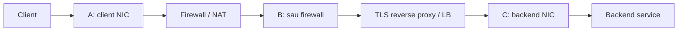

Giả sử client gọi:

```text
https://api.example.test/orders

Client-side tuple:
  192.0.2.20:52134 -> 203.0.113.10:443

After a hypothetical DNAT:
  192.0.2.20:52134 -> 198.51.100.25:443

After an illustrative reverse proxy:
  198.51.100.30:41127 -> 198.51.100.25:8080
```

Đây là **ba 5-tuples giả định**. Reverse proxy thường mở một kết nối upstream **mới**, không đơn giản là sửa header của cùng TCP connection; TLS có thể kết thúc tại proxy rồi được thiết lập lại hoặc chuyển plaintext upstream theo thiết kế.

Vì vậy:

- **A** cho thấy client đã gửi request tới public destination; không chứng minh backend nhận.
- **B** cho thấy packet/flow đã qua một hop cụ thể; có thể đã có DNAT hoặc thay interface.
- **C** cho thấy kết nối upstream tới backend; `source IP`, `source port` và TLS state có thể khác.

Nếu chỉ có A, kết luận “database đã thấy SYN” là **không có cơ sở**. Nếu chỉ có C, kết luận “client public đã trình bày certificate X” cũng có thể sai nếu LB/proxy kết thúc TLS ở trước.

### 1.3. Bốn câu hỏi bắt buộc trước khi capture

1. **Tôi cần chứng minh điều gì?** Ví dụ client đã gửi SYN, firewall đã forward, proxy có mở upstream TCP, server có trả SYN-ACK.
2. **Đường thực tế đi đâu?** Bao gồm DNS, routes, NAT, tunnels, ECMP, LB, proxy, IPv4/IPv6 và return path.
3. **Vị trí nào có khả năng thấy packet cần tìm?** Có nhìn trước hay sau biến đổi? Có thấy cả hai hướng không?
4. **Capture gây rủi ro gì?** Quyền, privacy, CPU/disk/port capacity, mất gói, thay đổi physical link hoặc trạng thái kết nối.

Chỉ sau khi trả lời bốn câu hỏi mới chọn công cụ và capture filter.

### 1.4. Quan sát trực tiếp và suy luận

| Nhìn thấy | Có thể nói | **Không thể tự kết luận** |
|---|---|---|
| Client gửi SYN | Stack/network interface đã phát hoặc chuẩn bị phát SYN ở điểm đo | Server chắc chắn nhận SYN |
| Server NIC nhận SYN | Gói đã tới điểm thu phía server | Application đã xử lý request |
| SYN-ACK được gửi ở server | TCP stack/proxy đã phản hồi SYN tại điểm đo | Client đã nhận SYN-ACK |
| TLS handshake thành công ở proxy | Hai endpoint của **kênh TLS này** đã thỏa thuận xong | TLS upstream/backend cũng thành công |
| HTTP 403 tại gateway | Gateway trả từ chối ở L7 | Firewall L3 đã drop |
| Không thấy packet | Sensor không quan sát được packet theo cấu hình hiện tại | Không có packet trên bất kỳ đường nào |

**Tệp PCAP là bằng chứng tại một điểm quan sát**, không tự xác định nguyên nhân ở một thành phần khác không nằm trong vùng nhìn thấy.

## 2. Bản đồ các điểm thu và câu hỏi phù hợp

### 2.1. Các nhóm capture point

| Điểm thu | Phù hợp nhất để | Hạn chế / tác động |
|---|---|---|
| **Client NIC** | Client có gửi DNS/TCP/TLS, nhận phản hồi? | Không biết các hop sau; offload/host stack ảnh hưởng |
| **Server NIC** | Server có nhận packet, phản hồi thế nào? | Không biết gói đã bị chặn ở trước; có thể không thấy app traffic localhost |
| **Firewall/Router interface** | Trước/sau ACL/NAT/route, packet drops | Capture tại thiết bị bận có thể ảnh hưởng control/data plane |
| **Switch SPAN** | Traffic qua ports/VLANs được mirror | Oversubscription, drop/duplicate, thiếu một chiều/đường |
| **TAP + broker** | Quan sát đường vật lý mà không bật full capture trên host app | Lắp đặt và active TAP có thể ảnh hưởng link; chỉ thấy đường đi qua |
| **Hypervisor/vSwitch mirror** | VM-to-VM, overlay workloads cùng host nếu mirror đúng | Port groups/host migration/offloads tạo visibility gaps |
| **Cloud traffic mirror** | Interface/network segment được provider hỗ trợ | Chi phí, quotas, encapsulation, source/target limits |
| **Kubernetes Pod namespace** | Kết nối của container/Pod, DNS, local TCP | Cần quyền; hostNetwork, node traffic, eBPF CNI path khác |
| **Kubernetes node/CNI** | Pod flows, overlay, policy drops, service translation | Thấy trước/sau encapsulation khác nhau, phải map Pod UID |
| **Ingress/egress proxy** | TLS termination, upstream request/response | Proxy mở flow khác; PCAP có thể chỉ thấy TLS ciphertext |
| **Wi-Fi monitor-mode adapter** | 802.11 management/control/data frames trên channel cụ thể | Channel hopping, encryption, RF coverage và privacy |

**Không có “điểm tốt nhất” cho mọi sự cố.** Điểm tốt nhất là vị trí có thể kiểm chứng giả thuyết với độ trung thực đủ cao và tác động chấp nhận được.

### 2.2. Đường kiểm tra A → B

```text
Source application
  [A] App process/socket instrumentation
  [B] Source host/Pod interface
   |
  [C] Firewall/virtual switch input
  [D] Firewall/virtual switch output
   |
  [E] Gateway/LB ingress
  [F] Gateway/LB egress
   |
  [G] Destination host/Pod interface
  [H] Destination application logs
```

Chọn **hai điểm kẹp quanh thành phần nghi vấn** nếu cần xác định nơi packet biến mất hoặc đổi tuple. Ví dụ C có SYN, D không có SYN và firewall logs báo DENY → có evidence cho việc chặn tại firewall. Nhưng nếu D là mirror port quá tải, việc **không có SYN tại D vẫn có thể do mất packet trong mirror**, nên cần thêm firewall counter/log/capture status.

### 2.3. Khi một điểm đủ và khi phải dùng nhiều điểm

**Một điểm thường đủ** để xác minh source resolver thực sự gửi DNS tới IP nào, xem SYN/ACK sequence cục bộ hoặc kiểm tra có TLS ClientHello tới server đang thử.

**Nhiều điểm cần thiết** khi câu hỏi là:

- Gói bị drop ở hop nào?
- NAT chuyển source/destination từ gì sang gì?
- Client và server nhận được cùng TCP segments không?
- Load balancer có tạo upstream request mới?
- Tunnel encapsulation/decapsulation đúng ở hai đầu?
- Packet loss có xuất hiện trên wire hay chỉ là drop do tool?

Không tăng số điểm thu chỉ để có nhiều dữ liệu; với từng điểm, xác định giả thuyết và mục tiêu chứng minh.

## 3. Mô hình packet path: L2/L3/L4, direction và đường trở về

### 3.1. Packets có thể đi bất đối xứng

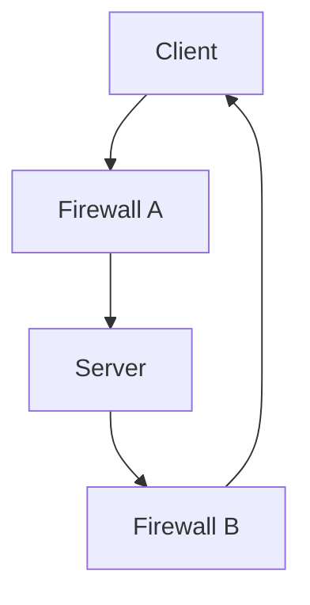

Nếu đường đi **client → server** qua Firewall A nhưng phản hồi **server → client** qua Firewall B, một SPAN port tại A có thể chỉ thấy SYN mà không thấy SYN-ACK. Đây không tự là server không phản hồi.

Nguyên nhân có thể:

- ECMP/hash chọn đường khác nhau giữa hai chiều.
- Routing policy/VRF và asymmetric WAN.
- Failover giữa hai firewall không chia sẻ state.
- NAT/load balancer chuyển đường.
- VM/Pod đi qua một node khác sau reschedule.

Để xác định handshake thật, cần đối chiếu capture tại source/destination hoặc capture ở nhiều hops với timestamps/5-tuple phù hợp.

### 3.2. Interface vật lý, loopback và network namespace

Ứng dụng gọi `127.0.0.1`/`::1` có thể chỉ tạo loopback traffic trong host hoặc Pod network namespace. Capture trên physical NIC sẽ không thấy request đó.

Trong Linux:

- `lo` quan sát loopback của **network namespace hiện tại**.
- `eth0` trong Pod thường là interface ảo của Pod network namespace.
- `veth` peer phía host có thể nhìn thấy gói trước khi route/bridge/eBPF policy.
- Interface `any` (khi `tcpdump` hỗ trợ) tổng hợp nhiều interfaces ở namespace hiện tại nhưng **không tương đương thấy toàn cluster**.

Trong container, hai containers cùng Pod thường chia sẻ network namespace; `localhost` giữa chúng có thể đi qua `lo` và không qua external CNI policy như traffic giữa hai Pods.

### 3.3. VLAN tags và Layer 2 detail

Một capture tại trunk/SPAN/TAP có thể cho thấy `802.1Q` VLAN tags, trong khi capture ở VM hoặc host NIC có thể **không thấy tag** do switch stripping/driver/hardware VLAN offload.

Do đó:

- Không thấy VLAN header trong một PCAP **không chứng minh** frame vốn không được gắn VLAN trên wire.
- Mirror configuration cần xác nhận VLAN tag preservation/copy behavior của thiết bị.
- Packet filters liên quan VLAN phải phù hợp DLT/link-layer format thật; BPF `vlan` thay đổi offset giải mã trên một số triển khai.

### 3.4. MTU, fragmentation và PMTUD

Gói bị drop do MTU/tunnel overhead có thể chỉ xuất hiện ở hop có encapsulation. Tùy capture point:

- Client thấy IP packet có kích thước hợp lệ theo local route.
- Tunnel ingress thêm outer headers khiến frame lớn hơn path MTU.
- Router có thể phát ICMP Packet Too Big/Fragmentation Needed.
- Một firewall/ACL có thể vô tình chặn ICMP cần cho Path MTU Discovery.

Muốn chẩn đoán PMTUD black hole, cần nhìn route/tunnel interface và các phản hồi ICMP phù hợp, không chỉ TCP retransmission ở client.

### 3.5. NAT và connection tracking

```text
Before SNAT:
  10.2.1.10:43512 -> 198.51.100.45:443

After SNAT:
  203.0.113.8:60901 -> 198.51.100.45:443
```

Một packet capture sau NAT không tự biết workload `10.2.1.10`, còn capture trước NAT không nhất thiết biết public tuple thực tế. Correlation cần:

- NAT translations/session logs kèm timestamp.
- Interface/route và packet direction.
- Flow hash/5-tuple, TCP sequence/timing nếu thích hợp.
- Cloud instance/node/Pod identity khi có.

Đừng dùng một source NAT IP dùng chung làm bằng chứng nhiều services đều là cùng một workload.

## 4. On-host capture: lựa chọn nhanh nhưng ảnh hưởng chủ thể đang điều tra

### 4.1. Lợi thế

Capture trực tiếp trên client hoặc server thường:

- Có thể kiểm tra đúng interface/route/network namespace.
- Hữu ích cho TCP/DNS/TLS handshake và application listener.
- Không cần SPAN/TAP infrastructure nếu quyền phù hợp.
- Có thể giới hạn rất chặt host/port/protocol.

Tuy nhiên nó dùng **CPU, kernel buffers, memory và disk I/O của chính host**, nên quá trình ghi PCAP có thể góp phần làm dịch vụ chậm hoặc thay đổi triệu chứng.

### 4.2. Một capture tại host có thể khác packet trên wire

Ảnh hưởng của network stack/NIC offload:

- **TSO/GSO:** hệ điều hành có thể cung cấp các TCP/GSO segments lớn cho NIC để chia nhỏ sau; host capture có thể thấy packet “lớn bất thường”.
- **GRO/LRO:** NIC/kernel có thể gộp nhiều packet nhận; host capture có thể thấy payload length khác với frame trên wire.
- **Checksum offload:** một số capture trên host thấy checksum chưa được hardware điền và Wireshark báo “incorrect”; không mặc định đó là wire corruption.
- **VLAN offload:** VLAN tag có thể bị tách khỏi frame trước khi packet capture ghi lại.
- **RSS/multi-queue/driver behavior:** kernel receive queues/buffers và packet fanout ảnh hưởng capture drops.

Một PCAP có “TCP checksum incorrect” trên host với checksum offload bật **không chứng minh** network packet bị lỗi trên wire. Xác minh điểm thu và offload status trước khi kết luận.

### 4.3. Không tắt offload một cách mù quáng

Trong môi trường thử nghiệm, việc tắt offload có thể giúp một số phân tích sâu rõ hơn, nhưng đồng thời có thể:

- Tăng CPU và PPS overhead.
- Thay packetization và behavior của network stack.
- Gây performance regression trong production.
- Làm phép đo không đại diện cấu hình trước đó.

**Không sửa `ethtool -K` trên hệ thống đang phục vụ người dùng** chỉ để có PCAP “đẹp”. Ưu tiên ghi nhận offload settings và, khi cần ground truth trên wire, so sánh với TAP/SPAN độc lập.

### 4.4. Capture từ process/container không có nghĩa bắt đúng application

Trong Kubernetes, chạy `tcpdump` trong Pod có thể không được phép hoặc container không có tool/capability. Dùng ephemeral debug container cũng cần RBAC/Pod Security, có thể thay resource behavior và không tự chứng minh traffic thuộc đúng process.

Phân biệt:

- `tcpdump` thấy packet qua interface.
- Socket/process telemetry (eBPF/OS) có thể cho PID/cgroup identity tùy công cụ.
- Application logs/traces có thể cho request ID/transaction.

Không tự gán packet capture trên shared host cho một process cụ thể chỉ dựa vào source IP của node.

## 5. Switch SPAN/port mirroring: thu ngoài host nhưng không bảo đảm đủ mọi packet

### 5.1. SPAN hoạt động theo ý tưởng gì?

**SPAN (Switched Port Analyzer)**, port mirroring hoặc một cơ chế mirror tương tự sao chép traffic từ một hay nhiều source ports/VLANs sang destination monitoring port.

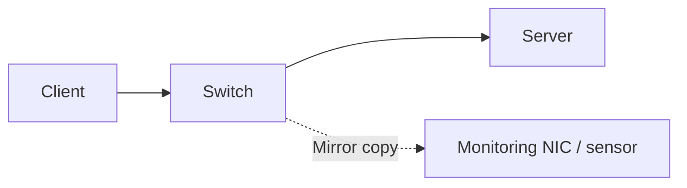

Điểm mạnh:

- Không cần cài capture tool lên application host.
- Có thể tập trung quan sát một số trunks/ports cùng lúc.
- Hữu ích khi tìm L2/L3 packet anomalies và xác nhận frame qua switch.
- Sensor có thể ghi dữ liệu và phân tích bên ngoài production application process.

Điểm cần hiểu: destination SPAN port nhận **bản sao** của traffic, không phải đường data plane gốc. Một copy bị mất **không nhất thiết làm mất packet được chuyển tới server**, và một PCAP đầy đủ trên SPAN **không chứng minh** server app đã xử lý payload.

### 5.2. Oversubscription gây mất bản sao

Giả sử:

```text
Source A:  700 Mbit/s
Source B:  600 Mbit/s
Mirror output link: 1 Gbit/s

Offered aggregate (simplified): 1.3 Gbit/s
Available mirror link:         1.0 Gbit/s
```

Khi hai luồng có traffic đồng thời theo cấu hình mirror, SPAN destination có thể bị **oversubscribed**. Thiết bị có thể drop **mirrored copies** dù production traffic vẫn hoạt động. Nếu traffic được mirror cả ingress và egress trên nhiều interfaces, tổng bản sao có thể còn lớn hơn traffic hữu ích dự đoán.

Trường hợp này minh họa về capacity, không cam kết switch nào cũng xử lý bằng một cơ chế drop giống nhau; thực tế phụ thuộc ASIC, buffer, port configuration, filtering và mirror priority.

### 5.3. Bản sao trùng lặp và direction

Nếu mirror hai chiều trên một trunk cùng các ports liên quan:

- Một frame có thể được nhìn thấy **hai lần** ở ingress/egress source ports.
- Mirroring cả uplink và access port có thể nhân đôi cùng traffic.
- Mirroring chỉ ingress có thể bỏ lỡ server responses.
- Mirroring nhiều VLANs có thể vô tình thu thêm dữ liệu nhạy cảm ngoài scope.

Khi đếm packet hoặc dựng TCP retransmission rate từ SPAN, phải loại trừ **mirror duplicates** trước khi kết luận mạng thực sự gửi lặp.

### 5.4. SPAN có thể làm mất thứ tự/timestamp

Một số thiết bị mirror traffic sau switching/queue xử lý; bản sao được đưa vào queue riêng và có thể bị reorder/drop hoặc nhận timestamp khi tới collector, không phải timestamp phần cứng tại thời điểm packet chạy trên production link.

Nếu cần phân tích microsecond latency hoặc packet ordering với độ chính xác cao, phải đánh giá:

- Timestamp source và accuracy.
- Mirror/capture path latency.
- Packet loss ở mirror source/destination.
- NIC hardware timestamp và synchronized clocks.
- Sự khác nhau giữa observed arrival order và wire order.

Không dùng timestamp PCAP từ hai sensor không đồng bộ để suy ra **one-way latency** chính xác.

### 5.5. Mirror VLAN/trunk/routed interfaces

Một switch có thể hỗ trợ mirror theo port, VLAN, ACL hoặc routing context khác nhau. Nhưng:

- Traffic giữa hai VMs trên **cùng hypervisor/vSwitch** có thể không đi tới physical switch.
- Traffic đã được tunnel/encapsulate qua underlay có thể chỉ hiện outer headers.
- Một ASIC có thể mirror ở bước trước hoặc sau ACL/QoS/VLAN transforms, tùy platform.
- Source traffic không đi qua port/VLAN đã chọn sẽ không xuất hiện.

Cần vẽ **actual data path** và xác minh scope của mirror bằng một flow lab có định danh.

### 5.6. Hành động an toàn trước khi cấu hình mirror

1. Ghi rõ source ports/VLANs/directions và owner.
2. Đo peak/pps của traffic nguồn, không chỉ Mbps trung bình.
3. Kiểm tra mirror destination port capacity và sensor NIC/disk.
4. Hạn chế phạm vi/time/payload; cân nhắc packet broker filtering.
5. Xác nhận không ảnh hưởng service production hoặc chức năng switch.
6. Theo dõi drop/queue counters ở mirror/sensor nếu platform có.
7. Cài timeout/expiry cho mirror session và review data retention.

Không để một mirror session “tạm” ghi toàn bộ traffic của nhiều VLANs trong nhiều tháng chỉ vì quên cleanup.

## 6. Network TAP: quan sát đường vật lý và các đánh đổi hạ tầng

### 6.1. TAP không đồng nghĩa SPAN

**Network TAP (Test Access Point)** thường được đặt vào đường truyền để cung cấp bản sao tín hiệu/traffic cho thiết bị giám sát. Có nhiều dạng:

- Passive optical TAP chia tín hiệu quang.
- Electrical TAP với cơ chế pass-through/monitor ports.
- Aggregation TAP ghép hai directions vào một monitor port.
- Regeneration TAP tạo bản sao cho nhiều monitoring tools.
- Active TAP/packet broker có chức năng lọc/chọn traffic/timestamp.

Không phải mọi TAP đều hoàn toàn thụ động hoặc không cần nguồn điện. Tác động failure, optical budget, bypass behavior, redundancy và link negotiation **phụ thuộc thiết kế thiết bị**.

### 6.2. Hình dung đường TAP

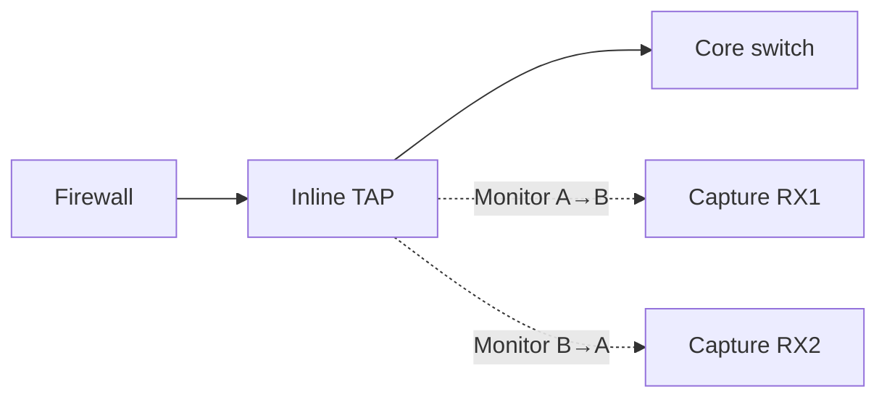

Với một TAP hai đường giám sát, sensor có thể thấy hai directions **riêng**. Nếu TAP aggregate về một output, cần kiểm tra capacity và duplicate behavior.

### 6.3. Được gì so với SPAN?

Trong các điều kiện phần cứng phù hợp, TAP có thể:

- Quan sát traffic trên một **đường vật lý cụ thể** với fidelity tốt hơn SPAN quá tải.
- Tránh việc switch phải clone packets ở SPAN source.
- Hỗ trợ packet loss/ordering analysis khi có timestamping thích hợp.
- Giữ hai hướng riêng để không nhầm chiều.

Nhưng **TAP không tự bảo đảm 0 packet loss trên toàn hệ thống**:

- Sensor NIC hoặc disk vẫn có thể drop.
- Monitor output vẫn có thể bị bão hòa.
- Aggregate/broker có thể filter/sampling hoặc reorder.
- TAP đặt trên link A không thấy link B/ECMP path hoặc cloud internal paths.

### 6.4. Tác động khi lắp TAP

Ngay cả passive optical TAP cũng có thể làm thay đổi **suy hao quang**, yêu cầu optical power budget đủ. Lắp hoặc thay dây có thể gây **link interruption** nếu không có kiến trúc bypass/phương án cutover thích hợp. Active devices có power/firmware/failure modes.

Checklist trước thay đổi trên production:

- Mức optical TX/RX, cable/connector type, compatibility và link margin.
- Speed/duplex/auto-negotiation với electrical equipment.
- HA links/maintenance window, rollback và người phụ trách.
- Monitor ports có throughput và clock/timestamp đủ không?
- Fail-open/fail-safe/bypass semantics theo đúng model được chọn.
- Tác động tới routing adjacency, LACP, stateful firewall session và SLO.

**Không yêu cầu người học tự cắm rút dây production để “có capture rõ hơn”.** Bài thực hành nên dùng một test link/virtual lab và được quyền thay đổi.

### 6.5. TAP/packet broker cũng cần policy dữ liệu

Một packet broker có thể lọc L2–L4, deduplicate, slice payload, gửi dữ liệu tới nhiều sensors. Nhưng người quản trị packet broker có thể nhìn thấy metadata hoặc payload nhạy cảm.

Cần:

- AuthN/AuthZ quản trị broker.
- Separate monitoring VLAN/VRF và ACL cho traffic bản sao.
- Limit data to approved sensors.
- Redact/mask/slice khi phù hợp, nhưng không giả rằng chỉ giữ 96 bytes là đã hết PII.
- Encrypt traffic nếu phải truyền monitoring copies qua mạng không tin cậy.
- Audit access và thay đổi filters/mirror mappings.

## 7. Thiết bị trung gian: firewall, NAT, IPS, VPN và load balancer

### 7.1. Khi cần đặt hai điểm trước và sau enforcement

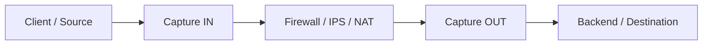

Một lỗi kết nối qua firewall có thể là:

1. Packet chưa tới firewall ingress.
2. Packet tới ingress nhưng bị policy/routing/IPS drop.
3. Packet đã ra egress nhưng bị drop ở hop sau.
4. Response đi đường khác hoặc bị stateful policy reject.

Để quyết định, so sánh capture **trước/sau** cùng với rule/session counters, forwarding path và timestamps. Nếu capture trên thiết bị bảo mật có nguy cơ tốn CPU, ưu tiên log/counters hoặc external TAP được phép trước.

### 7.2. NAT đổi định danh ở L3/L4

Ví dụ:

```text
Client → public VIP:
  192.0.2.20:52910 -> 203.0.113.10:443

Firewall DNAT:
  192.0.2.20:52910 -> 198.51.100.25:443

Firewall SNAT (nếu policy có):
  198.51.100.5:61510 -> 198.51.100.25:443
```

Khi ghép packet giữa hai capture points phải biết **cả DNAT và SNAT**. Hai capture có tuples khác không chứng minh có hai client requests khác nhau; ngược lại, proxies có thể tạo hẳn flow thứ hai với TCP sequence numbers khác.

### 7.3. IDS/IPS khác nhau về điểm quan sát

- **Passive IDS** thường nhận traffic mirror/TAP và phát cảnh báo; nó **không tự drop traffic gốc** trừ khi có tích hợp phản ứng.
- **Inline IPS** có thể kiểm tra/chặn traffic đi qua đường nó thực thi, nhưng phải đánh giá throughput/latency, bypass/fail-mode.
- **Network detection and response (NDR)** có thể phân tích flows/metadata/traffic copy và phản ứng qua các tích hợp được phê duyệt.

Một sensor thấy packet với signature xấu không nhất thiết đồng nghĩa packet đã tới ứng dụng. Một IPS log `BLOCK` không phải bằng chứng dữ liệu đã được lưu trên server. Cần xác định sensor đứng trước hay sau nơi chặn và đối chiếu backend logs.

### 7.4. VPN/IPsec/WireGuard: capture ngoài và trong tunnel

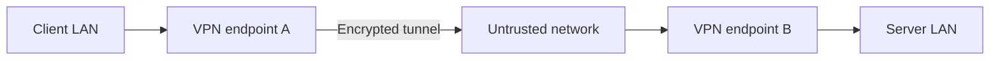

Với một IPsec site-to-site VPN:

- Capture **trên WAN interface** có thể chủ yếu thấy ESP packets hoặc UDP encapsulation (NAT-T), không thấy inner application TCP/HTTP.
- Capture **bên trong tunnel/after decryption** có thể thấy inner source/destination/IP payload theo quyền và thiết kế VPN endpoint.
- Với WireGuard, ngoài tunnel thường thấy encrypted UDP packets, còn interface logic có thể thấy inner IP packets.

Nếu capture ngoài tunnel không thấy `TCP/443` đến server nội bộ, **không được kết luận** client không gửi HTTPS; inner TCP có thể nằm trong encrypted tunnel.

Đừng cố thu hoặc giải mã traffic người dùng chỉ vì có quyền trên firewall. Decryption/payload inspection phải có business purpose, quyền hợp lệ và data handling controls.

### 7.5. TLS termination/re-encryption tại load balancer hoặc proxy

```text
Client -- TLS #1 --> Gateway
Gateway -- TLS #2 or HTTP --> Backend
```

Kênh TLS #1 và TLS #2 có thể:

- Dùng certificate/CA/SNI khác nhau.
- Có thời điểm handshake khác nhau.
- Dùng địa chỉ source/destination/ports khác.
- Bị áp authorization policy khác.

Capture trên gateway external interface cho biết **client-facing** TLS; capture backend interface cho biết **upstream** traffic. Nếu upstream HTTP plaintext, điều này không có nghĩa client-side TLS không tồn tại.

### 7.6. Một chiều bị mất do stateful firewall

Firewall stateful có thể drop response khi request/response đi qua hai firewall khác nhau mà session state không được đồng bộ. Capture trên source có thể thấy SYN retry liên tục; capture trên server có thể thấy SYN và SYN-ACK.

Giải thích đúng đòi capture cả chiều về hoặc firewall state/event counters, không chỉ server-side PCAP. **Bản thân TCP retransmission không chỉ ra chính xác hop gây drop**.

## 8. Virtualization và SDN: traffic có thể không lên physical NIC

### 8.1. VM-to-VM trên cùng host

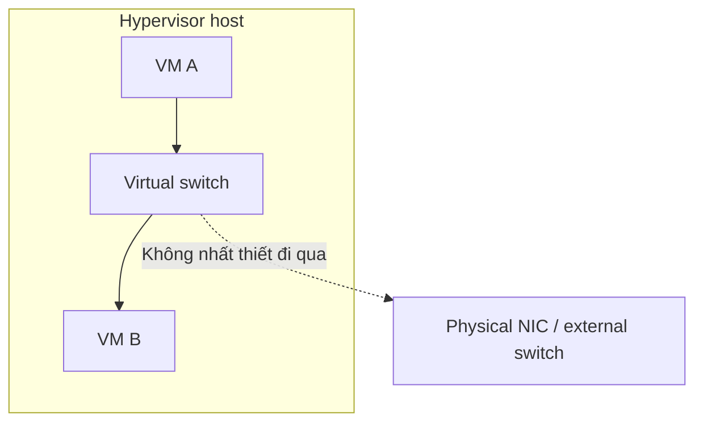

Nếu hai VM giao tiếp nội bộ qua cùng vSwitch/overlay host datapath, physical switch SPAN **có thể không thấy gì**. Muốn kiểm tra đường này, cần:

- Capture trong VM A/B, hoặc
- vSwitch/virtual NIC mirror được sản phẩm hỗ trợ, hoặc
- hypervisor/SDN flow logs/counters.

Host migration, distributed vSwitch port bindings và offload (SR-IOV/DPDK/SmartNIC) có thể thay đổi đường packet. Capture tại một vSwitch không còn chứa VM sau migration cũng sẽ mất visibility.

### 8.2. SR-IOV, DPDK và hardware offload

Một số workloads dùng hardware virtual functions hoặc userspace datapath để tăng throughput; traffic có thể bypass kernel hooks hoặc virtual-switch mirror theo một số cấu hình.

Khi điều tra:

1. Xác định interface type và driver.
2. Xem traffic đi qua kernel stack hay DPDK/hardware datapath.
3. Kiểm tra tool/provider nào hỗ trợ mirroring/counters tại vị trí đó.
4. Dùng source/destination capture hoặc NIC hardware telemetry nếu cần.

Không tự tin rằng `tcpdump -i any` trên hypervisor sẽ thấy **mọi** traffic đi qua DPDK userspace datapath.

### 8.3. Overlay/tunnel encapsulation

```text
Inner packet:
  Pod A 10.244.1.10 → Pod B 10.244.2.20  TCP/8080

Outer VXLAN example:
  Node A 10.0.1.10 → Node B 10.0.2.20  UDP/4789
```

Capture trên underlay link có thể thấy **outer node IPs/UDP tunnel**, không thấy Pod IPs nếu công cụ không giải mã lớp inner; capture trong Pod hoặc ở bridge/CNI hook thích hợp có thể thấy inner packet.

Không mặc định VXLAN/Geneve encapsulation có mã hóa: nó thường là **đóng gói**, không tự cung cấp confidentiality/integrity tương đương TLS/IPsec. Khi traffic còn nằm trong encrypted tunnel, inner headers/payload có thể không khả dụng tại điểm quan sát ngoài.

### 8.4. Virtual switch mirror cũng có performance impact

Mirror traffic qua một virtual switch cần sao chép packet/buffers và gửi đến sensor VM; có thể tăng:

- Host CPU/memory bandwidth.
- vSwitch queue pressure.
- Virtual NIC PPS.
- East–west host/network bandwidth nếu sensor nằm ở node khác.
- Storage throughput của sensor.

Cần kiểm tra cả **production VM SLO** và **capture completeness**. Một sensor VM thiếu CPU gây packet drop ở mirror output không đồng nghĩa nguồn production đã bị packet loss.

## 9. Cloud traffic mirroring: có thể nhìn ở đâu và phải trả giá gì?

### 9.1. Không có quyền SPAN toàn bộ cloud fabric

Trong public cloud, network underlay do nhà cung cấp vận hành; khách hàng thường **không thể đặt TAP vật lý** trên fabric hoặc mirror tùy ý mọi interface. Thay vào đó có thể dùng:

- Traffic mirroring của network interfaces/VMs được hỗ trợ.
- Host/guest packet capture trong instance/container.
- Managed gateway/firewall flow logs.
- VPC/VNet flow logs.
- Load balancer/CDN/ingress access logs.
- Application/service mesh metrics, traces.

**Tên dịch vụ, loại ENI/NIC hỗ trợ, filters, quotas, zone constraints và billing thay đổi theo provider.** Cần kiểm tra tài liệu và quota của chính môi trường triển khai, không coi tính năng AWS/Azure/GCP có semantics một-một.

### 9.2. Cloud mirror source/target

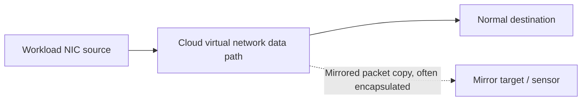

Capture point có thể nằm tại workload NIC/virtual network scope, không tại toàn bộ route/transit path. Những packet:

- Được guest OS loopback xử lý.
- Đi qua service provider managed component không nằm trong mirror scope.
- Bị drop trước mirror hook.
- Được phần cứng offload mà sản phẩm không mirror.

có thể không hiện trong mirrored PCAP. Kiểm chứng bằng traffic lab và nguồn telemetry độc lập.

### 9.3. Tunnel/encapsulation của packet mirror

Cloud mirroring có thể encapsulate các bản sao thành tunnel packet (ví dụ một cơ chế kiểu VXLAN/GRE tùy provider). Khi sensor nhận:

```text
Outer packet:
  mirror source host/fabric → mirror target
  tunnel headers

Inner packet:
  original workload source → destination
```

Phân tích đúng cần decapsulate và lưu source interface/observation domain. Nếu chỉ filter theo original destination IP ở **outer interface** bằng BPF không hiểu tunnel, kết quả có thể trống dù mirrored packets đang đến.

### 9.4. Tác động chi phí và quota

Cloud mirror có thể tạo:

- Chi phí theo số mirrored packets/bytes hoặc tài nguyên dịch vụ, tùy provider.
- Cross-zone/region data-transfer nếu sender/target khác AZ/region.
- CPU/network load trên sensor VM.
- Storage và logging costs.
- Extra egress bandwidth/queues/quotas.
- Security exposure khi bản sao chứa dữ liệu tenant/secret.

**Giám sát capture cost là một phần của monitoring change.** Một capture đầy đủ 10 Gbit/s kéo dài hàng giờ có thể tiêu thụ tài nguyên và chi phí lớn, kể cả khi application traffic không bị ảnh hưởng nhiều.

### 9.5. Flow logs không thay thế hoàn toàn mirror

Cloud flow logs thường cho 5-tuple/bytes/action/time với aggregation và độ trễ nhất định; chúng có thể phù hợp cho capacity/forensics nhưng không chứng minh chính xác TCP retransmission timing hoặc payload. Mirror/PCAP có thể chi tiết hơn ở capture point nhưng không có sẵn source workload IAM/user context nếu thiếu enrichment.

Khi mục tiêu là kiểm tra **security group rule action**, audit/flow logs có thể tốt hơn PCAP. Khi cần xem **TLS handshake sequence** hoặc TCP flags/timing, packet mirror hoặc host capture có thể phù hợp hơn, với privacy guardrails.

## 10. Kubernetes: capture point trong Pod, node, CNI, Service và mesh

### 10.1. Một packet có thể đi qua nhiều tầng

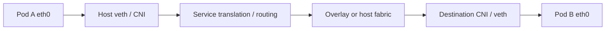

Đường thực tế thay đổi theo CNI (eBPF, iptables, IPVS, native routing, VXLAN/Geneve), Service type, node placement, network attachment và phiên bản. Sơ đồ chỉ dùng để định vị **nhiều vị trí packet có thể đổi hình thức hoặc bị chặn**.

### 10.2. Capture trong Pod network namespace

**Khi Pod A gọi Pod B trực tiếp**, capture tại `eth0` của Pod A giúp thấy packet rời Pod; ở `eth0` Pod B giúp kiểm tra packet đã đến Pod B chưa.

**Khi Pod A gọi Kubernetes Service**, có thể xuất hiện hai cách nhìn:

```text
Application destination:
  orders-api.commerce.svc.cluster.local:80
DNS response:
  Service ClusterIP (example) 10.96.10.20

Actual destination Pod:
  10.244.2.30:8080
```

Ở một số CNI, destination IP/port translation xảy ra trước hoặc sau một hook capture nhất định. Do đó không mặc định cả Pod-side và node-side PCAP đều có tuple giống hệt. Khi test NetworkPolicy, phải biết policy semantics và NAT stage của CNI.

### 10.3. Capture tại node/host

Ở node, có thể có:

- Veth host peer của Pod.
- Bridge interface (nếu có).
- Overlay tunnel interface.
- Physical NIC.
- eBPF/XDP datapath counters.
- Host-level forwarding/conntrack state.

Nếu packet bị chặn bởi CNI **trước điểm capture đã chọn**, ta có thể không thấy gói. Nếu `tcpdump -i any` hiện một packet nhiều lần trên các interfaces trong cùng namespace, đó có thể do quan sát packet ở **nhiều stages**, không tự là retransmission trên wire.

### 10.4. Ephemeral debug container và đặc quyền

Các container images tối giản thường không có `tcpdump`. Một ephemeral debug container được cấu hình hợp lệ có thể giúp quan sát Pod network namespace, nhưng cần RBAC, Pod Security, capability/privilege phù hợp và sự phê duyệt của team vận hành.

**Rủi ro:**

- Tạo ephemeral container thay đổi resource footprint của Pod.
- Có thể làm lộ traffic/secret nội bộ.
- Tool may not be able to access host CNI interfaces.
- Security policies có thể cấm packet sockets/capabilities.
- Tên container/Pod hoặc namespace sau reschedule có thể khác.

Ưu tiên **CNI flow logs, service mesh telemetry, proxy counters, application traces** trước nếu chúng đủ cho câu hỏi. Chỉ bổ sung full PCAP khi thực sự cần packet-level evidence.

### 10.5. `hostNetwork` và traffic cùng Pod

Nếu Pod dùng `hostNetwork: true`, network namespace là host namespace. Một `tcpdump` trong container có thể quan sát **host interfaces** nếu quyền cho phép; điều này làm phạm vi dữ liệu nhạy cảm tăng.

Hai containers trong **cùng một Pod** chia sẻ network namespace; traffic `localhost` giữa chúng có thể chỉ qua `lo`, không hiện trên node physical NIC hoặc Service mesh overlay.

### 10.6. Service mesh sidecar và ambient mode

**Sidecar:** application → local Envoy → mTLS Envoy-to-Envoy → destination Envoy → app. Capture trên app-side Pod interface có thể thấy local plaintext hoặc traffic loopback, còn capture trên đường mạng giữa nodes thấy ciphertext.

**Ambient:** ztunnel thường tham gia L4 mTLS/tunnel; waypoint xử lý L7 cho traffic được enrollment/routed qua nó. Capture tại node physical NIC có thể thấy tunnel traffic, còn proxy telemetry có khả năng ghi service/request context mà PCAP outer tunnel không có.

Không suy **JWT subject, application HTTP method** từ một outer encrypted flow record khi không có L7 telemetry. Không giả rằng mọi traffic đi qua waypoint nếu Service/workload chưa được gắn và capture point không nằm trên đường đó.

### 10.7. Correlation Pod UID và timestamp

```text
08:00 Pod frontend-a UID=A gets 10.244.1.10
08:30 Pod frontend-a terminated
08:31 Pod batch-b UID=B gets 10.244.1.10
```

Nếu PCAP tại 08:05 có `src=10.244.1.10`, không thể dùng `kubectl get pods` lúc 09:00 để gán flow cho `batch-b`. Cần lịch sử **Pod UID/IP assignment/node/service account** tại event time và đồng bộ thời gian.

### 10.8. Kubernetes không đảm bảo flow monitoring = packet capture

CNI telemetry có thể:

- Log policy allow/deny verdict.
- Enrich source/destination Pod metadata.
- Sampling/aggregation.
- Đếm packets/drops hoặc capture headers ở một hook.

Nó không nhất thiết chứa mọi packet bytes, TCP sequence và timing như PCAP. **Chọn thông tin vừa đủ cho câu hỏi**, đừng tăng mức thu payload chỉ vì công cụ hỗ trợ.

## 11. Wi-Fi capture: điểm thu gắn với kênh, vị trí và loại frame

### 11.1. Khác với Ethernet có dây

Trong Wi-Fi, receiver phải **ở trong vùng phủ sóng và nghe đúng channel/bandwidth** để thấy frames phù hợp. Một laptop đã association với AP thường sử dụng managed mode; muốn quan sát raw IEEE 802.11 management/control/data frames có thể cần **monitor mode** và adapter/driver hỗ trợ.

Không phải mọi adapter đều hỗ trợ monitor mode hoặc hiển thị radiotap metadata theo cách giống nhau.

### 11.2. Các điểm nhìn

| Điểm thu | Thường thấy | Không mặc định thấy |
|---|---|---|
| Trên Wi-Fi client (managed mode) | Traffic IP của chính client sau xử lý của driver | Raw frames của mọi clients/channels |
| Adapter monitor mode gần AP | Frames trên channel được nghe, tín hiệu RF khi driver hỗ trợ | Frames ở channel khác/hidden nodes/out of range |
| AP/controller telemetry | Associations, RSSI/SNR, retries, roaming, authentication | Full payload của mọi user hoặc external RF evidence |
| Wired side của AP | Ethernet/IP traffic sau wireless bridging/tunneling | Toàn bộ 802.11 management frames/radio details |

### 11.3. Channel hopping và loss of completeness

Một adapter monitor mode liên tục chuyển channel có thể bỏ lỡ frames trong lúc đang nghe channel khác. Với multi-radio AP, 2.4/5/6 GHz clients và channel width, cần chọn sensor/adapter cấu hình phù hợp.

Do đó **không thấy một EAP frame** trong monitor-mode capture không chứng minh authentication message không được gửi. Nên so với AP/controller logs/RADIUS events và capture cùng channel đúng thời điểm.

### 11.4. Mã hóa và quyền riêng tư

WPA2/WPA3 bảo vệ dữ liệu theo cấu hình, không bảo đảm mọi metadata đều bị che. PCAP 802.11 có thể chứa MAC identifiers, SSID, management frames, timing và traffic patterns. Không thu/giải mã traffic của người dùng ngoài scope; không yêu cầu khóa Wi-Fi production để tạo ví dụ.

### 11.5. Tình huống enterprise Wi-Fi

Khi client báo có sóng tốt nhưng không vào được mạng:

```text
RF visibility:
  Association / retries / roaming

Authentication:
  802.1X/EAPOL exchanges, AP and RADIUS outcomes

Network:
  DHCP, ARP/ND, DNS, VLAN/ACL

Application:
  HTTPS/TLS success, user journey
```

Chọn một **AP/controller/RADIUS log** cho authentication và một **client-side capture** cho DHCP/DNS có thể an toàn/hiệu quả hơn việc mirror toàn bộ Wi-Fi traffic của văn phòng.

## 12. Trước/sau TLS và QUIC: hiểu giới hạn visibility do mã hóa

### 12.1. TLS nhìn từ đâu?

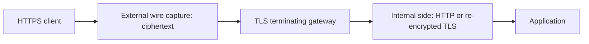

Điểm thu trên đường dây client ↔ gateway có thể thấy TCP/TLS metadata, packet sizes, timings, IP addresses và một phần handshake fields tùy protocol/feature. Nó **không đọc được HTTP request body** khi TLS được thiết lập đúng.

TLS 1.3 mã hóa nhiều handshake messages hơn các phiên bản cũ; ECH (Encrypted ClientHello) nếu được triển khai có thể che thêm tên server trong ClientHello. Không khẳng định SNI luôn hiện rõ hoặc certificate chain luôn có thể quan sát plaintext chỉ bằng PCAP.

### 12.2. HTTP/2 và HTTP/3/QUIC

- HTTP/2 thường multiplex nhiều streams trên một TLS connection; một TCP 5-tuple không tương đương một HTTP request.
- HTTP/3 sử dụng QUIC trên UDP, có thông tin handshake/transport được mã hóa và khả năng connection migration; IP/port tuple có thể đổi trong khi QUIC connection tồn tại.
- Passive network sensor không nhất thiết đọc được request URL, user identity hoặc application error từ ciphertext.

Khi cần điều tra L7, có thể ưu tiên **gateway access logs, service mesh telemetry, application traces** thay vì cố “tìm HTTP path” trong encrypted PCAP.

### 12.3. Decryption tạo ranh giới bảo mật mới

Một TLS inspection proxy có thể giải mã và tái mã hóa traffic trong một thiết kế được phê duyệt, nhưng điều đó:

- Làm thay đổi trust boundary và certificate handling.
- Tăng nguy cơ lộ credentials, payment/health data hoặc private payload.
- Có thể ảnh hưởng mutual authentication, pinning, protocol compatibility.
- Tăng CPU/latency/resource needs.
- Phải tuân thủ mục đích, scope, privacy/legal requirements.

**Không hướng dẫn làm lộ session secrets hay vô hiệu hóa TLS** chỉ để có PCAP rõ. Khi packet-level data ngoài tunnel không đủ, hãy dùng endpoint/proxy metadata đã được phép thu.

### 12.4. Cẩn thận với “plaintext ở backend”

Nếu proxy terminate TLS và gửi HTTP plaintext về backend, internal capture có thể chứa:

- Session cookies.
- Bearer tokens.
- Authorization headers.
- Request/response payload, PII hoặc secrets.

Đây có thể là điểm có **rủi ro dữ liệu cao nhất** dù nằm trong private subnet. Giới hạn nội dung thu bằng BPF/snaplen, access controls, redaction và approved retention. **Snaplen 96 bytes không bảo đảm loại sạch secrets**: cookies/headers vẫn có thể xuất hiện trong các gói có độ dài nhỏ hoặc metadata chứa thông tin nhạy cảm.

## 13. Capture ảnh hưởng CPU, memory, disk, network và latency như thế nào?

### 13.1. Không có packet capture “miễn phí”

Để ghi PCAP, hệ thống thường phải:

1. Nhận hoặc sao chép packet/frame tại capture hook.
2. Kiểm tra capture filter.
3. Đưa packet hoặc metadata vào memory/ring buffers.
4. Chuyển dữ liệu từ kernel/device tới process/collector.
5. Timestamp, serialize và ghi vào file/stream.
6. Có thể gửi bản sao đến remote sensor hoặc phân tích/giải mã thêm.

Chi phí từng bước phụ thuộc công nghệ: libpcap/AF_PACKET, AF_XDP, DPDK, eBPF, NIC hardware capture, switch mirror, cloud fabric hay packet broker. **Không mặc định một tool hay hook có chi phí giống nhau trên mọi thiết bị**.

### 13.2. Bốn giới hạn quan trọng

| Giới hạn | Triệu chứng | Đo gì |
|---|---|---|
| **CPU/PPS** | Capture process hoặc host CPU tăng, packet processing lag | CPU utilization, per-core saturation, packets/s |
| **Buffer/memory** | Kernel ring/packet socket bị overflow | Capture drop counters, buffer occupancy nếu có |
| **Storage I/O** | Disk queue tăng, write stalls, filesystem đầy | Disk throughput/latency/free space |
| **Network mirror path** | SPAN/TAP/cloud mirror output bị bão hòa | Mirror drops, target NIC drops, tunnel packet loss |

Với thiết bị firewall/router, còn có rủi ro **packet capture bật trên control plane CPU** làm chậm route control processes hoặc failover. Nếu thiết bị hỗ trợ hardware captures/counters hay external TAP, ưu tiên phương thức được vendor công nhận cho production.

### 13.3. Lưu lượng cao nhưng packet nhỏ gây PPS lớn

Hai luồng cùng 1 Gbit/s nhưng packet sizes khác nhau có thể cần số packets/s rất khác. Khi packet nhỏ, packet-processing overhead thường cao hơn và capture tool dễ bị drop do CPU/interrupt rate dù throughput không tăng.

Không dùng mỗi Mbps để quyết định sensor capacity. Cần test **PPS, packet size distribution, burstiness và concurrent flows**.

### 13.4. PCAP dung lượng tăng rất nhanh

Giả sử một điểm capture nhìn thấy trung bình 1 Gbit/s **và lưu toàn bộ bytes tương đương** trong 10 phút:

\[
1{,}000{,}000{,}000\ \mathrm{bit/s}
\times 600\ \mathrm{s}
\div 8
= 75{,}000{,}000{,}000\ \mathrm{byte}.
\]

Tức **khoảng 75 GB hệ thập phân** trước overhead định dạng/timestamp/metadata và trước mọi khác biệt giữa on-wire bytes với captured bytes. Đây là **ước lượng thô**; thực tế tùy snaplen, capture filter, VLAN/tunnel, frame padding, link utilization và file format.

Ví dụ lập capacity:

| Traffic rate trung bình | 1 phút | 10 phút | 60 phút |
|---|---:|---:|---:|
| 100 Mbit/s | 0,75 GB | 7,5 GB | 45 GB |
| 500 Mbit/s | 3,75 GB | 37,5 GB | 225 GB |
| 1 Gbit/s | 7,5 GB | 75 GB | 450 GB |
| 10 Gbit/s | 75 GB | 750 GB | 4,5 TB |

Số liệu là **định mức bit rate × thời gian**, không cam kết file PCAP đúng bằng cột đó. Khi mirror hai hướng, tunnel/headers hoặc mirror duplicate có thể làm tổng capture khác hẳn.

### 13.5. Snaplen và packet count giới hạn những gì?

**Snapshot length (`snaplen`)** giới hạn số bytes tối đa được ghi của mỗi packet. Ví dụ:

```text
Full packet: 1500 bytes
Snaplen:       96 bytes
Captured:      96 bytes (plus per-record metadata)
```

Nhờ snaplen ngắn, một capture có thể giữ L2/L3/L4 header và một phần context với ít dung lượng hơn. Nhưng:

- Header extensions/VLAN/tunnel có thể chiếm hết 96 bytes, làm mất inner headers.
- TLS records/HTTP payload không còn đủ để parse.
- PCAP vẫn có thể chứa thông tin nhạy cảm.
- Gói lớn bị **truncated do capture setting**, không có nghĩa packet thật bị network truncation.

Vì vậy snaplen là **tradeoff bằng chứng vs privacy/storage**, không phải một giá trị “an toàn” cho mọi protocol.

### 13.6. Ring buffer và rotate files

Một capture được thiết kế vận hành nên có:

- Memory/ring buffer có giới hạn.
- Thời gian hoặc packet count stop condition.
- Bounded file size + bounded number of files.
- Disk quota và filesystem health.
- Kill switch/stop command được xác minh.
- Metrics dropped-by-kernel/dropped-by-interface khi tool hỗ trợ.
- File access permissions và cleanup/retention.

**Chỉ rotation theo file size mà không giới hạn số lượng file vẫn có thể làm đầy disk**. Với tools có `-C`/`-W` hoặc option tương tự, phải kiểm tra semantics chính xác và path/quota trước khi chạy.

### 13.7. Trên production, quan sát SLO đồng thời

Trong một capture có quyền, nên monitor:

```text
Before capture:
  host CPU, memory, network PPS/throughput
  p95/p99 service latency
  disk free space, I/O latency
  packet drops at interface/CNI/mirror

During capture:
  same metrics + capture drop counters + PCAP growth

After capture:
  same metrics + successful cleanup
```

Nếu p99 latency tăng hoặc disk gần full, nên dừng capture theo ngưỡng đã thống nhất. **Không hy sinh availability chỉ để thu thêm bằng chứng** khi có phương pháp ít tác động hơn.

### 13.8. Tác động lên firewall, VPN và Wi-Fi AP

Một số thiết bị có CPU/accelerator riêng cho forwarding. Khi bật capture/debug:

- Packet có thể bị punt từ ASIC sang CPU.
- TLS/IPsec processing có thể cạnh tranh CPU với capture.
- Log volume có thể làm nghẽn storage/management plane.
- Wi-Fi AP có thể phải chuyển channel hoặc radio mode khi chạy specialized capture, ảnh hưởng clients.

Không áp lệnh debug/capture “mọi packet” của một vendor trên firewall core/router mà chưa biết mode, mức hỗ trợ và phương án rollback.

## 14. Chọn filter và độ chi tiết: capture filter khác display filter

### 14.1. Capture filter (BPF/libpcap)

Capture filter cố gắng giảm packet được đưa tới user space hoặc file **ngay tại thời điểm thu**. Ví dụ với `tcpdump`:

```bash
# Chỉ minh họa BPF syntax; thay LAB_PEER bằng IP thật được cấp quyền.
tcpdump -i eth0 -nn -c 100 \
  'host 192.0.2.10 and tcp port 443'
```

Lệnh này chỉ yêu cầu thấy TCP packets có một endpoint IP `192.0.2.10` và port 443 trong interface `eth0`, tối đa 100 packets. Nó **không** khẳng định traffic thật đã tồn tại, và có thể bỏ lỡ DNS, ICMP errors, VPN outer encapsulation hoặc QUIC UDP/443 của chính phiên kết nối cần điều tra.

### 14.2. Wireshark display filter

Display filter dùng khi đọc PCAP hoặc gói đã được capture:

```text
tcp.port == 443
ip.addr == 192.0.2.10
dns
tcp.analysis.retransmission
```

Nó có ý nghĩa khác với BPF syntax; ví dụ:

```text
BPF capture filter:    tcp port 443
Wireshark display:     tcp.port == 443
```

**Display filter không thể phục hồi packet đã bị loại bởi capture filter, đã mất ở mirror, hoặc chưa từng tới điểm thu.**

### 14.3. Capture quá hẹp làm mất nguyên nhân

Nếu chỉ lọc `tcp port 443`, bạn có thể không thấy:

- DNS query khiến HTTPS chưa bắt đầu.
- ICMP Fragmentation Needed/Packet Too Big.
- TCP tới upstream port khác sau proxy.
- QUIC UDP/443.
- VXLAN outer UDP/4789.
- ARP/ND để resolve L2 gateway.

Nên xác định **giả thuyết trước khi lọc**:

| Câu hỏi | Filter ban đầu có thể phù hợp | Bằng chứng bổ sung |
|---|---|---|
| Client có gửi DNS? | `port 53` và resolver IP | DoH/DoT thì cần endpoint/proxy logs |
| TCP handshake tới IP/port? | `host X and tcp port Y` | ICMP, route, firewall policy logs |
| HTTPS qua TCP? | `tcp port 443` theo actual endpoint | DNS, TLS proxy logs, NAT mappings |
| QUIC/HTTP3? | `udp port 443` theo actual endpoint | Application/QUIC logs |
| VPN traffic trên WAN? | ESP / UDP tunnel ports đúng VPN | Inner capture ở endpoint |
| CNI VXLAN? | `udp port 4789` nếu thực sự dùng VXLAN | Inner interface/CNI flow telemetry |
| PMTUD issue? | ICMP/ICMPv6 errors liên quan path | Source/destination packets, MTU settings |

### 14.4. Chọn `-nn` và name resolution

`tcpdump -nn` thường tránh resolve hostnames/port names trong output, giúp:

- Giảm hoạt động DNS bổ sung do công cụ tạo ra.
- Giữ địa chỉ/port số để so sánh NAT.
- Tránh nhầm hostname do DNS reverse mapping không ổn định.

Nhưng IP và port cũng là dữ liệu có thể nhạy cảm. Cần ẩn/redact trong báo cáo khi không cần danh tính cụ thể.

### 14.5. Giải mã đúng link-layer type

PCAPNG có thể chứa nhiều interfaces và timestamp resolutions. Linux `any` có thể xuất Linux cooked capture format, không phải Ethernet frame thô với MAC/VLAN headers như capture trên physical NIC. Một display filter dựa `eth.src` có thể không hoạt động nếu dữ liệu không có Ethernet header ở dạng mong muốn.

Cần ghi **DLT/link-layer encapsulation**, interface name và expected packet format trong capture notes.

### 14.6. Chọn header-only vs full payload

| Mức thu | Phù hợp | Rủi ro |
|---|---|---|
| Flow metadata | Who talked to whom, timing, bytes | Không đủ TCP sequence-level detail |
| Packet headers/short snaplen | TCP flags, fragmentation/RTT ở điểm thu, network diagnosis | Bỏ lỡ payload; vẫn có PII/identifiers |
| Full packet bytes | Deep protocol forensics khi thật sự cần | Dữ liệu nhạy cảm, disk/CPU/storage lớn |
| Application/proxy logs | HTTP status/identity/path theo schema có kiểm soát | Có thể không thấy packet loss bên dưới |

Giới hạn payload là nguyên tắc **data minimization**, nhưng phải đo xem snaplen có đủ cho câu hỏi điều tra hay không. Thay đổi snaplen trong một phiên test đã định phạm vi sẽ cần ghi nhận rõ.

## 15. Capture an toàn trong lab: từ inspect tới ghi PCAP có giới hạn

Các lệnh dưới đây là **hướng dẫn**, không được thực thi trong quá trình viết bài. Chỉ dùng trên host/container đã được cấp quyền hoặc mạng lab thuộc quyền kiểm soát, với interfaces và targets đã xác minh.

### 15.1. Inspect trước khi capture

```bash
# Read-only checks trên Linux lab.
ip -br address
ip route
ip -6 route
ip link show
ss -ltn

# Nếu có ethtool (có thể cần quyền đọc phù hợp):
ethtool -k eth0
ethtool -S eth0
```

Trước khi chọn `eth0`, cần xác nhận interface **thực** đang dùng. Với VPN/VRF/container/veth, `eth0` có thể không phải network path cần quan sát. Nếu chưa rõ, kiểm tra route và source network namespace trước.

### 15.2. Capture cực nhỏ, hiển thị console

```bash
# Captures at most 30 matching packets; không ghi file.
# Chỉ dùng IP/port của hệ thống lab.
sudo tcpdump -i eth0 -nn -c 30 -s 96 \
  'host 192.0.2.10 and tcp port 443'
```

Không dùng một capture **không có `-c` hoặc duration limit** rồi để nó chạy vô thời hạn trên server bận. Output console bản thân cũng có thể chứa metadata nhạy cảm, không gửi nguyên logs lên ticket công khai.

### 15.3. Lưu vào file trong môi trường thử

```bash
# Chỉ minh họa: thư mục lab phải tồn tại, có quota và quyền giới hạn.
# Có giới hạn packet count. Thay target IP/interface hợp lệ.
sudo tcpdump -i eth0 -nn -s 96 -c 1000 \
  -w /var/tmp/lab-capture.pcap \
  'host 192.0.2.10 and tcp port 443'
```

File này có thể chứa metadata/payload ngắn cần bảo vệ; **đường dẫn và tên file không phải output đã được tạo bởi bài học**. Cần bảo đảm không ghi vào filesystem production thiếu dung lượng. Nếu cần thu lâu hơn, đặt file rotation, quota và stop criteria cụ thể theo tool/version. Lưu ý `-c 1000` chỉ giới hạn **số gói khớp filter**, không tự giới hạn **thời gian chờ**: nếu không có traffic phù hợp, tiến trình vẫn có thể chạy; phải đặt time limit hoặc quy trình dừng riêng.

### 15.4. Đọc lại tệp capture

```bash
# Chỉ trên file lab đã được tạo hợp lệ.
tcpdump -nn -r /var/tmp/lab-capture.pcap
```

Không mở file PCAP từ nguồn không tin cậy bằng phiên bản decoder cũ trên máy chứa bí mật. Tài liệu capture có thể chứa malformed input; dùng môi trường phân tích cô lập, công cụ cập nhật và quyền truy cập tối thiểu.

### 15.5. Wireshark workflow

Với file PCAP đã được duyệt:

1. Mở file trong môi trường phân tích.
2. Kiểm tra capture metadata, interfaces, link-layer type và timestamps.
3. Dùng display filters cho flow/5-tuple thực tế.
4. So TCP flags/sequence/timing, phân biệt retransmission với mirror duplicate.
5. Tìm “first failed step” nhưng không suy nguyên nhân hop ngoài vantage.
6. Ghép với firewall/route/NAT/proxy logs và capture thứ hai nếu cần.
7. Chỉ xuất screenshot/file slice đã redact khi chia sẻ.

### 15.6. Không chèn secrets vào công cụ để “giải mã”

Không thu private keys, session keys hoặc credentials production vào PCAP/analysis host tùy ý. Khi cần L7 evidence, ưu tiên **application traces/proxy logs có kiểm soát**; mọi decryption đặc biệt phải qua quy trình bảo mật và quyền riêng tư của tổ chức.

## 16. Đối chiếu hai điểm thu: tìm nơi packet biến mất hoặc bị biến đổi

### 16.1. Khi nào cần dual-point capture?

Nếu câu hỏi là “tại sao source gửi nhưng destination không nhận?”, nên thu tại hai vị trí **bao quanh một đoạn mạng nghi vấn**:

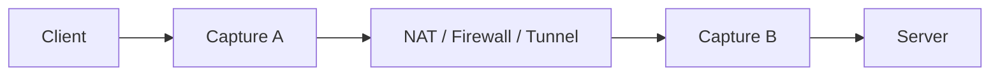

Một quy trình:

1. Xác định source/destination real IP/ports và **khả năng NAT/proxy**.
2. Chọn capture points trước/sau thành phần nghi vấn.
3. Đồng bộ thời gian của sensors và ghi clock accuracy.
4. Bắt đầu capture với giới hạn thời gian/dung lượng trước một **giao dịch lab định danh**.
5. Ghi request ID, timestamps và phiên bản chính sách/cấu hình.
6. Dừng capture, đối chiếu packet sequences/5-tuples theo từng đoạn.
7. Kiểm tra capture counters/drops trước khi kết luận gói biến mất.

### 16.2. Phân tích một SYN bị mất

Giả định không có proxy/NAT và sensors không drop:

```text
09:00:00.100 Capture A: Client SYN seq=x → Server:443
09:00:00.103 Capture B: same SYN seen
09:00:00.108 Capture B: Server SYN-ACK seq=y ack=x+1
09:00:00.109 Capture A: SYN-ACK NOT SEEN
```

Đây là ví dụ **logic**, không phải packet trace thật. Nếu capture A là điểm ở client-side hop và B gần server, một giả thuyết là **response path từ B tới A có vấn đề**. Nhưng:

- Capture A có thể đã drop copy.
- Response có thể đi route khác.
- NAT/IPS có thể thay tuple.
- Timestamp có thể lệch.

Vì vậy không xác định hop cụ thể chỉ từ hai dòng “seen/not seen” nếu chưa kiểm chứng các giả thuyết khác.

### 16.3. Ghép packet khi có NAT

Hai capture trước/sau NAT không nhất thiết có cùng 5-tuple. Dùng:

- NAT translation logs và session ID.
- TCP sequence/ACK numbers nếu NAT chỉ sửa IP/port và không có TCP proxy ở giữa.
- Payload/length/timing trong giới hạn privacy nếu phù hợp.
- Flow direction/interface và connection setup timestamp.
- Correlation IDs/application logs nếu proxy mở flow mới.

**Không ghép hai TCP flows khác nhau chỉ vì trùng HTTP URL.** Với reverse proxy, upstream connection có thể được pool/reuse giữa nhiều requests; HTTP/2 có nhiều streams trong một TCP connection.

### 16.4. Đồng bộ thời gian có độ chính xác thực tế

Giả sử Capture A và B lệch clock 40 ms. Một yêu cầu đo one-way delay 3 ms sẽ không thể giải thích tin cậy chỉ bằng trừ timestamps.

Để đo delay ngắn:

- Dùng NTP/PTP/hardware timestamp phù hợp, ghi clock synchronization quality.
- Biết timestamp được gán ở driver, NIC, kernel, userspace hay collector.
- Kiểm tra capture/mirror buffering, packet reordering.
- Nếu không đủ accuracy, chỉ kết luận về **thứ tự/hiện diện tương đối** hoặc dùng probe đo RTT thay vì bịa one-way latency.

### 16.5. Packet loss của mạng và packet drop của capture tool

Hai khái niệm khác nhau:

```text
Production packet drop:
  A packet is lost/blocked along the real data path.

Capture packet drop:
  Monitoring copy was not saved by the observer.
```

Các công cụ như `tcpdump` có thể báo số **packets captured**, **received by filter**, **dropped by kernel** theo OS/libpcap; ý nghĩa chính xác của counters khác nhau giữa hệ điều hành/capture backend. Chưa kể drops ở **SPAN switch, packet broker, cloud mirror hoặc sensor NIC** có thể **không được tính** trong `tcpdump` kernel counter.

Một capture báo `0 packets dropped by kernel` **không chứng minh** không có packet drops ở source mirror trước sensor.

### 16.6. Validity của phép so sánh

| Điều kiện | Nếu thiếu thì sao |
|---|---|
| Biết traffic path | Có thể capture nhầm link/interface |
| Biết NAT/proxy stage | Không ghép đúng original và translated flows |
| Có cả hai directions | Nhầm asymmetric routing thành server không đáp |
| Sensors time synchronized | Tính one-way delay sai |
| Biết drop counters trên toàn mirror path | Không chắc “not seen” do network hay sensor |
| Có request/test ID | Nhầm nhiều concurrent connections |
| Cùng test window/config versions | So dữ liệu ở hai thời điểm khác nhau |
| Authorization/data minimization | Có thể thu dữ liệu ngoài phạm vi |

## 17. Chất lượng bằng chứng và quyền riêng tư của PCAP

### 17.1. PCAP là dữ liệu nhạy cảm, kể cả khi mã hóa

Một file có thể chứa:

- Internal IPs, MACs, VLAN IDs, endpoint inventory.
- DNS queries, server names và thời điểm truy cập.
- Session cookies, bearer tokens, credentials nếu payload plaintext.
- API request paths, IDs, PII, database protocol commands.
- TLS/QUIC traffic metadata, flow sizes và timing.
- Internal topology/management traffic.

Encrypted traffic làm giảm khả năng đọc payload nhưng không biến PCAP thành dữ liệu công khai. Một trace có IP và timestamp có thể tiết lộ activity patterns hoặc danh tính qua correlation.

### 17.2. Thu tối thiểu theo mục tiêu

Trước khi bắt:

```text
Purpose:
  Diagnose TCP handshake loss for a specific lab service

Scope:
  Allowed source and destination
  TCP/443 only, plus required ICMP metadata if appropriate

Duration:
  Short approved window

Snaplen:
  Header-only where sufficient

Access:
  Named responders/analysts

Storage:
  Restricted path, encryption, file size cap

Retention:
  Delete or archive according to incident policy
```

Không dùng “thu tất cả để có bằng chứng” làm mặc định; scope phải hợp lý với sự cố và được review theo chính sách tổ chức.

### 17.3. Chain of custody khi dùng cho điều tra

Khi PCAP phục vụ security incident hoặc bằng chứng pháp lý, cần quy trình có thể audit:

1. Ghi ai yêu cầu thu, ai phê duyệt, vì mục đích nào.
2. Ghi capture point, source interfaces, packet filters, snaplen, time window.
3. Ghi phiên bản OS/driver/tool, capture backend và clock condition khi cần.
4. Ghi drops/limitations để không tuyên bố quá mức.
5. Lưu file vào storage được bảo vệ; tạo hash/checksum cho **bản gốc** nếu quy trình yêu cầu.
6. Chỉ làm việc trên **bản sao** khi phân tích; giữ bản gốc bất biến khi cần.
7. Ghi mọi truy cập/transfer/decode/export và người thực hiện.
8. Đặt retention/secure deletion phù hợp chính sách và nghĩa vụ pháp lý.

Một hash chứng minh **nội dung file không đổi kể từ lúc hash**, nhưng không chứng minh sensor đã nhìn thấy tất cả packets hoặc source network không thể bị giả mạo.

### 17.4. Redaction và PCAP slicing

Có thể giảm dữ liệu chia sẻ bằng cách:

- Chỉ xuất flows/time ranges liên quan.
- Cắt payload khi đủ dùng.
- Ẩn IP/MAC/user identifiers không cần thiết.
- Thay thế raw packets bằng thống kê/log đã xác minh.
- Lưu raw PCAP trong kho hạn chế và chỉ gửi kết luận đã kiểm chứng.

**Redaction có thể làm hỏng checksums hoặc mất thông tin cần để giải mã**, nên phải phân biệt rõ bản gốc/bản đã chuyển đổi và ghi lại phương pháp.

### 17.5. Phạm vi quyền và quy định

Capture có thể chạm dữ liệu người dùng, đối tác, nhân viên hoặc nhiều tenants. Tổ chức phải xét:

- Quyền quản trị thiết bị khác với quyền **xem payload**.
- Hợp đồng với cloud/managed service, data locality/sovereignty.
- Chính sách bảo mật và quyền riêng tư áp dụng.
- Yêu cầu thông báo/phê duyệt khi giám sát người dùng.
- Tách roles người quản trị network và người truy cập raw PCAP.

Đối với phân tích networking cơ bản, **không cần giải mã credentials/secret của người dùng** để chứng minh packet drop.

### 17.6. Khả năng xử lý tệp độc hại

PCAP hoặc capture metadata có thể chứa protocol fields được attacker cố tình tạo malformed để tấn công parser. Công cụ phân tích cần:

- Phiên bản cập nhật và môi trường phân tích sandbox khi có thể.
- Quyền tối thiểu, không chạy decoder dưới quyền cao nếu không cần.
- Không mở tệp không tin cậy trên máy lưu production secrets.
- Giới hạn file sizes/decompression/resources theo môi trường.

## 18. Quy trình triển khai capture an toàn trên hệ thống đang chạy

### 18.1. Giai đoạn 1 — Xác định câu hỏi và chọn nguồn ít tác động nhất

Hỏi:

- Cần biết **packet-level timing/flags**, hay chỉ flow direction/action?
- Có firewall/CNI/NetFlow/IPFIX/cloud logs đã đủ chưa?
- Có thể dùng synthetic test có giới hạn thay vì ghi traffic thật?
- Cần payload không, hay header metadata đủ?

Nếu mục tiêu là “firewall có chặn source không?”, **policy verdict/counters** có thể đáng tin và ít tác động hơn full PCAP. Nếu mục tiêu là “TLS handshake thất bại ở bước nào?”, endpoint/proxy logs + short PCAP có thể phù hợp.

### 18.2. Giai đoạn 2 — Lập capture change plan

```text
Capture request ID:
Owner/on-call:
Business/security question:
Approved systems and interfaces:
Expected path / NAT / tunnel points:
Capture source and destination:
Direction / protocol / BPF:
Snaplen / duration / file count / storage cap:
Expected PPS/bandwidth and sensor capacity:
Privacy classification and retention:
Clock sync and drop monitoring:
Start/stop and rollback procedure:
Evidence of low impact:
```

Không nên capture rộng vì “chưa rõ đích”. Khi chưa rõ path, hãy dùng route/flow logs/topology/read-only commands trước.

### 18.3. Giai đoạn 3 — Preflight health và capacity

Đo baseline:

- User-facing latency/error rate/SLO.
- Host/sensor CPU/memory/disk I/O.
- Disk free space và quota.
- Link throughput/pps, mirror port capacity.
- Interface drops, queue metrics, CNI/agent health.
- Time synchronization và source inventory.

Đặt điều kiện dừng capture nếu một trong các chỉ số vượt ngưỡng đã duyệt. Tăng độ tin cậy hơn khi có một **monitoring path độc lập** với chính capture sensor.

### 18.4. Giai đoạn 4 — Canary ngắn

Bắt đầu bằng capture **rất nhỏ** ở một điểm có scope rõ, kiểm tra:

1. Có thấy đúng test packet không?
2. Capture point có đúng trước/sau NAT/encryption không?
3. Hai directions có hiện không?
4. PCAP có hợp lệ, parsing được không?
5. Có packet drops/duplicates/clock skew không?
6. CPU/disk/SLO production có thay đổi không?

Nếu không đạt, **không lập tức tăng lên full payload/all interfaces**; điều tra path và filter trước.

### 18.5. Giai đoạn 5 — Thu và quan sát liên tục

Trong capture:

- Theo dõi actual PCAP growth và free storage.
- Theo dõi capture/mirror drop counters.
- Đối chiếu service SLO với baseline.
- Ghi start/stop time, policy/network changes đồng thời.
- Đánh dấu các giao dịch lab/synthetic có chủ đích.
- Dừng khi đạt số lượng packets/time mục tiêu hoặc stop condition.

Nếu capture làm tăng p99 latency hoặc tài nguyên chạm ngưỡng, có thể chuyển sang capture trên SPAN/TAP hoặc logs/metadata-only được phê duyệt thay vì kéo dài full PCAP.

### 18.6. Giai đoạn 6 — Kết thúc và khôi phục

Sau khi dừng:

1. Xác nhận process/session capture đã ngừng.
2. Thu hồi mirror sessions/temporary debugging rules.
3. Kiểm tra network/service SLO và exporter health.
4. Bảo quản file và metadata theo phân quyền/retention.
5. Ghi packet drops, clock uncertainty, filters và missing visibility.
6. Chỉ chia sẻ kết luận/tệp đã redact với đúng người.
7. Xóa tài nguyên tạm theo quy trình, tránh chạm dữ liệu production không thuộc phạm vi.

**Tuyên bố “capture xong, không có impact” cần evidence từ metrics/SLO**, không chỉ vì người vận hành không nhận được khiếu nại.

## 19. Mười hai tình huống chọn sai điểm thu và cách điều tra

### Tình huống A — Client thấy SYN retransmit, database bị đổ lỗi

**Hiện tượng:** `tcpdump` trên client có SYN/SYN/SYN, không thấy SYN-ACK.

**Suy luận sai:** “Database chắc chắn không phản hồi”.

**Điểm thu cần bổ sung:** firewall ingress/egress hoặc server-side interface, kèm route/NAT/firewall verdict. Nếu SYN chưa tới server, backend không thể phản hồi. Nếu server gửi SYN-ACK nhưng client không nhận, điều tra return path.

**Tác động cần kiểm soát:** tránh bật full capture trên firewall core; dùng event/counter hoặc short scoped external capture nếu đủ.

### Tình huống B — SPAN không thấy một số ACK

**Hiện tượng:** Server hoạt động ổn; SPAN-based PCAP có apparent TCP gaps/retransmissions.

**Nguyên nhân khả dĩ:** Mirror output bị oversubscription, SPAN chỉ mirror một chiều, host sensor drop hoặc duplicate traffic từ nhiều source ports.

**Kiểm chứng:** so switch mirror port counters, sensor drop counters, capture ở endpoint và business SLO. Không quy `tcp.analysis.lost_segment` là mất packet production nếu chính capture đang thiếu segments.

### Tình huống C — TCP checksum “bad” ở host

**Hiện tượng:** Wireshark đánh dấu nhiều packets outgoing `checksum incorrect`, nhưng ứng dụng giao tiếp bình thường.

**Nguyên nhân khả dĩ:** TX checksum offload; checksum hoàn thiện ở NIC sau capture hook.

**Xử lý:** ghi offload settings, so với wire-level capture khi cần. Không tắt checksum offload production hoặc báo NIC hỏng từ một PCAP host.

### Tình huống D — PCAP host có TCP payload lớn hơn MTU

**Hiện tượng:** Trên server 1.500-byte MTU, capture xuất hiện TCP segment hàng chục kilobytes.

**Nguyên nhân khả dĩ:** TSO/GSO/GRO/LRO hoặc capture hook trước/sau packet segmentation/coalescing.

**Xử lý:** phân biệt kernel superpacket với Ethernet frames trên wire, xác minh NIC/driver và capture tại TAP/SPAN nếu cần ground truth.

### Tình huống E — Wi-Fi monitor không thấy authentication retry

**Hiện tượng:** AP/RADIUS có EAP failures, monitor-mode adapter không thấy toàn bộ EAPOL exchange.

**Nguyên nhân khả dĩ:** Monitor nghe sai channel, channel hopping, RF range/hidden node hoặc driver giới hạn.

**Xử lý:** đối chiếu AP/controller/RADIUS logs với capture cùng channel, xác định band/channel width và thời điểm association. Không kết luận client chưa gửi frames.

### Tình huống F — Không thấy backend HTTP dù người dùng đang truy cập

**Hiện tượng:** Capture trước TLS gateway toàn ciphertext; người phân tích tìm HTTP `GET` nhưng không thấy.

**Nguyên nhân:** HTTPS được mã hóa, hoặc HTTP/2/QUIC multiplexing. Proxy backend có thể dùng kênh riêng.

**Xử lý:** gateway access logs, upstream traces hoặc authorized capture tại backend side nếu thật sự cần, với privacy controls. Không bỏ TLS verification.

### Tình huống G — Underlay thấy UDP/4789 chứ không thấy Pod IP

**Hiện tượng:** Capture trên physical NIC Kubernetes node cho toàn UDP tunnel, trong khi người điều tra muốn phân tích `pod-a → pod-b:8080`.

**Nguyên nhân:** VXLAN encapsulation, outer node IPs. Nếu CNI khác (Geneve/native routing), tunnel port/format cũng khác.

**Xử lý:** chọn Pod/veth/CNI inner capture, hoặc decapsulate đúng format khi được phép. Không filter outer NIC theo `tcp port 8080` rồi kết luận flow không tồn tại.

### Tình huống H — Một VM chạy DPDK không xuất hiện trong host tcpdump

**Hiện tượng:** vSwitch/host capture trống, nhưng NIC counters và application packets đang tăng.

**Nguyên nhân khả dĩ:** Userspace/hardware-accelerated datapath bypass kernel capture hook, SR-IOV VF hoặc capture sai PF/VF.

**Xử lý:** kiểm tra NIC driver/DPDK configuration và hypervisor mirror support, dùng endpoint/tool đúng datapath. Không cho rằng host `any` nhìn thấy mọi packet.

### Tình huống I — Mirror từ hai ports tạo retransmission giả

**Hiện tượng:** Cùng một IP ID/TCP segment/timestamp tương tự xuất hiện hai lần trong PCAP.

**Nguyên nhân khả dĩ:** Một packet được mirror khi ingress ở port A và egress ở port B.

**Xử lý:** xem VLAN/interface metadata và packet broker deduplication; không tính “hai copies” thành hai lần network gửi thật.

### Tình huống J — Capture làm đầy disk và ảnh hưởng database

**Hiện tượng:** Sau 15 phút ghi full packets, disk free giảm mạnh, database I/O latency tăng, service p99 chậm.

**Nguyên nhân:** PCAP được lưu chung filesystem/device với database hoặc ghi quá nhiều; không có cap/rotation.

**Xử lý:** dừng capture theo runbook, bảo vệ dữ liệu cần thiết, tách storage/quota, dùng snaplen/BPF hoặc external sensor. Không xóa file ngoài scope và không tiếp tục full capture để “đủ bằng chứng”.

### Tình huống K — Captures hai đầu lệch 80 ms

**Hiện tượng:** Trừ timestamp của server và client tạo ra “negative network latency”.

**Nguyên nhân:** Clock skew, capture queueing hoặc timestamp source khác nhau.

**Xử lý:** đồng bộ/đánh giá clock accuracy, so sequence/presence, tránh kết luận one-way delay từ clocks không chuẩn.

### Tình huống L — Cloud flow logs cho thấy traffic nhưng mirror target không nhận

**Hiện tượng:** Cloud flow records ghi traffic trên NIC, nhưng sensor không có packet.

**Nguyên nhân khả dĩ:** Mirror filter quá hẹp, source NIC không được hỗ trợ, mirror target unreachable, tunnel decapsulation/filter sai, cloud quota/cost limit hoặc sensor drop.

**Xử lý:** kiểm tra session configuration, target route/SG, tunnel outer headers, quotas, sensor PPS/disk; tạo synthetic flow có quyền để xác minh và ghi coverage. Không coi mirror trống là chứng minh flow log sai.

### 19.13. Tóm tắt bài học từ các tình huống

| Nhóm lỗi | Tình huống | Kiểm chứng |
|---|---|---|
| Sai path/hop | A, F, G, H | Map data path, proxy/tunnel/driver |
| Capture fidelity | B, C, D, I | Offload, mirror drop/duplicate counters |
| RF/channel visibility | E | AP/RADIUS + đúng monitor channel |
| Capture impact | J | CPU/I/O/SLO + file/duration limits |
| Timing/correlation | K | Clock sync, timestamp source |
| Provider/sensor gap | L | Mirroring config/quotas/target health |

## 20. Lab: so sánh capture points và đo tác động thực tế

### 20.1. Mục tiêu

Lab không yêu cầu tấn công hoặc sniff traffic người khác. Mục tiêu là tạo **một lưu lượng thử đã được cấp phép**, quan sát từ nhiều điểm, chứng minh những trường nào khác nhau và đo liệu capture có gây giảm chất lượng dịch vụ không.

### 20.2. Sơ đồ lab

```text
             Test Client
                 |
          [A] Client NIC
                 |
         Lab NAT / Gateway
          [B] Gateway OUT
                 |
          Test HTTPS Server
          [C] Server NIC

Side observation:
  D = mirror/virtual switch, nếu lab hỗ trợ
  E = service/proxy logs
```

Tất cả thành phần thuộc quyền quản lý lab. Có thể thay NAT bằng một Linux router trong sandbox nếu đội thực hành được phép; không cần sửa firewall production hoặc cài TAP lên đường mạng thật.

### 20.3. Các giả định cần ghi

- Client và server có addresses, routes, ports được chỉ định.
- HTTPS test certificate hợp lệ hoặc lab CA được client trust.
- Có giới hạn lưu lượng/số request và thời gian thực nghiệm.
- Nếu dùng NAT, có log translation/session để ghép tuples.
- Các điểm thu có timestamp và drop counters đã kiểm tra.
- Storage dành riêng/quota; không ghi vào filesystem chứa production DB.
- Không có payload/token nhạy cảm trong test requests.

### 20.4. Các bước mẫu

**Bước 1 — Preflight không thay đổi trạng thái:**

```bash
ip -br address
ip route
ip -6 route
ss -ltn
```

**Bước 2 — Ghi một test transaction có dấu thời gian:**

```bash
# Hostname được cấp trong lab; HTTPS trust phải hợp lệ.
curl --max-time 8 --silent --show-error \
  --output /dev/null \
  --write-out 'total=%{time_total} status=%{http_code}\n' \
  https://api.lab.example.test/ready
```

**Bước 3 — Thu tại A/C với filters/counters giới hạn:**

```bash
# Ví dụ tại mỗi sensor trong lab; thay interface/IP thật.
sudo tcpdump -i eth0 -nn -s 96 -c 200 \
  'host 192.0.2.20 and tcp port 443'
```

Nếu C nhìn thấy tuple đã NAT hoặc reverse proxy, filter tại C phải dùng **actual post-NAT/post-proxy tuple**; copy filter của A nguyên xi có thể làm C trống.

**Bước 4 — Kiểm tra drop counters, session mapping, application response và CPU/disk metrics**, sau đó dừng mọi capture sessions được tạo trong lab.

### 20.5. Ma trận 24 phép thử

| Mã | Phép thử | Kết quả dự kiến / bằng chứng cần có |
|---|---|---|
| **CP-01** | Client gửi một TCP connect tới test server | Capture A có SYN, logs xác nhận transaction |
| **CP-02** | Capture server side cùng phiên | Capture C có SYN đã tới, nếu route cho phép |
| **CP-03** | Gateway DNAT/SNAT trong lab | Original và translated tuples được map đúng |
| **CP-04** | Gateway reverse proxy thay vì NAT | Nhận diện upstream TCP flow riêng |
| **CP-05** | Capture only ingress direction trên mirror | Ghi rõ thiếu reverse direction, không kết luận server không trả |
| **CP-06** | Mirror cả input/output một packet qua hai source ports | Phát hiện duplicate copies |
| **CP-07** | Sensor mirror PPS bị giới hạn trong lab | Ghi capture drops/limitations, không suy production loss |
| **CP-08** | Host TX checksum offload bật | Nhận diện checksum artifact không phải wire corruption |
| **CP-09** | TSO/GSO/GRO behavior trong lab | Phân biệt large host packet với frame thực |
| **CP-10** | BPF `tcp port 443` trên HTTPS test | Giảm lưu lượng capture nhưng bỏ qua DNS/ICMP |
| **CP-11** | Wireshark display filter trên PCAP có sẵn | Chỉ thay hiển thị, không làm thay đổi dữ liệu đã thu |
| **CP-12** | Snaplen 96 so với full trong lab no-secret traffic | So file size và giới hạn decode |
| **CP-13** | Ghi capture cố định 30–60 giây và bounded packets | Bảo đảm dừng đúng thời gian/size limits |
| **CP-14** | Đo CPU/disk/latency trước, trong, sau capture | Không vượt guardrails đã phê duyệt |
| **CP-15** | Clock skew nhỏ được mô phỏng trong analysis | Không kết luận sai one-way latency |
| **CP-16** | Một endpoint bị policy drop có kiểm soát | Dùng captures trước/sau + policy verdict để xác định |
| **CP-17** | VPN outer vs inner capture nếu lab hỗ trợ | Outer tunnel metadata khác inner flow |
| **CP-18** | Overlay VXLAN/Geneve nếu lab có | Thấy tunnel headers vs Pod packet |
| **CP-19** | Pod-to-Pod trên cùng node trong lab | So veth/CNI với physical NIC visibility |
| **CP-20** | Test HTTP/2 hoặc QUIC nếu endpoints hỗ trợ | Nhận ra encrypted/multiplexed flows |
| **CP-21** | Wi-Fi monitor đúng/sai channel trong lab cho phép | Quan sát channel-dependent coverage |
| **CP-22** | Cloud traffic mirroring nếu môi trường thử có | Kiểm tra quota/outer tunnel và sensor health |
| **CP-23** | Bản PCAP giả lập chứa metadata cần redact | Chỉ share approved trimmed output |
| **CP-24** | Incident drill + cleanup mirror/sensor/file | SLO hồi phục, session đã dừng, evidence metadata đầy đủ |

**CP-07, CP-16–CP-22** yêu cầu môi trường lab chuyên biệt hoặc fault injection được phê duyệt; nếu không có điều kiện, ghi **NOT RUN**. Không cố ép mirror oversubscription, tắt mạng, reset offloads, thay firewall production hoặc bắt Wi-Fi của người dùng thật.

### 20.6. Mẫu biên bản một phép thử

```text
Test ID: CP-03
Question: Did lab gateway translate the tuple?

Source:
  Test client identity / address / port:
  Capture A interface and timestamp:

Middlebox:
  Gateway/NAT instance:
  Translation log / session ID:
  Capture B interface and timestamp:

Destination:
  Capture C interface and timestamp:
  Backend listener confirmed healthy:

Capture quality:
  Snaplen / BPF / duration:
  Clock synchronization:
  Capture and mirror drop counters:
  DLT / encapsulation:

Expected:
  A and B/C tuples differ by documented NAT translation
  Application request succeeds
  No service SLO regression from capture

Result: PASS / FAIL / INCONCLUSIVE
Analyst:
Evidence location / access:
Retention / cleanup:
```

### 20.7. Điều gì khiến một test INCONCLUSIVE?

- Không có server listener/transaction thực để đối chiếu.
- Một chiều traffic đi đường khác không được capture.
- `tcpdump` kernel drops hoặc SPAN port bão hòa.
- Không biết NAT/proxy mapping.
- Clocks lệch quá lớn cho yêu cầu timing.
- Data plane dùng SR-IOV/DPDK ngoài capture hook.
- Filters quá hẹp, snaplen làm mất field cần phân tích.
- File storage đầy hoặc capture dừng trước transaction.

**INCONCLUSIVE là kết quả đúng** khi chứng cứ không đủ; không ép PASS chỉ vì lệnh `tcpdump` thoát exit code 0.

### 20.8. Tổng kết lab

Khi kết thúc, người học nên có **một bảng chứng cứ**:

| Điểm thu | Thấy request? | Thấy response? | Tuples | Capture drops? | Host/service impact? |
|---|---|---|---|---|---|
| Client NIC | Theo test | Theo test | Pre-NAT | Ghi counters | Ghi p95/CPU |
| Gateway OUT | Theo test | Theo test | Post-NAT/upstream | Ghi counters | Ghi latency/NAT |
| Server NIC | Theo test | Theo test | Backend tuple | Ghi counters | Ghi server load |
| Mirror sensor (nếu có) | Theo scope | Theo scope | DLT/tunnel-specific | Ghi mirror drops | Ghi sensor PPS/disk |

Điều quan trọng nhất là **giải thích sự khác nhau** giữa các điểm thu và không gây gián đoạn để có bằng chứng đó.

## 21. Runbook: điều tra từ capture point mà không phá dịch vụ

### 21.1. Quy trình tổng quát

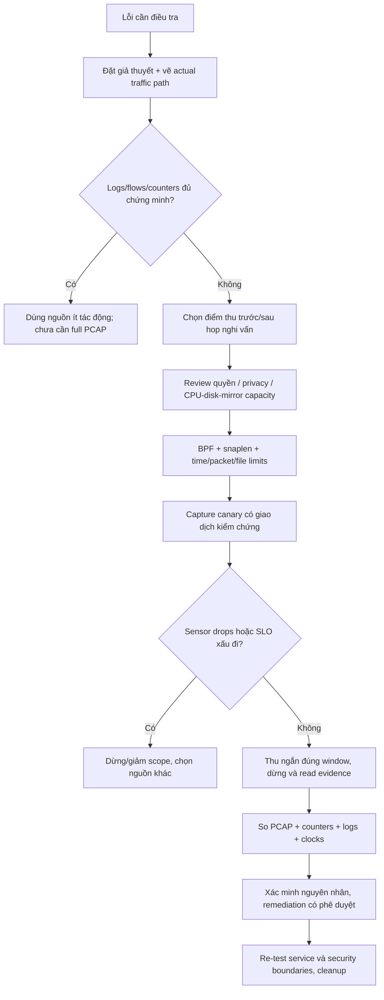

### 21.2. Runbook A — SYN đi nhưng không có SYN-ACK

**Mục tiêu:** xác định SYN không tới server, server không phản hồi, hay phản hồi không quay về client.

1. Xác minh IP/port thật và route của client; DNS có chỉ đúng đích không?
2. Kiểm tra listener/server health; dùng một positive control nếu được phép.
3. Thu short header capture tại client và destination hoặc hai phía firewall.
4. Nếu có NAT/proxy, thu session mapping/translated tuple và capture ở đúng hop.
5. So SYN seq/time và server SYN-ACK. Kiểm tra asymmetric routing.
6. Xác minh mirror/sensor drop counters trước khi nói “không thấy gói”.
7. Dùng firewall policy verdict và route logs để tìm đoạn chặn.

**Không mặc định** database không hoạt động chỉ vì client retransmit; không mở firewall all-ports để thử.

### 21.3. Runbook B — PCAP thấy nhiều “bad checksum” và retransmissions

1. Capture ở host hay external TAP/SPAN? Có TSO/GSO/GRO/checksum offload?
2. Tool có thấy duplicates do mirror nhiều ports không?
3. Có packet drops/short reads/reordering tại sensor không?
4. Application success rate, TCP counters và packet loss trên wire ra sao?
5. Nếu cần, đối chiếu với independent capture ở điểm khác.
6. Chỉ kết luận network corruption khi evidence từ datapath thật hỗ trợ.

**Không tắt toàn bộ NIC offloads** trên production nếu chưa có change approval và đánh giá performance.

### 21.4. Runbook C — Capture quá lớn hoặc chậm ứng dụng

1. Dừng capture session theo stop procedure, giữ các file đã được thu hợp lệ.
2. Kiểm tra storage free, disk I/O queue, CPU, memory và service p99.
3. Xác nhận không còn process/mirror session tiếp tục nhân bản traffic.
4. Giảm scope: specific host/port, short snaplen, fewer packets/duration.
5. Nếu cần packet-level fidelity, xem external TAP/SPAN hoặc sensor riêng.
6. Review quota, rotation, alert trước khi thử lại.
7. Xác minh SLO và security controls trở về baseline.

**Không xóa tùy tiện files của hệ thống khác để có chỗ tiếp tục capture.** Hãy xử lý cleanup đúng owner và incident retention.

### 21.5. Runbook D — Cloud/Kubernetes mirror trống

1. Kiểm tra source workload/interface và actual packet path.
2. Có hostNetwork/SR-IOV/DPDK/overlay/service NAT bypass không?
3. Mirror session, source filter, target route/SG và tunnel endpoint đúng chưa?
4. Sensor NIC/CPU/disk/drops/capture interface có khỏe không?
5. Thử một lab synthetic packet có quyền qua đúng path.
6. So flow/counters ở source với mirror data; ghi sampling/visibility gaps.
7. Nếu đường không được hỗ trợ, dùng endpoint/CNI/host/log telemetry khác.

Không kết luận traffic không tồn tại khi mirror chưa được xác minh hoạt động.

### 21.6. Runbook E — Sự kiện nghi lateral movement/exfiltration

1. Xác minh source identity, event-time IP/Pod/VM mapping, destination classification.
2. Xác minh có flow trái chính sách hay chỉ rejected attempts.
3. Ưu tiên firewall/CNI/EDR/proxy logs và chỉ capture metadata cần thiết.
4. Giới hạn mục tiêu, thời gian và quyền truy cập PCAP; giữ chain of custody.
5. Điều tra IAM/credentials/app audit và known change windows.
6. Nếu có dấu hiệu compromise rõ, containment theo IR authority; giữ bằng chứng.
7. Sau remediation, kiểm thử negative path bị chặn và positive business path hoạt động.

**Đừng tải PCAP đầy đủ chứa dữ liệu của nhiều người lên công cụ phân tích bên ngoài** nếu không có quyền chuyển giao.

### 21.7. Runbook F — TLS handshake lỗi qua gateway

1. Chọn capture **client-facing** và log TLS termination tại gateway.
2. Xác minh SNI/hostname, certificate trust và TLS alert metadata được phép.
3. Nếu gateway re-originate TLS, kiểm tra **upstream-facing** capture/logs riêng.
4. Phân biệt TLS #1 vs TLS #2, nguồn/đích/ports và peer identities.
5. Không cố đọc HTTP payload trong encrypted wire capture khi không cần.
6. Sau sửa, xác minh cả HTTPS transaction và authorization policy vẫn đúng.

### 21.8. Bản ghi tối thiểu trong incident

```text
Incident ID:
Question / hypothesis:
Approved capture owner and scope:
Traffic path / NAT / proxies:
Capture points and interfaces:
Capture filters, snaplen, time windows:
Clock synchronization and timestamp sources:
Mirror/capture drops and missing directions:
Service SLO before/during/after:
File identifier, hash and access location:
Observation at A:
Observation at B:
Contradictory evidence/limitations:
Root-cause conclusion and confidence:
Remediation and rollback:
Cleanup and retention:
```

## 22. Những hiểu lầm về capture point và tác động đến hệ thống

| Phát biểu sai hoặc thiếu | Cách hiểu đúng |
|---|---|
| “Cứ capture trên core switch sẽ thấy mọi east–west flow.” | Cùng hypervisor/overlay/host traffic có thể không qua physical switch. |
| “Không thấy packet ở một sensor tức không có traffic.” | Có thể sai path, filter, mirror loss, sampling, encryption/tunnel, sensor offline. |
| “SPAN chính là bản sao không thể mất gói.” | SPAN destination có thể oversubscribed/drop/reorder. |
| “SPAN duplicate nghĩa TCP đã retransmit.” | Có thể một packet bị mirror ở nhiều ports/directions. |
| “TAP luôn 100% không ảnh hưởng đường mạng.” | Lắp đặt, optical loss, active power/failure và maintenance có thể tác động. |
| “Một TAP thấy mọi đường qua data center.” | TAP chỉ thấy links/directions đi qua nó. |
| “`tcpdump -i any` trên host thấy mọi VM/container.” | Chỉ interfaces trong network namespace/hook tương ứng; DPDK/SR-IOV có thể bypass. |
| “Pod IP là đủ để biết process nào gửi packet.” | Cần UID/SA/process/time; IP được tái sử dụng, node/NAT shared. |
| “Capture trên underlay phải thấy Pod IP.” | VXLAN/Geneve/WireGuard/IPsec có outer headers/ciphertext. |
| “Server PCAP không thấy SYN nghĩa firewall đã drop.” | Có thể sensor/drop/filter/path khác; cần policy verdict và capture trước đó. |
| “Bad TCP checksum trên host chứng minh wire error.” | Checksum offload có thể gây artifact. |
| “Host capture thấy TCP packet lớn hơn MTU là lỗi mạng.” | TSO/GSO/GRO coalescing/segmentation có thể thay hình ảnh packet. |
| “Tắt offload luôn làm chẩn đoán chính xác hơn.” | Có thể làm thay packetization/performance, gây outage và mất tính đại diện. |
| “Capture cả chiều đi và về trên một SPAN luôn đủ.” | Routing bất đối xứng hoặc mirror scope làm một chiều vắng mặt. |
| “Đồng bộ clock không quan trọng khi so hai PCAP.” | Clock skew làm one-way latency và event ordering sai. |
| “`0 packets dropped by kernel` chứng minh không mất mirror packets.” | Không tính drops trước capture socket: switch/broker/cloud path. |
| “Một source NAT IP là danh tính của một Pod.” | Nhiều workloads cùng NAT; cần translation/UID/time correlation. |
| “Capture filter và Wireshark display filter giống nhau.” | Capture filter bỏ gói trước khi ghi; display chỉ lọc gói đã có. |
| “Filter TCP/443 cho thấy mọi HTTPS.” | QUIC dùng UDP/443; DNS, ICMP, proxies/tunnels có ports khác. |
| “TLS packet capture luôn hiển thị HTTP URL/JWT.” | Ciphertext không đọc được payload; cần endpoint/proxy logs có quyền. |
| “TLS 1.3 luôn hiện certificate plaintext.” | Nhiều handshake messages đã được mã hóa. |
| “PCAP 96-byte snaplen không còn dữ liệu nhạy cảm.” | Headers/identifiers và một phần payload vẫn có thể nhạy cảm. |
| “PCAP file chỉ tốn bằng throughput/8, không cần quota.” | Có metadata, duplicates, tunnels và thời gian kéo dài; disk đầy rất nhanh. |
| “Ghi PCAP trên production không làm thay đổi hệ thống.” | CPU, memory buffers, disk, NIC, mirror copies và latency đều có chi phí. |
| “Capture từ firewall/IPS lúc nào cũng rẻ.” | Một số thiết bị punt packets tới CPU hoặc cạnh tranh với data/control plane. |
| “Cloud mirroring luôn có thể bật cho mọi NIC.” | Hỗ trợ/quota/filter/tunnel/billing phụ thuộc provider. |
| “Mirror trống chứng minh VPC flow logs sai.” | Có thể mirror target/config/sensor không nhìn thấy traffic. |
| “Hash PCAP chứng minh capture đủ packets.” | Hash chỉ kiểm tra file integrity kể từ khi tạo/hash. |
| “Có quyền root tức được phép xem mọi payload.” | Quyền quản trị kỹ thuật không thay quyền bảo mật/privacy/legal. |
| “PCAP đủ để kết luận user có quyền truy cập dữ liệu.” | Network reachability khác JWT/IAM/app/DB authorization. |

## 23. Câu hỏi ôn tập và đáp án định hướng

### Câu 1. Capture point là gì?

**Định hướng:** Là vị trí cụ thể trên đường truyền/host/virtual datapath nơi gói tin được sao chép/ghi, với visibility và tác động phụ thuộc vị trí/technology.

### Câu 2. Vì sao PCAP ở client không chứng minh server đã nhận packet?

**Định hướng:** Packet có thể bị drop/định tuyến sai ở bất cứ hop nào giữa client và server; cần capture/log ở phía sau hoặc ngay tại server.

### Câu 3. Tại sao nên đặt hai điểm thu trước và sau firewall?

**Định hướng:** So packets và policy verdict trước/sau để xác định firewall có chặn/translate hay vấn đề ở hop khác, đồng thời kiểm tra sensor drop.

### Câu 4. SPAN khác TAP như thế nào?

**Định hướng:** SPAN là cơ chế switch mirror packet copy; TAP nằm trên một đường vật lý và cung cấp bản sao với hardware/failure semantics riêng. Cả hai có giới hạn fidelity/capacity.

### Câu 5. Vì sao SPAN có thể thiếu packets dù network vẫn bình thường?

**Định hướng:** Mirror output oversubscription, ASIC/buffer drops, thiếu source/direction hoặc sensor NIC/CPU/disk bottleneck. Drop bản sao không nhất thiết là drop traffic gốc.

### Câu 6. Khi nào mirror một packet có thể tạo hai bản sao?

**Định hướng:** Cùng packet xuất hiện ở ingress và egress source ports/VLANs đã mirror, hoặc nhiều monitoring stages. Cần dedup và interface context.

### Câu 7. TAP thụ động có tuyệt đối không ảnh hưởng link không?

**Định hướng:** Không. Physical insertion/optical loss và cutover có thể làm gián đoạn nếu không có maintenance và power budget; active TAP có failure modes riêng.

### Câu 8. Vì sao cùng-subnet VM-to-VM traffic có thể không hiện ở core SPAN?

**Định hướng:** Virtual switching trên hypervisor/SDN có thể chuyển traffic nội bộ không qua physical switch đang mirror.

### Câu 9. SR-IOV/DPDK ảnh hưởng host tcpdump ra sao?

**Định hướng:** Traffic có thể đi qua userspace/hardware datapath bypass kernel capture hook; cần tool/sensor ở đúng NIC/VF/virtual switch/endpoint.

### Câu 10. Vì sao TCP checksum trên host capture có thể sai nhưng trên wire đúng?

**Định hướng:** Checksum offload có thể hoàn thiện checksum sau thời điểm host capture hook ghi packet.

### Câu 11. TSO/GSO/GRO có thể tạo hiện tượng gì?

**Định hướng:** Gộp/phân đoạn packet tại kernel/NIC, khiến capture thấy superpacket/large segments khác frames trên wire; không mặc định lỗi MTU.

### Câu 12. `-i any` có capture toàn bộ cluster Kubernetes không?

**Định hướng:** Không. Nó chỉ bao phủ interfaces trong namespace/capture backend đang chạy, không tự thấy all nodes, overlay bypass hoặc hardware offload paths.

### Câu 13. Capture trên `lo` của Pod sẽ giúp điều tra loại traffic nào?

**Định hướng:** Loopback/localhost communications trong cùng Pod network namespace, khác đường đi qua physical NIC.

### Câu 14. Service ClusterIP và Pod IP có thể xuất hiện khác nhau ở đâu?

**Định hướng:** Trước/sau Service NAT/translation; phụ thuộc kube-proxy/IPVS/eBPF CNI và hook capture.

### Câu 15. Capture trên node underlay VXLAN thường thấy gì?

**Định hướng:** Outer node IPs/UDP encapsulation; có thể cần decapsulation hoặc inner interface capture để thấy Pod source/destination.

### Câu 16. Capture ngoài VPN có thể thấy application HTTP plaintext không?

**Định hướng:** Thông thường không nếu inner traffic nằm trong IPsec/WireGuard tunnel; phải chọn authorized inner capture hoặc endpoint telemetry theo policy.

### Câu 17. HTTPS qua reverse proxy tạo một hay nhiều TLS flows?

**Định hướng:** Có thể là client-facing TLS #1 và upstream TLS #2 hoặc HTTP plaintext, với source/destination và certificate/trust context khác.

### Câu 18. Vì sao một PCAP không thấy HTTP requests trên TLS 1.3?

**Định hướng:** Application data được mã hóa; dùng endpoint/gateway logs khi cần L7 context thay vì cố đọc ciphertext.

### Câu 19. QUIC có thể thay đổi gì trong cách theo dõi flow?

**Định hướng:** QUIC chạy trên UDP, mã hóa nhiều transport details, hỗ trợ migration; 5-tuple có thể đổi trong cùng logical connection.

### Câu 20. Một nguồn NAT IP có chứng minh một workload duy nhất đang gửi không?

**Định hướng:** Không, cần NAT translation/session và event-time workload identity; IP có thể được chia sẻ.

### Câu 21. Capture filter khác display filter thế nào?

**Định hướng:** Capture BPF lọc khi thu; display filter chỉ thay các packets hiện ra từ dữ liệu đã ghi. Không thể phục hồi packet bị bỏ lúc capture.

### Câu 22. Vì sao BPF `tcp port 443` có thể bỏ sót nguyên nhân HTTPS lỗi?

**Định hướng:** DNS query, ICMP PMTUD, QUIC UDP/443 hoặc upstream proxy port khác không match.

### Câu 23. Snaplen 96 bytes có phải đủ cho mọi protocol không?

**Định hướng:** Không. Tunnels/VLAN/IPv6 extension headers có thể chiếm nhiều bytes; payload và TLS/HTTP decode sẽ bị thiếu. Nó cũng không xóa mọi metadata nhạy cảm.

### Câu 24. Ước tính lưu 1 Gbit/s trong 10 phút theo raw bandwidth ra bao nhiêu?

**Định hướng:** Khoảng 75 GB (thập phân) trước packet record overhead, filters, snaplen và duplicate/mirror effects.

### Câu 25. Capture liên tục có thể ảnh hưởng ứng dụng qua những tài nguyên nào?

**Định hướng:** CPU/PPS processing, memory/ring buffers, disk I/O/space, NIC/mirror bandwidth, management/control-plane CPU, latency.

### Câu 26. Vì sao chỉ thấy `0 dropped by kernel` không đủ chứng minh capture đủ?

**Định hướng:** Packet copies có thể mất ở switch SPAN, TAP broker, cloud mirror, NIC hoặc những đường không tới capture socket.

### Câu 27. Đồng bộ timestamp giữa hai sensors có vai trò gì?

**Định hướng:** Giúp correlation và tránh kết luận sai về ordering/one-way delay; phải biết clock accuracy và timestamp source.

### Câu 28. Khi server-side capture trống, cần kiểm tra gì trước khi kết luận?

**Định hướng:** Đúng interface/namespace, filter, real route/NAT tuple, listener, proxy path, sensor health/drops, clock window và source-side evidence.

### Câu 29. Capture từ Wi-Fi adapter monitor mode có chắc thấy tất cả AP/clients không?

**Định hướng:** Không. Radio chỉ nghe theo channel/bandwidth/range và driver capability; channel hopping có thể bỏ lỡ frames.

### Câu 30. Capture outside VPN thấy UDP/ESP, không thấy inner TCP/443 nghĩa là gì?

**Định hướng:** Inner packets có thể nằm trong encrypted tunnel; không suy client không gửi HTTPS.

### Câu 31. Vì sao full PCAP có rủi ro dữ liệu cao?

**Định hướng:** Có thể chứa network inventory, credentials, cookies, PII, payload, identifiers và metadata liên quan người dùng.

### Câu 32. Hash PCAP chứng minh được điều gì và không chứng minh được gì?

**Định hướng:** Hỗ trợ kiểm tra file integrity kể từ lúc tạo hash; không chứng minh completeness, source authenticity hoặc sensor không mất packets.

### Câu 33. Một temporary cloud mirror session có thể phát sinh chi phí nào?

**Định hướng:** Mirrored bytes, cross-zone/region transfer, sensor VM/CPU/network, disk storage, processing và retention tùy provider.

### Câu 34. Tại sao không nên tắt TSO/GRO production để phục vụ PCAP?

**Định hướng:** Có thể tăng CPU và thay performance/packetization, khiến capture không đại diện trạng thái trước đó; cần change approval hoặc wire capture thay thế.

### Câu 35. Cách chứng minh capture không tác động service SLO?

**Định hướng:** Đo service latency/errors, CPU/memory/disk/network drops trước–trong–sau; có stop conditions, canary scope và xác nhận phục hồi.

### Câu 36. Mục tiêu chính khi chọn capture point là gì?

**Định hướng:** Chọn vị trí có thể trả lời giả thuyết cụ thể với fidelity/coverage đủ cao và tác động thấp nhất, đồng thời bảo vệ dữ liệu và biết rõ limitations.

## 24. Checklist lựa chọn capture point và giới hạn tác động

### 24.1. Mục tiêu và quyền

- [ ] Đã định nghĩa câu hỏi cần trả lời: DNS, TCP flags, firewall verdict, NAT, TLS, VPN, overlay, ứng dụng hay security incident.
- [ ] Có business/IR owner phê duyệt, mục đích sử dụng và phạm vi nguồn/đích được ghi rõ.
- [ ] Đã chọn loại dữ liệu **ít chi tiết nhất nhưng đủ bằng chứng**: metric/flow/log trước khi cần full PCAP.
- [ ] Không nhầm quyền quản trị host/switch/cloud với quyền đọc traffic payload hoặc dữ liệu người dùng.
- [ ] Có chính sách privacy/legal/data retention và access controls phù hợp.
- [ ] Không yêu cầu credentials/session keys để “giải mã” các luồng ngoài phạm vi.
- [ ] Không chạy packet capture/scans trên môi trường không có quyền.

### 24.2. Xác định đường mạng và điểm thu

- [ ] Có bản đồ source → DNS → route → firewall/NAT → gateway/proxy → destination.
- [ ] Đã xác định direction, network namespace, interface/VRF/VLAN và address family IPv4/IPv6.
- [ ] Đã phân biệt capture trước và sau SNAT/DNAT/LB, proxy re-origination và TLS termination.
- [ ] Đã kiểm tra return path và khả năng **asymmetric routing/ECMP**.
- [ ] Có dự kiến Service VIP/Pod IP translation, hostNetwork, same-Pod localhost và CNI datapath.
- [ ] Đã nhận diện underlay/overlay/tunnel path: VXLAN/Geneve, VPN/IPsec/WireGuard.
- [ ] Nếu cần L7 context, đã xác định nơi TLS terminate và nơi có app/proxy logs, tránh tìm plaintext trong ciphertext.
- [ ] Đã xác minh cloud/virtual NIC mirror support và đường đi qua actual hook, không giả định provider nhìn thấy tất cả.
- [ ] Nếu Wi-Fi capture, đã xác định channel, radio mode, RF location, driver capability và phạm vi người dùng.

### 24.3. SPAN/TAP/virtual mirror

- [ ] SPAN source ports/VLANs/directions được chọn đúng, không thu toàn mạng không cần thiết.
- [ ] Destination mirror throughput/PPS đủ cho **tổng copies**, kể cả khả năng duplicate.
- [ ] Có counters/telemetry cho SPAN/packet broker/target drops, không chỉ `tcpdump` kernel drops.
- [ ] Đã đánh giá reordering, timestamp source, data-link type và VLAN tag handling.
- [ ] Nếu dùng TAP, đã review installation window, optical power budget/speed và failure modes của model được chọn.
- [ ] Không thay physical links production nếu không có maintenance/rollback được phê duyệt.
- [ ] Virtual switch/hypervisor port mapping, VM migration, SR-IOV/DPDK/hardware offload được kiểm tra.
- [ ] Cloud mirror session có owner, quota, network cost, target security và cleanup plan.

### 24.4. Offload, fidelity và completeness

- [ ] Đã ghi NIC/driver/OS/capture backend và các offload settings TSO/GSO/GRO/LRO/checksum/VLAN.
- [ ] Không mặc định host checksum errors/large packets là wire faults.
- [ ] Biết capture filter BPF khác Wireshark display filter; không hy vọng recover packet bị loại trước khi ghi.
- [ ] BPF không vô tình loại DNS/ICMP/QUIC/tunnel packets liên quan.
- [ ] Snaplen đủ để đọc headers/protocol cần thiết, không mặc định một con số phù hợp mọi trường hợp.
- [ ] Biết sampling, mirror drops, capture socket drops và packet duplication làm thay đổi kết quả.
- [ ] Có positive test có packet thực đi đúng path để chứng minh sensor **đang thấy** traffic.
- [ ] Nếu không thấy packet, đã đánh giá alternative paths và sensor loss trước khi khẳng định packet không tồn tại.
- [ ] Nếu so hai capture, có clock synchronization, request/flow correlation và NAT mapping.

### 24.5. Performance và storage guardrails

- [ ] Đã ước lượng Mbps, PPS, burstiness và tổng data volume trong capture window.
- [ ] Sensor/host có CPU, memory/ring buffer, NIC và disk I/O đủ headroom.
- [ ] Có hạn thời gian/packet count và file size/number/quota, không ghi vô hạn.
- [ ] Không ghi full PCAP vào database filesystem hoặc critical OS disk khi có phương án riêng.
- [ ] Có stop condition khi disk, CPU, drops, latency hoặc business errors vượt ngưỡng đã duyệt.
- [ ] Ghi baseline service SLI/p95/p99, CPU, disk, packet drops trước–trong–sau.
- [ ] Có thể chuyển sang external sensor, short capture hoặc metadata/log nếu full capture gây impact.
- [ ] Không tắt offloads, ACL, encryption hoặc IPS chỉ để tạo PCAP dễ đọc khi chưa đánh giá thay đổi.

### 24.6. Bảo vệ và sử dụng bằng chứng

- [ ] PCAP được coi là dữ liệu nhạy cảm ngay cả khi chứa encrypted flows.
- [ ] Capture files được lưu trong vị trí hạn chế, mã hóa, phân quyền và có retention cụ thể.
- [ ] Có timestamp, capture settings, interface ID, filter, snaplen, tool/version và drop counters trong notes.
- [ ] Nếu phục vụ điều tra, có hash bản gốc và audit chain of custody theo quy trình.
- [ ] Bản làm việc/redacted output được phân biệt với bản gốc.
- [ ] Không phát tán raw bearer tokens, cookies, PII, TLS private keys hoặc admin credentials.
- [ ] PCAP không tin cậy được mở bằng analyzer cập nhật/môi trường cách ly phù hợp.
- [ ] Báo cáo ghi rõ những điều **quan sát trực tiếp**, những điều **suy luận** và mức chắc chắn.

### 24.7. Dừng, cleanup và hậu kiểm

- [ ] Capture đã dừng; không còn debug processes/temporary mirror sessions.
- [ ] Đã xác nhận không còn filesystem/network CPU/I/O impact đáng kể.
- [ ] Đã khôi phục cấu hình tạm theo thay đổi được duyệt, không tắt security controls.
- [ ] Service SLO và các network positive/negative checks trở lại bình thường.
- [ ] Ghi kết quả đạt/không đạt/inconclusive, kể cả điểm mù, dropped packets và clock uncertainty.
- [ ] Sắp xếp retention, secure deletion hoặc archive đúng hạn.
- [ ] Cập nhật runbook: điểm thu nào có hiệu quả, điểm nào sai và phương án ít tác động hơn lần sau.

### 24.8. Bảng chọn nhanh theo mục đích

| Nếu muốn biết... | Điểm thu/nguồn ưu tiên | Điều cần kiểm tra thêm |
|---|---|---|
| Client đã gửi SYN chưa? | Client NIC/namespace | Offload, correct interface, actual destination |
| Server có nhận SYN không? | Server NIC hoặc CNI destination hook | Listener và capture drops |
| Firewall có chặn packet? | Firewall verdict + capture trước/sau nếu cần | NAT, routing, state, mirror loss |
| Vì sao server response không về client? | Server-side + client-side + return route | Asymmetry/ECMP, NAT, time sync |
| Link có wire errors/reordering không? | TAP/external capture với timestamps phù hợp | Sensor PPS/drops, offload artifacts |
| Vì sao một VM-to-VM flow mất? | VM/vSwitch/SDN capture | Same-host path, SR-IOV/DPDK |
| Vì sao Pod-to-Pod bị drop? | Pod veth/CNI flow verdict và node logs | Service VIP/NAT, NetworkPolicy, overlay |
| VPN có chở đúng traffic? | Tunnel inner/outer captures tại endpoint | ESP/UDP encapsulation, key/security boundaries |
| Vì sao HTTPS trả 403? | Proxy/application authorization logs | TLS termination, JWT/peer identity, L7 policies |
| Có packet loss trong SPAN? | Mirror port + sensor counters | Production link counters/endpoint capture |
| Có mất gói thật hay chỉ do capture? | Independent capture + path counters | Mirror, offload, time and duplication |
| Vì sao PCAP làm service chậm? | Host/sensor CPU/I/O/disk và SLO | Capture PPS, snaplen, rotation, storage |
| Cần phát hiện lateral movement? | CNI/firewall flow logs + workload identity/EDR | Limit PCAP scope; IR authorization |
| Cần kiểm tra Wi-Fi authentication? | AP/RADIUS logs + client/monitor-mode theo kênh | RF coverage, DHCP/DNS và privacy |

**Ghi nhớ:** **Capture point quyết định những gì có thể quan sát, còn phương pháp capture quyết định độ trung thực và chi phí của bằng chứng.** Hãy bắt đầu từ câu hỏi cần chứng minh, vẽ đường đi thực, hiểu sự khác nhau trước/sau NAT, proxy, VPN, TLS và overlay, rồi chọn điểm thu có khả năng trả lời với phạm vi nhỏ nhất. Luôn đo **sensor drop, offload artifacts, clock uncertainty và tác động lên CPU/disk/network/SLO**; bảo vệ dữ liệu PCAP như một tài sản nhạy cảm. Một cuộc điều tra tốt không phải thu được nhiều packets nhất mà là **đưa ra kết luận có cơ sở, nêu rõ giới hạn và không tạo thêm sự cố khi quan sát**.
