# Phân biệt retransmission, reset và timeout qua packet capture và phân tích lưu lượng

**Retransmission (truyền lại), reset (đặt lại kết nối) và timeout (hết thời gian chờ)** đều có thể xuất hiện khi một ứng dụng báo “connection failed”, “read timed out” hoặc “broken pipe”. Tuy nhiên, chúng **không phải ba tên gọi khác nhau cho một lỗi**. Retransmission là hành vi truyền lại dữ liệu/segment khi TCP chưa xác nhận đã được nhận đầy đủ; **TCP RST** là cờ báo kết nối hoặc segment không được chấp nhận theo trạng thái TCP; còn **timeout** là kết quả một bộ đếm thời gian ở TCP, TLS, proxy hoặc ứng dụng đã hết hạn trước khi điều kiện chờ hoàn thành. Một chuỗi sự cố có thể có cả ba, nhưng không được suy quan hệ nhân quả chỉ bằng việc nhìn thấy chúng trong cùng packet capture.

Trong mô-đun **SECURITY_NETWORK_SECURITY**, khả năng đọc PCAP giúp điều tra ảnh hưởng của **firewall/NGFW, NAT, VPN, IDS/IPS, mạng container/Kubernetes, service mesh/mTLS, DNS, cloud load balancer, phân đoạn mạng và bảo mật kết nối**. Bài học thuộc chương **Packet capture và phân tích lưu lượng**. Mục tiêu là nhìn được từ **dấu vết packet → trạng thái transport → nguyên nhân khả dĩ → bằng chứng cần bổ sung → hướng xử lý an toàn**, thay vì kết luận “mất mạng” hoặc “firewall chặn” chỉ vì thấy dòng màu đỏ trong Wireshark.

Tất cả các ví dụ sử dụng địa chỉ IP tài liệu **192.0.2.0/24**, **198.51.100.0/24**, **203.0.113.0/24**, **2001:db8::/32**, hoặc private lab **10.20.0.0/16**. Một số timeline dùng thời gian và sequence numbers **giả định để học**, không phải bản trích từ PCAP sản xuất. Chỉ bắt gói, phân tích và chạy lệnh trên thiết bị, ứng dụng và kết nối được cấp phép. PCAP có thể chứa cookie, token, hostname, thông tin nội bộ hoặc dữ liệu người dùng dù chỉ định bắt headers.

## 1. Mục tiêu học tập

Sau bài học, người học có thể:

1. Phân biệt **TCP retransmission**, **fast retransmission**, **spurious retransmission**, **TCP reset** và các loại **connection/request/idle/response timeout**.
2. Giải thích quá trình **TCP three-way handshake, sequence number, acknowledgment number, receive window, FIN/RST** và mối quan hệ với lỗi quan sát.
3. Đọc dấu hiệu **SYN retry, data retransmission, duplicate ACK, SACK, out-of-order, zero window, RST và FIN** trong PCAP.
4. Xác định tại sao có thể nhìn thấy **retransmission mà không có packet loss thật**, hoặc có packet loss nhưng một điểm capture không thấy bản bị mất.
5. Tách **TCP retransmission timeout (RTO)** khỏi **ứng dụng báo timeout**, cùng nguồn gây timeout ở DNS, connect, TLS, HTTP, RPC, proxy, service mesh và load balancer.
6. Hiểu sự khác biệt giữa **RST từ client/server/proxy/firewall**, điều có thể và không thể xác định từ source IP và TCP flags.
7. Phân tích tác động **NAT/SNAT/DNAT, VPN tunnels, cloud load balancer, Kubernetes Service, CNI, proxy và TLS termination** tới diễn giải packet capture.
8. Sử dụng **Wireshark display filters, Follow TCP Stream, Expert Information, I/O Graphs, tshark, tcpdump và ss** một cách đúng phạm vi.
9. Nhận diện giới hạn từ **asymmetric routing, snapshot bắt trễ, packet capture loss, GRO/GSO/TSO/checksum offload, NIC mirroring và timestamp sai**.
10. Phân biệt **TCP/HTTP2 stream error, TLS alert, gRPC deadline và QUIC/UDP loss recovery**, không gắn cờ TCP RST cho giao thức khác.
11. Xây dựng **packet timeline và bảng bằng chứng** để khoanh vùng điểm lỗi, thay vì gán lỗi cho server hoặc firewall không có cơ sở.
12. Thực hiện **kiểm thử dương/âm, runbook và bảo vệ PCAP** phục vụ troubleshooting và điều tra an ninh.

## 2. Bảng phân biệt nhanh

| Dấu hiệu | Bản chất | Thường thấy gì trong PCAP? | Điều không được suy ra ngay |
| --- | --- | --- | --- |
| **TCP retransmission** | Cùng dải sequence bytes được gửi lại hoặc analyzer cho rằng đã gửi lại | TCP segment có **sequence range** chồng/lặp, Wireshark có thể ghi **[TCP Retransmission]** | Chưa thể khẳng định network packet loss hoặc fault ở sender |
| **Fast retransmission** | Sender truyền lại sớm theo dấu hiệu mất dữ liệu từ ACK/SACK | Segment truyền lại sau các ACK/SACK phù hợp; Wireshark có thể ghi **[TCP Fast Retransmission]** | Không chứng minh thuật toán sender chính xác chỉ từ Wireshark label |
| **Spurious retransmission** | Dữ liệu đã được nhận nhưng vẫn được gửi lại | ACK/SACK cho thấy bytes đã được nhận trước bản lặp, nếu capture đầy đủ | Không đồng nghĩa ứng dụng gửi hai request |
| **TCP RST** | Một endpoint/intermediary gửi TCP segment mang cờ **RST** | **tcp.flags.reset == 1**, có source/destination, seq/ack | Chưa biết chắc ai tạo RST hoặc vì sao nếu chỉ có một điểm bắt gói |
| **TCP FIN** | Một bên đóng chiều gửi một cách có trình tự | **tcp.flags.fin == 1**, tiếp tục có ACK/traffic chiều còn lại | Không tự là network failure |
| **Connect timeout** | Client không thiết lập kết nối trong deadline | Có thể thấy SYN lặp không có SYN-ACK; hoặc không thấy SYN tại điểm bắt | Không tự chứng minh firewall chặn |
| **Read/response timeout** | Ứng dụng không nhận dữ liệu đủ nhanh | Có thể thấy TCP connection vẫn mở, ACKs/keepalives, hoặc không có dữ liệu | Không đồng nghĩa TCP retransmission |
| **Idle timeout** | Không hoạt động theo bộ đếm của proxy/NAT/app | Sau một khoảng rảnh, connection bị đóng, RST/FIN hoặc silently expired | Không chỉ ra chính xác timer nào nếu không có logs |
| **TLS handshake timeout** | TLS không hoàn tất trong thời hạn | Có thể chỉ thấy TCP established và một phần TLS handshake | Không chắc do packet loss; có thể cert/mTLS/policy/CPU |
| **gRPC DEADLINE_EXCEEDED** | Thời hạn RPC logic đã hết | Có thể vẫn có TCP/HTTP2 frames và connection dùng lại | Không phải TCP RST |
| **QUIC packet loss** | Cơ chế phục hồi mất gói của QUIC trên UDP | UDP/443 packets, QUIC frames chỉ khi giải mã/giải mã metadata được | Không phải TCP retransmission |

**Quy tắc cốt lõi:** **Một TCP reset là packet-level event; một timeout có thể là ứng dụng tự quyết định; retransmission là cơ chế phục hồi truyền dữ liệu.** Ba sự kiện này thường liên quan nhưng không thay thế nhau.

## 3. TCP connection và vị trí ba hiện tượng

Trong TCP, client thường bắt đầu bằng **SYN**, server phản hồi **SYN-ACK**, client gửi **ACK**. Khi dữ liệu được truyền, TCP theo dõi sequence bytes và acknowledgments. Khi đóng, có thể dùng **FIN** theo thủ tục đóng từng chiều hoặc **RST** để ngắt/không chấp nhận kết nối theo trạng thái.

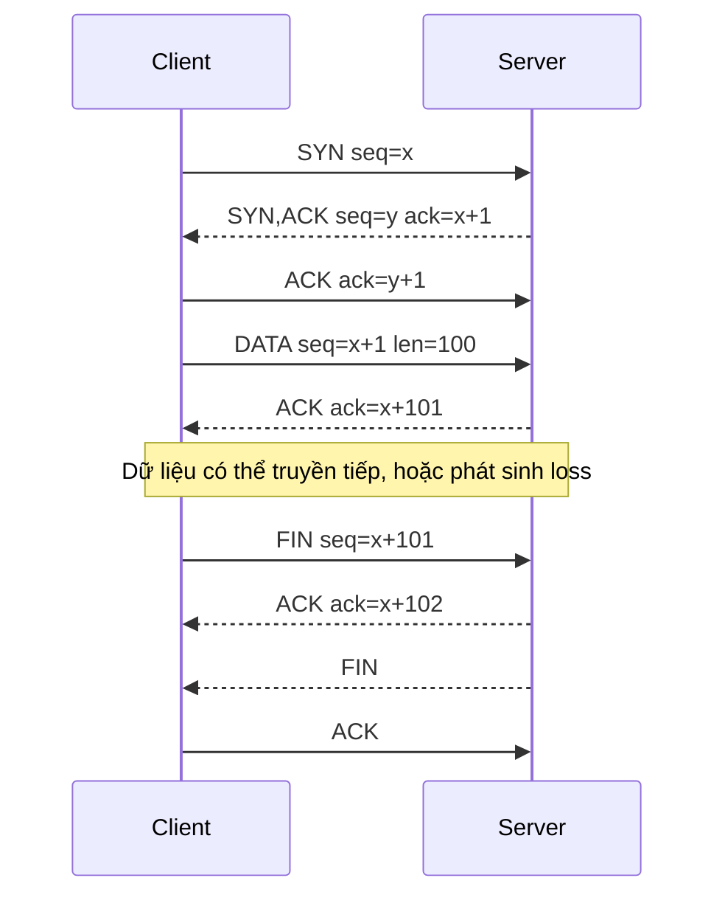

Đây là luồng bình thường **không có retransmission hoặc reset**. Trình tự FIN có thể khác và hai phía có thể đồng thời đóng. Sự kiện timeout có thể diễn ra ở **bất kỳ bước chờ nào**, tùy socket API, TCP timer và application deadline.

### 3.1. Những điều packet capture nhìn thấy

PCAP ở điểm phù hợp có thể cung cấp:

- IP/port/protocol, TCP flags, sequence/ack, window, timestamps.
- Chiều đi của segment, thứ tự tương đối, retransmission candidate.
- Một số TCP options: MSS, window scale, SACK permitted, timestamps.
- DNS, TLS handshake và HTTP plaintext nếu không mã hóa/điểm capture phù hợp.
- ICMP lỗi và một số routing/network signals.

Nó thường **không cung cấp trực tiếp**:

- Stack trace exception trong Java/Go/.NET.
- Timer/threshold của HTTP client hoặc proxy.
- Giao dịch database đã commit hay chưa.
- Firewall rule ID nếu không có firewall logs.
- End-user identity khi connection qua gateway.
- Payload HTTPS đã mã hóa mà không có khả năng giải mã được cấp phép.

## 4. Ba timeline điển hình cần nhớ

### 4.1. Retransmission: segment chưa được xác nhận trong thời gian dự kiến

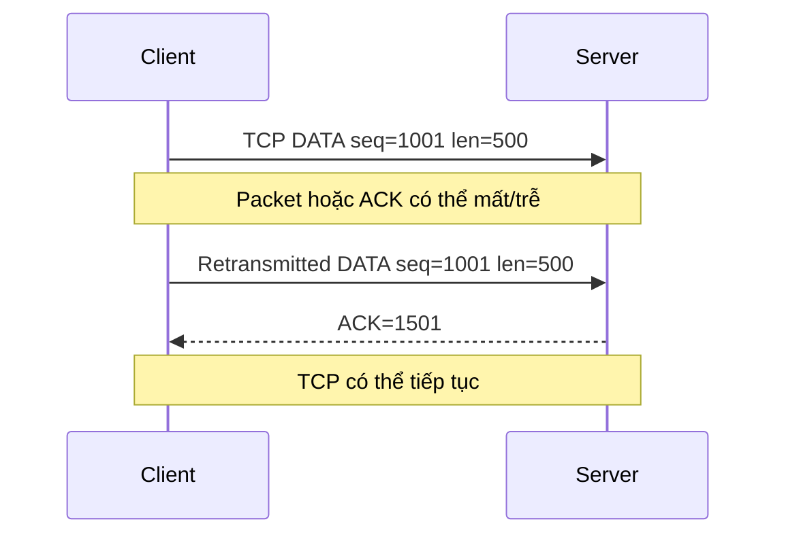

Cùng dải bytes 1001–1500 được gửi lại. Cần xem **segment đầu, ACK trước/sau, capture completeness và vị trí sensor** để xác định tại sao bản thứ hai tồn tại.

### 4.2. Reset: một phía gửi RST

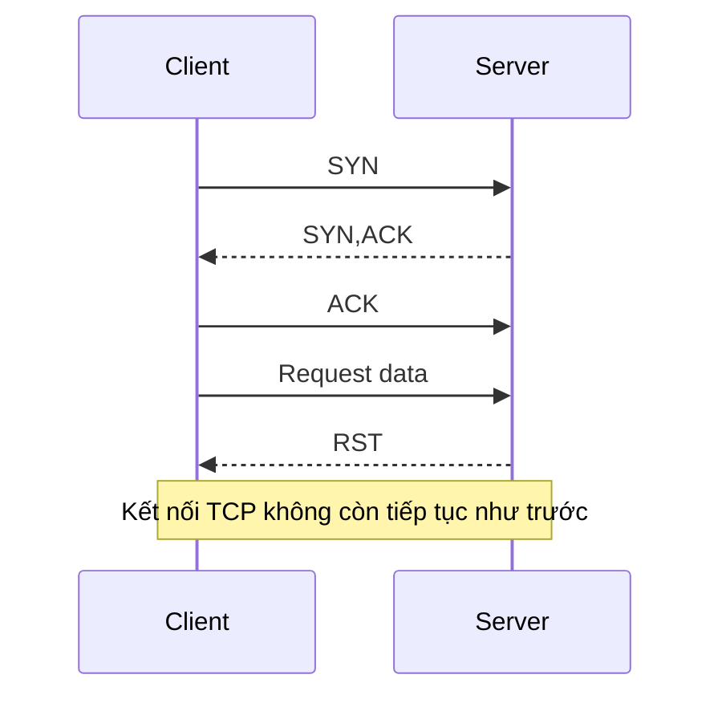

Nếu RST thật sự được endpoint xử lý, kết nối bị reset; ứng dụng có thể báo **Connection reset by peer** hoặc **ECONNRESET**, nhưng thông báo cụ thể phụ thuộc OS/API. Không thể chỉ từ source IP trùng server mà kết luận **ứng dụng server chủ động reset**: proxy, firewall hoặc thiết bị trên đường có thể sinh RST và dùng địa chỉ phù hợp hướng gửi.

### 4.3. Timeout: không có packet “TIMEOUT” bắt buộc

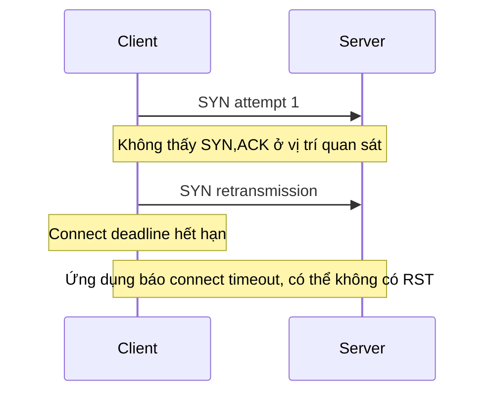

**Timeout là điều kiện thời gian**, không phải một TCP flag. Nhiều ứng dụng có thể kết thúc deadline bằng cách đóng socket, đôi khi tạo FIN/RST hoặc không tạo packet mới quan sát được. Vì vậy không nên tìm bộ lọc **tcp.timeout** như một TCP flag.

## 5. Chọn điểm bắt gói trước khi kết luận

Một kết nối có thể đi qua **client → Wi-Fi → router/firewall → NAT → load balancer → server/Pod**. Các captures ở từng điểm có thể thấy số lượng và hình thức packets khác nhau.

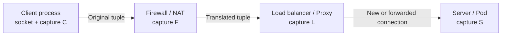

### 5.1. Bảng khả năng suy luận

| Quan sát | Có thể nói | Chưa thể nói |
| --- | --- | --- |
| Client thấy SYN gửi ra | Client stack đã phát SYN tại hook đó | Packet đã đến server |
| Firewall ingress thấy SYN | SYN đã tới observation point | Server đã nhận |
| Server thấy SYN | SYN tới server capture point | Application listener đã accept connection |
| Server thấy SYN-ACK gửi ra | Server stack có phản hồi | Client đã nhận SYN-ACK |
| Client không thấy response | Không có response trong capture tại client | Chắc chắn server không gửi |
| Một capture có RST source=server | Packet RST được thấy theo tuple | Chắc chắn server app tạo RST |
| Hai phía cùng thấy RST tương ứng | Có thể khoanh vùng nguồn/khoảng đường | Cần xét proxy/NAT/timestamp/capture loss |

### 5.2. Vị trí capture và offloading

Capture tại client/host có thể nằm **trước hoặc sau TSO/GSO/GRO/LRO, checksum offload và segmentation**. Capture trên TAP/SPAN giữa các thiết bị thường gần với traffic “trên dây”, nhưng vẫn có khả năng thiếu packets do mirror overload. Nói “PCAP là sự thật tuyệt đối” là sai nếu chưa biết **capture hook và chất lượng thu**.

### 5.3. Hai phía là phép kiểm mạnh

Khi có quyền và xử lý dữ liệu an toàn, bắt đồng thời ở **client và server** giúp phân biệt:

- Client thấy packet gửi, server không thấy → packet có thể mất/chặn trên đường hoặc server capture thiếu.
- Server thấy packet và response, client không thấy → kiểm tra return path/asymmetric routing.
- Client/server thấy cùng segment nhưng ứng dụng timeout → xem receive-window, TLS/application/proxy deadline.
- Cùng RST xuất hiện ở nhiều điểm → khoanh vùng đường phát sinh, vẫn cần xác minh source thật.

Không cần tự động bắt gói diện rộng trên production; chọn **5-tuple/filter/short duration** có giới hạn.

## 6. Đọc sequence number, ACK và độ dài TCP payload

Trong TCP, **sequence number là số thứ tự byte** trong luồng dữ liệu từng chiều. Mỗi sender có sequence space riêng; ACK thông thường là **next expected byte** theo quy tắc cumulative ACK.

Giả sử relative sequence numbers đang bật trong Wireshark:

```text
Client -> Server: seq=1   len=500   bytes 1..500
Server -> Client: ack=501           expects byte 501 next
Client -> Server: seq=501 len=300   bytes 501..800
Server -> Client: ack=801
```

**Đừng nhầm seq=501 với packet thứ 501.** TCP đánh số **bytes**, không đánh số packets. Các điểm bắt gói có thể hiển thị absolute hoặc relative sequence numbers khác nhau.

### 6.1. Bảng nhanh

| Field | Cách hiểu | Cạm bẫy |
| --- | --- | --- |
| **tcp.seq** | Sequence number (thường relative trong Wireshark mặc định) | Không nhất thiết là giá trị 32-bit trên dây nếu bật relative |
| **tcp.ack** | Next expected sequence byte cho chiều ngược | Không xác nhận ứng dụng đã xử lý dữ liệu |
| **tcp.len** | Độ dài payload TCP trong segment | Không bằng độ dài Ethernet frame |
| **tcp.window_size_value** | Window field thô trong TCP header | Có thể cần window scale để biết advertised receive window thực |
| **tcp.analysis.ack_rtt** | RTT estimate theo điều kiện dissector | Không đại diện toàn end-to-end application latency |
| **tcp.options.sack** | SACK blocks theo TCP options | Không có option không chứng minh SACK chưa từng được dùng |
| **tcp.flags.reset** | TCP RST flag | Không chỉ ra nguyên nhân reset |
| **tcp.flags.fin** | TCP FIN flag | Đóng chiều gửi có trình tự, không nhất thiết là error |

### 6.2. SYN và FIN cũng tiêu thụ sequence space

Trong TCP, **SYN** và **FIN** mỗi cờ tiêu thụ một sequence number theo quy tắc TCP. Ví dụ SYN seq=1000 được phản hồi ack=1001, dù không mang 1 byte payload application theo cách thông thường.

### 6.3. Sequence wraparound

Sequence number TCP dài 32-bit và có thể quay vòng; analyzer theo dõi context để diễn giải. Với capture cắt giữa chừng, relative seq và stream reconstruction có thể bị nhầm. Không so seq tuyệt đối của hai connections khác nhau rồi kết luận retransmission.

## 7. Retransmission thực chất là gì?

**Retransmission** là sender gửi lại những bytes chưa được xác nhận đủ theo logic TCP loss recovery. Cơ chế này biến packet loss/reordering thành một luồng byte tin cậy hơn, nhưng **không đảm bảo ứng dụng sẽ thành công trước deadline**.

### 7.1. Ví dụ cùng byte range

```text
t=0.000 Client -> Server  Seq=1001 Len=1200
t=0.220 Client -> Server  Seq=1001 Len=1200  [candidate retransmission]
t=0.235 Server -> Client  Ack=2201
```

Để xem đây có thật là sender retransmit hay chỉ là duplicated capture, cần:

- Có cùng **connection/sequence space** và byte range.
- Segment đầu có được nhìn thấy không?
- ACK từ đích có xuất hiện trước bản lặp không?
- Capture có **duplicate frames** từ SPAN/multiple interfaces không?
- Payload/length giống hay chỉ overlap? TCP có thể retransmit **một phần byte range** với segmentation khác.
- RTT/capture timestamp đáng tin không?

### 7.2. Retransmission không bằng ứng dụng gọi lại

Một Java HTTP client có thể chỉ gửi **một HTTP POST** trên socket TCP; TCP stack tự retransmit một segment chứa bytes của POST. Bản retransmit **không tạo một HTTP transaction thứ hai** ở server nếu TCP stream semantics hoạt động đúng. Ngược lại, một **application retry** có thể gửi lại POST dưới **connection mới** với seq numbers mới và gây double side effects.

Để phân biệt, cần theo dõi **logical request ID, HTTP/proxy logs, TCP stream identifiers, app retry policy**. Không đánh đồng **TCP retransmission** với **HTTP/gRPC retry**.

### 7.3. Retransmission không đồng nghĩa dữ liệu bị lỗi

Trong mạng TCP khỏe mạnh vẫn có thể có retransmissions hiếm do congestion, wireless interference hoặc transient reordering. Cần xem **tỷ lệ theo window, latency SLO, RTT, packet drops và khả năng phục hồi** thay vì chỉ một nhãn cảnh báo.

## 8. Vì sao TCP truyền lại?

Một retransmission có nhiều nguyên nhân khả dĩ:

| Khả năng | Kịch bản | Bằng chứng bổ sung |
| --- | --- | --- |
| **Data packet loss** | Segment không tới receiver | Sender thấy gửi, receiver không thấy; interface/drop counters |
| **ACK loss** | Receiver nhận dữ liệu nhưng ACK bị mất | Receiver capture có segment; ACK không tới sender |
| **Packet reordering** | Segment đến sau packets cùng connection | Out-of-order, SACK, multi-path/ECMP patterns |
| **ACK delay** | ACK tới muộn so với recovery timer | RTT variation, delayed ACK behavior, capture timing |
| **Congestion / buffer drops** | Queue đầy tại link/router/tunnel | Interface drops, ECN, RTT, utilization |
| **Wi-Fi/mobile loss** | Radio interference/roaming | Link-layer retries, radio telemetry |
| **Asymmetric path** | Một chiều có vấn đề | Captures hai hướng, routing/NAT/firewall |
| **MTU/PMTUD issue** | Một kích thước segment đi không tới | Small success/large fail, ICMP PTB handling |
| **Middlebox behavior** | Firewall/IPS/proxy reset/drop traffic | Device logs và captures quanh middlebox |
| **Host scheduling delay** | Receiver/sender CPU overloaded | Socket counters, host CPU/softirq, app threads |
| **Spurious retransmission** | Timeout/ACK ambiguity, segment đã nhận | DSACK/Eifel/RACK signals khi có |
| **Capture artifact** | Packet duplication, missing capture, offload | Capture drop counters, different observation points |

### 8.1. Retransmission là triệu chứng, không là vị trí lỗi

Nếu sender thấy bytes cần retransmit, nó có thể do **chiều gửi data** hoặc **chiều ngược gửi ACK**. Không kết luận “mất gói client→server” mà chưa kiểm tra phía receiver và reverse path.

### 8.2. Congestion không luôn nằm ở Internet

Nguồn mất packets có thể là **veth/CNI queue, host NIC, ToR switch, cloud gateway, VPN encapsulation, Wi-Fi, NAT state hoặc server receive path**. Thống kê interface tại nhiều điểm giúp khoanh vùng, nhưng cloud managed network có thể không cho toàn bộ counters.

## 9. RTO: Retransmission Timeout của TCP

**TCP retransmission timeout (RTO)** là timer do TCP sender sử dụng khi chưa có acknowledgment phù hợp cho bytes đã gửi. Các nguyên lý cổ điển được nêu trong **RFC 6298**, nhưng TCP stacks hiện đại có thể dùng thêm cơ chế như SACK/RACK/TLP và các điều chỉnh theo implementation.

### 9.1. Mô hình bộ ước lượng

Một mô hình đơn giản dùng **Smoothed RTT (SRTT)**, **RTT variation (RTTVAR)** và biên an toàn:

```text
RTO = SRTT + max(G, K * RTTVAR)

where:
  SRTT  = smoothed round-trip time
  RTTVAR= round-trip time variation estimate
  G     = clock granularity
  K     = constant used by the algorithm (traditionally 4)
```

Bài học không dùng công thức này để tự kết luận RTO thật từ một PCAP. Các giá trị ban đầu, floor/cap, backoff và việc sender dùng RACK/TLP hoặc loss probes phụ thuộc **OS/kernel/version/config/state**. TCP có thể tăng RTO sau các lần hết hạn liên tiếp.

### 9.2. Đừng lấy khoảng cách hai packets bằng đúng RTO

Khoảng cách nhìn thấy trên PCAP có thể chịu ảnh hưởng:

- Sender bắt đầu timer trước/sau segment quan sát.
- Capture mất segment hoặc timestamp skew.
- Delayed ACK và retransmission strategy.
- Congestion/loss detection fast path xảy ra trước timer.
- TCP stack scheduling/kernel timer granularity.
- Proxy retransmits thuộc TCP connection khác.
- Packet được mirror hai lần làm khoảng cách giả.

Chỉ khi có **sender socket TCP metrics/stack traces** và full capture phù hợp mới suy RTO với độ tin cậy cao.

### 9.3. Exponential backoff khi không có ACK

Khi tiếp tục mất ACK, sender thường tăng khoảng chờ theo cơ chế backoff trong giới hạn của implementation. Điều này có thể khiến ứng dụng nhận **read/connect timeout sớm hơn khi TCP vẫn đang cố phục hồi**. Timeout của ứng dụng không là packet lỗi riêng.

## 10. Fast retransmit và duplicate ACK

Trong TCP loss recovery truyền thống, sender có thể suy ra mất segment khi receiver báo đã nhận dữ liệu sau một khoảng trống. **Duplicate acknowledgments** và **SACK** giúp sender biết có bytes chưa đến nơi.

### 10.1. Một sơ đồ có gap

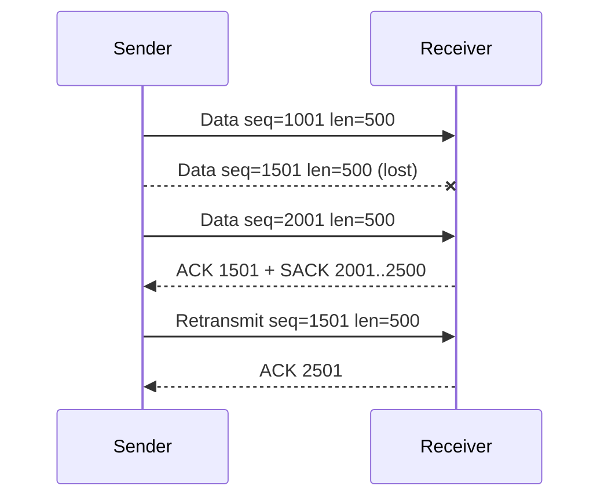

Sơ đồ minh họa ý nghĩa **cumulative ACK và SACK**. Không có bảo đảm sender luôn retransmit ngay khi chỉ có một SACK; thuật toán phục hồi và số lượng duplicate ACK thực tế phụ thuộc implementation/cwnd/timing.

### 10.2. Duplicate ACK chưa chứng minh mất gói

Duplicate ACK có thể xuất hiện do:

- Packet đến **out of order**.
- Lặp segment.
- ACK generation behavior.
- Network reordering/duplication.
- Capture sai/thiếu packet.
- **Zero window/window probes** hoặc tình huống TCP khác cần đọc context.

Một dòng **[TCP Dup ACK]** trong Wireshark là **heuristic analyzer**, không phải xác nhận sender đã dùng fast retransmit.

### 10.3. Fast retransmission vs RTO retransmission

- **Fast loss recovery:** sender dựa vào ACK/SACK/gap signals để truyền lại trước khi hết timer truyền lại theo trạng thái.
- **RTO-based recovery:** thiếu đủ ACK/loss signal, timer hết hạn.
- **RACK/TLP/modern recovery:** logic còn phụ thuộc thứ tự/thời gian truyền packets và probing; không giản lược tất cả thành “3 dup ACK thì chắc chắn fast retransmit”.

## 11. SACK, DSACK và out-of-order

**Selective Acknowledgment (SACK)** cho phép receiver thông báo các đoạn bytes đã nhận nằm sau khoảng trống so với cumulative ACK, giúp sender tránh gửi lại dữ liệu đã đến.

### 11.1. Ví dụ SACK

```text
Receiver has:
  bytes 1001..1500        -> cumulative ACK=1501
  bytes 2001..2500        -> SACK block [2001,2501)
  missing bytes 1501..2000

Sender may retransmit:
  seq=1501 len=500
```

SACK blocks mô tả những khoảng đã nhận, **không tự cho biết nguyên nhân gap là packet loss hay reordering**.

### 11.2. DSACK: dấu hiệu dữ liệu trùng

**Duplicate SACK (DSACK)** có thể cung cấp thông tin receiver đã thấy bytes lặp, giúp sender phát hiện một số **spurious retransmissions**. Tuy nhiên, không phải mọi capture có thể thấy đủ TCP options hoặc ACK history để diễn giải. Một DSACK event không tự chứng minh lỗi của network operator cụ thể.

### 11.3. Out-of-order không phải retransmission

Một segment đến sau segment mang sequence lớn hơn có thể được Wireshark gắn nhãn **Out-Of-Order**. Nó có thể là do **ECMP, wireless, queueing hoặc capture path**; sender không nhất thiết đã truyền lại segment đó. Cần so **sequence range, thứ tự tại receiver, timestamp và ACKs**.

### 11.4. Segments có length khác nhau vẫn có thể trùng byte range

Sender có thể chia lại dữ liệu thành các segment khác kích thước. Nếu packet thứ hai bao phủ một phần byte range cũ, analyzer có thể gắn nhãn retransmission/overlap khác nhau. **Không chỉ so packet size hoặc TCP checksum** để định danh retransmit.

## 12. Spurious retransmission và capture artifacts

Một **spurious retransmission** xảy ra khi sender gửi lại bytes mà receiver thực tế đã nhận trước đó. Nguyên nhân có thể là ACK bị trễ/mất, sequence ambiguity, timer hoặc recovery decisions chưa tối ưu.

### 12.1. Đâu là chứng cứ mạnh?

- Capture phía receiver xác minh segment gốc đã tới.
- Receiver đã gửi ACK/SACK trước khi sender retransmit, xét time uncertainty.
- TCP DSACK/Eifel hoặc kernel metrics cho thấy spurious recovery.
- Không có capture loss ảnh hưởng sequence/timing.
- Có evidence tại sender để phân biệt ACK bị mất với decision sai.

Một nhãn Wireshark **[TCP Spurious Retransmission]** hữu ích nhưng không nên được coi là phán quyết cuối cùng, nhất là khi bắt trễ, thiếu handshake, missing ACKs hoặc NAT/proxy gây nhiều TCP streams.

### 12.2. Duplicate packet tại SPAN là gì?

Một SPAN/mirror có thể gửi cùng packet từ **ingress và egress directions** vào sensor; collector lưu hai bản sát thời gian. Nếu sequence/ack và IP ID giống, Wireshark đôi khi nhìn như packet duplicate/retransmission.

Cần kiểm tra:

- Interface ID/direction trong pcapng.
- Ethernet MAC và VLAN tags.
- Capture timing cực sát.
- Số lượng duplicates nhất quán với mirror topology.
- Bản lặp có thực xuất hiện trên dây bên phía đích không.

**Không tự tăng retransmission counters theo số dòng trùng trong PCAP** nếu nhiều observation points được gộp.

## 13. Đánh giá retransmission rate đúng ngữ cảnh

Một vài nhãn retransmission không đủ để kết luận tuyến mạng có lỗi. Cần xác định **mẫu số** và thống nhất nguồn:

| Chỉ số | Ý nghĩa khả dĩ | Lưu ý |
| --- | --- | --- |
| **Retransmitted segments / all TCP segments** | Tỷ lệ segments được analyzer nhận là retransmissions | Có thể lệch do capture loss/offload |
| **Retransmitted bytes / original delivered bytes** | Tương đối về overhead truyền lại | Cần loại double count và biết scope |
| **TCP stack retransmission counters** | Sender/host telemetry về retransmits | Có thể bao gồm nhiều connections |
| **Loss recovery episodes** | Bao nhiêu lần TCP cần recovery | Không bằng số retransmitted packets |
| **RTT p95/p99 và variation** | Độ trễ ảnh hưởng timer/proxy | Cần phân biệt network RTT vs app latency |
| **Connection timeout/error rate** | Tác động đến người dùng | Phải dùng app/proxy logs |
| **Interface discards/errors** | Bằng chứng supporting network bottleneck | Có thể không theo flow cụ thể |

### 13.1. So sánh trước/sau change

Khi đánh giá một firewall rule, VPN gateway hoặc MTU adjustment:

- Dùng cùng **capture point và filter**.
- Đảm bảo workload/traffic volume tương đối so sánh được.
- Ghi sampling/loss và packet offload configuration.
- Theo dõi **tác động SLO**, không chỉ số nhãn Wireshark.
- Không đổi policy production chỉ vì một pcap chứa vài retransmissions.

## 14. TCP Reset (RST) là gì?

**RST** là cờ trong TCP header dùng để đặt lại hoặc từ chối một kết nối/segment trong những điều kiện do TCP state machine quyết định. Ví dụ phổ biến là **SYN tới port không có listener** dẫn tới TCP RST từ host đích (nếu không bị firewall drop), hoặc một endpoint **abort** connection đang tồn tại.

### 14.1. Nhận diện

```text
Client -> Server: SYN  Seq=1000
Server -> Client: RST,ACK  Ack=1001
```

Dấu vết này có thể tương ứng với **Connection refused** đối với lệnh connect, nhưng vẫn cần xem **source host thật, firewall reject policy, protocol và đường NAT**.

### 14.2. RST trong kết nối đang chạy

```text
Client -> Server: TCP data
Server -> Client: ACK
Server -> Client: RST
Application on client: "connection reset by peer"
```

Không phải cứ server thấy lỗi ứng dụng mới tạo RST: có thể do **socket đóng abortively (SO_LINGER), process crash/termination, proxy health/reuse, idle stale connection, firewall reset policy hoặc thiết bị trung gian**.

### 14.3. Reset có thể hợp lệ

Một RST có thể là cách endpoint từ chối SYN tới port không phục vụ, hoặc ứng dụng chủ động hủy kết nối không cần thiết. **RST rate tăng** có thể báo sự cố, nhưng từng RST không tự là malicious.

## 15. FIN vs RST: graceful close và abort

| Thuộc tính | FIN | RST |
| --- | --- | --- |
| Ý nghĩa | Bên gửi không gửi thêm dữ liệu theo cách đóng có trình tự | Đặt lại/từ chối connection theo trạng thái TCP |
| Tình huống thường gặp | HTTP keep-alive hết phiên theo lịch, app close bình thường | No listener, abortive close, stale pooled socket, middlebox reset |
| Có thể tiếp tục nhận dữ liệu? | TCP half-close có thể tiếp tục nhận ở chiều kia | Reset làm connection không tiếp tục theo trạng thái trước |
| Ứng dụng thấy gì? | EOF/connection close tùy protocol | ECONNRESET/connection refused tùy giai đoạn |
| Có chứng minh lỗi? | Không | Không luôn |
| Cần phân tích | FIN/ACK sequence, remaining data, HTTP status | Source, seq, timing, previous segments, proxy/firewall logs |

### 15.1. Half-close

TCP cho phép một endpoint **gửi FIN** nhưng vẫn nhận dữ liệu từ chiều kia trong thời gian phù hợp. Không coi packet FIN đầu tiên là dấu hiệu kết nối đã hoàn tất mọi thao tác.

### 15.2. FIN sau timeout

Một client hết **application deadline** có thể **đóng socket bằng FIN hoặc RST**, tùy socket state, unread data, OS và cách đóng. Khi thấy FIN sau khoảng im lặng, cần app logs để xác nhận timer nào vừa hết.

### 15.3. RST sau FIN/ACK

Một RST có thể xuất hiện khi có packet tới **socket đã bị đóng**, race condition hoặc connection pool reuse. Phải xem sequence timeline và hướng truyền, không kết luận app server cố ý từ chối dữ liệu bí mật.

## 16. RST đến từ ai: host, proxy hay firewall?

Một packet có source IP giống server không đủ để xác định **quá trình tạo RST**. RST có thể được tạo bởi:

- **TCP stack của server**: không có listener, socket reset.
- **Ứng dụng server** thông qua socket close/abort/certain errors.
- **Client**: client abort hoặc đóng sai trạng thái.
- **Reverse proxy/load balancer**: một chặng upstream bị đóng/timeout.
- **Firewall/IPS** cấu hình **reject-with-tcp-reset**.
- **NAT** khi state đã mất hoặc middlebox có hành vi reset.
- **Host endpoint protection** hoặc TCP proxy trong service mesh.
- Một số trường hợp **spoofed/injected RST** trên đường không được bảo vệ, tùy attacker position và TCP protections.

### 16.1. Đặt câu hỏi đúng

1. RST được thấy ở **capture client, firewall ingress/egress, server**?
2. Trước RST có SYN, data hoặc **idle interval** nào?
3. RST mang seq/ack phù hợp connection state không?
4. Có source/destination **NAT translation** không?
5. Server/proxy/NGFW có log **close/reset reason**?
6. TCP connection tới app có bị **L7 proxy termination** thành hai connections riêng không?
7. TTL/hop limit, TCP options hoặc interface metadata có khác pattern các packet server thông thường? Chỉ là **hint**, không là định danh chắc chắn.
8. Khi bắt tại server, RST có xuất hiện **phía outbound của server** hay chỉ ở client sau middlebox?

### 16.2. Một RST giả mạo không thể quy kết từ TTL một mình

TTL, IP ID, TCP timestamps hoặc MAC có thể giúp phát hiện sự khác biệt về đường đi nếu có baseline, nhưng **routing asymmetry, proxying, virtual NIC và offload** đều có thể làm chúng thay đổi. Muốn quy kết nguồn RST cần **captures nhiều điểm và logs thiết bị**, tránh cáo buộc firewall/IPS hoặc đối tác chỉ từ một đặc tính.

## 17. TCP reset khi port đóng, firewall reject và firewall drop

Ba trường hợp thường bị nhầm:

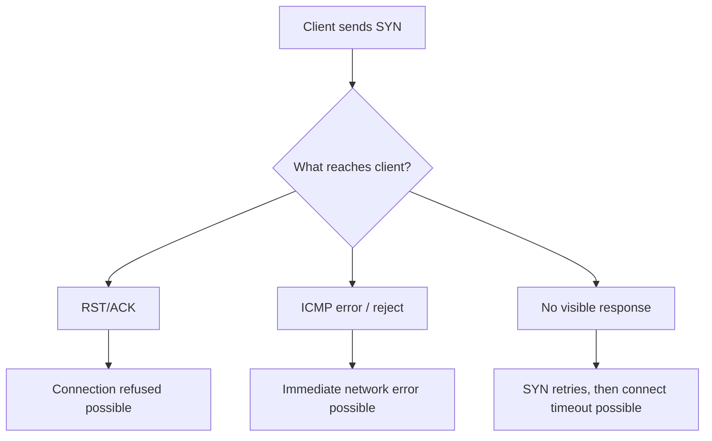

### 17.1. No listener

Host đích nhận SYN cho TCP port không có listener có thể trả **RST/ACK**. Đây là phản hồi TCP hợp lệ, không đồng nghĩa network path bị đứt.

### 17.2. Firewall reject-with-reset

Firewall có thể chủ động trả RST để kết nối thất bại nhanh. Một capture client nhìn giống no-listener nếu không có thêm evidence. Cần **policy logs, test ở server-side và capture qua firewall**.

### 17.3. Firewall drop

Nếu firewall **silent drop** SYN hoặc phản hồi, client có thể gửi **SYN retransmissions** và báo connect timeout. Nhưng giống tình trạng **route mất, server down, asymmetric return path hoặc capture thiếu packets**. Không khẳng định firewall drop mà không có verdict hoặc bằng chứng đi qua.

### 17.4. ICMP khác TCP RST

Một router/firewall có thể gửi **ICMP Destination Unreachable / Administratively Prohibited** hoặc lỗi mạng khác, tùy IP family và chính sách. ICMP không phải TCP RST; một ứng dụng có thể biến nhiều loại lỗi transport thành thông báo “network unreachable” hoặc timeout khác nhau.

## 18. Timeout có nhiều tầng, không phải một cờ TCP

Một request HTTPS có thể đi qua nhiều timer:

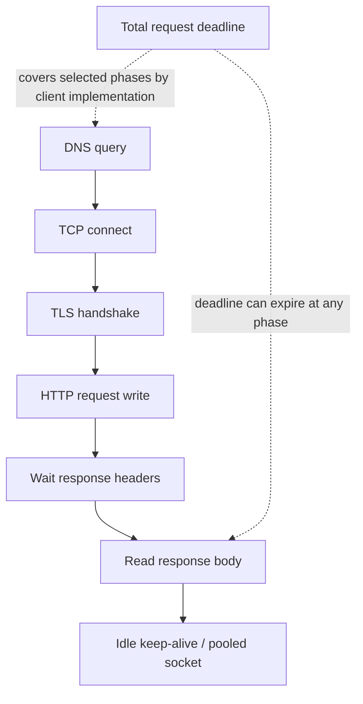

### 18.1. Bảng loại timeout

| Timeout | Bộ đếm ở đâu? | PCAP có thể thấy | Điểm cần biết |
| --- | --- | --- | --- |
| **DNS resolution** | OS stub, resolver, library | DNS query lặp/không response hoặc không thấy query | Caching/DoH có thể đổi đường |
| **TCP connect** | Kernel TCP + client connect deadline | SYN/SYN retransmissions; không SYN-ACK quan sát được | Firewall, routing, server listener, reverse path |
| **TLS handshake** | TLS library/proxy/app | TCP established, handshake chưa hoàn tất | Certificate, mTLS, fragmentation, application scheduling |
| **Write/send** | Socket/API/proxy | TCP window/ACK behavior, possible stalls | Local buffer/write timeout không luôn packet loss |
| **Time to first byte** | HTTP/RPC client | Request gửi xong, chờ response | Backend work/queueing; TCP vẫn healthy |
| **Read idle** | Client/proxy/app | Không có payload đủ lâu, có thể có ACKs | Chỉ phản ánh timer của một tầng |
| **Overall request deadline** | Application/gateway | Có thể bất kỳ trạng thái TCP | Không có TCP TIMEOUT packet |
| **Load balancer idle** | LB/proxy | Idle interval rồi FIN/RST hoặc silent expiry | Vendor-specific behavior |
| **NAT idle/state timeout** | NAT/conntrack | Stale session blackhole hoặc reset | Lựa chọn keepalive/reconnect |
| **TCP retransmission RTO** | Kernel sender | Segment truyền lại theo timer/recovery | Không bằng HTTP request deadline |
| **TCP keepalive failure** | Kernel socket | Keepalive probes và thiếu response | Mặc định/timers phụ thuộc OS |
| **gRPC deadline** | RPC client/server | HTTP/2/gRPC stream events nếu nhìn được | Không là TCP RST |
| **Database query timeout** | Driver/server/app | TCP established nhưng không có response kịp | SQL lock/CPU/app logic |

### 18.2. Timeout phía client không chứng minh server chưa xử lý

Đặc biệt với **POST/charge, database commit, update API**, server có thể đã hoàn tất transaction trước khi response tới client. Client timeout rồi retry request ở tầng ứng dụng có thể gây double effect nếu không có **idempotency**. TCP retransmission một segment **khác** với application retry gửi lại transaction.

## 19. Connect timeout: đọc chuỗi SYN cẩn thận

Ví dụ timeline minh họa:

```text
0.000  Client -> Server  SYN seq=1000
1.000  Client -> Server  SYN seq=1000   [retry]
3.000  Client -> Server  SYN seq=1000   [retry]
5.000  Application logs: connect timeout
```

**Thời gian trong ví dụ không phải TCP default cho mọi OS**. Một client library có timeout 5 giây có thể báo lỗi trước khi kernel dùng hết số SYN retries. Ngược lại, OS may continue behavior tùy socket lifetime.

### 19.1. Cần xem những gì?

- DNS hostname → A/AAAA có đúng?
- SYN rời client interface chưa, đến **firewall/server capture** chưa?
- SYN-ACK có được phát, có quay về client?
- Port listener/bind address, service target health?
- Security group/NACL/Kubernetes NetworkPolicy có cho đúng return path?
- IPv4/IPv6/Happy Eyeballs thử địa chỉ nào?
- Client/proxy timeout bao lâu; có nhiều connection attempts cùng lúc không?

### 19.2. Không thấy SYN trong PCAP có nhiều lý do

Capture sai interface, filter chỉ có một IP nhưng client đi IPv6, app không connect vì DNS lỗi, HTTP proxy được dùng, connection pooling tái sử dụng socket, hoặc capture bắt đầu quá trễ. **Không thấy SYN** không tự chứng minh TCP connect không được thử.

## 20. Read timeout: TCP kết nối tốt nhưng ứng dụng chờ quá lâu

Một response timeout có thể xảy ra khi:

1. TCP handshake hoàn tất.
2. Client gửi HTTP request, TCP ACK cho request đến.
3. Backend xử lý chậm vì DB lock/queue/CPU hoặc upstream call.
4. Client chờ quá deadline, đóng socket.
5. Server trả response sau deadline và có thể gặp **broken pipe/RST**.

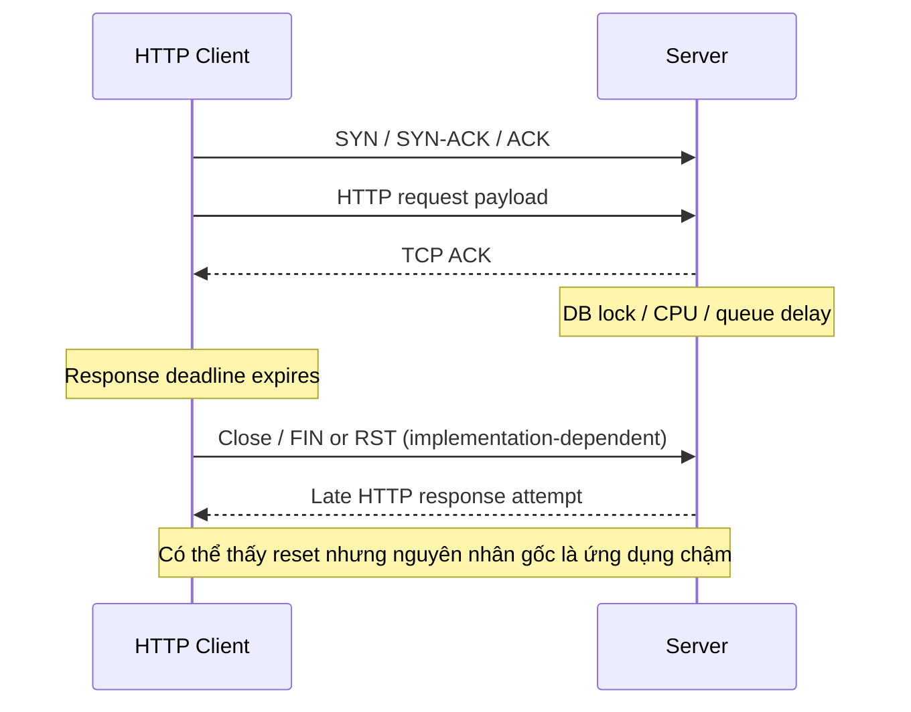

### 20.1. TCP ACK không có nghĩa request đã được xử lý

ACK cho biết TCP receiver nhận bytes trong receive buffer theo protocol, **không chứng minh application worker đã đọc, xác thực hay commit transaction**.

### 20.2. “Socket timeout” từ ứng dụng cần stack trace

Các thư viện có thể dùng tên **ReadTimeoutException, SocketTimeoutException, DeadlineExceeded** theo API. Muốn biết thời gian nào đã hết, cần **client config/logs, proxy access logs, server request timeline và DB/backend metrics**. PCAP một mình không cung cấp tên timer.

## 21. TLS handshake timeout và certificate failure

TLS handshake xảy ra **sau TCP established** đối với TLS trên TCP. Nếu TLS không hoàn tất, ứng dụng có thể báo handshake timeout hoặc TLS alert.

### 21.1. Các trường hợp

| Quan sát | Khả năng | Bằng chứng cần |
| --- | --- | --- |
| TCP established, ClientHello gửi, không response | TLS listener/proxy không trả; packet loss; app queue/CPU | Multi-point captures, server TLS logs |
| ServerHello/Certificate đến, sau đó alert | Trust/certificate/protocol negotiation | TLS alerts và application logs |
| TLS alert tới client | TLS layer chủ động báo lỗi | Alert type (nếu quan sát được), peer/cert policy |
| RST ngay sau ClientHello | Server/proxy/IPS abort hoặc policy | Proxy/WAF logs, RST source tracing |
| TLS handshake thành công, response timeout | Backend/application latency | HTTP/app traces, DB metrics |

### 21.2. mTLS

**Mutual TLS** có thể yêu cầu client certificate. Nếu credential không hợp lệ, một peer có thể **gửi TLS alert và đóng**; một số appliances có thể reset. Không sửa bằng cách tắt certificate verification hoặc đổi sang plaintext. Kiểm tra **issuer, SAN, trust bundle, EKU, certificate TTL, SNI và expected workload identity**.

### 21.3. Không đồng nhất RST và TLS alert

**TLS alert** là thông điệp của giao thức TLS; **TCP RST** là cờ transport. Chúng có thể xuất hiện gần nhau nhưng là hai lớp khác. Với TLS 1.3, một số handshake messages có phần được mã hóa; không giả định Wireshark đọc được đầy đủ nội dung nếu thiếu keys và quyền hợp lệ.

## 22. Idle timeout, connection pool và stale connection

Một connection HTTP keep-alive có thể nằm rảnh trong một thời gian. Client nghĩ socket còn dùng được nhưng load balancer, NAT, firewall hoặc server đã đóng/loại bỏ state.

### 22.1. Timeline kinh điển

```text
12:00:00 TCP connection established; request succeeds
12:00:05 Connection becomes idle
12:02:05 Proxy/NAT idle state expires (hypothetical)
12:03:00 Client reuses cached connection
12:03:00 Connection may fail with RST, write error, or timeout
```

Hành vi cụ thể phụ thuộc **proxy, NAT, OS và connection pooling**:

- Proxy/server có thể gửi **FIN** khi đóng graceful.
- Có thể gửi **RST** khi reuse/abort được nhận.
- Firewall/NAT có thể âm thầm quên state, khiến packets bị drop và timeout.
- HTTP client có thể phát hiện stale socket và tự mở connection mới.
- L7 proxy có thể tái thử request phù hợp nhưng gây rủi ro cho non-idempotent operations.

### 22.2. Giải quyết đúng lớp

- Điều chỉnh **client pool max idle age**, connection keepalive và proxy idle timeout theo SLO.
- Ghi connection lifecycle metrics và close reason.
- Tách **network keepalive** khỏi **application health check**.
- Không bật retry vô điều kiện cho POST không có idempotency contract.
- Không tắt firewall state timeout toàn hệ thống để sửa một client pool lỗi.

### 22.3. TCP keepalive khác HTTP keep-alive

**TCP keepalive** là probe của kernel cho socket idle tùy config. **HTTP keep-alive** là việc reuse TCP connection cho nhiều HTTP requests. Chúng có thể tồn tại cùng nhau nhưng **không phải cùng timer hoặc cùng giao thức**.

## 23. Zero window, receive window và flow-control stall

Một receiver có thể quảng bá **receive window bằng 0** khi chưa có buffer nhận, khiến sender không thể gửi tiếp payload theo flow control. Đó không nhất thiết là packet loss.

### 23.1. Dấu hiệu Wireshark

- **TCP Window Full** khi lượng unacknowledged data chạm advertised window theo phân tích.
- **TCP ZeroWindow** khi receiver quảng bá window=0.
- **TCP ZeroWindowProbe** từ sender để thăm dò khi có thể gửi tiếp.
- **TCP Window Update** khi receiver mở lại window.

Các labels này phụ thuộc capture đầy đủ và trạng thái window scaling. Đừng kết luận “server CPU 100%” chỉ vì thấy ZeroWindow; có thể do **ứng dụng không đọc socket đủ nhanh, receiver buffer pressure, scheduling hoặc lỗi dữ liệu ở tầng khác**.

### 23.2. Phân biệt với congestion window

- **Receive window (rwnd):** phía nhận quảng bá dung lượng nhận.
- **Congestion window (cwnd):** sender điều chỉnh khối lượng dữ liệu đang truyền dựa trên mạng.

rwnd=0 gợi ý **receiver-side flow control**, khác với mất packet/congestion. Muốn xác định cwnd/RTT/retransmit timeout thực, cần **sender TCP_INFO, ss -ti, kernel metrics hoặc trace**.

### 23.3. Zero window có thể dẫn tới application timeout

Ứng dụng có thể hết write/read deadline trong khi TCP vẫn đang duy trì kết nối, window probes tiếp diễn. Timeout này không nhất thiết tạo RST hay retransmission data. Phải xem **window timeline và app consumption rate**.

## 24. MTU, MSS, fragmentation và “black-hole” network

**Maximum Transmission Unit (MTU)** là kích thước đơn vị truyền tối đa ở một link/interface theo tầng áp dụng; **TCP Maximum Segment Size (MSS)** là lượng TCP payload tối đa một bên quảng bá cho peer trong quá trình thiết lập. Nếu đường đi có **VPN, GRE/VXLAN/overlay, IPsec hoặc cloud encapsulation**, MTU hữu hiệu có thể nhỏ hơn MTU nhìn thấy ở host.

### 24.1. Triệu chứng điển hình

- TCP three-way handshake thành công.
- Request/response rất nhỏ hoạt động.
- Khi dữ liệu lớn hơn một kích thước nào đó, nhiều retransmissions hoặc request timeout xuất hiện.
- Firewall/drop logs có thể không cho thấy ứng dụng vi phạm rule.
- ICMP **Fragmentation Needed** (IPv4) hoặc **Packet Too Big** (IPv6) có thể thiếu nếu PMTUD bị chặn.

### 24.2. Tại sao “MTU black hole” giống lỗi ứng dụng?

Nếu sender không nhận được tín hiệu giảm packet size cần thiết và dữ liệu vượt path MTU, các segments có thể không tới đích. Sender tiếp tục loss recovery, phía ứng dụng chỉ thấy **read timeout** hoặc thiếu response sau TLS handshake. Không được kết luận “database chậm” khi network path chỉ xử lý tốt packet nhỏ.

### 24.3. Kiểm tra an toàn

- So sánh kích thước segments/MTU/MSS ở client, VPN gateway, server và CNI.
- Tìm **ICMP PTB/Fragmentation Needed** theo cả hai chiều.
- Đối chiếu outer tunnel overhead và PMTUD.
- Nếu có quyền, dùng các **path MTU diagnostics** hoặc test upload/download tới lab endpoint với kích thước giới hạn.
- Không cố bỏ ICMP PTB khỏi firewall chỉ vì muốn “chặn ICMP”; chặn nhầm có thể phá PMTUD.
- Không thay MTU production trước khi có bằng chứng/rollback.

### 24.4. Vì sao cần xem TLS?

TLS records có thể lớn hơn một TCP segment và được TCP chia thành nhiều segments; **TLS handshake có thể trông bình thường** trước khi truyền payload lớn. Một TLS record không đồng nhất một IP packet.

## 25. Asymmetric routing và return path

**Asymmetric routing** xảy ra khi đường đi client→server và server→client không giống nhau. Đó có thể là thiết kế bình thường của multi-homed network, ECMP, VPN hoặc transit routing, nhưng dễ làm packet capture ở một điểm có vẻ thiếu ACK/response.

### 25.1. Dấu hiệu

- Sensor tại firewall A thấy SYN nhưng không thấy SYN-ACK.
- Server capture thấy SYN và phát SYN-ACK.
- Client capture có thể nhận SYN-ACK qua firewall B.
- Firewall stateful tại A/B có thể drop traffic nếu chỉ một phía có state.
- Wireshark gắn **TCP Previous Segment Not Captured** dù packet chỉ đi tuyến khác.

### 25.2. Phương pháp xác minh

1. Xác định **source/destination thực** trước/sau NAT.
2. Thu route/next hop/ECMP path tại thời điểm lỗi.
3. Đặt captures ở **hai đầu và các điểm trung gian cần thiết**.
4. Kiểm tra **firewall state tracking** và policy return path.
5. So **timestamps, sequence/ack range, TCP options, source/destination tuples**.
6. Không coi một chiều capture là toàn bộ cuộc đối thoại.

### 25.3. Packet reordering do multipath

Nếu packets cùng TCP connection đi qua đường có latency khác nhau, receiver có thể thấy **out-of-order** và sinh ACK/SACK gợi ý mất segment. Sender đôi khi thực hiện recovery dù dữ liệu chỉ đến muộn. Cần phân biệt **reordering** và **real drop** qua capture ở phía nhận và sequence timeline.

## 26. NAT, SNAT/DNAT và state timeout

NAT có thể thay IP và port của một flow tại gateway/host, làm 5-tuple trên PCAP thay đổi.

```text
Before SNAT:
  10.20.4.15:53144 -> 198.51.100.20:443

After SNAT:
  203.0.113.10:62001 -> 198.51.100.20:443

Return before reverse translation:
  198.51.100.20:443 -> 203.0.113.10:62001

Return toward client:
  198.51.100.20:443 -> 10.20.4.15:53144
```

### 26.1. Phân biệt NAT state timeout và TCP socket timeout

Một NAT gateway có thể xóa flow mapping sau một khoảng idle. Client và server vẫn có thể nghĩ TCP connection đang sống, nhưng packet tới không còn mapping phù hợp và có thể bị **drop**, gây retransmission/timeout, hoặc bị **reject/reset** tùy implementation.

Cần xem:

- NAT/conntrack **idle timeout** và L4 protocol.
- TCP keepalive/client pool age.
- Original/translated tuples và port reuse.
- Drop counters và gateway flow logs.
- Kết nối mới có hoạt động trong khi socket cũ lỗi không?
- Có nhiều clients dùng chung source NAT port pool gây pressure không?

### 26.2. Port reuse làm nhầm hai connections

Một gateway có thể tái sử dụng ephemeral port sau khi state cũ được dọn, nhưng **time interval** và tuple mapping sẽ quyết định connection nào liên quan. Không ghép hai PCAP từ hai thời điểm chỉ bằng public source IP/port.

### 26.3. Kubernetes Service DNAT

Một ứng dụng gọi **inventory Service ClusterIP:80**, còn packets thực tới Pod backend:8080. Nếu PCAP bắt trước DNAT và sau DNAT, port/destination khác nhau là bình thường. Muốn tìm RST nguồn phải biết **Service VIP, endpoint selected, CNI hooks và mesh sidecar**.

## 27. Reverse proxy, load balancer và service mesh

Trong kiến trúc cloud hoặc Kubernetes, **một HTTP request có thể đi qua nhiều TCP connections**:

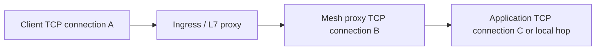

### 27.1. Vì sao kết luận “server reset” có thể sai?

- Client thấy RST từ **ingress IP** chứ không phải app.
- Ingress có thể đóng do **idle timeout, upstream timeout, overload hoặc client cancellation**.
- Service mesh proxy có thể reset stream HTTP/2 mà không reset TCP connection.
- Backend server có thể trả 200 cho một retry nhưng proxy đã hết deadline ở client.
- LB health check thất bại có thể làm connection bị cắt khi drain/rebalance.
- RST ở chặng client→proxy khác RST ở chặng proxy→server.

### 27.2. Nguồn cần ghép

| Chặng | Evidence |
| --- | --- |
| Client → ingress | Client PCAP, edge TCP flags, LB access log |
| Ingress → service | Upstream attempts, destination endpoint, proxy close reason |
| Service mesh sidecar/waypoint | mTLS identity, L4/TLS/HTTP route, reset/timeout metrics |
| App socket | TCPINFO/ss, server app log, graceful shutdown |
| App → DB/dependency | Separate flow/trace, deadline, resource metrics |

### 27.3. “Upstream reset before response started”

Một số gateways/proxies có thể log thông điệp **upstream reset**. Điều này nói **proxy mất/được reset ở upstream connection/stream** theo trạng thái của proxy; nó không tự chứng minh database hoặc application đã gửi TCP RST. Cần nhìn **upstream transport subtype, response flags, logs và PCAP tại proxy/server**.

### 27.4. Canary, retry và request amplification

Một ingress có thể retry request lỗi trên một upstream connection khác. Trong PCAP có thể thấy **nhiều TCP connections hoặc HTTP requests**, không phải retransmission TCP cùng 5-tuple. Đối với **POST không idempotent**, retry ở tầng ứng dụng/proxy cần chính sách nghiệp vụ riêng, tránh double transaction.

## 28. Thiết kế packet capture: từ giả thuyết đến bộ lọc

Trước khi mở Wireshark/tcpdump, cần trả lời:

1. Ứng dụng nào bị lỗi, **nguồn/đích/hostname** và thời điểm chính xác?
2. Lỗi là **connect timeout, read timeout, RST, HTTP 502/504 hay gRPC deadline**?
3. Có **proxy, NAT, service mesh, VPN, cloud LB hoặc DNS64** trên đường?
4. Cần quan sát **TCP handshake hay request/response**?
5. Điểm nào khả thi để capture và có quyền?
6. Địa chỉ nào có thể thay đổi qua DNS, SNAT và Service DNAT?
7. Traffic là **IPv4/IPv6, TCP/UDP, QUIC hay HTTP/2**?
8. Capture có thể chứa PII/credentials không, ai được đọc và giữ bao lâu?
9. Khi nào dừng capture (thời lượng, packet count, file size)?
10. Có **log ứng dụng/proxy/host** để đối chiếu không?

### 28.1. Chọn lọc để giảm rủi ro

- Ưu tiên **một endpoint, một port, một khoảng thời gian ngắn**.
- Hạn chế **snaplen** khi chỉ cần TCP headers nhưng lưu ý TCP options/VLAN/IPv6 có thể dài; snaplen nhỏ quá sẽ thiếu dữ liệu cần phân tích.
- Dùng **ring buffer** và quyền file nếu cần capture lâu hơn trong lab.
- Không bắt plaintext authentication/session cookies tràn lan.
- Có authorization và retention/redaction đối với PCAP.
- Nếu chỉ cần network counters, **flow logs/ss/proxy metrics** có thể ít xâm nhập hơn packet capture.

### 28.2. Capture tại client hay server?

- **Client-side:** biết packets đã rời client stack và responses đã tới hook đó.
- **Server-side:** biết packets có tới server và phản hồi đã được phát theo hook.
- **Firewall/proxy:** biết policy/translation và state theo chặng.
- **CNI/eBPF:** có thể gắn Pod identity/NetworkPolicy verdict nhưng có giới hạn offload/hook.
- **TAP/SPAN:** gần dây hơn, nhưng có nguy cơ duplicate/missed packets do mirror setup.

### 28.3. Captures hai đầu cần clock sync

Nếu so chuỗi packet giữa client và server, dùng timestamps đáng tin và tính **offset giữa clocks**. Không lấy chênh lệch timestamp giữa hai máy không sync làm network one-way latency. Seq/ack/tcp timestamps có thể giúp ghép events dù clock skew.

## 29. tcpdump: thu mẫu có giới hạn và đọc lại

**tcpdump** là công cụ command-line dùng libpcap/BPF để bắt và đọc packets. Ví dụ dưới đây chỉ dùng với lab được cấp phép. Interface **eth0**, địa chỉ và file đều là placeholder, cần thay đúng thực tế.

### 29.1. Capture TCP tới một test endpoint

```bash
# Trong lab được phép. File PCAP phải ở nơi chỉ người có quyền đọc.
# -c giới hạn packet count; -s giới hạn byte được giữ mỗi packet.
tcpdump -i eth0 -nn -s 128 -c 200 \
  -w /secure-lab/captures/one-connection.pcap \
  'host 198.51.100.20 and tcp port 443'
```

**Lưu ý:** snaplen 128 bytes vẫn có thể chứa một phần payload và metadata nhạy cảm; không thể bảo đảm “chỉ có headers” nếu TCP/IP headers ngắn. Nên hạn chế quyền file, thời gian, nguồn, retention và dùng bảo vệ PCAP theo quy định.

### 29.2. Đọc PCAP đã thu (read-only)

```bash
tcpdump -nn -tttt -r /secure-lab/captures/one-connection.pcap

# Chỉ in những TCP packets có RST flag trong file lab.
tcpdump -nn -r /secure-lab/captures/one-connection.pcap \
  'tcp[tcpflags] & tcp-rst != 0'
```

Cú pháp trên dùng **tcpdump capture/read filter (BPF)**, không phải cú pháp Wireshark display filter. Ví dụ **tcp[tcpflags]** áp trong ngữ cảnh IPv4/TCP phù hợp; khi phân tích IPv6/extension headers, hãy xác nhận BPF expression thực tế hỗ trợ trường hợp đó, không suy filter áp mọi packets.

### 29.3. Chỉ xem flags thay vì bắt tất cả

Với quyền lab, filter tập trung vào SYN/RST/FIN có thể giảm lượng dữ liệu, nhưng **không đủ phân biệt retransmission và timeout** vì thiếu packets data/ACK, sequence context và RTT. Capture đầy đủ phiên ở phạm vi nhỏ thường hữu ích hơn bắt mỗi RST rời rạc.

### 29.4. Không bắt gói từ hệ thống khác mà chưa có phép

Ngay cả lệnh read-only cũng có thể thu traffic nhạy cảm. Không đổi mirror/SPAN hoặc triển khai privileged Pod/host agent nếu không được phê duyệt. Việc dùng **Wireshark/tcpdump** không mặc nhiên cho phép đọc traffic của tenant khác.

## 30. tshark: đọc và trích trường từ PCAP

**tshark** là CLI của Wireshark, hữu ích khi cần trích timeline/fields để so sánh. Các display filter fields có thể khác theo version/dissector; kiểm tra với phiên bản đang dùng.

### 30.1. Xem các packets mang RST

```bash
tshark -r /secure-lab/captures/one-connection.pcap \
  -Y 'tcp.flags.reset == 1' \
  -T fields \
  -e frame.number \
  -e frame.time_relative \
  -e ip.src -e tcp.srcport \
  -e ip.dst -e tcp.dstport \
  -e tcp.seq -e tcp.ack \
  -e tcp.flags
```

Các trường **ip.src/ip.dst** dùng với IPv4; đối với IPv6 cần thêm **ipv6.src/ipv6.dst** hoặc trường hỗ trợ. Relative seq/ack numbers phụ thuộc preferences.

### 30.2. Kiểm tra các packets được analyzer xem là truyền lại

```bash
tshark -r /secure-lab/captures/one-connection.pcap \
  -Y 'tcp.analysis.retransmission || tcp.analysis.fast_retransmission || tcp.analysis.spurious_retransmission' \
  -T fields \
  -e frame.number \
  -e frame.time_relative \
  -e tcp.stream \
  -e tcp.seq \
  -e tcp.ack \
  -e tcp.len \
  -e tcp.analysis.retransmission \
  -e tcp.analysis.fast_retransmission \
  -e tcp.analysis.spurious_retransmission
```

**Wireshark TCP analysis flags là heuristics dựa trên những packets quan sát được**, không phải thông điệp TCP được sender ghi vào header. Nếu một filter trả 0 bản ghi, có thể do capture chưa thấy bytes cũ, analyzer preferences, thiếu segments hoặc traffic không phải TCP.

### 30.3. Xuất timeline một TCP stream

```bash
tshark -r /secure-lab/captures/one-connection.pcap \
  -Y 'tcp.stream == 0' \
  -T fields \
  -e frame.number \
  -e frame.time_relative \
  -e ip.src -e tcp.srcport \
  -e ip.dst -e tcp.dstport \
  -e tcp.flags \
  -e tcp.seq \
  -e tcp.ack \
  -e tcp.len
```

**tcp.stream == 0** là chỉ số stream do dissector gán trong **PCAP đó**, không là network session ID có thể dùng để join trực tiếp hai PCAP khác nhau. Khi ghép nhiều capture points, dùng **translated 5-tuples + timestamps + sequence/ACK context**.

## 31. Wireshark: quy trình phân tích tương tác

Một workflow hữu ích cho PCAP được cấp phép:

1. Mở bản **PCAP/PCAPNG** có nguồn và thời gian rõ.
2. Xác minh **capture interface, direction, timestamps, snaplen, file integrity**.
3. Dùng **Statistics → Conversations** và **Endpoints** để xác định 5-tuple.
4. Lọc IP/port liên quan, chọn đúng **TCP stream**.
5. Xem **three-way handshake**, SYN options và đầu phiên.
6. Kiểm tra **relative seq/ack, TCP length, ACK/SACK, window, flags**.
7. Dùng **Analyze/Expert Information** để tìm các gợi ý retransmission/RST/ZeroWindow.
8. Chuyển tới các packets trước/sau sự kiện; không chỉ đọc một dòng lỗi.
9. Dùng **Time Display Format / I/O Graphs / TCP Stream Graphs (Time-Sequence/RTT)** theo khả năng phiên bản.
10. Tìm DNS/TLS/HTTP2 context và correlate proxy/app logs.
11. Ghi **capture point + evidence + uncertainty** trong kết luận.

### 31.1. “Follow TCP Stream” không chắc cho nội dung HTTPS

Tính năng Follow TCP Stream có thể cho thấy stream bytes đã reassembled, nhưng với HTTPS nó thường là dữ liệu TLS mã hóa nếu không có keys được cấp phép. **Không cần giải mã payload để xem retransmission/RST/ACK**. Nếu được phép sử dụng session keys để phân tích TLS, cần hạn chế lưu/chia sẻ vì có thể lộ nội dung bí mật.

### 31.2. Expert Information là gợi ý, không phải bằng chứng cuối cùng

**[TCP Retransmission], [TCP Dup ACK], [TCP Out-of-Order], [TCP Previous segment not captured], [TCP ZeroWindow]** là nhãn phân tích của dissector. Chúng không phải flags được ghi trực tiếp trong TCP header. Cần kiểm tra **capture completeness, context và version-specific heuristics**.

### 31.3. TCP stream graph giúp gì?

- **Time-Sequence (Stevens):** quan sát sequence progress, retransmissions và gaps.
- **Round Trip Time:** xem RTT estimates, nhưng lấy mẫu ACK có ambiguity.
- **Window Scaling:** hiểu advertised window diễn biến.
- **I/O Graph:** so traffic volume/thời gian.
- Tên/menu có thể thay đổi theo phiên bản Wireshark, cần xác minh công cụ đang dùng.

## 32. Bảng Wireshark display filters cho troubleshooting

Các filter dùng ở **display filter** (không phải tcpdump BPF):

| Câu hỏi | Ví dụ Wireshark display filter | Lưu ý |
| --- | --- | --- |
| Chỉ TCP | **tcp** | Không bao gồm QUIC UDP/443 |
| TCP một host | **ip.addr == 192.0.2.10 && tcp** | IPv4, cần **ipv6.addr** cho IPv6 |
| Một TCP stream | **tcp.stream == 0** | Stream index trong file đang mở |
| RST | **tcp.flags.reset == 1** | Packet-level flag |
| SYN mà chưa ACK | **tcp.flags.syn == 1 && tcp.flags.ack == 0** | Có thể gồm SYN retransmissions |
| FIN | **tcp.flags.fin == 1** | Gracious close signal |
| Retransmission heuristic | **tcp.analysis.retransmission** | Heuristic; không nhất thiết loss trên dây |
| Fast retransmission heuristic | **tcp.analysis.fast_retransmission** | Không tự là proof sender recovery algorithm |
| Spurious retransmission | **tcp.analysis.spurious_retransmission** | Cần ACK/capture history |
| Duplicate ACK | **tcp.analysis.duplicate_ack** | Có thể do reordering |
| Out of order | **tcp.analysis.out_of_order** | Có thể do multipath/capture |
| Lost segment indicator | **tcp.analysis.lost_segment** | Có thể do missing capture |
| Zero window | **tcp.analysis.zero_window** | Nhận diện receiver advertised window |
| Zero window probe | **tcp.analysis.zero_window_probe** | Hành vi persist timer/flow control |
| HTTP/2 traffic | **http2** | Chỉ khi dissector nhận diện/giải mã phù hợp |
| DNS | **dns** | Không thấy DNS nội dung qua DoH nếu không giải mã được |
| ICMP errors | **icmp || icmpv6** | Giúp xem unreachable/PTB theo IP family |

### 32.1. Lọc rất hẹp có thể làm sai TCP analysis

Nếu **chỉ capture RST** hoặc lọc mất data/ACK trước khi lưu, Wireshark không đủ lịch sử để suy retransmission. **Display filter sau khi capture đủ context** thường tốt hơn capture filter quá hẹp.

### 32.2. TCP analysis flags có phụ thuộc preferences

Một số gợi ý chỉ hiện khi **Analyze TCP sequence numbers**/preferences liên quan được bật. Hai người mở cùng PCAP với phiên bản/preferences khác nhau có thể thấy nhãn khác; hãy trao đổi **field values và raw packet references**, không chỉ ảnh chụp cột “Info”.

### 32.3. Không mặc định filter theo port=443 đã bao gồm HTTP/3

QUIC thường dùng UDP/443, TLS nằm trong QUIC handshake chứ không phải TCP. Lọc **tcp.port == 443** sẽ bỏ qua traffic QUIC. Khi debug một domain HTTP/3, xem cả **udp.port == 443**, protocol negotiation và gateway support.

## 33. Xây dựng timeline có bằng chứng

Để so retransmission, reset và timeout, tạo bảng **frame/time/direction/seq/ack/len/flags/app log**.

### 33.1. Mẫu bảng

| Time relative | Direction | TCP seq/ack, len | Flags/label | Điều xác định |
| --- | --- | --- | --- | --- |
| 0.000 s | C→S | seq=0 | SYN | Client attempted TCP handshake |
| 0.015 s | S→C | ack=1 | SYN,ACK | Server/proxy responded at capture point |
| 0.018 s | C→S | ack=1 | ACK | Client completed handshake view |
| 0.020 s | C→S | seq=1 len=200 | PSH,ACK | 200 bytes sent from client |
| 0.028 s | S→C | ack=201 | ACK | Receiver TCP acknowledges bytes |
| 0.900 s | C→S | — | FIN/RST or no packet | Depends on app deadline/close behavior |

**Kết luận có thể:** request bytes đã được ACK tại TCP; không thấy response trước 0.9 giây ở điểm capture. **Không thể kết luận:** server application đã hoàn tất/đã nhận vào business logic.

### 33.2. Một ví dụ retransmit nhưng cuối cùng thành công

```text
0.000 C -> S  seq=1 len=1000
0.025 S -> C  ack=1, sack=(1001..2001)   (illustrative gap context)
0.045 C -> S  seq=1 len=1000  [retransmission candidate]
0.060 S -> C  ack=2001
0.080 S -> C  data, application response
```

**Cẩn thận:** ví dụ có SACK sau dữ liệu nhận ở vị trí khác **không đầy đủ dòng packets**; đây chỉ là pattern phân tích, không phải trace có thể replay nguyên trạng. Trên PCAP thật phải xem những segment được SACK và ACK tính theo từng chiều.

### 33.3. Timeout mà không retransmission

```text
0.000 C -> S  TCP handshake completes
0.010 C -> S  HTTP request bytes
0.012 S -> C  TCP ACK for request
0.800 (no response payload yet)
1.000 Client library reports response timeout
1.005 Client closes socket / sends FIN or RST depending on implementation
```

Ở ví dụ này **không cần TCP loss**; server có thể đang chờ database lock. Đây là lý do một biểu đồ retransmissions bằng 0 không chứng minh application responsiveness.

### 33.4. RST trước handshake vs sau handshake

- **SYN → RST/ACK**: gợi ý **port refused** hoặc reject-with-reset.
- **Established → RST after request**: có thể do application abort, proxy timeout, kernel state hoặc firewall.
- **Idle → reuse → RST**: gợi ý stale pooled connection và idle state mismatch.
- **FIN → data → RST**: có thể do race/unread data/closed socket; phải xem sequence context.

## 34. Capture loss, duplicates, segmentation và checksum offload

Những đặc điểm của công cụ/driver có thể làm PCAP trông như network lỗi.

### 34.1. Packet capture loss

**Tcpdump/libpcap capture drops** hoặc SPAN oversubscription có thể làm thiếu packets. Khi chỉ thấy seq nhảy từ 1001 sang 3001, Wireshark có thể gắn **Previous segment not captured**. Đó có thể do packet mất trên mạng, **hoặc chỉ mất tại sensor**.

### 34.2. TSO/GSO/GRO/LRO

- **TSO/GSO:** host có thể trình bày một large TCP buffer/segment trước khi NIC chia thành nhiều packets trên dây.
- **GRO/LRO:** host có thể hợp nhất nhiều packets nhận thành một buffer/segment lớn ở hook quan sát.
- Kết quả: PCAP ở host có thể thấy **TCP lengths vượt MSS**, khiến phân tích “bad segment/overlap” không phản ánh wire packets.

### 34.3. Checksum offloading

Một packet outbound ở capture hook có thể hiển thị **incorrect TCP checksum** vì NIC chưa hoàn tất checksum. Không mặc định đây là corruption trên dây. So với **wire capture** hoặc tắt kiểm tra checksum trong dissector cho mục tiêu phân tích, nhưng không tắt offload production như một “sửa lỗi” khi chưa có bằng chứng.

### 34.4. Duplicate SPAN frames và packet order

Một packet mirror có thể xuất hai lần nếu sensor nhận ở cả ingress/egress, hoặc packets được chuyển đến capture interface out-of-order. Cần kiểm tra **frame.interface_id, link-layer metadata, timestamp resolution và capture setup**. Nếu có multi-interface pcapng, giữ thông tin interface, đừng làm mất khi convert.

### 34.5. Không có handshake vì bắt giữa phiên

Nếu bắt sau khi TCP connection đã established, Wireshark không có initial sequence context/options và có thể gắn labels ít chính xác hơn. Không suy “không thấy SYN nên connection lạ” nếu capture bắt đầu lúc traffic đã chạy.

## 35. HTTPS, HTTP/2, gRPC và application retries

Một TCP connection có thể mang nhiều HTTP requests (HTTP/1.1 keep-alive) hoặc nhiều streams đồng thời (HTTP/2). **Reset một HTTP/2 stream** và **reset cả TCP connection** là khác nhau.

### 35.1. Một số khái niệm phải tách

| Sự kiện | Lớp | PCAP sẽ thể hiện gì khi quan sát được? |
| --- | --- | --- |
| **TCP RST** | TCP | Packet với RST bit |
| **TLS alert/close_notify** | TLS | TLS record/alert, có thể mã hóa tùy TLS version |
| **HTTP 503/504** | HTTP | Status response nếu traffic giải mã/được proxy ghi log |
| **HTTP/2 RST_STREAM** | HTTP/2 | Frame reset **một stream**, connection TCP có thể tiếp tục |
| **HTTP/2 GOAWAY** | HTTP/2 | Tín hiệu ngừng nhận streams mới và điều phối đóng |
| **gRPC DEADLINE_EXCEEDED** | RPC | gRPC status; không đồng nghĩa TCP reset |
| **App retry** | HTTP/RPC client/proxy | Một request logic được tạo attempt mới, có thể trên TCP connection khác |
| **TCP retransmission** | TCP | Cùng sequence byte range trên cùng connection được gửi lại |

### 35.2. HTTP/2 RST_STREAM không phải RST packet

Tên **RST_STREAM** dễ gây nhầm: nó là frame của HTTP/2, không phải TCP header RST bit. Một proxy có thể reset một stream vì deadline nhưng vẫn dùng TCP connection đó cho streams khác. Nếu chỉ lọc **tcp.flags.reset == 1**, bạn có thể không thấy stream reset.

### 35.3. gRPC retry

gRPC client có thể thử lại một unary RPC theo configuration hoặc transparent retry khi điều kiện cho phép. **Non-idempotent RPC** phải có business contract/idempotency nếu muốn retry. Một RPC timeout có thể xảy ra dù TCP hoàn toàn khỏe.

### 35.4. TLS không khiến TCP loss biến mất

Dù payload được mã hóa, TCP vẫn phải vận chuyển các TLS record bytes và sẽ retransmit khi cần. Có thể phân tích **seq/ack/retransmission/RST** mà không cần đọc plaintext HTTP. Ngược lại, không dùng packet metadata để tuyên bố API request body đã được app xử lý.

## 36. UDP, DNS và QUIC: không áp trực tiếp TCP RST/retransmission

**UDP** không có TCP sequence/ack state hoặc TCP RST bit. **QUIC** chạy trên UDP và có cơ chế ACK/loss recovery ở tầng QUIC, nhưng **không retransmit cùng packet byte-for-byte theo mô hình TCP**; QUIC phục hồi dữ liệu trong frames/streams qua packets mới và packet numbers mới.

### 36.1. Ví dụ các tình huống

- DNS UDP query không nhận response → resolver timeout và có thể retry query; **không phải TCP retransmission**.
- QUIC UDP/443 mất packet → QUIC ACK/loss detection, PTO (**Probe Timeout**) và frames có thể được gửi lại trong packet mới; **không có TCP RST**.
- HTTP/3 stream bị reset → **QUIC stream-level event**, không là TCP RST.
- ICMP Port Unreachable có thể xuất hiện khi UDP service/route không nhận traffic, nhưng không phải TCP RST.

### 36.2. Wireshark với QUIC

Một capture UDP/443 có thể được dissector nhận dạng QUIC, nhưng phần lớn nội dung mã hóa cần được giải mã theo quyền và khả năng công cụ. Dựa vào **QUIC/UDP counters, endpoint logs, RTT/loss metrics** và proxy HTTP/3 telemetry; không dùng **tcp.analysis.retransmission** để đo QUIC loss.

### 36.3. DNS timeout trước TCP

Nếu resolver không trả IP, client có thể báo **UnknownHostException** hoặc DNS timeout mà không gửi một SYN nào đến app server. Trước khi đổ lỗi firewall TCP/443, hãy xem **DNS query path, cache, split-horizon và DoH/DoT**.

## 37. Phân tích trong bối cảnh firewall, IDS/IPS và security policies

Một packet trace hữu ích trong điều tra security network policy khi ghép với policy decisions đúng lớp.

### 37.1. Ví dụ phân tích

| Quan sát | Khả năng | Bằng chứng cần |
| --- | --- | --- |
| SYN lặp, không response tại client | Silent drop/route/return path/server unavailable | Multi-point capture, firewall verdict |
| SYN→RST | No listener hoặc reject-with-reset | Server listener, firewall logs |
| TLS ClientHello→RST | Proxy/IPS/TLS policy/app abort | TLS/proxy logs, RST source localization |
| HTTP request được ACK, không response payload | Backend stalled hoặc response bị chặn | Server traces, reverse direction, queue |
| RST sau idle khoảng cố định | Idle timer mismatch ở LB/NAT/proxy | Device timeout config/connection close reasons |
| Retransmission tăng trong VPN | Loss, MTU/PMTUD, congestion, path change | Tunnel counters/outer-inner captures |
| Một client bị lỗi, client khác bình thường | Client path/policy/cert/IP family | Compare same endpoint and source policies |
| Chỉ Pod trong một node lỗi | Host/CNI NIC, kube-proxy/conntrack/MTU | Node counters, CNI logs, historical Pod mapping |
| Chỉ TLS/HTTP/2 streams lỗi | L7 proxy/service mesh, server limits | Upstream reset reason, stream IDs, application logs |

### 37.2. Quy tắc firewall không tương đương transport success

**ACCEPT** ở một firewall chỉ nói điều kiện policy tại observation point cho phép packet/flow. Server có thể không lắng nghe, reply path có thể drop, mTLS có thể fail hoặc app có thể timeout. **Không sửa bằng mở any-any** để biến một kết nối lỗi thành hoạt động.

### 37.3. RST injection là giả thuyết cần bằng chứng

Một IPS/firewall có thể chủ động tạo RST theo rule, nhưng không nên quy kết nếu chỉ thấy một RST ở client. Kiểm tra **IPS action logs, TCP state, TTL/sequence patterns, multi-point captures và điểm RST lần đầu xuất hiện**.

### 37.4. Thử nghiệm chỉ ở phạm vi được phép

Không tạo TCP RST giả mạo vào kết nối của hệ thống khác, không quét cổng của đối tác và không chủ ý gây packet loss trên production. Có thể tái tạo các trạng thái này **trong lab hoặc environment thử nghiệm đã được phê duyệt** bằng application harness, test proxy và network fault injection có rollback.

## 38. Cây quyết định: đang nhìn thấy retransmission, reset hay timeout?

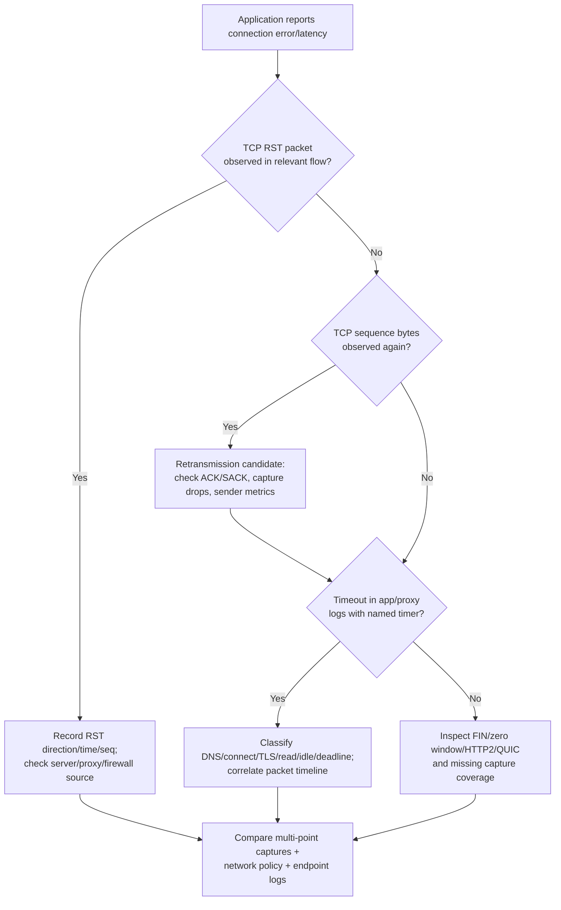

**Cây quyết định không ép sự kiện vào đúng một nhánh.** Một connect timeout có thể chứa **SYN retransmissions**, rồi ứng dụng đóng socket. Một server bị chậm có thể gửi **RST sau client deadline**. Quan trọng là dựng **timeline và tầng chịu trách nhiệm kết thúc request**, không chọn nhãn đầu tiên nhìn thấy.

### 38.1. Những câu hỏi luôn phải trả lời

- Điểm capture ở đâu, có nhìn **hai hướng** không?
- **5-tuple trước/sau NAT** đã đúng chưa?
- Bắt được SYN và sequence history đầy đủ chưa?
- Retransmissions thuộc **TCP stream nào**?
- Ai gửi RST và **RST xuất hiện đầu tiên ở đâu**?
- Timeout thuộc **timer nào** trong logs?
- ACK đã xác nhận bytes nhưng application có xử lý chưa?
- Có **loss, zero window, MTU/PMTUD hoặc app queueing**?
- Còn đường **proxy/LB/mesh** nào tạo connection mới?
- Bằng chứng nào còn thiếu và độ tin cậy kết luận tới đâu?

## 39. Tình huống A — SYN retransmissions dẫn tới connect timeout

**Bối cảnh:** client Java gọi **https://inventory.lab.example:443** qua private load balancer. Ứng dụng ghi **connect timed out** sau một deadline được cấu hình.

### 39.1. Dấu vết PCAP giả định

```text
Frame  Time      Direction   TCP
1      0.000     C -> VIP    SYN Seq=0 Win=64240
2      1.000     C -> VIP    SYN Seq=0 [candidate SYN retransmission]
3      3.000     C -> VIP    SYN Seq=0 [candidate SYN retransmission]
(no SYN,ACK visible in this capture)
Client log at 4.000: ConnectTimeoutException
```

### 39.2. Phân tích

- Có SYN từ client và attempts sau, nhưng không có response ở **điểm client**.
- Chưa biết packet **đã đến LB/server** chưa.
- Chưa biết có **SYN-ACK được phát nhưng mất trên reverse path** hay không.
- Nếu app deadline là 4 giây, nó có thể dừng trước khi kernel hết retry policy.
- DNS đã trả VIP? Nếu client thực dùng IPv6/HTTP proxy, filter có thể đang xem sai flow.

### 39.3. Xác minh

Dùng **LB listener/target health, cloud firewall/SG/NSG, route/NACL, server-side capture và drop counters**. Nếu server không thấy SYN mà network edge thấy, thu hẹp đoạn đường. Nếu server trả SYN-ACK nhưng client không thấy, tập trung **return route, stateful firewall và NAT**.

**Kết luận an toàn:** connect timeout kèm SYN retries; **nguyên nhân chưa xác định** nếu chưa có thêm evidence, không mặc định “firewall chặn”.

## 40. Tình huống B — SYN nhận RST/ACK ngay

**Bối cảnh:** caller gọi TCP/8443 tới một service vừa deploy; lỗi ứng dụng là **Connection refused**.

### 40.1. Timeline

```text
0.000 C -> S SYN      seq=1000
0.004 S -> C RST,ACK  ack=1001
0.005 App connect error: ECONNREFUSED
```

### 40.2. Phân tích

- RST/ACK xuất hiện nhanh sau SYN.
- Gợi ý **không có listener tại target port**, hoặc middlebox configured **reject-with-reset**.
- Không cần packet loss/retransmission để có lỗi.
- Nếu Kubernetes Service có **targetPort sai**, backend có thể trả RST dù Service/Pod vẫn Ready theo probe khác.

### 40.3. Xác minh

- Xem **ss -lnt** trên server đúng namespace/host.
- Kiểm tra Service **port/targetPort**, EndpointSlice, Pod readiness.
- Kiểm tra **firewall reject logs**, RST có xuất hiện ở server-side capture?
- Nếu chỉ ở client, không quy kết server app.

**Kết luận an toàn:** TCP connect bị từ chối bằng RST theo capture; lý do listener hay firewall phải kiểm tra.

## 41. Tình huống C — Request được TCP ACK nhưng read timeout

**Bối cảnh:** API trả chậm trong lúc database lock. Application client báo **ReadTimeoutException**, nhưng mạng không có dấu hiệu packet loss.

### 41.1. Timeline

```text
0.000 TCP handshake completes
0.010 C -> S HTTP request bytes Seq=1 Len=250
0.011 S -> C ACK=251
0.012..1.012 no response payload visible
1.013 Client logs read timeout
1.014 Client closes socket
1.350 Server application finishes DB query and tries to reply
```

### 41.2. Phân tích

- TCP ACK chỉ cho biết **server TCP stack nhận bytes**.
- Không có retransmission không nghĩa application phản hồi nhanh.
- Không thấy response payload có thể do **server chưa gửi, proxy buffering, TLS issue hoặc capture bị thiếu**.
- Một RST/FIN sau 1.013 có thể do **client đã hết deadline**, không phải root cause network.

### 41.3. Xác minh

Kiểm tra **HTTP request ID/trace spans, server queue/thread pool, DB slow queries/locks, proxy upstream response time** và capture server. Nếu server trả response sau client deadline, điều chỉnh **backend latency/timeout budget**, không mở firewall any-any.

**Kết luận:** response/read timeout ở tầng ứng dụng là ứng viên mạnh; cần app trace để biết backend stall.

## 42. Tình huống D — Stale connection pool bị RST sau idle

**Bối cảnh:** API client reuse TCP socket sau vài phút rảnh; request đầu tiên sau idle thường lỗi, request tiếp theo thành công.

### 42.1. Dấu vết

```text
12:00:00 connection established; application request succeeds
12:00:05 idle begins
12:02:05 LB/firewall/NAT may expire state (hypothesis)
12:03:00 client sends new data on old socket
12:03:00..12:03:05 RST or timeout, depending on path
12:03:05 new TCP connection; new request succeeds
```

### 42.2. Phân tích

- Khác với server reset ngay sau handshake.
- **Idle state mismatch** là khả năng khi lỗi xảy ra chỉ ở socket cũ.
- Có thể không hề có RST nếu NAT drop packets.
- Có thể app retry làm cùng request gửi hai lần trên connection mới; cần idempotency nếu là write.
- Không kết luận idle timer là 120 giây chỉ từ một lần thấy lỗi; cần log/config và phép đo lặp.

### 42.3. Xử lý

So sánh **LB idle timeout, client connection max idle age, TCP keepalive, NAT state, HTTP keepalive và close/draining behavior**. Chọn cơ chế keepalive/recycle phù hợp; không nâng timeout vô hạn.

## 43. Tình huống E — Retransmission do ACK bị mất

**Bối cảnh:** client gửi dữ liệu, server nhận và phát ACK, nhưng ACK bị mất trên đường quay về.

### 43.1. Hai điểm quan sát

```text
At client:
  t=0.000 C -> S Data seq=1001 len=500
  t=0.250 C -> S Data seq=1001 len=500 [retransmission candidate]
  t=0.270 S -> C ACK=1501

At server:
  t=0.010 C -> S Data seq=1001 len=500
  t=0.011 S -> C ACK=1501 (not observed at client)
  t=0.260 C -> S duplicate byte range seq=1001 len=500
```

### 43.2. Phân tích

- **Server đã nhận data segment gốc**.
- **Client không nhận ACK ban đầu** theo capture điểm client.
- Retransmission không có nghĩa data packet ban đầu bị drop.
- Điều kiện phản ánh **reverse path ACK loss/delay**, hoặc capture missingness. Cần đồng bộ clock và xác minh ACK thực đã rời server wire.

### 43.3. Phân biệt application retry

Nếu client chỉ có **một TCP stream**, same seq range, không có second HTTP logical request trên server, đó là transport retransmission. Nếu xuất hiện **hai distinct HTTP requests hoặc connections** chứa cùng operation, xét **application/proxy retry** riêng.

## 44. Tình huống F — ZeroWindow khiến request timeout

**Bối cảnh:** receiver xử lý chậm nên không đọc socket; advertised TCP receive window về zero. Sender không đẩy được body lớn.

### 44.1. Dấu vết

```text
0.000 C -> S Data Len=1200
0.005 S -> C ACK + Window=0
0.200 C -> S ZeroWindowProbe (candidate)
0.205 S -> C ACK + Window=0
1.000 Client write timeout
```

### 44.2. Phân tích

- **Flow control stall** là khả năng mạnh hơn packet loss.
- ZeroWindow không chứng minh lỗi TCP stack; ứng dụng receiver có thể **không tiêu thụ buffer** do CPU, queue, downstream I/O.
- Application timeout xảy ra dù connection chưa reset.
- Nếu capture không có TCP window scaling context, cần xem handshake để hiểu effective advertised window.

### 44.3. Xác minh

Kiểm tra **server process CPU, receive queue, socket memory, thread pool, stream backpressure, application drain rate** và ss -ti trên endpoint. Không tự tăng kernel buffers vô hạn để che lỗi ứng dụng.

## 45. Tình huống G — VPN MTU khiến chỉ request lớn bị lỗi

**Bối cảnh:** TCP handshake và GET nhỏ qua VPN hoạt động. Upload HTTPS lớn bị chậm, retransmissions tăng và client hết response deadline.

### 45.1. Dấu vết

- SYN/SYN-ACK/ACK hoàn tất.
- Các TCP segments nhỏ đi qua.
- Khi truyền dữ liệu kích thước lớn, một byte range được retransmit nhiều lần.
- Có thể thấy **ICMP Packet Too Big/Fragmentation Needed**, hoặc không thấy khi message bị drop.
- Gateway logs cho thấy tunnel encapsulation có overhead.

### 45.2. Phân tích

Một nguyên nhân cần xét là **path MTU black hole/PMTUD blocked**, nhưng cũng có thể là congestion, packet drop do queue, reverse-path ACK loss hoặc app rate limit. Chỉ dùng đoạn PCAP sender không đủ kết luận.

### 45.3. Xác minh

Test có kiểm soát **kích thước gói/dữ liệu**, so tunnel MTU/MSS, ICMP PTB, capture hai đầu và interface errors. Chỉ chỉnh **MSS clamping/MTU/PMTUD firewall** theo change approval, sau khi có rollback.

## 46. Tình huống H — Kubernetes Pod thấy RST nhưng app server không phát

**Bối cảnh:** Pod gọi inventory Service, client thấy TCP RST với source tưởng là server IP. Server application logs không ghi request.

### 46.1. Các khả năng

- Kubernetes Service **không có endpoint hợp lệ** hoặc route/kube-proxy/dataplane behavior đặc thù.
- Reverse proxy/service mesh sidecar/waypoint đóng connection.
- Firewall/IPS reject-with-reset.
- Backend process trên node khác không lắng nghe.
- NAT translation/timestamp bị đọc sai.
- PCAP client và server không cùng **TCP leg**.

### 46.2. Phân tích

1. Xác minh **Service, EndpointSlice, targetPort và selected Pod**.
2. Tìm **CNI flow verdict** và packet ở host/node/Pod.
3. Kiểm tra mTLS identity/AuthorizationPolicy/sidecar health.
4. Nếu có proxy L7, kiểm tra **upstream reset reason** thay vì suy từ client RST.
5. Ghép **original/translated 5-tuples**.
6. Nếu RST chỉ có ở client, chưa đủ bằng chứng gán cho app server.

**Kết luận:** network/proxy reset cần localization; không mặc định application bug.

## 47. Tình huống I — HTTP/2 RST_STREAM bị gọi nhầm là TCP reset

**Bối cảnh:** gRPC client nhận lỗi **UNAVAILABLE** hoặc stream reset; infrastructure team tìm bộ lọc **tcp.flags.reset == 1** nhưng không thấy packet nào.

### 47.1. Phân tích

- HTTP/2 **RST_STREAM** có thể đóng **một RPC stream** mà không reset TCP connection.
- gRPC deadline/cancellation có thể dùng stream-level semantics.
- Server/ingress proxy có thể tiếp tục phục vụ streams khác trên socket đó.
- Traffic gRPC thường qua TLS nên RST_STREAM không thấy plaintext trong PCAP nếu chưa được giải mã hợp lệ.

### 47.2. Bằng chứng đúng

Gộp **gRPC client/server logs, HTTP/2 stream IDs, proxy response flags, application deadline, TLS transport state** và PCAP TCP. Nếu TCP vẫn established và không có RST, không kết luận “không có lỗi mạng”; vấn đề có thể là **stream-level** hoặc **application deadline**.

## 48. Tình huống J — QUIC/HTTP3 timeout không có TCP retransmission

**Bối cảnh:** ứng dụng web dùng HTTP/3 gặp gián đoạn; capture chỉ có UDP/443, không thấy SYN, ACK TCP hay RST.

### 48.1. Giải thích

- QUIC không dùng TCP 3-way handshake và TCP RST.
- QUIC có **packet number, ACK frames và loss recovery** của riêng nó.
- **PTO (Probe Timeout)** trong QUIC không phải TCP RTO.
- QUIC stream errors/connection close phải được đọc từ endpoint/QUIC telemetry, hoặc capture giải mã khi hợp lệ.

### 48.2. Xác minh

Xem **client/edge HTTP/3 negotiation, QUIC transport metrics, UDP egress policy, path MTU/ICMP, NAT rebinding và protocol fallback**. Không chỉ mở TCP/443 rồi kết luận đã khắc phục UDP/443/HTTP3. Giữ retry/idempotency ở tầng ứng dụng khi request có side effects.

## 49. Tình huống K và L — Reset sau timeout và bắt gói sai thời điểm

### 49.1. Case K — Client timeout trước rồi server mới thấy RST

**Bối cảnh:** HTTP client hết overall request deadline và đóng socket. Server xử lý xong sau vài giây rồi cố ghi response, log **broken pipe** hoặc **connection reset**.

```text
t=0.000 TCP connection established
t=0.020 Client sends request, server TCP ACKs bytes
t=1.000 Client deadline expires; closes local socket
t=1.100 Client/OS sends FIN or RST (depends on state)
t=1.500 Server attempts late response
t=1.501 Server may see RST/error while writing
```

**Sai lầm:** thấy server log “connection reset by peer” rồi kết luận **server là nguyên nhân đầu tiên khiến client timeout**. Có thể thứ tự thực là **backend quá chậm → client hết deadline → đóng socket → server cố ghi vào connection đã đóng**.

**Kiểm chứng:** so **client deadline log, server request processing time, TCP ACK and close timeline, proxy upstream timeout**. Không suy server commit đã/không xảy ra chỉ từ FIN/RST. Với thao tác ghi, phải kiểm tra **business transaction state/idempotency**.

### 49.2. Case L — PCAP bắt trễ tạo nhãn retransmission sai

**Bối cảnh:** engineer bắt gói sau khi session đã established. Wireshark báo **Previous segment not captured** và một số **Retransmissions**, dù client/server TCP stack counters gần như không tăng.

**Khả năng:**

- Capture bắt đầu giữa một stream dài.
- SPAN mirror mất packets vì quá tải.
- Cùng packet được mirror hai lần.
- Segmentation/offload ở capture hook khác wire representation.
- Analyzer không thấy ACKs của chiều khác.

**Kiểm chứng:** lấy capture ngắn nhưng đủ **handshake→problem**, xem drops thống kê, so TSO/GRO setup, dùng endpoint counters và nếu được phép bắt hai điểm. Không tuyên bố tuyến mạng có packet loss thật chỉ từ nhãn dissector.

### 49.3. Case chung — lỗi do thay đổi đường mạng sau failover

Một ứng dụng ổn định trước khi chuyển AZ/region, sau failover xuất hiện retransmissions, RST và timeout. Nguyên nhân có thể là **return route khác, firewall state mismatch, MTU tunnel mới, DNS endpoint stale hoặc cert/trust domain**. Cần xem **change timeline và topology mới**; một PCAP từ region cũ không đủ phản ánh đường hiện tại.

## 50. Runbook: điều tra retransmission, reset và timeout có hệ thống

### Bước 1 — Thu thập mô tả lỗi chính xác

Ghi **timestamp UTC, user/request ID, source/destination IP/port, hostname, protocol, application exception đầy đủ, thời điểm bắt đầu/kết thúc, proxy/gateway, environment và deployment change gần nhất**.

Đặt câu hỏi trọng tâm:

- Ứng dụng báo **connect timeout**, **read timeout**, **connection refused**, **connection reset** hay **HTTP 504/gRPC deadline**?
- Lỗi mọi request hay chỉ **một phần clients/AZ/Pod**?
- Có thể tái hiện ở lab/staging không?
- Lỗi chỉ khi **connection reused sau idle**, chỉ khi **payload lớn**, hay mọi connection?
- Lỗi xuất hiện **sau policy/certificate/MTU/deployment change** nào?

### Bước 2 — Lập sơ đồ toàn bộ data path

```text
Client process
  -> local TCP/TLS stack
  -> Wi-Fi / host firewall / VPN (if present)
  -> router / cloud SG / NAT
  -> public or internal load balancer
  -> reverse proxy / service mesh
  -> Kubernetes Service / endpoint
  -> server socket / application
  -> database / downstream dependency

For each hop record:
  observation point
  original and translated 5-tuples
  source identity / owner
  TLS termination point
  idle/connection timeout
  logs and capture availability
```

Đừng bắt gói ở backend rồi tưởng đang quan sát **TCP connection trực tiếp của end-user** nếu có L7 proxy tạo một upstream socket mới.

### Bước 3 — Xác minh chất lượng PCAP

- Capture có **đủ hai chiều** không?
- Bắt được từ **SYN** hay giữa phiên?
- **tcpdump capture drops** hoặc SPAN overflow?
- Host offload/virtual NIC ảnh hưởng segmentation/checksum?
- Timestamp và **time synchronization** giữa điểm bắt?
- Có traffic **IPv6/UDP/QUIC** bị filter bỏ?
- Có **NAT/Service DNAT** làm tuple không khớp?
- Có **nhiều interfaces** và duplicated mirror frames?
- Có thể dùng **endpoint TCP stack metrics** để cross-check?

### Bước 4 — Dựng timeline ở tầng TCP

Chọn đúng stream và ghi:

1. **SYN/SYN-ACK/ACK** có hoàn tất?
2. Segment nào chứa **data bytes**, sequence ranges và ACK nào xác nhận?
3. Những **retransmissions** có cùng byte ranges và bao lâu sau bản đầu?
4. Có **SACK, duplicate ACK, zero window, out-of-order**?
5. RST/FIN xảy ra **trước hay sau request/deadline**?
6. Có ICMP/network errors hoặc dấu hiệu **PMTUD**?
7. Điểm khác biệt giữa **client và server captures** nằm ở đoạn nào?

### Bước 5 — Nhìn timer ở đúng tầng

- DNS: resolver query latency/failure?
- Connect: SYN path và server listener?
- TLS: ClientHello/ServerHello/alert và cert validation?
- HTTP: request headers/body đã gửi, first byte chậm?
- App: thread pool, queue, DB lock/dependency retry?
- Proxy: upstream timeout/idle/retry/circuit breaker?
- NAT/LB: state expiry, keepalive, connection drain?
- TCP: RTO/loss recovery/receive-window?
- RPC: deadline propagation/cancellation?

Một **client read timeout** có thể không liên quan tới RTO; cần log cấu hình timeout và kết quả ứng dụng.

### Bước 6 — Ghép bằng chứng khác

| Câu hỏi | Nguồn nên kiểm tra |
| --- | --- |
| Packet có đến server? | Server capture / NIC counters / CNI flow |
| Packet bị firewall chặn? | NGFW/SG/NetworkPolicy verdict, drop counters |
| RST do ai gửi? | Multi-point PCAP + proxy/device close logs |
| HTTP upstream có quá chậm? | Proxy timings, APM traces, application logs |
| TLS/mTLS có được chấp nhận? | TLS handshake logs, cert SAN/CA, mesh AuthZ |
| NAT/lb idle đã hết? | NAT/LB state/idle config và connection logs |
| TCP sender có retransmissions thật? | TCP_INFO, kernel counters, sender-side capture |
| Có packet loss trên interface? | Interface error/discard/queue metrics |
| DNS endpoint có thay đổi? | DNS queries/answers TTL, routing, address family |
| Transaction đã commit? | Application/database audit và operation ID |

### Bước 7 — Khoanh vùng, thay đổi có kiểm soát

- Nếu **no listener**: sửa bind/port/readiness và service routing.
- Nếu **firewall drop có bằng chứng**: sửa rule **nguồn–đích–cổng tối thiểu**, không any-any.
- Nếu **receive window zero**: tìm resource/app backpressure.
- Nếu **loss/MTU có bằng chứng**: điều tra interface/tunnel/PMTUD và thực hiện change có rollback.
- Nếu **proxy idle mismatch**: điều chỉnh pool/keepalive hợp lý.
- Nếu **server latency**: xử lý DB/CPU/queue, không chỉ tăng timeout.
- Nếu **TLS policy**: sửa cert/trust, không tắt verification.
- Nếu **PCAP thiếu**: cải thiện capture/telemetry, chưa khẳng định root cause.

### Bước 8 — Xác minh hồi phục và bảo vệ dữ liệu

Sau thay đổi, chạy **positive và negative tests**; xác nhận SLO, lỗi ứng dụng, RST/retransmission counters và policy vẫn chặn các kết nối không được phép. Bảo vệ PCAP/stack traces chứa dữ liệu nhạy cảm, lưu **evidence/provenance** và ghi rõ mức chắc chắn của kết luận.

## 51. Mẫu báo cáo chẩn đoán có provenance

Một báo cáo hữu ích không viết “Wireshark báo TCP Retransmission nên đường truyền lỗi”. Nó tách **quan sát, giả thuyết, bằng chứng kiểm chứng và bước tiếp theo**.

### 51.1. Mẫu bảng kết luận

| Trường | Ví dụ |
| --- | --- |
| **Incident ID** | INC-LAB-004 |
| **Thời gian** | 2026-11-28 09:10–09:15 UTC |
| **User-visible symptom** | API inventory timeout sau 1 s |
| **Flow** | orders-api → inventory-api TCP/8080 |
| **Capture points** | Client Pod, server Pod (đồng bộ theo UTC) |
| **Packet observation** | SYN/SYN-ACK/ACK thành công; request bytes ACKed; không thấy response payload trước deadline |
| **RST** | RST từ client sau deadline; cần kiểm tra client close semantics |
| **Retransmission** | Không có evidence loss trong phạm vi capture hiện có |
| **Application evidence** | Server trace cho thấy DB query mất 1,3 s |
| **Root cause confidence** | Cao cho DB latency; chưa chứng minh mọi requests đều bị cùng nguyên nhân |
| **Immediate fix** | Tối ưu truy vấn/giảm queue; deadline và retries theo policy |
| **Security invariant** | Không tắt mTLS/NetworkPolicy để chữa timeout |
| **Validation** | p95 request latency cải thiện; allow/deny tests vẫn PASS |

### 51.2. Mẫu JSON tự dựng

```json
{
  "incident_id": "INC-LAB-004",
  "analysis_time": "2026-11-28T09:15:00Z",
  "source_asset": "orders-api",
  "destination_asset": "inventory-api",
  "flow": {
    "protocol": "tcp",
    "destination_port": 8080,
    "original_source_ip": "10.20.4.15",
    "translated_source_ip": null
  },
  "capture": {
    "points": ["client-pod", "server-pod"],
    "two_direction_coverage": true,
    "capture_loss_verified": false,
    "clock_synchronization_verified": true,
    "tcp_streams_correlated": true
  },
  "observations": {
    "three_way_handshake_completed": true,
    "request_bytes_acknowledged": true,
    "retransmission_confirmed": false,
    "tcp_rst_observed": true,
    "rst_relative_to_deadline": "after_client_deadline",
    "application_timeout_class": "response_deadline"
  },
  "correlation": {
    "server_trace_id": "trace-demo-001",
    "database_query_ms": 1300,
    "client_deadline_ms": 1000
  },
  "assessment": {
    "likely_cause": "backend_latency_exceeds_client_deadline",
    "confidence": "high_for_observed_request",
    "cannot_conclude": [
      "all_other_requests_share_same_cause",
      "transaction_was_not_committed"
    ]
  },
  "sensitive_payloads_in_report": false
}
```

Đây là **schema báo cáo tự dựng**, không phải output chuẩn Wireshark, tshark, Envoy hoặc ứng dụng. **capture_loss_verified=false** nghĩa chưa được xác minh đầy đủ, **không** có nghĩa chắc chắn loss=0. Field **retransmission_confirmed=false** chỉ phản ánh bằng chứng của incident đang quan sát, không phải thống kê toàn bộ mạng.

### 51.3. Ngôn ngữ kết luận nên dùng

- **Xác nhận:** “Đã quan sát TCP RST ở điểm C lúc 09:10:02.”
- **Khả năng cao:** “Lỗi read timeout có liên hệ với server trace chậm hơn client deadline.”
- **Chưa xác định:** “Chưa chứng minh RST do server process hay proxy.”
- **Bằng chứng cần thêm:** “Cần capture trước/sau firewall và upstream close-reason log.”
- **Không phù hợp:** “Firewall chắc chắn phá kết nối vì Wireshark có màu đỏ.”

## 52. Ma trận kiểm thử retransmission, reset và timeout

Ma trận này dành cho **lab hoặc hệ thống được phép kiểm thử**, không phải hướng dẫn tạo lưu lượng gây mất dịch vụ vào hệ thống ngoài phạm vi. Các tình huống fault injection cần có **owner, change window, giới hạn tải, rollback và thông báo phù hợp**.

| ID | Tình huống quan sát/kiểm thử | Kết quả mong đợi |
| --- | --- | --- |
| **T01** | TCP handshake bình thường | SYN/SYN-ACK/ACK đúng chiều |
| **T02** | Port không có listener trong lab | RST/ACK hoặc kết quả đúng theo host/policy, không gọi là timeout nếu có RST |
| **T03** | Firewall configured reject-with-reset trong lab | Client thấy RST; firewall log xác nhận nguồn |
| **T04** | Firewall configured silent drop trong lab | SYN attempts/timeout theo timer, không tự gán no-listener |
| **T05** | Server nhận SYN nhưng client không nhận SYN-ACK | Kiểm tra return path/multi-point captures |
| **T06** | DNS resolution fail trước TCP | Không có SYN tới intended app; phân loại DNS |
| **T07** | IPv4 timeout nhưng IPv6 hoạt động | Tách flows hai address families |
| **T08** | Connect deadline ngắn hơn kernel retry window | App timeout không đồng nghĩa TCP hết retries |
| **T09** | Gửi TCP data và nhận ACK bình thường | Không nhận nhầm ACK là HTTP success |
| **T10** | Retransmit cùng byte range | Đọc seq/ack/len và evidence sender |
| **T11** | Sender retransmit một phần segment | Nhận diện overlapping sequence bytes |
| **T12** | ACK loss trên chiều về | Phân biệt data received với ACK missing |
| **T13** | Packet reordering trong lab | Không gán mọi out-of-order là packet loss |
| **T14** | SACK block báo đoạn đã nhận | Phân tích cumulative ACK và gap đúng |
| **T15** | Duplicate ACK không có loss thật | Không tuyên bố fast retransmit chắc chắn |
| **T16** | Spurious retransmission có evidence DSACK | Đánh dấu mức tin cậy phù hợp |
| **T17** | RTO-based loss recovery theo sender metrics | Đối chiếu timer/pcap, không tính RTO tùy ý |
| **T18** | RTT biến thiên không có packet loss | Không tạo cảnh báo loss chỉ vì RTT cao |
| **T19** | Long TCP connection vượt active capture period | Không đếm flow records thành app requests |
| **T20** | Application HTTP retry trên connection mới | Phân biệt TCP retransmit và request retry |
| **T21** | POST app retry khi response bị mất | Kiểm tra idempotency/transaction state |
| **T22** | FIN graceful close | Không gán reset/error |
| **T23** | TCP half-close | Không kết luận connection đóng hai chiều |
| **T24** | Server-side abort tạo RST | Correlate host/proxy close logs |
| **T25** | Client hủy request và gửi RST | Phân biệt RST sau app deadline |
| **T26** | RST source nhìn như server nhưng từ firewall | Localization bằng multi-point evidence |
| **T27** | RST sau stale pooled socket reuse | Kiểm tra idle timers và connection recycling |
| **T28** | NAT state silently expires | Timeout không bắt buộc có RST |
| **T29** | Shared SNAT gateway mapping | Correlate original/translated tuple |
| **T30** | Kubernetes Service DNAT | Map VIP/targetPort/backend đúng |
| **T31** | Proxy có hai TCP legs | Không ghép nhầm seq numbers giữa legs |
| **T32** | Upstream proxy logs reset reason | Không suy TCP RST nếu chỉ HTTP stream reset |
| **T33** | Read timeout khi request đã được ACK | Phân biệt backend stall với TCP loss |
| **T34** | TCP ZeroWindow | Phân tích receiver flow control |
| **T35** | ZeroWindowProbe và Window Update | Không hiểu thành packet retransmission data |
| **T36** | TLS ClientHello không được hồi đáp | Xem TLS logs và return path |
| **T37** | TLS certificate validation failure | Không tắt TLS verification, phân biệt alert/RST |
| **T38** | mTLS client identity bị từ chối | Không cố retry/fallback plaintext |
| **T39** | HTTP 504 do proxy timeout | Không kết luận network packet loss |
| **T40** | gRPC DEADLINE_EXCEEDED | Không gọi là TCP reset |
| **T41** | HTTP/2 RST_STREAM | Phân biệt stream-level với TCP RST |
| **T42** | HTTP/2 GOAWAY trong draining | Không gán thành TCP loss |
| **T43** | QUIC UDP/443 packet loss recovery | Không dùng TCP retransmission filters |
| **T44** | HTTP/3 QUIC PTO | Không gọi là TCP RTO |
| **T45** | MTU tunnel nhỏ hơn host MTU | Phân biệt small success/large timeout |
| **T46** | ICMP Packet Too Big được phép | Xem PMTUD thực thi đúng |
| **T47** | ICMP PTB blocked trong lab | Phát hiện black-hole symptom, không chẩn đoán nhầm DB |
| **T48** | Asymmetric routing | Không suy packet loss từ capture một chiều |
| **T49** | ECMP reordering | Tách out-of-order và true loss |
| **T50** | Capture bắt giữa TCP session | Nhận diện missing handshake/sequence history |
| **T51** | SPAN duplicate packet | Không đếm như retransmission thật |
| **T52** | SPAN/pcap capture drops | Có quality warning trước kết luận |
| **T53** | TSO/GSO large segment ở host capture | Không áp MSS/wire-size assumptions sai |
| **T54** | GRO/LRO receive coalescing | Không coi mỗi buffer là wire packet |
| **T55** | Checksum offload hiển thị checksum “bad” | Không kết luận corruption trên dây |
| **T56** | PCAP dual-interface có interface IDs | Giữ provenance và direction |
| **T57** | TCP streams dùng lại port sau khi đóng | Không ghép nhầm connection khác thời điểm |
| **T58** | TCP relative seq numbers bật/tắt | Giải thích số seq đúng |
| **T59** | TCP timestamps/clock skew giữa hai captures | Không suy one-way latency sai |
| **T60** | tshark display filter RST | Chỉ chọn packets mang TCP RST |
| **T61** | Wireshark TCP analysis disabled/partial capture | Không coi vắng label là vắng retransmissions |
| **T62** | App timeout log và PCAP cùng request ID | Correlate tầng timing và byte ranges |
| **T63** | NetworkPolicy deny sau service mesh | CNI verdict và RST/timeout được phân biệt |
| **T64** | Server CPU/thread pool quá tải | TCP vẫn healthy nhưng app deadline hết |
| **T65** | L7 proxy retries upstream | Không nhầm thành TCP retransmit của client leg |
| **T66** | Load balancer draining trong rollout | Phân biệt FIN/RST và migration/timeout |
| **T67** | PCAP bị lộ token/cookie trong lab | Redaction và access control hoạt động |
| **T68** | Triage nhiều nguồn có sự khác biệt | Báo provenance/uncertainty, không tự kết luận |
| **T69** | Incident fix cùng negative firewall regression | Luồng hợp lệ phục hồi, đường không phép vẫn bị chặn |
| **T70** | Chỉ có một RST packet không có context | Báo **insufficient evidence** thay vì chắc chắn root cause |

### 52.1. Test dương và test âm khác nhau thế nào?

- **Positive test:** một kết nối hợp lệ, đúng TLS/service identity, đi qua firewall/mesh được cho phép và hoạt động; capture/log có đủ bằng chứng.
- **Negative test:** endpoint/port không được phép bị từ chối đúng policy; hiểu rõ đó là **RST reject, ICMP reject hay silent drop**, không khẳng định tất cả kiểu deny sẽ giống nhau.
- **Failure simulation:** chỉ tạo trong lab theo quyền, ghi rõ start/stop, tải thấp, rollback, không gây outage cho bên thứ ba.
- **Capture quality test:** cố tình dùng partial capture/offload setup ở lab để xác nhận bộ phân tích biết báo thiếu bằng chứng.

## 53. Những hiểu lầm phổ biến

| Hiểu lầm | Vì sao sai | Cách hiểu đúng |
| --- | --- | --- |
| “Retransmission nghĩa packet chắc bị mất trên dây” | ACK loss/capture artifacts/reordering có thể giống | Multi-point evidence |
| “TCP retransmission là ứng dụng retry HTTP” | TCP lặp byte ranges, app retry tạo thao tác logic mới | Tách transport và app |
| “Một dòng Wireshark đỏ là lỗi bảo mật” | Coloring/expert heuristics | Xem flags/seq/context |
| “Fast retransmission luôn xảy ra sau đúng 3 dup ACK” | Modern SACK/RACK/TLP recovery | Sender implementation context |
| “Duplicate ACK chứng minh mất packet” | Reordering/duplication cũng gây | SACK/receiver evidence |
| “Previous segment not captured nghĩa network loss” | Có thể capture thiếu | Capture drops/points |
| “Spurious retransmission luôn là bug TCP” | ACK ambiguity/reordering và timer | DSACK/stack evidence |
| “Sequence number là số packet” | TCP đánh số byte | Byte ranges và ACK |
| “ACK nghĩa server application đã xử lý request” | TCP ACK chỉ xác nhận receive buffer | Application trace |
| “RST nghĩa server app crash” | Firewall, proxy, client, kernel đều có thể tạo | Localization/logs |
| “Source IP của RST chứng minh ai tạo” | Middlebox có thể sinh reset theo tuple | Multi-point captures |
| “RST luôn là tấn công” | Có reset hợp lệ/port refused | Context và policy |
| “FIN cũng là RST” | FIN graceful close, RST reset | TCP flags đúng |
| “Không thấy RST nghĩa không có lỗi” | Timeout, stream resets, drops | App/proxy/TCP evidence |
| “Timeout là packet flag” | Là quyết định timer | Client/proxy/OS logs |
| “Read timeout chứng minh packet loss” | Backend/DB có thể chậm | Trace/ACK/timings |
| “Connect timeout chứng minh firewall chặn” | Routing, reverse path, listener, capture gaps | Device verdict |
| “TCP RTO luôn là HTTP request timeout” | Kernel và app timers riêng | Compare deadlines |
| “TLS alert là TCP reset” | Khác giao thức/lớp | TLS vs TCP evidence |
| “TLS handshake success chứng minh app AuthZ” | TLS xác thực kênh, chưa cấp quyền dữ liệu | App/mesh AuthZ |
| “443 luôn là HTTPS TCP” | Có QUIC UDP/443 và traffic khác | Protocol identification |
| “HTTP/2 RST_STREAM là TCP RST” | Reset một stream, socket có thể còn | HTTP/2 telemetry |
| “gRPC DEADLINE_EXCEEDED là TCP timeout” | Là RPC deadline | Stream/app logs |
| “QUIC retransmission giống TCP retransmission” | QUIC packet number và frame recovery khác | QUIC metrics |
| “ZeroWindow nghĩa network packet loss” | Receiver flow control | rwnd/app consumption |
| “Increase timeout luôn giải quyết lỗi” | Có thể che bottleneck/giữ tài nguyên | SLO, root cause |
| “Idle timer ở client luôn bằng NAT timer” | Thiết bị khác nhau | Document path |
| “Có RST sau deadline nên RST là root cause” | Có thể do client hủy vì server chậm | Causal timeline |
| “PCAP host là đúng packets trên dây” | Offload làm representation khác | Capture hook |
| “Checksum bad trong PCAP là NIC lỗi” | Checksum offload thường tạo false warning | Wire verification |
| “Một PCAP luôn thấy cả hai chiều” | Asymmetry/filters | Observation point |
| “Packet loss qua VPN chắc do VPN encryption” | Có MTU, route, congestion, host CNI | Multi-layer diagnosis |
| “MTU không liên quan khi handshake OK” | Payload lớn có thể fail | PMTUD/MSS evidence |
| “Firewall ACCEPT là app success” | Policy tầng mạng khác app | HTTP trace |
| “Mở all ports sửa được timeout” | Nới attack surface, chưa sửa root cause | Least-privilege changes |
| “Không cần bảo vệ PCAP vì HTTPS mã hóa” | Headers, DNS, TLS metadata và một số plaintext nhạy cảm | Privacy/RBAC/retention |

## 54. Checklist phân tích packet capture an toàn

- [ ] Có **quyền truy cập và phạm vi capture** được phê duyệt.
- [ ] Biết request ID, source/destination hostname, IP, port và giao thức.
- [ ] Phân loại application error: **connect, read, idle, TLS, deadline, connection refused hay reset**.
- [ ] Vẽ data path client→VPN/firewall→NAT→LB/proxy→server/Pod.
- [ ] Biết TLS termination và mỗi proxy tạo **TCP leg** nào.
- [ ] Xác định observation points/capture hooks và NAT translated tuples.
- [ ] Capture có timestamps, interface ID/direction và đủ hai chiều.
- [ ] Bắt từ handshake khi có thể; không suy thiếu SYN là lỗi nếu capture giữa phiên.
- [ ] Có thông tin packet drops, snaplen, mirror setup và offload config.
- [ ] Không gộp duplicate SPAN frames thành retransmission thật.
- [ ] Đọc **TCP seq/ack/len** và phân biệt bytes với packets.
- [ ] Xem cumulative ACK, SACK, DSACK và duplicate ACK với context.
- [ ] Phân biệt **retransmission**, **fast recovery**, **out-of-order** và **spurious retransmission**.
- [ ] Không khẳng định packet loss thật chỉ từ Wireshark heuristic.
- [ ] Xác định RST/FIN direction, time, sequence, connection state.
- [ ] So RST trước handshake, trong session và sau client deadline.
- [ ] Không quy RST cho server app nếu thiếu capture/device log xác minh.
- [ ] Kiểm tra SYN retries và response ở cả client/server trước khi gọi connect timeout do firewall.
- [ ] Phân biệt TCP RTO với HTTP/gRPC request deadline.
- [ ] Kiểm tra DNS, TLS handshake, app queue/DB latency và proxy timeout.
- [ ] Xem **ZeroWindow/Window Full** và receiver-side flow control.
- [ ] Kiểm tra **path MTU/PMTUD, ICMP PTB và VPN tunnel overhead** khi chỉ request lớn lỗi.
- [ ] Kiểm tra asymmetric routing và return path/ECMP.
- [ ] Xem NAT state, idle timeout, connection pooling và port reuse.
- [ ] Phân biệt HTTP/2 **RST_STREAM**, TLS alert, QUIC PTO với TCP RST/RTO.
- [ ] Dùng Wireshark/tshark filters đúng loại; không nhầm BPF capture filters.
- [ ] Nếu application retry, kiểm tra logical operation và idempotency.
- [ ] Gắn logs từ firewall/IPS, CNI, mesh, LB, application, IAM/trace.
- [ ] Khi thiếu evidence, ghi **chưa xác định** và đề nghị capture bổ sung ở đúng điểm.
- [ ] Dùng thresholds/baselines và SLO, không coi mọi retransmission là sự cố.
- [ ] Không sửa production firewall/TLS/MTU hoặc tắt kiểm soát bảo mật tùy tiện.
- [ ] Có positive/negative regression tests sau thay đổi.
- [ ] Không dùng fault injection/scan/packet crafting lên thiết bị ngoài quyền.
- [ ] PCAP/logs được bảo vệ bằng access control, retention, mã hóa và redaction khi cần.
- [ ] Báo cáo có time, 5-tuple, capture point, frame refs, provenance và confidence.
- [ ] Có owner, incident/change ID, rollback và hậu kiểm.

## 55. Tổng kết

**Retransmission, reset và timeout** là ba hiện tượng khác nhau: **TCP retransmission** liên quan tới việc gửi lại byte ranges và loss recovery; **TCP RST** là tín hiệu đặt lại/từ chối một connection theo TCP state; **timeout** là quyết định hết thời gian chờ ở TCP, TLS, proxy hoặc ứng dụng và có thể **không tạo packet mang dấu hiệu riêng**. Một request thất bại có thể trải qua cả retransmissions, sau đó application deadline hết, rồi một phía gửi RST. Vì vậy cần **xây dựng timeline theo lớp và theo thứ tự nhân quả**.

Phân tích PCAP đáng tin dựa vào **5-tuple, seq/ack, TCP length, SYN/ACK/FIN/RST, SACK/duplicate ACK, receive window, thời gian và điểm bắt gói**, đồng thời tính tới **capture loss, offloading, NAT, proxy, VPN, MTU, asymmetric routing, TCP stream vs HTTP/2 stream, HTTP/3/QUIC**. **Nhãn Expert Information của Wireshark là gợi ý**, không phải quyết định cuối cùng về nguồn mất packet hoặc bên gửi reset. Chỉ ghép **multi-point captures, endpoint TCP metrics, firewall/mesh/proxy logs và application traces** mới giúp xác định nguyên nhân đủ cơ sở.

Trong mô-đun **SECURITY_NETWORK_SECURITY**, người học đạt mục tiêu khi có thể **phân loại chính xác transport symptom và application error, chọn bằng chứng bổ sung đúng nơi, đề xuất sửa đổi hẹp không phá mTLS/firewall/NetworkPolicy, giữ an toàn dữ liệu trong PCAP và xác minh kết quả bằng kiểm thử hợp lệ**. Tiêu chí thành công không phải tìm được nhiều dòng đỏ, mà là **biết điều gì thực sự đã xảy ra, điều gì vẫn chưa thể kết luận và tại sao cách khắc phục phù hợp với mạng an toàn**.
