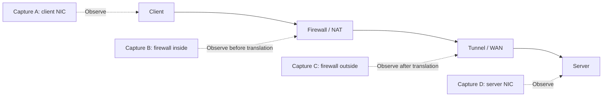
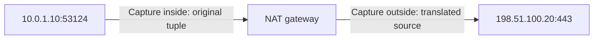
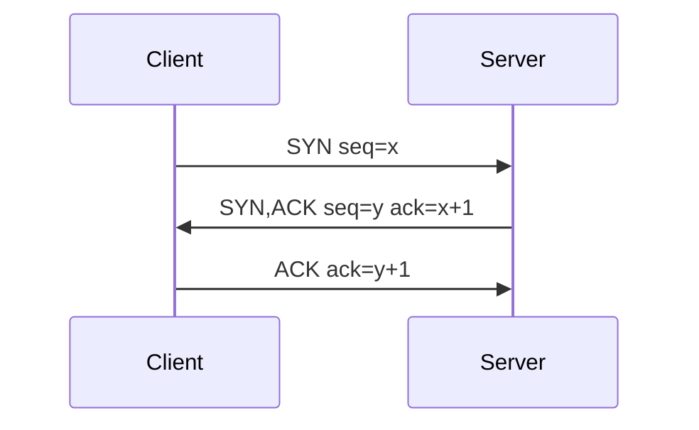
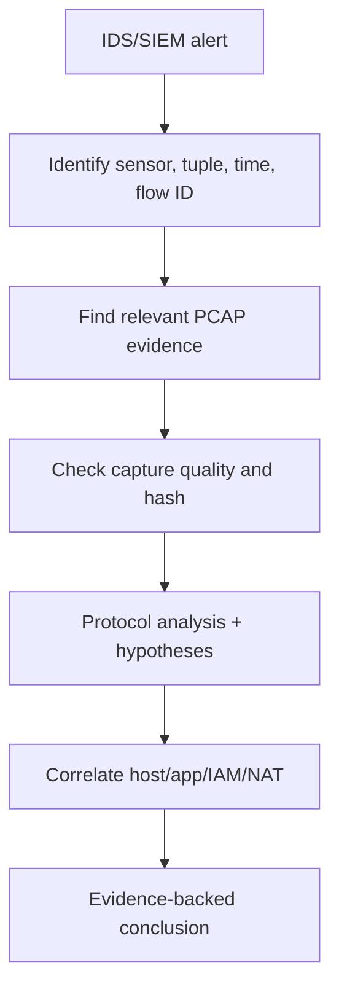

# Bằng chứng packet capture trong điều tra: thu thập, bảo toàn, phân tích và kết luận có căn cứ

## 1. Vì sao packet capture được sử dụng làm bằng chứng?

Khi xảy ra sự cố mạng, một dashboard có thể ghi “TCP timeout”, firewall báo `ALLOW` và IDS phát một alert, nhưng các thông tin đó chưa chắc đủ để trả lời **thực tế những gói tin nào đã đi qua điểm quan sát**. Một bản **packet capture** (bắt gói) cung cấp các packet hoặc phần packet mà cảm biến ghi nhận, cùng metadata như thời điểm, giao diện thu thập và độ dài gói khi định dạng/công cụ hỗ trợ. Đây là nguồn bằng chứng có ích để kiểm tra lại các giả thuyết về **DNS, TCP, UDP, ICMP, TLS, routing, retransmission, handshake, protocol anomalies và trao đổi dữ liệu**.

Ví dụ trong một sự cố giả định:

```text
10:03:11  Monitoring: API báo timeout khi gọi payment provider.
10:03:12  Firewall: rule cho phép TCP/443 đến địa chỉ provider.
10:03:12  PCAP tại client: SYN được gửi, không thấy SYN-ACK trả về.
10:03:13  PCAP tại gateway: SYN đi ra khỏi interface uplink.
10:03:14  Provider-side logs: chưa tìm thấy request tương ứng.
```

Từ PCAP tại client **có thể xác nhận** đã quan sát một số TCP SYN và chưa thấy SYN-ACK trong phạm vi capture; **chưa thể khẳng định** nhà cung cấp đã nhận SYN hay đã chủ động chặn nếu không có bằng chứng từ đường mạng/đích. Sự phân biệt đó làm nên giá trị của điều tra có kỷ luật.

**Bằng chứng packet capture** là tập hợp packet records và metadata được tạo, thu thập, lưu giữ, bảo vệ và phân tích theo một quy trình có thể kiểm tra lại. PCAP không tự động là “sự thật đầy đủ của toàn mạng”; nó chỉ phản ánh **những gì cảm biến tại điểm đo nhìn thấy trong điều kiện cụ thể**.

Trong phạm vi **SECURITY_NETWORK_SECURITY**, bài này kết nối kiến thức **TCP/IP, phân đoạn, firewall, VPN, DNS, TLS, IDS/IPS, giám sát mạng và hạ tầng cloud/Kubernetes** với công việc ứng phó sự cố.

### 1.1. Mục tiêu học tập

Sau bài này, người học có thể:

1. Phân biệt **packet evidence, flow logs, IDS alert, application log và host/process evidence**.
2. Lập kế hoạch capture có **phạm vi, quyền hạn, thời gian, giao diện và tiêu chí dừng**.
3. Hiểu các giới hạn do **SPAN/TAP, offload, asymmetric routing, snaplen, capture drops, timestamp và TLS/QUIC encryption**.
4. Bảo toàn PCAP/PCAPNG với **hash, chain of custody, read-only working copy, retention và access controls**.
5. Sử dụng **tcpdump, Wireshark, TShark, editcap/capinfos** ở mức phòng vệ và điều tra được ủy quyền.
6. Phân tích DNS, ARP/ND, TCP, UDP/ICMP, TLS và HTTP/QUIC trong giới hạn bằng chứng.
7. Tương quan packet với **NAT, proxy, VPN, IAM, EDR, Kubernetes/CNI, SIEM và log ứng dụng**.
8. Viết kết luận phân biệt **observed, corroborated, inferred, unknown** cùng độ tin cậy.

## 2. PCAP là quan sát trực tiếp, nhưng không phải quan sát toàn diện

Một gói tin có thể đi qua nhiều nơi:



Sơ đồ minh họa, không phải topology bắt buộc. Capture ở client có thể thấy packet **trước khi được NIC biến đổi**; capture ở firewall có thể thấy trước/sau NAT; capture ở WAN có thể chỉ thấy **tunnel được mã hóa**; capture ở server có thể thấy một luồng sau cân bằng tải.

### 2.1. Phạm vi của một kết luận

| Quan sát | Kết luận phù hợp | Kết luận không đủ căn cứ |
|---|---|---|
| SYN xuất hiện trong PCAP client | client stack/sensor đã thấy SYN trong capture | server chắc chắn nhận SYN |
| SYN-ACK xuất hiện tại client | tại điểm đo có SYN-ACK phù hợp | application đã chấp nhận request |
| TCP RST trong capture | một RST packet được quan sát | endpoint cuối chắc chắn tự tạo RST nếu còn middlebox |
| DNS response có A/AAAA | resolver trả địa chỉ theo dữ liệu lúc đó | client nhất định đã kết nối IP này |
| TLS handshake hoàn thành | giao thức đã hình thành kênh theo quan sát/metadata | chủ thể được quyền đọc mọi dữ liệu |
| TLS Application Data | có dữ liệu mã hóa được truyền theo giao thức | biết nội dung HTTP nếu không có khóa/endpoint logs |
| Không thấy packet trong file | sensor không có record đó trong phạm vi capture | packet không tồn tại trên mọi đường |
| HTTP response trong cleartext PCAP | thấy nội dung HTTP tại điểm đo | user có quyền nghiệp vụ hoặc request không bị proxy sửa |

### 2.2. Sự khác nhau giữa packet và hành động nghiệp vụ

Một flow TCP có thể chứa nhiều HTTP/2 requests; một HTTP request có thể gọi nhiều service và DB operations. **Packet-level evidence xác minh hoạt động giao thức**, trong khi để chứng minh **tác động nghiệp vụ hoặc data exfiltration** còn cần app/DB/SaaS/cloud data-plane audit.

## 3. Phân cấp giá trị bằng chứng: packet, flow, alert, application

| Loại | Thông tin có thể cung cấp | Giới hạn |
|---|---|---|
| **Full packet capture** | headers, payload bytes thấy được, packet sequence, timestamps | thiếu traffic nếu sensor sai vị trí hoặc capture drop; TLS mã hóa |
| **Truncated packet capture** | phần đầu packets đến snaplen; headers thường còn | thiếu payload/trailer, có thể không parse được các lớp sâu |
| **NetFlow/IPFIX/sFlow** | 5-tuple, volume, times, sampling tùy exporter | không phải packet bytes; sampling/aggregation |
| **Firewall sessions/logs** | rule/verdict, zone/interface, session state | allow không bảo đảm server nhận/app xử lý |
| **IDS/IPS alerts** | signature/behavior suspicion và action theo engine | alert không tự xác nhận compromise |
| **DNS/proxy logs** | tên đích/URL/CONNECT và policy theo khả năng | cache, TLS/QUIC, direct routes, identity spoof |
| **EDR/process** | tiến trình và execution context | không tự chứng minh packet đi qua một interface |
| **Application/API audit** | request/action/user/result | có thể thiếu network path, tamper/config risks |
| **Cloud/SaaS data-plane audit** | resource/object/tenant operations và outcome | không ghi mọi generic TCP packet |

**Một kết luận vững chắc thường phối hợp nhiều lớp độc lập.** Nếu PCAP và log ứng dụng mâu thuẫn, cần xem **đồng hồ, NAT, proxy, retries, packet loss, sampling và sensor coverage** trước khi chọn bên nào “đúng”.

## 4. Nguyên tắc pháp lý, quyền hạn và tính cần thiết

Bắt gói có thể thu **thông tin cá nhân, credentials, cookies, email, hồ sơ khách hàng, nội dung API hoặc dữ liệu của bên thứ ba**. Ngay cả metadata như DNS/địa chỉ IP cũng có thể tiết lộ hành vi người dùng và sơ đồ hạ tầng.

Trước khi thu thập:

- Xác minh **tài sản, mạng, user population và hoạt động thuộc phạm vi được ủy quyền**.
- Ghi **mục đích điều tra**, nguồn phê duyệt, incident/change ID và owner.
- Xác định **điểm bắt, filter, snaplen, thời lượng và retention** tối thiểu đủ giải quyết câu hỏi.
- Hạn chế quyền truy cập và nơi lưu PCAP, bảo vệ bằng **mã hóa và kiểm soát audit**.
- Cân nhắc **quy định pháp luật, hợp đồng, privacy, thông tin nhạy cảm và quyền của người dùng**.
- Không vô cớ giải mã TLS hoặc thu cookies/passwords. Chỉ truy cập dữ liệu thô khi có căn cứ và thẩm quyền.
- Nếu vụ việc cần **forensic/legal hold**, tuân thủ quy trình nội bộ và phối hợp chuyên trách.

**Bài học chỉ dùng kịch bản lab, dữ liệu giả và lệnh dành cho hệ thống được cấp phép.** Không chạy capture trên mạng của tổ chức/cá nhân khác hoặc cố thu traffic riêng tư ngoài phạm vi.

### 4.1. Mục tiêu điều tra quyết định cách lấy bằng chứng

Với lỗi **TCP handshake**, header-only capture có thể đủ. Với lỗi **HTTP payload framing** trong lab chưa mã hóa, có thể cần full packet. Với lưu lượng **TLS Production**, full capture thường vẫn không đọc được nội dung và tăng rủi ro lưu dữ liệu; có thể ưu tiên endpoint/application logs hoặc selective metadata.

## 5. Kế hoạch capture: viết câu hỏi trước khi bấm Start

Một capture tốt phải trả lời **một vấn đề cụ thể**:

```yaml
# Biểu mẫu học thuật, không phải file cấu hình runtime.
case_id: IR-NET-LAB-012
question: "Client gửi SYN nhưng server có nhận không?"
authorization: "approved-staging-network-owner"
network_scope: "segmented test VPC"
capture_points:
  - client-test-vm
  - firewall-inside-interface
  - server-test-vm
traffic_scope:
  source: "test-client"
  destination: "test-api"
  protocols: [tcp, icmp]
capture_window_utc: "2026-11-28T08:00:00Z/2026-11-28T08:10:00Z"
snaplen: 128
storage: "encrypted-restricted-evidence-vault"
capture_owner: network-incident-team
expected_safeguards:
  - time_sync_health_recorded
  - capture_drop_stats_recorded
  - sha256_after_stop
  - raw_copy_read_only
  - access_audit_enabled
```

### 5.1. Sáu câu hỏi trước capture

1. **Cần xác nhận điều gì?** Ví dụ kết nối TCP được thiết lập hay không, DNS trả gì?
2. **Bắt ở đâu?** Client, firewall, TAP/SPAN, proxy, tunnel endpoint hay server?
3. **Bắt vào lúc nào?** Cửa sổ tương ứng alert/reproduction; đồng hồ đã đồng bộ?
4. **Bắt cái gì?** Host/subnet/protocol/port/flow, capture filter và snaplen.
5. **Ai được phép đọc?** Loại dữ liệu và đối tượng có thể lọt vào file.
6. **Bằng chứng được lưu/bàn giao ra sao?** Hash, storage, retention, chain of custody.

### 5.2. Giới hạn phạm vi có thể giảm dữ liệu

Không nên mặc định `-i any -s 0` trên Production trong thời gian vô hạn. Capture full packet từ mọi giao diện có thể gây **I/O, CPU, disk pressure và thu thập dữ liệu ngoài mục đích**. Nếu chỉ cần 5-tuple/handshake, dùng filter và snaplen có chủ đích; nếu cần không gian quan sát lớn hơn, có phê duyệt và dung lượng đủ.

## 6. Chọn vantage point: host, TAP, SPAN, firewall và tunnel

| Vị trí | Điểm mạnh | Giới hạn |
|---|---|---|
| **Client host** | thấy stack client và giao thức trước/qua một số offloads | không chứng minh packet thực sự ra dây |
| **Server host** | thấy những gì stack server nhận tại điểm đo | có thể ở sau load balancer/TLS proxy |
| **Network TAP** | sao chép traffic trên liên kết được gắn đúng, ít phụ thuộc switch mirror config | placement, link speed, full duplex, loss/visibility |
| **SPAN/mirror port** | triển khai linh hoạt trên switch/cloud mirror | mirror congestion, drops, asymmetric paths, VLAN handling |
| **Firewall inside/outside** | so trước/sau policy và NAT | không thấy alternate route hoặc app business outcome |
| **Load balancer/reverse proxy** | thấy client/backend hops, TLS termination context | hai TCP sessions khác nhau, source IP rewritten |
| **VPN/IPsec endpoint** | có thể quan sát nội bộ sau giải mã tại endpoint được phép | WAN capture thường chỉ thấy encrypted tunnel |
| **Cloud traffic mirroring** | thu traffic từ interface/tài nguyên có hỗ trợ | cost, filters, packet encapsulation, service limitations |
| **Kubernetes node/CNI** | gắn Pod/namespace, policy verdict tùy plugin | hostNetwork, same-node, service NAT, offloads |

### 6.1. SPAN so với TAP

**SPAN** sao chép frames từ nguồn cấu hình sang một cổng/mirror target. Khi nhiều nguồn đổ vào một cổng có bandwidth thấp, có thể **mất gói do oversubscription**. Switch mirror cũng có thể thay VLAN tagging hoặc xử lý một số frames đặc biệt tùy thiết bị.

**TAP** là thiết bị thu thập traffic trên một đoạn liên kết, nhưng **không bảo đảm toàn bộ mạng**: nếu đường đi khác hoặc sensor nhận không đủ throughput vẫn có thể thiếu. Cần đánh giá duplex/aggregation, link speed, physical/logical interfaces và drop stats.

### 6.2. Hai phía NAT hoặc firewall có giá trị đặc biệt



Chỉ biết public source IP sau NAT không đủ xác định host. Khi có quyền, đối chiếu **translation logs, packet tuples, ports, timestamps và gateway/session IDs**.

### 6.3. Path bất đối xứng

Request và response có thể đi **những interfaces/regions khác nhau**. Một capture thấy TCP SYN mà không thấy SYN-ACK có thể vì reply **đi đường khác**, không phải server không trả lời. Để kết luận cần capture ở thêm điểm hoặc xác minh routing/session logs.

## 7. Bản chất file PCAP và PCAPNG

**PCAP (classic pcap)** là định dạng lưu một chuỗi packet records với global header và per-packet headers. Thường lưu **timestamps, captured length và original packet length** cùng packet bytes, theo khả năng định dạng.

**PCAPNG (pcap next generation)** dùng các **blocks** như Section Header Block, Interface Description Block, Enhanced Packet Block và các options có thể mô tả **nhiều interfaces, độ phân giải timestamp, comments, interface metadata hoặc information bổ sung**.

| Thuộc tính | PCAP classic | PCAPNG |
|---|---|---|
| Packet data và timestamps | Có | Có |
| Link-layer type | Thường ở global header | Per-interface metadata |
| Nhiều capture interfaces trong một file | Hạn chế theo format | Hỗ trợ rõ hơn |
| Metadata/options mở rộng | Hạn chế | Linh hoạt |
| Tương thích công cụ | Rộng, nhưng tùy version | Nhiều công cụ hiện đại hỗ trợ |
| Forensic suitability | Tùy quy trình bảo toàn | Tùy quy trình bảo toàn |

**PCAPNG không tự có chain of custody** và **PCAP không tự đáng tin hơn vì phổ biến**. Giá trị chứng cứ nằm ở nguồn, quy trình, completeness, timestamp và integrity. Comments trong PCAPNG cũng có thể bị sửa; không coi chúng là chữ ký bất biến.

### 7.1. Link-layer types và decoding

Một PCAP có thể bắt frames Ethernet (thường có Ethernet header), một capture trên loopback/tunnel có thể dùng **cooked capture, raw IP hoặc link-layer format khác**. Parser không nên giả mọi packet bắt đầu bằng 14-byte Ethernet header; kiểm `linktype`/interface metadata.

### 7.2. Packet length và captured length

Một packet gốc dài 1.500 bytes nhưng được capture với snaplen 96 bytes có thể hiển thị:

```text
Original packet length: 1500 bytes
Captured packet length: 96 bytes
```

Không có đủ payload để khẳng định nội dung packet bị cắt. “Missing bytes” có thể **do chủ đích snaplen**, không phải dữ liệu bị xóa sau khi thu.

### 7.3. Định dạng không chứng minh nguồn

Một file có extension `.pcap` hoặc `.pcapng` có thể được **tạo/sửa bởi phần mềm**. Muốn nói “thu từ interface X vào lúc Y” phải có **acquisition record, provenance, logger/source evidence và integrity validation** ngoài tên file.

## 8. Timestamp, clock synchronization và precision

Trong capture, timestamps thường được gắn tại **vị trí driver/kernel/NIC/hardware hoặc software path** tùy nền tảng. Cần phân biệt:

- **Clock correctness:** đồng hồ sensor đúng thời gian thực không?
- **Timestamp resolution:** đơn vị lưu (microseconds/nanoseconds...) chứ không tự bảo đảm độ chính xác.
- **Timestamp accuracy:** sai lệch so với thời điểm packet thực đi qua point.
- **Ordering:** packets có thể được timestamp gần nhau, qua multicore/queues hoặc nhiều interfaces.
- **Event time vs analysis time:** thời gian packet được capture khác lúc mở file trong Wireshark.

### 8.1. Cùng flow từ hai sensors không phải cùng timestamp

```text
Sensor A: 10:00:00.001800 UTC  SYN sent
Sensor B: 10:00:00.004100 UTC  SYN observed
Difference: 2.3 ms observed
```

Chênh lệch trên **không tự là one-way network latency** nếu clock offset, capture scheduling, mirror buffering chưa được kiểm. Muốn ước tính độ trễ một chiều cần synchronization đủ tốt và hiểu chính xác các điểm capture.

### 8.2. Timestamp trong Wireshark

Giao diện có thể hiển thị **absolute, relative, time since previous captured packet hoặc time since previous displayed packet**. Đổi chế độ hiển thị thay đổi con số trên giao diện nhưng không thay packet bytes. Báo cáo nên ghi **UTC absolute timestamps**, timezone, độ phân giải và offset nếu biết.

### 8.3. Những nguyên nhân làm timeline sai

- NTP/PTP chưa đồng bộ hoặc VM host time drift.
- Mirror/packet broker thêm delay.
- PCAPNG nhiều interfaces có độ phân giải timestamp/time offset khác nhau.
- File merge/sort được xử lý lại, không giữ thứ tự ban đầu.
- Chuyển timezone hoặc định dạng ngày tháng sai trong report.

Khi cần ghép timestamp từ các nguồn, lưu **raw timestamp, source offset estimate, capture interval, tool/view options và transformation history**.

## 9. Packet loss, snaplen, offloading và dấu hiệu “mất gói” giả

Capture loss có thể xảy ra ở **NIC, ring buffers, driver, kernel, packet socket, user-space capture, disk, switch SPAN hoặc network mirror**.

### 9.1. Packet drop counters

`tcpdump` thường in thống kê packets captured/received by filter/dropped by kernel, nhưng cách tính tùy platform. Counters **không bao quát mọi điểm mất gói** trước sensor (ví dụ SPAN oversubscription). Không thấy `kernel dropped` không chứng minh capture hoàn chỉnh.

### 9.2. Snaplen

`snaplen` là số bytes tối đa được lưu từ packet. Snaplen nhỏ giảm rủi ro/cost nhưng có thể cắt **TLS handshake metadata, encapsulation layers, HTTP headers hoặc payload**. Khi phân tích, so captured length và original length; ghi giới hạn của dữ liệu truncated.

### 9.3. NIC offloading

**Checksum offload, TCP segmentation offload (TSO), generic segmentation offload (GSO), generic receive offload (GRO), large receive offload (LRO)** có thể khiến packet captured trên host **không giống frames trên dây**:

- Wireshark hiển thị **TCP checksum incorrect** trên packet chuẩn bị NIC offload.
- Một packet trên host trông dài hơn MTU do segmentation được thực hiện muộn.
- Receive coalescing làm nhiều wire packets thành một representation.

Không kết luận mạng lỗi chỉ từ bad checksum ở host-side capture khi chưa kiểm offload/capture point. **Không tự tắt offload trên Production** để thay đổi cách hiển thị, vì có thể ảnh hưởng hiệu năng.

### 9.4. VLAN, tunnels và encapsulation

Switch/NIC có thể strip/insert **802.1Q tags**. Overlay **VXLAN, Geneve, GRE, IP-in-IP, IPsec, WireGuard** và cloud mirroring có thể tạo nhiều lớp headers. Cần phân biệt **outer/inner tuple** và điểm giải mã/termination, không gán outer gateway IP cho ứng dụng cuối.

### 9.5. Capture drop khác packet loss trên mạng

Nếu một packet không có trong PCAP, đó có thể là **mất khả năng quan sát**. Không tự kết luận packet đã bị mất trên dây. Muốn xác nhận network loss cần xét sender/receiver captures, sequence/ACK, retransmission, routes và sensor integrity.

## 10. Thu thập an toàn bằng tcpdump trên Linux

Những lệnh dưới đây **chỉ dành cho lab, staging hoặc interface/tài sản được ủy quyền**. Không dùng để thu dữ liệu riêng tư ngoài phạm vi. Quyền root/capability capture là quyền nhạy cảm.

### 10.1. Liệt kê interface

```bash
tcpdump -D
```

Tên `eth0` tiếp theo chỉ là ví dụ; xác định interface đúng bằng topology. Không dùng `-i any` làm mặc định vì có thể mở rộng phạm vi và tạo duplicate/cooked link-layer semantics.

### 10.2. Capture riêng lưu lượng lab

```bash
# Chỉ chạy trên test host/network đã được cấp phép.
# Lưu phần đầu packet, hạn chế thu payload không cần thiết.
sudo tcpdump -i eth0 -nn -s 128 -U \
  -w incident-lab-client.pcap \
  'host 198.51.100.25 and (tcp or udp or icmp)'
```

- `-i eth0` chọn interface.
- `-nn` tắt name/service resolution khi hiển thị.
- `-s 128` giới hạn bytes lưu mỗi packet; có thể thiếu headers sâu.
- `-U` yêu cầu packet-buffered output theo khả năng công cụ/libpcap.
- `-w` lưu file binary thay vì in payload.
- Biểu thức trong dấu nháy là **capture filter kiểu libpcap/BPF**.

Nếu điều tra được cấp quyền đòi full payload trong môi trường phù hợp, `-s 0` thường yêu cầu snaplen tối đa; việc này cần **privacy/storage review** và không giúp tự giải mã TLS.

### 10.3. Kết thúc và ghi thông số

Dừng bằng cơ chế chuẩn, thường Ctrl+C. Lưu **tool/version, command/filter, interface, capture start/end, thống kê captured/received/dropped, time sync health và network path context**. Chỉ hash file **sau khi capture đã đóng và ổn định**.

### 10.4. Ring buffer không phải evidence vault

`dumpcap`/`tcpdump` có thể hỗ trợ rotation/ring buffer. Segments cũ có thể **bị ghi đè**. Khi sự cố xảy ra, phải bảo toàn **các segments liên quan**, thứ tự, timestamps, capture metadata và hash từng segment trước khi quá hạn.

## 11. Capture filter BPF khác Wireshark display filter

| Mục tiêu | Capture filter (libpcap/BPF) | Display filter (Wireshark/TShark) |
|---|---|---|
| Một IP | `host 198.51.100.25` | `ip.addr == 198.51.100.25` |
| TCP/443 | `tcp port 443` | `tcp.port == 443` |
| UDP/53 | `udp port 53` | `udp.port == 53` |
| DNS | `port 53` nếu dùng port thường | `dns` khi dissector nhận diện |
| ICMPv4 | `icmp` | `icmp` |
| ICMPv6 | `icmp6` | `icmpv6` |
| SYN không ACK | `tcp[tcpflags] & (tcp-syn|tcp-ack) == tcp-syn` | `tcp.flags.syn == 1 && tcp.flags.ack == 0` |

### 11.1. Capture filter loại dữ liệu từ đầu

Những packet **không khớp capture filter sẽ không có trong file**. Không thể dùng display filter để khôi phục thứ chưa thu. Một filter chỉ lấy `tcp port 443` có thể bỏ **DNS, ICMP errors, IPv6 hoặc traffic fallback** cần cho sự cố. BPF behavior còn phụ thuộc **linktype, encapsulation và platform**.

### 11.2. Display filter chọn records đã có

```text
tcp.analysis.retransmission
dns.flags.rcode != 0
tcp.flags.reset == 1
ip.addr == 198.51.100.25
```

Các biểu thức này là **Wireshark display filters**, không phải shell commands hay tcpdump capture filters. Tùy Wireshark version/protocol dissector, một số field có thể không tồn tại hoặc hoạt động khác.

### 11.3. Filter làm lệch điều tra

Không thấy gói ICMP khi capture chỉ có TCP không thể chứng minh mạng không gửi ICMP. Ghi rõ filter ban đầu và **mọi display filters đã dùng khi chụp screenshot hoặc xuất danh sách packets**.

## 12. Phân tích với Wireshark/TShark trên bản sao

Quy trình:

1. Bảo toàn original ở nơi hạn chế quyền ghi.
2. Tính hash và tạo **working copy**; kiểm hash working copy nếu cần.
3. Phân tích/filter/reassemble/export từ working copy.
4. Lưu **version công cụ, filter, command, thời điểm, derived artifacts và hash khi phù hợp**.
5. Báo cáo packet/frame number kèm **source evidence ID**; không chỉ screenshot.

### 12.1. Kiểm tra metadata

```bash
capinfos incident-lab-client.pcap
```

Kết quả tùy version có thể cho **file type, link encapsulation, packet count, capture duration, size và data rates**. File metadata không tự xác minh sensor đầy đủ hay đồng hồ đúng.

### 12.2. In fields mà không in payload

```bash
tshark -r incident-lab-client.pcap \
  -T fields \
  -e frame.number -e frame.time_epoch \
  -e ip.src -e ip.dst \
  -e tcp.srcport -e tcp.dstport -e tcp.flags
```

Với IPv6 hoặc UDP, các fields TCP/IPv4 sẽ trống: không có nghĩa packet lỗi. Lọc/gắn fields phù hợp.

### 12.3. Xem TCP SYN packets

```bash
tshark -r incident-lab-client.pcap \
  -Y 'tcp.flags.syn == 1 && tcp.flags.ack == 0' \
  -T fields \
  -e frame.number -e frame.time_epoch \
  -e ip.src -e ip.dst -e tcp.stream
```

Đây là lệnh **đọc file**, không tạo traffic. Tên fields có thể thay theo phiên bản, ghi version.

### 12.4. Cẩn trọng khi “Follow Stream”

**Follow TCP/HTTP Stream** có thể hiển thị **cookies, credentials, tokens hoặc PII** nếu traffic cleartext hoặc được giải mã hợp lệ. Chỉ xem/export khi có thẩm quyền; không đưa nguyên payload vào ticket công khai.

## 13. Hash, chain of custody và tính toàn vẹn

**Cryptographic hash** giúp xác minh file không đổi bytes so với một bản đã ghi hash. SHA-256 là lựa chọn phổ biến để kiểm integrity cho PCAP/PCAPNG.

### 13.1. Quy trình bảo toàn

1. Dừng capture và bảo đảm file đã đóng.
2. Ghi **path/name, size, acquisition time, tool/version, interface, filter/snaplen, capture owner**.
3. Tính **SHA-256** cho original.
4. Đưa original vào **restricted evidence storage** có access audit/integrity controls.
5. Tạo working copy; xác nhận integrity khi di chuyển/copy.
6. Ghi **mọi lần tiếp nhận/chuyển giao/truy cập/transform/export**.
7. Thực hiện retention/legal hold theo quy định áp dụng.

### 13.2. Tính hash (chỉ đọc)

Linux:

```bash
sha256sum incident-lab-client.pcap
```

Windows PowerShell:

```powershell
Get-FileHash -LiteralPath '.\incident-lab-client.pcap' -Algorithm SHA256
```

Hash phải tính trên **file thật sau khi đóng**, không sao chép giá trị giả từ tài liệu. Khi file thay dù chỉ comment/metadata, hash thay đổi.

### 13.3. Chain-of-custody record

| Field | Mục đích |
|---|---|
| Evidence/case ID | định danh và liên kết vụ việc |
| Collector/authorization | ai thu, theo phê duyệt nào |
| Capture point/interface | vị trí, network scope |
| Start/end UTC | thời gian thu |
| Capture tool/version/command | phương pháp tái kiểm tra |
| Filter/snaplen/linktype | coverage và giới hạn |
| Drop/clock status | chất lượng dữ liệu |
| File type/bytes/hash | integrity và định dạng |
| Storage/retention | quản trị truy cập |
| Custody/analysis log | ai đã xử lý, tạo bản dẫn xuất |

### 13.4. Hash không tự xác nhận tính xác thực lịch sử

Hash giống nhau **không chứng minh** packet thật sự đến từ nguồn X, clock đúng, capture không mất gói hoặc không bị can thiệp **trước hash đầu tiên**. Giá trị forensic phụ thuộc **capture provenance, source integrity và documented custody**, không chỉ một chuỗi SHA-256.

## 14. Evidence manifest: biến file rời rạc thành bằng chứng có thể kiểm toán

Một file `incident.pcap` trơ trọi không trả lời **ai đã thu, filter nào được dùng, bản này có phải original không và nguồn time sync có tin cậy không**. Vì thế nên tạo một manifest riêng, kiểm soát phiên bản và có liên hệ tới incident/case.

```yaml
# Mẫu học thuật; điền hash/size thật khi thực hiện được ủy quyền.
evidence_id: PCAP-IR-012-A
case_id: IR-NET-LAB-012
classification: restricted-network-evidence
original_filename: incident-lab-client.pcap
file_format: pcap
file_size_bytes: TO_BE_MEASURED
sha256: TO_BE_CALCULATED
capture:
  point: test-client-eth0
  collector_role: network-incident-team
  authorization_reference: approved-lab-change
  start_time_utc: "2026-11-28T08:00:00Z"
  end_time_utc: "2026-11-28T08:10:00Z"
  tool: tcpdump
  tool_version: VERIFY_ACTUAL_VERSION
  interface: eth0
  snaplen: 128
  capture_filter: "host 198.51.100.25 and (tcp or udp or icmp)"
  timestamp_source: RECORD_FROM_PLATFORM
  known_clock_offset: UNKNOWN
  capture_drops: RECORD_ACTUAL_COUNTERS
storage:
  original_store: restricted-evidence-vault
  allow_overwrite: false
  access_audited: true
limitations:
  - truncated_payload_due_to_snaplen
  - only_one_interface_observed
custody:
  - action: collected
    actor_role: authorized-responder
    time_utc: "2026-11-28T08:10:00Z"
```

Các giá trị viết hoa là **ô cần điền**, không được đưa vào báo cáo thực như số liệu đã đo. Manifest nên được bảo vệ cùng evidence, có lịch sử cập nhật; tùy yêu cầu điều tra có thể dùng chữ ký số hoặc cơ chế lưu trữ bất biến của tổ chức.

### 14.1. Evidence identity khác filename

Nhiều captures có thể cùng tên `capture.pcap`. **Evidence ID** phải ánh xạ một artifact cụ thể có hash/size/source; không dùng filename duy nhất để nhận diện.

### 14.2. Truy xuất hai chiều

Mỗi screenshot, flow table, CSV hoặc packet export trong report cần tham chiếu **evidence ID + packet/frame number + file/tool/version/filter**. Ngược lại, manifest liệt kê các derived artifacts và mục đích tạo ra chúng.

## 15. Bản sao làm việc, merge, slice, redaction và derived artifacts

Điều tra viên thường phải **lọc một khoảng thời gian, chỉ xuất một TCP stream hoặc gộp captures từ nhiều sensors**. Đây là hành động phân tích hợp lý, nhưng output **không còn là original**.

### 15.1. Phân loại artifact

| Artifact | Vai trò | Quy tắc |
|---|---|---|
| Original capture | bằng chứng thu ban đầu | hạn chế quyền ghi, hash, custody |
| Working copy | phân tích thông thường | có link tới original và kiểm hash |
| Time-sliced PCAP | subset phục vụ triage | ghi filter/time/tool/version |
| Merged PCAPNG | so sánh multi-sensor | giữ source file IDs, clock uncertainty |
| Redacted/anonymized PCAP | chia sẻ có kiểm soát | không coi như raw evidence; mô tả transformations |
| CSV/JSON packet fields | trích xuất cho query/chart | ghi dissector/version/fields và data loss |
| Screenshot | minh họa | không thay source file + reproducible filter |
| Reassembled stream | view suy ra từ segments | ghi gaps/retransmissions và privacy controls |

### 15.2. Một phép chuyển đổi có thể thay kết quả phân tích

Lọc packets bằng display filter rồi lưu riêng có thể loại **gói SYN, DNS, ICMP, retransmissions hoặc context**. Merge/sort packets có thể làm thay frame numbers/time ordering. Ẩn IP addresses khi redaction có thể làm mất khả năng ghép NAT/session. Bởi vậy:

1. Không sửa original trực tiếp.
2. Tính hash cho derived file sau khi tạo.
3. Lưu **command, filter, source evidence IDs, byte offsets/packet numbers nếu có**.
4. Ghi transformation ảnh hưởng gì đến **headers, timestamps, fields và checksums**.
5. Không trình một bản redacted cho reviewer như thể đó là raw capture ban đầu.

### 15.3. Chia sẻ bên ngoài

Một full PCAP có thể chứa thông tin người dùng ngoài incident. Khi bàn giao cho đối tác, cần **data minimization, legal/contract approval, encryption, recipient identity, retention và secure transfer**, kèm bản dẫn xuất chỉ chứa packets liên quan nếu đáp ứng yêu cầu.

## 16. File validation: integrity khác decode correctness

Một file có SHA-256 khớp vẫn có thể **hỏng cấu trúc ngay lúc ghi** hoặc bị truncate do ổ đĩa đầy. Kiểm tra kỹ thuật cần tách:

1. **Integrity check:** file có khớp hash/size đã ghi không?
2. **Format check:** phần mềm có nhận định dạng PCAP/PCAPNG và blocks không?
3. **Capture completeness:** packet counters/drops, snaplen, timing, missing interfaces.
4. **Analytic coverage:** có đủ traffic để trả lời câu hỏi không?

### 16.1. Ví dụ lệnh chỉ đọc

```bash
capinfos incident-lab-client.pcap
tcpdump -nn -r incident-lab-client.pcap -c 10
tshark -r incident-lab-client.pcap -q -z io,stat,60
```

Lệnh cuối hiển thị thống kê theo khoảng 60 giây khi TShark hỗ trợ. **Không nhầm số packets tool đọc được với số packets thật đã đi qua mạng** nếu snaplen/filter/drop/placement giới hạn.

### 16.2. File chưa đóng hoặc partial write

Một process capture crash/cạn disk có thể để file dở dang. Một parser có thể đọc các packets đầu mà báo lỗi ở cuối. Ghi rõ **số packet đọc được, lỗi parser, phạm vi thời gian có thể tin cậy**; không sửa đuôi file original để khiến lệnh thành công mà không lưu bản dẫn xuất.

### 16.3. Hash không bảo vệ thao tác phân tích

Một analyst vô tình thay filter mà bỏ những packets phản bác giả thuyết vẫn có thể giữ original hash đúng. Vì vậy **reproducible queries, full context và peer review** cần bổ sung integrity bảo mật.

## 17. Quy trình triage PCAP trước khi soi từng packet

Đừng mở file vài GB rồi “Follow TCP Stream” ngẫu nhiên. Bắt đầu từ **câu hỏi điều tra và metadata**.

### 17.1. Trình tự đề xuất

1. Xác minh **evidence ID, hash, size, capture point, time window, filter, snaplen**.
2. Kiểm **PCAP/PCAPNG parsing, link-layer type, packet count, drop indicators**.
3. Kiểm **top protocols/endpoints/conversations** theo yêu cầu vụ việc.
4. Xác định **flows/streams có liên quan** tới alert/time/resource.
5. Kiểm **handshakes, DNS, ICMP, TCP sequence, TLS, application metadata**.
6. So **multi-vantage** nếu có và giữ giới hạn clock/translation.
7. Ghép **flow/firewall/NAT/VPN/process/app/SIEM events**.
8. Đặt ra **giả thuyết và phản chứng**, ghi kết luận và uncertainty.

### 17.2. Hình thức tổng hợp ban đầu

```bash
# Đọc PCAP đã được cho phép, không tạo lưu lượng.
tshark -r incident-lab-client.pcap -q -z conv,tcp
tshark -r incident-lab-client.pcap -q -z endpoints,ip
```

Một số thống kê/định dạng chỉ khả dụng khi dissector nhận protocol; IPv6 conversations có thể cần biến thể tương ứng. Không suy top-byte peer là attacker khi chưa xét **business baseline và chiều traffic**.

### 17.3. Đặt thông số trong notebook điều tra

Ghi **Wireshark/TShark version, profile, name resolution settings, reassembly settings, preferences, enabled dissectors**. Các lựa chọn này có thể thay cách giao diện nhóm flows hoặc diễn giải lỗi.

## 18. Ethernet, VLAN, ARP và Neighbor Discovery trong chứng cứ

Lỗi network thường bắt đầu trước tầng TCP.

### 18.1. Ethernet

Một Ethernet frame thường có destination/source MAC, EtherType, payload và có thể có **802.1Q VLAN tagging**. Packet capture trên host có thể không chứa **preamble hoặc FCS**; NIC/switch có thể xử lý checksum/tagging ngoài điểm quan sát.

Không tự kết luận “frame không có FCS nên không hợp lệ” vì nhiều capture paths **không lưu FCS**.

### 18.2. ARP trong IPv4

ARP được dùng để tìm MAC trên cùng L2/broadcast domain cho địa chỉ IPv4 cần liên lạc. Trong PCAP lab:

```text
Who has 10.0.1.1? Tell 10.0.1.10
10.0.1.1 is at aa:bb:cc:dd:ee:ff
```

Có thể kiểm **ARP request/reply, repeated unresolved requests, IP/MAC change**. Nhưng MAC spoofing, proxy ARP, virtual MAC và network mobility có thể tạo kết quả phức tạp.

### 18.3. IPv6 Neighbor Discovery (ND)

IPv6 dùng **ICMPv6 Neighbor Solicitation/Advertisement, Router Solicitation/Advertisement** thay vai trò address discovery của ARP. Nếu chỉ capture `arp` và `icmp`, bạn có thể bỏ **ND/ICMPv6**; cần filter phù hợp và biết scope của IPv6 link-local multicast.

### 18.4. Phân tích xung đột địa chỉ

Khi thấy MAC/IP thay đổi, đối chiếu **DHCP lease, switch CAM/port security, ARP/ND caches, VM migration và failover**. Không gắn nhãn ARP spoofing chỉ từ một reply MAC mới; cần baseline/authorized changes và nhiều nguồn.

## 19. IPv4/IPv6, fragmentation, ICMP và MTU

### 19.1. Trường IP cơ bản

Đối với IPv4, xem **source/destination, TTL, protocol, flags, identification, fragment offset, total length**. Với IPv6 xem **Next Header, Hop Limit, extension headers, Fragment Header khi có** và source/destination.

### 19.2. Fragmentation làm filter và decoding phức tạp

IPv4 fragments sau đầu tiên có thể **không mang TCP/UDP ports**, do đó BPF filter chỉ theo `tcp port 443` có thể bỏ các non-initial fragments tùy biểu thức/stack. IPv6 fragmentation dùng extension header khác. Reassembly đòi **đủ fragments và order**; thiếu fragments có thể khiến analyzer báo incomplete payload.

### 19.3. ICMP là tín hiệu lỗi, không chỉ ping

ICMPv4/ICMPv6 có nhiều messages như **Destination Unreachable, Time Exceeded, Packet Too Big** (IPv6) hoặc các chỉ báo khác. Chúng giúp điều tra **route failure và Path MTU Discovery**.

Khi thấy TCP timeout hoặc UDP datagrams không có đáp ứng, tìm ICMP lỗi liên quan; nhưng không thấy ICMP có thể do **filter, rate limiting hoặc khác path**, không chứng minh router không gửi.

### 19.4. MTU và PMTUD

Một payload ứng dụng lớn bị treo trong khi packet nhỏ hoạt động có thể gợi ý **PMTUD failure**, path MTU, tunnel overhead hoặc filtering ICMP. PCAP có thể giúp thấy **IPv4 DF, packet sizes, ICMP fragmentation-needed hoặc ICMPv6 Packet Too Big**, nhưng kết luận cần so network path và app behavior.

### 19.5. TTL/Hop Limit không xác nhận “ai là attacker”

TTL/Hop Limit có thể gợi ý số hop còn lại nhưng **initial TTL khác theo OS**, NAT/tunnel/path thay đổi và capture point khác nhau. Không suy địa lý/hệ điều hành/động cơ chắc chắn chỉ từ một TTL.

## 20. TCP three-way handshake như một chuỗi bằng chứng

Một TCP handshake điển hình:



Các trạng thái cần phân biệt trong capture:

| Quan sát | Có thể suy luận | Không đủ để kết luận |
|---|---|---|
| Một hoặc nhiều SYN | source thử thiết lập TCP | server đã nhận SYN |
| SYN rồi nhiều SYN retransmissions | chưa thấy phản hồi phù hợp theo stack/điểm đo | đích cố ý chặn hoặc tấn công |
| SYN-ACK | point thấy response từ địa chỉ/tuple phù hợp | application đã xác thực user |
| RST phản hồi SYN | kết nối bị từ chối/reset theo quan sát | đúng server đã tạo RST nếu có firewall/middlebox |
| Three-way handshake hoàn tất | TCP connection được hình thành theo dữ liệu thấy | HTTP/gRPC/TLS/business action thành công |
| FIN/ACK | có tín hiệu graceful close | ứng dụng xử lý xong mọi request |
| RST trong phiên | session bị reset | chắc chắn là malicious injection |

### 20.1. So hai phía khi kết nối thất bại

```text
Client capture: SYN SYN SYN
Server capture: no matching SYN
Gateway capture: SYN observed on inside, not on outside
```

Trường hợp này gợi ý vấn đề ở gateway/route/filter nhưng cần kiểm **capture coverage và NAT**. Nếu gateway outside có SYN nhưng server capture không, vẫn có thể mất trên path trung gian; chưa thể định danh router có lỗi nếu thiếu bằng chứng.

### 20.2. TCP options

MSS, window scaling, SACK permitted, timestamps có thể giúp chẩn đoán **throughput, reordering hoặc MTU**, nhưng option presence không tự chứng minh OS fingerprint chính xác hay exploit.

## 21. TCP retransmission, duplicate ACK, out-of-order và zero window

Wireshark có thể gắn các nhãn như:

```text
TCP Retransmission
TCP Fast Retransmission
TCP Dup ACK
TCP Out-Of-Order
TCP Previous segment not captured
TCP ZeroWindow
TCP Window Full
```

Đây là **analysis heuristics** từ chuỗi packets được quan sát, không phải cờ trong TCP header mang đúng tên đó. Kết quả tùy completeness, capture direction và analysis preferences.

### 21.1. Một retransmission chứng minh điều gì?

Nếu sender gửi lại một segment với sequence range cũ, đó là **dấu hiệu retransmission trong điểm quan sát**. Nó có thể do:

- Packet gốc bị mất trên đường đi.
- ACK trở về bị mất hoặc trễ.
- Reordering, congestion, network jitter.
- Capture sensor đã bỏ lỡ packet/ACK.
- TCP stack behavior phù hợp với control algorithms.

**Không kết luận “mạng mất 10% packets” từ số Wireshark retransmission flags** nếu chưa xét sender/receiver views, duplicate observation và capture drops.

### 21.2. Duplicate ACK và SACK

Duplicate ACKs/SACK blocks có thể cho biết receiver nhận các dữ liệu ở các sequence ranges khác nhau; dùng kết hợp **sequence numbers, advertised windows, ACK numbers và timestamps** để dựng giả thuyết packet loss/reorder.

### 21.3. Zero window

`TCP ZeroWindow` phản ánh receiver advertising window bằng 0, có thể liên quan **application không đọc buffer kịp** hoặc vấn đề hiệu năng. Không được mặc định mạng đang chặn traffic khi receive window cạn.

### 21.4. Một capture bị thiếu ACK có thể tạo nhiều cảnh báo giả

Một sensor mirror chỉ nhìn **một chiều** có thể gắn retransmission/out-of-order flags khác so với hai chiều đầy đủ. Luôn kiểm **capture point, bi-directional visibility, tcp.analysis.lost_segment, drop stats và packet numbers** trước khi kết luận.

## 22. TCP stream reassembly và giới hạn khi chứng minh dữ liệu ứng dụng

TCP là byte stream; application message boundaries không nhất thiết trùng packet boundaries. Một HTTP request có thể chia qua nhiều TCP segments, hoặc nhiều requests nằm trong một connection.

### 22.1. Reassembly là kết quả suy ra

Wireshark/TShark xây stream bằng **TCP sequence numbers, out-of-order/retransmission handling và dissector logic**. Nếu capture thiếu segments hoặc snaplen quá nhỏ, stream view có thể bị **holes** hoặc parse sai tầng ứng dụng.

### 22.2. TCP stream index không phải identity

`tcp.stream == 4` chỉ là **chỉ số nội bộ của dissector trong file/phiên phân tích**. Khi cắt/merge files, chỉ số có thể khác. Để ghi chứng cứ, nêu **evidence ID + packet numbers + tuple + time + analyzer version**, không dựa stream index trơ trọi.

### 22.3. HTTP trong cleartext lab

Nếu traffic HTTP không mã hóa nằm trong phạm vi có phép, PCAP có thể chứa **method, path, Host, headers, body và response status**. Nhưng:

- Một `200 OK` chưa chắc user đã được cấp quyền đúng; có thể body là login page hoặc app behavior bất thường.
- Một proxy có thể chỉnh headers hoặc chuyển request thành hai network connections.
- Cookies/Authorization headers có thể là secrets; không publish nguyên.
- Gaps/fragmentation/compression làm payload view thiếu.

### 22.4. HTTPS, HTTP/2 và multiplexing

Với TLS, passive capture thường chỉ thấy encrypted records/connection metadata. HTTP/2 có thể multiplex nhiều streams trên cùng TCP connection, nên **một TCP flow không đồng nghĩa một HTTP request**. Cần endpoint/proxy/app logs để biết routes, user identities và business action khi không có decryption hợp lệ.

## 23. DNS trong PCAP: query, response, cache và time-aware attribution

DNS là nguồn quan trọng để hiểu tên miền được client hỏi và lỗi kết nối phát sinh từ name resolution hay network path.

### 23.1. Một giao dịch DNS điển hình

```text
Client -> Resolver: Query A api.partner.example.com
Resolver -> Client: Response NOERROR, A 198.51.100.25
Client -> 198.51.100.25: TCP SYN
```

Ba quan sát liên tiếp hỗ trợ giả thuyết client dùng IP từ DNS, nhưng vẫn cần **source process, resolver context, cache/TTL và flow identity**. Một DNS response không tự chứng minh client nhất định sử dụng địa chỉ đó.

### 23.2. Những fields nên xem

| Field | Câu hỏi |
|---|---|
| Transaction ID | query/response có khớp trong phạm vi quan sát? |
| QNAME/QTYPE | client hỏi tên và loại record gì? |
| RCODE | NOERROR, NXDOMAIN, SERVFAIL hay lỗi khác? |
| Answer records/TTL | địa chỉ và thời gian cache dự kiến? |
| Query/response timestamp | RTT quan sát được, với giới hạn sensor clock? |
| Source/resolver IP/port | ai hỏi, ai trả? |
| EDNS(0)/TCP | payload size, truncation, retry/fallback? |
| DNSSEC-related fields | có validation/adflag context hay không? |

### 23.3. DNS UDP và TCP

DNS không chỉ dùng UDP/53. TCP/53 có thể phục vụ trường hợp cần **truyền lớn, truncation fallback, zone transfer trong bối cảnh được phép hoặc các nhu cầu giao thức khác**. Chỉ capture UDP/53 có thể bỏ flow liên quan.

### 23.4. Có thể không nhìn thấy DNS query

Nguyên nhân gồm **OS/application cache, local resolver, NodeLocal DNSCache, DoH/DoT, hard-coded IP, proxy DNS resolution hoặc truy vấn được thực hiện trước capture window**. Không thấy DNS trong file **không chứng minh** client đã kết nối IP không qua tên miền.

### 23.5. DNS tunneling hypothesis

Nhiều unique/long QNAMEs và frequency bất thường có thể gợi ý dữ liệu được mã hóa thành subdomains, nhưng **telemetry, TXT verification, CDN và search-path retry** cũng tạo patterns tương tự. Cần process/endpoint, DNS ownership, request context và bằng chứng data access để phân loại.

### 23.6. Độ tin cậy của DNS history

Không lấy `nslookup` hiện tại gán ngược một flow nhiều ngày trước. DNS answers có thể thay theo **TTL, CDN, split-horizon, resolver và thời gian**. Lưu historical DNS response với thời gian/nguồn trong SIEM nếu cần attribution.

## 24. TLS evidence: thấy handshake không đồng nghĩa nhìn được ứng dụng

TLS bảo vệ nội dung và xác thực peer theo cấu hình. Passive capture của TLS thường **không đọc được HTTP request body/cookies/credentials**. Điều này vừa bảo vệ dữ liệu vừa giới hạn điều tra từ network sensor.

### 24.1. Những tín hiệu có thể dùng

- Source/destination, protocol/port, packet length/timing.
- TLS ClientHello metadata khi nhìn được: phiên bản được đề xuất, cipher suites/extensions, SNI nếu chưa bị che.
- ALPN được client đề xuất khi handshake metadata có thể quan sát.
- Handshake completion/alerts khi có khả năng xác định từ điểm quan sát và protocol.
- TLS record sizes/directions, **không phải cleartext HTTP**.
- Endpoint logs về **negotiated protocol, certificate validation và authenticated client**.

### 24.2. TLS 1.3 và certificate visibility

Trong TLS 1.3, **nhiều handshake messages bao gồm server certificate được mã hóa sau bước thiết lập handshake keys**. Passive observer chỉ có PCAP có thể không xem được server certificate. Không viết báo cáo “PCAP chứng minh CA/certificate X” khi những fields đó không hiện hữu; cần **client/server/proxy logs hoặc session secrets được cấp phép**.

### 24.3. SNI và ECH

SNI từng giúp thấy hostname trong nhiều TLS ClientHello, nhưng **Encrypted ClientHello (ECH)** có thể che tên thực trong những triển khai hỗ trợ. SNI quan sát được không chứng minh **SaaS tenant, user identity hoặc HTTP route**.

### 24.4. SSLKEYLOGFILE và decryption trong lab

Một số TLS client/application hỗ trợ xuất **session secrets** để giải mã bản capture trong Wireshark. Đây là dữ liệu **cực kỳ nhạy cảm**:

- Chỉ dùng trong **lab hoặc tình huống được phê duyệt rõ ràng**.
- Không đưa TLS secrets vào ticket, Git repository hoặc SIEM broad access.
- Không thu secrets từ user devices/applications ngoài phạm vi.
- Bảo vệ key material bằng encryption, scope/retention và audit tương xứng.
- Ghi decrypted view là **derived analysis**, giữ original PCAP và nguồn của secrets riêng.

**Private key của certificate server thông thường không đủ để giải mã mọi session TLS hiện đại**, đặc biệt khi dùng forward secrecy/TLS 1.3. Không yêu cầu export production private key để điều tra packet nếu không có căn cứ và kiểm soát đặc biệt.

### 24.5. TLS failure analysis

Một failure có thể đến từ **certificate hostname/CA trust, expired cert, unsupported TLS version/cipher, SNI routing, mTLS client cert, ALPN mismatch hoặc middlebox**. PCAP giúp khoanh vùng handshake stage nhưng **client/server TLS error logs** thường cần để biết nguyên nhân xác thực cụ thể.

## 25. UDP, QUIC và HTTP/3: không thể áp logic TCP một cách máy móc

UDP không có TCP three-way handshake và ACK/sequence semantics tương tự. Một UDP datagram được thấy tại sender không chứng minh endpoint nhận/xử lý; cần **response, destination capture, app logs hoặc ICMP errors**.

### 25.1. QUIC

QUIC thường dùng UDP, hỗ trợ encryption và cơ chế quản lý kết nối riêng. HTTP/3 chạy trên QUIC trong triển khai hỗ trợ; lưu lượng thường xuất hiện trên **UDP/443**.

Những điểm cần biết:

- **QUIC Connection IDs** hỗ trợ nhận diện logic connection qua một số thay đổi address/port (connection migration) theo protocol.
- 5-tuple có thể thay mà QUIC connection còn tiếp tục; không tự đếm thành nhiều phiên độc lập.
- QUIC packets có nhiều loại/metadata nhưng phần lớn nội dung/application data được bảo vệ.
- Không áp Wireshark `tcp.analysis.retransmission` để phân tích QUIC như TCP.
- Đối chiếu **QUIC-aware application endpoint/server telemetry**, handshake và transport logs khi có.

### 25.2. QUIC Initial và giới hạn giải mã

Một số thông tin QUIC Initial có thể được dissector phân tích theo quy cách giao thức, nhưng **không tương đương quyền đọc toàn bộ HTTP/3 content**. Không coi có thể dissect một vài handshake frames là có thể khôi phục mọi request bodies.

### 25.3. UDP anomaly không tự là exfil

Traffic UDP/443 có thể là HTTP/3 hợp lệ; DNS, VPN, real-time media hoặc telemetry cũng dùng UDP. Một cảnh báo UDP mới phải dựa trên **baseline, destination, application, volume và policy**, không chỉ protocol number.

## 26. VPN, tunnel và overlay: outer traffic khác inner traffic

Trên một capture tại Internet/WAN, VPN có thể chỉ lộ **outer packet metadata**:

```text
Remote client public IP
  -> VPN gateway public IP
  encrypted tunnel payload
```

Ở điểm giải mã phù hợp (VPN endpoint, virtual interface hoặc service target), có thể quan sát:

```text
VPN-assigned private IP
  -> internal application server
  inner TCP/UDP packets
```

### 26.1. Không kết luận từ outer IP

Một VPN gateway có thể phục vụ nhiều users/sessions. Capture WAN có source/destination **tunnel endpoints**, không đồng nghĩa địa chỉ nguồn của **inner request** hay user.

### 26.2. Tunnel types

Các dạng **IPsec/ESP, WireGuard, GRE, VXLAN/Geneve, IP-in-IP hoặc service mesh overlays** có thể tạo layer chồng. Không phải tất cả đều mã hóa; **encapsulation** và **confidentiality** là hai thuộc tính khác nhau.

### 26.3. VPN attribution

Ghép bằng **user/device/session ID, assigned tunnel IP, start/end time, client/public NAT mapping, VPN gateway logs và inner packet capture**. Khi assigned IP được tái cấp, historical mapping là bắt buộc.

### 26.4. TLS termination ở load balancer

Client→LB và LB→backend có thể là **hai TCP/TLS connections độc lập** với source/destination tuples khác. Không mong sequence numbers hoặc TLS session IDs phải giống nhau. Muốn nối business request, dùng **LB access log, trusted request ID/trace ID và backend audit**.

## 27. NAT, proxy và load balancing: không gán nhầm source

Một kết nối trước/sau SNAT có thể trông như:

```text
Inside:
  10.42.17.8:53124 -> 198.51.100.25:443

Outside:
  203.0.113.10:61005 -> 198.51.100.25:443
```

Các IP public đều thuộc dải tài liệu. Để ghép hai views:

- Dùng **protocol, source/destination IP/port, pre/post translation, gateway/session ID và time interval**.
- Ghi offset clocks, aggregation/capture drops.
- Xác định DNAT/SNAT có xảy ra một hay nhiều lần không.
- Không chỉ join `src_ip` vì public NAT IP có nhiều clients.
- Chú ý port reuse theo thời gian.
- Với proxy, có thể có **connection pooling, multiplexing hoặc TLS termination**, không phải phép NAT đơn giản.

### 27.1. IP không phải người dùng

Một NAT IP có thể đại diện cả cụm Pods, nhiều VMs hoặc toàn VPN pool. **Không xác định user/process từ IP đơn lẻ.** Ghép với VPN identity, host process, Pod UID hoặc API principal có evidence và thời hạn.

### 27.2. Load balancing

Một client có thể nhìn **virtual IP**, trong khi backend capture thấy **source của LB/proxy và node IP**. Với TCP pass-through hoặc Direct Server Return, path lại khác. Phải nắm **LB mode, SNAT settings, proxy protocol, trusted client-IP forwarding và backend routing**.

### 27.3. Trusted headers

HTTP `X-Forwarded-For`/`Forwarded` chỉ có giá trị attribution khi **trusted proxy chain** đã được bảo vệ và client-supplied values được loại/ghi đè theo policy. Một giá trị tự khai không phải network evidence.

## 28. Packet capture trong Kubernetes và container networking

Một Pod có **network namespace** riêng theo mô hình thông thường; containers cùng Pod chia sẻ mạng nhưng có thể không cùng PID namespace. Node dataplane/CNI, kube-proxy hoặc eBPF, Service/EndpointSlice, overlay và service mesh thay đổi packet path.

### 28.1. Những điểm có thể quan sát

| Capture point | Có thể thấy | Cần kiểm |
|---|---|---|
| Pod network namespace | TCP/UDP của Pod theo scope | containers cùng Pod, sidecar |
| Node host interface | Pod egress đã hoặc chưa NAT tùy path | nhiều Pods/node, offloads |
| CNI/eBPF observer | flow identity/policy verdict tùy plugin | implementation/coverage |
| Service mesh sidecar | upstream/downstream sessions | TLS termination, workload identity |
| Cloud VPC mirror/flow | node/ENI/overlay metadata | không tự có Pod UID |
| Destination Pod/service | traffic sau Service routing | source IP preservation/SNAT |

### 28.2. Pod IP lifecycle

Một Pod có thể restart và IP được tái sử dụng. Để gắn PCAP với workload:

```text
cluster ID + node ID + Pod UID
  + Pod IP allocation interval
  + container ID / process if available
  + capture timestamp
  + CNI/Service translation context
```

Không dùng `kubectl get pods` hiện tại để gán một packet từ nhiều ngày trước nếu không có historical inventory.

### 28.3. NetworkPolicy và evidence

Một NetworkPolicy object thể hiện **ý định cấu hình**, còn packet capture và CNI policy verdict thể hiện **hành vi thấy tại điểm thực thi**. Nếu thấy traffic dường như vượt deny policy, phải kiểm **policy cộng dồn, selector, hostNetwork, CNI support, DNS/node-local path và capture position**.

### 28.4. Service ClusterIP

Packet tới Service VIP có thể được DNAT sang backend Pod IP; sensor trước/sau translation sẽ có tuples khác nhau. Không đếm là hai business requests và không quy toàn bộ traffic từ node NAT cho một Pod khi thiếu mapping.

## 29. Cloud networking: khi nào PCAP đủ và khi nào cần cloud audit?

Cloud infrastructure có nhiều paths: Internet NAT, private endpoint, peering/transit, load balancers, VPN/Direct Connect/ExpressRoute, managed serverless networking hoặc provider-internal API paths.

### 29.1. AWS

Cloud traffic mirroring/capture có thể hỗ trợ một số ENI/interface/resource types tùy tính năng; **VPC Flow Logs** cung cấp flow metadata theo scope và aggregation, không phải PCAP full payload. Dùng **CloudTrail management/data events, Network Firewall/VPC endpoint logs, instance/process logs** khi cần xác minh ai gọi cloud API hoặc thay policy.

### 29.2. Google Cloud

**Packet Mirroring** và VPC Flow Logs có scope và product constraints; cloud NAT, firewall logs, Cloud Audit Logs/Data Access và VPC Service Controls cung cấp bằng chứng bổ sung theo dịch vụ. Một flow được capture tại VM không chứng minh **bucket/tenant resource** đích.

### 29.3. Azure

Tùy dịch vụ và cấu hình, có **Network Watcher packet capture**, Azure Firewall/Virtual Network Flow Logs và resource diagnostic/Activity Logs. Không mặc định mọi managed service có packet mirroring giống VM, hoặc legacy NSG Flow Logs luôn là lựa chọn được hỗ trợ cho triển khai mới.

### 29.4. Private endpoint và multi-tenancy

Một kết nối HTTPS tới provider qua private endpoint có thể **hợp lệ về network reachability** nhưng API action tới **account/bucket/tenant chưa được duyệt**. Capture không tự giải mã hoặc biết ownership; cần **IAM/resource/endpoint policies và data-plane audit**.

### 29.5. Cloud acquisition provenance

Khi dùng packet mirror từ cloud, ghi **resource IDs, VPC/VNet/project/subscription, mirror source/filter/target, encapsulation, capture timestamps, region, cloud account principal và changes**. Mirroring setup/config là control-plane event cần audit.

## 30. Liên hệ PCAP với IDS/IPS, Zeek, NetFlow và SIEM

Một IDS alert có thể chỉ ra **flow cần mở**; PCAP giúp kiểm sequence/packet data; logs endpoint xác nhận outcome. Quy trình:



### 30.1. Suricata EVE và packet evidence

Một Suricata event có thể ghi `flow_id`, signature ID/revision, src/dst, timestamp, engine action và metadata. **flow_id có ý nghĩa theo sensor/event context**, không phải global ID có thể join bừa giữa mọi appliances. Lưu sensor ID, time và tuple.

### 30.2. Zeek connection UID

Zeek `uid` giúp liên kết protocol logs của Zeek với một connection trong scope cụ thể, nhưng không phải **VPN session ID, authenticated user ID hoặc application request ID**. PCAP có thể giúp kiểm traffic mà Zeek phân tích, nhưng logging/capture drop và dissector khác vẫn tạo sai khác.

### 30.3. NetFlow/IPFIX

NetFlow/IPFIX thường ghi 5-tuple/bytes/timing theo exporter, nhưng **sampling và aggregation** khiến số lượng flows khác packet capture. Không tự coi flow log là source chứa payload hoặc danh tính người dùng.

### 30.4. SIEM correlation cần provenance

Khi đưa packet summary vào SIEM, lưu:

- Evidence ID/hash.
- Source sensor/vantage point.
- Capture file time window/clock quality.
- Packet numbers/5-tuple/flow ID.
- Analysis tool/version/filter.
- Derived indicators với confidence.

**Không gửi nguyên full PCAP có secrets vào SIEM nếu chỉ cần metadata**. Lưu file thô trong evidence vault; SIEM giữ reference theo access control.

## 31. Liên kết packet với process, identity và application action

Packet trên dây không thường chứa **process name, OS user, Kubernetes ServiceAccount, IAM principal hoặc business object**. Cần kết hợp:

| Cần biết | Bằng chứng bổ sung |
|---|---|
| Process nào tạo TCP connect | EDR, host audit, socket/process execution IDs |
| User dùng VPN assigned IP | VPN/IdP session logs với time interval |
| Pod nào sở hữu IP | orchestrator lifecycle + CNI/node mapping |
| SaaS tenant/recipient | SaaS/API audit, identity/account logs |
| Cloud storage object nào được ghi | data-plane operation logs và resource policies |
| API route nào được gọi | gateway/app logs, trusted trace/request ID |
| File nào được đọc | OS/app/DB file/object access audit |
| Rule firewall nào áp dụng | firewall session/policy logs |

### 31.1. Socket/process association phải time-aware

PID có thể được tái sử dụng, ephemeral source ports cũng vậy. Ghép bằng **host/container/process execution ID + tuple + time interval**. Không sử dụng danh sách active sockets hiện tại để kết luận một process đã khởi tạo kết nối trong quá khứ nếu không có lịch sử.

### 31.2. Application-level evidence

Một server nhận TLS data không tự chứng minh user có quyền nghiệp vụ. Xác nhận **authentication, authorization, object-level access, action result và transaction ID** ở application logs hoặc database/cloud API audit.

### 31.3. “Không thấy dữ liệu truyền” có nghĩa gì?

Nếu PCAP encrypted hoặc thiếu packets, không thể suy không có dữ liệu nhạy cảm. Có thể phát biểu **“không quan sát được nội dung trong phạm vi capture”**, rồi mô tả các log khác đã kiểm và độ tin cậy.

## 32. Xây timeline có chứng cứ và phân loại mức độ chắc chắn

Trong điều tra, timeline dễ sai khi ghép packets, firewall session logs, VPN logs, EDR events và cloud API audit có **clock skew/aggregation windows khác nhau**.

### 32.1. Một timeline tối thiểu

```text
08:00:00.011  DNS response observed at client capture
08:00:00.030  Client SYN observed at client capture
08:00:00.034  SYN observed at firewall inside interface
08:00:00.040  SYN observed at firewall outside after NAT
08:00:01.032  Client SYN retransmission observed
08:00:02.050  Application timeout log
```

Không tự điền một dòng “remote server dropped SYN” chỉ vì chưa thấy SYN-ACK. Cũng không coi chênh lệch timestamps giữa hai captures là chính xác nếu clocks chưa được đánh giá.

### 32.2. Các mức bằng chứng

| Mức | Mô tả | Cách viết |
|---|---|---|
| **Observed** | packet/log xuất hiện trực tiếp tại nguồn có provenance | “Capture A quan sát SYN...” |
| **Corroborated** | nhiều nguồn độc lập hỗ trợ kết luận | “Gateway B cũng thấy packet phù hợp sau NAT...” |
| **Inferred** | suy luận có giả định chưa kiểm chứng hết | “Có khả năng reply đi đường khác...” |
| **Unknown** | thiếu dữ liệu cần thiết | “Chưa có capture tại remote server...” |
| **Contradictory** | bằng chứng có vẻ mâu thuẫn | “Flow log báo ACCEPT nhưng PCAP chưa có ACK; cần kiểm scope...” |

**Bất định không phải thất bại điều tra**: ghi điều chưa biết và đề xuất quan sát bổ sung giúp tránh các biện pháp ứng phó sai.

### 32.3. Event time vs ingest time

Packet timestamp là thời điểm sensor đánh dấu; SIEM ingest time có thể trễ. Flow log có thể tổng hợp một khoảng dài. Nếu viết timeline sát mili giây, phải ghi **timestamp precision và confidence interval**.

## 33. Mẫu hồ sơ điều tra: mỗi khẳng định phải truy về evidence

```yaml
# Incident case summary học thuật; không phải hồ sơ sự cố thực tế.
case_id: IR-NET-LAB-012
question: "Client không kết nối được API; có phải firewall chặn?"
environment: authorized-staging
observations:
  - claim: "Client đã phát TCP SYN"
    evidence_id: PCAP-IR-012-A
    packet_refs: [14, 18, 27]
    confidence: observed
  - claim: "Gateway inside đã thấy packet phù hợp"
    evidence_id: PCAP-IR-012-B
    packet_refs: [51]
    confidence: corroborated
unknowns:
  - "Không có capture at upstream destination"
  - "Clock skew giữa sensors chưa được đo chắc chắn"
not_concluded:
  - "Remote server actively blocked"
  - "Application request reached server"
next_actions:
  - "Verify outside firewall policy/NAT session evidence"
  - "Obtain authorized destination-side observation"
artifacts:
  - id: PCAP-IR-012-A
    sha256: VERIFY_FROM_ACTUAL_FILE
  - id: PCAP-IR-012-B
    sha256: VERIFY_FROM_ACTUAL_FILE
```

### 33.1. Evidence references có thể tái lập

Một câu tốt:

> “PCAP-IR-012-A, packet 14, từ interface client được ủy quyền lúc 08:00:00.030 UTC, cho thấy TCP SYN tới test API; packet 18 và 27 cùng sequence range xuất hiện sau đó, phù hợp retransmission hypothesis. Capture A báo snaplen 128 và thống kê kernel drops chưa ghi nhận, nhưng SPAN/path khác chưa được loại trừ.”

Một câu yếu:

> “Mạng chắc chắn làm mất gói do Wireshark tô màu đen.”

Coloring rules của Wireshark giúp quan sát, **không là bằng chứng độc lập về nguyên nhân**.

### 33.2. Phiên bản công cụ và filters

Báo cáo nên ghi Wireshark/TShark version, display filter, stream reassembly preferences, hostname resolution state, source file hash, và các transformations làm thay frame numbers. Nếu reviewer tái chạy trên version khác, có thể có labeling khác.

## 34. Case study 1: TCP timeout qua firewall nhưng chưa rõ điểm mất

### 34.1. Bối cảnh

Client ở subnet ứng dụng cần gọi HTTPS tới partner. Monitoring báo timeout; firewall logs báo allow.

| Capture point | Quan sát |
|---|---|
| Client | SYN tại t=0; retransmissions sau đó; không thấy SYN-ACK |
| Firewall inside | SYN khớp original tuple |
| Firewall outside | SYN khớp destination, source đã SNAT |
| Partner endpoint | chưa có capture hợp lệ |

### 34.2. Kết luận hợp lệ

- **Client đã khởi tạo TCP handshake** theo PCAP.
- **Gateway inside/outside quan sát SYN**, nên packet có dấu hiệu qua được điểm kiểm soát theo thời điểm/capture.
- **Client chưa thấy SYN-ACK trong cửa sổ capture**.

Chưa đủ để khẳng định partner chặn, tuyến Internet mất gói ở đâu, hay ứng dụng partner bị lỗi.

### 34.3. Bước kế tiếp

- Xác minh NAT session, routing, security policies theo luồng và timestamp.
- Kiểm **return path và asymmetric routing**.
- Nếu có thể và được phép, dùng destination-side packet capture hoặc network provider logs.
- Kiểm capture quality (drops, SPAN, time sync).
- So với một flow hợp lệ khác cùng ranh giới.

### 34.4. Điểm dễ sai

Nếu nhìn mỗi firewall `ALLOW` mà kết luận “server phải phản hồi”, analyst đã **đánh đồng policy verdict với end-to-end delivery**.

## 35. Case study 2: TCP retransmission cao sau thay đổi đường mạng

### 35.1. Bối cảnh

Ứng dụng Java báo latency tăng sau failover đường WAN. Wireshark đánh dấu nhiều `TCP Retransmission`, `Dup ACK` và `Out-Of-Order`.

### 35.2. Giả thuyết cạnh tranh

1. **Actual packet loss/congestion** trên đường mới.
2. **Asymmetric capture**: sensor chỉ thấy một chiều hoặc bị SPAN loss.
3. **Packet reordering** do ECMP/tunnel/queue scheduling.
4. **NIC GRO/TSO/offload artifacts** tại capture host.
5. **Application receiver-side flow control** hoặc slow consumer gây zero window.

### 35.3. Phân tích theo lớp

- Kiểm **capture drops, position, offload**, timestamps/clock.
- So **sender vs receiver captures** trên cùng connection, dựa seq/ACK.
- Xem duplicate ACK/SACK/window advertisement và TCP RTT estimate nếu có đủ data.
- Kiểm interface errors, loss metrics, queue saturation, router path.
- Xem **application threads/GC/DB latency** nếu zero window hoặc server không đọc nhanh.

### 35.4. Kết luận giả định

Nếu có nhiều retransmitted segments tại sender nhưng **receiver capture không nhận original**, đây là bằng chứng mạnh hơn về **loss trên path giữa hai điểm** so với một capture đơn. Nếu receiver thấy original mà sender không thấy ACK, có thể loss trên **return path** hoặc sensor gap.

### 35.5. Bài học

**Wireshark heuristic không là phép đo độc lập của packet loss end-to-end**. Nên có multi-vantage evidence và network counters, không sửa MTU/offloads khi chưa xác định nguyên nhân.

## 36. Case study 3: DNS NXDOMAIN tăng — tunneling hay lỗi phân giải?

### 36.1. Bối cảnh

SIEM phát hiện QNAMEs dài và tăng `NXDOMAIN` từ Pod reporting. NDR gắn cờ “DNS exfiltration possible”.

### 36.2. Hai giả thuyết

- **H1 — DNS exfiltration:** process bị compromise gửi payload mã hóa trong subdomain labels ra domain ngoài chính sách.
- **H2 — Resolver/client misconfiguration:** search domains/`ndots`, hostname sai hoặc SDK retry tạo nhiều queries không tồn tại.

### 36.3. Phương pháp dùng PCAP

1. Xác định **đúng Pod/host/NodeLocal DNS path** tại thời điểm alert.
2. Từ PCAP được cấp phép, xem QNAME/QTYPE/RCODE, timestamps, request-response mapping.
3. So source process/runtime events và deployment change.
4. Xem traffic ra resolver lạ, DoH/DoT nếu có được giám sát theo chính sách.
5. Phân biệt query names chứa **search suffixes lặp** với unique labels khác baseline.
6. Tìm evidence data-access/API export bên cạnh DNS patterns trước khi kết luận impact.

### 36.4. Không nên làm

Không copy tất cả raw QNAMEs có thể chứa PII/secret vào ticket, và không coi “domain rất dài” tự là payload exfil.

### 36.5. Bài học

PCAP cho thấy DNS exchange theo điểm quan sát; **intent và data impact** cần application/host/data logs và business context.

## 37. Case study 4: HTTPS bytes lớn — có phải thất thoát dữ liệu?

### 37.1. Bối cảnh

Một private VM gửi traffic TLS tới cloud object storage provider. Firewall cho phép TCP/443, IDS nhận thấy bytes tăng, SIEM cảnh báo potential exfiltration.

### 37.2. Những gì PCAP có thể hỗ trợ

- Có kết nối tới IP/port nào, trong thời gian nào.
- TCP handshake, retransmission, direction/volume theo packets quan sát được.
- Một số TLS metadata tùy version/config; không tự xem cleartext object.
- Packet paths qua NAT/proxy hoặc endpoint nếu có nhiều captures.

### 37.3. Những gì cần bằng chứng khác

| Câu hỏi | Nguồn bổ sung |
|---|---|
| Process nào tạo connection? | host process/EDR/socket timeline |
| Identity nào gọi cloud API? | IAM/data-plane audit |
| Ghi object vào account/bucket nào? | storage API/resource logs |
| Dữ liệu có nhạy cảm không? | data classification, application/DB audit |
| Job có được phê duyệt? | change/backup inventory, owner |
| Upload thực sự thành công? | API outcome/object audit |
| Quyền có bị lạm dụng? | resource/endpoint/IAM policy and incident timeline |

### 37.4. Kết luận hợp lệ

“Quan sát TLS outbound lớn” là một **dấu hiệu cần điều tra**. Nếu cloud data logs cho thấy writes tới **unapproved tenant/account** với principal cụ thể, kết luận policy violation có căn cứ hơn. Ngay cả khi xác định vi phạm, cần tiếp tục phân biệt **lỗi cấu hình, insider misuse và external compromise**.

### 37.5. Bài học

**PCAP không tự chứng minh exfiltration** chỉ vì số bytes cao hoặc destination domain lạ; việc kết luận dữ liệu đã rời tổ chức yêu cầu **evidence ở tầng dữ liệu và danh tính**.

## 38. Case study 5: TLS handshake thất bại sau certificate rotation

### 38.1. Bối cảnh

Sau khi thay certificate nội bộ, client Java báo TLS handshake failure. Firewall flow allow nhưng API trả errors.

### 38.2. Tín hiệu cần thu

- PCAP client cho biết TCP handshake có hoàn tất không; TLS records/alerts có xuất hiện không.
- Endpoint/client logs ghi **certificate validation errors, truststore, SNI, ALPN, protocol/cipher negotiation**.
- PKI/certificate inventory ghi **SAN, chain, expiry, EKU, CA trust anchor**.
- Proxy/LB logs nếu TLS termination ở nhiều hops.
- Deployment/rotation timeline.

### 38.3. Giới hạn TLS 1.3

Không nên đòi một passive PCAP phải thấy **certificate chain server ở cleartext** trong TLS 1.3. Có thể phải dựa vào logs hoặc client-side inspection được ủy quyền. Nếu lỗi do truststore Java chưa cập nhật, packet trace chỉ là bằng chứng giao thức hỗ trợ chẩn đoán, không phải nguồn độc lập duy nhất.

### 38.4. Bài học

**Firewall allow không đồng nghĩa TLS trust thành công**, và TLS handshake thành công cũng không tự là API business authorization.

## 39. Case study 6: firewall bị nghi bỏ qua NetworkPolicy trong Kubernetes

### 39.1. Bối cảnh

Nhóm triển khai default-deny egress NetworkPolicy trong namespace `payments`. Tuy vậy cloud flow logs vẫn thấy outbound từ node tới một service nằm ngoài allowlist.

### 39.2. Các khả năng

- Có NetworkPolicy khác **allow bổ sung** cho Pod.
- CNI không hỗ trợ/enforce policy như kỳ vọng.
- Traffic do **hostNetwork Pod, node agent hoặc sidecar** tạo, không phải app.
- Flow log ở node chỉ thấy **SNAT source**, không phân biệt Pod.
- Packet đi tới private endpoint/Service route khác ý định.
- Log đến trễ hoặc thuộc Pod trước thời điểm policy triển khai.

### 39.3. Kiểm chứng

1. Xác định source node, Pod UID, container/process và time interval.
2. Xem policy intent, namespace/Pod selectors, CNI verdict logs.
3. Kiểm bản capture ở Pod/node nếu hợp pháp và khả thi.
4. Đối chiếu Service/EndpointSlice, NAT, routing và hostNetwork.
5. Thực hiện **negative connectivity test tới controlled synthetic destination** trong staging.

### 39.4. Kết luận

“Node gửi traffic” **chưa chứng minh** app Pod vượt NetworkPolicy. Attribution phải đạt đến Pod/container/process hoặc ghi rõ không xác định. Không tự mở rộng rule hoặc vô hiệu CNI chỉ để đáp ứng một suy luận chưa được kiểm.

## 40. Playbook ứng phó sự cố có sử dụng packet capture

### Giai đoạn A — Triage và bảo vệ quyền

1. Xác định **incident/case owner, mức độ nghiêm trọng, tài sản, network boundary, câu hỏi cần giải đáp**.
2. Kiểm quyền bắt gói, data sensitivity và người phê duyệt.
3. Kiểm liệu có **PCAP đã được ghi sẵn** ở network sensor hay không; lưu segment có liên quan trước khi ring buffer ghi đè.
4. Chọn **capture points và filters** đủ cho giả thuyết; không thu mọi interface trong Production nếu không cần.
5. Ghi start/end UTC, NTP status, tool/version, expected capture drops và log source coverage.

### Giai đoạn B — Acquisition

- Thực hiện capture trong phạm vi được duyệt, giám sát CPU, memory, packet rate và disk.
- Với nhiều sensors, dùng **capture IDs riêng**, không giả timestamp các máy đã đồng bộ tuyệt đối.
- Ghi topology/routing/NAT/LB/overlay configuration tại thời điểm sự cố nếu trong phạm vi cho phép.
- Kết thúc và xác nhận file ổn định; lưu counters/drops.
- Hash original, lưu vào restricted evidence store và ghi custody.

### Giai đoạn C — Analysis

1. Kiểm định dạng, size, snaplen, linktype, completeness và timestamp.
2. Tách flows/packets theo câu hỏi cụ thể.
3. Dùng protocol evidence: TCP/UDP/DNS/ICMP/TLS/QUIC.
4. Đối chiếu nhiều vantage points khi có.
5. Ghép firewall/IDS, VPN, NAT, EDR, SIEM, IAM, app/cloud audit.
6. Viết **giả thuyết và phản chứng**, không dừng ở event đầu tiên khớp niềm tin.
7. Ghi kỹ những gì **PCAP không thể xác nhận**.

### Giai đoạn D — Containment

Chỉ hành động theo quyền của incident commander và mức confidence:

| Biện pháp | Khi thích hợp | Nguy cơ nếu thực hiện sai |
|---|---|---|
| Chặn destination/port cụ thể | xác minh traffic ngoài chính sách | shared IP/SaaS/CDN có thể bị ảnh hưởng |
| Thu hồi token/session | có dấu hiệu lạm dụng identity | long-lived flows/caches cần kiểm |
| Cô lập endpoint/Pod | nguồn nghi compromised với bằng chứng đủ | gián đoạn dịch vụ, mất volatile evidence |
| Thay firewall/NAT routes | đã xác định bypass/path sai | tạo asymmetric path/outage |
| Tạm dừng data export job | có policy violation/data risk | ngắt backup hoặc workflow hợp lệ |
| Tăng capture có thời hạn | thiếu dữ liệu xác minh | privacy/cost/storage và performance |

**Không xóa Pod/VM hay dừng dịch vụ tùy tiện trước khi bảo toàn bằng chứng volatile cần thiết**, trừ khi quyết định containment khẩn cấp được người có thẩm quyền đưa ra.

### Giai đoạn E — Recovery và hậu kiểm

- Khắc phục root cause: network config, certificate, application, IAM hoặc compromise.
- Test positive flows và negative flows sau thay đổi.
- Xác nhận logs/capture/alerts không bị mất do thay route/agent config.
- Ghi outcome, evidence IDs, attribution confidence và limitations.
- Lưu capture theo retention/legal hold, xóa bản sao thừa có kiểm soát.
- Bổ sung regression test và cập nhật sơ đồ path/monitoring.

## 41. Report chứng cứ: viết sao để người khác kiểm lại được

Một báo cáo không nên chỉ có screenshots Wireshark kèm kết luận. Cấu trúc tham khảo:

| Mục | Nội dung cần có |
|---|---|
| Executive finding | đã xác định điều gì, mức confidence |
| Investigation question | câu hỏi nghiệp vụ/an ninh cần trả lời |
| Scope & authorization | tài sản, mạng, thời gian, approvals |
| Capture methodology | sensor/interface, TAP/SPAN/host, filter, snaplen, tool/version |
| Evidence inventory | IDs, original file type/size/hash, custody |
| Capture quality | drop counters, offload/clock/sampling/gaps/one-sided visibility |
| Observations | packet/frame refs, timelines, fields, outcome trực tiếp |
| Corroboration | firewall, NAT, EDR, SIEM, app/cloud API logs |
| Competing hypotheses | khả năng khác và bằng chứng phản bác |
| Uncertainties | dữ liệu thiếu, encrypted payload, routes chưa quan sát |
| Conclusion | chỉ những điều bằng chứng đủ hỗ trợ |
| Recommended action | scoped remediation, test và follow-up |
| Derived artifacts | CSV, filtered PCAP, chart, screenshots, transformations |

### 41.1. Ví dụ đoạn kết luận đúng mức

> “Tại PCAP A ghi ở client, đã quan sát ba TCP SYN packets tới test endpoint trong cửa sổ 08:00:00–08:00:03 UTC và không có SYN-ACK phù hợp. PCAP B ở gateway outside cho thấy SYN với source tuple đã SNAT đi qua điểm đo. Không có capture tại máy đích hoặc evidence đáng tin về return path. Kết luận: đã xác nhận attempts đi ra khỏi gateway; chưa xác định được điểm thất lạc hoặc nguyên nhân remote server không đáp ứng.”

Mẫu này tách **quan sát, tương quan và giới hạn**. Không nói “firewall đang tốt tuyệt đối” hoặc “đối tác cố ý chặn”.

### 41.2. Evidence table có packet refs

| Claim ID | Evidence/packet | Quan sát | Confidence |
|---|---|---|---|
| OBS-01 | PCAP-A frame 14 | TCP SYN src test-client → dst test API | observed |
| OBS-02 | PCAP-A frames 18,27 | tiếp tục thấy SYN cùng flow/sequence range | observed |
| OBS-03 | PCAP-B frame 51 | SYN sau NAT được sensor B quan sát | corroborated nếu tuple/time khớp |
| UNK-01 | Không có server-side capture | chưa biết packet đến nơi chưa | unknown |
| UNK-02 | Chưa đo clock offsets | độ lệch liên-sensor chưa chắc | unknown |

Đây là **bảng ví dụ**, không chỉ ra frames thực. Trong báo cáo thật, các packet numbers phải đến từ **file đã lưu hash**, có time window và analyzer settings.

### 41.3. Phân biệt “evidence supports” và “root cause confirmed”

Một capture có thể đủ chỉ ra packet bị drop giữa hai điểm nếu sensor quality tốt, nhưng để biết **vì sao** (SG deny, ACL, route blackhole, L2 loss, hardware bug, upstream QoS), thường cần config/log/telemetry bổ sung. Không tự biến localized failure thành root cause cụ thể khi thiếu chứng cứ.

## 42. Forensic readiness: chuẩn bị trước khi sự cố xảy ra

Khi hệ thống đã gặp incident, một số packets có thể đã mất vĩnh viễn nếu không có capture hoặc retention. Để sẵn sàng:

- Liệt kê **critical network boundaries**, các vị trí có thể bắt gói mà không tạo bottleneck.
- Xác định approved personnel/tools, emergency capture procedures và access control.
- Đồng bộ thời gian cho sensors và theo dõi lệch clock.
- Thiết lập retention/rotation có thể **bảo toàn incident window** mà không tự ghi đè trước khi thu.
- Theo dõi packet loss/drop counters, disk/CPU và capture agent health.
- Tích hợp **firewall, DNS, NAT, VPN, endpoint, cloud API và application audit** để tăng attribution.
- Định nghĩa data classification/privacy; không ghi payload thừa vào SIEM.
- Có evidence vault, SHA-256 hashing, transfer manifest và custody process.
- Kiểm tra restore/readback file định kỳ, không chỉ kiểm “dịch vụ capture đang chạy”.

### 42.1. Capture on-demand hay continuous?

| Phương án | Ưu điểm | Đánh đổi |
|---|---|---|
| **On-demand** | chi phí/privacy thấp hơn, scope gắn incident | có thể bỏ lỡ sự kiện trước khi bật |
| **Continuous metadata capture** | có lịch sử flow/protocol với chi phí thấp hơn full payload | payload/packet-level chi tiết thiếu |
| **Selective full packet capture** | phân tích sâu nơi rủi ro cao | storage, privacy, performance |
| **Ring-buffer full capture** | giữ rolling recent window | segments cũ bị ghi đè nếu không preserve |
| **Cloud traffic mirroring** | central sensor visibility trên resources hỗ trợ | mirror overhead/cost/coverage gaps |

**Không có mô hình duy nhất**. Quyết định theo sensitivity, architecture, regulatory/privacy và nhu cầu chứng cứ.

### 42.2. Quy trình diễn tập

Trên lab/staging:

1. Tạo flows hợp lệ với **client/server được kiểm soát**.
2. Bật capture ở hai điểm với timestamps.
3. Thực hiện một lỗi có chủ đích, ví dụ chặn test port theo change được cấp phép.
4. Thu original file và hash.
5. Kiểm có thấy đúng packets/ICMP errors theo topology.
6. Báo cáo giới hạn nếu sensor chỉ nhìn một chiều.
7. Restore đường kết nối và xác minh service availability.

Không cần dựng lưu lượng tấn công vào hệ thống bên ngoài để kiểm chứng quy trình thu bằng chứng.

## 43. STRIDE: mô hình hóa rủi ro đối với chính bằng chứng packet capture

| STRIDE | Tình huống | Hậu quả | Phòng vệ |
|---|---|---|---|
| **Spoofing** | file giả được đặt tên như capture từ firewall | sai attribution | acquisition manifest, authenticated sources, independent logs |
| **Spoofing** | source IP/MAC spoofed | nhầm thiết bị/user | NAT/VPN/host/session evidence |
| **Tampering** | packet bytes/file header bị sửa trước khi review | sai kết luận | hash ngay khi đóng, custody, protected original |
| **Tampering** | analyst chỉnh filtered file nhưng gọi là raw | thiếu phản chứng | derived-file labeling, raw refs |
| **Repudiation** | không biết ai chuyển file qua storage | mất audit/custody | access and transfer logs |
| **Repudiation** | không có clock/sensor config | không kiểm lại timeline | metadata/commands/counters |
| **Information disclosure** | PCAP chứa cookies/secrets hoặc client data | thêm sự cố privacy | minimal scope, encryption, RBAC, redaction copies |
| **Information disclosure** | chia sẻ full PCAP qua ticket/IM | phát tán dữ liệu ngoài phạm vi | secure evidence links, permissions |
| **Denial of Service** | capture full payload làm đầy disk/CPU Production | downtime hoặc missing evidence | sizing, filters, ring limits, monitoring |
| **Denial of Service** | SPAN traffic bị oversubscribe | mất packets âm thầm | drop counters, bandwidth/capacity test |
| **Elevation of Privilege** | capture agent có quyền host quá rộng | attacker lạm dụng sensor | hardening, minimal privileges, updates |
| **Elevation of Privilege** | evidence viewer có quyền sửa original | che giấu thay đổi | write-protected store, role separation |

### 43.1. Threat actor có thể lợi dụng điểm mù nào?

- Attacker chuyển traffic sang **IPv6/QUIC/private endpoint** ngoài điểm capture.
- Source qua **VPN/NAT/proxy** khiến một public IP không đại diện user.
- **TLS encrypts payload**, sensor chỉ thấy metadata.
- Sensor dùng **snaplen nhỏ, drop packets hoặc time-skew**.
- Log/API evidence bị tắt đúng lúc sự cố.
- Capture file có hash nhưng **không ghi origin/control-plane changes**.

Các điều này không tự chứng minh attack; chúng là **các giả thuyết cần kiểm coverage**. Điều tra phải công khai giới hạn thay vì giả không thấy là không có.

## 44. Ma trận nghiệm thu: kiểm chứng file và phương pháp điều tra

| Test case | Expected | Evidence |
|---|---|---|
| Capture có owner và approval | xác định đúng scope | manifest/change ID |
| Interface đúng | traffic lab có mặt | interface/tcpdump metadata |
| Capture filter quá hẹp | ghi nhận missing context | filter description |
| Snaplen 96 trên payload lớn | truncated length được phát hiện | orig/captured length |
| Full snaplen trong lab | đủ payload cần thiết khi có quyền | size/scope audit |
| Capture start/end UTC | timeline rõ | acquisition record |
| Clock lệch giữa 2 sensors | không tính false one-way latency | time-sync evidence |
| SPAN oversubscription | cảnh báo capture quality risk | port/sensor counters |
| Tap đúng segment | thấy flows đúng path | topology and lab flow |
| Offload bad checksum artifact | không kết luận network corruption sai | host vs wire capture |
| TSO/GRO packet size | giải thích representation khác MTU | offload context |
| VLAN tag stripped | không kết luận wrong VLAN thiếu căn cứ | interface/switch config |
| PCAP linktype loopback | dissector đọc đúng | capinfos/linktype |
| PCAPNG multi-interface | xử lý metadata từng interface | file metadata |
| PCAP header bị hỏng | parse failure được báo, original giữ nguyên | validation output |
| File bị cắt cuối | mô tả partial evidence | parser error + file size |
| File đang được ghi | chưa hash như original ổn định | capture status |
| Hash original sau đóng file | lưu SHA-256 thật | evidence manifest |
| Hash bản sao | giống original khi copy nguyên vẹn | transfer audit |
| Derived filtered file | có source/transform/hash riêng | artifact register |
| Redacted share copy | không giả bản raw | approval and redaction notes |
| Raw evidence read-only | analyst không sửa được | access test |
| Custody transfer | có actor/time/receiver | chain-of-custody log |
| Ring buffer sắp overwrite | incident window được preserve | segment IDs/hash |
| TCP SYN client-side | không kết luận remote receive | packet references |
| TCP SYN ở gateway outside | source tuple SNAT được ghép | NAT log + pcap |
| Return path bất đối xứng | không coi missing ACK là drop chắc chắn | path evidence |
| TCP retransmission | không nhầm capture loss và network loss | 2-sided capture |
| TCP zero window | xem app receiver/flow control | ACK/window analysis |
| IPv4 fragments | biết thiếu ports ở fragment sau | fragment fields |
| IPv6 Neighbor Discovery | quan sát ICMPv6 đúng scope | nd display filter |
| ICMP Packet Too Big | hỗ trợ PMTUD hypothesis | ICMPv6 and MTU context |
| DNS query không connect | không tạo flow giả | DNS + TCP trace |
| NodeLocal DNS cache | ghi nhận central DNS visibility gap | node/CNI logs |
| TLS 1.3 encrypted certificate | không tự khẳng định thấy cert cleartext | TLS endpoint logs |
| QUIC UDP/443 | không áp TCP heuristic | QUIC-aware dissection |
| Proxy TLS termination | phân biệt hai TCP connections | LB/Proxy app logs |
| VPN outer vs inner | không coi tunnel IP là user app IP | session/inner capture |
| Kubernetes Pod IP tái cấp | map theo Pod UID/time | cluster audit |
| Cloud private API | xác minh resource/tenant bằng data audit | IAM/API logs |
| IDS alert + PCAP | signature không tự là compromise | endpoint outcome |
| Large TLS bytes | không khẳng định exfil content | app/storage audit |
| Sensor thiếu reverse traffic | ghi one-sided coverage | capture geometry |
| SIEM timestamp khác PCAP | dùng source time và clock offsets | event correlation |
| Evidence chain hoàn chỉnh | report tái kiểm được | hash/commands/version/refs |
| Privacy review | không đưa secrets vào ticket | retention/access audit |
| Incident remediation test | allowed và forbidden flows đúng | positive/negative tests |

### 44.1. Cách đánh giá PASS

Một test chỉ PASS khi có **observed result, exact evidence references và giải thích giới hạn**. Ví dụ “TCP timeout được ghi” không đủ PASS cho câu “firewall drop packets”; phải xem đúng verdict/placement hoặc có nhiều điểm quan sát.

### 44.2. Mẫu record kiểm thử

```yaml
# Record thử nghiệm trên lab đã được phê duyệt, không phải test runner.
test_id: PCAP-EVIDENCE-012-NAT
environment: authorized-staging
question: "Ghép tuple trước và sau SNAT đúng chưa?"
source: controlled-test-client
destination: controlled-test-api
expected:
  inside_capture_present: true
  outside_capture_present: true
  nat_translation_time_match: true
  original_files_hashed: true
  capture_quality_documented: true
  no_sensitive_data_collected: true
evidence:
  - inside_capture_id
  - outside_capture_id
  - nat_session_log_ref
  - hash_manifest
result: PENDING
```

## 45. KPI và chất lượng chương trình packet evidence

Mục tiêu không phải “thu càng nhiều bytes càng tốt” mà là **đúng chứng cứ, đủ phạm vi, truy nguyên được và không gây thêm rủi ro**.

| KPI/SLI | Ý nghĩa | Điều dễ hiểu sai |
|---|---|---|
| **Capture authorization coverage** | mỗi hoạt động có scope/owner rõ | có quyền host ≠ có quyền bắt mọi traffic |
| **Critical-path capture readiness** | có thể quan sát đường quan trọng khi cần | sensor deploy nhưng không đúng link |
| **Packet capture drop indicators** | theo dõi mất data ở các điểm đo | kernel drops=0 ≠ không mất trên SPAN |
| **Clock health** | chất lượng ghép timeline giữa sensors | nanosecond resolution ≠ nanosecond accuracy |
| **Snaplen appropriateness** | đủ headers/payload cho giả thuyết được duyệt | luôn full snaplen trong Production |
| **Evidence hashing coverage** | % original artifacts được hash sau capture | hash tự chứng minh nguồn/time |
| **Custody completeness** | các lần thu/chuyển/đọc có record | filename là đủ nhận diện |
| **Raw vs derived separation** | original không bị thay bởi filtered/redacted copy | merged file là original |
| **Reproducible analysis rate** | conclusions có packet refs/tool/filter | screenshot không thể xác minh |
| **Multi-vantage coverage** | critical paths có khả năng đối chiếu hai phía | chỉ một sensor nhìn cả mạng |
| **Identity attribution quality** | network source được ghép Pod/user/host đúng thời điểm | gán NAT IP cho user |
| **Confirmed vs inferred claims** | case report phân loại uncertainty rõ | ghi chắc chắn để trông chuyên nghiệp |
| **False root-cause conclusions** | sai attribution/diagnosis bị phát hiện hậu kiểm | đếm mọi retransmission là network loss |
| **Privacy/retention compliance** | không thu/lưu/chi sẻ vượt mục đích | giữ payload vô hạn |
| **Time to preserve evidence** | incident window được lưu trước overwrite | chỉ đo thời gian mở Wireshark |
| **Capture performance impact** | giám sát CPU/disk/bandwidth khi bật capture | điều tra gây outage mới |

### 45.1. Đo coverage bằng câu hỏi điều tra

Nếu muốn biết packet có rời một firewall hay không, một sensor ở **client** chưa đủ. Nếu muốn biết source **process** nào, PCAP network không có process identity; cần endpoint telemetry. KPI nên đo **khả năng trả lời các câu hỏi incident thật** thay vì số GB PCAP lưu trữ.

### 45.2. Thực hành review chéo

Người thứ hai dùng **original hash + packet numbers + tool/version/filter** tái hiện được observations mà không cần tin lời analyst đầu tiên. Nếu conclusions khác nhau, phân tích **dissector settings, dropped packets, clock assumptions và missing context**.

## 46. Những hiểu lầm thường gặp về bằng chứng PCAP

1. **“Có file PCAP là có bằng chứng đầy đủ.”** Chỉ thấy traffic trong phạm vi sensor/filter/time.
2. **“Không thấy packet nghĩa packet không tồn tại.”** Có thể off-path, snaplen/filter/drop.
3. **“PCAP luôn lưu mọi payload.”** Có thể truncated hoặc encrypted.
4. **“PCAPNG tự đảm bảo tính pháp lý.”** Vẫn cần provenance, hash và custody.
5. **“SHA-256 khớp chứng minh capture chưa từng bị sửa.”** Không chứng minh giai đoạn trước hash đầu.
6. **“Đổi tên file thành .pcap là đủ chứng minh định dạng.”** Cần format validation.
7. **“Một screenshot Wireshark thay được evidence file.”** Không có raw context/reproducibility.
8. **“Follow TCP Stream lúc nào cũng an toàn.”** Có thể lộ tokens/PII.
9. **“Capture filter và display filter giống nhau.”** Filter bắt gói quyết định dữ liệu được thu.
10. **“Đã áp display filter thì original bị xóa packet.”** Filter hiển thị chỉ chọn view, trừ khi export file mới.
11. **“Một merged capture là original.”** Đó là derived artifact với transformation riêng.
12. **“Hash khi tcpdump còn ghi file là hash cuối cùng.”** Nội dung có thể tiếp tục thay.
13. **“Không có kernel dropped packets nghĩa full fidelity.”** SPAN/mirror/offload có thể giới hạn.
14. **“SPAN mirror thấy mọi gói của switch.”** Scope/config/bandwidth có giới hạn.
15. **“TAP luôn thấy toàn bộ Internet của tổ chức.”** Chỉ thấy segment được gắn đúng.
16. **“Gói to hơn MTU trong host PCAP chứng minh MTU bị phá.”** Offload có thể làm biểu diễn khác.
17. **“Bad TCP checksum luôn là network corruption.”** Checksum offload có thể giải thích.
18. **“VLAN tag không thấy nghĩa switch không gắn VLAN.”** Tag stripping/driver có thể ẩn.
19. **“Số retransmissions bằng số packets mất trên mạng.”** Có thể mất ACK, reorder hoặc capture gaps.
20. **“Wireshark TCP Retransmission là cờ có sẵn trong header.”** Đó là phân tích heuristic.
21. **“TCP SYN nhìn ở client chứng minh server nhận.”** Cần điểm đo đích/path.
22. **“TCP RST chắc chắn do server ứng dụng gửi.”** Middlebox có thể inject/reset.
23. **“TCP handshake thành công chứng minh HTTP request thành công.”** Còn TLS/app/authentication.
24. **“TCP ZeroWindow nghĩa firewall block.”** Thường liên quan receiver flow control.
25. **“Không thấy ICMP nên không có lỗi routing.”** ICMP có thể bị lọc/rate-limit/off-path.
26. **“IPv4 ARP đủ để điều tra IPv6.”** IPv6 dùng ND/ICMPv6.
27. **“DNS response A chứng minh client đã kết nối IP đó.”** Cache, proxy, preferences có thể khác.
28. **“DNS record hiện tại giải thích flow lịch sử.”** DNS có TTL/CDN/split-horizon.
29. **“Long DNS QNAME chắc chắn là tunneling.”** Có nhiều nhu cầu hợp lệ dùng tên dài.
30. **“TLS 1.3 certificate luôn rõ trong passive capture.”** Nhiều handshake fields được mã hóa.
31. **“Server private key đủ giải mã mọi TLS traffic.”** Forward secrecy/TLS 1.3 thay điều đó.
32. **“Có SSLKEYLOGFILE nghĩa có quyền dùng secrets.”** Phải có authorization và bảo vệ nghiêm ngặt.
33. **“SNI chứng minh HTTP URL/tenant.”** SNI/ECH và multi-tenancy có giới hạn.
34. **“HTTPS bytes cao đủ xác nhận data exfil.”** Cần data resource/action/outcome.
35. **“UDP/443 là traffic độc hại.”** QUIC/HTTP/3 có thể hợp lệ.
36. **“Áp tcp.analysis cho QUIC giống TCP.”** QUIC transport semantics khác.
37. **“Một 5-tuple là một business transaction.”** Keepalive/multiplexing/proxy pooling.
38. **“Public NAT IP là tên một người dùng.”** NAT dùng chung, cần temporal mapping.
39. **“Outer VPN IP là inner application IP.”** Tunnel thay địa chỉ quan sát.
40. **“Pod IP hiện tại là Pod của event tuần trước.”** IP tái sử dụng và scheduling thay.
41. **“NetworkPolicy object chứng minh CNI đã chặn.”** Cần dataplane/test evidence.
42. **“Central firewall thấy mọi Kubernetes east-west traffic.”** Same-node/private paths có thể khác.
43. **“Cloud VPC flow logs là PCAP full packet.”** Thường là flow metadata/aggregation.
44. **“Private endpoint chứng minh bucket đúng tổ chức.”** Cần IAM/resource/data-plane logs.
45. **“IDS signature match xác nhận exploit thành công.”** Cần target/EDR/app evidence.
46. **“Không có packet ở server capture nghĩa chắc bị firewall chặn.”** Sensor quality/path cần kiểm.
47. **“Cộng bytes các captures ở nhiều hops ra tổng exfil.”** Trùng một luồng.
48. **“Timestamp resolution nano nghĩa accuracy nano.”** Clock và placement mới quyết định.
49. **“Phải giải mã mọi user HTTPS để điều tra.”** Privacy, authorization và endpoint logs quan trọng.
50. **“Đã sửa firewall thì có thể xóa file evidence.”** Retention và custody phải theo incident process.
51. **“Một công cụ luôn parse đúng mọi PCAP.”** Dissector/version/settings khác nhau.
52. **“Case không đủ capture có nghĩa không có sự cố.”** Kết luận phải là insufficient evidence khi phù hợp.

## 47. Câu hỏi tự kiểm tra và bài tập thực hành

**Câu 1.** Vì sao PCAP có thể làm bằng chứng mạnh cho TCP handshake nhưng không tự xác nhận quyền đọc một bản ghi trong database?

**Câu 2.** Phân biệt packet capture, NetFlow/IPFIX, firewall session log, IDS alert, EDR process event và cloud data-plane audit.

**Câu 3.** Một client capture có SYN nhưng không có SYN-ACK. Hãy nêu ít nhất năm giả thuyết và bằng chứng giúp phân biệt.

**Câu 4.** Giải thích khác nhau giữa SPAN, TAP, host capture, cloud traffic mirror và capture tại VPN endpoint.

**Câu 5.** Phân biệt timestamp resolution, precision hiển thị, accuracy và clock skew; tại sao không tính one-way latency chỉ bằng hai PCAP chưa đồng bộ?

**Câu 6.** Packet captured length 96, original length 1500 nói điều gì? Có thể suy file bị chỉnh sửa không?

**Câu 7.** Nêu ba trường hợp offloading làm packet view trên host khác frames trên dây.

**Câu 8.** Khi nhìn thấy TCP checksum incorrect, bạn sẽ kiểm gì trước khi kết luận packet lỗi?

**Câu 9.** So sánh classic PCAP và PCAPNG về interface metadata/link-layer/timestamps. Định dạng nào tự đủ chain of custody?

**Câu 10.** Vì sao hash SHA-256 không thay thế capture authorization hoặc provenance?

**Câu 11.** Giải thích khác nhau giữa capture filter và display filter; việc lọc sai ảnh hưởng completeness như thế nào?

**Câu 12.** Một Wireshark capture chỉ có traffic TCP/443. Có thể nói chắc không có ICMP error/DNS query không?

**Câu 13.** Những TCP events nào giúp phân biệt reset, handshake timeout, receive-window exhaustion và retransmission?

**Câu 14.** Vì sao retransmission flags có thể là false inference trong capture chỉ thấy một chiều?

**Câu 15.** Bằng chứng PCAP nào giúp phân tích Path MTU Discovery ở IPv4 và IPv6?

**Câu 16.** DNS A response tại t=0 có chứng minh kết nối HTTPS lúc t=2s tới cùng IP do hostname đó tạo không?

**Câu 17.** Trong TLS 1.3, vì sao passive capture không nhất thiết thấy server certificate? Có thể dùng nguồn nào thay?

**Câu 18.** Tại sao một TLS session thành công không tự chứng minh user business authorization?

**Câu 19.** QUIC connection migration gây khó khăn gì nếu điều tra chỉ join theo 5-tuple?

**Câu 20.** Khi traffic đi qua VPN, những captures ở WAN và virtual tunnel interface có thể cho thấy thông tin khác gì?

**Câu 21.** Một firewall outside PCAP nhìn public NAT IP. Cần records nào để xác định Pod/process thực đã tạo traffic?

**Câu 22.** Vì sao traffic node egress trong Kubernetes không luôn chứng minh app Pod vượt NetworkPolicy?

**Câu 23.** Một PCAP cho thấy 100 MB TLS đến storage API. Bạn cần những data-plane events nào để đánh giá khả năng exfiltration?

**Câu 24.** Nêu các điều kiện để export một bản redacted PCAP cho đối tác mà vẫn duy trì chain of custody.

**Câu 25.** Viết hai câu kết luận: một câu phân biệt quan sát với suy luận và một câu nêu rõ limitation khi thiếu capture at destination.

### 47.1. Bài tập A — Capture planning

Trên mạng lab được cấp phép, thiết kế một **acquisition plan** cho lỗi HTTP timeout. Nêu câu hỏi, hai điểm bắt, filters, snaplen, thời gian, approval, disk capacity và cách bảo toàn original.

### 47.2. Bài tập B — PCAP metadata và hash

Dùng một file synthetic/public training PCAP hợp pháp. Xác định file type/linktype, packet count, timestamp range, captured/original lengths, compute SHA-256 và viết manifest; **không sửa file gốc**.

### 47.3. Bài tập C — BPF vs display filters

Chọn một flow trong lab. Viết BPF capture filter thu đúng traffic theo địa chỉ/protocol và Wireshark display filter để kiểm SYN. Giải thích traffic **không thể phục hồi** nếu filter gốc bỏ nó.

### 47.4. Bài tập D — TCP handshake

Trong staging, bắt gói ở client/server khi API hoạt động bình thường. Đánh dấu SYN, SYN-ACK, ACK; sau đó dùng một **controlled test policy** để gây timeout và quan sát sự khác biệt, không thay production firewall.

### 47.5. Bài tập E — Multi-vantage NAT

Từ hai captures và NAT session logs giả, ghép original và translated tuples theo time/ports/protocol; đưa ra trường hợp public IP dùng chung không thể gán được một user.

### 47.6. Bài tập F — Retransmission và capture quality

Phân tích một capture synthetic có retransmissions, một capture one-sided và một capture thiếu packets. So sánh Wireshark labels, xác định nơi **không đủ chứng cứ về network packet loss**.

### 47.7. Bài tập G — DNS và ICMP

Quan sát DNS queries/responses và ICMP lỗi trong lab. Nêu cách phân biệt resolver failure, routing failure, firewall drop và application exception.

### 47.8. Bài tập H — TLS/HTTP/3

Dùng traffic synthetic tới server do bạn quản lý để phân biệt TCP+TLS và UDP+QUIC. Ghi những metadata thấy được, những fields được mã hóa và giới hạn của dissector; **không tìm cách lấy session secrets của bên khác**.

### 47.9. Bài tập I — Kubernetes

Trong cluster staging được cấp quyền, lập bảng Pod UID/IP/node, NetworkPolicy/CNI và vị trí capture. Kiểm một flow được phép và một flow bị từ chối tới synthetic endpoint; xác minh **source identity theo thời gian**.

### 47.10. Bài tập J — Data exfil investigation

Với bộ dữ liệu giả gồm TLS PCAP, firewall flows và cloud storage audit, phân biệt upload hợp lệ tới approved bucket với upload trái policy tới tenant khác. Tách **network observation** và **confirmed data operation**.

### 47.11. Bài tập K — Chain of custody

Viết evidence manifest, chain-of-custody table, bản working copy và một filtered/derived artifact. Nêu những thay đổi nào làm đổi hash, và vì sao hash không chứng minh capture point.

### 47.12. Bài tập L — Incident report

Từ case TCP timeout hoặc DNS anomaly, viết báo cáo có **evidence IDs, packet numbers, confidence, competing hypotheses, unknowns, decision, recommended next capture/test**, không dùng screenshots làm bằng chứng duy nhất.

## 48. Tổng kết

**Packet capture là bằng chứng có giá trị để điều tra hoạt động mạng đã được quan sát ở một điểm đo cụ thể**, đặc biệt với handshake, DNS, ICMP, routing, MTU, retransmissions, proxy/TLS metadata và những tương tác giao thức. Nhưng một PCAP **không tự là bản ghi đầy đủ của toàn mạng**, không tự xác minh người dùng/process, không tự chứng minh quyền nghiệp vụ và không giải mã TLS/QUIC một cách mặc định.

Muốn sử dụng packet capture như **bằng chứng đáng tin**, phải thực hiện trọn chu trình:

1. **Phê duyệt, lập kế hoạch:** câu hỏi điều tra, scope, vantage point, filter, snaplen, thời gian và privacy.
2. **Thu thập có kiểm soát:** TAP/SPAN/host/cloud mirror, timestamp/time sync, packet drops, offloads, protocol/link types.
3. **Bảo toàn:** original/working copies, SHA-256, manifest, chain of custody, access audit, retention và derived transformations.
4. **Phân tích có phương pháp:** protocol timeline và multi-vantage comparison; phân biệt packet đã thấy với kết quả ở đích.
5. **Tương quan đa lớp:** firewall/NAT/VPN/DNS, IDS/IPS/Zeek, host/EDR, Kubernetes/cloud, application/API/data-plane audits.
6. **Kết luận và ứng phó:** ghi **observed, corroborated, inferred, unknown**; chọn biện pháp đúng scope và có kiểm thử.

Một báo cáo điều tra tốt không chỉ nói “Wireshark cho thấy lỗi”; nó chỉ ra **file nào, packet nào, tại điểm đo nào, độ tin cậy ra sao, giả thuyết nào đã được loại trừ và điều gì vẫn chưa được chứng minh**. Đó là cách biến việc bắt gói từ kỹ thuật chẩn đoán thành **quy trình chứng cứ có thể tái kiểm tra và có trách nhiệm**.

**Tài liệu tham khảo để đọc sâu:** NIST SP 800-86 (*Guide to Integrating Forensic Techniques into Incident Response*); NIST SP 800-61 (hướng dẫn ứng phó sự cố theo phiên bản hiện hành); NIST SP 800-92 (*Guide to Computer Security Log Management*); NIST SP 800-207 (*Zero Trust Architecture*); RFC 791 (IPv4), RFC 8200 (IPv6), RFC 9293 (TCP), RFC 8446 (TLS 1.3), RFC 9000 (QUIC), RFC 9114 (HTTP/3); Wireshark *User's Guide* và các tài liệu `tcpdump`, `libpcap`, `dumpcap`, `capinfos`, `editcap`, `mergecap` theo version; tài liệu pcap/pcapng của Wireshark và các triển khai hỗ trợ; Suricata EVE JSON và Zeek logging documentation; AWS VPC Flow Logs/Traffic Mirroring/CloudTrail, Google Cloud Packet Mirroring/VPC Flow Logs/Cloud Audit Logs, Azure Network Watcher packet capture/Virtual Network Flow Logs; Kubernetes NetworkPolicy/CNI, CoreDNS/NodeLocal DNSCache; MITRE ATT&CK về Discovery, Lateral Movement, Command and Control, Exfiltration; tài liệu forensic evidence handling, privacy/data retention và incident response được tổ chức phê duyệt.
