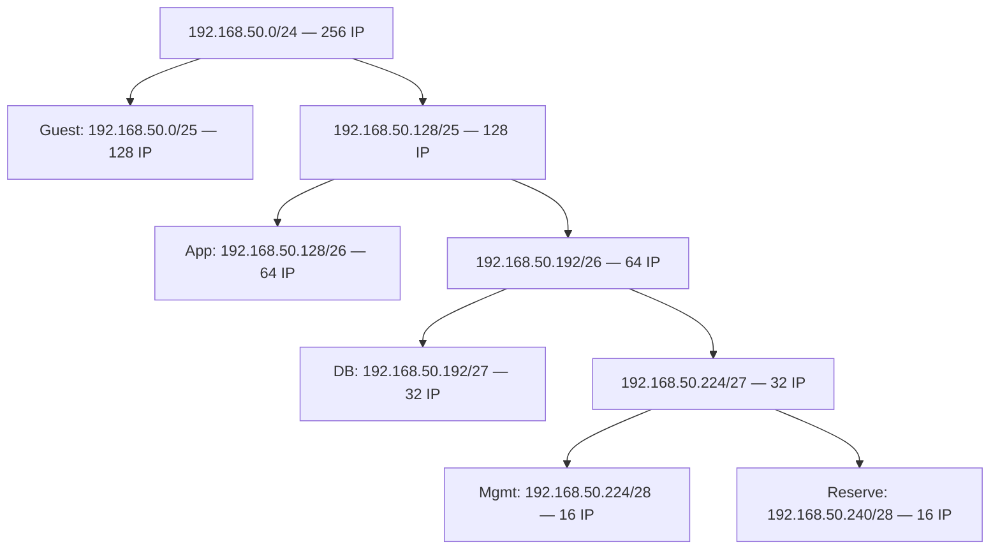

# Subnet mask và CIDR

## Mục tiêu học tập

Sau bài này, người học có thể:

- Giải thích địa chỉ IPv4 gồm phần **network** và **host** như thế nào, cùng vai trò của subnet mask.
- Chuyển đổi giữa **subnet mask dạng thập phân có dấu chấm** và **CIDR prefix** (ví dụ `255.255.255.192` tương đương `/26`).
- Tìm địa chỉ mạng, broadcast, dải địa chỉ và số địa chỉ host dùng được trong các subnet IPv4 thông thường.
- Chia subnet bằng FLSM/VLSM, kiểm tra tính thẳng hàng của prefix, gộp các mạng và hiểu nguyên tắc **longest prefix match** trong định tuyến.
- Áp dụng CIDR đúng phạm vi khi thiết kế phân đoạn mạng, firewall, VPN, IDS/IPS, chính sách cloud và bảo vệ các vùng tin cậy.
- Nhận biết những khác biệt quan trọng của prefix IPv6 so với subnet IPv4.

## 1. Subnet mask và CIDR nằm ở đâu trong TCP/IP?

Trong kiến trúc TCP/IP, tầng **Internet** đảm nhiệm việc đánh địa chỉ và chuyển tiếp gói IP giữa các mạng. Để một router biết gói cần đi qua đâu, hệ thống phải hiểu **địa chỉ IP** và **phạm vi mạng** của địa chỉ đó.

Một địa chỉ **IPv4** dài **32 bit**, thường viết bằng bốn octet thập phân, ví dụ `192.168.10.130`. Địa chỉ đơn lẻ chưa cho biết ranh giới của mạng; cần thêm **subnet mask** hoặc độ dài **prefix**.

- **Subnet mask**: chuỗi 32 bit, các bit `1` liên tiếp từ trái chỉ phần mạng, các bit `0` còn lại chỉ phần host. Ví dụ `255.255.255.0`.
- **CIDR** (*Classless Inter-Domain Routing*): biểu diễn mạng bằng địa chỉ và độ dài prefix `/n`, trong đó `n` là số bit đầu thuộc phần mạng; ví dụ `192.168.10.0/24`.
- **Subnet**: một phần không gian địa chỉ IP được xác định bởi prefix; có thể dùng để cấp địa chỉ cho một mạng con, cấu hình route hay mô tả tập nguồn/đích trong chính sách an ninh.
- **Route**: quy tắc chuyển tiếp đến một prefix đích; một subnet được đặt tên trong ACL/firewall chưa đồng nghĩa router đã có đường tới subnet đó.

CIDR cho phép chia mạng linh hoạt theo số bit thực tế, không bị ràng buộc bởi các lớp địa chỉ lịch sử A, B, C. Các prefix `/8`, `/16`, `/24` thường gặp **không có nghĩa** phải suy subnet mask dựa vào octet đầu tiên. Ngày nay, phải dựa vào prefix được cấp hoặc cấu hình.

**Ví dụ:** `192.168.10.130/26` là cách viết một **địa chỉ host kèm prefix**. Subnet chứa host này là `192.168.10.128/26`. Hai chuỗi không có cùng ý nghĩa: một cái chỉ host/interface trong mạng, cái còn lại là địa chỉ chuẩn của toàn mạng.

## 2. Từ bit nhị phân đến subnet mask

### 2.1. IPv4 gồm 32 bit

Một octet có tám bit, có giá trị từ 0 đến 255. Mỗi vị trí bit mang trọng số:

```text
Vị trí:      7   6   5   4   3   2   1   0
Trọng số:  128  64  32  16   8   4   2   1

192 = 128 + 64              = 11000000
168 = 128 + 32 + 8          = 10101000
 10 = 8 + 2                 = 00001010
130 = 128 + 2               = 10000010
```

Địa chỉ `192.168.10.130` ở dạng nhị phân:

```text
11000000.10101000.00001010.10000010
```

Subnet mask hợp lệ trong CIDR dùng **các bit 1 liền nhau từ trái sang phải**, sau đó chỉ còn bit 0. Mask kiểu `255.0.255.0` có các bit 1 ngắt quãng nên không phải subnet mask CIDR chuẩn.

### 2.2. Quy đổi mask ↔ prefix

Ví dụ `/26` nghĩa là 26 bit mạng và `32 - 26 = 6` bit host.

```text
Prefix:  /26
Mask:    11111111.11111111.11111111.11000000
Decimal:      255.     255.     255.     192
```

Bảng quy đổi nhanh:

| Prefix | Subnet mask | Số địa chỉ trong một khối | Host IPv4 thường dùng được* |
| --- | --- | ---: | ---: |
| `/8` | `255.0.0.0` | 16.777.216 | 16.777.214 |
| `/16` | `255.255.0.0` | 65.536 | 65.534 |
| `/20` | `255.255.240.0` | 4.096 | 4.094 |
| `/24` | `255.255.255.0` | 256 | 254 |
| `/25` | `255.255.255.128` | 128 | 126 |
| `/26` | `255.255.255.192` | 64 | 62 |
| `/27` | `255.255.255.224` | 32 | 30 |
| `/28` | `255.255.255.240` | 16 | 14 |
| `/29` | `255.255.255.248` | 8 | 6 |
| `/30` | `255.255.255.252` | 4 | 2 |
| `/31` | `255.255.255.254` | 2 | Trường hợp đặc biệt: 2 trên liên kết point-to-point được hỗ trợ |
| `/32` | `255.255.255.255` | 1 | Một địa chỉ đơn lẻ, thường dùng cho host route |

* Công thức host “thường dùng được” áp dụng cho subnet IPv4 thông thường có prefix **từ `/1` đến `/30`**. Với `/31` và `/32`, xem ngoại lệ bên dưới; việc cấp phát thực tế trong cloud có thể dành riêng thêm địa chỉ.

**Không cần thuộc cả bảng:** nhớ các giá trị bit của octet cuối `128, 192, 224, 240, 248, 252, 254, 255`; mỗi lần tăng prefix thêm 1, số địa chỉ trong khối giảm một nửa.

### 2.3. Tìm địa chỉ mạng bằng phép AND

**Network address** của một host là kết quả phép AND theo từng bit giữa IP và subnet mask:

```text
IPv4 host:    192.168.10.130
CIDR:         /26
Mask:         255.255.255.192

Octet cuối:
IP:           10000010   (130)
Mask:         11000000   (192)
AND:          10000000   (128)

Network:      192.168.10.128/26
```

Trong một subnet IPv4 thông thường:

- **Network address**: mọi bit host = 0.
- **Broadcast address**: mọi bit host = 1.
- **Dải địa chỉ dùng cho host**: giữa network address và broadcast address, không gồm hai đầu.

Đối với `192.168.10.130/26`:

| Thuộc tính | Giá trị |
| --- | --- |
| Prefix | `/26` |
| Mask | `255.255.255.192` |
| Network | `192.168.10.128` |
| Broadcast | `192.168.10.191` |
| Dải host thông thường | `192.168.10.129` đến `192.168.10.190` |
| Tổng số địa chỉ | `2^(32-26) = 64` |
| Số host thông thường | `64 - 2 = 62` |

**Lưu ý:** network và broadcast được mô tả ở đây theo địa chỉ quảng bá IPv4 truyền thống. Các địa chỉ `/31` dành cho liên kết point-to-point có thể dùng cả hai địa chỉ theo RFC 3021; `/32` chỉ một địa chỉ đơn, không có “host thứ nhất” và “broadcast cuối” theo cách đếm subnet thông thường. Prefix `0.0.0.0/0` bao phủ toàn bộ không gian IPv4 và thường làm **default route** hoặc đối tượng chính sách “mọi địa chỉ”; không nên diễn giải nó như một LAN với một tập host được cấp phát thực tế.

## 3. Cách tính subnet nhanh, không cần chuyển cả 32 bit

Với prefix không nằm đúng ranh giới octet, hãy tìm **octet chứa bit mạng cuối cùng** và tính:

```text
Block size = 256 - giá trị octet mask tương ứng
Network octet = floor(IP octet / block size) × block size
Broadcast octet = Network octet + block size - 1
```

Những octet đứng trước octet này giữ nguyên phần network; các octet đứng sau nhận giá trị `0` ở network và `255` ở broadcast.

**Ví dụ A — `10.20.30.77/27`**

- Prefix `/27` → mask `255.255.255.224`.
- Octet cuối có block size `256 - 224 = 32`.
- Các mốc subnet: `.0`, `.32`, `.64`, `.96`, `.128`, `.160`, `.192`, `.224`.
- `77` thuộc khoảng `64..95`.

Kết quả: network `10.20.30.64/27`, broadcast `10.20.30.95`, host thông thường từ `.65` đến `.94` (30 host).

**Ví dụ B — `10.12.19.7/20`**

- Mask `255.255.240.0`: octet **thứ ba** có block size `16`.
- Octet thứ ba là `19`, thuộc đoạn `16..31`.
- Network `10.12.16.0/20`; broadcast `10.12.31.255`; dải host thông thường `10.12.16.1` đến `10.12.31.254`.

**Sai lầm phổ biến:** chỉ tính ở octet thứ tư. Với `/20` hoặc `/13`, ranh giới subnet nằm ở octet trước; mọi octet bên phải vẫn tham gia thay đổi dải địa chỉ.

## 4. Chia subnet: FLSM và VLSM

### 4.1. Chia thành các mạng có cùng kích thước (FLSM)

Giả sử có `192.168.10.0/24`, muốn chia thành **4 subnet bằng nhau**. Cần mượn `2` bit từ phần host vì `2^2 = 4`, nên prefix mới là `/26`.

```text
192.168.10.0/24
├── 192.168.10.0/26      [0..63]
├── 192.168.10.64/26     [64..127]
├── 192.168.10.128/26    [128..191]
└── 192.168.10.192/26    [192..255]
```

| Subnet | Network | Host thông thường | Broadcast |
| --- | --- | --- | --- |
| 1 | `192.168.10.0/26` | `.1` – `.62` | `.63` |
| 2 | `192.168.10.64/26` | `.65` – `.126` | `.127` |
| 3 | `192.168.10.128/26` | `.129` – `.190` | `.191` |
| 4 | `192.168.10.192/26` | `.193` – `.254` | `.255` |

Khi đi từ prefix `/p` sang `/q` với `q > p`:

```text
Số subnet con có cùng kích thước = 2^(q-p)
Số địa chỉ trong mỗi subnet con = 2^(32-q)
```

Công thức không tự quyết định địa chỉ nào được phép dùng cho host trong mọi trường hợp; vẫn cần xét `/31`, `/32` và địa chỉ do nền tảng dự trữ.

### 4.2. Chia theo nhu cầu host (VLSM)

**Variable Length Subnet Masking (VLSM)** cho phép dùng các prefix khác nhau trong cùng một khối lớn để tránh lãng phí địa chỉ. Chẳng hạn, hệ thống một tổ chức có khối `192.168.50.0/24` và nhu cầu dự kiến:

- Wi-Fi khách: 100 host.
- Vùng ứng dụng: 45 host.
- Vùng dữ liệu: 20 host.
- Vùng quản trị: 10 host.

Phân bổ theo kích thước lớn đến nhỏ:

| Vùng | CIDR | Tổng IP | Host IPv4 thông thường | Khoảng địa chỉ |
| --- | --- | ---: | ---: | --- |
| Guest Wi-Fi | `192.168.50.0/25` | 128 | 126 | `.0` đến `.127` |
| Application | `192.168.50.128/26` | 64 | 62 | `.128` đến `.191` |
| Database | `192.168.50.192/27` | 32 | 30 | `.192` đến `.223` |
| Management | `192.168.50.224/28` | 16 | 14 | `.224` đến `.239` |
| Dự phòng | `192.168.50.240/28` | 16 | 14 | `.240` đến `.255` |

Mỗi subnet có địa chỉ network và broadcast theo quy tắc IPv4 thông thường; bảng “Khoảng địa chỉ” là **toàn bộ khối**, không phải toàn bộ số IP có thể gán cho thiết bị.

Sơ đồ:



Các nguyên tắc kiểm tra kế hoạch:

1. **Không chồng lấn** địa chỉ giữa các vùng phải tách biệt.
2. **Đúng ranh giới khối**: mạng `/26` bắt đầu ở octet cuối `0, 64, 128, 192`; `192.168.50.150/26` là host thuộc mạng `192.168.50.128/26`, không phải network address của mạng mới.
3. **Dành chỗ cho tăng trưởng** và địa chỉ do công nghệ dự trữ; không chỉ tính số thiết bị hiện tại. Ví dụ các dịch vụ cloud có thể giữ lại một số IP trong từng subnet.
4. **Phân vùng địa chỉ chưa đủ để cách ly**. Cần route, firewall, ACL, security group hoặc cơ chế tương đương để thực thi chính sách giao tiếp giữa các vùng.

## 5. Gộp subnet bằng CIDR (route summarization)

CIDR cũng hỗ trợ **gộp route**: thay nhiều prefix nhỏ bằng một prefix lớn hơn khi địa chỉ **liền nhau và đúng ranh giới**, đồng thời chính sách định tuyến cho phép.

Ví dụ hai subnet:

```text
10.8.0.0/24  →  10.8.0.0   đến 10.8.0.255
10.8.1.0/24  →  10.8.1.0   đến 10.8.1.255
```

Có thể gộp thành `10.8.0.0/23`, bao phủ từ `10.8.0.0` đến `10.8.1.255` vì hai mạng /24 liền nhau, cùng hướng đi và là cặp đúng ranh giới /23.

```text
10.8.0.0/24 + 10.8.1.0/24 = 10.8.0.0/23
```

**Không thể** gộp chính xác `10.8.1.0/24` và `10.8.2.0/24` bằng một `/23`: khối /23 phải bắt đầu ở octet thứ ba là số **chẵn**. Prefix nhỏ nhất bao cả hai mạng là `10.8.0.0/22`, nhưng nó đồng thời chứa `10.8.0.0/24` và `10.8.3.0/24` — những dải nằm ngoài hai mạng ban đầu.

Lợi ích của gộp route là giảm số mục trong bảng định tuyến và đơn giản hóa quảng bá tuyến. Rủi ro là prefix gộp có thể đại diện cho những địa chỉ không thực sự phục vụ qua cùng đường hoặc không cùng quyền truy cập. **Không tùy tiện gộp allowlist firewall** chỉ để giảm số luật nếu điều đó mở quyền đến nhiều host hơn dự kiến.

### 5.1. Longest prefix match

Router so sánh địa chỉ đích với các mạng đích trong bảng route và thường chọn **prefix khớp dài nhất** (tuyến cụ thể nhất); sau đó mới áp dụng các tiêu chí khác giữa các route cùng mức cụ thể theo thiết kế hệ thống.

| Prefix đích | Next hop |
| --- | --- |
| `0.0.0.0/0` | Gateway mặc định |
| `10.0.0.0/8` | Router A |
| `10.8.0.0/16` | Router B |
| `10.8.2.0/24` | Router C |

Gói có đích `10.8.2.7` khớp cả bốn prefix; route `10.8.2.0/24` thắng vì `/24` dài nhất. Tuy nhiên, việc chọn route không chứng minh gói sẽ được **firewall cho phép** hoặc đích trả lời thành công.

Trong mạng nhiều subnet, route chồng lấn có thể có chủ đích (đường đặc thù, migration) nhưng gây khó kiểm soát nếu được sao chép thẳng vào ACL. Cần đánh giá cụ thể cả đường đi và chính sách hai chiều.

## 6. Subnet mask, CIDR và kiến trúc mạng an toàn

Module **SECURITY_NETWORK_SECURITY** nghiên cứu phân đoạn, firewall, VPN, IDS/IPS, xác thực kết nối, DNS, mạng không dây, cloud và giám sát xâm nhập. Subnet mask/CIDR là ngôn ngữ nền tảng để mô tả phạm vi địa chỉ của nhiều security control trong các thành phần này.

### 6.1. CIDR trong network segmentation và firewall

Dùng sơ đồ VLSM ở mục 4, thiết kế chính sách khởi đầu:

| Nguồn CIDR | Đích CIDR | Giao thức / cổng | Ý định kiểm soát |
| --- | --- | --- | --- |
| Guest `192.168.50.0/25` | Internet qua gateway được kiểm soát | HTTP/HTTPS và dịch vụ cần thiết | Cho khách truy cập dịch vụ bên ngoài theo policy |
| Guest `192.168.50.0/25` | App/DB/Mgmt nội bộ | Mọi cổng | **Deny** |
| App `192.168.50.128/26` | DB `192.168.50.192/27` | Chỉ TCP `5432` cho workload được phép | Giao tiếp nghiệp vụ cần thiết |
| DB `192.168.50.192/27` | Internet | Deny theo mặc định; ngoại lệ có kiểm soát | Hạn chế kết nối ra ngoài bất thường |
| Thiết bị quản trị qua kênh tin cậy | Mgmt `192.168.50.224/28` | Cổng quản trị cụ thể | Quản trị có xác thực mạnh |

Đây là ma trận ý định; khi triển khai thật còn cần giới hạn **đích theo host hoặc danh tính workload** thay vì tin rằng mọi IP trong subnet App đều được truy cập toàn bộ DB. Phải xem cơ chế firewall có **stateful** hay không, nơi áp rule, luật ưu tiên trước/sau, chiều ingress/egress và các dịch vụ phụ trợ như DNS, NTP, log hoặc health check.

Nếu muốn chỉ cho `192.168.50.192/27` truy cập nhưng lại viết thành `192.168.50.0/24`, chính sách đã mở từ **32** lên **256** địa chỉ nguồn hoặc đích, tức mở rộng **8 lần** về không gian IP. Điều này có thể vô tình bao gồm cả Guest Wi-Fi và Management.

**Phân đoạn logic không tự động tạo cách ly bảo mật:** tách VLAN, subnet hay cloud VPC subnet giúp tổ chức mạng; route và policy phải bảo đảm chỉ các luồng mong muốn được đi qua ranh giới.

### 6.2. CIDR trong VPN và truy cập từ xa

Giả sử VPN chỉ nên cung cấp quyền truy cập subnet quản trị `192.168.50.224/28`:

- Route được cấp cho client cần đúng dải đích; cấu hình route sai `192.168.50.0/24` có thể khiến client gửi nhiều luồng nội bộ hơn qua VPN.
- **Route qua VPN không đồng nghĩa được phép truy cập.** Vẫn cần firewall và quyền theo danh tính người dùng, thiết bị và ứng dụng.
- Nếu hai địa điểm đều dùng `192.168.50.0/24`, có nguy cơ **CIDR overlap** khiến việc chọn route hoặc NAT giữa site gặp vấn đề; nên kiểm tra quy hoạch IP trước khi kết nối site-to-site.
- VPN gateway là một ranh giới, nhưng quyền vào DB hoặc dashboard vẫn phải được kiểm tra ở lớp application và tài khoản dịch vụ.

### 6.3. CIDR trong IDS/IPS, phân tích lưu lượng và DNS

IDS/IPS và hệ thống SIEM thường dùng CIDR để phân loại **nguồn nội bộ**, **đích được bảo vệ**, **dải quản trị** hoặc nhóm hệ thống cần cảnh báo. Ví dụ một luồng TCP từ Guest CIDR sang DB CIDR có thể là tín hiệu vi phạm phân đoạn dù firewall đã chặn nó.

Khi giám sát, nên xem:

- IP nguồn/đích, port, protocol, thời gian, chiều kết nối, action allow/deny và vị trí quan sát.
- **Luồng east–west** giữa App/DB/Mgmt; đây là nơi kẻ tấn công có thể thử di chuyển ngang sau khi chiếm một máy.
- Tính nhất quán của địa chỉ sau NAT, reverse proxy hoặc dịch vụ cân bằng tải. Log ở các điểm khác nhau có thể thấy các IP khác nhau của cùng phiên; cần correlation ID và metadata phù hợp.
- DNS query/response từ các subnet và việc workstation có dùng resolver đã chỉ định không. CIDR cho biết dải nguồn nhưng không tự bảo đảm truy vấn DNS hay tên miền đích an toàn.

Địa chỉ IP và CIDR **không phải danh tính đáng tin cậy tuyệt đối**: DHCP thay đổi IP, proxy/NAT che địa chỉ gốc, VPN cấp IP động, cloud workload thay đổi nhanh, và một số nguồn có thể giả mạo gói IP trong phạm vi điều kiện mạng cho phép. Đối với dữ liệu nhạy cảm nên kết hợp danh tính, chứng thư/mTLS, quyền ứng dụng và ghi log.

### 6.4. CIDR trong Wi-Fi và cloud

Với Wi-Fi, tách mạng **guest** khỏi mạng thiết bị nhân viên và server bằng VLAN/subnet phù hợp, kiểm soát định tuyến giữa vùng, cấu hình WPA2/WPA3-Enterprise hoặc WPA3 theo thiết bị được hỗ trợ, và áp dụng xác thực truy cập. Hai SSID riêng nhưng cùng subnet và cùng quyền không tạo ra cách ly cần thiết.

Trong cloud, CIDR thường xuất hiện khi định nghĩa VPC/VNet, subnet, route table, network ACL, security group hoặc firewall policy. Khi thiết kế cần kiểm tra:

1. Dải mạng cloud có **chồng lấn** on-premises hoặc các VPC/VNet nối peering/transit/VPN hay không.
2. Số IP cần sử dụng và số IP nhà cung cấp **dự trữ trong từng subnet**; cách đếm `2^h - 2` không nhất thiết là số địa chỉ sẵn cấp cho workload.
3. Những thành phần nào thực thi policy theo **subnet CIDR**, **IP**, **security group**, **NIC**, **Pod** hoặc **service identity**; các khái niệm này không thay thế cho nhau.
4. Route ra Internet/NAT/Private Endpoint, phân tách public-private, egress restriction và nơi lưu log luồng mạng.
5. Có đường quản trị hoặc dịch vụ cloud nào đi vòng qua firewall dự kiến hay không.

**Ví dụ threat modeling:** nếu DB đặt trong subnet private nhưng security group chấp nhận TCP `5432` từ `0.0.0.0/0`, vẫn tồn tại một policy quá rộng. Mức độ phơi lộ thực tế còn phụ thuộc khả năng định tuyến đến DB và các lớp khác, nhưng cần thu hẹp chính sách ngay theo nguồn hợp lệ.

## 7. Phân biệt IPv4 và IPv6 prefix

**IPv6** dùng địa chỉ **128 bit**, viết dạng hexadecimal có dấu hai chấm, ví dụ `2001:db8:1234:5600::1`. IPv6 cũng dùng CIDR prefix như `/64`, `/56`, `/128`, nhưng không dùng subnet mask IPv4 dạng `255.255.255.0`.

- `2001:db8:1234:5600::/64` là một IPv6 subnet có 64 bit prefix.
- Một khối `2001:db8:1234:5600::/56` chứa **256** subnet `/64`, với hextet thứ tư đi từ `5600` đến `56ff`.
- `/128` chỉ đúng một địa chỉ IPv6; `/127` thường dùng trên liên kết point-to-point theo thiết kế phù hợp.
- **IPv6 không có địa chỉ broadcast** như IPv4; multicast/anycast đảm nhiệm các cơ chế khác. Không dùng công thức host IPv4 `2^(32-p)-2` để tính số địa chỉ IPv6 dùng được.
- IPv6 vẫn cần firewall, segmentation, kiểm soát Neighbor Discovery/Router Advertisement theo ngữ cảnh, xác thực và logging. Việc một subnet có không gian rất lớn không khiến nó tự an toàn.

Một kiến trúc **dual stack** cần kiểm tra policy cho **cả IPv4 lẫn IPv6**. Chặn đường IPv4 nhưng để đường IPv6 không lọc có thể tạo lối đi ngoài dự kiến.

## 8. Kiểm tra subnet bằng công cụ và thực nghiệm

Khi xử lý một địa chỉ hoặc CIDR, nên kiểm tra bằng cả tính nhẩm và thư viện chuẩn để tránh lỗi phân chia ranh giới. Ví dụ Python chỉ dùng thư viện chuẩn `ipaddress`:

```python
import ipaddress

interface = ipaddress.ip_interface("192.168.10.130/26")
network = interface.network

print(network)                   # 192.168.10.128/26
print(network.netmask)           # 255.255.255.192
print(network.network_address)   # 192.168.10.128
print(network.broadcast_address) # 192.168.10.191
print(network.num_addresses)     # 64

# Kiểm tra một IP có thuộc subnet không.
print(ipaddress.ip_address("192.168.10.190") in network)  # True
print(ipaddress.ip_address("192.168.10.192") in network)  # False

# strict=True (mặc định) đòi đối số là địa chỉ mạng chuẩn.
# Với một địa chỉ host/prefix, dùng strict=False để chuẩn hóa.
print(ipaddress.ip_network("192.168.10.130/26", strict=False))
# 192.168.10.128/26
```

**Không dùng riêng phép kiểm tra “IP thuộc CIDR” làm xác thực người dùng**. Đó chỉ là điều kiện về địa chỉ kết nối, không chứng minh quyền xem dữ liệu.

Ở môi trường thực tế, hãy kiểm tra thêm bằng route table, firewall/network policy hiện hữu và các phép thử **allow + deny** từ đúng hai phía mạng. Chẳng hạn, gói từ subnet App đến port DB được phép phải đi được; gói từ subnet Guest đến cùng port phải bị chặn và tạo telemetry tương ứng. Nếu thất bại, kiểm tra thứ tự rule, route thực tế, nguồn sau NAT và các chính sách ở host lẫn cloud.

## 9. Những lỗi thường gặp

| Nhầm lẫn | Hệ quả / cách sửa |
| --- | --- |
| “IP bắt đầu bằng 10 chắc chắn là mạng /8” | Dải `10.0.0.0/8` là một khối private phổ biến; mạng con thực tế có thể là `10.12.16.0/20`, `10.8.2.0/24`, v.v. Luôn đọc prefix cụ thể. |
| Coi `192.168.10.130/26` là network address | Đây là địa chỉ host/prefix; mạng chuẩn là `192.168.10.128/26`. |
| Áp `2^(32-p)-2` cho mọi prefix | Sai ở `/31`, `/32` và khi nhầm “tổng địa chỉ” với “IP có thể cấp trên cloud”. |
| Viết CIDR sai ranh giới, ví dụ `192.168.50.32/26` | `/26` chia theo bội số 64; địa chỉ trên thuộc `192.168.50.0/26`. |
| Gộp hai dải CIDR không thẳng hàng | Có thể mở rộng đối tượng route/firewall sang cả mạng ngoài dự kiến. |
| Tách subnet là đã bảo mật giữa các vùng | Thiếu route/policy, các subnet có thể vẫn giao tiếp tự do. |
| Chỉ có rule deny IPv4 | Workload dual stack có thể tiếp tục đi qua IPv6. |
| Dùng subnet nguồn thay cho xác thực | NAT, IP động hoặc workload bị chiếm quyền có thể vẫn phù hợp CIDR; cần kiểm tra danh tính và quyền. |
| Không thử traffic thực tế | Sai route, ACL, label hoặc thứ tự rule làm chính sách không đúng như bản thiết kế. |

## 10. Bài tập thực hành có đáp án

### Bài 1 — Tính subnet

Cho host `172.16.5.77/28`. Hãy tìm mask, network, broadcast, số host IPv4 thông thường và hai địa chỉ host đầu/cuối.

**Đáp án bài 1**

Mask `255.255.255.240`, block size `16` ở octet cuối. `77` thuộc đoạn `64..79`. Network `172.16.5.64/28`; broadcast `172.16.5.79`; có `16 - 2 = 14` host thông thường, từ `172.16.5.65` đến `172.16.5.78`.


### Bài 2 — Chia subnet theo kích thước

Từ mạng `10.4.8.0/23`, chia thành subnet `/25`. Có bao nhiêu subnet, các địa chỉ network là gì và mỗi subnet chứa bao nhiêu địa chỉ IPv4?

**Đáp án bài 2**

Số subnet: `2^(25-23) = 4`. Bốn mạng là `10.4.8.0/25`, `10.4.8.128/25`, `10.4.9.0/25`, `10.4.9.128/25`. Mỗi subnet có `128` địa chỉ, thường dùng được `126` host trong LAN IPv4 tiêu chuẩn.


### Bài 3 — Gộp route và chọn route

Hai mạng `10.8.1.0/24` và `10.8.2.0/24` có thể gộp **chính xác** thành một `/23` không? Nếu bảng route có `10.0.0.0/8`, `10.8.0.0/16`, `10.8.2.0/24`, route nào chọn khi đích là `10.8.2.7`?

**Đáp án bài 3**

Không thể gộp đúng hai dải thành một `/23`, vì chúng không cùng một khối /23 thẳng hàng. Với đích `10.8.2.7`, chọn `10.8.2.0/24` do nguyên tắc longest prefix match.


### Bài 4 — Rà soát policy bảo mật

Vùng Guest là `192.168.50.0/25`; DB là `192.168.50.192/27`. Một rule cho phép Guest truy cập DB được viết `source=192.168.50.0/24, destination=192.168.50.192/27, TCP/5432`. Hãy chỉ ra vấn đề và đề xuất thay đổi.

**Gợi ý đáp án bài 4**

`192.168.50.0/24` bao phủ cả Guest, App, DB và Mgmt, nên rule rộng hơn yêu cầu; ngoài ra, mục đích thiết kế là **Guest không được truy cập DB**. Hãy bỏ rule cho Guest, giới hạn nguồn chỉ còn đúng workload App cần thiết (có thể dùng CIDR `192.168.50.128/26` làm phạm vi sơ bộ), kiểm soát TCP/5432 và quyền DB, sau đó thử kết nối hợp lệ từ App và thử bị chặn từ Guest.


## Ghi nhớ

- **Mask** và **CIDR prefix** biểu diễn cùng ranh giới bit mạng/host trong IPv4.
- Với `/p`, subnet có `2^(32-p)` địa chỉ IPv4; cần xét các ngoại lệ và địa chỉ bị dự trữ trước khi tính số host cấp phát thực tế.
- Chia subnet cần **đúng ranh giới, không chồng lấn**, cân đối nhu cầu hiện tại và tăng trưởng.
- Gộp route chỉ an toàn khi dải địa chỉ, hướng đi và chính sách phù hợp; router ưu tiên prefix đích khớp dài nhất.
- CIDR là công cụ để **mô tả phạm vi mạng**, còn việc bảo vệ thực sự cần firewall/ACL, định tuyến, phân đoạn, xác thực, phân quyền và giám sát cùng vận hành.

