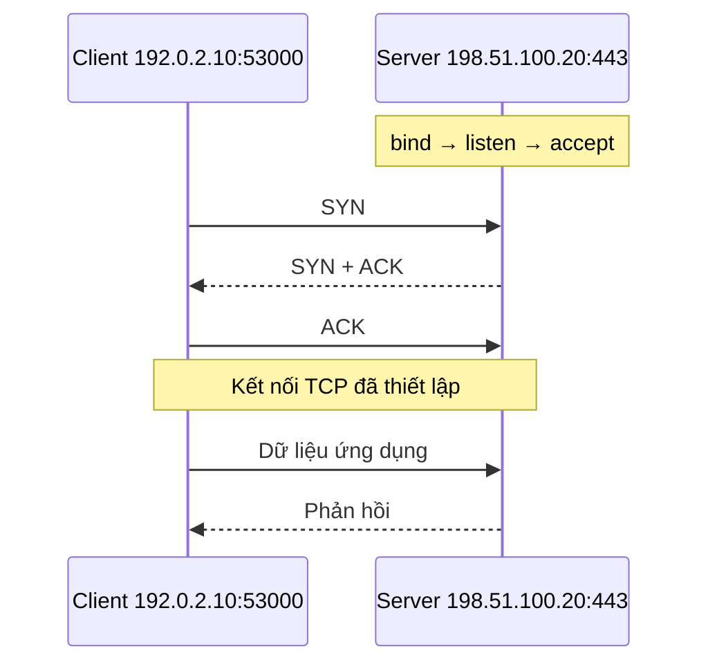

# Port và socket trong TCP/IP

Khi một gói tin đi tới máy chủ, địa chỉ IP giúp mạng chuyển gói tin đến đúng thiết bị hoặc giao diện mạng. Nhưng trên cùng thiết bị có thể đồng thời chạy web server, SSH, cơ sở dữ liệu và nhiều dịch vụ khác. **Port (cổng)** giúp tầng vận chuyển chuyển dữ liệu tới đúng đầu mối giao tiếp; **socket** là cơ chế mà hệ điều hành và ứng dụng dùng để gửi, nhận dữ liệu qua đầu mối đó.

Trong bảo mật mạng, hiểu port và socket giúp giải thích vì sao một dịch vụ đang chạy nhưng không truy cập được, vì sao chương trình gặp lỗi “Address already in use”, cách firewall áp dụng chính sách, và điều gì khiến một dịch vụ vô tình lộ ra Internet.

Sau bài này, người học có thể:

- Phân biệt địa chỉ IP, số port, socket lắng nghe và socket của một kết nối cụ thể.
- Giải thích cách TCP và UDP dùng port để phân phối dữ liệu tới ứng dụng.
- Phân tích quá trình `bind`, `listen`, `accept`, `connect` và việc cấp phát ephemeral port.
- Đọc địa chỉ và trạng thái socket, kiểm tra cổng bằng công cụ hệ điều hành.
- Xác định các rủi ro khi bind sai địa chỉ, mở port không cần thiết hoặc nhầm lẫn giữa “đang lắng nghe” và “có thể truy cập từ xa”.

## 1. Port nằm ở đâu trong mô hình TCP/IP?

Trong mô hình TCP/IP, IP đảm nhiệm việc định tuyến gói tin giữa các nút mạng; TCP và UDP thuộc **tầng vận chuyển (transport layer)**. Header TCP/UDP chứa **source port** và **destination port**, mỗi trường dài 16 bit. Vì vậy, số port nằm trong khoảng **0–65535**.

Ví dụ, một trình duyệt truy cập website qua HTTPS/TCP:

```text
Máy khách                              Máy chủ
192.0.2.10:53000   ── TCP ────────>  198.51.100.20:443
   IP nguồn: 192.0.2.10                 IP đích: 198.51.100.20
   Port nguồn: 53000                    Port đích: 443
```

`192.0.2.10` và `198.51.100.20` là các địa chỉ IPv4 dành cho tài liệu minh họa. Hệ điều hành máy khách thường tự chọn port nguồn tạm thời `53000`; máy chủ đã cấu hình một dịch vụ lắng nghe trên port đích `443`. Gói phản hồi đảo chiều địa chỉ và port nguồn/đích.

Một số nguyên tắc cần nhớ:

- **IP xác định địa chỉ mạng; port xác định đầu mối ở tầng vận chuyển.** Hai máy khác nhau có thể cùng mở port `443`.
- **TCP port 53 và UDP port 53 thuộc hai không gian giao tiếp khác nhau.** Chỉ nhìn con số `53` chưa đủ xác định giao thức.
- **Port không tự định danh ứng dụng hay chứng minh tính an toàn.** Dịch vụ tùy ý có thể chạy trên `443`, và dịch vụ HTTPS có thể được cấu hình trên port khác.
- **Port không xuất hiện trong header IP.** Khi router hoặc firewall cần lọc theo port, thiết bị phải xem thêm thông tin TCP/UDP, nếu có và được phép theo chính sách.

### 1.1. Các khoảng port

IANA phân chia số port để quản lý việc đăng ký dịch vụ:

| Khoảng | Tên thường dùng | Ý nghĩa |
|---|---|---|
| `0–1023` | System/Well-Known Ports | Các dịch vụ phổ biến thường dùng port đã được gán, như SSH `22` hoặc HTTPS `443`. |
| `1024–49151` | User/Registered Ports | Có thể đăng ký cho ứng dụng, dịch vụ hoặc sản phẩm. |
| `49152–65535` | Dynamic/Private Ports | Khoảng port động/tư nhân theo phân loại IANA, thường liên quan các kết nối phía client. |

**Phân loại IANA không đồng nghĩa với khoảng ephemeral port thực tế của mọi hệ điều hành.** Linux, Windows và từng cấu hình có thể dùng khoảng cấp phát động khác nhau. Port `0` không phải cổng dịch vụ thông thường; khi ứng dụng gọi `bind` với port `0`, hệ điều hành thường tự chọn một port còn trống.

Trên nhiều hệ Unix/Linux, quyền bind các port thấp hơn `1024` được kiểm soát bởi cơ chế đặc quyền hoặc capability; hành vi cụ thể phụ thuộc hệ điều hành và cấu hình.

### 1.2. Những port thường gặp

| Dịch vụ hoặc giao thức | Port mặc định/phổ biến | Transport | Lưu ý bảo mật |
|---|---|---|---|
| SSH | `22` | TCP | Dùng để quản trị; hạn chế nguồn truy cập và bảo vệ danh tính đăng nhập. |
| DNS truyền thống | `53` | UDP và TCP | UDP thường dùng cho truy vấn; TCP cũng cần cho nhiều trường hợp như phản hồi lớn hoặc truyền vùng. |
| HTTP | `80` | TCP | Dữ liệu ứng dụng thông thường không được HTTP tự mã hóa. |
| HTTPS (HTTP/1.1, HTTP/2) | `443` | TCP | Bảo vệ bằng TLS khi triển khai và xác thực đúng. |
| HTTP/3 (QUIC) | `443` | UDP | QUIC dùng UDP và tích hợp cơ chế bảo mật dựa trên TLS 1.3. |
| NTP | `123` | UDP | Không nên mở rộng quyền truy cập dịch vụ thời gian hơn nhu cầu. |
| MySQL | `3306` | TCP | Thường chỉ nên truy cập từ ứng dụng hoặc mạng quản trị được phép. |
| PostgreSQL | `5432` | TCP | Cần kiểm soát listener, xác thực và quy tắc truy cập mạng. |

Các giá trị trên là **quy ước triển khai**, không phải bảo đảm rằng một chương trình đang chạy tại port đó. Khi đánh giá một máy chủ, phải kiểm tra tiến trình thực tế, giao thức, địa chỉ bind và chính sách mạng.

## 2. Socket là gì?

**Socket** là một đầu mối giao tiếp do hệ điều hành cung cấp cho tiến trình. Ứng dụng thao tác với socket thông qua API để mở, gắn địa chỉ, kết nối, lắng nghe, đọc, ghi và đóng kết nối. Trong lập trình, từ “socket” có thể chỉ đối tượng/handle API; trong phân tích mạng, từ này thường chỉ một đầu mối giao tiếp với những thuộc tính như giao thức, địa chỉ và port.

Ba khái niệm dễ bị nhầm:

| Khái niệm | Câu hỏi nó trả lời | Ví dụ |
|---|---|---|
| **Port** | Số cổng tầng vận chuyển là bao nhiêu? | TCP `443` |
| **Socket lắng nghe** | Tiến trình nào đang chờ kết nối đến địa chỉ/port nào? | TCP listener trên `127.0.0.1:18080` |
| **Socket đã kết nối** | Đầu mối này đang giao tiếp với đầu mối từ xa nào? | TCP `192.0.2.10:53000` ↔ `198.51.100.20:443` |

Hệ điều hành thường xác định một luồng TCP theo **5-tuple**:

```text
(transport protocol, source IP, source port, destination IP, destination port)

(TCP, 192.0.2.10, 53000, 198.51.100.20, 443)
```

Ở góc nhìn của máy chủ, các kết nối có thể cùng dùng địa chỉ/port cục bộ `198.51.100.20:443`, nhưng khác địa chỉ/port của client. Do đó, **một server socket lắng nghe có thể tiếp nhận nhiều TCP connection**, mỗi connection có socket và trạng thái độc lập. Listener được quản lý theo cơ chế bind/listen của hệ điều hành; không nên coi listener là một kết nối có đủ 5 thành phần.

Đường đi điển hình khi máy chủ nhận dữ liệu:

```text
Gói IP đến giao diện mạng
          |
          v
IP xác định transport protocol (TCP hoặc UDP)
          |
          v
TCP/UDP đọc port và thông tin phiên/đối tác
          |
          v
Hệ điều hành phân phối đến socket phù hợp
          |
          v
Ứng dụng đọc dữ liệu từ socket
```

Việc phân phối này thường gọi là **demultiplexing**. Nếu không có socket đích phù hợp, phản ứng phụ thuộc vào transport, hệ điều hành và firewall: TCP có thể trả `RST`, UDP có thể dẫn tới thông báo ICMP không tới được port, hoặc gói bị loại bỏ mà không có phản hồi.

### 2.1. Họ địa chỉ và kiểu socket

Socket không bị giới hạn ở Internet:

- `AF_INET`: địa chỉ IPv4; ví dụ `127.0.0.1:8080`.
- `AF_INET6`: địa chỉ IPv6; ví dụ `[::1]:8080` (ngoặc vuông giúp phân biệt dấu `:` trong IPv6 và port).
- `AF_UNIX`/Unix domain socket: giao tiếp nội bộ cùng máy thông qua địa chỉ kiểu đường dẫn hoặc dạng khác do hệ điều hành hỗ trợ; **không dùng TCP/UDP port**.

Với socket Internet, kiểu `SOCK_STREAM` thường được dùng cho TCP (luồng byte), còn `SOCK_DGRAM` thường dùng cho UDP (datagram). Không nên đồng nhất thuật ngữ **socket** với **WebSocket**: WebSocket là giao thức ở tầng ứng dụng, thường chạy trên TCP hoặc qua hạ tầng HTTP, còn socket là giao diện giao tiếp cấp hệ điều hành.

## 3. Vòng đời TCP: từ listener đến một connection

Một máy chủ TCP thường đi qua những bước sau:

1. `socket`: tạo socket theo họ địa chỉ và transport phù hợp.
2. `bind`: gắn socket với IP/port cục bộ. Ví dụ chỉ cho phép máy hiện tại truy cập qua `127.0.0.1:18080`.
3. `listen`: chuyển socket sang trạng thái lắng nghe, cho phép hệ điều hành xếp hàng các yêu cầu kết nối theo cơ chế backlog.
4. `accept`: lấy một kết nối đã được thiết lập để xử lý; trả về **socket mới** cho kết nối đó, trong khi socket listener tiếp tục lắng nghe.
5. `read`/`write`: trao đổi luồng byte. Ứng dụng phải tự xác định ranh giới thông điệp, ví dụ bằng độ dài hoặc ký tự xuống dòng.
6. `close`: đóng socket khi không cần nữa; TCP xử lý quá trình kết thúc kết nối và có thể trải qua trạng thái như `TIME_WAIT`.

Phía client thường gọi `connect` tới địa chỉ đích. Nếu client chưa chọn địa chỉ/port nguồn, hệ điều hành có thể tự gán địa chỉ nguồn thích hợp và **ephemeral port**. TCP thiết lập kết nối qua bắt tay ba bước:



Chú ý rằng `accept` là lời gọi của ứng dụng để nhận một kết nối sẵn sàng, không phải một gói tin riêng trên mạng. Backlog cũng không phải giới hạn tuyệt đối số client mà một máy chủ có thể phục vụ; nó liên quan tới các hàng đợi kết nối của hệ điều hành và cấu hình thực tế.

### 3.1. Vì sao nhiều client cùng kết nối đến port `443`?

Giả sử máy chủ `198.51.100.20` lắng nghe TCP `443` và nhận hai kết nối:

| Kết nối | Client | Server |
|---|---|---|
| A | `192.0.2.10:53000` | `198.51.100.20:443` |
| B | `192.0.2.11:53000` | `198.51.100.20:443` |

Dù hai client tình cờ dùng cùng port nguồn `53000`, 5-tuple vẫn khác do địa chỉ IP nguồn khác nhau. Máy chủ phân biệt và trả lời đúng từng kết nối. Nếu cùng một client muốn mở thêm kết nối đồng thời tới cùng server/port/protocol, client cần một tổ hợp địa chỉ/port nguồn khác phù hợp để các 5-tuple không trùng nhau.

### 3.2. `TIME_WAIT` và tình trạng cổng bị chiếm

`TIME_WAIT` là một trạng thái của **TCP connection** sau khi đóng, thường xuất hiện ở phía chủ động kết thúc kết nối. Nó giúp tránh nhầm lẫn với các gói tin cũ và hoàn tất hành vi đóng theo TCP. Vì vậy:

- Thấy nhiều entry `TIME_WAIT` không tự động có nghĩa server vẫn đang `LISTEN`.
- Khi khởi động lại ứng dụng, lỗi bind còn phụ thuộc địa chỉ, port, socket đang dùng và tùy chọn của hệ điều hành; không nên suy luận chỉ từ sự xuất hiện của `TIME_WAIT`.
- Các cơ chế như `SO_REUSEADDR` hoặc `SO_REUSEPORT` có cách hoạt động và giới hạn khác nhau giữa hệ điều hành. Chỉ dùng khi hiểu rõ ý nghĩa, tránh vô tình cho phép các listener cùng chia sẻ port.

## 4. UDP dùng port nhưng không thiết lập TCP connection

UDP cũng mang source port và destination port, nhưng chuyển **datagram** thay vì luồng byte có kết nối. Một ứng dụng UDP có thể `bind` vào IP/port rồi dùng `sendto` và `recvfrom` để gửi/nhận từng datagram từ nhiều đối tác.

Khác biệt quan trọng:

| Tiêu chí | TCP | UDP |
|---|---|---|
| Cách trao đổi | Luồng byte có kết nối | Các datagram riêng lẻ |
| Thiết lập phiên ở transport | Bắt tay TCP | Không có bắt tay UDP |
| Bảo đảm mặc định | Truyền lại, sắp thứ tự byte, kiểm soát luồng/tắc nghẽn | Không bảo đảm đến nơi, đúng thứ tự hoặc chỉ đến một lần |
| Ranh giới thông điệp | Ứng dụng tự đóng khung dữ liệu | Giữ ranh giới từng datagram ở API |
| API thường gặp | `listen`/`accept`, `connect`, `read`/`write` | `sendto`/`recvfrom`, có thể dùng `connect` UDP |

Một socket UDP vẫn có thể gọi `connect`: thao tác này thường đặt **đối tác mặc định** và lọc datagram nhận về từ đối tác khác, đồng thời ảnh hưởng cách API báo lỗi. **Nó không thực hiện bắt tay TCP và không biến UDP thành transport bảo đảm độ tin cậy.** Các giao thức chạy trên UDP, như QUIC, có thể tự bổ sung độ tin cậy, điều khiển tắc nghẽn và mã hóa ở lớp riêng.

Ở mức bảo mật, UDP không có bước bắt tay transport nên việc quan sát “không có phản hồi” từ một port UDP rất khó diễn giải: có thể không có dịch vụ, firewall đã chặn hoặc ứng dụng chỉ trả lời các gói có định dạng hợp lệ.

## 5. Chọn địa chỉ `bind` quyết định phạm vi tiếp cận ban đầu

Port giống nhau nhưng **địa chỉ bind khác nhau** có thể cho kết quả an toàn hoàn toàn khác. Khi dịch vụ chạy, cần kiểm tra cả `Local Address` và `Local Port`:

| Địa chỉ bind | Ý nghĩa thông thường | Hệ quả |
|---|---|---|
| `127.0.0.1:18080` | Chỉ loopback IPv4 trên môi trường mạng của tiến trình | Các máy khác không trực tiếp kết nối qua IP mạng ngoài của máy chủ. |
| `[::1]:18080` | Chỉ loopback IPv6 | Chỉ client truy cập loopback IPv6 tương ứng. |
| `192.0.2.20:18080` | Một địa chỉ IPv4 cục bộ cụ thể | Chỉ nhận trên địa chỉ được bind, còn truy cập được hay không phụ thuộc tuyến mạng và firewall. |
| `0.0.0.0:18080` | Wildcard trên các địa chỉ IPv4 cục bộ | Có thể tiếp nhận qua nhiều giao diện IPv4; phải kiểm soát phạm vi truy cập thực tế. |
| `[::]:18080` | Wildcard trên các địa chỉ IPv6 cục bộ | Có thể tiếp nhận trên IPv6; có nhận IPv4 qua dual-stack hay không phụ thuộc cấu hình hệ điều hành/socket. |

`0.0.0.0` trong kết quả `LISTEN` là ký hiệu **đang bind wildcard**, không phải địa chỉ mà client nên dùng để kết nối. Nó cũng **không chứng minh dịch vụ đã mở tới Internet**: firewall máy chủ, ACL của mạng, định tuyến, NAT, security group và chính sách ingress vẫn có thể chặn. Ngược lại, một ứng dụng chỉ intended cho nội bộ mà bind `0.0.0.0` và được mạng cho phép truy cập có thể bị phơi lộ ngoài ý muốn.

Loopback trong container hoặc network namespace thường thuộc phạm vi mạng riêng của môi trường đó. Ví dụ, `127.0.0.1` **bên trong container** không tự động là `127.0.0.1` của máy host hay một container khác.

### 5.1. Port forwarding và NAT

Trong mạng có NAT, một thiết bị biên có thể chuyển tiếp `203.0.113.5:8443` tới `10.0.0.10:443`. Client nhìn thấy endpoint công khai, còn máy nội bộ nhận endpoint sau khi thiết bị NAT thay đổi địa chỉ và có thể cả port. Vì vậy, 5-tuple được quan sát **trước và sau NAT có thể khác nhau**.

Port forwarding mở ra đường đi tới dịch vụ nếu các chính sách khác cũng cho phép; nó không thay thế xác thực, TLS hay quy tắc firewall. Khi một cơ sở dữ liệu nội bộ bị công bố bằng port forwarding, việc đổi `5432` sang port khác không xóa được rủi ro truy cập trái phép.

## 6. Thực hành: TCP socket bằng Java

Ví dụ sau chạy một dịch vụ TCP đơn giản chỉ trên loopback `127.0.0.1:18080`. Server đọc **một dòng UTF-8**, gửi trả một dòng rồi đóng kết nối. Đây là ví dụ quan sát port/socket, **không có TLS và xác thực**, nên chỉ dùng trong môi trường thực hành cục bộ.

Tạo tệp `TcpSocketServer.java`:

```java
import java.io.BufferedReader;
import java.io.BufferedWriter;
import java.io.InputStreamReader;
import java.io.OutputStreamWriter;
import java.net.InetAddress;
import java.net.InetSocketAddress;
import java.net.ServerSocket;
import java.net.Socket;
import java.nio.charset.StandardCharsets;

public class TcpSocketServer {
    public static void main(String[] args) throws Exception {
        try (ServerSocket server = new ServerSocket()) {
            server.bind(new InetSocketAddress(
                    InetAddress.getByName("127.0.0.1"), 18080));
            System.out.println("Listening on " + server.getLocalSocketAddress());

            // Một kết nối để dễ quan sát; server thực tế cần xử lý nhiều client.
            try (Socket peer = server.accept();
                 BufferedReader input = new BufferedReader(
                         new InputStreamReader(peer.getInputStream(), StandardCharsets.UTF_8));
                 BufferedWriter output = new BufferedWriter(
                         new OutputStreamWriter(peer.getOutputStream(), StandardCharsets.UTF_8))) {
                System.out.println("Connected peer: " + peer.getRemoteSocketAddress());
                String line = input.readLine();
                if (line != null) {
                    output.write("ACK: " + line);
                    output.newLine();
                    output.flush();
                }
            }
        }
    }
}
```

Tạo tệp `TcpSocketClient.java`:

```java
import java.io.BufferedReader;
import java.io.BufferedWriter;
import java.io.InputStreamReader;
import java.io.OutputStreamWriter;
import java.net.InetSocketAddress;
import java.net.Socket;
import java.nio.charset.StandardCharsets;

public class TcpSocketClient {
    public static void main(String[] args) throws Exception {
        try (Socket socket = new Socket()) {
            socket.connect(new InetSocketAddress("127.0.0.1", 18080), 3000);
            socket.setSoTimeout(3000);

            System.out.println("Local endpoint: " + socket.getLocalSocketAddress());
            System.out.println("Remote endpoint: " + socket.getRemoteSocketAddress());

            try (BufferedWriter output = new BufferedWriter(
                         new OutputStreamWriter(socket.getOutputStream(), StandardCharsets.UTF_8));
                 BufferedReader input = new BufferedReader(
                         new InputStreamReader(socket.getInputStream(), StandardCharsets.UTF_8))) {
                output.write("hello socket");
                output.newLine();
                output.flush();
                System.out.println("Received: " + input.readLine());
            }
        }
    }
}
```

Biên dịch cả hai tệp trong thư mục thực hành bằng JDK và chạy ở hai terminal:

```bash
javac TcpSocketServer.java TcpSocketClient.java

# Terminal 1: chạy trước
java TcpSocketServer

# Terminal 2: chạy sau
java TcpSocketClient
```

Một kết quả minh họa của client:

```text
Local endpoint: /127.0.0.1:53142
Remote endpoint: /127.0.0.1:18080
Received: ACK: hello socket
```

Port nguồn `53142` chỉ là **ví dụ**, mỗi lần chạy có thể khác. Port đích vẫn là `18080`. Trên server, `ServerSocket` đại diện listener, còn socket `peer` là kết nối vừa được `accept`. Sau một lượt trao đổi, hai chương trình kết thúc; ví dụ không triển khai vòng lặp, đa luồng hoặc giao thức ứng dụng hoàn chỉnh.

Từ ví dụ có thể rút ra thêm ba điểm:

1. `Socket` cho TCP cung cấp **luồng byte**. `readLine()` hoạt động vì hai bên thống nhất dùng dấu xuống dòng làm ranh giới thông điệp; không phải TCP tự biết đâu là một thông điệp.
2. `connect` có thời hạn chờ `3000` ms, còn `setSoTimeout(3000)` áp dụng cho thao tác đọc bị chặn. Timeout kết nối và timeout đọc là hai điều kiện khác nhau.
3. Các luồng và socket dùng `try-with-resources` được đóng khi hết phạm vi. Ứng dụng production cần xử lý ngoại lệ, đóng có kiểm soát, giới hạn kích thước thông điệp và áp dụng TLS/xác thực khi dữ liệu đi qua mạng không tin cậy.

## 7. Quan sát port và socket trên hệ điều hành

Có thể kiểm tra trực tiếp trạng thái listener hoặc connection. Những lệnh sau phục vụ **máy hoặc môi trường mà bạn có quyền quản trị/kiểm tra**.

### Linux

```bash
# TCP đang lắng nghe; -p hiển thị tiến trình nếu đủ quyền
ss -lntp

# UDP socket đang bind
ss -lunp

# Các kết nối TCP liên quan port 18080
ss -tn '( sport = :18080 or dport = :18080 )'
```

### Windows PowerShell

```powershell
# Liệt kê TCP listener
Get-NetTCPConnection -State Listen |
    Sort-Object LocalPort |
    Select-Object LocalAddress, LocalPort, OwningProcess

# Liệt kê UDP endpoint
Get-NetUDPEndpoint |
    Select-Object LocalAddress, LocalPort, OwningProcess

# Kiểm tra một port cụ thể và tiến trình đang sở hữu nó
Get-NetTCPConnection -LocalPort 18080 |
    Select-Object LocalAddress, LocalPort, RemoteAddress, RemotePort, State, OwningProcess

# Thử kết nối TCP từ chính máy đang thực hiện lệnh
Test-NetConnection -ComputerName 127.0.0.1 -Port 18080
```

Trong ví dụ Java, hãy chạy server trước khi kiểm tra `LISTEN`. Muốn xem entry `ESTABLISHED`, phải quan sát **khi kết nối còn mở**; chương trình mẫu trao đổi một dòng rồi thoát nên trạng thái này có thể tồn tại quá ngắn để nhìn thấy thủ công.

Khi đọc đầu ra, chú ý:

- `LISTEN`: socket TCP đang chờ kết nối; không có nghĩa mọi client ngoài mạng đều đến được.
- `ESTABLISHED`: kết nối TCP đã được thiết lập, có endpoint cục bộ và từ xa.
- `TIME_WAIT`: trạng thái sau đóng kết nối; không phải một port listener mới.
- `OwningProcess`/PID: hỗ trợ truy vết tiến trình, nhưng không thay thế kiểm tra cấu hình và quyền truy cập của tiến trình.
- UDP endpoint: có thể xuất hiện như socket đã bind mà không có trạng thái `LISTEN` theo kiểu TCP.

## 8. Bảo mật port và socket theo nhiều lớp

Một port có thể đóng về mặt ứng dụng nhưng mở về phía mạng, hoặc ngược lại: tiến trình lắng nghe song firewall chặn tất cả kết nối đến. Cần phân biệt **service exposure** (dịch vụ được công bố ở đâu), **reachability** (đường mạng có đi tới không) và **authorization** (ai được sử dụng dịch vụ).

| Rủi ro | Cơ chế | Biện pháp phù hợp |
|---|---|---|
| Lộ giao diện quản trị, debug hoặc cơ sở dữ liệu | Dịch vụ bind wildcard hoặc có port forwarding/ingress quá rộng | Bind địa chỉ cần thiết, đặt sau mạng quản trị, giới hạn firewall/security group theo nguồn. |
| Quét port để nhận diện dịch vụ | Đối tượng bên ngoài dò các TCP/UDP endpoint có phản hồi | Giảm bề mặt dịch vụ, vá lỗi, ghi log; không xem đổi port là phương án bảo vệ chính. |
| Truy cập trái phép trên port “đã mở” | Firewall cho phép kết nối nhưng ứng dụng thiếu xác thực hoặc phân quyền | Xác thực, phân quyền, TLS/mTLS theo nhu cầu và bảo vệ bí mật đăng nhập. |
| Cạn tài nguyên kết nối | Rất nhiều kết nối, phiên tồn đọng hoặc lưu lượng SYN bất thường | Giới hạn tài nguyên, timeout, điều tiết kết nối, giám sát, cơ chế chống SYN flood của nền tảng. |
| Cạn ephemeral port hoặc bảng NAT | Quá nhiều kết nối đồng thời tới các đích, quản lý connection pool kém | Tái sử dụng kết nối hợp lý, đóng tài nguyên đúng cách, theo dõi port/range và dung lượng thiết bị mạng. |
| Dữ liệu bị đọc hoặc sửa trên đường truyền | Ứng dụng gửi plaintext qua TCP hoặc UDP | Dùng TLS hoặc giao thức mã hóa có xác thực và cấu hình kiểm tra chứng chỉ đúng. |

Các nguyên tắc thực hành:

1. **Chỉ mở listener cần thiết.** Tắt dịch vụ không sử dụng, giảm quyền của tiến trình và kiểm soát mọi địa chỉ bind.
2. **Tách mạng theo chức năng.** Web server có thể cần public `443`, nhưng database thường chỉ cần cho phép các máy ứng dụng hoặc nhóm quản trị kết nối.
3. **Lọc inbound và outbound theo nhu cầu.** Firewall dùng IP, protocol, port và trạng thái kết nối; hệ thống lớn còn cần ACL, security group, chính sách Kubernetes hoặc các cơ chế tương ứng.
4. **Bảo vệ ở tầng ứng dụng.** TCP connection thiết lập thành công không chứng minh danh tính, quyền truy cập hoặc tính toàn vẹn dữ liệu. Dùng xác thực, mã hóa và kiểm tra đầu vào.
5. **Giám sát thực tế.** So sánh danh sách port được phép với socket đang bind, sự thay đổi tiến trình và lưu lượng bất thường. Chỉ quét hoặc kiểm tra những hệ thống bạn được phép kiểm thử.

**Một port “mở” không đồng nghĩa có lỗ hổng**, và một port “đóng” trong phép đo từ bên ngoài cũng không chứng minh hệ thống an toàn: kết quả phụ thuộc điểm đo, firewall, giao thức và thời điểm.

## 9. Chẩn đoán sự cố thường gặp

| Dấu hiệu | Giả thuyết ưu tiên | Cách xác minh |
|---|---|---|
| Java báo `BindException: Address already in use` | Địa chỉ/port đã được socket khác sử dụng hoặc có xung đột theo quy tắc bind của OS | Kiểm tra listener và PID, cấu hình bind, IPv4/IPv6 và trạng thái socket liên quan. |
| Kết nối TCP báo `Connection refused` | Đích không có listener phù hợp hoặc thiết bị ở đường đi chủ động từ chối | Kiểm tra đúng IP/port/protocol, listener ở máy đích và firewall trả reject. |
| `connect` bị timeout | Mất đường đi, firewall lọc im lặng, gói thất lạc hoặc đích không phản hồi | Kiểm tra định tuyến, firewall, NAT, IP đích và thử từ nhiều điểm mạng được phép. |
| Client cùng máy kết nối được, máy khác không được | Dịch vụ bind loopback hoặc luật ingress/mạng chỉ cho truy cập nội bộ | Xem `LocalAddress`, firewall host, security group và port forwarding. |
| TCP kết nối thành công nhưng ứng dụng treo khi đọc | Hai phía chưa thống nhất ranh giới thông điệp, chưa gửi đủ dữ liệu hoặc chưa flush | Kiểm tra protocol framing, timeout, log và lượng byte truyền/nhận. |
| UDP không thấy phản hồi | Gói bị chặn, ứng dụng không nhận dạng datagram hoặc không có dịch vụ | Quan sát gửi/nhận tại các điểm được phép, xác minh payload mong đợi và luật UDP. |

Quy trình kiểm tra gợi ý đi từ gần tới xa:

```text
Ứng dụng có thực sự chạy?
      ↓
Socket đang bind đúng IP + protocol + port?
      ↓
Tiến trình có lỗi hoặc từ chối ngay tại máy đích?
      ↓
Firewall/ACL/security group/NAT cho phép đường đi?
      ↓
TCP/UDP có trao đổi dữ liệu hợp lệ ở tầng ứng dụng?
      ↓
Xác thực, TLS, timeout và chính sách ứng dụng có đúng?
```

Thứ tự này giúp tránh sửa firewall khi nguyên nhân là ứng dụng chỉ bind `127.0.0.1`, hoặc kết luận “port bị đóng” khi thực tế server đang đợi thông điệp ứng dụng chưa hoàn chỉnh.

## 10. Tổng hợp các phân biệt quan trọng

- **IP + port** chỉ là một phần của ngữ cảnh; muốn nhận diện luồng TCP phải xét thêm transport protocol và cả hai endpoint của kết nối.
- **Listening socket khác connected socket.** Một listener có thể phục vụ nhiều kết nối với các cặp endpoint khác nhau.
- **TCP khác UDP.** Cả hai có port, nhưng chỉ TCP cung cấp luồng byte tin cậy và bắt tay kết nối ở tầng vận chuyển.
- **Bind khác reachability.** Bind lên `0.0.0.0` không tự động mở Internet; bind loopback giới hạn đường vào trực tiếp từ bên ngoài môi trường mạng tương ứng.
- **Port khác quyền truy cập.** Cho phép kết nối tới `443` hoặc `5432` không đồng nghĩa client được xác thực, được cấp quyền hay dữ liệu đã mã hóa.

Trong kiến trúc mạng an toàn, port/socket là đầu mối để áp dụng phân đoạn mạng, firewall, giám sát lưu lượng và kiểm soát dịch vụ. Cách triển khai đúng cần kết hợp **địa chỉ bind có chủ đích, kết nối được quản lý, chính sách mạng tối thiểu và bảo vệ ở tầng ứng dụng**.
