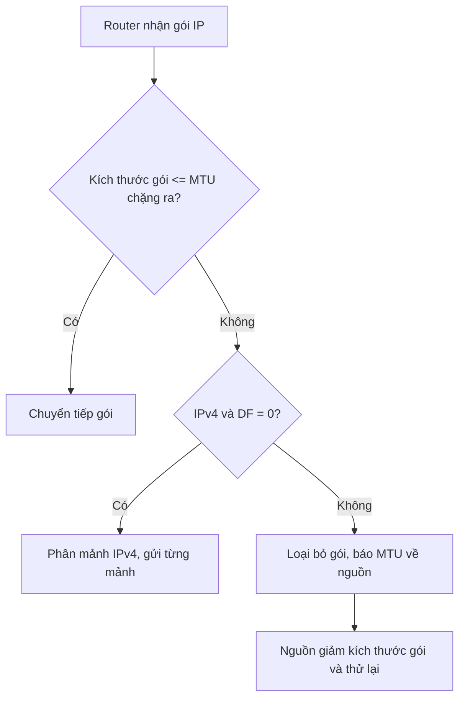

# MTU và fragmentation trong TCP/IP

## 1. Vì sao kích thước gói tin là vấn đề bảo mật mạng?

Trong mạng TCP/IP, dữ liệu có thể đi qua Ethernet, Wi-Fi, PPPoE, VPN, đường hầm (tunnel) và nhiều thiết bị định tuyến trước khi đến đích. Mỗi chặng có giới hạn kích thước gói IP có thể mang trong một lần truyền. Giới hạn này được gọi là **MTU (Maximum Transmission Unit)**. Nếu một gói IP lớn hơn giới hạn của chặng tiếp theo, hệ thống phải chia nhỏ gói theo quy tắc của giao thức, giảm kích thước gói từ nguồn hoặc báo lỗi.

Hiểu MTU và **fragmentation (phân mảnh IP)** giúp giải thích những tình huống tưởng như khó hiểu: ping gói nhỏ thành công nhưng truy cập HTTPS bị treo; VPN kết nối được nhưng tải tệp thất bại; DNS trả lời lúc được lúc không; hay firewall/IDS/IPS không nhìn thấy đầy đủ thông tin tầng vận chuyển trong từng mảnh IP. Đây là kiến thức nền để cấu hình kết nối an toàn, xác định điểm nghẽn và phân tích lưu lượng.

**Mục tiêu sau bài học:**

- Phân biệt MTU của một giao diện, Path MTU (PMTU), kích thước gói IP và TCP MSS.
- Đọc được các trường `Identification`, `DF`, `MF`, `Fragment Offset` của IPv4 và tính chính xác vị trí, kích thước các mảnh.
- Giải thích cách IPv4 và IPv6 xử lý gói vượt MTU, kể cả khi có tunnel/VPN.
- Phân tích vai trò của ICMP/ICMPv6 trong Path MTU Discovery và dấu hiệu *PMTU black hole*.
- Nhận diện nguy cơ phân mảnh đối với firewall, NAT, IDS/IPS và áp dụng quy trình kiểm tra phù hợp.

## 2. MTU, Path MTU và MSS khác nhau như thế nào?

### 2.1. MTU là giới hạn tại một liên kết

**MTU** của một giao diện là kích thước lớn nhất của **gói IP** (đơn vị byte) mà giao diện có thể truyền trên liên kết đó mà không phải phân mảnh ở tầng IP. Trong Ethernet thông dụng, MTU là **1.500 byte**; con số này tính cả IP header và IP payload, nhưng **không tính** Ethernet header, FCS và phần mở đầu khung ở tầng vật lý. Một số hệ thống dùng *jumbo frame* (thường cấu hình MTU gần 9.000 byte), nhưng chỉ hoạt động nếu các thiết bị trên đoạn mạng liên quan cùng hỗ trợ.

Ví dụ, gói IPv4 gồm header 20 byte và payload 1.480 byte có tổng chiều dài 1.500 byte, vừa với MTU Ethernet 1.500. Nếu payload tăng thêm 1 byte, gói này đã vượt MTU của liên kết đó.

**Path MTU (PMTU)** là MTU nhỏ nhất trên toàn bộ đường đi mà gói phải vượt qua, tính theo kích thước gói IP ở lớp đang xét. Nếu đường đi có các giới hạn lần lượt 1.500 → 1.492 → 1.400 → 1.500 byte, thì PMTU thực tế ở thời điểm đó là **1.400 byte**. PMTU có thể đổi khi định tuyến, cấu hình tunnel hoặc chính sách mạng thay đổi; MTU 1.500 của card mạng nguồn không bảo đảm PMTU đến mọi đích đều bằng 1.500.

### 2.2. TCP MSS không phải MTU

**MSS (Maximum Segment Size)** giới hạn phần **dữ liệu TCP** trong một segment. TCP MSS không tính IP header hay TCP header. Khi không có IP/TCP options hoặc header mở rộng:

| Trường hợp | MTU IP | IP header | TCP header | MSS tối đa theo MTU |
|---|---:|---:|---:|---:|
| TCP/IPv4 qua Ethernet | 1.500 | 20 | 20 | 1.460 |
| TCP/IPv6 qua Ethernet | 1.500 | 40 | 20 | 1.440 |
| TCP/IPv4 qua đường có PMTU 1.400 | 1.400 | 20 | 20 | 1.360 |

Quy tắc tính sơ bộ:

```text
MSS_TCP <= PMTU - độ dài IP header - độ dài TCP header
```

MSS thực tế còn phụ thuộc MSS hai đầu trao đổi trong quá trình bắt tay TCP, options, header mở rộng, đường đi và cách hệ điều hành xử lý PMTU. **MSS clamping** trên router/VPN có thể điều chỉnh MSS được quảng bá trong TCP SYN để hạn chế việc tạo segment quá lớn. Tuy nhiên, nó **chỉ xử lý TCP**; UDP, QUIC, ICMP và các giao thức khác vẫn cần cách quản lý kích thước gói riêng.

> **Phân biệt đơn vị:** MTU nói về gói IP trên một chặng; PMTU nói về gói IP trên cả đường đi; MSS nói về dữ liệu bên trong một TCP segment. MTU không đồng nghĩa tốc độ, băng thông hay kích thước thông điệp ứng dụng.

## 3. IPv4 phân mảnh gói như thế nào?

### 3.1. Điều kiện cần phân mảnh

Một IPv4 datagram có trường `Total Length` (gồm IP header và payload). Nếu datagram lớn hơn MTU của giao diện gửi ra:

1. Nếu cờ **DF (Don't Fragment) = 0**, nút gửi hoặc router trung gian **có thể phân mảnh** datagram IPv4 thành các gói nhỏ hơn để đi tiếp. Router có thể chia nhỏ cả một mảnh đã tồn tại nếu gặp MTU thấp hơn.
2. Nếu **DF = 1**, router **không được phân mảnh**. Khi gói vượt MTU chặng ra, router loại bỏ gói và thông thường gửi **ICMP Destination Unreachable, Type 3, Code 4** (*Fragmentation Needed*) về nguồn, có thể kèm MTU của chặng gây lỗi. Nguồn phải điều chỉnh kích thước gói cho phù hợp.
3. Các mảnh IPv4 được định tuyến như các gói IP riêng biệt; chúng có thể đến không đúng thứ tự. **Máy đích thực hiện tái lắp ráp (reassembly)** thành datagram ban đầu. Router trung gian thông thường không tái lắp ráp trước khi chuyển tiếp.



Nhánh báo lỗi được hiểu là ICMP *Fragmentation Needed* cho IPv4 có DF=1 hoặc ICMPv6 *Packet Too Big* cho IPv6. Thực tế thông điệp ICMP có thể bị lọc, giới hạn tốc độ hoặc thất lạc.

### 3.2. Những trường trong IPv4 header cần đọc

| Trường | Vai trò khi phân mảnh |
|---|---|
| `Identification` (16 bit) | Các mảnh của cùng datagram mang cùng giá trị nhận dạng để đích ghép đúng các mảnh; việc ghép còn phụ thuộc địa chỉ nguồn, đích và giao thức. |
| `DF` | Đặt bằng 1 để yêu cầu không phân mảnh IPv4 trên đường đi. |
| `MF` (*More Fragments*) | Bằng 1 nếu vẫn còn mảnh phía sau; mảnh cuối có `MF = 0`. |
| `Fragment Offset` (13 bit) | Vị trí bắt đầu dữ liệu mảnh trong payload IP ban đầu, tính theo **đơn vị 8 byte**, không phải byte. |
| `Total Length` | Độ dài **riêng từng mảnh**, bao gồm IP header của mảnh đó. |
| `Protocol` | Xác định giao thức dữ liệu bên trong (TCP, UDP, ICMP...); không phải mảnh nào cũng chứa đầu TCP/UDP. |

Khi datagram chưa bị phân mảnh, thông thường `Fragment Offset = 0` và `MF = 0`. Với datagram đã phân mảnh, mảnh đầu có offset 0, mảnh giữa có `MF = 1`, mảnh cuối có `MF = 0`. Các mảnh **trừ mảnh cuối** phải chứa lượng dữ liệu chia hết cho 8, để offset của mảnh tiếp theo biểu diễn chính xác.

### 3.3. Ví dụ tính tay: 4.000 byte payload qua MTU 1.500

Giả sử một IPv4 datagram có **4.000 byte IP payload**, IPv4 header dài **20 byte**, `DF = 0`, không có IP options. Tổng độ dài IP ban đầu là:

```text
Original Total Length = 20 + 4.000 = 4.020 byte
MTU                   = 1.500 byte
Payload tối đa/mảnh   = floor((1.500 - 20) / 8) * 8
                      = 1.480 byte
```

Ta tạo hai mảnh mang 1.480 byte và mảnh cuối mang phần còn lại `4.000 - 2 × 1.480 = 1.040` byte:

| Mảnh | IP payload (byte) | IP Total Length (byte) | Fragment Offset (đơn vị 8 byte) | MF |
|---|---:|---:|---:|---:|
| 1 | 1.480 | 1.500 | 0 | 1 |
| 2 | 1.480 | 1.500 | 185 | 1 |
| 3 | 1.040 | 1.060 | 370 | 0 |

Kiểm chứng vị trí dữ liệu:

```text
Mảnh 1: byte    0..1479   -> offset   0/8 =   0
Mảnh 2: byte 1480..2959   -> offset 1480/8 = 185
Mảnh 3: byte 2960..3999   -> offset 2960/8 = 370
```

Ba mảnh có cùng `Identification` và cùng thông tin định danh datagram ban đầu; mỗi mảnh có IPv4 header riêng. Tổng số byte IP cần truyền là `1.500 + 1.500 + 1.060 = 4.060`, **tăng 40 byte** so với datagram 4.020 byte ban đầu do phát sinh thêm hai header IPv4 dài 20 byte. Chưa tính overhead khung liên kết, việc mất mảnh, truyền lại hoặc các IP options có thể làm thay đổi phép tính.

**Công thức tổng quát** cho ví dụ IPv4 header không có options:

```text
max_non_last_fragment_payload = floor((MTU - IP_header_size) / 8) * 8
fragment_offset              = số byte payload trước mảnh hiện tại / 8
fragment_total_length        = IP_header_size + fragment_payload_length
```

Nếu có IP options, độ dài IP header có thể khác 20 byte, đồng thời các options được sao chép sang mảnh khác nhau theo quy tắc IPv4; phải dùng độ dài header thực tế để tính.

### 3.4. Mất một mảnh ảnh hưởng toàn bộ datagram

Đích chỉ tái lắp ráp thành công nếu nhận đủ các phần cần thiết. Nếu một mảnh thất lạc hoặc hết thời hạn lưu tạm, toàn bộ datagram gốc không thể được chuyển lên TCP/UDP như một gói hoàn chỉnh. Bản thân IP không có cơ chế yêu cầu truyền lại từng mảnh; với TCP, việc mất dữ liệu cuối cùng có thể kích hoạt truyền lại ở tầng TCP, còn UDP phụ thuộc ứng dụng nếu cần khôi phục. Phân mảnh vì thế làm tăng số gói, tải xử lý và xác suất mất toàn bộ datagram khi một mảnh thất lạc.

## 4. IPv6 khác IPv4 ở điểm nào?

IPv6 chủ động chuyển trách nhiệm xử lý kích thước gói về **nguồn gửi**:

| Khía cạnh | IPv4 | IPv6 |
|---|---|---|
| Router trung gian phân mảnh | Có thể, nếu `DF = 0` | **Không** phân mảnh |
| Khi gói quá lớn so với MTU chặng ra | Router có thể phân mảnh hoặc báo ICMP *Fragmentation Needed* | Router loại bỏ gói và gửi **ICMPv6 Packet Too Big (Type 2)** |
| Cơ chế phân mảnh | Trường `Identification`, `Flags`, `Fragment Offset` trong IPv4 header | Nguồn dùng **Fragment extension header** khi cần phân mảnh |
| Tái lắp ráp | Ở đích | Ở đích |
| MTU tối thiểu của liên kết IPv6 | Không áp dụng cùng quy tắc IPv6 | Liên kết IPv6 phải hỗ trợ MTU tối thiểu **1.280 byte** ở lớp IP (có thể dùng cơ chế thích ứng ở lớp dưới) |

Nếu nguồn IPv6 cần gửi dữ liệu lớn hơn PMTU, thông thường nguồn giảm kích thước các gói được tạo ra. Khi buộc phải phân mảnh IPv6, **chỉ nguồn** tạo mảnh với Fragment extension header; các router chuyển tiếp không tự chia mảnh. Fragment header thêm 8 byte và chứa offset, cờ `M` (*More fragments*) cùng Fragment Identification 32 bit. Trong thiết kế mạng, nên hạn chế phân mảnh ở cả IPv4 và IPv6 khi có thể.

> **Điểm phải nhớ:** Chặn toàn bộ ICMPv6 để “tăng bảo mật” có thể làm hỏng IPv6 PMTUD. ICMPv6 Packet Too Big là thành phần thiết yếu để nguồn biết khi nào cần tạo gói nhỏ hơn.

## 5. Path MTU Discovery và lỗi PMTU black hole

### 5.1. PMTUD hoạt động như thế nào?

**Path MTU Discovery (PMTUD)** giúp nguồn tìm ra giới hạn gói IP có thể đi qua toàn bộ đường truyền:

1. Nguồn gửi gói theo ước lượng MTU hiện tại. Với PMTUD IPv4 cổ điển, nguồn thường đặt `DF = 1` để router không phân mảnh hộ.
2. Nếu gói quá lớn so với một chặng, router loại bỏ và phản hồi **ICMPv4 Type 3/Code 4**, hoặc **ICMPv6 Type 2** đối với IPv6.
3. Nguồn dùng thông tin phản hồi để giảm ước lượng PMTU và tạo gói nhỏ hơn cho các lần gửi sau. Đường đi có thể thay đổi nên giá trị PMTU cần được quản lý/cập nhật theo thời gian.

PMTUD phụ thuộc vào việc thiết bị nhận được các phản hồi phù hợp. Nếu firewall hoặc ACL chặn những thông báo cần thiết, nguồn có thể tiếp tục gửi gói quá lớn và không biết tại sao chúng bị loại bỏ.

### 5.2. PMTU black hole và PMTUD không phụ thuộc ICMP

**PMTU black hole** là trường hợp các gói lớn bị loại bỏ ở một chặng nhưng thông báo lỗi không về được nguồn (hoặc nguồn không xử lý được). Biểu hiện thường thấy:

- Gói nhỏ, bắt tay TCP hoặc truy vấn đơn giản có thể thành công, nhưng truyền dữ liệu lớn bị dừng hoặc rất chậm.
- Kết nối qua VPN/tunnel gặp lỗi trong khi kết nối trực tiếp hoạt động.
- Một số phản hồi DNS lớn qua UDP hoặc phiên sử dụng UDP/QUIC gặp khó khăn, tùy cách ứng dụng xử lý kích thước gói và truyền lại.

**Packetization Layer PMTUD / DPLPMTUD** dùng phép thử gói theo kích thước và quan sát khả năng truyền thành công để xác định giới hạn, giảm phụ thuộc vào thông báo ICMP. RFC 8899 mô tả DPLPMTUD cho các giao thức datagram; việc triển khai phải kiểm soát mất gói, thử lại và kích thước thăm dò một cách an toàn. Không thể mặc định rằng mọi hệ điều hành và ứng dụng đều hỗ trợ cùng cơ chế này.

### 5.3. VPN, tunnel và encapsulation làm giảm MTU hiệu dụng

Khi chạy IP qua IPsec, WireGuard, GRE hoặc một overlay khác, lớp đóng gói bổ sung tạo ra header và đôi khi có phần xác thực/mã hóa. Nếu đường ngoài có PMTU 1.500 byte và tổng overhead đóng gói IP bổ sung trong một cấu hình giả định là 60 byte, thì giới hạn cho **gói IP bên trong** không vượt quá **1.440 byte**:

```text
PMTU đường ngoài                 = 1.500 byte
Overhead tunnel (giả định)      =    60 byte
MTU tối đa của gói IP bên trong  = 1.440 byte
MSS TCP/IPv4 bên trong (giả định,
  header IPv4 20 + TCP 20)      = 1.400 byte
```

Con số overhead thực tế tùy giao thức, phiên bản IP ngoài, thuật toán bảo vệ, NAT traversal, options và cấu hình; không áp dụng “trừ 60 byte” cho mọi VPN. Thiết bị hoặc đầu cuối tunnel cần phối hợp cấu hình MTU, PMTUD và khi phù hợp là MSS clamping. Chỉ điều chỉnh MSS không đủ để giải quyết tất cả gói UDP hay giao thức khác.

## 6. Phân mảnh ảnh hưởng firewall, NAT và IDS/IPS

Một IPv4 datagram chứa TCP/UDP header ở **đầu IP payload**. Khi phân mảnh, chỉ mảnh đầu chứa phần đầu datagram đó; các mảnh tiếp theo thường không mang TCP/UDP source port, destination port hay TCP flags. Điều này gây khó khăn cho thiết bị lọc gói dựa trên cổng hoặc kiểm tra nội dung nếu thiết bị nhìn từng mảnh độc lập.

| Tình huống | Tác động | Hướng xử lý phòng vệ |
|---|---|---|
| Mảnh IP không đầu tiên không có TCP/UDP header | ACL/stateless firewall không thể quyết định đầy đủ từ cổng trong riêng mảnh đó | Dùng stateful inspection, quy tắc xử lý mảnh nhất quán, tái lắp ráp/chuẩn hóa tại điểm cần kiểm tra |
| Mảnh chồng lấn (overlapping fragments), offset bất thường | Các bộ tái lắp ráp khác nhau có thể hiểu payload không giống nhau; nguy cơ lách kiểm tra | Chuẩn hóa lưu lượng, loại bỏ mảnh sai quy tắc; IPv6 phải loại bỏ cả datagram khi các mảnh chồng lấn |
| Rất nhiều mảnh nhỏ hoặc luồng mảnh không hoàn chỉnh | Tốn bộ nhớ và thời gian chờ tái lắp ráp, có thể làm cạn tài nguyên | Giới hạn số mảnh/bộ đệm, thời gian chờ và tốc độ theo năng lực thiết bị; giám sát dấu hiệu bất thường |
| NAT hoặc firewall không liên kết được các mảnh | Mất trạng thái phiên hoặc bỏ một số mảnh, làm đứt kết nối | Kiểm tra cơ chế theo dõi fragment/connection tracking, đường đi hai chiều, chính sách thiết bị |
| IPS chỉ nhìn thấy một phần datagram | Bỏ sót dấu hiệu nguy hiểm hoặc đưa ra quyết định không nhất quán | Tái lắp ráp/chuẩn hóa trước khi phân tích ở mức giao thức và đồng bộ chính sách với thiết bị đích |

Không nên mặc định chặn **mọi** gói phân mảnh. Một số đường truyền hoặc ứng dụng hợp lệ vẫn cần phân mảnh; chính sách quá rộng có thể gây lỗi kết nối. Cần phân biệt **phân mảnh hợp lệ** với mẫu bất thường, áp dụng giới hạn tài nguyên hợp lý và đánh giá tác động trước khi thay đổi chính sách. Các bản triển khai IPv6 theo RFC 8200 phải loại bỏ toàn bộ datagram nếu phát hiện fragment chồng lấn.

Từ góc nhìn threat modeling, các điểm cần kiểm tra gồm: cổng tunnel, thiết bị NAT, firewall ranh giới, IDS/IPS, load balancer và máy đích. Cùng một luồng có thể được xử lý khác nhau tại các điểm này; chỉ nhìn log của một thiết bị chưa đủ xác định nơi gói bị loại bỏ.

## 7. Chẩn đoán sự cố MTU/fragmentation

### 7.1. Quy trình kiểm tra theo giả thuyết

1. **Khoanh vùng tuyến đường:** ghi lại nguồn, đích, giao thức bị ảnh hưởng (TCP, UDP, IPv4 hay IPv6), các router/VPN/tunnel liên quan và thời điểm xuất hiện lỗi. So sánh đường trực tiếp với đường qua VPN nếu có.
2. **Xem MTU tại nguồn:** kiểm tra MTU giao diện và MTU của giao diện tunnel. Không suy rằng chỉ số tại nguồn bằng PMTU toàn tuyến.
3. **Thử các kích thước có kiểm soát:** với lưu lượng được phép kiểm tra, gửi ICMP echo nhỏ và tăng dần kích thước, sử dụng DF khi thử IPv4. Kết quả cần được giải thích trong bối cảnh firewall có thể chặn hoặc giới hạn ICMP.
4. **Bắt gói ở hai phía nếu có quyền:** tìm các thông báo ICMP/ICMPv6 báo MTU, IPv4 `MF/Fragment Offset`, retransmission và những gói lớn bị mất giữa hai điểm.
5. **Kiểm tra chính sách và encapsulation:** xem ACL có cho qua ICMP PMTUD cần thiết không, tunnel có overhead bao nhiêu, MTU/MSS được cấu hình ra sao, thiết bị bảo mật có xử lý mảnh nhất quán không.
6. **Xác minh sau điều chỉnh:** thử lại cả kết nối nhỏ lẫn truyền dữ liệu lớn; kiểm tra TCP và ứng dụng UDP/QUIC phù hợp, tránh kết luận chỉ từ một lệnh ping.

### 7.2. Lệnh ví dụ trên Linux và Windows

```bash
# Linux: xem MTU trên giao diện (đổi eth0 theo môi trường)
ip link show dev eth0

# Linux: thăm dò PMTU dọc đường nếu đã cài tracepath
tracepath -n 1.1.1.1

# Linux: IPv4 ICMP Echo payload 1472 B + ICMP header 8 B
# + IPv4 header 20 B = 1500 B, yêu cầu không phân mảnh
ping -4 -M do -s 1472 -c 3 1.1.1.1

# Thử 1473 B để xem giới hạn thay đổi ở đâu
ping -4 -M do -s 1473 -c 3 1.1.1.1

# Linux: bắt các mảnh IPv4 (MF=1 hoặc offset khác 0)
sudo tcpdump -ni eth0 'ip[6:2] & 0x3fff != 0'

# Linux: ICMPv4 báo "Fragmentation Needed"
sudo tcpdump -ni eth0 'icmp[0] = 3 and icmp[1] = 4'
```

```powershell
# Windows: -f đặt DF cho IPv4, -l là kích thước ICMP Echo data
ping -4 -f -l 1472 1.1.1.1
ping -4 -f -l 1473 1.1.1.1
```

**Giải thích phép thử:** payload `1472` trong lệnh ping IPv4 là **dữ liệu ICMP Echo**, không phải IP payload đầy đủ: `1472 + 8 (ICMP) + 20 (IPv4) = 1500`. Nếu PMTU là 1.492 byte, mức tương ứng để thử sẽ là `1492 - 20 - 8 = 1464` byte (giả sử IPv4 header 20 byte). Lệnh gửi có thể bị từ chối ngay ở máy nguồn nếu vượt MTU cục bộ; việc remote không phản hồi cũng có thể do chặn ping hoặc giới hạn tốc độ, nên **timeout không tự chứng minh sự cố MTU**.

Khi dùng Wireshark, có thể lọc:

```text
ip.flags.mf == 1 || ip.frag_offset > 0   # Phân mảnh IPv4
icmp.type == 3 && icmp.code == 4         # ICMPv4 Fragmentation Needed
icmpv6.type == 2                         # ICMPv6 Packet Too Big
ipv6.fraghdr                             # Có IPv6 Fragment Header
```

Trong một số hệ điều hành, tính năng **TSO/GSO/GRO/LRO** làm bản bắt gói ngay trên máy gửi/nhận hiển thị gói hoặc segment lớn hơn kích thước thực trên đường truyền. Nếu dữ liệu bắt gói có vẻ mâu thuẫn với MTU, đối chiếu ở thiết bị trung gian hoặc vị trí ghi nhận trên đường dây; chỉ thay đổi cấu hình offloading có kiểm soát trong môi trường thử nghiệm.

### 7.3. Ví dụ xử lý sự cố thực tế

**Bối cảnh:** người dùng truy cập dịch vụ HTTPS qua VPN. Kết nối TCP được thiết lập, trang đơn giản tải được nhưng khi tải tệp lớn thì thường dừng. Card Ethernet ở hai đầu đều hiển thị MTU 1.500.

**Phân tích:** kiểm tra cho thấy tunnel tăng kích thước gói IP ngoài và làm PMTU của luồng bên trong thấp hơn 1.500. Gói lớn có DF cần thông báo ICMP *Fragmentation Needed*, nhưng thông báo này bị một ACL lọc. Nguồn vẫn gửi các gói vượt giới hạn, dẫn tới biểu hiện giống PMTU black hole.

**Khắc phục theo nguyên nhân:** xác định overhead tunnel thật, cho phép các thông báo PMTUD cần thiết đi qua theo chính sách an toàn, đặt MTU giao diện tunnel phù hợp và có thể cấu hình MSS clamping đối với TCP. Kiểm tra lại tải lớn và lưu lượng UDP; giám sát xem còn mảnh bất thường hoặc ICMP Packet Too Big/Fragmentation Needed không. Hạ MTU một cách tùy tiện có thể che triệu chứng nhưng không chỉ ra quy tắc ACL gây lỗi.

## 8. Những nhầm lẫn thường gặp

| Nhận định | Giải thích đúng |
|---|---|
| “Ethernet MTU 1.500 nghĩa là TCP gửi được 1.500 byte dữ liệu mỗi segment.” | 1.500 đã bao gồm IP header; với IPv4/TCP header cơ bản, MSS là 1.460. |
| “Mọi router đều phân mảnh gói lớn.” | IPv4 chỉ có thể phân mảnh khi cho phép; router IPv6 không phân mảnh. |
| “Fragment Offset là số byte.” | Offset được mã hóa theo **đơn vị 8 byte** trong IPv4 và IPv6 Fragment Header. |
| “Cứ bật DF là truyền tin an toàn hơn.” | DF buộc nguồn xử lý PMTU; nếu phản hồi ICMP bị chặn thì vẫn có thể gây đứt lưu lượng. |
| “Chặn hết ICMP không ảnh hưởng ứng dụng.” | ICMPv4 Fragmentation Needed và ICMPv6 Packet Too Big rất quan trọng đối với PMTUD. |
| “Chỉnh MSS của TCP giải quyết được lỗi MTU cho mọi ứng dụng.” | UDP, QUIC và giao thức khác không dùng TCP MSS. |
| “Một lần ping thất bại chứng minh có lỗi MTU.” | ICMP có thể bị chặn hoặc rate limit; phải kết hợp phép thử và bắt gói. |
| “Bắt gói ở máy nguồn thấy gói 9 KB tức Ethernet đã truyền một IP packet 9 KB.” | Offloading có thể khiến bản bắt gói ở host khác với gói thực trên dây. |

## 9. Vận dụng và tự kiểm tra

**Tình huống 1:** IPv4 header 20 byte, IP payload 3.000 byte, MTU chặng ra 1.400 byte, `DF=0`. Mảnh không cuối được mang tối đa bao nhiêu byte payload? Đáp án: `floor((1400 - 20) / 8) × 8 = 1376` byte. Hai mảnh đầu mang 1.376 byte mỗi mảnh, mảnh cuối mang 248 byte; offset lần lượt là 0, 172 và 344 (đơn vị 8 byte), cờ `MF` là 1, 1, 0.

**Tình huống 2:** router IPv6 nhận gói 1.500 byte nhưng MTU của chặng ra chỉ là 1.280 byte. Router sẽ không chia gói thành mảnh; nó loại bỏ gói và gửi ICMPv6 Packet Too Big cho nguồn để nguồn điều chỉnh kích thước.

**Tình huống 3:** một firewall đọc được port TCP của mảnh IPv4 đầu tiên nhưng không đọc được port trên mảnh thứ hai. Đây là hành vi có thể xảy ra đúng với cấu trúc phân mảnh: TCP header nằm ở phần đầu datagram gốc. Hệ thống kiểm tra cần liên kết/tái lắp ráp các mảnh theo chính sách thay vì xử lý từng mảnh như một kết nối độc lập.

**Ghi nhớ khi vận hành:** ưu tiên tạo gói phù hợp PMTU và xử lý ICMP/ICMPv6 đúng chuẩn; xem xét overhead của VPN/tunnel; khi điều tra lỗi luôn quan sát cả kích thước gói, đường đi và cách các thiết bị bảo mật xử lý fragment. Phân mảnh là cơ chế tương thích của IP, nhưng quản trị tốt kích thước gói thường giúp đường truyền ổn định, dễ giám sát và giảm tải tái lắp ráp.

### Tài liệu chuẩn tham khảo

- [RFC 791 — Internet Protocol (IPv4)](https://www.rfc-editor.org/rfc/rfc791): các trường và quy tắc phân mảnh IPv4.
- [RFC 1191 — Path MTU Discovery](https://www.rfc-editor.org/rfc/rfc1191): PMTUD cổ điển cho IPv4.
- [RFC 8200 — Internet Protocol, Version 6 (IPv6) Specification](https://www.rfc-editor.org/rfc/rfc8200): Fragment Header và xử lý kích thước gói IPv6.
- [RFC 8201 — Path MTU Discovery for IP version 6](https://www.rfc-editor.org/rfc/rfc8201): PMTUD cho IPv6.
- [RFC 8899 — Datagram Packetization Layer Path MTU Discovery](https://www.rfc-editor.org/rfc/rfc8899): kỹ thuật DPLPMTUD cho các giao thức datagram.
