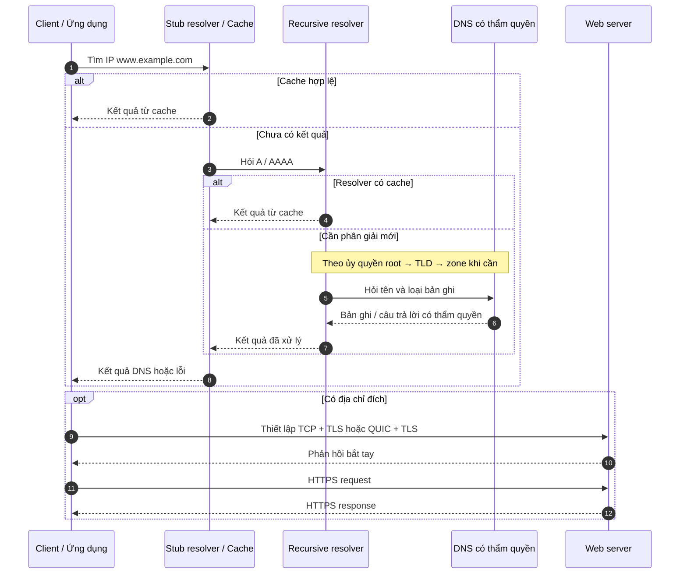

# DNS trong luồng kết nối

> **Học phần:** `SECURITY_NETWORK_SECURITY` · **Chương:** TCP IP  
> Trong bảo mật mạng, DNS liên kết việc phân giải tên với các lớp phòng vệ như phân đoạn mạng, firewall, VPN, IDS/IPS, xác thực kết nối và giám sát. Hiểu luồng DNS giúp bảo vệ hạ tầng nội bộ, mạng không dây và môi trường đám mây, đồng thời phân biệt lỗi phân giải tên với lỗi kết nối.

## Mục tiêu học tập

Sau bài này, người học có thể:

1. Theo dõi một tên miền từ ứng dụng qua cache, recursive resolver và máy chủ DNS có thẩm quyền đến địa chỉ IP.
2. Phân biệt DNS, TCP/QUIC, TLS và HTTP trong một lần truy cập dịch vụ.
3. Giải thích cách bản ghi, TTL, DNS truyền thống, DNS mã hóa và DNSSEC tác động đến kết nối.
4. Nhận diện các mối đe dọa DNS, phân tích log/lưu lượng và thiết kế biện pháp kiểm soát phù hợp.
5. Dùng `dig`, `Resolve-DnsName` và công cụ mạng để khoanh vùng lỗi.

## 1. DNS nằm ở đâu trong luồng TCP/IP?

**Domain Name System (DNS)** là hệ thống phân cấp dùng để tìm thông tin gắn với tên miền. Trong luồng truy cập web, DNS thường được hỏi để chuyển `www.example.com` thành địa chỉ IP có thể kết nối. DNS **không tự thiết lập** kết nối TCP, QUIC hoặc TLS; nó chỉ cung cấp dữ liệu để ứng dụng chọn đích.

Giả sử người dùng mở `https://www.example.com/`:

1. Trình duyệt phân tích URL: giao thức HTTPS, hostname `www.example.com` và cổng mặc định 443.
2. Ứng dụng kiểm tra các nguồn phân giải có sẵn như cache ứng dụng, cơ chế hệ điều hành hoặc DNS; thứ tự cụ thể phụ thuộc nền tảng.
3. Nếu cần tra cứu, client gửi câu hỏi về bản ghi `A` (IPv4), `AAAA` (IPv6) và có thể các loại bản ghi dịch vụ khác.
4. Resolver trả về địa chỉ hoặc thông tin lỗi. Client lựa chọn IP thích hợp, có thể thử IPv4 và IPv6 theo chiến lược của ứng dụng.
5. Client mở TCP 443 và bắt tay TLS cho HTTPS truyền thống, hoặc QUIC qua UDP 443 cho HTTP/3 khi được hỗ trợ.
6. Client xác thực danh tính dịch vụ qua TLS, sau đó trao đổi yêu cầu và phản hồi HTTP.

**Điểm cốt lõi:** DNS thành công không đồng nghĩa kết nối đến máy chủ thành công. Route, ACL, firewall, listener, TLS hoặc bản thân ứng dụng vẫn có thể lỗi.

### Sơ đồ luồng điển hình



Sơ đồ là mô hình logic. Trình duyệt có thể sử dụng DoH riêng, kết nối HTTP có thể được tái sử dụng, và resolver có thể hỏi nhiều nguồn hoặc truy vấn đồng thời. **Không phải mỗi yêu cầu HTTP đều phát sinh một truy vấn DNS mới.**

## 2. Những thành phần tham gia phân giải DNS

| Thành phần | Vai trò | Điều cần lưu ý |
|---|---|---|
| **Ứng dụng / stub resolver** | Nhận hostname, khởi tạo yêu cầu tra cứu hoặc dùng kết quả đã có | Một số trình duyệt có cache và cơ chế DNS riêng |
| **Resolver đệ quy (recursive resolver)** | Nhận câu hỏi, dùng cache hoặc tra các máy chủ DNS khác, rồi trả kết quả | Cần giới hạn quyền recursion, giám sát và bảo vệ cache |
| **Root name server** | Chỉ dẫn đến máy chủ phụ trách miền cấp cao | Thường không có IP cuối cùng của trang web |
| **TLD name server** | Chỉ dẫn đến máy chủ có thẩm quyền của `example.com`, `.vn`... | Là mắt xích ủy quyền |
| **Authoritative name server** | Cung cấp dữ liệu cho zone thuộc quyền quản lý | Cần bảo vệ quyền sửa zone và cập nhật bản ghi |
| **DNS forwarder** | Chuyển truy vấn đến một resolver khác theo chính sách | Phổ biến trong DNS nội bộ, VPN, hybrid cloud |
| **Cache nhiều tầng** | Lưu kết quả nhằm giảm độ trễ và truy vấn | Cache cũ có thể khiến các client nhìn thấy IP khác nhau |

### Đệ quy và truy vấn lặp

Client thông thường gửi câu hỏi cho **recursive resolver** và chờ kết quả. Nếu resolver không có cache và không chuyển tiếp lên upstream, nó có thể thực hiện các truy vấn **lặp (iterative)**:

- Hỏi root để tìm máy chủ cho TLD `.com`.
- Hỏi máy chủ TLD để tìm máy chủ có thẩm quyền của `example.com`.
- Hỏi máy chủ có thẩm quyền về `www.example.com`.
- Xử lý thêm các bí danh `CNAME` hoặc truy vấn liên quan rồi trả thông tin về client.

Root và TLD chủ yếu đưa ra **referral** (thông tin ủy quyền). Nhờ cache, resolver hiếm khi phải đi đủ tất cả các tầng cho mọi lần hỏi. Trong mạng doanh nghiệp, recursive resolver có thể chuyển một số tên nội bộ tới forwarder riêng.

### Các bản ghi thường gặp

| Bản ghi | Dùng làm gì? | Liên hệ với kết nối |
|---|---|---|
| `A` | Tên → IPv4 | Cung cấp một hoặc nhiều IP đích |
| `AAAA` | Tên → IPv6 | Có thể cho client kết nối qua IPv6 |
| `CNAME` | Tên bí danh → tên đích khác | Có thể cần phân giải tiếp để lấy địa chỉ |
| `NS` | Chỉ ra máy chủ DNS cho zone | Phục vụ ủy quyền DNS |
| `SOA` | Thông tin quản trị zone | Có vai trò trong cache phản hồi phủ định |
| `MX` | Máy chủ nhận thư | Dùng trong luồng email |
| `TXT` | Dữ liệu văn bản | Thường dùng trong xác minh domain, SPF... |
| `PTR` | IP → tên trong reverse DNS | Hỗ trợ chẩn đoán, không xác thực tuyệt đối danh tính |
| `SRV` | Dịch vụ, máy chủ, cổng | Tùy ứng dụng có hỗ trợ hay không |
| `HTTPS` / `SVCB` | Tham số lựa chọn endpoint, giao thức dịch vụ | Có thể cung cấp ALPN, thông tin đích; không thay thế kiểm tra TLS |
| `CAA` | Chính sách CA được phép phát hành chứng chỉ | Liên quan quy trình cấp chứng chỉ |
| `DNSKEY`, `DS`, `RRSIG` | Thành phần DNSSEC | Hỗ trợ xác minh tính xác thực và toàn vẹn dữ liệu |

Ví dụ dữ liệu minh họa:

```dns
api.example.com.  300  IN  A     203.0.113.10
api.example.com.  300  IN  AAAA  2001:db8::10
```

`203.0.113.0/24` và `2001:db8::/32` là dải địa chỉ dành cho tài liệu, không phải lời khẳng định những IP minh họa đang phục vụ thật.

## 3. Mổ xẻ một truy vấn và phản hồi DNS

Khi client cần IP của `api.example.com`, nó tạo câu hỏi với:

- **QNAME:** tên cần hỏi, ví dụ `api.example.com`.
- **QTYPE:** loại bản ghi cần lấy, ví dụ `A` hoặc `AAAA`.
- **QCLASS:** thường là `IN` (Internet).

Client có thể bật cờ **RD** (Recursion Desired) để yêu cầu resolver thực hiện đệ quy. Khi nhận yêu cầu, resolver xem cache, tra cứu khi cần, có thể kiểm chứng DNSSEC và trả phản hồi. Phản hồi có mã trạng thái cùng các section như `ANSWER`, `AUTHORITY` và `ADDITIONAL`.

| Dấu hiệu | Ý nghĩa | Điều dễ hiểu sai |
|---|---|---|
| `NOERROR` | Truy vấn không báo lỗi DNS | Không chắc có dữ liệu đúng loại hỏi; có thể là `NODATA` |
| `NXDOMAIN` | Tên được hỏi không tồn tại theo nguồn trả lời | Có thể do hỏi sai resolver đối với tên nội bộ |
| `SERVFAIL` | Server không hoàn thành việc xử lý | Có thể do upstream, mạng hoặc kiểm chứng DNSSEC lỗi |
| `AA` | Câu trả lời có thẩm quyền | Không tự chứng minh dữ liệu có chữ ký hợp lệ |
| `RD` / `RA` | Client yêu cầu / server hỗ trợ recursion | `RA` không có nghĩa mọi client đều được phép |
| `TC` | Phản hồi bị cắt ngắn | Có thể cần thử DNS qua TCP để lấy đủ dữ liệu |
| `AD` | Resolver báo dữ liệu đã được xác thực | Chỉ nên tin khi có quan hệ tin cậy đúng với resolver/kênh DNS |

Khi bản ghi có `CNAME`, quá trình có thể phải tiếp tục theo tên đích. Khi có nhiều bản ghi `A`/`AAAA`, client có thể chọn một trong số đó dựa trên hệ điều hành, mạng và chính sách ứng dụng. DNS có thể trả nhiều IP nhưng không bảo đảm mọi IP đều đang sẵn sàng phục vụ.

## 4. UDP, TCP và DNS mã hóa

DNS truyền thống thường dùng **UDP 53** để tiết kiệm overhead. **TCP 53** cũng là thành phần hợp lệ của DNS, ví dụ khi phản hồi UDP bị cắt ngắn, với một số thao tác quản trị như zone transfer hoặc khi client/server cần truyền tải đáng tin cậy. Vì vậy chỉ cho UDP 53 qua firewall có thể làm một số truy vấn thất bại.

**EDNS(0)** cho phép công bố các khả năng bổ sung và kích thước payload UDP lớn hơn DNS cổ điển. Phản hồi lớn vẫn có thể gặp phân mảnh hoặc bị thiết bị mạng chặn; khi thấy `TC=1` nên xét đến đường DNS qua TCP, chính sách firewall và MTU.

| Cơ chế | Kênh thường dùng | Lợi ích | Giới hạn |
|---|---|---|---|
| DNS thường | UDP/TCP **53** | Phổ biến, dễ tương thích | Payload truy vấn thường không được mã hóa |
| **DoT** – DNS over TLS | TLS/TCP **853** | Mã hóa đoạn client ↔ resolver | Resolver vẫn biết truy vấn; cần xác thực đúng resolver |
| **DoH** – DNS over HTTPS | HTTPS, thường **443** | Bảo vệ payload DNS trong HTTPS | Có thể vượt ngoài chính sách DNS nội bộ nếu endpoint tự cấu hình |
| **DoQ** – DNS over QUIC | QUIC/UDP **853** | Truy vấn DNS trên kênh QUIC mã hóa | Hỗ trợ thực tế phụ thuộc triển khai |

**DNSSEC** là cơ chế khác với các giao thức mã hóa trên: nó giúp validating resolver kiểm tra nguồn gốc và toàn vẹn dữ liệu DNS có ký theo chuỗi tin cậy. DNSSEC **không mã hóa** tên miền hỏi và không ngăn resolver đáng ngờ quan sát truy vấn. Ngược lại, DoH/DoT bảo vệ kênh đến resolver nhưng không khiến câu trả lời từ một resolver không đáng tin tự nhiên trở nên đúng. Có thể dùng DNSSEC cùng DoH/DoT.

Lưu ý với kiểm soát lưu lượng: DoH thường chạy trên `443` giống HTTPS. Firewall chỉ dựa vào số cổng không phân biệt được mọi kết nối web với DoH. Cần kết hợp cấu hình trình duyệt/endpoint, danh sách resolver được phê duyệt, log phù hợp và chính sách mạng.

## 5. Cache, TTL và việc thay IP của dịch vụ

Trong ví dụ `api.example.com. 300 IN A 203.0.113.10`, số `300` là **TTL (Time To Live)** tính bằng giây: một cache tuân theo DNS có thể giữ bản ghi trong khoảng thời gian còn hiệu lực. Resolver trả kết quả từ cache sẽ giảm TTL còn lại.

Có nhiều nguồn cache: recursive resolver, OS, ứng dụng, trình duyệt hoặc thư viện mạng. Các tầng này có thể có chính sách và giới hạn riêng. **Giảm TTL không đồng nghĩa mọi client đổi IP ngay:** một số cache đã lấy dữ liệu cũ, một số ứng dụng giữ kết nối TCP/QUIC cũ, và một số hệ thống cache độc lập.

Ngoài cache dữ liệu tìm thấy (**positive cache**), DNS còn có **negative caching** cho câu trả lời như `NXDOMAIN` hoặc không có bản ghi cần hỏi (`NODATA`), theo quy tắc liên quan bản ghi `SOA`. Nếu vừa tạo một tên miền trước đó chưa tồn tại, client có thể vẫn gặp câu trả lời âm từ cache.

Khi chuyển endpoint:

1. Kiểm tra TTL và trả lời từ nhiều resolver liên quan.
2. Phân biệt bản ghi authoritative vừa thay với dữ liệu trong cache của client.
3. Xem có kết nối cũ đang được ứng dụng tái sử dụng không.
4. Chỉ xác nhận cutover hoàn tất khi đo cả phân giải tên lẫn khả năng kết nối ứng dụng.

**TTL DNS khác với TTL/cache-control của HTTP.** TTL DNS không điều khiển thời gian trình duyệt lưu ảnh, CSS hay dữ liệu API.

## 6. DNS kết hợp với TLS, VPN và phân đoạn mạng

### 6.1 DNS tìm đích, TLS xác thực dịch vụ

Nếu kẻ tấn công làm client nhận IP sai cho `login.example.com`, client có thể thử kết nối đến IP đó. Tuy nhiên, trong HTTPS được xác minh đúng, chứng chỉ TLS phải phù hợp với hostname mà client định truy cập. Một máy chủ giả không có chứng chỉ hợp lệ thường khiến bắt tay TLS bị từ chối hoặc trình duyệt cảnh báo. **Không bỏ qua lỗi chứng chỉ** để xử lý sự cố DNS.

**SNI** là thông tin hostname mà client có thể gửi trong quá trình TLS handshake để server chọn cấu hình phù hợp; chứng chỉ TLS được xác minh theo hostname của kết nối. Header HTTP `Host` hoặc `:authority` giúp định tuyến ở tầng ứng dụng. Các khái niệm này liên quan nhưng không thay thế truy vấn DNS. Với ECH, khả năng quan sát SNI từ mạng có thể thay đổi.

### 6.2 Split DNS và VPN

**Split-horizon DNS** cho phép kết quả của cùng một tên khác nhau tùy client/resolver và ngữ cảnh mạng:

| Client | Resolver | `intranet.corp.example.com` |
|---|---|---|
| Văn phòng | DNS nội bộ | `10.20.30.40` |
| Ở nhà, chưa bật VPN | DNS công cộng | Có thể `NXDOMAIN` |
| Ở nhà, VPN cấu hình DNS đúng | DNS nội bộ qua VPN | `10.20.30.40` |

Nếu VPN cấp route vào mạng riêng nhưng client vẫn hỏi DNS công cộng, ứng dụng có thể nhận `NXDOMAIN` dù tunnel đã hoạt động. Nếu trình duyệt tự bật DoH tới resolver công cộng, nó có thể bỏ qua thiết lập DNS nội bộ và **làm lộ hostname nội bộ**. Mặt khác, DNS trả đúng IP riêng nhưng không có route hoặc firewall chặn, lỗi nằm ở đường mạng.

### 6.3 Mạng phân đoạn, Wi-Fi và cloud

Kiến trúc tham khảo:

```text
[VLAN người dùng] ----DNS----> [Resolver nội bộ] ----> [DNS upstream]
       |
       +---------HTTPS-------> [Firewall / Proxy] ---> [Ứng dụng]

[VPN client] ------DNS-------> [Resolver nội bộ cho tên doanh nghiệp]
[Cloud VPC/VNet] --forward--> [DNS nội bộ / private zone]
```

Giới hạn endpoint chỉ hỏi những resolver được quản lý khi phù hợp; recursive resolver nên chỉ phục vụ những nguồn được phép. Chính sách firewall tới resolver phải xét **UDP/TCP 53**, kênh DNS mã hóa theo thiết kế và các tên nội bộ cần forward. Mạng khách Wi-Fi, mạng nhân viên, quản trị và workload cloud có thể cần quyền truy vấn và quyền kết nối khác nhau.

Kết quả DNS trả IP riêng **không cấp quyền truy cập** vào IP đó. Chính sách segmentation, IAM, VPN, route và bảo vệ dịch vụ vẫn quyết định truy cập có thành công hay không.

## 7. Các mối đe dọa DNS

| Mối đe dọa | Cơ chế | Tác động | Kiểm soát chính |
|---|---|---|---|
| **DNS spoofing / cache poisoning** | Đưa phản hồi giả vào client hoặc cache resolver | Điều hướng kết nối sai đích | Resolver được vá lỗi, cơ chế chống giả mạo truy vấn, validation DNSSEC nơi hỗ trợ |
| **Chiếm quyền quản trị zone** | Lộ tài khoản, API key hoặc quyền sửa bản ghi | Đổi `A`, `MX`, `NS`... trái phép | MFA, phân quyền tối thiểu, audit log và quy trình thay đổi |
| **Rogue resolver / DNS hijacking** | Wi-Fi/router hoặc phần mềm độc hại sửa resolver | Theo dõi, sửa câu trả lời, chặn phân giải | Quản lý cấu hình DNS endpoint, bảo vệ mạng, resolver/kênh đáng tin |
| **DNS tunneling** | Mã hóa dữ liệu thành các nhãn tên miền hoặc payload DNS | Điều khiển mã độc, rò rỉ dữ liệu | Giới hạn DNS egress, giám sát truy vấn dài/bất thường, điều tra endpoint |
| **DNS rebinding** | Domain đổi lời giải từ IP công khai sang IP nội bộ trong điều kiện có thể khai thác | Lợi dụng ứng dụng/trình duyệt để tới tài nguyên nội bộ | Xác thực dịch vụ nội bộ, kiểm tra Host/Origin, giới hạn quyền, lọc rebinding phù hợp |
| **DNS reflection/amplification** | Open resolver hoặc máy chủ DNS bị dùng trả lượng dữ liệu lớn về IP nguồn giả | DDoS tới nạn nhân | Không mở recursion tùy tiện, rate limiting, chống giả IP nguồn (BCP 38) |
| **Phishing/typosquatting** | Tên miền giả giống tên chính thức | Đánh cắp thông tin, tải mã độc | Lọc tên độc hại, xác minh URL và chứng chỉ, bảo vệ tài khoản |
| **DNS leakage** | Tên truy vấn nội bộ đi ra resolver công cộng hoặc DNS plaintext | Lộ tên dịch vụ và hành vi truy cập | Split DNS đúng, DNS mã hóa khi phù hợp, quản lý VPN/DoH |

**DNSSEC không xử lý mọi rủi ro**: nó không mã hóa truy vấn, không ngăn người quản trị hợp lệ nhưng bị chiếm tài khoản sửa dữ liệu zone rồi ký hợp lệ và không bảo vệ người dùng khi họ chủ động mở tên miền phishing khác.

### Những tín hiệu cần giám sát

- Tỷ lệ `NXDOMAIN` hoặc `SERVFAIL` tăng bất thường trên nhiều endpoint.
- Nhiều truy vấn đến subdomain ngẫu nhiên, nhãn tên rất dài hoặc tần suất đều bất thường.
- Máy trạm tự gửi DNS đến resolver chưa được phê duyệt hoặc thay đổi resolver sau khi nối Wi-Fi/VPN.
- IP/NS/MX của domain quan trọng đổi ngoài lịch vận hành.
- Trả lời DNS lớn hoặc lưu lượng phản hồi tăng đột biến tại dịch vụ không nên mở recursion ra Internet.

Những dấu hiệu này chỉ là **đầu mối điều tra**. CDN, phần mềm quản trị, cập nhật dịch vụ và ứng dụng hợp pháp có thể tạo mẫu tương tự. Luôn đối chiếu log firewall, IDS/IPS, endpoint và lịch thay đổi trước khi kết luận có tấn công.

## 8. Thực hành quan sát luồng DNS

Dùng môi trường bạn được phép kiểm tra. `example.com` là tên miền dành cho ví dụ tài liệu; giá trị IP, TTL thực tế phụ thuộc mạng, thời gian và resolver.

### 8.1 Linux/macOS với `dig`

```bash
# Tra A và xem TTL qua resolver đang được cấu hình
dig example.com A +noall +answer

# Tra IPv6 và bí danh nếu có
dig example.com AAAA +noall +answer
dig www.example.com CNAME +noall +answer

# Đọc status, flags, resolver, thời gian phản hồi
dig example.com A

# So sánh truyền tải TCP với DNS thông thường
dig +tcp example.com A

# Đi từng tầng DNS; có thể thất bại nếu mạng chặn DNS trực tiếp
dig +trace www.example.com
```

Ví dụ minh họa cho phần trả lời:

```text
;; ANSWER SECTION:
api.example.com.   300   IN   A   203.0.113.10
```

`300` là TTL; địa chỉ chỉ để minh họa. Nếu không thấy `ANSWER SECTION`, kiểm tra `status` và các section khác; `NOERROR` có thể đi kèm câu trả lời rỗng cho loại bản ghi đã hỏi.

### 8.2 Windows PowerShell

```powershell
# Tra IPv4
Resolve-DnsName example.com -Type A

# Tra IPv6
Resolve-DnsName example.com -Type AAAA

# Xem cache DNS hệ thống
ipconfig /displaydns

# Truy vấn cơ bản
nslookup example.com
```

`Resolve-DnsName` có thể cho kết quả khác trình duyệt có DNS/cache riêng. Khi so sánh hãy ghi **resolver thực sự**, mạng/VPN, giao thức và thời gian truy vấn.

### 8.3 Quan sát gói tin với Wireshark/tcpdump

```bash
# Chỉ chạy trong mạng/máy bạn có quyền giám sát
sudo tcpdump -ni any 'port 53 or port 853'
```

Trong Wireshark, bộ lọc `dns` thường hiển thị DNS có thể giải mã. Với DNS truyền thống, đối chiếu tên truy vấn, loại bản ghi, địa chỉ/port nguồn đích, transaction ID và thời gian để khớp truy vấn/phản hồi. Không ghép gói **chỉ** dựa vào transaction ID khi nhiều luồng chạy song song.

DoT/DoQ thường xuất hiện ở cổng 853 nhưng payload đã mã hóa; DoH thường nằm trong HTTPS 443 nên không hiển thị nội dung tên truy vấn bằng cách lọc `dns` hoặc `port 53` thông thường. Khi cần điều tra DNS mã hóa, tham khảo log resolver hoặc endpoint phù hợp và được phép.

### 8.4 Kiểm tra ứng dụng sau khi DNS thành công

```bash
curl -v https://example.com/
```

Quan sát IP được thử, kết nối truyền tải, bắt tay TLS, xác minh chứng chỉ và mã HTTP. Nếu DNS trả IP nhưng kết nối TCP/QUIC bị timeout, cần xem route/firewall/service. Nếu kết nối được nhưng chứng chỉ không hợp lệ, cần điều tra tên/chứng chỉ hoặc cấu hình TLS. Nếu đã nhận HTTP `4xx` hoặc `5xx`, tiếp tục chẩn đoán ứng dụng, proxy và backend.

## 9. Tách lỗi theo từng lớp

| Hiện tượng | Giả thuyết ưu tiên | Kiểm tra tiếp |
|---|---|---|
| `NXDOMAIN` | Tên không tồn tại tại resolver đang hỏi, sai suffix hoặc split DNS | Đối chiếu tên, resolver, zone và VPN |
| `NOERROR` không có `A` | Tên có thể chỉ có loại bản ghi khác | Hỏi `AAAA`, `CNAME`; kiểm tra `NODATA` |
| `SERVFAIL` | Upstream, lỗi DNSSEC validation hoặc resolver | Xem log resolver, quyền truy vấn, chuỗi DNSSEC |
| DNS timeout | Kênh DNS bị chặn, resolver lỗi, mất kết nối | Kiểm tra UDP/TCP 53, DoT/DoH, route và ACL |
| Một mạng được, mạng khác lỗi | Split DNS, IPv4/IPv6, resolver hoặc firewall khác nhau | So sánh kết quả và đường đi từ mỗi mạng |
| Có IP nhưng TCP/QUIC timeout | Route, NAT, firewall hoặc listener | Kiểm tra kết nối IP/port, chính sách phân đoạn |
| TCP được nhưng TLS lỗi | Chứng chỉ, hostname, thời gian, SNI hoặc TLS interception | Đọc lỗi bắt tay TLS; giữ xác thực chứng chỉ |
| TLS được nhưng HTTP `4xx/5xx` | Quyền truy cập hoặc lỗi ứng dụng | Kiểm tra HTTP, reverse proxy, log backend |
| Đổi DNS nhưng vẫn về IP cũ | Cache, TTL, kết nối được tái sử dụng | Xem resolver, TTL còn lại và phiên cũ |

Quy trình chẩn đoán nên đi từ **hostname → resolver → phản hồi DNS/TTL → IP được chọn → route → TCP/QUIC → TLS → HTTP**. Lưu thời điểm, mạng, trạng thái VPN, công cụ và IP thực sự được dùng để so sánh chính xác.

## 10. Tình huống thực tế: VPN kết nối được nhưng intranet không mở

**Bối cảnh:** Nhân viên ở nhà mở `https://intranet.corp.example.com`. VPN hiển thị “Connected” nhưng trình duyệt báo không tìm thấy tên miền. Dịch vụ nội bộ vẫn hoạt động ở `10.20.30.40:443`.

Dữ liệu minh họa:

```text
Máy trong văn phòng:
  DNS resolver = 10.20.0.53
  intranet.corp.example.com A = 10.20.30.40

Máy tại nhà sau khi bật VPN:
  DNS resolver thực tế = resolver công cộng
  intranet.corp.example.com A = NXDOMAIN
  Route tới 10.20.30.40 đã có
```

**Phân tích:** VPN đã cung cấp đường mạng nhưng DNS query vẫn đi ra không gian tên công cộng, nơi không có bản ghi intranet. Đây là lỗi chọn resolver/split DNS. Nếu hệ điều hành hỏi đúng DNS nội bộ mà trình duyệt vẫn lỗi, cần xem trình duyệt có DoH hoặc cache riêng không.

**Hướng xử lý:** Cấu hình policy cho `corp.example.com` dùng DNS nội bộ qua VPN, xác nhận resolver phục vụ client VPN, kiểm tra route và firewall tới IP/cổng dịch vụ. Đối chiếu truy vấn ở cả hệ điều hành lẫn trình duyệt và theo dõi log trên resolver. Không công bố bản ghi nội bộ ra Internet chỉ để che lỗi cấu hình DNS.

**Tự kiểm tra:**

1. Nếu DNS trả đúng `10.20.30.40` nhưng kết nối 443 timeout, nên kiểm tra gì trước?  
   *Route, ACL/firewall, listener, VPN và khả năng đi tới IP/port.*
2. Nếu `Resolve-DnsName` trả đúng mà trình duyệt vẫn `NXDOMAIN`, giả thuyết hợp lý?  
   *Trình duyệt đang dùng DoH/resolver hoặc cache khác.*
3. Nếu TLS báo chứng chỉ không khớp hostname, có nên bỏ qua cảnh báo?  
   *Không. Cần kiểm tra hostname, virtual host và chứng chỉ TLS.*

## 11. Checklist thiết kế DNS an toàn

1. **Tập trung quản trị resolver:** Biết client ở mỗi VLAN, Wi-Fi, VPN, cloud đang hỏi ai; chỉ cho client được phép dùng recursion.
2. **Giới hạn đường DNS:** Quản lý UDP/TCP 53 và DNS mã hóa theo thiết kế; quản lý chính sách DNS trong trình duyệt và endpoint.
3. **Bảo vệ zone:** MFA, phân quyền tối thiểu, bảo vệ API key và zone transfer, kiểm soát/audit thay đổi bản ghi.
4. **Kiểm tra tính xác thực:** Dùng DNSSEC validation tại nơi có hỗ trợ, giám sát lỗi DNSSEC; không tắt kiểm tra chỉ để né triệu chứng.
5. **Giữ DNS và VPN nhất quán:** Thử split DNS, private zone, forwarding và đường kết nối trong các mạng nội bộ/cloud.
6. **Quan sát có ngữ cảnh:** Ghi log mã phản hồi, thay đổi resolver/zone, bất thường truy vấn; đối chiếu firewall, IDS/IPS và endpoint.
7. **Thử cả dịch vụ đích:** DNS trả đúng mới là một bước; còn phải xác minh route, transport, TLS và ứng dụng.

## Kết luận

Trong luồng kết nối TCP/IP, DNS cung cấp thông tin tìm đích. Hệ điều hành và ứng dụng có thể dùng nhiều tầng cache và resolver; sau phân giải, các lớp mạng, truyền tải, TLS và HTTP mới quyết định trải nghiệm thực tế. Nhìn rõ từng điểm chuyển giao giúp xác định sự cố chính xác hơn, ngăn lạm dụng DNS và kết hợp DNS với firewall, phân đoạn mạng, VPN, IDS/IPS trong kiến trúc mạng an toàn.

**Tài liệu chuẩn để học sâu:** RFC 1034/1035 (DNS), RFC 2308 (negative caching), RFC 4033–4035 (DNSSEC), RFC 7858 (DoT), RFC 8484 (DoH), RFC 9250 (DoQ), RFC 9460 (SVCB/HTTPS).
