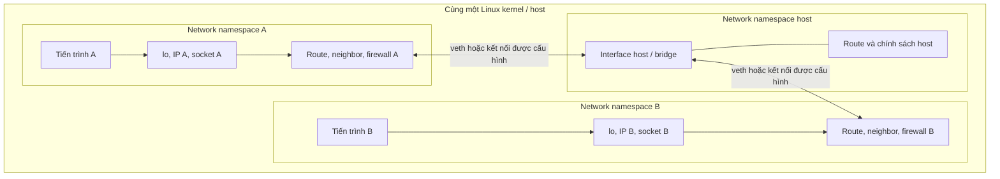
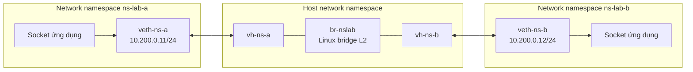

# Network namespace trong TCP/IP và an ninh mạng

Trong Linux, nhiều ứng dụng có thể chạy trên cùng một kernel nhưng cần nhìn thấy những môi trường mạng khác nhau. Ví dụ, hai container cùng chạy dịch vụ tại cổng TCP `8080`, một nhóm workload chỉ được giao tiếp với nhau, hoặc một kỹ sư cần dựng mạng thử nghiệm mà không thay đổi bảng định tuyến của hệ thống đang hoạt động. **Network namespace** (không gian tên mạng) là cơ chế ở mức kernel giúp tạo những góc nhìn mạng riêng như vậy.

Khác với việc chỉ đặt địa chỉ IP khác nhau cho hai tiến trình, network namespace tách các đối tượng thuộc ngăn xếp mạng của Linux: interface, IP, route, neighbor table, cổng lắng nghe và một phần quan trọng của trạng thái firewall. Mỗi namespace có thể hoạt động như một **ngăn xếp TCP/IP độc lập về mặt logic**; muốn có lưu lượng giữa các namespace, người quản trị phải thiết lập đường nối và chính sách phù hợp.

Trong module **SECURITY_NETWORK_SECURITY**, việc hiểu network namespace giúp phân tích phân đoạn mạng, firewall, IDS/IPS, VPN, DNS, mạng container, cloud và cách một gói tin đi qua các ranh giới tin cậy. Tuy nhiên, namespace là một **cơ chế cô lập**, không tự nó tạo thành môi trường an toàn đầy đủ trước tác nhân có đặc quyền hoặc cấu hình sai.

## Mục tiêu học tập

Sau bài này, bạn có thể:

1. Giải thích network namespace là gì và phân biệt với tiến trình, host, VLAN, VRF và container.
2. Xác định những thành phần TCP/IP được tách theo namespace và những thành phần không tự động được tách.
3. Theo dõi đường đi của gói tin qua cặp `veth`, Linux bridge, route và firewall.
4. Tự tạo một mô hình hai namespace trong lab, kiểm tra kết nối, đọc cấu hình và dọn dẹp.
5. Phân tích giới hạn bảo mật, đặc quyền và các cách workload có thể giao tiếp vượt ngoài namespace.
6. Lựa chọn điểm đặt kiểm soát và thu thập bằng chứng khi điều tra sự cố kết nối container.

## 1. Network namespace là gì?

Linux hỗ trợ nhiều loại namespace để các tiến trình nhìn thấy những tập tài nguyên khác nhau. **Network namespace** phân chia ngăn xếp mạng: tiến trình trong namespace A nhìn thấy interface, địa chỉ, route, socket và quy tắc mạng thuộc namespace A; tiến trình trong namespace B nhìn thấy các đối tượng tương ứng của B.

Mỗi tiến trình Linux thuộc một network namespace tại một thời điểm. Những tiến trình cùng namespace chia sẻ môi trường mạng đó. Khi hệ thống khởi động, các tiến trình thường ở namespace mạng mặc định của host (hay còn gọi là *initial network namespace*). Các namespace mới có thể được tạo và tiến trình được chạy bên trong bằng công cụ như `ip netns` hoặc API Linux.

### Hình dung đơn giản



Sơ đồ mô tả **cách tổ chức logic** của các đối tượng mạng. Kernel vẫn là kernel chung, và các đường nối giữa các namespace không tồn tại tự động chỉ vì tạo namespace.

Các thuộc tính đáng nhớ:

- Hai tiến trình ở hai namespace khác nhau có thể cùng bind `0.0.0.0:8080` mà không xung đột cổng với nhau, nếu không có xung đột ngay trong từng namespace.
- `127.0.0.1` chỉ vòng về ngăn xếp mạng của namespace hiện tại. Một tiến trình trong A không thể truy cập dịch vụ chỉ bind `127.0.0.1` của B bằng cách kết nối `127.0.0.1` từ A.
- Một interface mạng thông thường nằm trong **một network namespace tại một thời điểm**. Có thể chuyển đầu interface sang namespace khác, hoặc nối các namespace bằng cặp `veth`.
- Namespace mới thường có interface `lo` nhưng cần được bật; không tự có đường ra Internet, default route hay DNS hoạt động.
- Chia sẻ cùng kernel đồng nghĩa lỗ hổng kernel, đặc quyền quá rộng hoặc quyền thao tác namespace có thể làm suy yếu ranh giới cô lập.

## 2. Đối tượng TCP/IP nào được tách riêng?

| Đối tượng | Trong network namespace | Hệ quả vận hành và bảo mật |
| --- | --- | --- |
| Interface mạng | Mỗi namespace nhìn thấy interface được gắn cho mình, gồm `lo`, `veth`, interface vật lý nếu được chuyển vào. | Không thấy interface của namespace khác theo giao diện mạng thông thường. |
| Địa chỉ IPv4/IPv6 | Gắn với interface thuộc namespace đó. | Hai namespace có thể sử dụng dải địa chỉ giống nhau nếu thiết kế kết nối phù hợp. |
| Bảng route và policy routing | Mỗi namespace có tuyến và quy tắc định tuyến riêng. | Route trong host không tự xuất hiện trong namespace mới. |
| Neighbor cache | ARP (IPv4) và Neighbor Discovery (IPv6) gắn với ngữ cảnh mạng tương ứng. | Phân tích địa chỉ MAC/IP phải đúng namespace. |
| Socket TCP/UDP và cổng lắng nghe | Socket thuộc ngữ cảnh mạng mà nó được tạo; phạm vi bind/port có tính theo namespace. | `ss -lntup` cần chạy đúng namespace để quan sát dịch vụ. |
| Interface loopback | Mỗi namespace có `lo` riêng. | `localhost` của A khác `localhost` của B. |
| Firewall/netfilter | Nhiều bảng, chain, trạng thái conntrack và quy tắc được duy trì theo namespace. | Chính sách bên trong namespace và chính sách tại host/bridge có thể ảnh hưởng các đoạn đường đi khác nhau. |
| Trạng thái TCP/IP khác | Nhiều sysctl `net.*`, thiết lập protocol, thiết bị tunnel có phạm vi theo namespace. | Cần xác minh từng sysctl/thiết bị thay vì mặc định mọi tham số đều độc lập. |
| Process/PID, file system, user identity | **Không được cô lập chỉ bằng network namespace.** | Cần PID, mount, user namespace, cgroups và cơ chế bảo vệ khác theo mô hình triển khai. |
| Tệp cấu hình như `/etc/resolv.conf` | Là tệp trên file system; không tự tách chỉ vì tạo netns. | DNS có thể bị cấu hình nhầm khi ứng dụng dùng resolver chung. |

Khi quan sát bằng `/proc/<PID>/ns/net`, những tiến trình cùng network namespace thường có định danh inode namespace tương ứng. Đây là cách biết tiến trình đang thuộc không gian mạng nào, kể cả khi namespace không có tên được tạo bằng `ip netns add`.

### Tách giao diện khác với tách tiến trình

`ip netns` cung cấp **tên tiện dụng** cho các network namespace được quản lý. Trong khi đó, tiến trình có thể được đặt vào một namespace không có tên qua runtime container hoặc API. Vì vậy danh sách `ip netns list` không nhất thiết hiển thị *tất cả* namespace mà kernel hiện có.

Một namespace cũng có thể tiếp tục tồn tại khi còn tiến trình hoặc tham chiếu giữ nó, dù tên quản lý đã bị xóa. Khi dọn dẹp, cần biết tiến trình nào còn đang chạy trong namespace.

## 3. Network namespace liên quan gì đến ngăn xếp TCP/IP?

Network namespace thay đổi **bối cảnh xử lý** của gói tin: interface nhận gói, route được tra cứu, quy tắc firewall được xét, neighbor nào được phân giải và socket nào có thể nhận gói. Nó không định nghĩa lại IP hay TCP.

Với một gói từ chương trình trong namespace A:

1. Ứng dụng tạo socket và gửi dữ liệu; kernel dùng ngữ cảnh mạng liên quan đến socket.
2. Ngăn xếp IP tra cứu địa chỉ đích, policy routing, route và interface đi ra **của A**.
3. Nếu đích đi qua interface `veth`, gói được chuyển sang đầu bên kia của cặp `veth`.
4. Đầu đối diện có thể nằm ở namespace host, nơi bridge, router, firewall hoặc tunnel tiếp tục xử lý gói.
5. Sau khi qua đường nối đến namespace B, kernel xử lý ở giao diện của B, áp dụng chính sách liên quan và đưa đến socket phù hợp tại B.

Một chi tiết rất quan trọng: nếu A **không có route** đến địa chỉ đích, việc host có thể route đến đích đó không đủ để kết nối thành công. A cần route ra gateway hoặc mạng đích của riêng nó; sau đó gateway/host cần xử lý gói theo chính sách.

### `localhost` là riêng cho từng namespace

Giả sử tiến trình A bind `127.0.0.1:9000` trong namespace A. Khi tiến trình B ở namespace B kết nối `127.0.0.1:9000`, B chỉ tìm dịch vụ trong namespace B. B sẽ không tới dịch vụ A, dù cùng host vật lý.

Nếu muốn B truy cập A, phải có giao diện kết nối, địa chỉ có thể định tuyến và dịch vụ A bind tới địa chỉ phù hợp, đồng thời firewall cho phép. Việc bind `0.0.0.0` trong A là bind trên **mọi địa chỉ IPv4 hiện có của A**, không có nghĩa tự động công khai trên mọi interface của host.

## 4. Veth: sợi dây ảo nối hai namespace

`veth` (*virtual Ethernet*) là một **cặp interface Ethernet ảo**. Gói đi vào một đầu sẽ xuất hiện ở đầu còn lại. Mỗi đầu có thể nằm trong namespace khác nhau.

```text
Namespace A                   Namespace host                   Namespace B
 10.200.0.11                      Linux bridge                  10.200.0.12
    │                                 br-nslab                        │
 veth-ns-a ──[veth pair]── vh-ns-a ──┬── vh-ns-b ──[veth pair]── veth-ns-b
                                     │
                              Chuyển tiếp Ethernet
```

Một `veth` đôi cho phép nối điểm tới điểm; Linux bridge có thể gắn nhiều đầu `veth` để tạo một miền L2. Nếu dùng router L3 ở host thay vì bridge, các namespace có thể sử dụng các subnet riêng; lúc đó cần route và có thể cần bật IPv4/IPv6 forwarding ở nơi đóng vai trò router.

### `veth` và bridge không phải firewall

Bridge học MAC và chuyển frame Ethernet theo bảng FDB. Việc các interface cùng bridge là một **đường kết nối** giữa các namespace, không tự bảo đảm rằng máy này bị chặn truy cập máy kia.

Để kiểm soát truy cập, cần áp dụng chính sách tại các vị trí thực sự nhìn thấy đường đi: firewall trong namespace, host firewall, cơ chế lọc trên bridge, eBPF, hoặc distributed firewall/CNI. Trên Linux, lưu lượng bridge có thể đi qua các netfilter hook khác nhau tùy cấu hình và module như `br_netfilter`; không nên kết luận mọi gói bridge đều đi qua chain IPv4 `FORWARD` của host.

## 5. Lab: tạo hai network namespace và kiểm tra kết nối

Mô hình bên dưới phục vụ học tập trên **máy Linux hoặc VM lab mà bạn có quyền quản trị**. Các lệnh tạo và xóa những namespace/interface thử nghiệm; không chạy trên host sản xuất nếu chưa rà soát tên và các thành phần hiện có. Chúng yêu cầu quyền `root` hoặc capability thích hợp như `CAP_NET_ADMIN`.

Mục tiêu: tạo namespace `ns-lab-a`, `ns-lab-b` và bridge `br-nslab` trong host; nối mỗi namespace tới bridge bằng một cặp `veth`, đặt hai IP trong cùng mạng `10.200.0.0/24`, sau đó ping từ A sang B. Đây là mạng lab nội bộ; ví dụ **không thiết lập Internet/NAT**.

### 5.1. Sơ đồ mục tiêu



### 5.2. Tạo namespace và bridge

Các lệnh dưới đây giả định bạn chạy shell với quyền quản trị; nếu chưa có, sử dụng phương thức nâng quyền được phép trong lab.

```bash
# Tạo hai network namespace có tên
sudo ip netns add ns-lab-a
sudo ip netns add ns-lab-b

# Tạo Linux bridge trong network namespace của host
sudo ip link add br-nslab type bridge
sudo ip link set br-nslab up

# Kiểm tra danh sách namespace
ip netns list
```

Sau khi tạo, các namespace chưa có kết nối với bridge. Mỗi namespace có interface loopback riêng, thường đang ở trạng thái `DOWN`.

### 5.3. Tạo hai cặp `veth` và gắn vào bridge

```bash
# Cặp veth cho namespace A
sudo ip link add veth-ns-a type veth peer name vh-ns-a
sudo ip link set veth-ns-a netns ns-lab-a
sudo ip link set vh-ns-a master br-nslab
sudo ip link set vh-ns-a up

# Cặp veth cho namespace B
sudo ip link add veth-ns-b type veth peer name vh-ns-b
sudo ip link set veth-ns-b netns ns-lab-b
sudo ip link set vh-ns-b master br-nslab
sudo ip link set vh-ns-b up
```

Đầu `veth-ns-a` giờ thuộc namespace A nên không xuất hiện trong `ip link show` của host; muốn xem phải chạy lệnh trong A. Tương tự với B. Hai đầu `vh-ns-a` và `vh-ns-b` nằm phía host, làm cổng trên bridge.

### 5.4. Cấu hình loopback, IP và bật interface

```bash
# Namespace A
sudo ip netns exec ns-lab-a ip link set lo up
sudo ip netns exec ns-lab-a ip addr add 10.200.0.11/24 dev veth-ns-a
sudo ip netns exec ns-lab-a ip link set veth-ns-a up

# Namespace B
sudo ip netns exec ns-lab-b ip link set lo up
sudo ip netns exec ns-lab-b ip addr add 10.200.0.12/24 dev veth-ns-b
sudo ip netns exec ns-lab-b ip link set veth-ns-b up
```

Đặt IP có prefix `/24` làm kernel tự tạo connected route cho `10.200.0.0/24` trong mỗi namespace. Vì hai máy ở cùng subnet L2 nối bởi bridge, lab này **không cần default route, bật IP forwarding ở host hay NAT**.

### 5.5. Quan sát ngăn xếp TCP/IP riêng của từng namespace

```bash
# Kiểm tra địa chỉ, route, neighbor và socket trong namespace A
sudo ip netns exec ns-lab-a ip -brief address
sudo ip netns exec ns-lab-a ip route
sudo ip netns exec ns-lab-a ip neigh
sudo ip netns exec ns-lab-a ss -lntu

# Thử kết nối từ A sang B
sudo ip netns exec ns-lab-a ping -c 3 10.200.0.12

# Xem lại neighbor cache sau khi trao đổi lưu lượng
sudo ip netns exec ns-lab-a ip neigh show

# Quan sát cổng bridge tại host
bridge link show
```

Kết quả mong đợi: có route trực tiếp tới `10.200.0.0/24` qua `veth-ns-a`, ping tới `10.200.0.12` thành công nếu môi trường không có policy bổ sung ngăn ICMP, và neighbor cache trong A có thể xuất hiện MAC của B.

Thử quan sát loopback trong hai namespace:

```bash
sudo ip netns exec ns-lab-a ip address show lo
sudo ip netns exec ns-lab-b ip address show lo
```

Cả hai đều có `lo`, nhưng đây là hai interface khác nhau. Bạn có thể dùng `ip netns exec ns-lab-a ss -lnt` và lệnh tương tự với B để so sánh danh sách TCP listener; mặc định chưa có dịch vụ ứng dụng nào được tạo bởi lab.

### 5.6. Quan sát đường gói tin

Nếu máy lab có `tcpdump` và bạn được phép thu thập gói, mở terminal thứ nhất:

```bash
sudo tcpdump -ni vh-ns-a icmp
```

Trong terminal thứ hai:

```bash
sudo ip netns exec ns-lab-a ping -c 3 10.200.0.12
```

Tại đầu `vh-ns-a` ở host, bạn có thể quan sát request/reply ICMP đi qua cặp `veth`. Nếu không thấy gói, kiểm tra interface capture đúng, trạng thái `UP`, bridge membership và cơ chế offload/filter tại môi trường lab. Trên những hệ thống có traffic thực, packet capture có thể chứa dữ liệu nhạy cảm; chỉ thu thập trong phạm vi được cấp quyền.

### 5.7. Dọn dẹp đúng các tài nguyên của lab

Thoát mọi shell/tiến trình đang chạy trong `ns-lab-a` và `ns-lab-b` trước khi xóa. Có thể kiểm tra:

```bash
sudo ip netns pids ns-lab-a
sudo ip netns pids ns-lab-b
```

Khi không còn tiến trình lab đang dùng các namespace, xóa chúng rồi xóa bridge:

```bash
sudo ip netns del ns-lab-a
sudo ip netns del ns-lab-b
sudo ip link del br-nslab
```

Khi interface `veth` trong namespace bị hủy, cặp `veth` tương ứng cũng bị dỡ. Nếu vẫn còn tiến trình giữ namespace, `ip netns del` có thể xóa tên quản lý nhưng namespace chưa bị giải phóng hoàn toàn ngay. Không giết tiến trình hoặc xóa namespace khác không thuộc lab.

## 6. Từ L2 đến L3: khi nào cần routing và NAT?

Lab trên dùng một bridge L2, vì vậy các IP cùng `10.200.0.0/24` có thể trao đổi trực tiếp qua ARP và forwarding Ethernet. Trong hệ thống thực, hai namespace có thể ở **khác subnet**, ví dụ A `10.201.1.0/24` và B `10.201.2.0/24`. Khi đó cần một router hoặc gateway, cùng tuyến đi và tuyến về phù hợp.

Nếu host làm router, cần:

1. Interface phía host trong từng subnet hoặc router/tunnel phù hợp; chỉ có một bridge không tự tạo gateway L3.
2. Route trong mỗi namespace hướng tới gateway và route trở về phía đích.
3. IP forwarding được bật ở namespace thực sự đóng vai trò chuyển tiếp.
4. Firewall cho phép lưu lượng `FORWARD` cần thiết, gồm cả chiều phản hồi phù hợp stateful policy.

**NAT không bắt buộc** để hai subnet nội bộ nói chuyện với nhau nếu chúng định tuyến được. NAT thường được dùng khi nhiều namespace dùng địa chỉ private cần truy cập Internet qua IP nguồn của host, hoặc khi cần xử lý trùng địa chỉ/điều kiện mạng cụ thể. Cả NAT lẫn tunnel không thay thế được phân quyền và firewall.

Ví dụ luồng đơn giản trong mô hình có gateway là:

```text
Tiến trình A
   │  Gói IP nguồn 10.201.1.11, đích 10.201.2.12
Namespace A: chọn default route hoặc route đích
   │
veth A → Router/Gateway trong host hoặc namespace router
   │  Route lookup + policy FORWARD + (NAT nếu thiết kế có)
veth B
   │
Namespace B: policy tại đầu nhận → socket ứng dụng B
```

Một chiều có route chưa đủ: firewall stateful, route trở về hoặc các chính sách NAT/conntrack có thể khiến kết nối thất bại. Khi đọc log phải phân biệt gói trước NAT và sau NAT, interface nhận và interface gửi, cũng như namespace đang giữ bảng conntrack.

## 7. DNS trong network namespace: điểm rất dễ hiểu sai

Network namespace quản lý giao diện và đường đi của gói DNS, nhưng **không tự tạo một file `/etc/resolv.conf` riêng**. Trình resolver trong ứng dụng vẫn đọc các tệp cấu hình theo filesystem/mount namespace mà tiến trình nhìn thấy.

Công cụ `ip netns exec <tên>` của iproute2 có cơ chế hỗ trợ cấu hình theo namespace: các tệp ở `/etc/netns/<tên>/` có thể được đưa vào vị trí tương ứng trong `/etc` của tiến trình chạy lệnh thông qua mount namespace. Khi dùng container runtime, DNS có thể được cấu hình theo cách khác.

Những lỗi thường gặp:

- Namespace đã ping được IP nhưng không phân giải được tên do resolver trỏ tới địa chỉ không thể tiếp cận.
- `127.0.0.53` hoặc `127.0.0.1` trong `resolv.conf` chỉ có ý nghĩa nếu DNS stub thực sự lắng nghe tại loopback của **chính namespace đó** (hoặc có cơ chế phù hợp).
- Namespace có route tới DNS nhưng firewall/ACL chặn UDP/TCP 53, DNS-over-TLS/HTTPS hoặc lưu lượng resolver khác.
- Khi kết nối VPN hoặc overlay, split DNS, domain search và route tới DNS nội bộ có thể cần cấu hình riêng.

Quy trình kiểm tra: xác định DNS server mà tiến trình đọc được; kiểm tra đường tới IP DNS từ đúng namespace; xác minh resolver đang chạy ở đâu; cuối cùng đối chiếu chính sách bảo vệ DNS và log liên quan. Không tự chỉnh DNS của host để chữa một namespace khi chưa biết nơi cấu hình được quản lý.

## 8. Tích hợp với container, Kubernetes và cloud

### 8.1. Container

Một container runtime có thể tạo network namespace cho container rồi đưa một đầu `veth` vào đó, cấu hình địa chỉ IP, route và kết nối đầu còn lại tới bridge, router, overlay hoặc mạng cloud. Tuy nhiên, **container không chỉ là network namespace**: PID namespace, mount namespace, user namespace, cgroups, seccomp, AppArmor/SELinux và cấu hình capability cùng góp phần cô lập.

Hai container có thể có namespace mạng riêng, hoặc được cấu hình để **chia sẻ một network namespace**. Khi chia sẻ, chúng nhìn thấy cùng interface, địa chỉ và phạm vi cổng TCP/UDP; `localhost` và các listener cũng nằm trong mạng chung đó.

### 8.2. Kubernetes

Trong mô hình pod thông dụng, các container cùng một **Pod** chia sẻ network namespace, địa chỉ IP pod và port space. Sidecar và ứng dụng chính có thể giao tiếp qua `localhost`. Các Pod khác nhau thường có không gian mạng riêng, dù đường chuyển tiếp cụ thể phụ thuộc CNI.

Ví dụ:

- Container A trong Pod P bind `127.0.0.1:15000`; container B **cùng Pod P** có thể kết nối tới endpoint đó.
- Container của Pod Q không thể coi `127.0.0.1:15000` là dịch vụ của Pod P; nó nhìn thấy loopback của Q.
- Hai container trong cùng Pod P không thể cùng bind cùng một địa chỉ/cổng TCP một cách thông thường; chúng chia sẻ port space của Pod.

Có nhiều CNI triển khai mạng Pod bằng route trực tiếp, bridge, overlay như VXLAN/Geneve hoặc eBPF. **Network namespace không quyết định CNI sử dụng overlay**; đó là hai cơ chế ở tầng khác nhau. Kubernetes `NetworkPolicy` cũng không tự có hiệu lực nếu CNI không hỗ trợ thực thi, và phạm vi bảo vệ phụ thuộc chính sách và datapath cụ thể.

Chế độ `hostNetwork: true` làm Pod dùng namespace mạng của node; đây là khác biệt quan trọng về địa chỉ, cổng và bề mặt tấn công. Việc tiến trình Pod có thể quản trị mạng host hay không còn phụ thuộc đặc quyền/capability và nhiều lớp bảo vệ khác.

### 8.3. Overlay, VPN và cloud

Network namespace hoạt động **bên trong một kernel Linux**. Overlay như VXLAN/Geneve, VPN như WireGuard/IPsec hoặc mạng ảo do cloud điều khiển có thể cung cấp đường kết nối giữa các host/site. Một giao diện tunnel có thể được tạo hoặc chuyển vào network namespace, nhưng tunnel vẫn cần underlay reachability và chính sách bảo mật.

Ví dụ một Pod ở node A có namespace mạng riêng, chuyển gói qua `veth`/CNI; node A có thể đóng gói gói đó vào VXLAN để đi qua IP fabric tới node B. Như vậy có nhiều lớp:

```text
Ứng dụng → TCP/IP trong network namespace của Pod
         → veth / policy CNI
         → tunnel overlay (nếu CNI sử dụng)
         → IP underlay giữa node A và node B
         → giải tunnel → veth / network namespace Pod đích
```

Vì thế khi phân tích lưu lượng, cần tách rõ `Pod IP`, `node IP`, interface veth, tunnel endpoint và chính sách thực sự xử lý gói ở mỗi chặng.

## 9. Network namespace có phải ranh giới bảo mật hoàn chỉnh?

**Không.** Nó làm giảm mức độ một tiến trình nhìn thấy và tương tác trực tiếp với ngăn xếp mạng khác, nhưng có thể có nhiều đường kết nối hợp lệ hoặc bị cấu hình quá rộng. Khả năng cô lập và tác động của một tiến trình còn phụ thuộc quyền, kernel và các lớp bảo vệ còn lại.

| Giả định dễ sai | Thực tế cần kiểm tra |
| --- | --- |
| “Khác namespace thì không thể giao tiếp.” | `veth`, bridge, route, VPN, overlay, proxy hoặc socket/IPC được cấu hình có thể tạo đường trao đổi dữ liệu. |
| “Namespace riêng nghĩa là đã phân đoạn mạng an toàn.” | Phân đoạn yêu cầu policy cụ thể cho nguồn, đích, giao thức, danh tính và lưu lượng east-west. |
| “Mọi interface đều bị giấu nên host không thấy traffic.” | Host có thể quan sát tại đầu `veth`, bridge, tunnel hoặc điểm khác tùy datapath/quyền. |
| “Có namespace riêng nên không cần phân quyền.” | Tiến trình có quyền/capability lớn hoặc cấu hình quản lý host quá rộng vẫn có thể làm thay đổi mạng. |
| “Cổng 8080 của namespace A đã công khai từ Internet.” | Phải có đường route/NAT/proxy/service mapping và firewall phù hợp mới tới được từ ngoài. |
| “Container có network namespace riêng thì đã an toàn.” | Cần bảo vệ kernel, capability, mount/user/PID namespace, image, secrets và workload policy. |
| “Tên DNS trong namespace là riêng.” | Tệp resolver và dịch vụ DNS phải được bố trí hợp lý; netns chỉ điều khiển đường kết nối mạng. |

### Đặc quyền và khả năng thao tác mạng

Tạo và quản trị interface, route hoặc firewall thường yêu cầu `CAP_NET_ADMIN` trong ngữ cảnh user namespace sở hữu network namespace, hoặc quyền tương ứng được hệ thống cho phép. `ip netns exec` thông thường cần khả năng nhập namespace và thực thi lệnh theo quyền hiện tại. Cơ chế user namespace cho phép một số mô hình không cần quyền root toàn hệ thống, nhưng không đồng nghĩa mọi thao tác tạo netns/veth đều được phép trong mọi môi trường.

Một workload được cấp `CAP_NET_ADMIN` có thể sửa route hoặc firewall trong namespace mà capability đó có hiệu lực; nếu được chia sẻ namespace mạng với workload khác, ảnh hưởng có thể lan tới những tiến trình chia sẻ. Với môi trường nhạy cảm, dùng least privilege, hạn chế host networking, bảo vệ API/runtime và tránh cấp capability mạng không cần thiết.

### Bề mặt tấn công nên đưa vào threat model

1. **Giao diện kết nối:** endpoint nào nối namespace vào host, mạng khác hoặc Internet?
2. **Vùng tin cậy:** ai được phép đi qua bridge, router, gateway, Service và CNI policy?
3. **Kiểm soát danh tính:** workload dùng token, quyền hệ điều hành hay identity nào để gọi dịch vụ đích?
4. **Đặc quyền quản trị:** ai tạo namespace, chuyển interface, thêm route, thay firewall hoặc sửa cấu hình CNI?
5. **Quan sát xâm nhập:** IDS/IPS đặt tại host/bridge/eBPF/Pod có thấy được traffic trước hoặc sau đóng gói/mã hóa không?
6. **Hạn chế thoát ra ngoài:** workload có thể truy cập DNS, metadata endpoint của cloud, Internet và các mạng quản trị ở mức nào?
7. **Giới hạn kernel chung:** có dùng policy giảm capability, syscall, file system và tài nguyên để hạn chế tác động khi tiến trình bị chiếm không?

Với dịch vụ nhạy cảm, lớp kiểm soát cấp ứng dụng như xác thực, ủy quyền và TLS/mTLS vẫn quan trọng. Mạng riêng là một điều kiện của thiết kế bảo mật, không phải bằng chứng rằng request từ mạng đó đã đáng tin.

## 10. Firewall, conntrack và chính sách theo từng chặng

Không có một “firewall namespace” duy nhất chi phối toàn bộ đường gói tin từ container đến Internet. Quy tắc có thể tồn tại tại nhiều điểm:

- **Trong namespace nguồn:** filter trên traffic đi ra, định tuyến nội bộ hoặc policy CNI thực thi ở endpoint.
- **Tại host hoặc namespace router:** `FORWARD`, NAT, conntrack, bridge filtering, `tc`/eBPF; chính xác hook nào được dùng phụ thuộc datapath.
- **Trong namespace đích:** lọc input hoặc egress/ingress policy ở interface đích.
- **Ngoài host:** firewall vật lý, gateway cloud, security group, ACL, IDS/IPS và mạng đối tác.

Nhiều bảng/chain netfilter và trạng thái conntrack có **phạm vi theo network namespace**. Khi muốn đọc firewall của container, chạy lệnh với đúng namespace và quyền thích hợp; đọc `nft list ruleset` ở host không mặc nhiên phản ánh mọi rule trong namespace khác.

Ví dụ lệnh **chỉ đọc trạng thái**:

```bash
# Hiển thị socket, route và quy tắc nftables trong namespace A
sudo ip netns exec ns-lab-a ss -lntu
sudo ip netns exec ns-lab-a ip route
sudo ip netns exec ns-lab-a nft list ruleset

# Hiển thị ruleset ở namespace host để đối chiếu
sudo nft list ruleset
```

Lệnh `nft` có thể chưa được cài, hoặc hệ thống đang dùng iptables/legacy backend, eBPF hay firewall do runtime quản lý. Không thấy rule trong namespace A **không đồng nghĩa** gói không bị lọc ở nơi khác. Đặt câu hỏi theo hướng “gói có đi qua hook/policy nào trên đường thực tế?” và xác nhận với counter/log.

### Tình huống: namespace A không đi được Internet

Đầu tiên kiểm tra A có địa chỉ và default route chưa; sau đó xem gateway có route/forwarding hay không, NAT có cần không, policy `FORWARD` có chặn không, DNS có hoạt động không. Nếu ping IP public được nhưng gọi tên miền lỗi, ưu tiên kiểm tra resolver và DNS path. Nếu dùng tunnel VPN/overlay, kiểm tra tuyến tới tunnel peer, tunnel state và MTU tương ứng.

## 11. Quan sát mạng và xử lý sự cố từ đúng namespace

Một lỗi thường gặp là chạy toàn bộ lệnh trên host rồi kết luận dịch vụ trong container không lắng nghe hoặc không có route. Do network namespace có bảng socket và route riêng, cần xác định **đúng namespace mà tiến trình thuộc về**.

### 11.1. Tìm network namespace của tiến trình

Nếu biết PID của một tiến trình thuộc quyền kiểm tra, có thể xem tham chiếu namespace:

```bash
# Thay 12345 bằng PID thực của tiến trình trong phạm vi được quản trị
readlink /proc/12345/ns/net

# So sánh với namespace mạng của shell hiện tại
readlink /proc/self/ns/net
```

Kết quả thường có dạng `net:[inode]`. Nếu giống nhau, hai tiến trình có cùng network namespace tại thời điểm kiểm tra. Để xem trạng thái từ namespace của một tiến trình có thể dùng `nsenter` với quyền phù hợp:

```bash
# Chỉ đọc cấu hình mạng trong netns của PID được phép quan sát
sudo nsenter --target 12345 --net ip -brief address
sudo nsenter --target 12345 --net ip route
sudo nsenter --target 12345 --net ss -lntup
```

Khi chọn `nsenter --net`, tiến trình mới vào network namespace của PID được chỉ định; các namespace khác (mount/user/PID...) không tự động giống PID đó. Vì vậy đường dẫn file, danh sách PID hoặc quyền vẫn có thể khác với tiến trình gốc.

### 11.2. Trình tự điều tra theo mô hình TCP/IP

| Triệu chứng | Kiểm tra trong namespace nguồn | Kiểm tra bên ngoài namespace |
| --- | --- | --- |
| `connect: Network is unreachable` | Địa chỉ IP, route, default gateway, policy routing. | Host/gateway có kết nối tới đích chưa. |
| `Connection refused` | Đúng IP/port không, service có listen, trạng thái TCP socket. | NAT/proxy có trỏ sai port; firewall dùng REJECT hay không. |
| Kết nối timeout | Route, neighbor, local policy, source IP, retransmission. | Đầu `veth`, bridge, FORWARD/ACL, route trở về, security group. |
| Ping IP được nhưng tên miền lỗi | DNS resolver, `resolv.conf`, route tới DNS, UDP/TCP 53. | Resolver thực sự nằm ở đâu và có cho phép truy cập không. |
| Namespace A truy cập được dịch vụ B nhưng không ngược lại | Route về, firewall hai chiều, dịch vụ bind đúng interface. | NAT/conntrack, stateful policy, route bất đối xứng. |
| Gói nhỏ qua được, gói lớn lỗi | MTU interface, PMTUD, TCP MSS. | MTU bridge, tunnel encapsulation, ICMP cần cho PMTUD. |
| IDS tại host thiếu thông tin ứng dụng | Quan sát trước encapsulation hoặc tại endpoint nếu được phép. | Vị trí sensor, overlay, TLS/VPN và khả năng giải mã. |
| Hai workload lẽ ra bị cô lập nhưng truy cập được nhau | Route và policy workload/CNI, listener đích. | Bridge, inter-VRF gateway, hostNetwork, proxy và đường bypass. |

### 11.3. Đọc flow theo từng chặng

Khi xử lý một yêu cầu `A:client → B:443`, hãy ghi lại: IP/port nguồn-đích, namespace A, tên interface đi ra, đầu `veth` ở host, bridge/router, interface vào B và namespace B. Quan sát counter, flow log hoặc packet capture ở nơi có quyền. Một packet capture tại host có thể thấy **outer packet** nếu CNI dùng overlay, trong khi capture ở đầu `veth` gần Pod thường thấy **inner packet**.

Sơ đồ đường đi để gắn bằng chứng:

```text
Ứng dụng A
  │  (1) Socket TCP và route trong netns A
  ▼
veth A
  │  (2) Đầu veth ở host: frame/packet trước tunnel
  ▼
Bridge / Router / CNI / eBPF
  │  (3) Policy, conntrack, NAT; có thể encapsulation overlay
  ▼
Underlay / Cloud network
  │  (4) Route, tunnel peer, security group, firewall
  ▼
Host đích → veth B
  │  (5) Decapsulation/policy tại datapath đích
  ▼
netns B → socket ứng dụng B
```

Thứ tự của NAT, tunnel, policy và điểm hook cụ thể thay đổi theo runtime/CNI. Vì vậy sơ đồ là **khung phân tích**, cần đối chiếu triển khai thực tế trước khi khẳng định một rule được áp dụng ở bước nào.

## 12. Những hiểu lầm và lỗi cấu hình phổ biến

1. **Quên bật `lo`:** nhiều dịch vụ dùng `localhost`; loopback đang `DOWN` có thể khiến ứng dụng thất bại dù interface `veth` hoạt động.
2. **Chỉ cấu hình IP mà không bật `veth`:** cả hai đầu kết nối cần được bật và gắn đúng bridge/route.
3. **Nhầm địa chỉ host với địa chỉ namespace:** `ip address` chạy ở host không thấy các IP trong namespace khác.
4. **Giả định namespace tự có mạng ngoài:** không có default route, gateway, forwarding/NAT thì gói không tự tới Internet.
5. **Nhầm DNS với reachability:** ping IP tốt không chứng minh resolver đang trỏ đúng DNS server.
6. **Lạm dụng quyền mạng:** cấp `CAP_NET_ADMIN`, `privileged` hoặc host networking không cần thiết làm tăng bề mặt tấn công.
7. **Tin rằng mọi traffic qua host `FORWARD`:** bridge datapath, `br_netfilter`, eBPF hoặc offload có thể thay đổi nơi thực thi policy.
8. **Nghĩ khác namespace là khác kernel:** các namespace vẫn chia sẻ Linux kernel và các tài nguyên không được namespace đó cô lập.
9. **Quên kiểm tra chiều về:** TCP cần luồng hai chiều; return route, NAT và stateful firewall đều quan trọng.
10. **Không quản lý vòng đời:** xóa tên namespace khi còn tiến trình có thể để lại namespace chưa được giải phóng; script cleanup phải xác định tài nguyên chính xác.

## 13. Bài tập tình huống: hai dịch vụ trong cùng một host

Một công ty vận hành ứng dụng đặt hàng và công cụ quản trị trên cùng máy Linux:

- `orders` ở network namespace riêng, IP `10.80.1.10`, dịch vụ HTTP `8080`.
- `admin` ở network namespace khác, IP `10.80.2.10`, giao diện quản trị `8443`.
- Host làm router giữa hai subnet. Ứng dụng đặt hàng cần gọi API quản trị giới hạn trên TCP `8443`, nhưng công cụ quản trị không được truy cập vào cổng database `5432` của `orders`.
- Một kỹ sư nhận thấy `orders` không phân giải được `internal.example.test`, trong khi vẫn ping được IP gateway của host.
- IDS triển khai trên card mạng vật lý của host không ghi nhận traffic giữa `orders` và `admin`.

### Yêu cầu phân tích

1. Hãy vẽ đường đi từ socket `orders` đến `admin:8443`, ghi rõ những interface và namespace cần kiểm tra.
2. Vì sao hai dịch vụ có thể chạy cùng cổng TCP nếu nằm ở hai network namespace khác nhau?
3. Firewall cần đặt ở đâu để chặn `admin → orders:5432` mà vẫn cho phép luồng API đúng mục đích? Có đường bypass nào cần xem xét?
4. Hãy đưa ra ít nhất ba nguyên nhân có thể khiến phân giải DNS lỗi dù ping gateway thành công.
5. Vì sao IDS trên card vật lý có thể không thấy kết nối giữa hai namespace? Bạn sẽ bổ sung sensor/telemetry ở đâu?
6. Những quyền nào không nên cấp cho tiến trình nếu nó không cần tự thay đổi interface, route và firewall?

### Hướng giải tham khảo

| Vấn đề | Phân tích | Kiểm chứng/hành động |
| --- | --- | --- |
| Luồng `orders → admin:8443` | Route của `orders` gửi tới veth/gateway host, host forward sang subnet `admin`, sau đó tới socket nghe tại `10.80.2.10:8443`. | Đọc `ip route` trong từng netns, route/forwarding host, listener và rule thực tế ở từng chặng. |
| Hai dịch vụ trùng port | Socket và port binding được quản lý theo network namespace. | So sánh `ss -lnt` ở từng netns; cùng port không có nghĩa cùng IP/đường truy cập. |
| Chặn `admin → orders:5432` | Chính sách phân đoạn tại host router hoặc distributed/endpoint firewall cần deny cụ thể và kiểm soát mọi đường nối. | Kiểm thử từ subnet `admin`, xem counter/log; đảm bảo không có bridge hoặc proxy bypass. |
| DNS lỗi | `resolv.conf` dùng DNS loopback của host, DNS server không route được, firewall chặn port hoặc tên miền nội bộ cần split DNS. | Đọc resolver mà tiến trình thấy, thử kết nối tới DNS theo đúng IP/namespace, kiểm tra log DNS. |
| IDS không thấy lưu lượng | Hai namespace trao đổi nội bộ qua veth/route trong host; gói có thể không đi ra card vật lý. | Đặt quan sát tại `veth`, bridge, host routing path, CNI/eBPF hoặc endpoint theo quyền và mục tiêu giám sát. |
| Quyền quá rộng | Tiến trình bình thường không cần `CAP_NET_ADMIN` hay quyền quản trị host để xử lý HTTP. | Giới hạn capability, user/mount namespace phù hợp và policy host/runtime. |

### Câu hỏi tự kiểm tra

1. Network namespace có làm mỗi tiến trình dùng một Linux kernel riêng không?
2. Vì sao `127.0.0.1` trong namespace A không tự truy cập được `127.0.0.1` của namespace B?
3. Một đầu `veth` có thể vừa nằm ở host vừa nằm trong namespace A tại cùng thời điểm không?
4. Khi nào chỉ cần bridge, khi nào phải có routing, và NAT có luôn bắt buộc không?
5. Vì sao `ip netns list` có thể không hiển thị một namespace mà tiến trình container đang sử dụng?
6. Dùng `nft list ruleset` trên host có bảo đảm xem được mọi rule trong network namespace của Pod không?
7. Network namespace tự tách file `/etc/resolv.conf` không? Công cụ nào có thể giúp cấu hình theo tên namespace?
8. Hai container trong cùng Pod Kubernetes có chia sẻ `localhost` và port space không?
9. Vì sao cần phân đoạn, firewall và xác thực ứng dụng dù mỗi workload đã có netns riêng?
10. Nếu một namespace ping IP đích được nhưng kết nối API timeout, bạn sẽ thu thập bằng chứng ở những chặng nào?

**Ghi nhớ:** Network namespace giúp Linux duy trì các ngăn xếp TCP/IP logic riêng trên cùng kernel. `veth`, bridge, router, tunnel và CNI tạo đường kết nối giữa các ngăn xếp đó; routing và firewall quyết định gói được đi đâu; quyền của tiến trình, chính sách phân đoạn và giám sát quyết định mức độ an toàn. Khi đánh giá hoặc xử lý sự cố, hãy luôn xác định **đúng namespace, đúng interface, đúng đường đi và đúng điểm thực thi policy**.

