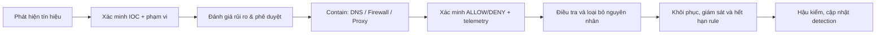
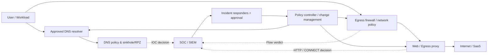
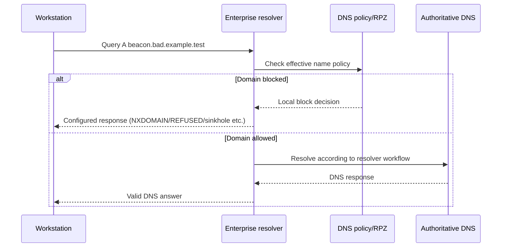
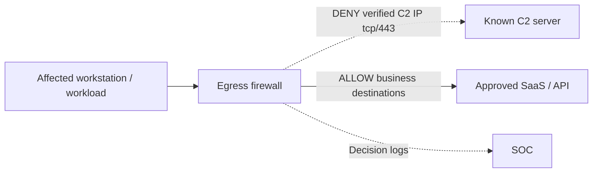
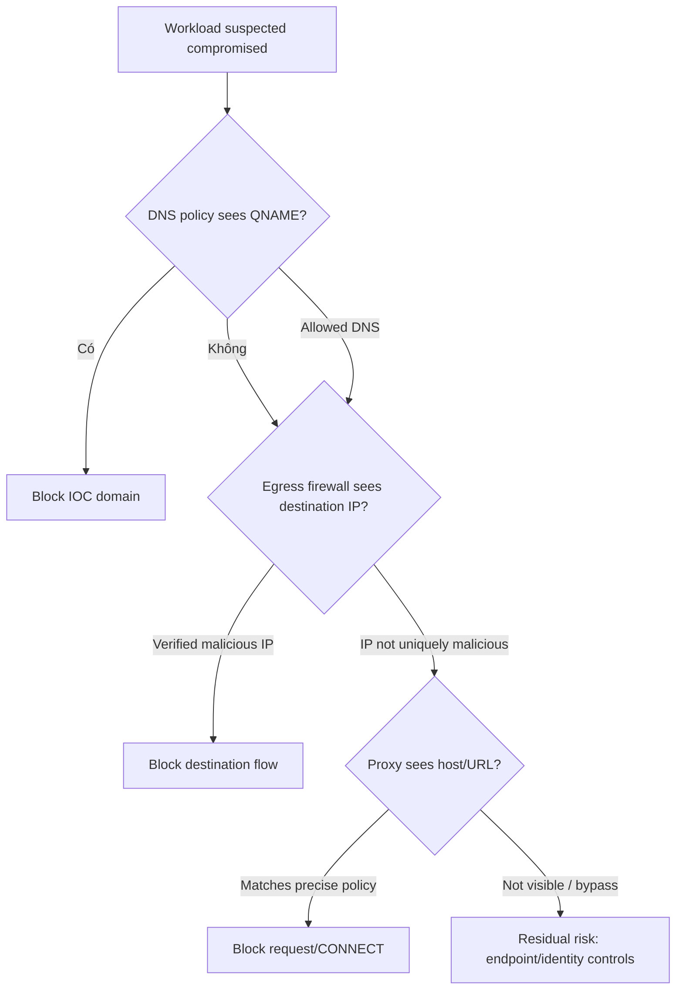
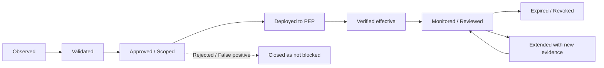
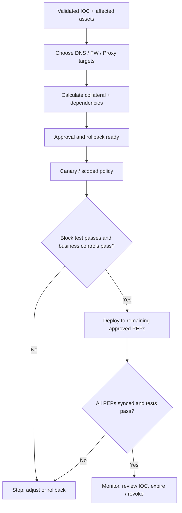
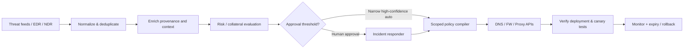
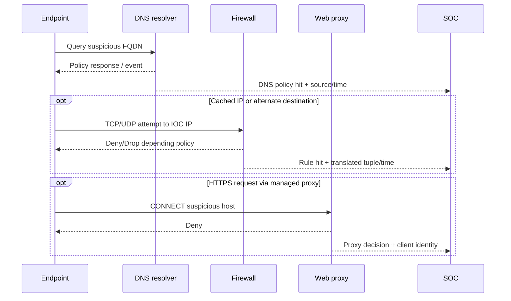
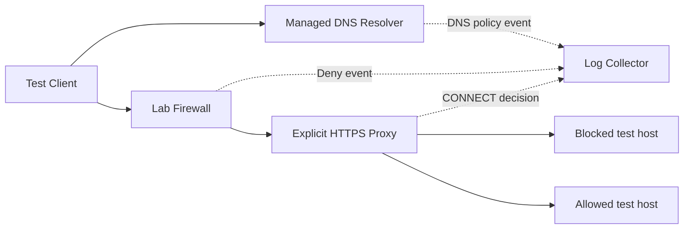

# Chặn IOC tại DNS, firewall và proxy: containment nhiều lớp trong ứng phó sự cố mạng

Một SOC phát hiện máy trạm trong mạng doanh nghiệp liên tục truy vấn `beacon.bad.example.test`, sau đó tìm cách kết nối tới một địa chỉ IP không thuộc hệ thống được phê duyệt. Đội ứng phó có thể muốn chặn ngay để hạn chế command-and-control (C2), nhưng một quyết định quá rộng — chẳng hạn chặn cả dải IP của nhà cung cấp CDN chỉ vì một domain bị lợi dụng — có thể khiến hàng trăm dịch vụ hợp lệ ngừng hoạt động. Ngược lại, chỉ chặn một tên miền ở DNS cũng không đủ nếu mã độc đã biết địa chỉ IP hoặc dùng một resolver riêng.

Vấn đề quan trọng không phải đơn thuần là *“thêm IOC vào blocklist”*, mà là **chặn đúng hành vi ở đúng điểm thực thi, đủ nhanh để giảm thiệt hại, có bằng chứng, có rollback và không làm mất kiểm soát hoạt động kinh doanh**.

**Indicator of Compromise (IOC)** là một dấu hiệu có thể hỗ trợ phát hiện hoạt động đã hoặc đang bị xâm nhập: tên miền, địa chỉ IP, URL, certificate fingerprint, file hash, process artifact hay một tổ hợp đặc điểm. Trong phạm vi bài này, chúng ta tập trung vào các IOC **có thể dùng tại DNS, firewall và proxy** — như FQDN, IPv4/IPv6, địa chỉ đích, cổng/giao thức, URL/host và đặc điểm kết nối.

Bài học thuộc chương **Ứng phó sự cố mạng** trong module **SECURITY_NETWORK_SECURITY**. Những kỹ năng về phân đoạn, firewall, VPN, IDS/IPS, xác thực kết nối, bảo vệ DNS, cloud, network telemetry, packet analysis và threat modeling sẽ được kết hợp để thực hiện **containment mạng theo bằng chứng**, không đồng nhất chặn chỉ báo với việc đã loại bỏ mã độc.

Sau bài học, bạn có thể:

1. Phân biệt **IOC, indicator of attack (IOA), detection, containment, eradication và recovery**.
2. Kiểm tra nguồn gốc, độ mới, mức tin cậy, ngữ cảnh và nguy cơ **false positive** trước khi chặn.
3. Ánh xạ từng loại IOC đến **DNS resolver/RPZ, firewall egress/ingress và secure web proxy** có khả năng thực thi phù hợp.
4. Thiết kế chính sách chặn theo **workload/user, destination, port, protocol, thời hạn và phạm vi** thay vì allow/deny rộng không kiểm soát.
5. Hiểu sự khác nhau giữa **DNS name, resolved IP, SNI, HTTP Host, CONNECT authority, URL path và TLS identity**.
6. Kiểm tra các đường vòng qua **DNS cache, hardcoded IP, DoH/DoT, QUIC/HTTP/3, VPN, NAT, IPv6, cloud private endpoints** và những kết nối đã thiết lập.
7. Thiết lập triển khai canary, kiểm thử **blocked-path và business-positive control**, quan sát policy/log và rollback.
8. Phối hợp IOC block với điều tra host, thu hồi credential, EDR, IAM và application authorization.
9. Xây dựng playbook khẩn cấp, tiêu chí tự động hóa an toàn, vòng đời expiry/review và hậu kiểm.

> **Giới hạn thực hành:** Tên miền dạng `example.test`, các dải địa chỉ tài liệu `192.0.2.0/24`, `198.51.100.0/24`, `203.0.113.0/24` và `2001:db8::/32` chỉ dành cho ví dụ. Không sử dụng các chỉ báo giả định trong chính sách production. Không thử truy cập cơ sở hạ tầng độc hại thật, không triển khai chặn mạng ngoài phạm vi có quyền và không xuất bản dữ liệu/credentials điều tra nhạy cảm.

## 1. Vì sao phải chặn IOC trong incident response?

### 1.1. IOC block nhằm làm gì?

Các mục tiêu có thể là:

- **Ngắt kết nối C2:** hạn chế máy nhiễm nhận lệnh hoặc báo trạng thái ra ngoài.
- **Giảm exfiltration:** chặn những destination được xác nhận là kênh thoát dữ liệu.
- **Giới hạn tải xuống payload:** ngăn truy cập tên miền/URL phát tán mã độc hoặc phishing.
- **Khoanh vùng sự cố:** chặn đường lateral movement tới mục tiêu cụ thể.
- **Giữ thời gian điều tra:** giảm khả năng attacker tiếp tục hành động trong lúc SOC xác định phạm vi.
- **Bảo vệ các máy chưa bị ảnh hưởng:** giảm khả năng truy cập cùng infrastructure bị đánh giá nguy hiểm.
- **Tạo tín hiệu giám sát:** theo dõi những nguồn tiếp tục tìm cách giao tiếp với chỉ báo đã bị chặn.

**Chặn IOC không tự xóa persistence, gỡ mã độc, thu hồi token đã lộ, vá lỗ hổng hay đảm bảo dữ liệu chưa bị lấy đi.** Đó là hành động **containment**, thường cần phối hợp host isolation, EDR và identity response.

### 1.2. Đặt IOC block vào vòng đời ứng phó



Trong một sự cố cấp bách, containment có thể triển khai **trước khi toàn bộ root cause rõ ràng**, nhưng phải ghi **lý do, phạm vi, owner, deadline và rollback**. Không cần có kết luận cuối cùng về mã độc mới được chặn một endpoint nguy hiểm đã có bằng chứng rõ; tuy nhiên thiếu thông tin về shared hosting/CDN có thể khiến hành động quá rộng.

### 1.3. IOC khác IOA

| Dạng chỉ báo | Ví dụ | Giá trị | Hạn chế |
|---|---|---|---|
| **Domain IOC** | `beacon.bad.example.test` | Chặn qua DNS/proxy hostname | Thay domain, cache, IP direct hoặc DoH bypass |
| **IP IOC** | Một host C2 có IP xác nhận | Chặn ở firewall L3/L4 | Cloud IP có thể chia sẻ/tái phân bổ |
| **URL IOC** | `https://portal.example.test/login-fake` | Proxy/browser/email protection có thể chặn chi tiết | HTTP path HTTPS bị mã hóa nếu không giải mã |
| **File hash IOC** | SHA-256 của payload | Endpoint/EDR kiểm tra artifact | Không thể chặn bằng DNS/firewall một cách trực tiếp |
| **TLS certificate fingerprint** | Hash chứng chỉ hoặc key theo ngữ cảnh | Endpoint/proxy/cert telemetry nếu khả dụng | Cert rotation; nhiều handshake fields mã hóa |
| **IOA/hành vi** | Service account mới gọi 100 admin endpoints | Giúp phát hiện biến thể chưa có IOC tĩnh | Cần baseline/context, dễ false positive |

IOC là **bằng chứng gợi ý**, không phải bản án độc lập. Một DNS lookup tới domain nghi vấn có thể do sandbox phân tích, threat intelligence checker, security product hoặc malware; cần xác minh source/intent và thời điểm.

### 1.4. Một địa chỉ độc hại không nói lên toàn bộ host

```text
IOC: destination 203.0.113.24

Questions before blocking:
  Is this an exclusive attacker server or shared cloud/CDN address?
  What time was it observed?
  Which victim/source made the connection?
  Was the connection successful?
  Was a payload downloaded or data uploaded?
  Could this IP have been reallocated?
  Is there a narrower FQDN/URL/method to block?
```

Đặc biệt ở cloud, cùng IP có thể phục vụ nhiều tenants, hoặc một IP đã được giải phóng/tái phân bổ. **Đừng suy từ một kết nối quá khứ rằng toàn bộ CIDR/ASN vẫn độc hại hôm nay.**

## 2. Ba lớp chặn bổ trợ: DNS, firewall và proxy

### 2.1. So sánh nhanh

| Lớp | Đối tượng phù hợp | Điểm mạnh | Giới hạn |
|---|---|---|---|
| **DNS security/resolver** | FQDN, zone/name patterns, query policy | Ngăn phân giải tên ở resolver kiểm soát | Không chặn IP hardcoded, DNS đã cache hoặc DNS bypass |
| **Firewall L3/L4** | IPv4/IPv6, port, protocol, zone/interface/workload | Không phụ thuộc tên miền khi đã có IP, áp tại đường mạng | Không biết URL path/JWT; IP có thể dùng chung |
| **HTTP(S) proxy/SWG** | Hostname/CONNECT authority, HTTP URL khi quan sát được, user/app policy | Chính sách theo ứng dụng/user, logs và web control | HTTPS path thường mã hóa nếu chỉ tunnel; traffic bypass proxy |

Tầng không chặn thay thế được toàn bộ tầng khác. Ví dụ:

```text
DNS policy:
  Deny resolution of known C2 hostname.

Firewall egress:
  Deny direct TCP/UDP to verified C2 IPs from affected segment.

Web proxy:
  Deny known phishing host or URL when visible.

Endpoint/identity:
  Isolate compromised device, revoke stolen credentials.
```

### 2.2. Một sơ đồ tham chiếu



Đây là **sơ đồ chức năng**, không đảm bảo toàn bộ traffic luôn đi `firewall → proxy`. Một ứng dụng có thể gọi trực tiếp Internet, sử dụng private service endpoint, VPN/SD-WAN khác, hoặc proxy chỉ kiểm soát HTTP(S). Mỗi chính sách phải gắn với **điểm thực thi và đường dữ liệu đã xác minh**.

### 2.3. Chặn theo chiều nào?

- **Outbound/egress:** thường ưu tiên khi muốn ngăn máy bị nghi nhiễm gọi C2 hoặc exfiltration endpoint.
- **Inbound/ingress:** phù hợp khi IOC là nguồn đang quét/tấn công dịch vụ công khai, nhưng IP người dùng có thể qua CGNAT, CDN hoặc proxy nên cần cẩn thận.
- **East–west:** cần firewall nội bộ/CNI/host policy khi attacker di chuyển giữa workloads, không phụ thuộc Internet gateway.
- **Remote access/ZTNA:** có thể dùng danh tính người dùng/thiết bị/session để hạn chế kết nối; một IP VPN NAT không đại diện từng user.

Chặn outbound một IOC không chặn attacker đã có quyền truy cập ứng dụng nội bộ hoặc mã độc sử dụng những destinations mới.

### 2.4. Quyền thực thi ở đâu quan trọng hơn nơi tạo rule

Một IOC được gửi tới SOAR hoặc management console chưa chắc đã tới được tất cả PEP:

- DNS resolver ở chi nhánh có thể chưa nhận policy.
- Firewall standby có thể chưa sync hoặc policy không match zone.
- Proxy chỉ dành cho browser, workload CLI đi direct Internet.
- Cloud workloads có egress qua NAT gateway khác.
- Kubernetes CNI/host-level flow không đi qua proxy.
- IPv6 có đường riêng dù IPv4 đã bị deny.

Vì vậy phải **kiểm tra trên lưu lượng thật hoặc synthetic lab flow từ đúng nguồn** thay vì chỉ chụp màn hình control plane báo đã thêm rule.

## 3. Kiểm tra và chuẩn hóa IOC trước khi đưa vào blocklist

### 3.1. Tối thiểu phải có provenance và thời hạn

Một IOC record đủ dùng:

```yaml
# Schema minh họa do bài học định nghĩa, KHÔNG phải API một sản phẩm.
indicator_id: ir-2026-045-ioc-01
type: fqdn
value: beacon.bad.example.test
first_seen_utc: "2026-11-28T01:00:00Z"
last_seen_utc: "2026-11-28T01:20:00Z"
source: internal-detection-investigation
confidence: high
evidence: "endpoint alert + correlated DNS/flow events"
affected_assets:
  - workstation-test-01
policy_scope: "affected-user-segment"
recommended_action: block-dns-and-egress
owner: security-incident-response
review_due_utc: "2026-11-29T01:00:00Z"
expiry_utc: "2026-12-02T01:00:00Z"
rollback_reference: "change-ir-2026-045"
```

Những ngày/ID ở đây chỉ là ví dụ. **Thời hạn một rule phải xuất phát từ rủi ro/thỏa thuận của incident**, không có một TTL chuẩn phù hợp mọi IOC.

### 3.2. Nguồn IOC và mức tin cậy

| Nguồn | Giá trị | Việc cần làm |
|---|---|---|
| Telemetry nội bộ đã xác minh | Liên hệ trực tiếp một asset/event | Kiểm tra source identity, timestamp, kết nối có thực sự thành công |
| EDR/IDS alert | Có detection context/process | Loại false positives và kiểm tra alert policy |
| Feed threat intelligence | Mở rộng IOC cần chú ý | Kiểm tra độ mới, danh tiếng feed, confidence, duplication |
| Incident vendor/partner | Có thể chứa IoCs chuyên biệt theo chiến dịch | Xác minh provenance, license/handling và relevance |
| Community report | Phát hiện sớm biến thể | Không tự chặn phạm vi lớn nếu bằng chứng yếu |

Lọc IOC theo **độ tin cậy, độ chính xác, mức tác động và khả năng đảo ngược**, không đơn giản cho mọi feed vào một danh sách “deny forever”.

### 3.3. Domain/FQDN normalization

Trước khi chặn domain:

1. Tách hostname khỏi `scheme`, path, query string và port.
2. Xử lý trailing dot (nếu nguồn chứa) và case-insensitive DNS name matching.
3. Kiểm tra định dạng tên miền, IDN/Unicode và A-label Punycode.
4. Xác định chính xác **apex** và các subdomain cần áp.
5. Kiểm tra **public suffix** để tránh chặn toàn bộ nhà cung cấp/shared hosting.
6. So domain mới với allowlist/critical business services.
7. Ghi lý do tại sao chọn exact match hoặc suffix/wildcard match.

Ví dụ:

```text
Observed URL:
  https://Beacon.Bad.Example.Test:443/path?token=REDACTED

Normalized FQDN:
  beacon.bad.example.test

Exact match:
  beacon.bad.example.test

Suffix/wildcard semantics:
  depend on resolver/proxy product; do not assume all match apex.
```

Một rule `*.example.test` thường **không nhất thiết** match `example.test`; với wildcard DNS nó cũng có semantics cụ thể. Đừng chặn cả `example.test` khi IOC thực chỉ là một subdomain thuộc nhiều tenants.

### 3.4. IP/CIDR normalization

- Phân biệt **IPv4** và **IPv6**.
- Xác định **IP duy nhất** so với CIDR; một rule `/24` IPv4 rộng hơn rất nhiều so với `/32`.
- Kiểm tra ASN/provider/shared load balancer/CDN và khả năng IP đổi chủ.
- Phân biệt IP *thấy ở packet* với IP *do DNS phân giải*, *NAT* hoặc *proxy* cung cấp.
- Nếu feed có `ip:port` hoặc protocol, giữ nguyên context thay vì chặn toàn bộ ports.
- Phân biệt đích thực với source public NAT/CDN ingress của user.

Ví dụ:

```text
Precise IOC:  203.0.113.24/32, tcp/443, egress
Broad rule:   203.0.113.0/24, any protocol, any direction
```

Hai rule không tương đương. Broad rule có thể làm gián đoạn các tenants/partners không liên quan dù một IOC ban đầu chính xác.

### 3.5. URL normalization khó hơn hostname

Một URL có thể có:

- `scheme` (`http`, `https`).
- Host, IDN, port.
- Path case sensitivity phụ thuộc app.
- Percent-encoding và normalization/redirect semantics.
- Query parameters chứa session tokens hoặc IDs.
- Fragment `#...` thường **không gửi trong HTTP request tới server**.

**Không log nguyên URL chứa token/PII**. URL IOC nên được lưu theo cấu trúc, redact phần nhạy cảm và xác định việc chặn nên ở **exact URL, path prefix hay hostname**. Với HTTPS qua CONNECT tunnel, proxy không TLS-inspect thường **không thấy path/query** nên không thể cam kết chặn chính xác URL path.

### 3.6. IOC có thể là tài nguyên chia sẻ

Các nguồn false positive thường gặp:

- CDN/shared IP của nhiều domains.
- SaaS multi-tenant subdomain hoặc common login endpoints.
- Domain vừa bị tái phân bổ/chuyển chủ.
- Cloud object storage cùng bucket/CDN path với nội dung hợp lệ.
- Dynamic DNS hoặc DNS load balancing/fast-flux.
- IP dùng cho threat-intel sandbox/testing.
- URL chứa redirect chains, signed URLs hết hạn.

Nếu IOC có **low specificity**, ưu tiên quan sát thêm, giới hạn scope hoặc chọn lớp có thể phân biệt chính xác hơn (ví dụ proxy hostname thay vì IP chia sẻ).

### 3.7. Decision record quan trọng như IOC

```text
IOC value/type:
Evidence and confidence:
Threat scenario:
Where was it observed?
Candidate blocking layer:
Expected legitimate traffic affected:
Scope and direction:
Approver/IR owner:
Rule priority/ordering:
Expiry/review:
How to prove block worked:
How to undo:
```

Đây là cơ sở để một người trực ca khác hiểu **tại sao** rule tồn tại, không chỉ thấy một IP khó hiểu trong firewall policy.

## 4. Chặn IOC tại DNS: can thiệp vào bước phân giải tên

### 4.1. Điều gì xảy ra trong một DNS block?

Một thiết bị muốn truy cập `beacon.bad.example.test` có thể cần hỏi resolver để lấy bản ghi `A`/`AAAA` hoặc các loại bản ghi liên quan. Một resolver do doanh nghiệp kiểm soát có thể **áp policy trước khi trả dữ liệu DNS**.



Sơ đồ mô tả **luồng logic**; không nhất thiết sản phẩm hỏi RPZ engine bằng một network call trên từng query. DNS policies có thể được đánh giá trong resolver, ở DNS security gateway hoặc endpoint agent.

### 4.2. Các kiểu phản hồi và ý nghĩa

| Kiểu | Diễn giải | Hệ quả cần lưu ý |
|---|---|---|
| **NXDOMAIN** | Tên được trả như không tồn tại theo policy | App có thể fail nhanh; negative DNS cache giữ kết quả trong thời gian nhất định |
| **REFUSED** | Resolver từ chối thực hiện truy vấn theo policy | App có thể retry hoặc đổi resolver tùy cấu hình |
| **NODATA / NOERROR không có answer** | Không có RRset của loại được hỏi theo phản hồi | Hành vi client/cache khác NXDOMAIN |
| **Sinkhole A/AAAA** | Trả địa chỉ kiểm soát thay vì đích thực | Có thể quan sát attempts nhưng phải bảo vệ sinkhole và privacy |
| **Walled-garden/block page** | Chuyển sang dịch vụ thông báo theo cơ chế phù hợp | Với HTTPS có thể gặp TLS certificate mismatch; không tùy ý giả certificate |
| **Silent drop/timeouts** | Không trả lời DNS | Dễ gây retry/độ trễ, khó phân biệt outage và block |

Không giả mọi sản phẩm hỗ trợ tất cả response types. **DNSSEC và signed answers** cần được đánh giá khi resolver sửa kết quả bằng local response policy: downstream DNSSEC validation và cách resolver xử lý local policy khác nhau; tránh “sửa” bằng cách vô hiệu hóa validation trên diện rộng.

### 4.3. RPZ là gì?

**Response Policy Zone (RPZ)** là cách nhiều DNS recursive resolvers (ví dụ các triển khai hỗ trợ RPZ) áp chính sách lên tên miền/response theo cú pháp và cơ chế của sản phẩm. Một số kỹ thuật sử dụng:

- `QNAME` trigger theo tên được truy vấn.
- Triggers dựa trên địa chỉ IP của câu trả lời hoặc nameserver, nếu resolver hỗ trợ.
- Actions như local-data, NXDOMAIN, NODATA hoặc PASSTHRU theo implementation.

RPZ là **policy response**, không nhất thiết là việc xóa domain khỏi authoritative DNS của Internet. Chỉ những clients **đang sử dụng resolver chịu policy** mới nhận kết quả đã điều chỉnh.

### 4.4. Mẫu RPZ lab minh họa

Một ví dụ policy zone dùng với một resolver hỗ trợ cú pháp RPZ kiểu BIND:

```dns
; MINH HỌA zone contents. Chỉ dùng trong isolated DNS lab
; sau khi cấu hình resolver được kiểm tra theo phiên bản.
$TTL 60
$ORIGIN rpz.lab.example.test.
@ IN SOA localhost. hostmaster.localhost. (
  2026112801  ; serial
  60          ; refresh
  60          ; retry
  604800      ; expire
  60          ; negative TTL
)
  IN NS localhost.

beacon.bad.example.test    CNAME .
*.bad.example.test         CNAME .
```

Trong một triển khai RPZ kiểu BIND, **`CNAME .` có thể biểu thị chính sách NXDOMAIN**; các ví dụ ở đây chỉ là tên giả. Cấu hình resolver để *enable response-policy*, zone origin, transfer/update, rule precedence và exception behavior **không được cung cấp** vì phụ thuộc môi trường. **Không copy snippet vào resolver production** rồi cho rằng policy đã được kích hoạt.

Trong ví dụ này, **owner names không có dấu chấm kết thúc** vì là các tên tương đối trong RPZ zone: `beacon.bad.example.test` được ghi thành owner thuộc `rpz.lab.example.test.` theo cú pháp zone file, đại diện cho QNAME trigger của domain gốc. Nếu viết FQDN owner tuyệt đối bên ngoài zone, resolver có thể bỏ qua dữ liệu ngoài zone. Khi dùng BIND thật cần kiểm tra syntax và kết quả query theo phiên bản trước khi triển khai.

Lưu ý: `*.bad.example.test` không nhất thiết bao phủ apex `bad.example.test`. Với một giải pháp DNS security khác, wildcard/suffix match có semantics khác. Phải kiểm thử apex/subdomain/exact match.

### 4.5. DNS sinkhole dùng để quan sát, không phải “kết thúc incident”

Nếu resolver trả địa chỉ sinkhole do tổ chức kiểm soát:

```text
Compromised host
   └─ DNS query for bad hostname
      └─ Resolver returns sinkhole address
         └─ Host attempts connection to sinkhole
```

Sinkhole có thể giúp xác định còn những hosts nào đang thử liên lạc, nhưng:

- Có thể thu thông tin nhạy cảm hoặc nội dung từ clients → cần privacy/security controls.
- Một HTTP/TLS client có thể nhận lỗi certificate hoặc kết nối timeout.
- Sinkhole phải có đủ capacity, network isolation và policy chặn hành vi không mong muốn.
- Nếu trả cùng IP cho nhiều IOC, cần liên kết DNS query logs để biết domain nào được yêu cầu.
- Không biến sinkhole thành open service/proxy mà attacker có thể sử dụng.

**Địa chỉ sinkhole là môi trường kiểm soát của defender**, không được dùng IP ngẫu nhiên ngoài Internet để “đẩy traffic độc hại tới đó”.

### 4.6. Cache và TTL làm chậm/đổi hiệu lực

Một IOC DNS block có thể chưa ngăn ngay tất cả kết nối:

- Client/OS/browser cache còn IP cũ.
- Recursive resolver khác chưa nhận policy.
- Application giữ connection pool đang mở.
- DNS negative caching có thể tồn tại sau khi bỏ block.
- Một số application ghi cứng IP hoặc dùng DoH/DoT khác.
- Domain có CNAME chains, CDN targets hoặc thay đổi địa chỉ nhanh.

Không kết luận một policy DNS **không hoạt động** chỉ vì một thiết bị vẫn kết nối trong thời gian ngắn sau khi cập nhật. Cần xác minh **DNS query path, cache state và existing connection** đồng thời với firewall/proxy telemetry.

### 4.7. DNS over HTTPS/TLS và các đường vòng

Trong hệ thống có:

- **DoH**: DNS đi trong HTTPS đến một resolver được chọn.
- **DoT**: DNS đi qua TLS (thường port 853, không giới hạn ở đó).
- **DoQ**: DNS over QUIC theo triển khai.
- Browser/app private DNS settings.
- VPN split tunnel hoặc DNS resolver trên mạng khác.

DNS policy trên resolver doanh nghiệp **không kiểm soát** những truy vấn đi thẳng đến resolver ngoài. Có thể giảm bypass bằng:

1. Endpoint managed DNS configuration và secure device posture.
2. Egress controls tới resolvers được phê duyệt; không chỉ chặn UDP/53.
3. Policy ở proxy/identity-aware gateway khi có.
4. Quan sát encrypted DNS destinations, tùy quyền và visibility.
5. Chặn direct-IP IOC qua firewall khi đã xác minh chính xác.

Không đưa ra cam kết “chặn hết DoH” bằng việc đóng port 853; DoH có thể dùng **HTTPS/443**, còn ứng dụng hợp lệ cũng dùng port đó. Cần network+endpoint controls được quản trị.

### 4.8. DNS domain không tương đương TCP destination

```text
Domain X → CNAME Y → A/AAAA on shared CDN IP
```

Một IOC domain chính xác có thể được DNS chặn theo **QNAME** mà không phải chặn toàn shared CDN IP. Ngược lại, một malware dùng hardcoded IP hoặc một alternate hostname có thể không cần truy vấn domain X.

Do đó:

- Chặn hostname ở DNS khi hostname có **độ đặc hiệu cao**.
- Chỉ thêm firewall IP rule nếu địa chỉ được xác minh không tạo collateral lớn.
- Dùng proxy/domain-aware controls nếu cần bảo vệ cả những clients có cache.
- Kiểm tra IPv4/IPv6 records và CNAME chains trong investigation.

### 4.9. Khi cần kiểm tra DNS policy

Một phép thử trong isolated lab:

```bash
# Các IP/hostname dưới đây chỉ là placeholders dùng để minh họa.
# Thay bằng approved test resolver và domain thuộc lab.
dig @192.0.2.53 beacon.bad.example.test A +time=2 +tries=1
dig @192.0.2.53 beacon.bad.example.test AAAA +time=2 +tries=1
dig @192.0.2.53 allowed.lab.example.test A +time=2 +tries=1
```

Đánh giá:

- Trả **rcode/answer** đúng theo policy của resolver đã chọn?
- Có policy hit log tương ứng với client identity/time?
- CNAME/wildcard/apex/AAAA có được bao phủ?
- Domain hợp lệ **vẫn resolve bình thường**?
- DNSSEC/caching behavior có nằm trong giả định đã được kiểm thử?

Chỉ thấy `NXDOMAIN` một lần chưa chứng minh **tất cả endpoints/resolvers** đều enforce, và cũng có thể chỉ là domain giả chưa từng tồn tại. Cần **positive control** là truy vấn allow domain và **policy-specific log** chứng minh lý do trả lời bị sửa.

## 5. Chặn IOC tại firewall: đích IP, hướng traffic và ngữ cảnh đường mạng

### 5.1. Firewall có thể chặn điều gì?

Một rule L3/L4 thông thường có thể khớp:

- Source/destination IPv4, IPv6 hoặc CIDR.
- Transport protocol TCP/UDP/ICMP, destination port/source port khi cần.
- Ingress/egress direction, network zone/interface, VRF/VPC/namespace.
- Connection state hoặc identity/group tags theo sản phẩm.
- Thời gian, policy priority, rule-set và logging options.

Firewall L3/L4 **không tự biết URL path, JWT subject hoặc nội dung HTTPS**. Các chức năng L7/NGFW có thể quan sát thêm application/domain metadata khi được cấu hình và traffic đi qua đúng engine; không được gộp năng lực L7 đó vào mọi firewall.

### 5.2. Egress chặn C2 và exfiltration



Để chặn outbound, xác định rule **tại đúng egress enforcement point**: chi nhánh, VPC/VNet route, NAT gateway, node/host firewall, Kubernetes CNI hoặc proxy. Một firewall ở data center không thể chặn cloud workload đi Internet bằng một egress gateway khác nếu không nằm trên path.

### 5.3. Chính sách minh họa, không phụ thuộc vendor

```yaml
# PSEUDOCODE - KHÔNG PHẢI CONFIG API trực tiếp
rule_id: ir-2026-045-egress-c2
priority: incident-containment
action: deny
direction: egress
sources:
  workload_group: affected-endpoints
destinations:
  ipv4:
    - 203.0.113.24/32
  ipv6:
    - 2001:db8::24/128
protocols:
  - tcp
  - udp
destination_ports:
  - 443
log_decision: true
owner: ir-team
review_due: "2026-11-29T01:00:00Z"
expires_at: "2026-12-02T01:00:00Z"
```

Mỗi triển khai thật cần **dịch schema và xác nhận rule evaluation** theo firewall/cloud/CNI dùng thực tế. Việc chặn cả TCP và UDP/443 trong ví dụ chỉ có ý nghĩa nếu IOC đã được xác minh ở cả hai đường; không tự mở rộng transport nếu không có bằng chứng.

### 5.4. Không chặn shared/CDN IP một cách máy móc

Đặt câu hỏi:

```text
IOC observed = one phishing URL
Hosted on IP shared by 500 unrelated sites
```

Một firewall deny IP sẽ làm **tất cả sites cùng IP** không truy cập được từ scope nguồn. Có thể thay bằng hostname/path-specific proxy protection, browser/endpoint policy, email URL rewriting hoặc DNS exact name block.

Nếu incident khẩn cấp và không có lớp khác, decision record phải mô tả **collateral impact, thời hạn và phê duyệt**. Khi nghi compromise nghiêm trọng, có thể cô lập affected device thay vì chặn cả IP chung ở toàn công ty.

### 5.5. Existing sessions và stateful filtering

Một firewall stateful có thể giữ **connection entries** đã thiết lập. Rule mới chặn đích không mặc định làm mọi existing TCP session dừng ngay, tùy platform:

- Policy có áp lại khi session được tạo hay với mỗi packet?
- Có cơ chế session re-evaluation khi rule thay đổi?
- Có cần selectively terminate tracked sessions/flows?
- Nếu TCP connection đã đóng tại proxy rồi mở upstream, session nào cần bị hủy?
- NAT states có giữ mapping cũ?

Không xóa toàn bộ conntrack hoặc reset mọi sessions trong production để “đảm bảo block”. Nếu cần containment tức thì, thực hiện **targeted session termination** bằng thao tác được sản phẩm hỗ trợ và approved change plan, sau đó kiểm thử.

### 5.6. Rule ordering và conflict

Một số firewall dùng first-match ordered rules, một số hệ thống dựa trên security group/policy scopes hoặc tầng đánh giá khác. Không tự giả định:

```text
DENY in policy set A always overrides any ALLOW in B.
```

Phải xem:

- Global vs local policy; zone vs interface.
- Rule order, priority, pre-/post-rules.
- Exceptions/allow lists có scope cao hơn.
- Existing session behavior.
- NAT stage khi evaluating IP selectors.
- IPv6 rule set và policy target.

Chỉ báo “rule installed” không bằng **rule hit đúng vào traffic từ nguồn bị ảnh hưởng**.

### 5.7. Ingress IOC và client identity

Nếu nguồn IOC là một public IP đang truy cập website:

- Một IP có thể chứa nhiều users qua CGNAT, corporate proxy hoặc VPN.
- Nếu đứng sau CDN, origin server có thể thấy **CDN IP**, không thấy client IP nếu không có trusted forwarding context.
- HTTP `X-Forwarded-For` có thể bị giả mạo nếu origin không kiểm tra trusted proxy chain.
- IP của attacker có thể xoay nhanh.

Đừng chặn CDN/ISP shared IP ở origin một cách sai lầm. Với HTTP abuse, WAF/bot controls và identity-aware rate limiting có thể chính xác hơn; với volumetric DDoS cần upstream/CDN/provider controls, không chỉ local firewall.

### 5.8. NAT, route và dual stack

Một host riêng `10.0.1.7` đi Internet qua NAT có thể xuất hiện thành public egress IP tại external log. Nếu chặn **source public NAT** không đúng vị trí, sẽ ảnh hưởng nhiều workloads. Với firewall đặt trước NAT, source workload khác với sau NAT; đối chiếu session mapping.

Một IOC có cả `A` và `AAAA`, hoặc một service dual-stack, cần đánh giá **IPv4 và IPv6**. Không coi deny IPv4 `/32` là đã chặn truy cập nếu client vẫn có global IPv6 route và endpoint IPv6 tương ứng.

### 5.9. Cloud/container network policy

Cloud SG/NSG/firewall rules và Kubernetes NetworkPolicy có thể thực thi một phần IOC containment, nhưng:

- SG/NSG là security policy trên network/interface/resource theo platform, không mặc định có hostname/path matching.
- NetworkPolicy chuẩn là L3/L4 pod/namespace selectors + IP blocks/ports; không hỗ trợ FQDN/URL hoặc `deny` rule tường minh.
- Nhiều NetworkPolicies **cộng gộp ALLOW**; thêm một policy “không cho kết nối” không tự tạo explicit deny khi có ALLOW khác.
- CNI có thể có egress/FQDN/CIDR policy extensions riêng, cần đọc đúng phiên bản.
- `ipBlock` và NAT/Service translation có các điều kiện thực thi khác nhau theo datapath.

Không khẳng định một Kubernetes `NetworkPolicy` nào cũng dùng để chặn một IP đã được allow bởi policy khác. Nếu cần network deny cụ thể, dùng **CNI/provider policy hỗ trợ** hoặc sửa phạm vi ALLOW theo change plan; kiểm thử từ đúng Pods và đúng route.

### 5.10. Đọc policy và đường kết nối trước khi sửa

Trong môi trường được cấp quyền:

```bash
# Linux host: CHỈ ĐỌC, không flush/change rules.
ip route
ip -6 route
sudo nft list ruleset
sudo iptables -S

# Kubernetes: CHỈ ĐỌC, kiểm tra context trước.
kubectl config current-context
kubectl get networkpolicy -n commerce
kubectl get pods -n commerce --show-labels -o wide
```

Kết quả `nft`/`iptables` không nhất thiết phản ánh toàn datapath khi dùng eBPF CNI, cloud SG/NSG hoặc hardware offload. Phải bổ sung **effective policy/logs** ở đúng điểm chặn.

## 6. Chặn IOC tại proxy/SWG: phân biệt hostname, URL và HTTPS tunnel

### 6.1. Khi nào proxy là lựa chọn tốt hơn DNS/firewall?

Một **web proxy** hoặc **secure web gateway (SWG)** có thể kiểm tra những requests đi qua nó và, tùy năng lực:

- Áp policy theo authenticated user, device, workload hoặc source network.
- Chặn hostname/domain hoặc URL path khi có dữ liệu L7.
- Ghi HTTP method, response status, proxy action và category.
- Kiểm soát file downloads, malware scanning, reputation, rate/size limits tùy sản phẩm.
- Chặn HTTPS `CONNECT` tới host/port được xác định, ngay cả khi không giải mã body.
- Cấp block page và bằng chứng policy hit trong những trường hợp giao thức cho phép.

Nhưng **proxy chỉ có hiệu lực với traffic đi qua nó**. Một ứng dụng gọi trực tiếp IP:443, QUIC UDP/443 hoặc một egress VPC khác có thể bypass nếu route/policy không ép qua gateway.

### 6.2. Forward proxy, reverse proxy và egress gateway

| Loại | Vai trò | IOC enforcement ví dụ |
|---|---|---|
| **Forward/explicit web proxy** | Client gửi HTTP requests hoặc HTTPS CONNECT tới proxy | Chặn destination host, user/category, HTTP URL khi thấy |
| **Transparent/intercept proxy** | Chặn/định tuyến traffic đi qua mà client không cấu hình rõ | Scope phụ thuộc routing/TLS và cơ chế interception |
| **Reverse proxy/WAF** | Đứng trước web app nhận inbound requests | Chặn attacker source, path/query, exploit signatures theo quyền |
| **Cloud egress gateway** | Điều phối outbound của workloads | Chặn domain/IP/protocol tùy khả năng datapath |
| **Service mesh egress gateway** | Egress cho workloads đã enrollment | Workload identity + endpoint policy ở đúng mesh route |

Khi người dùng yêu cầu “chặn URL độc hại tại proxy”, cần xác định **proxy nào, ở chiều nào, có thấy URL path hay chỉ thấy CONNECT hostname**.

### 6.3. HTTPS CONNECT có thể thấy gì?

Ví dụ client sử dụng explicit HTTP proxy:

```text
Client → Proxy:
  CONNECT portal.bad.example.test:443 HTTP/1.1

Proxy → Client:
  HTTP/1.1 200 Connection Established  (nếu được phép)

Client ↔ Destination:
  TLS-encrypted application traffic through the tunnel
```

Một proxy không TLS-inspect có thể quyết định **dựa trên CONNECT authority host:port**, authenticated client và proxy policy. Nó thường **không thấy**:

- `GET /malicious/path` ở bên trong HTTPS.
- Request/response body.
- JWT claims hoặc cookies của website.
- Application errors bên trong tunnel.

Không hứa một rule `/malicious/path` sẽ hoạt động trên HTTPS tunnel nếu sản phẩm không có L7 decryption/application integration phù hợp.

### 6.4. Ví dụ URL IOC và lựa chọn lớp

```text
IOC:
  https://storage.example.test/public/compromised/file.bin

Evidence:
  Path is harmful, shared host has legitimate tenants.
```

Một domain-wide block `storage.example.test` có thể phá nhiều dịch vụ, còn chặn shared CDN IP càng rộng hơn. Các lựa chọn cần đánh giá:

1. EDR/browser/download reputation bảo vệ endpoint.
2. SWG có thể inspect URL path theo quyền/chính sách.
3. App-specific API filter nếu lưu lượng thuộc ứng dụng nội bộ.
4. Chặn **riêng affected endpoints** theo thời gian nếu chưa có lớp path-aware.
5. Theo dõi tải xuống/sha256 ở endpoint để xác minh remediation.

Nếu proxy không thể nhìn path, **không giả vờ có URL-level block**; báo rõ “domain/CONNECT-host block only” và residual risk.

### 6.5. HTTP Host, TLS SNI, ECH và certificate identity

Phân biệt:

- **HTTP Host/`:authority`:** chỉ tiêu định tuyến HTTP request; có thể được nhìn khi HTTP plaintext hoặc L7 proxy đã xử lý.
- **TLS SNI:** tên server do client thông báo ở handshake, có thể thấy ở một số quan sát thụ động nhưng **không tự chứng minh** certificate/user/app permissions.
- **ECH (Encrypted ClientHello):** khi triển khai có thể che target hostname trong inner ClientHello; passive observer có thể chỉ thấy thông tin outer.
- **DNS QNAME:** tên được client/resolver hỏi; không bảo đảm nó là tên dùng trong một TCP/TLS connection.
- **Certificate SAN:** tên được chứng nhận theo TLS validation, không thay thế danh tính workload/user đã được xác thực.

Một NGFW/web proxy chỉ dựa vào passive SNI có thể không hoạt động theo kỳ vọng khi ECH/QUIC hoặc direct-IP use cases xuất hiện. Với **explicit CONNECT proxy**, destination authority vẫn có thể được biết ở nơi proxy nhận CONNECT, nhưng cần policy chống misuse của CONNECT requests.

### 6.6. TLS inspection: lợi ích và giới hạn

Một số môi trường doanh nghiệp được phép **TLS terminate/inspect/re-originate** tại SWG. Khi đó proxy có thể đọc URL/path và một số HTTP content, nhưng:

- Phát sinh một trust boundary mới và yêu cầu quản lý CA/certificates nghiêm ngặt.
- Có thể không tương thích mTLS, certificate pinning, HTTP/3, privacy-sensitive apps.
- Có nguy cơ thu credentials, session cookies, health/financial/PII.
- Tăng CPU/latency và chi phí logging.
- Phải tuân thủ policy, luật và thông báo/quyền riêng tư liên quan.

**Không tắt TLS validation hoặc ép cài root CA tùy ý để chặn một URL.** Nếu traffic không được phép giải mã, chọn phương pháp hostname/endpoint reputation hoặc scope cô lập thích hợp.

### 6.7. HTTP/3 và QUIC

HTTP/3 chạy trên QUIC (thường UDP/443). Một explicit HTTP proxy có thể xử lý QUIC theo tính năng riêng; một proxy chỉ kiểm soát TCP CONNECT **không chắc** thấy traffic UDP/443 đi trực tiếp.

Các hướng phòng vệ:

- Managed browser/device proxy settings và network egress enforcement.
- Chính sách đối với direct UDP/443 phù hợp nhu cầu (cân nhắc business impact).
- HTTP/3-aware proxy/NGFW khi triển khai được hỗ trợ.
- Endpoint/app telemetry, không đòi hỏi phải nhìn plaintext QUIC tại passive sensor.

**Không chặn UDP/443 toàn tổ chức như phản xạ mặc định**: có thể ảnh hưởng hiệu năng, fallback hoặc các ứng dụng hợp lệ; phải kiểm chứng các tuyến và fallback trước.

### 6.8. Authentication, PAC, bypass và split tunnel

Một doanh nghiệp có thể dùng Proxy Auto-Configuration (PAC), browser-managed proxy, VPN split tunneling hoặc từng ứng dụng tự xử lý HTTP stack. Khi proxy bypass:

```text
Browser → Explicit Proxy → Internet     (policy enforced)
CLI tool → Direct NAT → Internet        (policy bypass if no egress firewall)
Mobile app → Alternate DNS/QUIC         (different path)
```

Chỉ có proxy blocklist không đủ để bảo vệ những callers không được ép đi qua proxy. Cần:

- Inventory clients/workloads và đường direct egress.
- Egress firewall giới hạn direct Internet theo yêu cầu.
- Device policy, managed proxy settings và proxy authentication.
- Audit `DIRECT` exceptions, PAC bypass rules, service accounts.
- Synthetic tests từ **đúng ứng dụng nguồn**, không chỉ browser đã được cấu hình.

### 6.9. Proxy log phải có đủ để chứng minh block

Một bản ghi minh họa:

```json
{
  "event_time": "2026-11-28T02:15:00Z",
  "client_identity": "test-workstation-01",
  "proxy": "swg-lab-01",
  "action": "DENY",
  "request_type": "CONNECT",
  "destination_host": "portal.bad.example.test",
  "destination_port": 443,
  "policy_id": "ir-2026-045-proxy-block",
  "reason": "verified-ioc",
  "incident_id": "ir-2026-045"
}
```

Đây là **schema giả lập**, không phải output mặc định của vendor. Không log raw URL query chứa token; nếu gateway thấy authenticated user, logs cần tuân thủ quyền riêng tư và lưu dữ liệu tối thiểu.

## 7. Chọn lớp chặn theo loại IOC và tình huống

### 7.1. Bảng quyết định

| IOC hoặc mục tiêu | DNS | Firewall L3/L4 | Proxy/SWG | Lớp bổ sung |
|---|---|---|---|---|
| FQDN C2 xác nhận, không shared | **Ưu tiên** nếu dùng managed resolver | IP đích nếu chính xác | Host block | EDR, host isolation |
| C2 IP hardcoded | Không đủ | **Ưu tiên** theo IP/proto/port | Có thể có IP policy | EDR/process controls |
| URL path độc hại trên shared CDN | Domain block quá rộng | IP block nguy cơ lớn | **Path-specific nếu thấy L7** | Browser/EDR/URL reputation |
| Phishing hostname riêng | DNS exact/suffix | Không lý tưởng với shared IP | Host/category block | Email/browser protection |
| Attacker inbound qua shared ISP IP | Không liên quan trực tiếp | Cân nhắc scope/risk | WAF/reverse proxy tốt hơn cho HTTP | Rate limit, identity, DDoS edge |
| DNS exfiltration qua domain riêng | DNS QNAME policy và DNS anomaly detection | DNS egress resolver controls | Không phải lớp chính | DLP, endpoint telemetry |
| Exfil qua HTTPS tới SaaS hợp lệ | Không nên block SaaS rộng | IP thường dùng chung | User/app/path control nếu hỗ trợ | DLP, IAM, app audit |
| Lateral movement nội bộ tới port admin | Không đủ | **Internal firewall/CNI/host** | Có thể không thấy | PAM/ZTNA/mTLS/IAM |
| C2 qua QUIC UDP/443 | QNAME nếu dùng DNS | Destination UDP/443 nếu chính xác | QUIC-aware nếu có | Endpoint/NDR |
| Suspicious file hash | Không trực tiếp | Không trực tiếp | Download malware scanner nếu có | EDR, file integrity |

**Ưu tiên** trong bảng không phải lệnh tự động. Phải dựa trên network path, độ tin cậy IOC, business impact và quyền vận hành.

### 7.2. Độ đặc hiệu và blast radius

Một cách đánh giá thực dụng:

```text
Rule specificity:
  exact hostname > shared parent wildcard in many scenarios
  exact IP + port + source > entire provider CIDR in many scenarios
  exact URL path (if observable) > shared CDN hostname

But:
  narrow IOC may be bypassed quickly if attacker rotates infrastructure.
```

Đây là nguyên tắc **thường đúng về collateral**, không phải thứ tự an ninh tuyệt đối. Chặn quá hẹp có thể bỏ sót biến thể, chặn quá rộng có thể làm outage. Phải cân bằng theo incident severity, business criticality và evidence.

### 7.3. Nhiều lớp giúp gì?



Thực tế có thể không theo thứ tự này vì DNS resolution xảy ra trước kết nối, và proxy có thể tự resolve DNS hoặc bắt kênh mới. Sơ đồ chỉ thể hiện **các khả năng containment khác nhau**, không phải packet-level data path cố định.

### 7.4. Tránh “block everywhere” thiếu kiểm soát

Đẩy cùng một domain vào DNS, firewall và proxy mà không dịch đúng loại IOC có thể tạo:

- Một IP động bị chặn lâu hơn hostname.
- DNS fail khiến app retry liên tục, tăng latency.
- Proxy block page làm client báo TLS errors, khó phân biệt.
- Một allow exception không nhất quán giữa các địa điểm.
- Logs trùng lặp và alert flood cho cùng source.

Nên định nghĩa một **incident policy intent** rồi sinh các rules **phù hợp với semantics** của từng PEP; giữ mapping và correlation ID.

## 8. Những đường bypass và giới hạn cần xử lý

### 8.1. Threat model

Giả định một máy trạm đã nhiễm mã độc:

1. Malware thử domain IOC tại resolver nội bộ.
2. Nếu DNS bị chặn, thử IP đã cache/hardcoded.
3. Nếu IP bị chặn, thử domain/IP mới hoặc cloud CDN.
4. Nếu proxy bắt HTTP CONNECT, dùng direct socket/QUIC hoặc alternate egress.
5. Có thể lợi dụng một endpoint SaaS hợp lệ đã được allow.
6. Có thể dùng compromised credentials để truy cập API nội bộ.

Chỉ một policy tên miền **không làm biến mất toàn bộ chuỗi hành vi trên**. Cần endpoint isolation/EDR, credential revocation, service authorization và giám sát bất thường.

### 8.2. Bảng các điểm mù

| Điểm mù | Vì sao có | Giảm rủi ro |
|---|---|---|
| DNS cache/hardcoded IP | Không có query mới | Firewall IP rule chính xác + endpoint response |
| DoH/DoT/DoQ | Resolver không được quản trị | Managed DNS/egress/device controls |
| Alternate VPN/split tunnel | Traffic không qua corporate gateway | Inventory routes, posture, egress enforcement |
| Direct IP TCP/UDP | Proxy/DNS hostname không thấy | Firewall + endpoint telemetry |
| ECH/QUIC | Passive metadata giảm | Explicit proxy/endpoint app logs theo khả năng |
| Shared CDN/SaaS | Block IP/domain gây collateral | Path/user/workload-aware controls |
| NAT/CGNAT | Source identity bị che | NAT session + workload/user correlation |
| IPv6 | Rule chỉ áp IPv4 | Dual-stack routing/ACL test |
| Cloud private endpoint | Traffic bypass central firewall | Effective route, SG/NSG, IAM |
| Kubernetes hostNetwork/CNI alternate path | Không qua proxy hoặc Policy mong đợi | Node/host/cloud controls, coverage tests |
| Existing TCP sessions | Stateful rule có thể không re-evaluate | Targeted session policy/termination |
| DNS/HTTP redirects | IOC ban đầu thay đổi đích | Endpoint/proxy logs, redirect chain analysis |
| Legitimate app abused for exfil | Destination vốn được phép | App audit, IAM least privilege, DLP |
| Malware rotates IOC quickly | Blocklist tĩnh lạc hậu | Behavioral detection/IOAs và hunting |

### 8.3. Chặn DNS không đồng nghĩa chặn kết nối

Một phép thử:

```text
Test A:
  dig blocked-name from managed resolver → policy block

Test B:
  client attempts approved synthetic TCP flow to verified IP
  → may still connect if no firewall policy exists
```

Test B **không phải hướng dẫn vượt chặn trên mạng không được cấp quyền**. Nó minh họa trong sandbox rằng DNS block chỉ tác động resolution; khi đánh giá production, dùng firewall effective policy/endpoint telemetry và tests đã được phê duyệt thay vì cố truy cập C2 thật.

### 8.4. Không coi remote IP của một application là chủ thể tấn công

Với cloud workloads:

- Pod có thể SNAT qua node/NAT gateway.
- Reverse proxy dùng nguồn riêng để gọi upstream.
- WAF nằm trước load balancer/CDN.
- Partner API/IdP có nhiều địa chỉ IP thay đổi.

Chặn source NAT IP chung có thể chặn cả nghìn workloads. Gắn IOC vào **hostname/session/workload identity tại đúng thời điểm** để tránh đánh đồng các tenants.

### 8.5. IOC block phải gắn với bảo vệ control plane

Nếu attacker có quyền chỉnh:

- Firewall policy, SG/NSG, routes/peering.
- DNS resolver policies, device DNS configuration.
- Proxy bypass/PAC hoặc policy exceptions.
- Kubernetes CNI/NetworkPolicy.
- IAM/ServiceAccount credentials.

thì có thể tạo đường mới hoặc gỡ block. Cần kiểm soát IAM/RBAC/PAM, change approvals, immutable/audit logs và cảnh báo policy drift. **IOC block không thay thế kiểm soát quyền sửa policy.**

## 9. Vòng đời IOC rule: từ phát hiện đến hết hạn

### 9.1. Bảy trạng thái tối thiểu



Không phải IOC nào cũng cần được block. Một chỉ báo có thể được giữ ở trạng thái **monitor-only** hoặc **rejected** nếu:

- Confidence thấp, chưa có telemetry corroboration.
- Chỉ có trên feed cũ, thiếu thời điểm quan sát.
- Chặn có collateral cao hơn nguy cơ.
- Rule trùng với bảo vệ khác.
- Hành vi đã được ngăn tại endpoint và không cần sửa network policy.

### 9.2. Policy intent và từng bản triển khai

Trong hệ thống nhiều địa điểm, có thể quản lý một quyết định trung tâm:

```text
Incident: IR-045
Intent: block external C2 for affected endpoint groups

DNS deployment:
  exact domain + matching policies on managed resolvers

Firewall deployment:
  verified destination IP/port, outbound, affected zones

Proxy deployment:
  CONNECT host block for web clients

Endpoint deployment:
  isolate suspicious process/device, rotate credentials
```

Mỗi triển khai có **policy ID, owner, version, scope và status** riêng. Khi một resolver chưa nhận rule, incident record phải hiển thị *partial enforcement*, không báo “blocked everywhere”.

### 9.3. Ưu tiên thời hạn và review

Ví dụ về phân nhóm:

| IOC | Gợi ý vòng đời | Lý do |
|---|---|---|
| URL phishing đã xác minh, short-lived | Ngắn, tự review | Redirect/hosting thay đổi nhanh |
| IP cloud động | Ngắn, ưu tiên exact match | Dễ tái phân bổ/chung tenant |
| Domain độc quyền C2 đang hoạt động | Trong incident và kỳ theo dõi | Có thể tiếp tục gây hại, vẫn cần review |
| Shared SaaS hostname | Hạn chế và thận trọng | Business impact cao |
| Internal management abuse | Theo policy/security architecture lâu dài | Có thể nên sửa segmentation, không để IOC rule tạm |

Không có “IOC TTL 24 giờ” cố định cho mọi tổ chức. Thời hạn là **policy decision**, có thể cần gia hạn bằng bằng chứng mới. Nếu rule không có owner/expiry, một ngày nó có thể trở thành nguồn outage âm thầm.

### 9.4. Rút rule và DNS cache

Khi bỏ block:

- DNS negative caches còn giữ NXDOMAIN/REFUSED theo behavior/TTL.
- Client/proxy caches còn lưu phản hồi cũ hoặc policy cache.
- Firewall session states có thể chưa lập lại.
- Replicas/branches chưa nhận policy rollback.
- URL/domain reputations ở browser/endpoint có thể chưa hết hạn.

Hậu kiểm cần phân biệt *rule removed from management API* với *traffic actually restored*. Một rollback phải có **positive test từ đúng source và đúng resolver/proxy/route**, không chỉ xác minh thay đổi đã lưu.

### 9.5. IOC records cần đủ cho audit

```yaml
# Pseudocode, vendor-neutral.
decision_id: ir-045-block-01
indicator_refs:
  - ir-2026-045-ioc-01
state: verified
target_scope:
  source_group: compromised-workstations
  environments: [prod-workstations]
enforcements:
  - type: dns
    policy_id: dns-ir-045-001
    expected: NXDOMAIN
  - type: firewall
    policy_id: fw-ir-045-002
    expected: deny-egress
  - type: proxy
    policy_id: swg-ir-045-003
    expected: deny-connect
approval:
  owner: incident-commander
  change_reference: emergency-change-045
rollback:
  per_policy: true
review:
  expiry_utc: "2026-12-02T01:00:00Z"
```

Một trường `state: verified` trong schema ví dụ không có tác dụng thực tế. Chỉ **effective-policy readback, policy hit telemetry và test từ nguồn tương ứng** mới chứng minh enforcement.

## 10. Quy trình triển khai IOC containment: observe → canary → enforce

### 10.1. Quyết định mức khẩn cấp

Trước khi chặn:

1. IOC có liên quan trực tiếp một endpoint bị compromise không?
2. Có dấu hiệu data exfiltration/C2 đang diễn ra không?
3. Nếu chậm chặn, hậu quả là gì?
4. IOC có shared infrastructure hoặc là critical business dependency không?
5. Có endpoint isolation hay token revocation nhanh và chính xác hơn không?
6. Có người/nhóm chịu trách nhiệm ngay nếu policy gây outage không?

Ở mức rủi ro cao, **containment ngay với phạm vi nhỏ** có thể đúng hơn chờ dashboard hoàn hảo. Nhưng không vì khẩn cấp mà quên bằng chứng tối thiểu, owner và khả năng khôi phục.

### 10.2. Thử trên mirror/simulate khi công cụ hỗ trợ

Có thể dùng:

- DNS policy “monitor/report-only” hoặc test resolver trước.
- Firewall policy shadow/simulation/hit counters nếu platform hỗ trợ.
- Proxy report-only/dry-run theo tính năng thực tế.
- Source workload canary hoặc pilot office/namespace/region.
- Synthetic IOC fixture nằm trong controlled lab.

**Không phải mọi DNS RPZ/firewall/SG/NetworkPolicy đều có chế độ report-only.** Với trường hợp không hỗ trợ, thử trong sandbox và review effective policy trước change; không tự suy rằng `dry-run` có ý nghĩa data-plane.

### 10.3. Triển khai theo phạm vi



Đối với containment trực tiếp khi có nguy cơ nghiêm trọng, quy trình có thể rút gọn canary nhưng vẫn cần **rollback readiness, log fidelity và verification**.

### 10.4. Kiểm tra chặn cả hai chiều kết quả

Một rule được xem là có hiệu lực khi:

- **Security negative test:** Một request/kết nối **trái quyền** được đánh giá bởi đúng PEP và **bị chặn**.
- **Business positive control:** Một request/kết nối **hợp lệ** tới destination tương tự hoặc dịch vụ phụ thuộc vẫn **thành công**.
- **Policy hit evidence:** Có log/counter ghi đúng rule và source identity.
- **No bypass evidence:** Các route/resolver/protocol ngoài ý định được kiểm kê và kiểm thử theo phạm vi có quyền.
- **SLO:** Dịch vụ quan trọng, DNS latency, proxy throughput và firewall sessions không giảm vượt ngưỡng.

Chỉ thấy `curl timeout` tới một domain không tồn tại **không chứng minh** firewall/DNS IOC block đang hoạt động.

### 10.5. Một kế hoạch kiểm thử nhỏ

```text
IOC test hostname:   blocked.lab.example.test
Approved hostname:   allowed.lab.example.test
IOC test IP:         203.0.113.24 (documentation placeholder)
Approved test IP:    203.0.113.25 (documentation placeholder)

Expected:
  A. DNS query blocked hostname → configured local policy response
  B. DNS query allowed hostname → expected lab answer
  C. TCP/443 to block-target from affected segment → DENY at expected FW
  D. TCP/443 to approved test endpoint → ALLOW
  E. HTTPS CONNECT blocked host via test proxy → DENY
  F. HTTPS CONNECT approved host → ALLOW
```

Giả định này **không tạo lab endpoints**. Nếu địa chỉ tài liệu không được triển khai trong một lab cô lập, kết nối sẽ thất bại vì không có dịch vụ; không ghi PASS. Phải có actual fixtures và evidence nếu thực hiện.

### 10.6. Mỗi rule phải có rollback cụ thể

Rollback có thể gồm:

- Gỡ hoặc disable đúng DNS RPZ entry (không xóa cả zone).
- Gỡ đúng firewall IOC rule, không reset ACL mặc định của toàn site.
- Gỡ đúng proxy hostname/URL block, không vô hiệu SWG.
- Xác minh từng policy đã rời data plane và logs tương ứng.
- Kiểm tra DNS cache/negative TTL và phiên kết nối.
- Kiểm thử business recovery và không mở những đường bảo vệ khác.

Không dùng emergency rollback bằng cách **tắt toàn DNS security, mở egress `0.0.0.0/0` hoặc xóa default deny** nếu chỉ một IOC bị chặn nhầm.

## 11. Tự động hóa từ threat intelligence tới SOAR: phòng ngừa tự chặn nhầm

### 11.1. Một pipeline tốt phải có cổng kiểm soát



Automate tốt không đồng nghĩa tự động đưa mọi IOC từ feed vào mọi thiết bị.

### 11.2. Các guardrails nên có

- **Validation:** schema/type/IDN/IP parse, nguồn feed, chữ ký hoặc trust metadata khi có.
- **Confidence:** chỉ tự chặn khi đủ độ tin cậy và nguồn độc lập theo policy.
- **Critical allowlist:** ngăn chặn nhầm internal resolvers, IdP, payment/backup, CDN hosts cực quan trọng trừ khi có incident approval rõ.
- **Blast-radius limit:** số domains/IPs, CIDR width, số endpoints bị ảnh hưởng, volume.
- **Rate limit:** hạn số rules được triển khai mỗi phút/giờ.
- **Idempotency:** cùng IOC không tạo hàng trăm rules trùng.
- **Approval:** người có quyền review exception/high-impact/block shared infrastructure.
- **Rollback:** lưu bản cấu hình trước và change reference.
- **Expiry:** TTL và review, cleanup bỏ rules stale.
- **Health validation:** negative và positive controls; data plane sync status.
- **Audit:** ai tạo/sửa/gỡ rule, lý do, versions, timestamps.

### 11.3. Những hành động không nên tự động không kiểm soát

- Chặn cả ASN vì một IP trong feed.
- Chặn wildcard parent domain chứa critical SaaS.
- Chặn toàn TCP/443 hoặc UDP/443 của doanh nghiệp.
- Tắt DNSSEC/TLS inspection settings hoặc trust validation trên diện rộng.
- Xóa mọi NAT/conntrack state.
- Cập nhật policy mà không ghi owner/expiry.
- Gửi IOC chứa thông tin nội bộ nhạy cảm lên feed công cộng không được phép.
- Cô lập toàn cụm Kubernetes do một user báo website chậm.

Trong một sự cố mã độc có confidence cao, endpoint-specific block hoặc EDR isolation được phê duyệt có thể **vừa nhanh vừa ít collateral** hơn mở rộng firewall toàn tổ chức.

### 11.4. SOAR policy push không tự xác minh kết quả

Một API trả `200 OK` có thể chỉ báo rule đã được management plane nhận. Cần:

1. Kiểm tra config version trên active/standby/region/branch.
2. Kiểm tra đúng source/zone/identity selectors.
3. Kiểm tra priority/order hoặc policy conflicts.
4. Xác nhận actual flow verdict theo rule.
5. Chạy test chuẩn từ đúng client/VPC/Pod khi được phép.
6. Đánh giá SLO và blocked attempts.

Nếu một PEP offline/chưa sync, báo **PARTIAL**, không báo toàn mạng đã containment hoàn toàn.

### 11.5. Kill switch cho automation

Hệ thống tự động hóa nên có:

- Pause/disable campaign-level rule distribution.
- Bounded rollout batches.
- Revert specific changes by ID.
- Human escalation and on-call owner.
- Detection of unexpected business error rate.
- Audit trail independent of automation credentials.

**Kill switch không được xóa mọi security policy.** Nó phải dừng hoạt động **mới** và rollback **đúng rule batch lỗi**.

## 12. False positive và tác động đến dịch vụ: đánh giá trước/sau chặn

### 12.1. Một ví dụ chặn nhầm CDN IP

```text
Observed:
  malicious content served by one hostname/path
  DNS resolves to an IP also used by business SaaS.

Firewall response:
  DENY shared IP across all endpoints.

Unexpected result:
  CRM login and software updates fail.
```

Vấn đề không phải firewall hoạt động sai — nó **thực hiện chính sách quá rộng**. Hành động tốt hơn có thể là proxy URL/host-specific, browser protection hoặc endpoint quarantine. Khi buộc phải chặn IP tạm thời, cần đánh giá và ghi nhận mức tác động.

### 12.2. Những dịch vụ nhạy cảm với IOC block

| Dependency | Rủi ro nếu chặn nhầm | Dấu hiệu cần giám sát |
|---|---|---|
| IdP/MFA/JWKS | User/service không xác thực | Auth error, token validation fail |
| Public DNS/resolver | Nhiều ứng dụng không resolve | SERVFAIL/NXDOMAIN, DNS latency |
| CDN/SaaS | Người dùng mất truy cập | Regional synthetic SLI, 4xx/5xx/timeout |
| Certificate OCSP/CRL | TLS validation bị ảnh hưởng tùy client | TLS handshake/validation errors |
| NTP/time sync | Token/TLS clock skew hoặc log timeline lỗi | Clock drift, auth failures |
| KMS/secrets | Workloads không decrypt hoặc rotate | API errors, credential/rotation failures |
| Payment/ERP/backup | Giao dịch hoặc recovery thất bại | Business transaction SLI, job errors |
| Cloud control plane | Deploy/scale/network operations lỗi | IAM/API failure, control plane alerts |
| Security telemetry | Mất khả năng điều tra | Missing flow/log/exporter heartbeat |

Không block các destination dùng chung chỉ vì một domain phụ thuộc liên quan một IOC **nếu chưa đánh giá điều kiện thực tế và business owner**.

### 12.3. Đo collateral

Có thể dùng:

```text
Business SLI:
  success rate, p95/p99 latency, error budget burn

DNS:
  policy hits, REFUSED/NXDOMAIN distributions, query latency

Firewall:
  rule hits by source/workload, session setup failures, drops

Proxy:
  denied CONNECT/URL requests by user/app, auth errors, retries

Coverage:
  % target PEPs with policy version, sensor health, IPv6 scope
```

Nếu sau chặn rule hits tăng và business SLO giảm, không tự kết luận đó là thành công vì “chặn được nhiều”. Phải điều tra source, destination và legitimate dependency.

### 12.4. Khi nào cho phép ngoại lệ?

Một exception chỉ hợp lý nếu:

- Có business requirement được xác minh.
- Có giới hạn source identity, exact destination, thời hạn và owner.
- Security risk được đánh giá, có compensating controls.
- Có cách giám sát exception và ngày rà soát.
- Không tạo allow override rộng làm vô hiệu những chặn khác.

Một external API hợp lệ vô tình nằm trong shared domain/IP cần được xử lý **có căn cứ**; không mặc định mọi request trong nhóm đó là benign.

### 12.5. Mối liên hệ giữa containment và reliability

Một block gây outage có thể khiến người trực ca dỡ bỏ **tất cả** security controls trong hoảng loạn. Để tránh:

1. Tổ chức theo dõi business SLI và security policy đồng thời.
2. Sử dụng **narrow policy** ngay từ đầu.
3. Có người phê duyệt và rollback trong cửa sổ sự cố.
4. Biết cách phân biệt DNS block response, firewall drop và proxy deny.
5. Sau rollback, vẫn giữ incident investigation/EDR controls hoạt động.

Đây là lý do **rollback là một phần của containment design**, không phải dấu hiệu quy trình ứng phó thất bại.

## 13. Telemetry và bằng chứng: chứng minh IOC block có hiệu lực

### 13.1. Bốn lớp bằng chứng

| Lớp | Bằng chứng | Không đủ để kết luận |
|---|---|---|
| **Policy intent** | Incident decision, IOC record, scope, rule definition | Chưa chứng minh rule nằm ở data plane |
| **Control plane** | API update thành công, config version trên PEP | Chưa chứng minh traffic thực sự match |
| **Data plane** | DNS policy action, firewall deny hit, proxy request reject | Chưa chứng minh mọi clients/paths bị chặn |
| **Outcome** | Negative test fail đúng lý do, positive test pass, exfil/C2 không còn theo scope | Chưa chứng minh malware đã bị loại bỏ khỏi host |

Một báo cáo hoàn thành phải phân biệt các lớp. Đặc biệt, không thể suy từ việc hết C2 alerts rằng *“đã khắc phục toàn bộ”* nếu endpoint đã mất network, telemetry bị tắt hoặc attacker đổi destination.

### 13.2. Tương quan một phiên cố kết nối



Những nhánh này **không nhất thiết xảy ra cùng một phiên**. Một thiết bị có thể chỉ gửi DNS query rồi dừng; client đã cache IP không tạo DNS event mới; client dùng direct socket không có proxy event. SOC phải ghép theo **asset identity, time, path, IOC version và session context**.

### 13.3. Các trường dữ liệu nên giữ

**DNS:**

```text
event_time, resolver_id, client_id/source_ip,
query_name, query_type, response_code/answer,
policy_action, policy_rule_id, zone/version
```

**Firewall:**

```text
event_time, device/zone/interface,
source/destination IPv4/IPv6 and ports, protocol,
pre/post-NAT mapping if available,
action, policy_id, session_id, bytes/packets
```

**Proxy:**

```text
event_time, authenticated_client/workload,
destination host/port, method/URL path only if visible,
action, category/policy, connection/request id,
egress route and proxy instance
```

**Endpoint/security:**

```text
asset ID / Pod UID / service account,
process and parent chain if captured,
EDR alert ID, network connection telemetry,
compromise state, credential revocations
```

Các schemas là **mẫu logic**, không phải fields mặc định của mọi vendor. Không đưa raw bearer token, query chứa secret, PII không cần thiết hoặc đầy đủ HTTP payload vào logging pipeline.

### 13.4. NAT và thời gian là vấn đề attribution

```text
10:00:00 Pod A uses 10.244.1.20
10:10:00 Pod A deleted
10:11:00 Pod B uses 10.244.1.20
```

Một firewall record từ `10.244.1.20` lúc 10:05 phải được ghép với Pod A, **không phải Pod B** dựa vào snapshot lúc 10:20. Tương tự, NAT gateway IP dùng chung đòi mappings theo session/time.

Đồng bộ NTP/chrony và ghi **event time vs ingestion time**, tránh ghép DNS query 10:05 với flow 10:10 chỉ vì collector nhận trễ.

### 13.5. KPI containment có ý nghĩa

| Chỉ số | Mục đích | Điểm dễ sai |
|---|---|---|
| Time to validate IOC | Đánh giá tốc độ xác minh | Không ép xác minh nhanh bằng cách bỏ provenance |
| Time to effective block | Tính tới **data-plane effective** | Không lấy thời gian nhấn nút SOAR làm kết quả |
| PEP deployment coverage | DNS/FW/proxy targets nhận rule | Scope phải là expected PEPs, không phải tổng mọi thiết bị |
| Blocked connection attempts | Đo nguồn còn thử IOC | Retries/cache có thể tăng volume |
| Unexpected allows after block | Phát hiện bypass/config error | Thiếu telemetry không đồng nghĩa zero |
| False positive/collateral incidents | Đo ảnh hưởng kinh doanh | Phải có business owner review |
| Stale IOC rules | Giảm policy drift | Expiry không tự giải quyết persistence trên endpoint |
| Sensor data freshness | Tránh blind spot | Một exporter offline có thể trông như traffic giảm |

Không dùng “số lượt block càng nhiều = càng an toàn” làm KPI đơn lẻ. Một máy nhiễm retry liên tục có thể làm số block rất lớn nhưng chưa được xử lý.

### 13.6. Alert có hành động rõ

Ví dụ:

```text
Alert: C2 IOC BLOCK HIT
Source: workstation-test-01
Indicator: beacon.bad.example.test
Policy: DNS ir-045-01 / FW ir-045-02
First seen: [event time]
Last seen: [event time]
Count: [requests / connection attempts]
Business impact: none observed / unknown
Endpoint EDR state: pending investigation
Action: investigate source process and isolate if confirmed
Owner: SOC incident responder
```

Nếu alert chỉ có `destination IP denied 1000 times`, rất khó xác định source identity, policy reason, expected test hay incident urgency.

### 13.7. Bảo vệ hệ thống giám sát

Một attacker có thể thử xóa logs, thay resolver, chuyển sang network path không có cảm biến hoặc làm quá tải SIEM. Vì vậy giám sát IOC block phải có:

- Exporter/collector heartbeat và missing-data alerts.
- Đường truyền log xác thực/mã hóa, queue/buffer khi cần.
- Retention và quyền truy cập phân tách khỏi compromised assets.
- Audit policy modification và disabling telemetry.
- Correlation với endpoint/identity/network events độc lập.

**Không có policy hits** có thể có ba nghĩa: không còn attempts, path bypass hoặc telemetry đã mất. Cần phân biệt chúng bằng evidence.

## 14. Runbook ứng phó theo từng lớp

### 14.1. Runbook tổng quát

```text
1. Classify the incident:
   C2 / exfiltration / phishing / lateral movement / abusive ingress.

2. Verify IOC and affected assets:
   source identity, destination, first/last seen, confidence.

3. Assess urgency and collateral:
   shared CDN, critical SaaS, business owner, active data loss.

4. Choose enforcement:
   DNS for names, firewall for verified IPs, proxy for host/URL.

5. Approve + record:
   incident, rule IDs, scope, expiry, rollback.

6. Deploy appropriately:
   canary where practical, or narrow emergency containment.

7. Verify:
   effective policy + PEP hit + negative test + positive control.

8. Monitor:
   DNS errors, proxy/firewall load, business SLO, residual routes.

9. Investigate host and credentials:
   EDR isolation, malware persistence, identity/DB/API audit.

10. Recover:
    remove temporary rules when risk subsides, preserve evidence.
```

### 14.2. Runbook A — Domain C2 đang hoạt động

**Tín hiệu:** workstation có DNS queries định kỳ tới một C2 domain có corroborated endpoint activity.

**Bước xử lý:**

1. Xác minh domain exact match và client source; loại trừ sandbox/security tools.
2. Kiểm tra domain có shared hosting hoặc business dependencies không.
3. Chặn qua managed recursive resolver/DNS policy với scope phù hợp.
4. Nếu đã xác minh unique C2 IP, cân nhắc egress firewall rule hẹp.
5. Nếu browser/HTTP clients liên quan, chặn CONNECT hostname tại SWG.
6. Theo dõi DNS hit, firewall deny và direct-IP attempts.
7. Thực hiện host containment/hunt, thu hồi tokens nếu có dấu hiệu compromise.
8. Test approved business destinations và đánh giá residual DoH/cached-IP paths.

**Không kết luận clean host** chỉ vì domain không resolve nữa.

### 14.3. Runbook B — Malware dùng IP hardcoded

**Tín hiệu:** Endpoint EDR chỉ ra process đang kết nối một IP xác minh là C2 mà không có DNS lookup.

**Bước xử lý:**

1. Xác minh destination IP/time/protocol/port và vai trò IP (exclusive hay shared).
2. Đặt firewall egress deny theo source group bị ảnh hưởng.
3. Nếu cần cắt existing session, dùng API/công cụ session termination có phạm vi.
4. Kiểm tra firewall policy hit và test từ source đã xác định.
5. Nếu IP thuộc shared CDN, ưu tiên host isolation/EDR thay vì broad network block.
6. Hunt các endpoints khác có cùng destination/process pattern.
7. Đánh giá dữ liệu có thể đã rời tổ chức trước khi chặn.

### 14.4. Runbook C — URL phishing trên CDN

**Tín hiệu:** Phishing URL thuộc một shared HTTPS hostname; DNS/IP block sẽ gây collateral lớn.

**Bước xử lý:**

1. Tách exact hostname/path và loại bỏ token/PII khỏi IOC record.
2. Kiểm tra có URL-level detection tại SWG/browser/email security không.
3. Nếu HTTPS path không hiển thị vì CONNECT tunnel, không tuyên bố path block đã enforce.
4. Dùng website/browser reputation, email URL removal, endpoint protection và targeted access restriction.
5. Kiểm tra CDN/IP có đang phục vụ critical applications không.
6. Bảo vệ người dùng đã truy cập bằng password reset/token revocation khi cần.
7. Test legitimate URLs cùng hostname theo khả năng và privacy policy.

### 14.5. Runbook D — DNS security chặn nhầm IdP hoặc payment endpoint

**Tín hiệu:** Sau block, user login/checkout fail, DNS response mã lỗi tăng tại endpoints hợp lệ.

**Bước xử lý:**

1. Xác định exact IOC rule và dependency bị ảnh hưởng.
2. Đánh giá domain/hostname có thật sự là IOC hay chỉ cùng parent/shared service.
3. Hạn phạm vi hoặc rollback **đúng rule**, không disable toàn DNS security.
4. Đối chiếu negative caching và resolver replica synchronization.
5. Chạy positive synthetic authentication/checkout không phát sinh transaction thật.
6. Duy trì containment cho affected hosts qua EDR/firewall hẹp nếu IOC vẫn đáng ngờ.
7. Ghi lý do false positive, bổ sung guardrail/approval cho critical services.

### 14.6. Runbook E — Policy đã tạo nhưng vẫn thấy outbound connection

**Tín hiệu:** SIEM tiếp tục thấy TCP/443 tới destination sau khi SOAR báo success.

**Bước xử lý:**

1. Đối chiếu source workload, IP sau NAT và route thật.
2. Kiểm tra policy đã tới active/standby/branch/VPC tương ứng chưa.
3. Kiểm tra rule priority, zone/interface và IPv6 policy.
4. Xem existing sessions/conntrack.
5. Xem traffic có bypass qua VPN/direct egress/proxy/DoH không.
6. Xác nhận timestamp và sensor; có thể flow log là record delayed.
7. Test synthetic controlled traffic tới **lab equivalent IOC**, không thử gọi hạ tầng độc hại thật.
8. Sửa targeted PEP/rule và report partial containment cho đến khi có evidence.

### 14.7. Runbook F — Nghi credentials bị lộ, không chỉ C2 IOC

**Tín hiệu:** Một tài khoản cloud/service account có unusual API calls và C2 network connections.

**Bước xử lý:**

- Chặn network destinations đã xác minh theo phạm vi.
- Revoke/rotate credentials/tokens, session và keys theo quy trình.
- Phân tích IAM roles, cross-account trust, object access và application audit.
- Kiểm tra attacker có sửa security policy/network routes không.
- Harden workload/host và điều tra persistence/lateral movement.
- Dùng app/IAM/data logs xác định unauthorized actions ngay cả nếu kết nối hợp lệ.

**Network IOC block không thay thế identity containment.** Một token đã lộ có thể dùng từ một IP hoàn toàn khác.

### 14.8. Runbook G — Feed IOC sai gây chặn hàng loạt

**Tín hiệu:** Sau feed sync, số deny tăng bất thường và nhiều ứng dụng không hoạt động.

1. Tạm dừng batch auto-distribution có liên quan, không tắt toàn security stack.
2. Xác định feed, IOC batches, policy IDs và change history.
3. So critical allowlist, source scopes và business SLO.
4. Rollback đúng batch chưa được xác minh hoặc đang gây collateral.
5. Duy trì những IOC có confidence/urgency cao bằng targeted endpoints controls.
6. Test business-positive, security-negative và policy synchronization.
7. Phân tích guardrail thiếu: confidence, rate cap, approval hay expiry.

### 14.9. Runbook H — Threat actor chuyển sang egress hợp lệ

**Tín hiệu:** Sau khi C2 IP/domain bị chặn, compromised workload dùng một SaaS API hoặc cloud storage đã được allow.

1. Tương quan endpoint process, user/workload identity và API object actions.
2. Kiểm tra SaaS auditing, upload volume, abnormal scopes và session origins.
3. Giảm quyền hoặc thu hồi session/credentials bị lạm dụng theo IAM/app policy.
4. Dùng DLP/casb/proxy policy khi phù hợp và có quyền.
5. Không chặn toàn bộ SaaS/CDN nếu điều đó phá business functions.
6. Kiểm tra local persistence và security control coverage.

**Tín hiệu hành vi/IOA** có thể quan trọng hơn IOC tĩnh khi attacker dùng các destinations vốn hợp lệ.

## 15. Mười hai tình huống phân tích quyết định chặn IOC

### Tình huống 1 — Domain IOC có độ tin cậy cao nhưng IP là CDN

**Quan sát:** EDR ghi nhận process lạ truy vấn một hostname riêng, domain trỏ tới IP dùng chung CDN.

**Phân tích:** Exact domain có độ đặc hiệu cao; IP block có collateral lớn. DNS resolver và SWG host block là ứng viên chính; firewall block toàn IP có thể không phù hợp.

**Xác minh:** Domain exact/suffix match, policy hit từ affected endpoint, legitimate CDN websites vẫn thành công. Đồng thời điều tra process và credential theft.

### Tình huống 2 — IP IOC chỉ dùng cho C2 nhưng process không truy vấn DNS

**Quan sát:** Compromised VM định kỳ kết nối hardcoded TCP/IP.

**Phân tích:** DNS RPZ không chạm traffic. Chặn egress tại VM/segment firewall với exact IP và protocol/port được xác minh, cân nhắc session termination có mục tiêu.

**Xác minh:** Firewall DENY từ đúng VM, không có bypass qua host/IPv6/alternate route; EDR hunt/host isolation tiếp tục.

### Tình huống 3 — Một wildcard domain block làm hỏng đăng nhập

**Quan sát:** Security team block parent domain chứa cả domain login SaaS.

**Phân tích:** Lỗi rule scope. DNS suffix matching và allowed subdomains/critical dependencies không được review. Rule đã được áp đúng nhưng quyết định sai.

**Khắc phục:** Thu hẹp exact FQDN, rollback rule wildcard, xác minh cache, login success và IOC-negative tests.

### Tình huống 4 — Browser block nhưng CLI service vẫn tải dữ liệu

**Quan sát:** SWG browser logs cho DENY phishing host, song service dùng direct HTTP library tiếp tục kết nối.

**Phân tích:** PAC/managed proxy chỉ áp browser, service account dùng egress NAT khác.

**Khắc phục:** Inventory ứng dụng nguồn và route, áp workload/network egress enforcement, kiểm tra direct IPv4/IPv6 và QUIC paths; không nói proxy rule đã bảo vệ mọi clients.

### Tình huống 5 — DNS RPZ trả NXDOMAIN nhưng thiết bị vẫn gửi SYN

**Quan sát:** Endpoint vẫn có connection attempts tới IOC IP.

**Phân tích:** Client có DNS cache, hardcoded IP, existing connection hoặc alternate resolver. Cũng có thể flow log là record đến trễ.

**Khắc phục:** Correlate event time/source, kiểm tra firewall/EDR state; chặn IP chính xác nếu an toàn, không gỡ DNS rule do cho rằng vô dụng.

### Tình huống 6 — Quy tắc firewall deny được tạo nhưng active TCP tiếp tục

**Quan sát:** SOAR policy API success, một TCP session vẫn truyền bytes sau thời điểm thay đổi.

**Phân tích:** Stateful session grandfathering/conntrack hoặc rule không match source/NAT stage. Cần phân biệt với flow log aggregated trễ.

**Khắc phục:** Kiểm tra policy semantics và session state, targeted session termination theo quyền, xác nhận rule hit và application SLO.

### Tình huống 7 — IPv4 block thành công, IPv6 vẫn mở

**Quan sát:** Workstation dual-stack tiếp tục giao tiếp qua IPv6 tới cùng dịch vụ.

**Phân tích:** IOC đã được bổ sung duy nhất `A`/IPv4; DNS `AAAA` và policy IPv6 không được xét.

**Khắc phục:** Inventory IPv6 endpoints/route, đánh giá IPv6 IOC riêng, áp policy tương ứng và test cả hai address families.

### Tình huống 8 — DNS security bị bỏ qua qua DoH

**Quan sát:** Corporate resolver trả block, một ứng dụng vẫn resolve domain bằng HTTPS tới resolver khác.

**Phân tích:** Quản trị DNS chỉ có hiệu lực với clients chọn managed resolver. Đường egress HTTPS chứa DoH có thể không bị chặn bằng UDP/53 policy.

**Khắc phục:** Device-managed DNS, approved egress destinations, app/proxy posture và endpoint controls; tránh block toàn HTTPS/443.

### Tình huống 9 — Một public IP bị xem là attacker, nhưng là VPN egress của đối tác

**Quan sát:** WAF logs nhiều requests bất thường từ một IP công cộng.

**Phân tích:** IP có thể là CGNAT/VPN outbound của nhiều người dùng. Có thể một account bị lạm dụng hoặc script lỗi.

**Khắc phục:** Ưu tiên application identity, session/device, rate/behavior controls và origin logs; nếu buộc block IP, ghi rõ collateral/owner/time bound.

### Tình huống 10 — Chặn IP của payment gateway và checkout fail

**Quan sát:** Business SLI giảm sau khi security feed tự chặn một IP thuộc payment provider.

**Phân tích:** IP có thể là shared/reassigned, confidence của feed thấp; không có critical dependency validation.

**Khắc phục:** Pause đúng IOC batch, xác minh approved payment flow, rollback có mục tiêu, giữ endpoint containment cho hosts bị compromise và cải thiện guardrails.

### Tình huống 11 — Security policy đã enforce nhưng SIEM không có block events

**Quan sát:** Network probes bị deny đúng, nhưng dashboard IOC block hits bằng 0.

**Phân tích:** Logging không được bật cho rule, exporter offline, event sampling, collector lag, timezone mismatch hoặc SIEM parser sai.

**Khắc phục:** Kiểm tra data-plane rule/counters và log delivery độc lập; tạo controlled test event trong lab; alert khi telemetry mất data.

### Tình huống 12 — Sau khi chặn C2, attacker dùng SaaS hợp lệ

**Quan sát:** Compromised workload không còn gọi domain IOC nhưng upload bất thường lên một cloud API được phép.

**Phân tích:** Một allowed business flow có thể bị lạm dụng để exfiltration; IOC network block chỉ là một lớp.

**Khắc phục:** IR host/identity, DLP/SaaS API audit, least privilege, endpoint detection và review dữ liệu bị truy cập. Không tự chặn toàn bộ SaaS nếu rủi ro business không tương xứng.

### 15.13. Ma trận nguyên nhân

| Tình huống | Lớp chặn có khả năng thiếu | Căn cứ bổ sung |
|---|---|---|
| 1, 3, 10 | Domain/IP granularity, business dependency | DNS/proxy effective rules, critical allowlist |
| 2, 5, 6 | Hardcoded IP, cache, active sessions | Firewall/EDR/conntrack evidence |
| 4, 8 | Proxy/DNS bypass | Actual egress path, managed device posture |
| 7 | IPv6 coverage | AAAA, route/IPv6 firewall tests |
| 9 | Source IP attribution | Trusted proxy chain, app identity, user session |
| 11 | Telemetry loss | PEP hit counters, collector health |
| 12 | Behavioral misuse of allowed flow | SaaS audit, IAM/EDR/DLP |

Mỗi ca đều nhắc lại một nguyên tắc: **một rule có thể đúng cú pháp nhưng sai đối tượng, sai scope, sai điểm thực thi hoặc không đủ để kết thúc sự cố**.

## 16. Lab: chặn IOC giả lập tại DNS, firewall và proxy

### 16.1. Mục tiêu

Người thực hành chứng minh một IOC giả lập có thể bị chặn ở ba lớp theo những điều kiện có thật, không gây truy cập tới hạ tầng độc hại ngoài Internet và không làm mất kết nối với tài nguyên được phép.

**Chỉ tiến hành trên isolated network lab** gồm:

- Một workstation/client thử nghiệm.
- Recursive DNS resolver hỗ trợ policy/sinkhole theo phiên bản.
- Egress firewall hoặc router policy-capable.
- Explicit HTTP(S) proxy lab có thể chặn CONNECT host theo policy.
- Hai HTTP(S) test endpoints và một DNS test zone thuộc lab.
- Log collector và một dashboard/service SLI đơn giản.

Các hostnames `blocked.lab.example.test`, `allowed.lab.example.test` và địa chỉ dải tài liệu **chưa tồn tại mặc định**; cần được người phụ trách lab tạo trong network sandbox. Không dùng IOC thật trong phép thử.

### 16.2. Lab topology



Client có thể cấu hình HTTP proxy để kiểm tra layer đó; riêng firewall rule cần một test flow **không phụ thuộc proxy DNS semantics** hoặc cần hiểu traffic thực tế đi qua proxy. Để phân biệt từng lớp, nên có các test paths riêng trong lab và giữ network/identity context rõ ràng.

### 16.3. Policy intent cho lab

```yaml
# VENDOR-NEUTRAL PSEUDOCODE - KHÔNG CHẠY TRỰC TIẾP
scenario: mock-c2-block
dns:
  exact_fqdn: blocked.lab.example.test
  response: NXDOMAIN
firewall:
  source_group: test-client
  destination_ipv4: 203.0.113.24/32
  protocol: tcp
  destination_port: 443
  action: deny
proxy:
  authenticated_client: test-client
  method: CONNECT
  destination_host: blocked.lab.example.test
  action: deny
allow_controls:
  fqdn: allowed.lab.example.test
  destination_ipv4: 203.0.113.25/32
  tcp_port: 443
audit:
  incident: lab-ir-001
  owner: training-soc
  expiry: after-lab
```

Nếu có reverse proxy/cdn, phải xác định **địa chỉ thực qua từng hop**. Trong isolated lab, các documentation IPs phải được gán cho test endpoints có listener/route, nếu không không thể suy timeout là firewall block.

### 16.4. Lệnh read-only để xác định bối cảnh

```bash
# Trong lab/host được cấp quyền.
ip -br address
ip route
ip -6 route
cat /etc/resolv.conf

# Chỉ đọc rules. Một số host không có cả nft và iptables.
sudo nft list ruleset
sudo iptables -S
```

Lệnh trên không thay policies. Không chạy `iptables -F`, `nft flush ruleset`, `conntrack -F` hoặc reset toàn router chỉ để tạo một phép thử.

### 16.5. Kiểm tra DNS rule đúng và không đúng

```bash
# Thay bằng IP resolver thật trong lab.
dig @192.0.2.53 blocked.lab.example.test A +time=2 +tries=1
dig @192.0.2.53 blocked.lab.example.test AAAA +time=2 +tries=1
dig @192.0.2.53 allowed.lab.example.test A +time=2 +tries=1
```

Ghi rõ:

- Expected policy rcode/answer.
- Resolver instance/version và rule ID.
- Client source identity, time, DNS policy log.
- Positive control `allowed.lab.example.test` hoạt động.
- Nếu domain blocked vốn không có RRset trước khi tạo lab, kết quả `NXDOMAIN` **không được coi là PASS** nếu không có evidence policy hit.

### 16.6. Kiểm tra proxy CONNECT host

Một ví dụ lệnh chạy từ client có thể:

```bash
# --proxy chỉ là ví dụ, yêu cầu một proxy test được cấu hình trong lab.
# Không dùng -k hoặc bypass HTTPS certificate validation.
curl --proxy http://192.0.2.10:3128 \
  --max-time 8 --verbose \
  https://blocked.lab.example.test/

curl --proxy http://192.0.2.10:3128 \
  --max-time 8 --verbose \
  https://allowed.lab.example.test/
```

**Cảnh báo:** `--verbose` có thể in request headers; chỉ sử dụng synthetic endpoints **không có credentials**, và không copy logs có secrets lên ticket công khai. Nếu blocked DNS name không resolve từ client nhưng explicit proxy tự resolve, vẫn cần xác định **ai resolve và policy nào đã thực sự deny**. Một `curl` fail do resolver/route không chứng minh proxy block; cần **proxy rule hit**.

### 16.7. Kiểm tra firewall layer riêng biệt

Trong lab có quyền, tạo hai TCP listeners tại test IPs đã định tuyến và không liên quan C2 thật:

```text
Firewall negative test:
  Client A → 203.0.113.24 TCP/443: expected DENY

Business positive control:
  Same client → 203.0.113.25 TCP/443: expected ALLOW

Evidence:
  FW rule hit + listener health + actual route
```

Không cần hoặc không nên thực hiện kết nối thực đến IP ngoài Internet. Có thể đặt test IPs ở interface/virtual router lab isolating documentation network. Nếu không có listener/path thật, ghi **NOT RUN** hoặc **INCONCLUSIVE**.

### 16.8. Ma trận kiểm thử 26 trường hợp

| ID | Trường hợp | Kỳ vọng và điều kiện evidence |
|---|---|---|
| **IOC-01** | Exact FQDN ở managed resolver | Policy action mong đợi + log rule hit |
| **IOC-02** | Allowed FQDN trên cùng resolver | Resolve bình thường, positive control |
| **IOC-03** | `A` vs `AAAA` của blocked FQDN | Policy bao phủ đúng cả hai khi phù hợp |
| **IOC-04** | Apex vs wildcard subdomain | Match đúng semantics, không mở rộng ngoài scope |
| **IOC-05** | Truy vấn từ resolver replica khác | Mọi target PEP nhận đúng policy version |
| **IOC-06** | Query trước/sau TTL/cache trong lab | Phân biệt cache với policy enforcement |
| **IOC-07** | Client không dùng managed resolver | Ghi coverage gap/bypass; không giả DNS block đã toàn diện |
| **IOC-08** | Exact firewall destination TCP/443 | DENY từ approved source, rule hit |
| **IOC-09** | Approved test IP TCP/443 | ALLOW, healthy listener |
| **IOC-10** | Firewall rule thiếu đúng source zone | Phát hiện mismatch, không tô PASS |
| **IOC-11** | Existing TCP session qua policy change trong lab | Ghi session semantics, không giả đã cắt ngay |
| **IOC-12** | IPv6 equivalent IOC | Policy IPv6 đúng hoặc gap được ghi |
| **IOC-13** | Proxy CONNECT blocked host | DENY do proxy policy, không phải DNS error |
| **IOC-14** | Proxy CONNECT approved host | ALLOW qua proxy, certificate validation OK |
| **IOC-15** | Proxy HTTPS path-only IOC | Ghi **không quan sát được** nếu không inspect L7 |
| **IOC-16** | Browser dùng proxy, CLI app direct egress | Phát hiện bypass path qua flow/routes |
| **IOC-17** | Test QUIC UDP/443 trong controlled lab | Xác định actual enforcement point và coverage |
| **IOC-18** | Shared CDN IP impact simulation | Chặn exact hostname/path nếu có, business control vẫn pass |
| **IOC-19** | NAT source identity correlation | Ghép đúng pre/post NAT session theo time |
| **IOC-20** | Policy update canary rồi rollback | Chỉ rule liên quan được thay, logs còn |
| **IOC-21** | DNS negative cache sau rollback | Quan sát delay/TTL theo resolver/client |
| **IOC-22** | Một PEP replica không sync | Báo partial containment, không thành công giả |
| **IOC-23** | Log collector tạm offline trong sandbox | Alert telemetry gap, không hiểu block hits=0 là sạch |
| **IOC-24** | Feed confidence thấp + critical SaaS | Rule bị giữ để review, không auto-block |
| **IOC-25** | Endpoint vẫn có EDR alert sau block | Incident chưa đóng; tiếp tục host/identity response |
| **IOC-26** | End-to-end recovery drill | IOC block hợp lệ, user SLO ổn, expiry/rollback có evidence |

Những trường hợp liên quan session termination, alternate route, DoH/QUIC, mirrored traffic hoặc mất collector **phải thực hiện trong lab cô lập và có phê duyệt**. Không cố tạo malware C2 thật hay tấn công hệ thống đối tác để kiểm thử.

### 16.9. Một biên bản test chuẩn

```text
Test ID: IOC-13
Goal: Verify exact CONNECT hostname blocked by test proxy
Environment: approved isolated lab

Source:
  Client identity / device:
  Proxy configuration:

Destination:
  Blocked test hostname:
  Approved control hostname:

Effective policy:
  Proxy instance, rule ID, policy version:

Expected:
  Blocked host → DENY at proxy
  Allowed host → ALLOW through proxy

Evidence:
  [ ] Proxy DENY log with exact identity/host/time
  [ ] Allowed host positive control successful
  [ ] DNS and route separately validated
  [ ] No user credentials in captured output
  [ ] Business SLO/latency within lab thresholds

Result: PASS / FAIL / INCONCLUSIVE / NOT RUN
Owner:
Timestamp:
Cleanup:
```

### 16.10. Lab kết thúc khi nào?

Kết luận đủ khi:

- IOC chính xác bị deny ở đúng PEP với evidence.
- Business flows không bị chặn ngoài ý định.
- Caching, session, IPv6, direct egress và proxy coverage có kết quả phù hợp scope.
- Logs/timestamps đủ tương quan.
- Rules thử có owner/expiry và được gỡ khi hết buổi.
- Không có malware thật, public endpoint mới hoặc credentials để lại.

**Một rule có mặt trong cấu hình không phải kết quả thực nghiệm**; số test PASS phải phản ánh traffic và logs được quan sát thật.

## 17. Khả dụng, hiệu năng và chế độ lỗi của các điểm chặn

### 17.1. Vì sao IOC block có thể gây sự cố hệ thống?

Các thao tác sau có thể gây tác động:

- Thêm hàng trăm nghìn DNS RPZ entries làm tăng memory/lookup/replication cost.
- Firewall policy updates lớn làm tăng thời gian compile/propagation.
- Proxy block policy quá rộng dẫn đến nhiều retries và authentication failures.
- Sinkhole bất ngờ nhận lưu lượng lớn từ hàng nghìn endpoints.
- SOAR API rate limit làm PEPs cập nhật không đồng bộ.
- DNS resolver/proxy bị outage đúng lúc mọi clients bị ép qua một endpoint duy nhất.
- Logs từ một IOC bị retry liên tục làm đầy pipeline hoặc tăng chi phí SIEM.

Tùy thiết bị và quy mô, tác động không nhất thiết lớn nhưng **phải được đo**. Không giả rằng thêm một rule nào cũng “không ảnh hưởng CPU vì là control plane”.

### 17.2. Theo dõi các chỉ số

| Component | Chỉ số nên đo | Tín hiệu có thể cần phản ứng |
|---|---|---|
| DNS resolver | QPS, cache hit, policy lookup latency, SERVFAIL/REFUSED/NXDOMAIN, memory | Resolver latency tăng, cache/buffer quá tải |
| Firewall | PPS, active sessions, conntrack/NAT, CPU, rule hit/drop rates | Session exhaustion, routing/forwarding errors |
| Proxy/SWG | Active connections, CONNECT errors, auth failures, TLS CPU, p95/p99 | User latency/5xx tăng, proxy capacity bị bão hòa |
| Policy controller | API success, config propagation lag, target versions | Một vùng chưa nhận rule, drift sau failover |
| SIEM/log pipeline | Ingest lag, queue drops, parser errors, missing sources | Mất khả năng chứng minh block và điều tra |
| Business services | Login/checkout success, app SLO, endpoint health | False positive hoặc đường truyền hỏng |

Một chỉ số `DNS NXDOMAIN tăng` có thể do chính IOC block mới, chưa chắc là **DNS outage**. Cần đo cả *approved-domain positive controls* và resolver latency.

### 17.3. Khi DNS resolver bị lỗi

Nếu các clients buộc dùng resolver doanh nghiệp:

- DNS security policy có thể ngừng thực thi khi client chuyển resolver dự phòng không có rule.
- Hoặc DNS resolution có thể ngừng hoàn toàn nếu không có dự phòng.
- Một số caching resolvers tiếp tục trả cache cũ, gồm blocked results.
- Failover có thể làm DNS logs chia về nhiều collector instances.

Phải định nghĩa **điểm nào được phép fail-open/fail-closed** theo business/security objectives, kiểm thử từng failure mode và giám sát các clients thực sự dùng resolver nào.

### 17.4. Firewall và proxy failover

- Stateful firewall pair có thể chia sẻ/không chia sẻ session state theo cấu hình.
- Một policy mới có thể tồn tại trên active nhưng chưa có trên standby.
- Proxy pool có thể có instance chưa nhận IOC category update.
- Load balancer có thể gửi client sang PEP mà policy version cũ.
- Cloud route chuyển AZ/region có thể bypass path đang enforce.

Không kết luận "chặn thành công" từ một test trên một instance nếu môi trường có nhiều PEPs hoặc nhiều đường đi. Kiểm tra **replica/version consistency và failover routes** trong khả năng được phê duyệt.

### 17.5. Cách tính coverage

Một cách thống kê:

\[
\text{Deployment coverage}
= \frac{\text{Số PEP trong phạm vi đã xác minh có policy hiệu lực}}
{\text{Tổng số PEP thuộc phạm vi dự kiến}}
\times 100\%.
\]

Ví dụ 18/20 PEPs đã có effective policy ⇒ **90% deployment coverage**. Nhưng đây mới là **coverage theo thiết bị**, chưa đồng nghĩa 90% traffic được bảo vệ: hai PEP thiếu policy có thể phục vụ 60% người dùng.

Vì vậy cần kết hợp **traffic-weighted critical path coverage** và source/service inventory, không dùng một tỷ lệ thiết bị để đánh giá toàn bộ rủi ro.

### 17.6. False positive rate cần định nghĩa rõ

Không dùng:

```text
false-positive rate = number of business complaints / number of block hits
```

vì một block có thể ảnh hưởng nhiều requests/users, còn nhiều retries từ một host làm mẫu số phình. Cần đo:

- Số rule bị xác nhận chặn nhầm sau review.
- Số workloads/business journeys bị ảnh hưởng.
- User error budget consumption.
- Thời gian phát hiện và rollback false-positive rule.
- Tỷ lệ automatic actions phải đảo ngược theo change ID.

Nếu chưa có evidence đầy đủ, ghi **unknown** thay vì bịa một tỷ lệ chính xác.

## 18. Bảo quản bằng chứng, phối hợp IR và tiêu chí kết thúc containment

### 18.1. Các bên thường tham gia

| Vai trò | Trách nhiệm |
|---|---|
| Incident commander | Ưu tiên rủi ro, phê duyệt emergency decisions, điều phối |
| SOC/Threat intelligence | Xác minh IOC, provenance, correlation, detections |
| DNS/network/firewall team | Chọn PEP, policy precedence, change/rollback |
| Web proxy/identity team | URL/CONNECT control, device/user identity, privacy |
| Endpoint/EDR team | Host isolation, process investigation, malware eradication |
| Cloud/Kubernetes platform | SG/NSG/routes/CNI, workload inventory, IaC controls |
| Application/business owner | Đánh giá legitimate flows, SLO, false positives |
| Privacy/legal/compliance (khi cần) | Phạm vi dữ liệu, notification, evidence retention |

**Không cần nhiều cuộc phê duyệt nối tiếp cho mọi IOC** nếu tổ chức đã có emergency change policy; nhưng người trực ca phải biết rõ **mức hành động nào được ủy quyền** và khi nào phải escalates.

### 18.2. Chain of custody và dữ liệu nhạy cảm

Khi lưu IOC/flow logs/PCAP:

- Ghi source event timestamp, collection timestamp và timezone.
- Lưu hash/tệp gốc khi phục vụ pháp lý theo chính sách.
- Kiểm soát RBAC và access logs.
- Không gửi raw credentials/session cookies, full user URLs hoặc private keys vào tickets/feed ngoài.
- Lưu mapping giữa IOC record, rule ID, incident ID và log evidence.
- Xác nhận retention/secure deletion và legal hold nếu áp dụng.

Một file hash chỉ chứng minh tệp không bị thay đổi kể từ thời điểm tạo hash, **không chứng minh IOC là độc hại hoặc logs đã đầy đủ**.

### 18.3. Các trạng thái incident không nên bị gộp

| Trạng thái | Ý nghĩa |
|---|---|
| **IOC identified** | Đã ghi nhận chỉ báo nghi vấn |
| **IOC validated** | Đã có bằng chứng đủ cho quyết định |
| **Policy deployed** | Management/control plane nhận cấu hình |
| **Policy effective** | Đã có data-plane evidence tại scope định nghĩa |
| **Containment achieved** | Đường tấn công trong phạm vi đã bị hạn chế và residual risks có xử lý |
| **Eradication achieved** | Malware/persistence và nguyên nhân kỹ thuật được xử lý |
| **Recovery verified** | Dịch vụ/identity trở lại an toàn và hoạt động |
| **Incident closed** | Đã hoàn tất báo cáo, lessons learned, owners và follow-ups |

Một incident chỉ có trạng thái `Policy deployed` không nên tự chuyển thẳng sang `Incident closed`.

### 18.4. Tiêu chí đóng phase containment

Cần ghi nhận:

1. **Affected assets identified** với mức độ chắc chắn và còn asset nào chưa được xác định.
2. **Confirmed IOC(s)** có provenance/time/confidence.
3. Các **communication paths** cần hạn chế đã được chặn hoặc có alternative mitigation.
4. Effective-policy + deny event tests ở DNS/firewall/proxy targets liên quan.
5. Business-positive controls và logging pipelines khỏe.
6. Existing sessions/hardcoded IP/DoH/IPv6/proxy bypass được đánh giá.
7. Host/identity/data investigation vẫn có owner và lịch.
8. Rule expiry/review/rollback đã xác định.

Không buộc mọi incident phải có cả ba lớp DNS/firewall/proxy nếu một lớp không phù hợp; quan trọng là **đường nguy hiểm đã được giảm theo phạm vi được chứng minh**.

### 18.5. Bảng báo cáo quyết định cuối

```text
Incident ID:
Affected sources and identities:
Threat assessment:
IOC(s) with confidence and last_seen:
Blocking policy rationale:

DNS:
  Resolver/policy ID/version:
  Coverage / cache / IPv4/IPv6 behavior:
  Evidence:

Firewall:
  PEP/zone/direction/rule:
  NAT / sessions / IPv6:
  Evidence:

Proxy:
  Host or URL visible?
  CONNECT/TLS behavior:
  PEP/identity and evidence:

Business collateral:
  Positive controls:
  SLO change:

Residual risks:
  Alternate DNS, direct IP, QUIC, SaaS, credentials:

Next steps:
  Endpoint / IAM / app remediation:
  Rule expiry / review owner:
  Detection changes:
  Rollback reference:
```

### 18.6. Hậu kiểm: biến IOC tạm thời thành kiểm soát bền vững

Sau sự cố, nên trả lời:

- Tại sao nguồn bị compromise có thể đến C2 từ đầu?
- Egress network segmentation có quá rộng không?
- Có lý do để yêu cầu managed DNS/proxy/identity cho nhóm workload này không?
- Detection của IOA có thể nhận ra hành vi khi domain/IP đổi không?
- Cần update EDR/patch/secrets management/DB authorization không?
- Những IOC rules nào có thể được gỡ an toàn?
- Chúng ta đã làm ảnh hưởng legitimate users ở đâu và điều gì sẽ ngăn tái diễn?

**Mục đích không phải giữ một blocklist vô hạn**, mà là tăng khả năng phát hiện/ngăn chặn sớm, thu hẹp blast radius và rút ngắn thời gian phản ứng trong lần sau.

## 19. Câu hỏi ôn tập và đáp án định hướng

### Câu 1. IOC là gì và chặn IOC phục vụ giai đoạn nào của incident response?

**Định hướng:** IOC là dấu hiệu có thể cho biết compromise/hoạt động nguy hiểm, gồm domain/IP/URL/file hash... Chặn IOC tại mạng chủ yếu là **containment**, không tự gỡ persistence hay chứng minh data chưa bị lấy đi.

### Câu 2. Tại sao IOC khác IOA?

**Định hướng:** IOC thường là artifact cụ thể như domain/IP, IOA mô tả hành vi/chuỗi hành động. Attacker đổi domain/IP nhanh nên kết hợp detection theo hành vi.

### Câu 3. Tại sao một threat feed có 50.000 IP không nên được block tự động toàn bộ?

**Định hướng:** Feed có độ mới/confidence khác nhau, cloud IP tái phân bổ, shared CDN và business impact. Cần validate, deduplicate, guardrails, approval, scope/expiry.

### Câu 4. DNS block có chặn một client đang dùng hardcoded IP không?

**Định hướng:** Không nếu client không cần resolver đã được áp policy. Kết hợp endpoint/egress firewall khi địa chỉ có đủ độ đặc hiệu và có quyền.

### Câu 5. `NXDOMAIN` và `REFUSED` giống nhau không?

**Định hướng:** Không. NXDOMAIN báo tên không tồn tại theo câu trả lời; REFUSED báo resolver từ chối. Caching/retry/client behavior khác nhau.

### Câu 6. DNS sinkhole có những rủi ro nào?

**Định hướng:** Cần mạng/host do defender quản lý, capacity, privacy, certificate/HTTP behavior, logs và không thành open proxy. Không sinkhole tới IP bên thứ ba tùy ý.

### Câu 7. RPZ là gì và phạm vi hiệu lực?

**Định hướng:** Local response policy của resolver hỗ trợ, có thể dùng QNAME/response triggers. Chỉ ảnh hưởng clients/resolvers đi qua PEP đó; cần test wildcard/apex/DNSSEC.

### Câu 8. Tại sao block `*.bad.example.test` chưa chắc block cả `bad.example.test`?

**Định hướng:** Wildcard/exact/parent matching phụ thuộc DNS product/policy; cần rule/test apex riêng thay vì suy đoán.

### Câu 9. Đâu là vấn đề khi lấy IP của một domain C2 để chặn trên firewall?

**Định hướng:** Có thể là IP shared CDN/hosting hoặc thay đổi theo thời gian; cần xác minh ownership, TTL, các legitimate tenants và scope thích hợp.

### Câu 10. Vì sao một TCP session vẫn chạy sau khi firewall deny rule được thêm?

**Định hướng:** Stateful connection tracking, policy re-evaluation hoặc proxy sessions/flow log delay. Kiểm tra session semantics và targeted termination khi có quyền.

### Câu 11. Một firewall chặn TCP/443 có chặn HTTP/3 không?

**Định hướng:** Không chắc; HTTP/3 thường dùng QUIC qua UDP/443. Cần xét đúng protocol, application behavior và egress route.

### Câu 12. Tại sao không nên block toàn UDP/443 chỉ vì lo QUIC C2?

**Định hướng:** Có thể ảnh hưởng dịch vụ hợp lệ và fallback/latency; cần IOC cụ thể, target scope, app/proxy support và business tests.

### Câu 13. `RequestAuthentication`/mTLS trong service mesh có thay firewall IP IOC block không?

**Định hướng:** Không hoàn toàn. Mesh xác thực service principal/authorization cho mesh traffic; IP egress/host/unenrolled traffic có thể ngoài scope. Phải ghép controls theo đường đi.

### Câu 14. Proxy HTTPS CONNECT không TLS-inspect có nhìn URL path không?

**Định hướng:** Thông thường không; proxy có thể thấy destination authority host:port và client identity, còn HTTPS payload/path bên trong tunnel được mã hóa.

### Câu 15. Khi nào proxy chặn URL path tốt hơn firewall IP?

**Định hướng:** Khi IOC chỉ là một path độc hại trên shared CDN và proxy thực sự có L7 visibility theo chính sách/giấy phép; chặn IP có collateral lớn.

### Câu 16. DoH làm mất tác dụng DNS block trong tình huống nào?

**Định hướng:** Khi ứng dụng trực tiếp dùng external resolver qua HTTPS ngoài managed DNS. Endpoint/egress/proxy controls giúp giới hạn route; chặn port 53 đơn lẻ không đủ.

### Câu 17. Có thể suy user identity từ IP source NAT không?

**Định hướng:** Không; nhiều clients/workloads dùng chung NAT. Cần NAT session/time, auth logs và user/device/workload identity đáng tin.

### Câu 18. Tại sao `X-Forwarded-For` không luôn là nguồn sự thật?

**Định hướng:** Header có thể bị giả từ client; chỉ tin khi được proxy chain đáng tin xử lý/chuẩn hóa theo chính sách.

### Câu 19. Vì sao cần chặn/kiểm thử cả IPv4 lẫn IPv6?

**Định hướng:** Dual-stack endpoint/route có thể tiếp tục qua IPv6 khi IPv4 đã bị deny. Test AAAA, global IPv6 và PEP policy scope.

### Câu 20. Khi nào phải kiểm tra rule priority/exception?

**Định hướng:** Luôn khi triển khai policy mới; engine có first-match, allow exceptions, zones và global/local precedence khác nhau. Cần effective rules và test hit.

### Câu 21. IOC ở management console với trạng thái “deployed” đã đủ báo containment thành công chưa?

**Định hướng:** Chưa. Cần data-plane evidence, negative/positive tests, đúng source/path, policy version trên tất cả target PEPs.

### Câu 22. Một HTTPS `403` từ proxy khác firewall `DROP` như thế nào?

**Định hướng:** 403 là L7 response của một component; DROP là packet forwarding decision. Cần biết response tạo bởi proxy/WAF/app nào, không suy từ HTTP status ra firewall.

### Câu 23. Một `curl timeout` tới domain giả chưa tồn tại chứng minh điều gì?

**Định hướng:** Không chứng minh DNS/firewall/proxy policy hoạt động. Có thể là DNS missing, route/listener không có. Cần mock endpoint, policy hit và approved positive control.

### Câu 24. Tại sao feed automation cần rate limit và CIDR width guardrail?

**Định hướng:** Để ngăn một feed lỗi triển khai hàng loạt broad denies làm ảnh hưởng availability và khó rollback.

### Câu 25. IOC rule có cần expiry không?

**Định hướng:** Có review/expiry theo risk và incident context để tránh stale cloud IP/shared host blocks; gia hạn cần bằng chứng chứ không vô hạn.

### Câu 26. Khi gỡ DNS block mà client vẫn thấy NXDOMAIN, vì sao?

**Định hướng:** Có thể negative DNS caching, resolver replica chưa sync hoặc client cache. Phải xác minh effective-policy và chờ/kiểm soát cache theo kế hoạch.

### Câu 27. Dùng số lượt bị chặn làm KPI bảo mật duy nhất có tốt không?

**Định hướng:** Không. Retry từ một host có thể tạo nhiều hits. Cần outcome, incident scope, source identity, false positive, coverage và telemetry health.

### Câu 28. Vì sao cloud SG/NSG hoặc Kubernetes NetworkPolicy không thể chặn URL path theo API chuẩn?

**Định hướng:** Các controls chủ yếu áp ở network L3/L4. URL/HTTP semantics ở L7; cần proxy/mesh/application policy có visibility đúng.

### Câu 29. Nếu có NetworkPolicy tên `deny-c2` trong Kubernetes API, có chắc IP C2 bị chặn không?

**Định hướng:** Không. NetworkPolicy chuẩn không có explicit deny semantics; ALLOW policies cộng gộp và cần CNI enforcement. Xem effective rules và traffic tests.

### Câu 30. Một IOC block đã thành công nhưng EDR vẫn báo malicious process, nên làm gì?

**Định hướng:** Không đóng incident. Tiếp tục host isolation/remediation, credentials revocation, hunting, data-access investigation.

### Câu 31. Tại sao cần lưu event timestamp và ingestion timestamp riêng?

**Định hướng:** Log export/collectors có thể delay; nếu chỉ dùng ingestion time có thể ghép nhầm connection trước khi policy được áp thành “policy bypass”.

### Câu 32. Làm sao phân biệt “không có IOC hits” với sensor mất dữ liệu?

**Định hướng:** Exporter heartbeat, ingestion freshness, independent probes, PEP counters và expected log sources.

### Câu 33. Khi nào chặn IP attacker inbound có thể làm hại người dùng hợp lệ?

**Định hướng:** IP có thể là CGNAT, CDN, corporate VPN; nhiều người dùng cùng địa chỉ. Dùng identity-aware WAF/proxy/rate controls khi thích hợp.

### Câu 34. Chặn IOC có thay được application object-level authorization không?

**Định hướng:** Không. Attacker có thể lạm dụng app/SaaS destinations đã được cho phép để đọc dữ liệu; cần IAM/app audit/DB roles/DLP.

### Câu 35. “Partial containment” nghĩa là gì?

**Định hướng:** Một số PEPs/paths đã chặn nhưng còn nơi chưa sync hoặc residual bypass chưa xử lý; báo trạng thái đúng để incident commander có quyết định.

### Câu 36. Những bằng chứng nào cần có trước khi đóng phase containment?

**Định hướng:** IOC validated, affected assets/scopes, effective rules/negative tests, business-positive controls, residual paths và endpoint/identity response, owner/expiry/rollback.

## 20. Checklist chặn IOC tại DNS, firewall và proxy

### 20.1. Trước khi ra quyết định

- [ ] Xác định incident ID, severity, người phê duyệt và owner xử lý.
- [ ] IOC có nguồn gốc, first/last seen, context, confidence và loại dữ liệu rõ ràng.
- [ ] Đã phân biệt IOC vs IOA và ghi lý do block thay vì monitor-only.
- [ ] Đã kiểm tra IPv4/IPv6, IDN/Punycode, hostname normalization, URL path và port/protocol.
- [ ] Đã đánh giá IP shared/CDN/ASN, public suffix, dynamic hosting và khả năng chặn nhầm.
- [ ] IOC được gắn với affected assets/workloads và network path thật theo thời gian.
- [ ] Có phân tích user/business/critical dependencies có thể bị ảnh hưởng.
- [ ] Xác định biện pháp host/EDR/IAM bổ sung thay vì xem network IOC block là đầy đủ.

### 20.2. DNS containment

- [ ] Đã xác định managed resolver/DNS security service thực sự được clients sử dụng.
- [ ] Exact name/wildcard/suffix/apex semantics được kiểm tra, không block parent domain rộng ngoài ý định.
- [ ] RPZ hoặc resolver policy được enable đúng, có log rule/action và version rõ.
- [ ] Đã chọn NXDOMAIN/REFUSED/NODATA/sinkhole theo mục đích, hiểu caching/availability effects.
- [ ] DNSSEC và signed-response policy behavior được xác minh theo resolver.
- [ ] Đã kiểm tra `A`, `AAAA`, CNAME chains và expected legitimate domains.
- [ ] Có visibility và risk mitigation cho DNS cache, hardcoded IP, DoH/DoT/DoQ và external resolvers.
- [ ] Sinkhole nếu dùng phải thuộc quyền quản lý của tổ chức, an toàn về capacity/privacy.
- [ ] Có positive query control và policy-specific log chứng minh block, không chỉ một NXDOMAIN ngẫu nhiên.

### 20.3. Firewall và network segmentation

- [ ] Rule khớp đúng source/zone/identity, destination IP, port, protocol và direction.
- [ ] Không chặn toàn CIDR/ASN/shared public IP nếu chỉ một IOC cụ thể chưa đủ bằng chứng.
- [ ] Đã kiểm tra NAT mapping, transit/peering/cloud route và direct egress bypass.
- [ ] Đã kiểm tra active/standby firewall, rule order/priority/allow exceptions.
- [ ] Đã đánh giá existing sessions/conntrack và phương án target termination nếu thật sự cần.
- [ ] IPv4 và IPv6 datapaths/rules được kiểm tra.
- [ ] Cloud SG/NSG, CNI và host firewall semantics được xác minh theo platform.
- [ ] Không suy NetworkPolicy chuẩn có explicit DENY khi chỉ thấy object tên `deny`.
- [ ] Có firewall rule hit/flow verdict và test từ đúng source, positive control cho approved services.

### 20.4. Proxy/SWG/WAF

- [ ] Đã xác định forward proxy, SWG, reverse proxy/WAF hay egress gateway là PEP cần dùng.
- [ ] Biết proxy thấy HTTP hostname, CONNECT authority, TLS SNI hoặc URL path ở mức nào.
- [ ] Không hứa URL path block khi traffic HTTPS chỉ đi qua CONNECT tunnel mà không có L7 visibility.
- [ ] Đã kiểm tra TLS inspection/decryption policy, compatibility và privacy trước khi cần.
- [ ] HTTP/3/QUIC, ECH, split tunnel, PAC/DIRECT và direct socket egress được đánh giá.
- [ ] Proxy logs có authenticated identity, hostname/action/policy/version trong giới hạn privacy.
- [ ] Có positive test với legitimate site cùng shared infrastructure khi phù hợp.
- [ ] Không cấm toàn dịch vụ/cloud provider vì một URL path duy nhất nếu có cách chính xác hơn.

### 20.5. Policy rollout và tự động hóa

- [ ] Có decision record, owner, change approval/emergency authority và rollback ID.
- [ ] IOC policies được versioned, tách bạch control-plane deployed và data-plane effective.
- [ ] Có canary/simulator/report-only khi sản phẩm và mức khẩn cấp cho phép.
- [ ] Automation có confidence gate, dedup, rate limit, critical allowlist và blast-radius threshold.
- [ ] Các bước high-impact như ASN/CIDR rộng, critical SaaS block phải có human approval theo policy.
- [ ] Có per-PEP status, nhận biết partial sync và failover/replica policy version.
- [ ] Rules tạm có expiry/review và quy trình remove an toàn, không trở thành allow/deny rác.
- [ ] Có kill switch dừng batch gây lỗi mà không tắt toàn bộ controls.
- [ ] Không flush all firewall sessions, reset DNS security hoặc mở all egress để phục hồi một IOC cụ thể.

### 20.6. Kiểm chứng và vận hành

- [ ] Negative test bị deny đúng lý do tại đúng DNS/firewall/proxy PEP.
- [ ] Positive business control tới approved destinations vẫn thành công.
- [ ] Test data phản ánh actual endpoint/listener/path; không coi timeout do domain giả thiếu record là PASS.
- [ ] Có evidence theo source identity, policy ID, timestamp và log collection health.
- [ ] Đã kiểm tra DNS caches, existing sessions, direct IP, IPv6 và proxy bypass theo scope.
- [ ] Đã đối chiếu ứng dụng SLI, DNS latency, proxy throughput, firewall/NAT sessions và log ingest health.
- [ ] Mất telemetry/collector được báo là coverage gap, không diễn giải là không có attack.
- [ ] Đã phân biệt denied attempts với successful malicious actions trong app/DB/IAM logs.

### 20.7. Điều tra và hậu kiểm

- [ ] Endpoint/process/credential compromise có owner, không chỉ có network block rule.
- [ ] EDR/hunting/host isolation, IAM credential revocation và application data review được thực hiện theo nhu cầu.
- [ ] Incident record có residual risk, coverage gaps và collateral được đánh giá trung thực.
- [ ] PCAP/logs/IOCs có data minimization, access control, retention và chain-of-custody nếu cần.
- [ ] Khi phục hồi, rollback đúng policy rule, kiểm tra negative cache/replica sync/active sessions.
- [ ] Có report MTTD/MTTC hoặc time to effective block với timestamp definition rõ.
- [ ] IoCs quá hạn được review/gỡ, đặc biệt cloud IP/shared CDN vốn có thể đổi chủ.
- [ ] Đã cập nhật detection theo hành vi và kiến trúc egress/segmentation để giảm tái diễn.

### 20.8. Bảng quyết định cuối cùng

| Mục tiêu | Control thích hợp | Bằng chứng phải có |
|---|---|---|
| Chặn tên C2 xác nhận | Managed DNS RPZ/security policy | Query policy action + positive resolver test |
| Chặn hardcoded C2 IP | Source-scoped egress firewall/host policy | Rule hit và packet/flow verdict |
| Chặn URL độc hại trên shared domain | L7-aware SWG/browser/email defense | URL-specific deny + legitimate content allowed |
| Chặn inbound HTTP abuse | WAF/reverse proxy/identity/rate policy | Trusted source attribution + app outcome |
| Chặn direct-IP/DoH/proxy bypass | Managed endpoint + egress network controls | Actual path/source tests và logs |
| Ngăn lateral movement | Internal firewall/CNI + mTLS/app auth | Denied forbidden path và allowed business path |
| Ứng phó credential theft | IAM/session/token revocation + EDR | Invalidated sessions, audit và endpoint evidence |
| Phát hiện IOC policy chưa sync | Policy version/PEP coverage + probes | Per-PEP effective state, no missing target |
| Hạn chế false positive | Scoped exact rule + approvals/expiry | SLO/critical-service positive controls |
| Đóng containment phase | Effective network + endpoint/identity actions | IR evidence, residual risk và owner |

**Ghi nhớ:** **DNS chặn cách một ứng dụng phân giải tên, firewall chặn luồng mạng theo IP/protocol/port, còn proxy chặn những yêu cầu/đích mà nó thực sự nhìn thấy.** Mỗi lớp có phạm vi khác nhau và có thể bị bỏ qua qua cache, hardcoded IP, encrypted DNS, QUIC, NAT hoặc alternate routes. Trong ứng phó sự cố, một IOC chỉ nên chuyển thành rule khi đã có căn cứ, biết collateral, có owner/expiry/rollback và kiểm chứng tại data plane. Thành công không đo bằng số mục trong blocklist mà bằng **khả năng giới hạn hành vi tấn công, giữ hoạt động hợp lệ và tiếp tục xử lý gốc rễ trên endpoint, danh tính và ứng dụng**.
