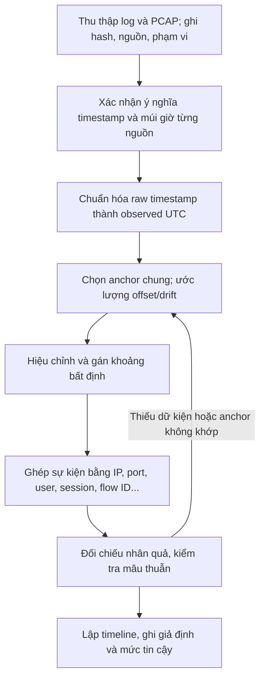

# Đối chiếu thời gian giữa nhiều nguồn log

Trong điều tra số trên mạng (*network forensics*), cùng một hành động có thể để lại dấu vết tại VPN, DNS, firewall, IDS/IPS, bản ghi gói tin (PCAP), hệ điều hành, EDR và nền tảng đám mây. Những hệ thống này không nhất thiết ghi cùng múi giờ, có đồng hồ chính xác như nhau hoặc đánh dấu cùng một thời điểm trong vòng đời sự kiện. Vì vậy, sắp xếp các chuỗi thời gian nguyên bản theo thứ tự tăng dần có thể dẫn đến một kết luận sai về trình tự tấn công.

Bài học này tập trung vào cách **chuẩn hóa, hiệu chỉnh, đối chiếu và đánh giá độ tin cậy của mốc thời gian** giữa các nguồn chứng cứ mạng; từ đó tái dựng một timeline có thể giải thích và kiểm chứng.

## 1. Kết quả cần đạt

Sau bài học, người học có thể:

1. Phân biệt thời gian sự kiện, thời gian quan sát, thời gian nhận log và thời gian xuất bản ghi.
2. Chuẩn hóa timestamp từ nhiều định dạng và múi giờ về UTC mà không làm mất thông tin gốc.
3. Xác định ảnh hưởng của **clock offset**, **clock drift**, độ phân giải thời gian và độ trễ truyền/ghi log.
4. Dùng mốc chung (*anchor event*) để ước lượng sai lệch đồng hồ, đồng thời lượng hóa khoảng bất định.
5. Ghép VPN, DNS, firewall, IDS, PCAP và endpoint thành chuỗi sự kiện phục vụ điều tra xâm nhập.
6. Bảo toàn chứng cứ và trình bày được cơ sở cho mỗi phép hiệu chỉnh thời gian.

## 2. Vì sao log của cùng một sự kiện lại có thời gian khác nhau?

Một luồng TCP có thể được quan sát theo nhiều góc nhìn:

- **PCAP:** thời điểm card mạng hoặc tiến trình bắt gói đóng dấu cho một gói tin.
- **Firewall:** thời điểm một rule được áp dụng, một phiên được tạo hoặc một phiên bị đóng; các loại bản ghi này không đồng nghĩa.
- **IDS/IPS:** thời điểm bộ phát hiện quyết định tạo cảnh báo, có thể sau khi nhiều gói đã được xử lý.
- **DNS:** thời điểm truy vấn/đáp ứng được resolver ghi nhận.
- **VPN:** thời điểm xác thực thành công, cấp phiên hoặc ngắt kết nối.
- **Endpoint/EDR:** thời điểm tiến trình, kết nối hay hành động trên máy đích được ghi nhận.
- **SIEM:** thời điểm bản ghi tới bộ thu hoặc được lập chỉ mục, đôi khi trễ nhiều giây hoặc phút.

Có ít nhất bốn khái niệm cần phân biệt:

| Loại mốc thời gian | Ý nghĩa | Giá trị trong điều tra |
|---|---|---|
| **Event time** | Sự kiện xảy ra theo đồng hồ của nguồn sinh log | Dùng để tái dựng trình tự sau khi đã hiệu chỉnh |
| **Observation/capture time** | Cảm biến thực sự quan sát gói tin hay hành động | Mốc quan sát tại vị trí cụ thể trên mạng |
| **Receive/ingest time** | Bộ thu log/SIEM tiếp nhận bản ghi | Giúp phát hiện độ trễ gửi log; không mặc nhiên là thời điểm sự kiện |
| **Export/processing time** | Bản ghi được truy xuất, chuyển đổi hoặc đưa vào báo cáo | Phục vụ chuỗi bảo quản chứng cứ; không thay thế event time |

**Ví dụ:** Firewall tạo log lúc kết thúc một kết nối kéo dài 10 phút, còn PCAP ghi SYN lúc bắt đầu. Chênh lệch 10 phút ở đây không có nghĩa là đồng hồ firewall sai 10 phút. Trước khi ước lượng sai lệch, phải kiểm tra **ý nghĩa của trường timestamp**.

## 3. Ba lớp sai lệch phải xử lý riêng

### 3.1. Định dạng và múi giờ

Cùng một thời điểm có thể biểu diễn theo nhiều cách:

| Timestamp nguồn | Diễn giải | UTC |
|---|---|---|
| `2026-11-28T16:15:00.500+07:00` | Giờ Việt Nam (UTC+07:00) | `2026-11-28T09:15:00.500Z` |
| `2026-11-28T09:15:00.500Z` | ISO 8601 đã ghi UTC | `2026-11-28T09:15:00.500Z` |
| `2026-11-28 09:15:00.500` | Không kèm múi giờ | **Chưa đủ dữ kiện để chuyển đổi** |
| Unix epoch (giây hoặc mili giây) | Số giây/ms từ mốc 1970-01-01 UTC theo quy ước hệ thống | Cần xác định rõ đơn vị trước khi chuyển |

Ký hiệu `Z` nghĩa là UTC, `+07:00` nghĩa là lệch 7 giờ về phía Đông của UTC. Không được tự cho rằng một timestamp thiếu thông tin múi giờ là UTC. Trước khi chuyển đổi phải kiểm tra cấu hình của máy, phiên bản ứng dụng, tài liệu về trường dữ liệu và thiết lập tại **thời điểm xảy ra sự kiện**.

Đối với múi giờ có giờ mùa hè (*daylight saving time*, DST), một giờ địa phương có thể xảy ra hai lần hoặc hoàn toàn không tồn tại vào ngày chuyển giờ. Cần lưu **múi giờ vùng** (chẳng hạn `America/New_York`), offset thực tế tại ngày xảy ra sự kiện và, nếu có, dấu hiệu phân biệt lần xuất hiện của giờ bị lặp. Không lấy offset hiện tại áp cho log lịch sử.

### 3.2. Sai lệch đồng hồ: offset và drift

Giả sử thời gian UTC thực tế là `t` và timestamp quan sát được từ nguồn `i` sau khi xử lý múi giờ là `C_i(t)`. Mô hình gần đúng:

\[
C_i(t) = t + \delta_i(t)
\]

Trong đó `δ_i(t)` là sai lệch đồng hồ. Quy ước dấu:

- `δ > 0`: đồng hồ nguồn **chạy nhanh** so với mốc tham chiếu.
- `δ < 0`: đồng hồ nguồn **chạy chậm**.
- Timestamp hiệu chỉnh: `t_corrected = t_observed_UTC − δ`.

Nếu đồng hồ firewall nhanh **120,6 giây**, timestamp đã chuẩn hóa là `09:17:00.700Z` thì thời gian hiệu chỉnh sẽ là `09:15:00.100Z`. Cần trừ sai lệch **sau** khi quy đổi múi giờ; không trừ cùng độ lệch hai lần.

Sai lệch có thể biến đổi theo thời gian (*clock drift*):

\[
\delta_i(t) \approx \delta_{0,i} + d_i(t-t_0)
\]

Ở đây `δ₀` là offset gần một mốc tham chiếu `t₀`; `d` là tốc độ trôi đồng hồ (ví dụ ppm). Với cửa sổ điều tra ngắn và đồng hồ ổn định, có thể xấp xỉ offset cố định. Với sự kiện kéo dài nhiều ngày, mất đồng bộ NTP, khởi động lại máy hoặc thay đổi giờ thủ công, phải ước lượng offset theo từng giai đoạn.

### 3.3. Độ phân giải, độ trễ và độ bất định

Không phải timestamp có đủ 3 chữ số mili giây đều chính xác tới mili giây:

- Log làm tròn đến **giây** có thể gây sai số lượng tử hóa khoảng ±0,5 giây nếu làm tròn gần nhất; hệ thống cắt phần lẻ có khoảng bất định khác.
- Timestamp PCAP có thể có độ phân giải micro/nano giây nhưng độ chính xác thực phụ thuộc đồng hồ và cách timestamp tại điểm capture.
- Một log được đẩy theo lô có **ingest time** muộn hơn event time đáng kể.
- Sự kiện đi qua nhiều điểm đo có độ trễ mạng, xử lý, hàng đợi và ghi đĩa khác nhau.

Với mỗi mốc đã hiệu chỉnh, nên ghi một **khoảng thời gian khả dĩ**:

\[
t_{\mathrm{event}} \in [t_{\mathrm{corrected}}-\epsilon,\;t_{\mathrm{corrected}}+\epsilon]
\]

Trong đó `ε` gồm độ bất định của offset, độ phân giải và các thành phần chưa thể loại trừ. Đây là ước lượng được giải thích, **không phải** chỉ số chính xác tuyệt đối. Nếu hai khoảng bất định chồng lấn, không được khẳng định chắc chắn sự kiện nào xảy ra trước chỉ nhờ vào timestamp.

## 4. Quy trình đối chiếu có thể kiểm chứng



### Bước 1. Thu thập và bảo toàn dữ liệu gốc

Ghi lại tối thiểu: nguồn/hostname, loại log, phiên bản và vị trí cảm biến, đường dẫn và thời điểm thu thập, người thực hiện, khoảng thời gian truy xuất, timezone đã cấu hình và checksum (ví dụ SHA-256). Giữ file gốc ở chế độ chỉ đọc theo quy trình chứng cứ; sử dụng bản sao để phân tích.

Với PCAP cần ghi giao diện bắt gói, điểm đặt cảm biến, cơ chế timestamp và liệu thiết bị có sử dụng đồng bộ thời gian phần cứng hay không. Với thiết bị ảo/cloud, ghi khu vực, múi giờ hiển thị, loại event và metadata thời gian của dịch vụ.

Chính sách thời gian cũng là chứng cứ: nguồn NTP/PTP, trạng thái đồng bộ, thay đổi cấu hình giờ, các lần điều chỉnh bất thường, sự kiện restart, resume của VM. Kết quả kiểm tra đồng hồ **sau sự cố** chỉ phản ánh trạng thái lúc kiểm tra; không tự chứng minh offset trong quá khứ.

### Bước 2. Lập bảng đặc tính thời gian của từng nguồn

Bảng đầu vào nên chứa:

| Trường | Câu hỏi cần trả lời |
|---|---|
| `source_id` | Thiết bị/dịch vụ nào sinh log? |
| `event_field` | Trường nào là thời gian sự kiện thực sự? |
| `raw_timestamp` | Chuỗi thời gian nguyên vẹn từ log là gì? |
| `timestamp_semantics` | Bắt đầu phiên, phát hiện, kết thúc phiên hay ingest? |
| `timezone` | Gắn offset/múi giờ nào theo thời điểm sự kiện? |
| `precision` | Đơn vị thời gian và phương thức làm tròn? |
| `clock_reference` | NTP/PTP nào, có lịch sử đồng bộ không? |
| `estimated_offset` | Đồng hồ nhanh/chậm bao nhiêu so với tham chiếu? |
| `uncertainty` | Độ bất định ước lượng và căn cứ? |
| `evidence_ref` | File gốc, record ID, dòng log hoặc packet number? |

Không sửa timestamp nguyên bản thành timestamp hiệu chỉnh trong file chứng cứ. Đưa bản chuẩn hóa vào một **trường mới**, giữ cả giá trị và quy tắc chuyển đổi.

### Bước 3. Chọn sự kiện neo (*anchor*) phù hợp

Anchor là một sự kiện có thể xác định là **cùng một hiện tượng** ở ít nhất hai nguồn, đủ rõ về định danh và thời điểm quan sát. Một số ví dụ:

- Cùng gói TCP SYN tại hai điểm bắt gói, đối chiếu IP, cổng, TCP sequence number, hướng lưu lượng và hoàn cảnh NAT.
- Cùng giao dịch DNS nhờ query name, transaction ID, client/server, cổng và nội dung phản hồi.
- Cùng phiên VPN từ session ID, username, địa chỉ cấp phát và thông tin xác thực.
- Cùng HTTP request nhờ request ID/trace ID (nếu được bảo toàn trên các hệ thống).

Không dùng riêng IP hay username để ghép, vì NAT, DHCP, địa chỉ tái sử dụng và nhiều phiên song song có thể tạo các sự kiện khác nhau trông giống nhau. Với các hệ thống có độ trễ xử lý, cần biết anchor phản ánh cùng **điểm đo** hay chỉ cùng **chuỗi xử lý**.

Nếu một sự kiện thực tế được ghi `09:15:00.000Z` tại cảm biến tham chiếu và `09:15:00.250Z` tại cảm biến B, chênh 250 ms có thể do đồng hồ, độ trễ đường truyền và độ trễ capture. Không gán toàn bộ 250 ms cho đồng hồ B nếu chưa ước lượng các thành phần này.

Ưu tiên dùng **nhiều anchor độc lập** trong cửa sổ thời gian, kiểm tra chênh lệch nhất quán, loại bỏ các cặp ghép sai có bằng chứng. Nếu offset tăng tuyến tính qua thời gian, cân nhắc mô hình drift; nếu chênh lệch nhảy đột ngột, chia timeline thành các giai đoạn và tìm bằng chứng về chỉnh giờ, khởi động lại hoặc sự cố đồng bộ.

### Bước 4. Chuẩn hóa và hiệu chỉnh

Thực hiện theo thứ tự:

1. Parse định dạng và xác định rõ timezone/offset của timestamp gốc.
2. Chuyển sang UTC, giữ độ chính xác nguyên bản và ghi phương thức parse.
3. Ước lượng `δ` cho từng nguồn trong khoảng thời gian tương ứng.
4. Tính `corrected_utc = observed_utc − δ`.
5. Gắn khoảng bất định cùng nguồn gốc phép ước lượng.
6. Ghép event với các trường định danh: `src_ip`, `dst_ip`, `src_port`, `dst_port`, protocol, NAT mapping, `session_id`, `event_id`, `trace_id` và thông tin DNS/DHCP.

Trong báo cáo, cần phân biệt **thời gian hiển thị từ log**, **thời gian UTC sau chuyển đổi**, và **thời gian UTC ước lượng sau hiệu chỉnh đồng hồ**. Một trường ghi nhận offset không có nguồn kiểm chứng phải được đánh dấu là giả định.

### Bước 5. Đối chiếu thứ tự nhân quả

Sắp xếp theo thời gian hiệu chỉnh giúp tìm mẫu, nhưng cần kiểm tra ngữ nghĩa. Ví dụ: SYN phải xuất hiện trước các gói dữ liệu của cùng kết nối; câu truy vấn DNS có thể xuất hiện trước kết nối tới IP được trả về, nhưng DNS cache khiến điều đó **không bắt buộc**. Log IDS tạo sau khi xử lý gói có thể tới SIEM trước log firewall nhờ đường truyền khác nhau.

Khi nguồn mâu thuẫn, kiểm tra lần lượt: sai múi giờ, làm tròn timestamp, loại trường sự kiện, clock offset/drift, độ trễ ghi/gửi log, định danh ghép nhầm, sự kiện thất lạc hoặc can thiệp log. Nếu không đủ dữ kiện để phân xử, giữ cả hai giả thuyết và ghi mức tin cậy.

## 5. Tình huống thực hành: truy cập đáng ngờ qua VPN

Giả sử đội ứng cứu đang điều tra một phiên VPN và các kết nối ngay sau đó. Dữ liệu sau là **ví dụ giả lập** để minh họa việc hiệu chỉnh, không phải sự cố thực tế. Offset được ước lượng bằng các anchor và hồ sơ đồng bộ riêng; bảng dùng cùng quy ước **offset = đồng hồ nguồn − đồng hồ tham chiếu**.

| Nguồn / sự kiện | Timestamp nguyên bản | Offset ước lượng | UTC hiệu chỉnh | Bất định (±) |
|---|---|---:|---|---:|
| VPN: xác thực thành công | `2026-11-28T16:14:58.200+07:00` | 0 ms | **09:14:58.200Z** | 100 ms |
| DNS: truy vấn tên miền | `2026-11-28T09:14:59.050Z` | 0 ms | **09:14:59.050Z** | 50 ms |
| Firewall: cho phép luồng TCP | `2026-11-28T09:17:00.700Z` | +120.600 ms | **09:15:00.100Z** | 500 ms |
| PCAP: gói SYN quan sát | `2026-11-28T09:15:00.000Z` | −250 ms | **09:15:00.250Z** | 10 ms |
| IDS: cảnh báo trên luồng | `2026-11-28T09:15:00.300+00:00` | 0 ms | **09:15:00.300Z** | 100 ms |
| EDR: tiến trình tạo kết nối | `2026-11-28T09:15:06.000Z` | +4.000 ms | **09:15:02.000Z** | 200 ms |

Lưu ý trong bảng, dấu chấm ở cột offset dùng cách viết số của Việt Nam: `+120.600 ms` là **+120.600 mili giây = +120,6 giây**, còn `+4.000 ms` là **+4 giây**. Để tránh nhầm lẫn khi trao đổi giữa hệ thống quốc tế, trong dữ liệu máy nên dùng số nguyên `120600` và `4000` với tên trường `offset_ms`.

**Cách suy ra timeline:**

1. VPN xác thực lúc 09:14:58.200Z; DNS xuất hiện khoảng 850 ms sau.
2. Firewall có timestamp quan sát 09:17:00.700Z nhưng đồng hồ nhanh 120,6 giây, nên mốc hiệu chỉnh là 09:15:00.100Z.
3. Cảm biến PCAP có đồng hồ chậm 250 ms; gói ghi 09:15:00.000Z được hiệu chỉnh thành 09:15:00.250Z.
4. IDS cảnh báo xấp xỉ 09:15:00.300Z, EDR ghi sự kiện khoảng 09:15:02.000Z.

Có thể kết luận **đáng tin cậy hơn** rằng đăng nhập VPN và truy vấn DNS xảy ra trước cụm hoạt động TCP. Tuy nhiên, khoảng bất định của firewall là [09:14:59.600Z, 09:15:00.600Z], chồng lấn với khoảng của PCAP là [09:15:00.240Z, 09:15:00.260Z]. Vì vậy, chỉ từ hai timestamp trên **chưa thể kết luận chặt chẽ** log firewall xảy ra trước gói SYN. Cần đối chiếu ý nghĩa log firewall (thời điểm decision, session creation hay session closure) và ID của luồng.

Cũng không được mặc định DNS query, kết nối TCP và cảnh báo IDS thuộc cùng một hoạt động chỉ vì chúng gần nhau. Phải có chứng cứ liên kết như bản ghi DNS answer, IP đích, NAT mapping, 5-tuple, session ID hoặc payload phù hợp.

### Sơ đồ mốc đã hiệu chỉnh

```text
UTC (giả lập)
09:14:58.200   VPN login
      |
09:14:59.050   DNS query
      |
09:15:00.100   Firewall allow   (±500 ms)
09:15:00.250   PCAP TCP SYN     (±10 ms)
09:15:00.300   IDS alert        (±100 ms)
      |
09:15:02.000   EDR connection
```

Sơ đồ là thứ tự **mốc giữa** đã hiệu chỉnh. Nó không tự động chứng minh thứ tự tuyệt đối của mọi cặp sự kiện.

## 6. Công cụ hỗ trợ điều tra

### 6.1. Linux: xác nhận timezone, đồng bộ, truy xuất journal

```bash
# Kiểm tra cấu hình múi giờ và đồng bộ hiện tại
timedatectl

# Với máy dùng chrony: trạng thái đồng bộ hiện tại
chronyc tracking
chronyc sources -v

# Truy xuất một khoảng thời gian, in timestamp với UTC
journalctl --utc \
  --since "2026-11-28 09:10:00 UTC" \
  --until "2026-11-28 09:20:00 UTC" \
  --output=short-iso-precise

# Tính SHA-256 trên bản chứng cứ đã được thu thập
sha256sum firewall.log
```

`chronyc tracking` cung cấp thông tin offset và trạng thái **tại thời điểm chạy**. Muốn điều tra sự kiện lịch sử, cần lưu log đồng bộ/chỉnh giờ trong cùng khoảng thời gian, cấu hình, lịch sử monitoring hoặc mốc đối chiếu độc lập; không lấy offset hiện tại làm số hiệu chỉnh cho mọi log cũ.

### 6.2. Windows: đối chiếu thời gian sự kiện

```powershell
# Trạng thái và peers đồng bộ thời gian hiện tại
w32tm /query /status
w32tm /query /peers

# Ví dụ đọc log Security và hiện mốc UTC
Get-WinEvent -FilterHashtable @{
    LogName = 'Security'
    StartTime = [datetime]'2026-11-28T16:10:00'
    EndTime = [datetime]'2026-11-28T16:20:00'
} | Select-Object Id, RecordId, @{
    Name = 'TimeCreatedUtc'
    Expression = { $_.TimeCreated.ToUniversalTime().ToString('o') }
}, Message

# Hash chứng cứ để ghi vào manifest
Get-FileHash -Algorithm SHA256 -LiteralPath '.\security.evtx'
```

Đoạn lọc trên giả định máy truy vấn đặt múi giờ địa phương phù hợp với giá trị giờ truyền vào. Trong XML của Windows Event Log, thuộc tính `System/TimeCreated/@SystemTime` thường thể hiện thời gian UTC; cần xác nhận đối với công cụ xuất dữ liệu cụ thể. `TimeCreated` do PowerShell hiển thị có thể đã chuyển sang múi giờ máy đang đọc log, nên phải ghi rõ cách xuất.

### 6.3. PCAP: lấy thời gian gói tin có thể xử lý bằng máy

```bash
tshark -r capture.pcapng \
  -Y "tcp.flags.syn == 1" \
  -T fields \
  -e frame.number -e frame.time_epoch \
  -e ip.src -e ip.dst -e tcp.srcport -e tcp.dstport
```

`frame.time_epoch` biểu diễn thời gian frame theo Unix epoch để tránh nhầm giữa múi giờ hiển thị trên máy phân tích. **Không** vì thế mà mặc định đồng hồ tại máy bắt gói luôn chính xác. Phải kiểm tra nguồn timestamp, chất lượng đồng bộ và vị trí thu thập. Nếu gói đi qua NAT, đối chiếu thêm bảng NAT hoặc các thuộc tính không đổi phù hợp.

### 6.4. SIEM và log dịch vụ đám mây

Khi dùng SIEM, thường cần xuất đồng thời cả `event.timestamp` (do nguồn phát sinh), `ingested_at`/`@timestamp` (tùy định nghĩa schema) và `collector_received_at`. Không suy đoán ý nghĩa các trường chỉ từ tên; kiểm tra mapping và pipeline thật. Với cloud audit log, so sánh **event time của dịch vụ**, thời gian delivery, thời gian lập chỉ mục và timezone hiển thị của giao diện.

Đặc biệt, log cloud có thể đến trễ hoặc không xuất hiện trong khoảng truy vấn ngắn; một sự kiện được **nhìn thấy muộn** không nhất thiết **xảy ra muộn**.

## 7. Tự động hóa phép chuẩn hóa bằng Python

Đoạn mã sau minh họa với dữ liệu giả lập của tình huống trên. Script chỉ xử lý timestamp có timezone/offset rõ ràng; các timestamp không kèm timezone phải được nghiên cứu trước khi đưa vào pipeline. Số `offset_ms` là **giả định đã được điều tra và xác nhận từ nguồn khác**, không phải thứ script tự suy ra từ việc sắp xếp.

```python
import csv
from datetime import datetime, timedelta, timezone
from io import StringIO

data = """source,raw_timestamp,offset_ms,uncertainty_ms,event
vpn,2026-11-28T16:14:58.200+07:00,0,100,login_success
dns,2026-11-28T09:14:59.050Z,0,50,dns_query
firewall,2026-11-28T09:17:00.700Z,120600,500,tcp_allow
pcap,2026-11-28T09:15:00.000Z,-250,10,tcp_syn
ids,2026-11-28T09:15:00.300+00:00,0,100,ids_alert
edr,2026-11-28T09:15:06.000Z,4000,200,connection
"""

def parse_aware_timestamp(value: str) -> datetime:
    parsed = datetime.fromisoformat(value.replace("Z", "+00:00"))
    if parsed.tzinfo is None or parsed.utcoffset() is None:
        raise ValueError(f"Timestamp thiếu múi giờ: {value}")
    return parsed.astimezone(timezone.utc)

def iso_utc(value: datetime) -> str:
    return value.isoformat(timespec="milliseconds").replace("+00:00", "Z")

records = []
for row in csv.DictReader(StringIO(data)):
    observed_utc = parse_aware_timestamp(row["raw_timestamp"])
    offset = timedelta(milliseconds=int(row["offset_ms"]))
    uncertainty = timedelta(milliseconds=int(row["uncertainty_ms"]))

    # offset dương: đồng hồ nhanh, phải trừ để về tham chiếu
    corrected_utc = observed_utc - offset
    records.append({
        **row,
        "observed_utc": observed_utc,
        "corrected_utc": corrected_utc,
        "earliest_utc": corrected_utc - uncertainty,
        "latest_utc": corrected_utc + uncertainty,
    })

records.sort(key=lambda item: item["corrected_utc"])

for item in records:
    print(
        item["source"],
        item["event"],
        iso_utc(item["corrected_utc"]),
        f"[{iso_utc(item['earliest_utc'])}, "
        f"{iso_utc(item['latest_utc'])}]",
    )
```

Đầu ra mong đợi, rút gọn:

```text
vpn      login_success 2026-11-28T09:14:58.200Z
dns      dns_query     2026-11-28T09:14:59.050Z
firewall tcp_allow     2026-11-28T09:15:00.100Z
pcap     tcp_syn       2026-11-28T09:15:00.250Z
ids      ids_alert     2026-11-28T09:15:00.300Z
edr      connection    2026-11-28T09:15:02.000Z
```

Script thực tế nên bổ sung trường `evidence_ref`, timezone gốc, độ phân giải, phương pháp ước lượng offset, giai đoạn hiệu lực của offset, thời điểm thu thập và phiên bản pipeline. Với thiết bị bị đổi giờ đột ngột, cần ánh xạ offset theo **nhiều khoảng** thay vì một hằng số. Khi kết hợp hàng triệu bản ghi, chuẩn hóa tại khâu ETL và lưu bản log gốc/manifest riêng để có thể truy vết ngược.

## 8. Những lỗi điều tra thường gặp và cách phát hiện

| Tình huống | Dấu hiệu | Cách xử lý |
|---|---|---|
| Nhầm giờ địa phương với UTC | Chênh đúng 7 giờ hoặc số giờ nguyên | Kiểm tra timezone thực của nguồn, cách parser/SIEM chuyển đổi |
| Nhầm giây với mili giây của epoch | Năm 1970 hoặc ngày rất xa tương lai | Kiểm tra schema, độ dài giá trị và đơn vị timestamp |
| Đồng hồ lệch nhưng không ghi hiệu chỉnh | PCAP và firewall dường như đảo thứ tự | Đối chiếu nhiều anchor, nguồn NTP lịch sử và các cặp gói chung |
| Đồng hồ trôi qua nhiều giờ/ngày | Offset đầu và cuối khoảng điều tra khác nhau | Ước lượng drift hoặc chia đoạn theo thời gian |
| Lẫn event time và ingest time | Một loạt log cùng xuất hiện trễ | Xuất cả hai trường, xác minh pipeline và hàng đợi |
| Lấy thời điểm đóng phiên làm lúc bắt đầu | Firewall đứng sau toàn bộ lưu lượng | Đọc loại sự kiện, flow start/end, duration và counters |
| Chỉ ghép bằng địa chỉ IP | Các phiên không liên quan bị nhập chung | Dùng NAT/DHCP lease, 5-tuple, session/trace ID |
| Timestamp hiển thị quá nhiều chữ số | Có nano giây nhưng clock sai hàng giây | Phân biệt độ phân giải và độ chính xác, ghi bất định |
| DST hoặc thay đổi múi giờ | Giờ bị lặp hoặc có khoảng trống | Dùng timezone theo ngày lịch sử và offset rõ ràng |
| Leap second và *clock smear* | Sai khác cỡ giây quanh thời điểm đặc biệt | Xác minh chính sách thời gian của từng bên; không giả định mọi nguồn xử lý giống nhau |
| NTP bị can thiệp hoặc chỉnh giờ thủ công | Độ lệch nhảy bất thường, thứ tự đảo liên tục | Đối chiếu log hệ thống, anchor ngoài và độ tin cậy của nguồn thời gian |

**Lưu ý bảo mật:** Kẻ tấn công có thể sửa timestamp, thay đổi đồng hồ hoặc xóa/giả mạo log. Vì vậy, một timeline không nên dựa độc quyền vào đồng hồ của máy bị nghi xâm nhập. Ưu tiên các nguồn độc lập (cảm biến mạng, hệ thống log tập trung, audit đám mây), hash chứng cứ và giải thích các mâu thuẫn chưa giải quyết được.

## 9. Cách báo cáo timeline phục vụ ứng cứu sự cố

Một bản ghi kết quả tối thiểu nên có các cột:

```text
event_id
source_id
event_type
raw_timestamp
raw_timezone
observed_utc
corrected_utc
uncertainty_before_ms
uncertainty_after_ms
clock_offset_ms
offset_valid_from_utc
offset_valid_to_utc
correction_evidence
entity_keys
evidence_ref
confidence
analyst_note
```

Có thể dùng khoảng bất định **không đối xứng** nếu độ trễ xử lý được biết chỉ có một hướng hoặc nếu nguồn cắt phần mili giây thay vì làm tròn. Trường `confidence` phải dựa trên căn cứ cụ thể (số anchor, mức nhất quán, tình trạng đồng bộ, chất lượng log), không chỉ là cảm nhận.

Một mẫu ghi chú kết luận:

> Trong cửa sổ 09:14:58–09:15:02 UTC, phiên VPN và truy vấn DNS xuất hiện trước cụm kết nối TCP và cảnh báo IDS theo các timestamp đã hiệu chỉnh. Đồng hồ firewall được ước lượng nhanh 120,6 giây và đồng hồ cảm biến PCAP chậm 250 ms tại giai đoạn liên quan. Do khoảng bất định của bản ghi firewall chồng lấn với gói TCP SYN, thứ tự tuyệt đối của hai bản ghi này chưa xác định bằng thời gian đơn thuần. Việc liên kết chúng với cùng phiên cần được kiểm tra bằng thông tin luồng/NAT và semantics của bản ghi firewall.

**Nguyên tắc trình bày:** mỗi kết luận phải phân biệt được **quan sát trực tiếp**, **giá trị được tính/hiệu chỉnh** và **suy luận**. Ghi rõ nguồn của mỗi phép hiệu chỉnh và những giả định còn tồn tại để người điều tra khác có thể tái dựng lại.

## 10. Bài tập vận dụng và câu hỏi tự kiểm tra

**Bài tập 1 — Chuẩn hóa giờ.** Thiết bị A ghi `2026-11-28T16:20:12.000+07:00`; thiết bị B ghi `2026-11-28T09:20:13.200Z`. Cả hai được mô tả là thời điểm quan sát cùng một gói, song B đặt sau A trên đường truyền. Hãy cho biết timestamp UTC của A, độ chênh giữa các timestamp và vì sao chưa thể kết luận đồng hồ B nhanh 1,2 giây.

*Gợi ý đáp án:* A tương ứng `09:20:12.000Z`; B ghi muộn hơn 1,2 giây. Khoảng chênh còn bao gồm thời gian gói đi qua mạng/thiết bị, thời gian capture và độ sai lệch của cả hai đồng hồ. Cần xác minh cùng gói và dùng thêm anchor.

**Bài tập 2 — Hiệu chỉnh offset.** Log C ghi `09:18:01.750Z`; các anchor cho thấy đồng hồ C chạy nhanh `+90.000 ms` trong cửa sổ này. Tính UTC hiệu chỉnh.

*Đáp án:* `09:16:31.750Z` (trừ 90 giây).

**Bài tập 3 — Khoảng bất định.** Sự kiện X được ước lượng ở `10:00:00.300Z ± 400 ms`; Y ở `10:00:00.500Z ± 50 ms`. Có thể khẳng định X trước Y không?

*Đáp án:* Không. Khoảng X là [09:59:59.900Z, 10:00:00.700Z], Y là [10:00:00.450Z, 10:00:00.550Z]; hai khoảng chồng lấn.

**Câu hỏi tự kiểm tra:**

1. Khi nào `event_time` và `ingest_time` có thể chênh nhau đáng kể?
2. Vì sao cần lưu timestamp gốc ngay cả khi đã có `corrected_utc`?
3. Làm sao phân biệt lệch timezone với offset đồng hồ?
4. Vì sao không thể lấy một anchor duy nhất làm bằng chứng offset cho mọi thời điểm?
5. Những khóa nào giúp xác minh một log firewall và một packet trong PCAP thuộc cùng kết nối?

Để trả lời đúng, người học cần giải thích được **ý nghĩa thời gian của nguồn log, căn cứ hiệu chỉnh, khoảng bất định và chứng cứ liên kết sự kiện**. Một timeline hữu ích cho network forensics là timeline có thể kiểm tra lại nguồn và mức tin cậy, chứ không chỉ là bảng đã sắp xếp theo giờ.
