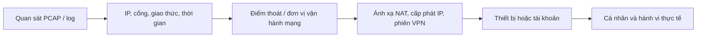

# Giới hạn của IP attribution trong điều tra số trên mạng

Trong điều tra số trên mạng (*network forensics*), **IP attribution** là quá trình dùng địa chỉ IP và các dấu vết liên quan để xác định hệ thống, mạng, tài khoản hoặc chủ thể có liên quan đến một hoạt động mạng. Đây là một bài toán **suy luận dựa trên chứng cứ**, không phải phép tra cứu có thể tự động cho ra danh tính người thực hiện.

Ví dụ, máy chủ ghi nhận một yêu cầu từ `203.0.113.25` lúc `03:20:15 UTC`. Quan sát này có thể chứng minh rằng máy chủ đã nhận lưu lượng có địa chỉ nguồn ấy tại thời điểm ghi nhận; nó **chưa chứng minh** người sở hữu IP, người đăng ký đường truyền hay người đang sử dụng thiết bị là tác giả của hành động. Một địa chỉ công cộng có thể được hàng nghìn thiết bị dùng chung; một kết nối có thể đi qua VPN, proxy hoặc máy bị chiếm quyền điều khiển.

Sau bài này, người học có thể phân biệt cấp độ quy kết từ phiên mạng đến con người; giải thích các giới hạn do NAT, CGNAT, IPv6, VPN, proxy, giả mạo IP và sai lệch thời gian; thiết kế việc thu thập và tương quan nhật ký; đồng thời trình bày kết luận với mức độ chắc chắn phù hợp.

## 1. IP attribution thực sự xác định điều gì?

Địa chỉ IP là địa chỉ định tuyến tại lớp mạng. Ý nghĩa của nó luôn gắn với **thời điểm**, **vị trí quan sát** và **cấu trúc đường truyền**. Cụm từ “đã xác định IP” không tương đương “đã xác định người”. Có thể chia bài toán quy kết thành các cấp độ:

| Cấp độ | Câu hỏi cần trả lời | Chứng cứ điển hình | Giới hạn |
| --- | --- | --- | --- |
| 1. Gói tin hoặc phiên | Lưu lượng nào xuất hiện tại điểm giám sát? | PCAP, NetFlow/IPFIX, firewall, access log | Địa chỉ nguồn có thể bị dịch hoặc giả mạo tùy giao thức và loại quan sát. |
| 2. Điểm thoát mạng | Thiết bị trung gian hoặc IP công cộng nào đưa lưu lượng ra Internet? | IP/port nguồn, bản ghi NAT, router, VPN gateway | Điểm thoát có thể đại diện cho nhiều thiết bị và người dùng. |
| 3. Kết nối hoặc thuê bao | Ai được cấp địa chỉ, cổng hoặc phiên truy cập trong khoảng thời gian đó? | Nhật ký ISP, DHCP, RADIUS, CGNAT, cấp prefix IPv6 | Thuê bao hoặc tài khoản đường truyền có thể được chia sẻ, bị lạm dụng hoặc không trực tiếp tạo lưu lượng. |
| 4. Thiết bị hoặc tài khoản | Endpoint/tài khoản nào gắn với hoạt động được điều tra? | DHCP nội bộ, 802.1X, VPN/SSO, EDR, audit log, dấu vết trên máy | Thiết bị có thể bị điều khiển từ xa; tài khoản có thể bị đánh cắp. |
| 5. Cá nhân thực hiện | Ai thực tế đã thao tác và trong hoàn cảnh nào? | Nhiều nguồn độc lập, hồ sơ pháp lý phù hợp, dấu vết xác thực và thiết bị | Chỉ riêng IP, MAC hoặc tên tài khoản **không đủ** để xác nhận danh tính hay ý định. |

Một kết luận hợp lệ phải nói rõ đang ở cấp độ nào. Ví dụ, “phiên đăng nhập đi qua nút thoát VPN X” là phát biểu về **hạ tầng trung gian**; “người A đã đăng nhập” là phát biểu mạnh hơn rất nhiều và cần chứng cứ khác.

## 2. Những gì địa chỉ IP có thể và không thể chứng minh

| Quan sát | Có thể kết luận ở mức phù hợp | Không thể tự suy ra |
| --- | --- | --- |
| Server ghi `src_ip=203.0.113.25` | Server đã thấy địa chỉ nguồn này từ điểm quan sát của nó. | Người trực tiếp tạo yêu cầu; địa chỉ gốc trước NAT/proxy. |
| Tra RDAP/WHOIS hoặc ASN | Tổ chức đang quản lý hoặc công bố dải địa chỉ theo dữ liệu đăng ký/định tuyến. | Người dùng cuối của một phiên cụ thể. |
| Cơ sở dữ liệu GeoIP báo một thành phố | Ước lượng vị trí mạng, có sai số và phụ thuộc nhà cung cấp dữ liệu. | Vị trí GPS, địa chỉ nhà hoặc vị trí của cá nhân. |
| Một tài khoản đăng nhập từ IP X | Hệ thống xác thực gắn sự kiện với IP X theo cơ chế ghi log của nó. | Chủ tài khoản là người đang điều khiển phiên đó. |
| Hai sự kiện có cùng IP công cộng | Hai sự kiện có chung một địa chỉ quan sát được. | Chắc chắn cùng thiết bị, thuê bao hoặc người dùng. |
| Bản ghi DNS phân giải một tên miền | Hệ thống resolver đã nhận hoặc xử lý truy vấn DNS. | Người dùng đã truy cập nội dung web của tên miền đó. |

**IP đích** cũng cần được hiểu thận trọng. IP của CDN, dịch vụ cloud hoặc bộ cân bằng tải có thể phục vụ nhiều website; một IP đích không nhất thiết xác định chính xác ứng dụng hoặc nội dung được truy cập. TLS/HTTPS và QUIC thường che nội dung tầng ứng dụng khỏi cảm biến chỉ nhìn thấy lưu lượng mạng.

## 3. Các nguyên nhân phổ biến làm sai lệch quy kết

### 3.1. NAT, PAT và Carrier-Grade NAT

NAT thay đổi địa chỉ giữa các miền mạng; PAT/NAPT còn có thể thay đổi cổng. Với **CGNAT** (*Carrier-Grade NAT*), một nhà mạng có thể cho nhiều thuê bao dùng chung một IP công cộng. Vì vậy, cặp `IP công cộng + thời gian` thường **chưa đủ** để truy ra một thuê bao. Dữ liệu tương quan thường cần:

- IP nguồn công cộng **và cổng nguồn công cộng** mà phía dịch vụ quan sát được.
- Giao thức (`TCP`, `UDP`...) và thời điểm có độ chính xác, múi giờ rõ ràng.
- IP/cổng đích khi cơ chế NAT hoặc thiết kế nhật ký đòi hỏi để phân biệt ánh xạ.
- Nhật ký ánh xạ của CGNAT và, nếu cần, của router phía thuê bao.
- Bản ghi cấp địa chỉ/phiên truy cập xác định thuê bao tại thời điểm tương ứng.

Ngay cả khi ánh xạ CGNAT đúng, kết quả đầu tiên thường là **kết nối/thuê bao**, chưa phải người thực hiện. Cổng có thể được tái sử dụng qua thời gian; việc bỏ mất vài giây hoặc ghi sai múi giờ có thể khiến việc ghép ánh xạ sai.

### 3.2. IP động và IPv6

Với IPv4 động, DHCP hoặc phiên truy cập của ISP có thể cấp lại cùng một IP cho thuê bao khác sau khi kết thúc phiên. Tra cứu ai sở hữu dải IP **hiện tại** không thay thế được nhật ký cấp phát **tại thời điểm xảy ra sự kiện**.

Với IPv6, một thiết bị có thể đồng thời có nhiều địa chỉ, bao gồm địa chỉ tạm thời theo cơ chế *privacy extensions*. Prefix mạng do ISP cấp cũng có thể thay đổi. Quan sát một địa chỉ IPv6 không đồng nghĩa biết một thiết bị duy nhất hay chủ sử dụng của nó; phải kiểm tra lịch sử cấp prefix, bản ghi router/Neighbor Discovery, DHCPv6 hoặc log endpoint tùy mô hình triển khai. Không nên mặc định IPv6 luôn có NAT, cũng không nên coi việc thiếu NAT là bằng chứng danh tính.

### 3.3. VPN, proxy, Tor, CDN và dịch vụ trung gian

Khi lưu lượng đi qua VPN hoặc proxy, dịch vụ đích thường nhìn thấy IP của **nút thoát**. Với Tor, IP được quan sát ở máy chủ có thể là IP của **Tor exit relay**. Những địa chỉ này chủ yếu nhận diện điểm trung gian, không nhận diện người dùng gốc. Proxy doanh nghiệp, NAT của văn phòng, gateway an ninh, CDN hay reverse proxy cũng che địa chỉ của máy khách khỏi một số lớp quan sát.

Muốn truy ngược cần xác định rõ từng chặng và nguồn log đáng tin cậy. Việc một VPN/provider có lưu log, có thể cung cấp log hay có quyền cung cấp log phụ thuộc cấu hình, chính sách, thời hạn lưu trữ và quy định pháp luật; không được mặc định luôn truy được hoặc không thể truy được.

### 3.4. Giả mạo địa chỉ nguồn và lưu lượng phản xạ

Trong một số kiểu lưu lượng, đặc biệt là gói UDP không có phiên xác nhận hai chiều, kẻ gửi có thể đặt **địa chỉ nguồn giả**. Ở tấn công phản xạ/khuếch đại, máy bị hại nhận lưu lượng từ các máy phản xạ hợp lệ, dù chúng không phải bên khởi tạo cuộc tấn công. Do đó danh sách IP gửi nhiều gói đến nạn nhân có thể là danh sách **máy phản xạ**.

Với một kết nối TCP hoàn tất bắt tay ba bước và trao đổi dữ liệu bình thường, việc giả mạo IP nguồn kiểu gửi gói một chiều khó giải thích toàn bộ phiên hơn. Tuy nhiên, điều đó **không loại trừ** proxy, NAT, máy trung gian bị xâm nhập hoặc các hình thức tấn công khác. Không được áp dụng cùng một mức độ tin cậy cho mọi giao thức.

### 3.5. Mạng dùng chung, thiết bị bị xâm nhập và tài khoản bị đánh cắp

Một IP có thể đại diện cho hộ gia đình, quán cà phê, ký túc xá, phòng máy, hệ thống IoT hoặc cả một tổ chức. Kể cả đã tìm ra máy cụ thể, hoạt động có thể do phần mềm độc hại, tài khoản dịch vụ, tác vụ tự động hay người truy cập từ xa tạo ra. Địa chỉ MAC chỉ có ý nghĩa trong phạm vi liên kết mạng phù hợp, có thể bị thay đổi hoặc ngẫu nhiên hóa; MAC không phải định danh toàn Internet.

## 4. Mô hình suy luận: mỗi bước cần chứng cứ riêng



Mỗi mũi tên là **một giả thuyết cần kiểm chứng bằng dữ liệu bổ sung**, không phải kết quả tự động của bước trước. Nếu thiếu bản ghi nối giữa hai tầng, phải dừng kết luận ở tầng đã được chứng minh.

Đánh giá giá trị của một dấu vết theo bốn câu hỏi:

1. **Nguồn:** Bản ghi do hệ thống nào tạo, ở phía nào của NAT/proxy, ai có thể sửa nội dung?
2. **Thời gian:** Đồng hồ có đồng bộ không; độ phân giải, múi giờ và sai số đã được ghi lại chưa?
3. **Tính duy nhất:** Có nhiều phiên/thiết bị/thuê bao phù hợp cùng IP và khoảng thời gian đó không?
4. **Độc lập:** Dấu vết thứ hai thực sự độc lập hay chỉ là bản sao thông tin từ cùng một header/log nguồn?

Ví dụ, access log và dashboard SIEM lấy cùng một `X-Forwarded-For` không tạo thành hai nguồn xác nhận độc lập; dashboard chỉ hiển thị lại dữ liệu đã có.

## 5. Thu thập chứng cứ đủ để tương quan phiên

### 5.1. Các trường nên ghi nhận

Một sự kiện mạng phục vụ attribution thường cần những thông tin sau, tùy phạm vi quan sát và yêu cầu điều tra:

| Trường | Vai trò | Lưu ý |
| --- | --- | --- |
| `timestamp_utc`, độ phân giải, sai số đồng hồ | Xác định khoảng thời gian xảy ra sự kiện | Dùng thời gian có timezone rõ ràng; lưu dấu sai lệch NTP nếu có. |
| `src_ip`, `src_port`, `dst_ip`, `dst_port`, `protocol` | Xác định luồng/ánh xạ; thường gọi là *5-tuple* | Không bỏ cổng nguồn khi cần đối chiếu CGNAT. |
| `sensor_id`, `interface`, `direction` | Cho biết quan sát trước hay sau NAT/proxy, chiều đi/về | Cùng một luồng có thể có nhiều IP/port ở các chặng. |
| `connection_id`, `request_id`, `flow_id` | Nối các bản ghi của cùng một phiên/yêu cầu | Kiểm tra cách sinh ID để tránh ghép nhầm. |
| NAT mapping, thời gian bắt đầu/kết thúc | Ánh xạ IP/port ngoài sang IP/port trong | Ghi giao thức và đích nếu thiết kế NAT cần; xét khả năng tái sử dụng cổng. |
| DHCP, RADIUS, DHCPv6, prefix delegation | Nối địa chỉ nội bộ hoặc prefix với phiên thuê bao/thiết bị | Chú ý thời hạn cấp phát và cấp lại. |
| VPN/IdP/SSO/802.1X, audit log | Liên hệ phiên mạng với định danh đăng nhập | Tài khoản xác thực chưa đồng nghĩa người thực hiện. |
| Log endpoint/EDR và dấu vết ứng dụng | Kiểm tra tiến trình, thiết bị, phiên hoạt động | Cần xác minh thiết bị có bị xâm nhập hay được điều khiển từ xa. |

Nhật ký flow có thể cung cấp metadata về kết nối nhưng thường không chứa toàn bộ payload. PCAP có thể đầy đủ hơn về cấu trúc gói, song nội dung HTTPS/QUIC vẫn có thể được mã hóa; không nên mô tả điều chưa quan sát được.

### 5.2. Chuẩn hóa thời gian trước khi ghép log

Giả sử access log ghi `2026-11-10T03:20:15.124Z`, NAT log chỉ ghi giây, còn firewall chậm 800 ms. Ghép bằng một mốc thời gian “bằng nhau tuyệt đối” có thể vừa bỏ sót bản ghi đúng vừa chọn nhầm bản ghi khác.

Thực hành phù hợp là giữ cả thời gian gốc lẫn thời gian đã chuẩn hóa về UTC, đo hoặc ước lượng sai lệch đồng hồ, ghi nhận độ chính xác của từng nguồn và tìm **khoảng thời gian giao nhau** giữa sự kiện và tuổi thọ ánh xạ NAT. Nếu nhiều ánh xạ thỏa điều kiện, kết quả là **chưa phân biệt được**, không được tự chọn bản ghi gần nhất rồi khẳng định danh tính.

## 6. Ví dụ điều tra: một IP công cộng, nhiều lớp NAT

Giả sử một dịch vụ web ghi nhận yêu cầu đáng ngờ. Mọi địa chỉ IP công cộng trong ví dụ dưới đây thuộc dải **dành cho tài liệu**, chỉ dùng minh họa; các bản ghi đều là dữ liệu giả lập.

```text
Thiết bị:          192.168.10.24:60310
    | NAT tại router gia đình
WAN của router:    100.64.7.21:52300
    | CGNAT của ISP
IP công cộng:      203.0.113.25:54567
    | Internet
Web server:        192.0.2.10:443 (TCP/TLS)
```

Các nguồn ghi nhận sự kiện (giả sử đồng hồ đã được đồng bộ và kiểm tra):

| Nguồn | Dữ liệu giả lập | Ý nghĩa |
| --- | --- | --- |
| Access log của web | `2026-11-10T03:20:15.124Z`, `203.0.113.25:54567 → 192.0.2.10:443/TCP`, `request_id=req-7b19` | Điểm quan sát bên ngoài thấy phiên từ IP/cổng công cộng. |
| Nhật ký CGNAT của ISP | Ánh xạ đang hiệu lực: `203.0.113.25:54567/TCP ↔ 100.64.7.21:52300/TCP` | Truy về kết nối phía WAN của một thuê bao, nếu đối chiếu đủ trường và thời gian. |
| Nhật ký router gia đình | Ánh xạ đang hiệu lực: `100.64.7.21:52300/TCP ↔ 192.168.10.24:60310/TCP` | Truy về địa chỉ nội bộ, nếu log router có thể tin cậy. |
| DHCP nội bộ | `192.168.10.24` được cấp cho một client trong khoảng bao trùm sự kiện | Hỗ trợ liên hệ địa chỉ nội bộ với thiết bị; cần thêm chứng cứ nhận dạng thiết bị. |
| Ứng dụng/IdP | `request_id=req-7b19` liên quan phiên tài khoản `training-user` | Gắn yêu cầu với phiên xác thực, nếu tính toàn vẹn của ID và log được xác minh. |

**Kết luận được hỗ trợ:** Trong giả định các log đầy đủ, thời gian khớp và không có ánh xạ cạnh tranh, yêu cầu `req-7b19` tương ứng một luồng đi qua CGNAT và router gia đình đến `192.168.10.24`; ứng dụng gắn yêu cầu với phiên tài khoản `training-user`.

**Điều chưa chứng minh:** Không thể từ bảng trên kết luận chủ thuê bao, chủ máy hoặc chủ tài khoản trực tiếp gửi yêu cầu. Để tiến đến kết luận về cá nhân, phải xem nhật ký đăng nhập, yếu tố xác thực, dấu vết endpoint, truy cập từ xa, khả năng bị xâm nhập và các chứng cứ độc lập khác theo thẩm quyền hợp pháp.

Nếu access log chỉ chứa `203.0.113.25` và thiếu cổng nguồn, việc truy theo CGNAT có thể không xác định được một phiên duy nhất. Nếu nhật ký ISP đã hết hạn lưu trữ, không được suy ngược bằng dữ liệu cấp phát hiện tại.

### Minh họa phép nối log có điều kiện

Ví dụ SQL dưới đây chỉ diễn đạt **nguyên tắc tìm ứng viên**, không thay thế việc kiểm tra logic NAT và sai số thời gian của hệ thống thực tế:

```sql
-- Bảng nat_mappings chứa thời gian hiệu lực đã chuẩn hóa UTC.
-- Ứng dụng cần kiểm tra thêm: clock skew, các ánh xạ trùng,
-- tính đầy đủ và nguồn gốc của dữ liệu.
SELECT mapping_id, inside_ip, inside_port,
       valid_from_utc, valid_to_utc
FROM nat_mappings
WHERE outside_ip = '203.0.113.25'
  AND outside_port = 54567
  AND protocol = 'TCP'
  AND valid_from_utc <= TIMESTAMP '2026-11-10 03:20:15.124'
  AND valid_to_utc   > TIMESTAMP '2026-11-10 03:20:15.124';
```

Khi đồng hồ có sai số, phải mở rộng và kiểm tra **khoảng thời gian** theo thông số thực đo; không tùy tiện thêm biên thời gian để ép khớp kết quả. Truy vấn trả về nhiều bản ghi là tín hiệu cần điều tra tiếp.

## 7. Hai bẫy thường gặp ở lớp ứng dụng

### 7.1. Tin tưởng `X-Forwarded-For` từ nguồn không kiểm soát

Trong kiến trúc có reverse proxy, server ứng dụng có thể thấy IP của proxy và nhận địa chỉ máy khách từ header `X-Forwarded-For` hoặc `Forwarded` (RFC 7239). Nhưng client cũng có thể tự gửi các header HTTP này nếu cổng vào không kiểm soát và ghi đè chúng. Ví dụ:

```http
GET /login HTTP/1.1
Host: example.test
X-Forwarded-For: 198.51.100.44
```

Header trên **không tự chứng minh** client thực sự có IP `198.51.100.44`. Chỉ nên diễn giải IP chuyển tiếp theo **chuỗi proxy tin cậy đã cấu hình**, từ địa chỉ kết nối thực tại cổng vào và quy tắc proxy thêm/xóa/ghi đè header. Nếu client có thể truy cập trực tiếp backend hoặc proxy chấp nhận header do client tự khai, dữ liệu quy kết có thể bị đầu độc.

### 7.2. Nhầm máy bị tấn công, máy trung gian và máy khởi tạo

Trong tấn công DDoS phản xạ qua UDP, IP mà nạn nhân nhìn thấy có thể là máy phản xạ. Trong tấn công qua web proxy, IP trong access log có thể là proxy. Trong sự cố máy tính bị cài mã độc, IP nội bộ là địa chỉ của thiết bị bị điều khiển. Ba trường hợp này dẫn đến các kết luận khác nhau:

| Tình huống | Quan sát trực tiếp | Kết luận cần tránh |
| --- | --- | --- |
| Nạn nhân nhận nhiều UDP response từ máy chủ công cộng | Các máy phản xạ đã gửi gói tới nạn nhân | “Các chủ máy phản xạ là kẻ chủ mưu.” |
| Dịch vụ nhận yêu cầu từ VPN exit | Nút thoát VPN đã kết nối tới dịch vụ | “Người vận hành VPN là người thực hiện yêu cầu.” |
| Một máy nhân viên tạo lưu lượng bất thường | Hoạt động phát sinh từ hoặc qua endpoint đó | “Nhân viên đang sở hữu máy chắc chắn chủ động thực hiện.” |

## 8. Quy trình điều tra thực hành

1. **Định nghĩa sự kiện và giả thuyết.** Xác định phiên, hành động, thời điểm, vị trí quan sát. Viết rõ ít nhất một cách giải thích khác: IP dùng chung, proxy, tài khoản bị chiếm quyền hoặc máy bị điều khiển.
2. **Bảo toàn dữ liệu gốc.** Thu thập PCAP, bản ghi flow, firewall, web, NAT, VPN/IdP và nhật ký cấp phát liên quan trong phạm vi được phép. Ghi nguồn, người thu thập, thời điểm, cách trích xuất; lưu bản gốc ở nơi có kiểm soát truy cập, tạo mã băm kiểm tra toàn vẹn khi phù hợp.
3. **Chuẩn hóa điểm nhìn và thời gian.** Gắn mỗi log với vị trí trước/sau NAT hoặc proxy, đổi thời gian về UTC, ghi độ chính xác và độ lệch đồng hồ. Phân biệt thời điểm gói tin, thời điểm kết thúc phiên và thời điểm hệ thống ghi log.
4. **Ghép luồng theo đủ thuộc tính.** Đối chiếu IP/cổng nguồn và đích, giao thức, khoảng thời gian hiệu lực, request/connection ID. Kiểm tra cổng bị tái sử dụng, phiên đồng thời, log thiếu và sai số thời gian.
5. **Tìm chứng cứ hỗ trợ độc lập.** Ghép DHCP/RADIUS/prefix IPv6 với thiết bị, VPN/SSO với phiên xác thực, EDR với tiến trình và hoạt động trên máy. Kiểm tra đường đi qua proxy/CDN và khả năng thiết bị hoặc tài khoản bị xâm nhập.
6. **Thử bác bỏ kết luận.** Tìm thiết bị hoặc thuê bao khác phù hợp với cùng IP/thời gian, xem trường hợp giả mạo nguồn hoặc log header giả. Không coi việc thiếu dữ liệu phản bác là bằng chứng khẳng định.
7. **Viết báo cáo có giới hạn rõ ràng.** Tách sự kiện quan sát được, suy luận, giả định, nguồn chứng cứ, mức độ tin cậy và những khoảng trống. Chỉ kết luận về cá nhân khi chứng cứ thực sự hỗ trợ cấp độ đó.

Đối với dữ liệu của ISP, nhà cung cấp VPN hoặc danh tính thuê bao, việc yêu cầu và sử dụng bản ghi phải phù hợp thẩm quyền, quy định bảo vệ dữ liệu và quy trình điều tra áp dụng. Tránh thu thập thông tin nhận dạng vượt quá nhu cầu chứng minh sự kiện.

## 9. Diễn đạt mức độ chắc chắn trong báo cáo

Thay vì ghi “IP X là hacker”, hãy mô tả từng nhận định và chứng cứ tương ứng:

| Cách diễn đạt | Đánh giá |
| --- | --- |
| “Sensor S ghi nhận phiên TCP từ `203.0.113.25:54567` tới dịch vụ tại thời điểm T.” | Phát biểu quan sát có thể kiểm chứng bằng PCAP/log, kèm nguồn và thời điểm. |
| “Dữ liệu CGNAT và router có ánh xạ phù hợp, liên kết phiên này với thiết bị nội bộ D trong khoảng T.” | Suy luận có điều kiện; cần xác nhận tính toàn vẹn, tính duy nhất và độ lệch thời gian. |
| “Tài khoản A gắn với request ID của phiên được ghi nhận.” | Liên kết tới danh tính tài khoản theo log, chưa chứng minh người thao tác. |
| “Cá nhân A thực hiện tấn công vì IP thuộc thuê bao đứng tên A.” | Vượt quá chứng cứ; không chấp nhận nếu chỉ có thông tin IP/thuê bao. |

Có thể dùng các nhãn định tính như **xác nhận bằng chứng cứ trực tiếp**, **được nhiều nguồn hỗ trợ**, **chưa đủ dữ liệu** và **không thể xác định**. Nêu lý do cụ thể; đừng tự gán tỷ lệ phần trăm chính xác khi không có mô hình xác suất được kiểm định.

## 10. Thiết kế hệ thống để attribution đáng tin cậy hơn

- **Ghi log có cấu trúc:** Thống nhất định dạng thời gian UTC, địa chỉ và cổng ở hai đầu, giao thức, định danh request/flow, ID thiết bị giám sát và chiều kết nối. Với máy chủ Internet có thể nằm sau CGNAT của khách hàng, lưu **source port** khi phù hợp và được phép.
- **Đặt ranh giới tin cậy của proxy:** Ghi IP thực tại cổng vào, kiểm soát danh sách proxy tin cậy; xóa hoặc chuẩn hóa header chuyển tiếp do client tự khai trước khi ghi nhận ở backend.
- **Duy trì dữ liệu ánh xạ:** Đảm bảo log NAT/CGNAT, DHCP, RADIUS, VPN và prefix delegation có thời gian hiệu lực đủ chi tiết để đối chiếu. Kiểm thử tình huống cổng tái sử dụng và nhiều thuê bao chia sẻ địa chỉ.
- **Đồng bộ đồng hồ:** Theo dõi NTP và độ lệch; thống nhất thời gian UTC có độ phân giải phù hợp cho phân tích. Không để log hệ thống dùng múi giờ mặc định không rõ ràng.
- **Bảo đảm toàn vẹn và khả năng kiểm toán:** Kiểm soát truy cập log, hạn chế sửa/xóa, ghi lịch sử trích xuất và xử lý, bảo vệ dữ liệu gốc, ghi nhận các khoảng thời gian bị thiếu.
- **Giảm thiểu dữ liệu:** Xây dựng thời hạn lưu trữ, phân quyền và quy trình cung cấp log phù hợp pháp luật. Khả năng quy kết tốt hơn không đòi hỏi phải lưu toàn bộ nội dung truyền thông hoặc dữ liệu cá nhân không liên quan.

### Danh sách kiểm tra trước khi đưa ra kết luận

- [ ] Đã xác định điểm quan sát và chiều lưu lượng; biết IP được ghi ở trước hay sau NAT/proxy.
- [ ] Có IP **và cổng**, giao thức, thời gian UTC, độ lệch đồng hồ cần thiết cho kiểu ánh xạ đang điều tra.
- [ ] Đã đối chiếu khoảng hiệu lực của NAT, DHCP, VPN hoặc cấp prefix thay vì dựa trên trạng thái hiện tại.
- [ ] Đã kiểm tra khả năng IP dùng chung, cổng tái sử dụng, mạng công cộng và máy trung gian.
- [ ] Không dựa vào header do client tự khai hay dữ liệu GeoIP để kết luận danh tính cá nhân.
- [ ] Đã kiểm tra các cách giải thích khác: giả mạo nguồn, phản xạ, thiết bị bị xâm nhập, tài khoản bị đánh cắp.
- [ ] Mỗi kết luận trong báo cáo có nguồn chứng cứ, giả định và giới hạn đi kèm.

**Nguyên tắc cốt lõi:** IP attribution tốt bắt đầu từ gói tin/phiên đã quan sát, nối từng chặng bằng nhật ký đáng tin và dừng ở đúng cấp độ mà chứng cứ cho phép. IP là một manh mối hữu ích trong *network forensics*, nhưng không phải định danh con người.

## Tài liệu tham khảo

- [RFC 6269 — Issues with IP Address Sharing](https://datatracker.ietf.org/doc/html/rfc6269): hệ quả của việc nhiều người dùng cùng một địa chỉ IP.
- [RFC 6302 — Logging Recommendations for Internet-Facing Servers](https://datatracker.ietf.org/doc/html/rfc6302): các trường log hữu ích khi máy khách đi qua hệ thống chia sẻ địa chỉ.
- [RFC 6598 — IANA-Reserved IPv4 Prefix for Shared Address Space](https://datatracker.ietf.org/doc/html/rfc6598): dải `100.64.0.0/10` dùng trong môi trường chia sẻ địa chỉ.
- [RFC 6888 — Common Requirements for Carrier-Grade NATs](https://datatracker.ietf.org/doc/html/rfc6888): yêu cầu liên quan đến CGNAT.
- [RFC 7239 — Forwarded HTTP Extension](https://datatracker.ietf.org/doc/html/rfc7239): mô tả HTTP `Forwarded` và các lưu ý liên quan đến độ tin cậy của dữ liệu chuyển tiếp.
- [RFC 8981 — Temporary Address Extensions for Stateless Address Autoconfiguration in IPv6](https://datatracker.ietf.org/doc/html/rfc8981): địa chỉ IPv6 tạm thời.
- [RFC 5737 — IPv4 Address Blocks Reserved for Documentation](https://datatracker.ietf.org/doc/html/rfc5737): các dải IPv4 giả lập dùng trong ví dụ.
