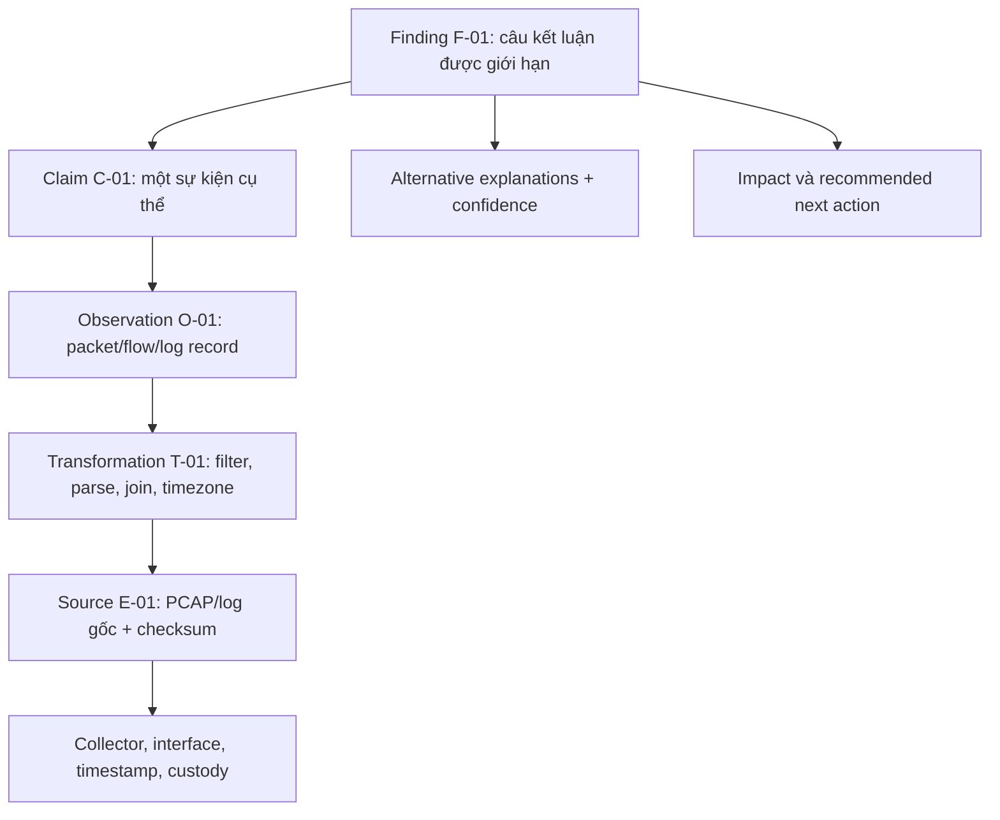
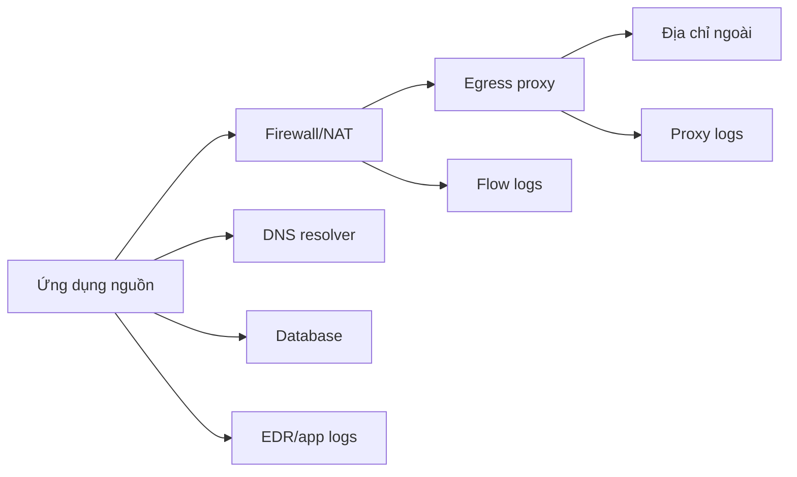
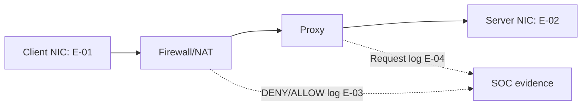
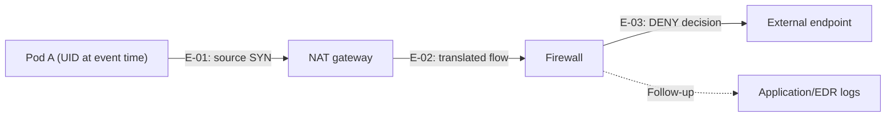
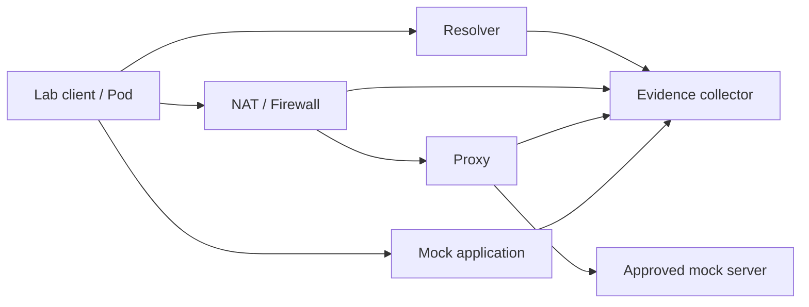

# Báo cáo phát hiện có thể kiểm chứng trong điều tra số trên mạng

Một nhóm ứng phó sự cố nhận được báo cáo: *“Máy chủ ứng dụng đã gửi dữ liệu bí mật tới máy chủ điều khiển của attacker lúc 09:14; cần cô lập ngay toàn bộ cụm.”* Bằng chứng đính kèm chỉ là một ảnh chụp dashboard ghi “outbound 1,2 GB” đến một địa chỉ IP. Báo cáo không nêu dữ liệu đó được đo trước hay sau NAT, có bao nhiêu traffic thuộc backup hợp lệ, thời gian của thiết bị có đúng không, IP đích có đang dùng chung bởi các tenant khác hay không, và người phân tích đã dùng truy vấn nào.

Đây là ví dụ về một kết luận **chưa thể kiểm chứng**. Dù có thể chứa tín hiệu quan trọng, người tiếp nhận không đủ thông tin để tái tạo phép đo, loại trừ giả thuyết khác hoặc quyết định mức độ khẩn cấp một cách có trách nhiệm.

Ngược lại, một báo cáo có thể nói:

> Từ 09:12:03 đến 09:16:27 UTC, collector F1 ghi 14 flow records với tổng `bytes_out` 1.200.000.000 byte theo cách định nghĩa của exporter. Dữ liệu cho thấy các kết nối từ địa chỉ sau NAT tới IP đích X, nhưng **chưa chứng minh được** loại nội dung đã truyền, mức độ hoàn tất ở phía nhận hay chủ thể trước NAT. Quy trình NAT mapping, nhật ký ứng dụng và dấu vết endpoint cần được đối chiếu trước khi kết luận có rò rỉ dữ liệu.

Điểm khác biệt không phải ở việc dùng ngôn ngữ ít chắc chắn hơn, mà ở **khả năng truy xuất nguồn gốc dữ liệu, phương pháp phân tích, ranh giới suy luận và điều kiện để người khác xác nhận hoặc bác bỏ nhận định**.

**Báo cáo phát hiện có thể kiểm chứng** (*verifiable forensic findings report*) là tài liệu mô tả câu hỏi điều tra, phạm vi dữ liệu, phương pháp, bằng chứng cụ thể, phép phân tích, kết quả quan sát, các giả thuyết được xem xét, mức tin cậy, giới hạn và hành động đề xuất theo cách một người có thẩm quyền độc lập có thể rà soát và, khi được cấp dữ liệu/công cụ cần thiết, lặp lại những bước phân tích trọng yếu.

Bài thuộc chương **Điều tra số trên mạng** của module **SECURITY_NETWORK_SECURITY**. Chủ đề kết nối kiến thức phân đoạn mạng, firewall, VPN, IDS/IPS, DNS, wireless, cloud và monitoring với việc phân tích packet, flow, nhật ký xác thực và xây dựng kết luận về sự kiện mạng **đủ rõ để hỗ trợ quyết định kỹ thuật, vận hành và bảo mật**.

Sau bài học, bạn có thể:

1. Phân biệt **dữ kiện quan sát được**, **kết quả xử lý**, **suy luận**, **giả thuyết** và **quyết định ứng phó**.
2. Viết câu hỏi điều tra có phạm vi, tiêu chí xác minh và kết quả được phép khẳng định.
3. Quản lý nguồn gốc, tính toàn vẹn, chuỗi bàn giao và phiên bản bằng chứng PCAP/log/flow/config.
4. Lập timeline có múi giờ, độ phân giải và sai số đồng hồ được công bố.
5. Ghi lại truy vấn, filter, tool version, parsing/normalization và các tham số đủ để kiểm thử lại.
6. Liên kết IP/port với workload/user qua NAT, DHCP, VPN, proxy, Kubernetes và cloud identity mà không quy kết quá mức.
7. Đối chiếu nhiều nguồn độc lập, phân biệt positive evidence, missing evidence và visibility gap.
8. Trình bày confidence, alternative explanations, false positives, tác động và những điều chưa biết.
9. Tạo bảng finding-to-evidence, mẫu báo cáo, peer-review checklist và kế hoạch bảo quản dữ liệu nhạy cảm.
10. Thực hiện lab kiểm thử được một phát hiện với dữ liệu giả lập và kết quả `SUPPORTED / NOT SUPPORTED / INCONCLUSIVE`.

> **Lưu ý thực hành:** Các IP trong các dải tài liệu `192.0.2.0/24`, `198.51.100.0/24`, `203.0.113.0/24` và `2001:db8::/32`, tên miền `example.test`, hash/ID và thời gian trong bài đều là ví dụ, **không phải một cuộc điều tra đã tiến hành**. Chỉ phân tích dữ liệu mà bạn có quyền truy cập, không thử liên hệ hạ tầng nghi độc hại và không đưa thông tin định danh/secret vào báo cáo chia sẻ rộng. Những yêu cầu bảo toàn chứng cứ và thẩm quyền có thể khác theo tổ chức, hợp đồng và quy định pháp luật.

## 1. “Có thể kiểm chứng” có nghĩa là gì?

### 1.1. Ba câu hỏi người phản biện cần trả lời được

1. **Bằng chứng nào?** Tệp/bản ghi gốc đến từ cảm biến nào, ở đâu, vào lúc nào, với quyền truy cập và giới hạn gì?
2. **Phương pháp nào?** Từ bằng chứng gốc, những thao tác, bộ lọc, chuyển đổi, truy vấn và bước phân tích nào tạo ra kết quả đã trình bày?
3. **Kết luận có nằm trong khả năng chứng minh không?** Kết quả trực tiếp thể hiện điều gì, giả thuyết thay thế nào còn khả thi, và cần dữ liệu nào để xác nhận phần chưa chắc?

Một báo cáo đẹp, có sơ đồ và nhiều screenshot vẫn có thể không đạt nếu thiếu khả năng **truy ngược từng tuyên bố quan trọng tới một hoặc nhiều bằng chứng cụ thể**.

### 1.2. Kiểm chứng khác tái tạo tuyệt đối

Trong forensics, thường không thể khiến hệ thống quá khứ “xảy ra lại” với cùng packets, cùng routing và cùng threat actor. Vì thế cần phân biệt:

- **Reviewability:** người khác đọc được dữ liệu và hiểu phương pháp.
- **Repeatability:** người khác chạy lại cùng phương pháp trên **cùng bản dữ liệu đã bảo quản** và thu kết quả nhất quán trong giới hạn làm tròn/phiên bản.
- **Reproducibility:** khi có dữ liệu, mô hình hoặc phép đo độc lập phù hợp, kết quả hỗ trợ cùng nhận định.
- **Independent corroboration:** nguồn khác không cùng lỗi thu thập cũng đưa ra dấu vết phù hợp.

Một PCAP có SHA-256 và truy vấn lọc đầy đủ hỗ trợ repeatability; chưa tự bảo đảm sensor không bỏ lỡ packets hay nội dung mã hóa đã được hiểu chính xác.

### 1.3. Chuỗi liên kết từ kết luận đến dữ liệu



Muốn kiểm chứng một finding, người rà soát phải đi ngược từ **finding → observations → phép biến đổi → dữ liệu gốc**. Cần đánh dấu rõ chỗ nào là dữ liệu đo và chỗ nào là đánh giá của người phân tích.

### 1.4. Tiêu chuẩn thực dụng

Một báo cáo đạt yêu cầu tối thiểu khi:

- Mỗi kết luận quan trọng có ID và tham chiếu bằng chứng.
- Bằng chứng gốc được định danh, bảo vệ tính toàn vẹn và biết điểm quan sát.
- Phương pháp lọc/phân tích có thể mô tả lại đủ chính xác.
- Dữ liệu không hỗ trợ suy luận được nêu là **chưa xác định**.
- Số liệu có đơn vị, khoảng thời gian và cách tính.
- Hạn chế do đồng hồ, cảm biến, sampling, NAT/mã hóa được nêu rõ.
- Có đánh giá ảnh hưởng/khuyến nghị tách biệt với dữ kiện.
- Người rà soát độc lập có thể chỉ ra cách **bác bỏ hoặc kiểm tra thêm** kết luận.

## 2. Những mức độ phát biểu: từ packet đến quyết định

### 2.1. Tách năm tầng nhận định

| Mức | Ví dụ | Tính chất |
|---|---|---|
| **Observation** | PCAP tại sensor S1 có packet TCP SYN đến `198.51.100.40:443` | Dữ kiện tại điểm quan sát |
| **Measurement** | Có 17 SYN khớp bộ lọc trong 60 giây | Giá trị được tính từ dữ liệu và filter |
| **Inference** | Nguồn có thể đang thử tạo kết nối nhiều lần | Suy luận cần giả định |
| **Hypothesis** | Ứng dụng đang retry do firewall drop | Một lời giải thích để kiểm chứng |
| **Response decision** | Tạm giới hạn flow và kiểm tra dịch vụ | Hành động có đánh giá rủi ro/quyền |

**Một TCP SYN không chứng minh TCP handshake thành công.** Một flow record không tự chứng minh toàn bộ HTTP payload đã được phía nhận xử lý. Một domain IOC được truy vấn không tự chứng minh endpoint đã nhiễm mã độc.

### 2.2. Ngôn ngữ nên sử dụng

| Hạn chế cần sửa | Cách diễn đạt có thể kiểm chứng |
|---|---|
| “Máy A đã tấn công DB.” | “Sensor N1 ghi 420 SYN từ IP được gán cho A tới DB TCP/5432 trong cửa sổ T; chưa xác định chủ thể/process và liệu có truy cập thành công.” |
| “Attacker đã đánh cắp 1 GB dữ liệu.” | “Exporter ghi tổng 1 GB bytes theo trường `bytes_out` trên 5 flows; chưa xác nhận nội dung, tính duy nhất và delivery ở application layer.” |
| “Firewall đã chặn mọi traffic.” | “Với các đường được thử từ nguồn X, rule R ghi DENY; các đường IPv6/alternate VPN chưa được kiểm thử.” |
| “Không có liên lạc C2.” | “Không có bản ghi khớp trong tập logs có coverage C1, thời gian T; telemetry từ node N2 bị thiếu.” |
| “TLS certificate chứng minh đây là máy chủ của attacker.” | “Handshake ở điểm P chứa certificate metadata M; attribution cho một chủ thể cần bằng chứng bổ sung.” |

Không né tránh kết luận khi chứng cứ mạnh; hãy **khẳng định đúng phạm vi có thể chứng minh**.

### 2.3. Dữ kiện phủ định cần điều kiện

“Không quan sát thấy” chỉ hữu ích khi biết:

- Cảm biến có nhìn đúng luồng và cả hai directions không?
- Collector có hoạt động và không drop records?
- Khoảng thời gian và timezone có đúng?
- BPF/query filter có loại bỏ biến thể khác (IPv6, UDP/QUIC, tunnel) không?
- Dữ liệu đã đủ retention chưa?

Một câu thiếu điều kiện như “không tìm thấy traffic nghĩa là máy sạch” không phải phát hiện có thể kiểm chứng.

### 2.4. Mẫu một finding ngắn

```text
Finding ID: F-003
Claim: Multiple outbound TCP connection attempts from app node A
       to destination TCP/443 were observed during T.
Direct observations:
  O-013: PCAP E-01, frame 89, SYN without ACK flag
  O-014: PCAP E-01, frame 92, SYN retransmission candidate
  O-015: Firewall log E-03, matching DENY decision
Inferences:
  The connection attempt may have been blocked at policy P.
Alternatives:
  Asymmetric path or capture loss may explain missing SYN-ACK.
Confidence: Moderate, pending destination-side telemetry.
Required follow-up:
  Correlate firewall session ID and independent source log.
```

Đây là ví dụ cách viết, **không phải kết quả điều tra thật**.

## 3. Đặt câu hỏi điều tra và ranh giới phạm vi

### 3.1. Từ yêu cầu mơ hồ tới câu hỏi có thể kiểm thử

Yêu cầu: *“Xem có rò rỉ dữ liệu không.”*

Chia thành:

1. Từ **workload nào** có outbound connections bất thường?
2. Kết nối tới **IP/domain/host** nào, có thuộc ứng dụng hợp lệ không?
3. Trong **khoảng thời gian** nào và quan sát tại points nào?
4. Flow có **bytes theo chiều outbound** bao nhiêu theo semantics exporter?
5. Có application/request/DB audit chỉ ra **dữ liệu nào được đọc/gửi**?
6. Có chứng cứ receiver nhận, ghi, hoặc xử lý dữ liệu không?
7. Có đường khác (VPN, IPv6, proxy, cloud private endpoint) chưa nằm trong phạm vi không?

Từng câu có **nguồn evidence và tiêu chí chấp nhận kết quả** riêng. Nếu chỉ trả lời được câu 1–4, báo cáo cần nêu “network data transfer observed; content/exfiltration unconfirmed”.

### 3.2. Scope statement

```text
Case ID: NF-2026-011
Incident trigger: anomalous outbound transfer alert
Primary questions:
  Q1: Which source and destination communicated?
  Q2: What bytes/timing can be verified from available telemetry?
  Q3: Did firewall/proxy deny or allow the connection?
Scope:
  Affected VPC/cluster, approved systems, interfaces
  Observation window: 2026-11-28T08:55:00Z..09:25:00Z
  Sources: E-01..E-05
Out of scope:
  Attribution to a named person without identity evidence
  Content-level exfil claim without app/endpoint evidence
Constraints:
  No decrypt of user TLS content
  One flow sensor has packet sampling
Approval:
  IR lead and asset owner
```

**Cửa sổ thu thập** và **cửa sổ được trình bày trong báo cáo** có thể khác nhau; phải ghi cả hai nếu data retention/filtering đã làm thu hẹp phạm vi.

### 3.3. Giữ sơ đồ phụ thuộc dịch vụ



Người đọc cần biết **mỗi sensor ở vị trí nào**. Nếu source gọi proxy, IP đích mà firewall thấy có thể chỉ là proxy; muốn ghép người dùng/URL phải dùng log của proxy và identity mapping.

### 3.4. Quyết định mức độ chắc chắn từ đầu

Trước thu thập, ghi:

- Điều gì đủ để kết luận **kết nối đã thử**?
- Điều gì đủ để kết luận **handshake/transport đã thiết lập**?
- Điều gì đủ để kết luận **application request thành công**?
- Điều gì đủ để kết luận **data exfiltration**?
- Điều gì đủ để kết luận **attribution tới user/process**?

Không di chuyển ngưỡng bằng chứng sau khi đã nhìn thấy kết quả chỉ để phù hợp giả thuyết ban đầu.

## 4. Kiểm kê bằng chứng: provenance, tính toàn vẹn và chain of custody

### 4.1. Evidence là nhiều loại, không chỉ PCAP

| Evidence | Nội dung có thể cung cấp | Giới hạn cần ghi |
|---|---|---|
| PCAP/PCAPNG | Headers, timing, flags, một phần payload tại điểm thu | TLS/QUIC, snaplen, offload, drops, capture point |
| NetFlow/IPFIX/sFlow | IP/port/protocol, bytes, counters, time | Sampling, aggregation, flow timeout, NAT context |
| Cloud flow logs | Traffic metadata và action theo cloud provider | Không đủ mọi packet; lag/semantics khác platform |
| Firewall/IPS | Policy decisions, session state, detects | Rule order, NAT stage, logging/sampling |
| DNS resolver logs | Query/response/policy, client, timestamps | Cache, encrypted DNS bypass, missing QNAME context |
| Proxy/WAF/CDN | HTTP/CONNECT host, URL nếu visible, user, action | TLS/QUIC visibility và forwarded identity |
| VPN/IdP/NAC | Session/user/device identity và trạng thái đăng nhập | Session sharing, clock skew, conditional access |
| Kubernetes/CNI | Pod UID, network policy verdict, node association | Pod IP reuse, hostNetwork, overlay visibility |
| EDR/OS | Process/socket/user session events | Endpoint compromise có thể làm log thiếu/tampering |
| App/DB audit | Request ID, action, object/tenant, bytes logic | Instrumentation coverage, log retention |
| Config/change audit | Route/firewall/SG/DNS/policy edits | Event có thể trễ hoặc thiếu semantic effective state |

Không có source nào tự bảo đảm completeness. Lựa chọn nguồn phải tương ứng **câu hỏi điều tra và khả năng quan sát**.

### 4.2. Evidence register

```text
Evidence ID: E-01
Case ID: NF-2026-011
Type: PCAPNG
Original filename: capture-node-a-20261128.pcapng
Acquired from: approved CNI/host capture interface
Observer location: node-a, interface ens5, ingress+egress
Acquired by: IR analyst (role/identifier)
Acquisition start/end (UTC):
  2026-11-28T09:00:00Z / 2026-11-28T09:15:00Z
Original clock accuracy/time source:
  NTP monitored, uncertainty not yet quantified
Capture settings:
  BPF: host <documented-lab-peer> and tcp port 443
  snaplen: 128
  drop counters: preserved separately
Hash algorithm: SHA-256
Original SHA-256: <computed from actual file; not an invented value>
Evidence storage: restricted evidence vault ID/path
Access/retention: case policy
Known limitations:
  One vantage, capture filter excludes DNS/QUIC
```

Mỗi bằng chứng cần ID bền vững; **screenshot của dashboard** thường nên được coi là dẫn xuất từ query/time range và source dataset, không thay thế nguyên bản log/PCAP.

### 4.3. Hash chứng minh điều gì?

SHA-256 giúp kiểm tra nội dung một file **không thay đổi** giữa thời điểm tính hash và thời điểm đối chiếu:

```bash
# Chỉ đọc: trên tệp bằng chứng đã được cấp quyền.
sha256sum evidence-01.pcapng
```

Trên PowerShell:

```powershell
Get-FileHash -LiteralPath 'evidence-01.pcapng' -Algorithm SHA256
```

Nếu hash lúc nhận và lúc phân tích khớp, đó là bằng chứng về **file integrity từ lúc hash**. Nó **không chứng minh**:

- Tệp đã thu đủ mọi packet.
- Sensor đúng chỗ/đúng cấu hình.
- File được tạo từ thiết bị được tuyên bố mà không có giả mạo.
- Log đã được ghi bởi một tác nhân đáng tin.
- Kết luận “attacker” là đúng.

Để củng cố provenance, cần kết hợp acquisition log, source authentication, hệ thống lưu trữ, timestamps và quyền truy cập.

### 4.4. Tách bản gốc và bản làm việc

```text
Original evidence (read-only / controlled vault)
     |
     +---- verified working copy
                  |
                  +---- filtered extract / subset
                  +---- normalized CSV/JSON
                  +---- analysis notes / figures
```

Không chỉnh sửa trực tiếp bản gốc khi dùng Wireshark/PCAP tools để lọc, merge, redact hay chuyển định dạng. Ghi **quan hệ cha–con của các dẫn xuất**, hash và script/query tương ứng để người phản biện truy lại.

### 4.5. Chain of custody

Một entry tối thiểu:

| Mốc | Ai/thao tác | Evidence ID | Thời gian UTC | Nơi lưu | Ghi chú |
|---|---|---|---|---|---|
| Acquire | Analyst A | E-01 | T1 | Vault restricted | BPF/snaplen và capture drop counters |
| Transfer | Analyst A → Custodian B | E-01 | T2 | Secure channel | Hash trước/sau |
| Copy for analysis | Custodian B | W-01 derived from E-01 | T3 | Isolated workspace | Copy hash khớp |
| Produce exhibit | Analyst C | X-01 derived from W-01 | T4 | Case report | Filter/query và redaction noted |

Tên và mốc `T1..T4` là placeholders. Việc quản lý chain of custody phục vụ **audit/integrity**, không phải tuyên bố mặc định rằng mọi tệp đều đáp ứng yêu cầu pháp lý.

### 4.6. Những điều metadata cần ghi đầy đủ

- Source system, collection point, interface/VRF/namespace.
- Tool, version, OS/driver/capture backend.
- BPF, capture duration, snaplen, sampling và packet drop counters.
- Export query/version/API parameters, field semantics.
- Clock source/timezone/resolution, expected skew.
- NAT/route/policy/software version ở thời điểm sự kiện.
- Authentication/authorization cho data collection.
- Acquisition, transfer, analysis, redaction và retention.

Đây là thông tin để người khác phân biệt **lỗi dữ liệu đầu vào** với **lỗi suy luận của nhà phân tích**.

## 5. Timeline có thể kiểm chứng: UTC, timestamp và sai số

### 5.1. Một mốc thời gian có nhiều nghĩa

Một flow record có thể có:

- `flowStartMilliseconds`: thời điểm exporter ghi nhận bắt đầu flow theo đồng hồ của nó.
- `flowEndMilliseconds`: mốc kết thúc/đóng record.
- Collector receive timestamp: lúc bản ghi đến hệ thống thu thập.
- Index/ingestion timestamp: lúc bản ghi được xử lý/tạo index.
- Time displayed in UI: giờ chuyển đổi theo timezone của người đọc.

Nếu dùng ingestion time như event time, một flow được export chậm 5 phút sẽ bị gán nhầm là traffic xảy ra **sau** khi firewall policy thay đổi. Phải công bố trường được dùng cho từng loại log.

### 5.2. Ghi thời gian theo định dạng rõ ràng

Ưu tiên biểu diễn timestamp theo RFC 3339/ISO 8601 có timezone:

```text
2026-11-28T09:14:03.250Z
2026-11-28T16:14:03.250+07:00
```

Hai chuỗi trên chỉ cùng một thời điểm nếu offset được hiểu đúng. Đừng ghi đơn thuần `09:14` cho bằng chứng chia sẻ giữa nhiều địa điểm hoặc khu vực. Với các thiết bị chỉ ghi local time, ghi rõ timezone/DST và quy tắc chuyển đổi.

### 5.3. Đồng hồ lệch có thể đảo ngược thứ tự

```text
True event sequence:
  Source SYN transmitted      t=0 ms
  Destination SYN received    t=5 ms

Clock condition:
  Source clock:      +20 ms
  Destination clock: -20 ms

Observed timestamps:
  Source: +20 ms
  Destination: -15 ms
```

Lấy chênh timestamp thô sẽ cho “độ trễ âm 35 ms”. Sai lệch đến từ **clock offset** chứ không chứng minh packet đi ngược thời gian.

Khi sự kiện cách nhau rất gần, thay vì đưa ra thứ tự tuyệt đối, báo:

> Hai events xảy ra trong các khoảng thời gian có phần chồng lấn khi tính sai số đồng hồ; dữ liệu hiện tại không đủ để khẳng định event nào đi trước.

### 5.4. Khoảng bất định thay vì một con số giả chính xác

Nếu timestamp một sự kiện được biểu diễn là \(t\), độ bất định ước lượng là \(\delta\), có thể coi khoảng thực tế:

\[
t_{\mathrm{actual}} \in [t-\delta,\ t+\delta].
\]

Giả sử event A = `09:00:00.100 ± 50 ms`, event B = `09:00:00.120 ± 50 ms`. Hai khoảng chồng lấn nên **chưa đủ cơ sở** nói A chắc chắn xảy ra trước B. Độ bất định thực tế có thể đến từ clock synchronization, timestamp capture hook, buffering hoặc log export.

Không dùng công thức trên như cam kết đồng hồ có bound chính xác nếu thiết bị không cung cấp dữ liệu về \(\delta\); trong trường hợp ấy báo **uncertainty unknown**.

### 5.5. Timeline evidence table

| Thời điểm UTC | Source/event ID | Quan sát | Độ tin cậy thời gian | Bước liên quan |
|---|---|---|---|---|
| 09:12:03.102 | E-01 frame 104 | TCP SYN từ source A tới X | NTP status documented | Connection attempt |
| 09:12:03.109 | E-02 log 33 | Firewall deny trùng tuple | Clock uncertainty chưa đo | Possible policy block |
| 09:12:03.500 | E-03 event 17 | App connect timeout | App log timestamp seconds resolution | User-visible symptom |
| 09:15:00 | E-04 change 8 | Firewall rule version updated | API event timestamp | Change timeline |

Bảng trên là **tập dữ liệu giả lập**. Nhận định “rule version update lúc 09:15 gây ra SYN bị deny lúc 09:12” sẽ vô lý theo timeline này; cần phân biệt log import delay và effective rule time trước khi đưa ra quan hệ nhân quả.

### 5.6. Quy trình chuẩn hóa timeline

1. Ghi source timezone, event-time field, timezone offset và precision.
2. Kiểm tra NTP/PTP status nếu có, mất đồng bộ/clock jumps.
3. Chuyển về UTC và giữ **raw timestamp** để audit.
4. Tách event time khỏi collector/ingestion time.
5. Đánh dấu uncertainty, gaps, duplicate records và out-of-order events.
6. Nhóm theo **source identity, flow/session/request ID**, không chỉ timestamp gần nhau.
7. Không xác định causal ordering từ hai đồng hồ không đồng bộ mà không có bằng chứng khác.

## 6. Packet capture: bằng chứng quan sát có giới hạn

### 6.1. PCAP không phải toàn bộ mạng

Một capture có thể được thu tại client NIC, server, firewall ingress/egress, switch SPAN, TAP, virtual switch, cloud mirror, Kubernetes Pod/node/CNI hoặc VPN endpoint. Những điểm này có **data-path visibility khác nhau**.



Nếu E-01 có SYN mà E-02 không có, không đủ để kết luận firewall đã drop: packet có thể đi đường khác, proxy tạo flow mới, NAT đổi tuple hoặc sensor E-02 thiếu packets. Muốn quy kết, cần bổ sung policy verdict, route/NAT session mapping và capture health.

### 6.2. Những thuộc tính nên ghi trong metadata

```text
Capture point:
  source host/node/site, interface, namespace, direction
Capture technology:
  libpcap, SPAN, TAP, cloud mirror, CNI/eBPF
Packet fidelity:
  snaplen, DLT, filter, dropped packets, mirror oversubscription
Network conditions:
  NAT, proxy, overlay, tunnel, IPv4/IPv6, offloads
Time:
  start/end UTC, timestamp precision, clock uncertainty
Tool version:
  capture and decoder tools
```

### 6.3. Capture artifacts làm suy luận sai

- **Checksum offload:** host capture có thể ghi TCP checksum chưa hoàn tất trước khi NIC xử lý.
- **TSO/GSO/GRO:** packet lengths trên host có thể khác Ethernet frames trên dây.
- **SPAN duplication:** cùng một packet được mirror ở nhiều ports, gây tưởng là TCP retransmission.
- **SPAN oversubscription:** bản sao bị drop, production traffic vẫn thành công.
- **BPF filter:** một capture chỉ `tcp port 443` bỏ qua DNS, UDP/443 QUIC và ICMP PMTUD.
- **Overlay/VPN:** node physical NIC có thể thấy UDP tunnel hoặc ciphertext thay vì inner IP/HTTP.
- **PCAP truncation:** `snaplen` ngắn không chứng minh packet thực bị truncation.

Báo cáo nên nêu **artifact nào đã kiểm tra hoặc chưa loại trừ**, thay vì đặt mọi cảnh báo của Wireshark thành bằng chứng mạng lỗi.

### 6.4. Một test hai điểm thu

Giả sử:

```text
E-01 source capture:
  SYN seq=1000
  SYN seq=1000 (later, possible retransmit)

E-02 destination capture:
  SYN seq=1000 received
  SYN-ACK seq=7000 ack=1001 transmitted
```

Kết luận chắc:

- Có SYN trong E-01 và E-02 phù hợp test flow.
- Có SYN-ACK ghi nhận ở destination point E-02.

Chưa thể kết luận:

- Client đã nhận SYN-ACK.
- Hop cụ thể nào làm mất response nếu E-01 không có SYN-ACK.
- Vì sao source retry nếu clocks/sensors không đủ độ tin cậy.

Một báo cáo tốt đưa ra **bước kiểm tra tiếp theo** như return-path capture, firewall state logs, asymmetric route review.

### 6.5. DLT, encapsulation và parsing

Trong PCAPNG, nhiều interfaces có thể dùng link-layer types/timestamp resolutions khác nhau. Trên Linux, capture `any` đôi khi dùng *cooked capture*, không có Ethernet header như trên NIC vật lý. Với VXLAN/Geneve/IPsec/WireGuard, `src`/`dst` ở outer packet khác inner flow.

Để kết luận về Pod IP từ underlay capture, cần chứng minh công cụ đã decapsulate đúng layer. Không lấy node-to-node UDP tunnel và báo “Pods chỉ gọi port UDP” khi inner packet là TCP/443.

### 6.6. Encrypted traffic và phạm vi nội dung

Với TLS 1.3 và QUIC, nhiều trường application/handshake được mã hóa. Network PCAP có thể hỗ trợ:

- Client/server IP/port khi nhìn thấy.
- Packet size, timing và một phần handshake metadata tùy protocol.
- TCP flags hoặc UDP flow.
- TLS errors trong những phần quan sát được.

Nó thường **không chứng minh URL path, API method, JWT subject hoặc payload cụ thể**. Muốn kết luận “user tải dữ liệu X”, cần authenticated application/DB audit, endpoint/process telemetry hoặc một nguồn L7 hợp lệ khác.

## 7. Flow logs: cách không diễn giải quá mức bytes và connections

### 7.1. Flow records là dữ liệu tổng hợp

Một record:

```json
{
  "first_seen_utc": "2026-11-28T09:12:03Z",
  "last_seen_utc": "2026-11-28T09:12:09Z",
  "src_ip": "192.0.2.20",
  "src_port": 51732,
  "dst_ip": "198.51.100.40",
  "dst_port": 443,
  "proto": "TCP",
  "bytes": 82000,
  "packets": 74,
  "action": "ACCEPT"
}
```

Đây là **schema giả lập**. Từng nền tảng định nghĩa `bytes`, `packets`, `action`, thời gian và direction khác nhau. Một field `ACCEPT` tại cloud flow log có thể chỉ nói network policy chấp nhận traffic ở một điểm, **không có nghĩa HTTP request thành công hoặc receiver xử lý toàn bộ data**.

### 7.2. Phân biệt hướng và counter

Nếu một record mô tả outbound theo một interface, không được cộng cả hai directions như một chiều exfil. Trước khi tính bytes cần làm rõ:

- Exporter ở trước hay sau NAT?
- Có thấy một chiều hay cả hai?
- Có mirror/duplicate records?
- Một TCP connection có nhiều records do active timeout không?
- Có sampling, estimated values hay truncated windows?
- `bytes` là Layer 2, Layer 3 hay một định nghĩa cụ thể của provider?

### 7.3. Tính toán với đơn vị và giả định

Ví dụ 1.200.000.000 byte trong 4 phút theo một counters field đã được xác minh:

\[
\text{Average reported rate}
=\frac{1{,}200{,}000{,}000 \times 8}{4\times60}
=40{,}000{,}000\ \mathrm{bit/s}
=40\ \mathrm{Mbit/s}.
\]

Đây là **average rate của reported bytes trong cửa sổ 4 phút theo giả định**, chưa phải network peak, chưa nói data là plaintext hay exfiltration. Khi số liệu là sampled/aggregated, phải ghi cách ước lượng và uncertainty.

### 7.4. Không gộp trùng flow records

Một network path có thể được quan sát tại:

```text
Node egress → NAT gateway → cloud firewall → web proxy
```

Nếu mỗi điểm xuất flow records, việc cộng bytes của tất cả points có thể **đếm cùng traffic nhiều lần**. Chỉ cộng những source/observation domains theo quy tắc được định nghĩa và có reconciliation, ví dụ tính tại một reference point hoặc đo user-facing bytes ở application logs.

### 7.5. Sampling và record gaps

Với sFlow sampled packets, absence không chứng minh no traffic. Với IPFIX/NetFlow, exporter có thể drop records khi quá tải, dùng active/inactive timeouts hoặc aggregation. Với cloud flow logs, có thể có **log delivery lag, aggregation windows, skip/drop fields** tùy sản phẩm.

Một tuyên bố “không thấy flow nào” phải giới hạn:

> Không có record khớp filter trong tập E-02 ở các interfaces A/B, khoảng T. Sensor availability được xác minh, tuy nhiên sampled traffic và out-of-scope paths không nằm trong kết luận.

## 8. Correlation: chứng minh IP nào thuộc workload/user nào tại thời điểm nào

### 8.1. IP không phải danh tính bất biến

Các dạng ánh xạ:

- DHCP lease: IP ↔ MAC/client ID trong một khoảng.
- NAT: private tuple ↔ public tuple + time.
- VPN: tunnel IP ↔ authenticated session/user/device.
- Proxy: client identity ↔ HTTP CONNECT/request ↔ upstream connection.
- Kubernetes: Pod IP ↔ UID/namespace/service account/node ở event time.
- Cloud: ENI/NIC/IP ↔ instance/resource/account trong cửa sổ.
- Firewall load balancer: client flow ↔ VIP/backend flow khi có session/correlation IDs.

**Không được map IP của ngày hôm qua vào asset đang giữ IP đó hôm nay.**

### 8.2. Một ví dụ Pod IP tái sử dụng

```text
09:00 Pod orders-api-1 UID=A gets 10.244.1.17
09:20 Pod UID=A terminates
09:21 Pod batch-worker-2 UID=B gets 10.244.1.17

Flow event at 09:12: 10.244.1.17 → DB:5432
```

Gán flow 09:12 cho UID=B bằng `kubectl get pods` lúc 09:30 là sai. Cần historical Pod UID ↔ IP assignment at event time, và clock uncertainty không được vượt quá khoảng chuyển giao.

### 8.3. NAT/proxy làm đổi tuple

```text
Original:
  Pod 10.244.1.17:51234 → 198.51.100.40:443

After SNAT:
  NAT public 203.0.113.8:61111 → 198.51.100.40:443

Proxy upstream (if used):
  Proxy 203.0.113.10:52200 → 198.51.100.40:443
```

Một bản ghi từ firewall ngoài cùng chỉ có `src=203.0.113.8` không đủ biết Pod nào trong hàng trăm Pods dùng chung NAT. Tìm NAT session mapping + event time, hoặc upstream proxy log có authenticated client identity.

### 8.4. Source attribution có nhiều mức

| Mức | Nhận định có thể nêu | Evidence bổ sung để đi xa hơn |
|---|---|---|
| Network address | “Traffic từ IP X tại điểm P” | Address ownership ở event time |
| Host/VM/Pod | “IP X gắn với asset A trong T” | Lease/NAT/IP allocation/Pod UID |
| Process/service | “Process/service S tạo flow” | EDR/eBPF/socket/app logs đáng tin |
| User session | “Session U liên quan” | IdP/VPN/proxy auth binding và token context |
| Con người thực hiện | “Một cá nhân đã chủ động thực hiện hành động” | Cần chứng cứ vượt ra ngoài network IP/login; tránh suy diễn |

Một tài khoản hợp lệ bị attacker đánh cắp hoặc một thiết bị dùng chung làm **user attribution** khác với **human attribution**. Viết rõ mức mình đạt được.

### 8.5. Trusted proxy chain và forwarded headers

`X-Forwarded-For`, `Forwarded` hoặc headers tương tự có thể bị client giả mạo nếu gateway/origin không xác minh trusted proxy chain. Chỉ dùng chúng làm chứng cứ gán client IP khi:

- Trust boundary được cấu hình rõ.
- Proxy xóa/chuẩn hóa headers không tin cậy.
- Log nguồn và route tương ứng được xác nhận.
- Có khả năng ghép request ID/authenticated identity.

### 8.6. IPv4, IPv6 và các đường vòng

Một cuộc điều tra chỉ truy `ip.addr == 192.0.2.20` hoặc firewall IPv4 logs có thể bỏ:

- Global IPv6 connection tới cùng service.
- IPv6 DNS AAAA route.
- Alternate VPN tunnel/egress proxy.
- Cloud private endpoint hoặc cross-VPC link.
- QUIC UDP/443 khi chỉ lọc TCP/443.

Scope phải nói rõ address families/protocols đã được kiểm tra và các blind spots chưa bao phủ.

## 9. Phương pháp có thể chạy lại: truy vấn, công cụ và phép biến đổi

### 9.1. Một screenshot chưa phải phương pháp

Ảnh dashboard chỉ ghi *“37 connections”* nhưng thiếu các thông tin dưới đây chưa đủ:

- Tập dữ liệu/query backend nào?
- Filter chính xác, field schema và thời gian?
- Có dùng local timezone trong UI không?
- Có deduplicate/sampling/retries/aggregation không?
- Đếm **connections, flows, records hay packets**?
- Tool/query version, parser và cách xuất dữ liệu?

Trong báo cáo phải kèm **truy vấn hoặc thao tác mô tả đủ chính xác**, không chỉ hình ảnh kết quả.

### 9.2. Manifest của bước phân tích

```yaml
# Schema mô tả phương pháp, không phải output thực của một công cụ.
analysis_id: A-01
purpose: Count TCP SYN attempts to lab destination
input_evidence:
  - E-01
input_hash_verified: true
software:
  name: tshark
  version: "<record-actual-version>"
  platform: "<record-OS-and-build>"
query:
  display_filter: "tcp.flags.syn == 1 && tcp.flags.ack == 0"
  selected_fields:
    - frame.number
    - frame.time_epoch
    - ip.src
    - ip.dst
    - tcp.srcport
    - tcp.dstport
output:
  derived_evidence_id: X-01
  hash: "<computed-after-export>"
known_limitations:
  - "Capture only shows specified interface and time window"
  - "IPv6 fields not included in this particular extraction"
```

Đây là **mẫu manifest có placeholder**, chưa phải kết quả phân tích. Không tự đặt tool version hoặc hash khi chưa chạy/kiểm tra.

### 9.3. Kiểm tra metadata của PCAP

Trên bản sao tệp được cấp quyền trong môi trường phân tích:

```bash
# Các lệnh chỉ đọc; tên file là placeholder.
sha256sum evidence-01.pcapng
tshark --version
capinfos evidence-01.pcapng
```

`capinfos` có thể cung cấp file type, số packets, capture duration, metadata/timestamps theo khả năng phiên bản. **Các giá trị về start/end/duration của file không chứng minh tất cả packets trong khoảng đã được thu**; vẫn phải biết capture point, filter và drops.

### 9.4. Xuất bảng SYN từ bản sao PCAP

```bash
# Read-only input; stdout là dữ liệu dẫn xuất có thể được lưu riêng có kiểm soát.
tshark -r evidence-01.pcapng \
  -Y 'tcp.flags.syn == 1 && tcp.flags.ack == 0' \
  -T fields \
  -e frame.number \
  -e frame.time_epoch \
  -e ip.src \
  -e ip.dst \
  -e tcp.srcport \
  -e tcp.dstport
```

Lưu ý:

1. `-Y` là **display filter** áp lên gói đã được đọc; nó không phục hồi những packets thiếu trong PCAP.
2. `ip.src`/`ip.dst` có thể trống với IPv6; cần thêm `ipv6.src`/`ipv6.dst` nếu scope gồm IPv6.
3. `frame.time_epoch` thường được biểu diễn bằng seconds từ epoch; độ phân giải/precision phụ thuộc input và output.
4. Việc đếm SYN packets **không tương đương** đếm unique TCP connections; có thể chứa retransmissions.
5. TLS/QUIC, packets không được decoder hiểu và các link-layer types khác cần filter/fields phù hợp.
6. Tệp xuất ra phải gắn analysis ID, output hash và quyền truy cập khi chia sẻ.

### 9.5. Capture filter khác display filter

```text
Capture BPF (khi thu):
  host 192.0.2.20 and tcp port 443

Wireshark/TShark display filter (khi phân tích):
  ip.addr == 192.0.2.20 && tcp.port == 443
```

Capture BPF có thể **loại gói trước khi ghi file**. Display filter chỉ quyết định những packets trong dữ liệu đã thu được hiển thị hoặc xuất ra. Báo cáo cần ghi **cả capture filter và analysis/display filter** nếu có.

### 9.6. Truy vấn log phải bảo toàn semantics

Pseudocode SQL cho dữ liệu flow đã chuẩn hóa:

```sql
-- GIẢ MÃ TRUY VẤN: tên cột/table và field semantics cần xác minh.
SELECT
    src_ip,
    dst_ip,
    dst_port,
    protocol,
    COUNT(*) AS records,
    SUM(bytes_observed) AS reported_bytes
FROM normalized_flow_records
WHERE event_time_utc >= '2026-11-28T09:00:00Z'
  AND event_time_utc <  '2026-11-28T09:20:00Z'
  AND dst_ip = '198.51.100.40'
GROUP BY src_ip, dst_ip, dst_port, protocol;
```

Không trình bày `COUNT(*)` như số unique connections nếu một flow có nhiều records theo timeouts. Cần xác định:

- Cột `bytes_observed` có tính directional hay cả hai chiều?
- Các records có duplicated/replayed khi collector retry không?
- Một NIC/source có nhiều exporter observation domains không?
- Event time có đúng normalized UTC chưa?
- Filter có loại IPv6/UDP, data gaps hay NAT translations không?

**Truy vấn chạy lại ra cùng con số không bảo đảm định nghĩa con số đúng**; data dictionary là một phần của phương pháp.

### 9.7. Ghi lại transformations

| Bước | Thao tác | Tham số cần ghi | Rủi ro |
|---|---|---|---|
| Decode | PCAP → packet fields | Tool/version, DLT, protocol decoders | Parser khác nhau |
| Filter | Chọn time/source/protocol | BPF, display filter, timezone | Thiếu packets ngoài filter |
| Normalize | IPv6/IP, timestamps, units | Schema, mapping, conversion | Sai units/offset |
| Join | Flow ↔ NAT/VPN/Pod/IdP logs | Keys, matching window, confidence | Gán sai identity |
| Aggregate | Packets/flows → counts/bytes | Group keys, dedup, sampling | Double-count |
| Visualize | Bảng → biểu đồ | Buckets, axis, smoothing | Che outliers |
| Redact | Ẩn fields trước chia sẻ | Masking rules/version | Làm mất khả năng đối chiếu |

Mỗi dẫn xuất cần thể hiện **input evidence IDs và transform IDs**. Không có yêu cầu bắt buộc phải dùng một công cụ cụ thể; **khả năng mô tả chính xác** quan trọng hơn thương hiệu công cụ.

### 9.8. Công cụ đồ họa và bước thao tác thủ công

Với Wireshark/Grafana/SIEM UI:

1. Ghi phiên bản tool và nguồn/tập dữ liệu.
2. Ghi filter/query nguyên văn; screenshot nếu giúp xác thực ngữ cảnh.
3. Ghi time range với timezone, sampling và panel transformations.
4. Export raw rows/packet identifiers (đã cấp phép) để kiểm chứng.
5. Lưu file dẫn xuất và hash.
6. Ghi thao tác tay như sort, remove duplicates, hide columns.

Nếu một bước thủ công chỉ có thể diễn đạt bằng “tôi nhìn thấy biểu đồ hơi lạ”, hãy ghi **judgment subjectivity** và bổ sung số liệu trước khi đưa ra kết luận định lượng.

## 10. Đối chiếu nguồn và những bằng chứng mâu thuẫn

### 10.1. Corroboration không phải cộng nhiều màn hình

Ba dashboard cùng truy xuất **một bộ flow logs** không tạo ba nguồn độc lập. Independent corroboration mạnh hơn khi các nguồn có **điểm thu và failure modes khác nhau**, ví dụ:

- PCAP tại client + firewall decision log.
- Gateway request log + backend application audit.
- DNS resolver query event + endpoint process connection telemetry.
- Cloud VPC flow logs + Kubernetes CNI verdict.
- VPN authenticated session log + DHCP lease + EDR process.

Tuy nhiên ngay cả các nguồn độc lập vẫn có thể cùng phụ thuộc clock configuration hoặc một log pipeline; cần xét **correlated failure modes**.

### 10.2. Bảng đối chiếu một giả thuyết

Giả thuyết H1: *“Firewall đã chặn TCP SYN từ node A tới DB.”*

| Bằng chứng | Hỗ trợ H1 thế nào | Vấn đề |
|---|---|---|
| E-01 source PCAP có SYN | Nguồn đã thử tạo connection | Không biết firewall nhận |
| E-02 firewall log `DENY` cùng source/dest/port | Có policy decision tương ứng | Cần đối chiếu NAT stage/session ID/time |
| E-03 destination PCAP không có SYN | Phù hợp với packet bị chặn trước đích | Sensor có thể thiếu direction/drop |
| E-04 allowed-source → same DB succeeds | Positive control cho listener/path | Test không hoàn toàn cùng thời điểm |
| E-05 route table | Giúp xác định firewall nằm trên path | Route snapshot có thể khác event time |

H1 được hỗ trợ mạnh hơn khi **effective rule/flow verdict** trùng packet và destination sensor khỏe; nhưng nếu E-03 bị mất logs, không được trình bày bằng chứng phủ định như chứng cứ độc lập tuyệt đối.

### 10.3. Không “sửa” chứng cứ để chúng khớp nhau

Nếu DNS log báo domain X nhưng proxy log báo host Y:

- Có thể X CNAME đến Y, redirect, proxy resolves riêng hoặc nhiều request khác nhau.
- Có thể clock skew, client NAT identity mismatch.
- Có thể log parser mapping sai field.
- Có thể có malicious alternative path hoặc browser prefetch.

Ghi nhận **contradiction** và kiểm tra từng giả thuyết. Không bỏ dòng log bất tiện mà không ghi lý do, cũng không chọn một source làm “truth” chỉ vì nó phù hợp dự đoán.

### 10.4. Missing evidence được phân loại

| Trạng thái | Ví dụ | Diễn giải |
|---|---|---|
| **Expected absence** | Firewall drop trước server, server PCAP không có SYN | Phù hợp với giả thuyết nhưng chưa là chứng cứ duy nhất |
| **Visibility gap** | Collector không nhận events từ node | Không thể suy thiếu traffic |
| **Out of scope** | Chỉ capture IPv4 TCP | Không nói về IPv6/UDP |
| **Data expired** | NAT mappings quá thời hạn lưu | Attribution chưa thể xác nhận |
| **Not collected** | Không có destination application logs | Không xác nhận nội dung app |
| **Contradictory evidence** | Proxy nói ALLOW, firewall nói DENY | Cần phân biệt hai flows/layers |

Báo cáo có thể ghi `INCONCLUSIVE` một cách rõ ràng. Một kết luận không xác định có căn cứ tốt hơn một khẳng định sai.

### 10.5. Kiểm tra giả thuyết thay thế

Ví dụ một endpoint liên tục gửi SYN mà không có response:

- H1: firewall deny.
- H2: destination listener down.
- H3: asymmetric route làm response không tới source sensor.
- H4: capture sensor mất packets.
- H5: NAT/proxy tạo flow khác và filter sai tuple.

**Phương pháp loại trừ:**

```text
H1: Check firewall exact rule verdict + session mapping.
H2: Check listener healthy + authorized positive control.
H3: Check destination response capture + return route.
H4: Check sensor kernel/mirror drops and independent logs.
H5: Check NAT/proxy mapping and actual post-transform tuple.
```

Không phải giả thuyết nào cũng dễ kiểm chứng trong production, nhưng phải ghi rõ **cái nào đã kiểm tra và cái nào còn mở**.

## 11. Độ tin cậy, sai số và mức độ khẳng định

### 11.1. Đừng gắn “High confidence” cho câu quá rộng

Ví dụ:

```text
Finding:
  A TCP SYN to target IP was observed.

Confidence:
  High that the SYN appears in the specified capture.
  Low/unknown that the target application accepted data.
  Unknown attribution to a human user.
```

Confidence gắn với **một mệnh đề cụ thể**, không áp đồng loạt lên mọi suy luận trong incident.

### 11.2. Thang confidence mô tả

| Mức | Định nghĩa gợi ý | Ví dụ |
|---|---|---|
| **High** | Bằng chứng trực tiếp, integrity/coverage xác minh, nhiều nguồn tương thích và alternatives chính đã được xem xét | Firewall DENY có session ID trùng packet tại ingress, policy version đã xác minh |
| **Moderate** | Có bằng chứng đáng tin nhưng một số giả thuyết thay thế chưa loại trừ | Flow + DNS cùng asset/time, chưa có endpoint process |
| **Low** | Một nguồn hạn chế hoặc inference phụ thuộc nhiều giả định | IP reputation feed cũ, không có internal corroboration |
| **Unknown/Not assessable** | Dữ liệu không đủ hoặc quality chưa xác nhận | Sensor offline, source attribution mất |

Đây là **thang gợi ý nội bộ**, không phải điểm số thống kê được chuẩn hóa. Nếu tổ chức có rubric riêng, áp dụng nhất quán và ghi phiên bản.

### 11.3. Tách uncertainty và impact

Một finding có **high impact nhưng moderate confidence** vẫn có thể cần containment nhanh. Ngược lại, một DNS request được xác minh chắc chắn có thể có **low impact** nếu do sandbox nội bộ tạo ra.

```text
Confidence: How well does evidence support this claim?
Impact: What could happen or has been observed?
Urgency: How quickly should an authorized responder act?
```

Không dùng mức độ nghiêm trọng của hậu quả giả định để thay thế cho độ tin cậy của bằng chứng.

### 11.4. Không tạo xác suất giả

Không ghi “92% chắc chắn là malware” chỉ vì có 11/12 indicators khớp nếu không có mô hình đã hiệu chuẩn và validation. Trong tài liệu IR thông thường, diễn đạt **có căn cứ** với những hạn chế cụ thể sẽ trung thực hơn con số giả chính xác.

### 11.5. Bất định từ sampling và clock

Các nguồn:

- Flow sampling chưa biết tỷ lệ → không suy chính xác total connection count.
- Timestamp lệch → không khẳng định thứ tự causal.
- NAT mapping thiếu → chưa gán được source workload.
- TLS encrypted → chưa xác định payload.
- Sensor packet drops → chưa thể nêu absence absolute.
- Shared cloud IP → không quy kết operator/domain ownership từ IP đơn lẻ.

Nêu những giới hạn tác động **trực tiếp tới finding nào**, thay vì giấu vào một dòng disclaimer cuối báo cáo.

### 11.6. Một bảng confidence có thể kiểm toán

| Finding | Direct evidence | Assumptions | Alternatives còn mở | Confidence |
|---|---|---|---|---|
| F-01: Source gửi SYN | E-01 frame IDs | Capture point thuộc source | Driver/capture artifacts | High cho “packet observed” |
| F-02: Firewall chặn SYN | E-02 policy deny log | NAT/session mapping đúng | Log khác flow, sensor loss | Moderate |
| F-03: Exfil dữ liệu bí mật | Chỉ có flow bytes | Payload chứa secret | Backup hợp lệ, app retries | Low/Unknown |

Thang confidence phải được điều chỉnh khi bằng chứng mới xuất hiện; giữ **report revision history** để biết kết luận đã đổi như thế nào.

## 12. Trình bày bằng chứng bằng bảng, biểu đồ và sơ đồ không gây hiểu nhầm

### 12.1. Evidence exhibit là gì?

Một exhibit là phần trích dẫn dẫn xuất phục vụ chứng minh cụ thể, ví dụ:

- Bảng 5 packets minh họa TCP handshake.
- Flow table theo source/destination/bytes.
- Timeline trước/sau firewall policy change.
- Sơ đồ vị trí sensor.
- Screenshot một log event kèm query và evidence ID.
- Biểu đồ egress theo thời gian với source, units và data gaps.

Exhibit cần:

1. ID như `X-01`.
2. Nguồn gốc `E-01`, `E-03`, v.v.
3. Phương pháp `A-01` và các filters/transformations.
4. Timezone/units/legend.
5. Chú thích limitations.
6. Bản copy/redacted version nếu chia sẻ.

**Một biểu đồ không có trục thời gian hoặc nguồn dữ liệu không phải bằng chứng đủ để xác minh kết luận.**

### 12.2. Chọn biểu đồ có ý nghĩa

| Câu hỏi | Cách trình bày | Tránh |
|---|---|---|
| Khi nào sự kiện bắt đầu? | Timeline UTC với source/event IDs | Giờ địa phương không timezone |
| Traffic đột biến tới đâu? | Rate theo cửa sổ, đơn vị bytes/s và sampling | Cộng cumulative counter làm throughput |
| Có nhiều hosts liên lạc không? | Bảng distinct identities/time bins | Đếm IP NAT là số user |
| Bằng chứng nào ủng hộ F-01? | Finding-to-evidence matrix | Ảnh dashboard không có query |
| Packet bị mất đoạn nào? | Sơ đồ path và captures tại hai điểm | Mũi tên suy đoán không ghi sensor |
| Policy thay đổi lúc nào? | Change timeline + effective config version | Nhầm API request time với data-plane effective time |

### 12.3. Không che missing data

Nếu collector mất logs từ 09:05–09:10, biểu đồ nên có **gap** được ghi chú. Không được tự nối một đường liên tục hoặc lấp giá trị 0 mà không cho biết interpolation.

```text
09:00–09:05  collected
09:05–09:10  NO DATA (collector disconnected)
09:10–09:20  collected
```

Không kết luận “không có truy cập trái phép 09:05–09:10” từ khoảng không có dữ liệu.

### 12.4. Số làm tròn và quy ước đơn vị

Phân biệt:

- Byte vs bit (`B` vs `b`).
- GB thập phân (`10^9` byte) vs GiB (`2^30` byte).
- Wall-clock duration vs active flow duration.
- Records vs sessions vs TCP packets.
- Source-to-destination vs bidirectional traffic.

Ví dụ 1.200.000.000 bytes ≈ 1,2 GB, ≈ 1,118 GiB; cùng dữ liệu nhưng đơn vị khác. Số liệu nên ghi **giá trị gốc** và chuyển đổi nếu dùng để ra quyết định.

### 12.5. Liên kết findings vào sơ đồ kiến trúc



Sơ đồ trên chỉ là mẫu. Trong báo cáo thật, **không vẽ mũi tên “packet reached external endpoint”** nếu chỉ có firewall DENY ở trước; chú thích “attempted flow” hoặc chấm dứt mũi tên tại PEP.

## 13. Cấu trúc báo cáo phát hiện có thể kiểm chứng

### 13.1. Cấu trúc hai tầng người đọc

**Tầng quyết định (executive/incident summary):** trả lời *đã biết gì, mức ảnh hưởng, mức chắc chắn, cần làm gì, còn chưa biết gì*. Không nhồi toàn bộ PCAP vào 1 trang.

**Tầng kỹ thuật (analysis/evidence appendix):** cho phép một analyst khác kiểm tra claims qua raw evidence IDs, tool versions, queries, timeline, transformations và limitations.

Nếu báo cáo chỉ có tầng kỹ thuật, incident commander có thể khó quyết định. Nếu chỉ có summary, nhóm phản biện không thể xác minh.

### 13.2. Mục bắt buộc và câu hỏi tương ứng

| Mục | Câu hỏi |
|---|---|
| Metadata/Version | Case nào, ai soạn, người review, status, ngày giờ, phân loại bảo mật? |
| Executive summary | Kết luận quan trọng và mức tin cậy là gì? |
| Scope & objectives | Đã điều tra câu hỏi, tài sản và thời gian nào? |
| Environment/path | Sensor, NAT, proxy, firewall, routing, TLS nằm ở đâu? |
| Evidence inventory | Bằng chứng nào, ai thu, hash, storage, limitation? |
| Methods | Tools, queries, filters, versions, normalization, join keys? |
| Timeline | Events và clock uncertainty? |
| Findings | Claim–observations–analysis–alternatives–confidence? |
| Impact & residual risk | Người dùng/dữ liệu nào bị ảnh hưởng/chưa xác định? |
| Response actions | Đã làm gì, ai phê duyệt, kết quả và rollback? |
| Recommendations | Việc gì tiếp theo, ai phụ trách, tiêu chí hoàn tất? |
| Appendix | Bảng/trích dẫn có thể tái chạy, logs/configs đã phân quyền? |

### 13.3. Mẫu báo cáo có thể tái sử dụng

```markdown
# Network Forensics Findings Report — <CASE_ID>

**Status:** Draft / Peer-reviewed / Final
**Classification:** <INTERNAL / RESTRICTED / ...>
**Author / Reviewer:** <ROLE + ID>
**Revision:** <VERSION> — <UTC_TIMESTAMP>
**Incident:** <INCIDENT_ID>

## 1. Executive summary
- Verified facts:
- Most important finding IDs:
- Assessment and confidence:
- Immediate action required:
- Residual questions:

## 2. Scope and questions
- In-scope assets, services, network paths:
- UTC observation/acquisition windows:
- Questions Q-01..:
- Explicit out-of-scope items:

## 3. Environment and observation points
- Diagram of source / NAT / firewall / proxy / destination:
- Sensor location and coverage:
- Relevant network/policy versions:

## 4. Evidence register
| ID | Original source | Time | SHA-256 | Custody | Limitations |
|----|-----------------|------|---------|---------|-------------|
| E-01 | <...> | <...> | <actual hash> | <...> | <...> |

## 5. Methods and transformations
- Tools / versions / platform:
- Filters / queries / parameters / scripts:
- Parsing and normalization rules:
- Join keys and deduplication:
- Data quality and clock uncertainty:

## 6. Timeline
| UTC time | Source/event ID | Observation | Uncertainty |
|----------|-----------------|-------------|-------------|

## 7. Findings
### F-01 — <Precise claim>
- Direct observations:
- Evidence and exhibit IDs:
- Calculations / derivations:
- Supporting evidence:
- Contradictory evidence:
- Alternative hypotheses:
- Confidence and limitations:
- Effect on case questions:

## 8. Impact / response
- Verified impact:
- Potential but unconfirmed impact:
- Containment performed and approval:
- Post-action tests and residual risks:

## 9. Recommendations
| Action | Owner | Priority | Evidence to close |
|--------|-------|----------|-------------------|

## 10. Peer review and revision history
- Reviewer questions and responses:
- Open disputes:
- Revision ID, date, change summary:

## 11. Appendices
- Evidence manifest, sanitized query outputs, diagrams:
- Instructions to access raw restricted evidence:
```

Mẫu này là **khung nội dung**, không phải báo cáo thực đã hoàn thành. Thông tin `<...>` chỉ được điền từ bằng chứng và quyền đã xác minh.

### 13.4. “Finding” cần cấu trúc nhất quán

Một bảng finding register:

| ID | Câu phát hiện | Căn cứ chính | Confidence | Tình trạng |
|---|---|---|---|---|
| F-01 | TCP SYN attempts from A observed during T | E-01 frames 10–45 | High (observation) | Supported |
| F-02 | Firewall denied matching flow | E-02 rule event + NAT map | Moderate | Supported with caveat |
| F-03 | Sensitive data exfiltration occurred | Only aggregate bytes | Unknown | Not established |

Người đọc phải thấy ngay F-03 **không được chứng minh**, dù F-01/F-02 có thể hoàn toàn chính xác.

### 13.5. Mức độ công bố: nội bộ, SOC, pháp lý, quản lý

Một báo cáo cho business owner có thể dùng định danh tài sản và kết luận tổng hợp. Phần evidence appendix có thể chứa:

- Internal IP/MAC, topology, user/account identity.
- Packet metadata, URL paths, file names.
- Security rule/configuration details.
- Endpoint process/command line.

Chúng có thể nhạy cảm, nên có **phân loại, quyền xem và bản redact**. Phần được lược bỏ phải được ghi “redacted” và có đường kiểm chứng bản gốc cho người được quyền, không thay thế bằng dữ liệu bịa.

## 14. Ví dụ xuyên suốt: từ cảnh báo exfiltration đến finding hợp lệ

### 14.1. Bối cảnh giả định

Một ứng dụng `orders-api` ở Kubernetes region R nhận alert “anomalous outbound volume”. Bộ dữ liệu giả lập gồm:

```text
E-01  Network flow record:
      09:10:00Z–09:14:00Z
      NAT public IP 203.0.113.8 -> 198.51.100.40 TCP/443
      outbound reported bytes 1,200,000,000

E-02  NAT session mapping:
      09:09:58Z–09:14:30Z
      10.244.1.17:51234 -> 203.0.113.8:61111

E-03  Kubernetes pod allocation history:
      Pod UID orders-a held 10.244.1.17 from 08:55Z to 09:18Z

E-04  DNS resolver:
      09:09:55Z query backups.lab.example.test from source

E-05  Application job log:
      09:10Z approved scheduled backup job started

E-06  Collector health:
      Flow exporter reported no drops in available counters
```

Các tên và thời gian chỉ là **case study giả lập**. Chưa có file PCAP/log thật; không được sử dụng chúng làm bằng chứng về hệ thống của người học.

### 14.2. Phân tích ban đầu

- E-01 xác nhận **exporter reported 1.200.000.000 bytes** trên flow record, theo semantics giả định.
- E-02 và E-03 hỗ trợ ánh xạ public NAT flow đến một Pod UID tại event time.
- E-04/E-05 gợi ý có một hoạt động backup hợp lệ gần cùng thời điểm.
- Không có application content audit, object transfer receipt, DB query data hoặc confirmation từ destination.

Không thể kết luận “mã độc exfiltrated 1,2 GB dữ liệu bí mật” chỉ từ E-01.

### 14.3. Một tính toán có thể kiểm tra

Trong ví dụ, cửa sổ 4 phút:

\[
\text{Rate}_{\mathrm{avg}}
=\frac{1{,}200{,}000{,}000 \times 8}{240}
=40\ \mathrm{Mbit/s}.
\]

Và:

\[
1{,}200{,}000{,}000\ \mathrm{byte}
=1{,}2\ \mathrm{GB}
\approx1{,}118\ \mathrm{GiB}.
\]

Trong báo cáo thật, ghi rõ field bytes có thuộc **one direction** hay không và có bị tính trùng records/active timeout không. Nếu chưa biết, không xem phép tính là số bytes app thực sự gửi.

### 14.4. Ba findings có thể viết từ cùng dữ liệu

**F-01 — Outbound bytes reported**

> Collector ghi một flow record từ public NAT IP tới destination TCP/443 với 1.200.000.000 bytes trong cửa sổ 09:10–09:14 UTC. Confidence cao đối với **giá trị nằm trong record**, phụ thuộc integrity và data dictionary; chưa xác minh nội dung hoặc delivery phía server.

**F-02 — Source association**

> NAT session và Pod allocation records trong cùng cửa sổ gợi ý connection thuộc Pod UID `orders-a`. Confidence moderate-to-high theo giả định clock/tuple mapping đầy đủ; chưa xác minh process cụ thể trong Pod.

**F-03 — Exfiltration**

> Dữ liệu hiện tại **không đủ** xác nhận unauthorized sensitive-data transfer. Có hoạt động backup theo E-05 cần kiểm chứng; chưa có destination receipt, application/DB audit hoặc evidence process compromise. Kết luận: **INCONCLUSIVE**, không gọi là exfiltration confirmed.

### 14.5. Các kiểm tra giúp tăng confidence

1. Xác minh destination IP/hostname thuộc backup service đã phê duyệt **tại event time**.
2. Đọc app/backup logs về job ID, object set, data volume và completion status.
3. Đối chiếu cloud object storage/server access logs ở destination khi có quyền.
4. Kiểm tra container process/runtime/EDR và service account credentials.
5. Kiểm tra observed traffic có đi qua proxy/VPN/IPv6/other NAT path không.
6. Đối chiếu flow records khác để loại duplicate aggregation.
7. Xem code/deploy/change audit trước alert để xác minh backup job.
8. Nếu phát hiện unauthorized action, đánh giá impact, containment và data scope theo IR runbook.

### 14.6. Khi kết quả thay đổi, cập nhật báo cáo có phiên bản

Ví dụ một destination audit mới E-07 cho thấy transaction thuộc backup job hoàn tất, thông tin này có thể giảm khả năng exfiltration trong giả thuyết ban đầu; vẫn cần xác minh authorization/ownership. Nếu E-07 cho thấy một user/service account không được phép gửi object nhạy cảm, nhận định có thể chuyển sang **supported unauthorized transfer**, nhưng mức độ nhạy cảm của dữ liệu và người thực hiện vẫn phải có chứng cứ riêng.

Ghi:

```text
Revision 1: F-03 INCONCLUSIVE — destination evidence absent.
Revision 2: E-07 received; F-03 updated with reasons and audit.
Reviewer:
Previous claim retained in revision history.
```

**Không xóa nhận định cũ khỏi lịch sử** khi thêm evidence mới làm thay đổi kết luận; có thể cần truy xuất quyết định IR đã dựa trên revision nào.

## 15. Mười hai tình huống báo cáo dễ sai và cách làm có thể kiểm chứng

### Tình huống A — DNS query bị xem là C2 thành công

**Dữ liệu:** Resolver log có query `beacon.bad.example.test`; response bị policy NXDOMAIN.

**Sai:** “Máy đã kết nối thành công với C2 server.”

**Đúng mức evidence:** “Client tại source X đã yêu cầu phân giải QNAME vào T; resolver R trả NXDOMAIN do policy P.” Để kết luận kết nối cần flow/endpoint connection evidence; để kết luận compromise cần process/EDR/context.

### Tình huống B — TCP SYN nhiều được xem là port scan tấn công

**Dữ liệu:** PCAP ghi nhiều SYN tới TCP/443 sau một deploy.

**Sai:** “Host đã scan mạng, chủ thể là attacker.”

**Kiểm tra:** Repeated connections có cùng destination hay nhiều ports? Có health probe/retry job? Thời gian deploy? Packet retransmissions có bị đếm trùng? Ghi số SYN vs distinct destinations và label **potential scan/retry** nếu chưa đủ.

### Tình huống C — Client PCAP thiếu SYN-ACK

**Dữ liệu:** Source có SYN nhưng không thấy SYN-ACK.

**Sai:** “Destination host không trả lời.”

**Kiểm tra:** Server-side capture, firewall verdict, reverse route, asymmetric path, SPAN/kernel drops. Câu đúng: “Không quan sát SYN-ACK tại capture point C trong phạm vi filter/window.”

### Tình huống D — Cloud flow `ACCEPT` bị hiểu là HTTP 200

**Dữ liệu:** Cloud network flow log action `ACCEPT`.

**Sai:** “API xử lý thành công request.”

**Kiểm tra:** Gateway/HTTP logs, TLS connection, application trace, server/backend metrics. `ACCEPT` thuộc network policy semantics ở observation point, không là L7 success.

### Tình huống E — IP sau NAT được gán cho một người dùng

**Dữ liệu:** Public egress IP xuất hiện trong firewall flow logs.

**Sai:** “Nhân viên U đã upload dữ liệu.”

**Kiểm tra:** NAT translations theo time, VPN session/device identity, proxy auth, process/app audit. Nêu cấp attribution đã hỗ trợ; account session không tự chứng minh cá nhân ngồi trước máy.

### Tình huống F — Shared CDN IP được coi là hạ tầng độc quyền attacker

**Dữ liệu:** Kết nối tới IP có reputation xấu.

**Sai:** “Chắc chắn máy đã gọi server của attacker.”

**Kiểm tra:** Domain/CONNECT authority/DNS answers, SNI nếu quan sát được và hợp lệ, cloud/CDN shared infrastructure, thời gian IP allocation. Độ tin cậy IP reputation phụ thuộc ngữ cảnh và độ mới.

### Tình huống G — Flow bytes được coi là payload bí mật

**Dữ liệu:** IPFIX ghi 650 MB outbound.

**Sai:** “650 MB dữ liệu khách hàng đã bị đánh cắp.”

**Kiểm tra:** Direction, byte semantics, duplication/sampling, app/DB audit, endpoint process, destination logs, approved backups. Có thể chỉ kết luận observed bytes nếu dữ liệu phù hợp.

### Tình huống H — Logs không thấy events trong khoảng outage

**Dữ liệu:** SIEM không có DNS/firewall alerts từ 10:00–10:20; exporter mất kết nối 09:58–10:25.

**Sai:** “Không có hoạt động độc hại trong khoảng đó.”

**Đúng:** “Không có dữ liệu nguồn được thu trong cửa sổ; không thể xác minh absence.” Đánh dấu evidence gap ảnh hưởng F-IDs và đề xuất nguồn độc lập.

### Tình huống I — PCAP checksum sai bị xem là packet corruption

**Dữ liệu:** Host capture báo TCP bad checksum nhiều.

**Sai:** “Card mạng gửi frames hỏng.”

**Kiểm tra:** Checksum offload, TSO/GSO/GRO và wire-level capture/counters nếu có. Ghi capture fidelity và không sửa offload production chỉ để tệp PCAP “đẹp”.

### Tình huống J — Firewall thay rule sau sự cố bị coi là nguyên nhân

**Dữ liệu:** Dashboard ghi policy update lúc 09:20, app timeout lúc 09:19; collector nhận flow record lúc 09:21.

**Sai:** “Policy thay lúc 09:20 đã gây timeout 09:19.”

**Kiểm tra:** Event time vs ingestion time, effective policy deployment, timezone, clock skew, pre-existing config. Correlation không tự là causation.

### Tình huống K — Dữ liệu IPv4 kết luận toàn bộ network

**Dữ liệu:** Firewall IPv4 không có connection tới IOC IP.

**Sai:** “Không có C2 egress.”

**Kiểm tra:** IPv6 AAAA/global routes, proxy/QUIC/DoH, VPN, direct cloud egress, endpoint telemetry. Phạm vi báo cáo phải nêu **IPv4 only** nếu không có nguồn khác.

### Tình huống L — Một report “High confidence” không có alternative hypotheses

**Dữ liệu:** SOC có PCAP tại node và proxy logs nhưng hai nguồn mâu thuẫn.

**Sai:** Chọn một nguồn, bỏ nguồn còn lại và đánh giá `High`.

**Kiểm tra:** Có thể là hai kết nối proxy khác nhau, NAT stage hoặc clock mismatch. Lập bảng contradictions, thu thêm evidence và tạm đánh dấu finding cần review.

### 15.13. Ma trận “claim sai → kiểm chứng”

| Sai lầm | Bằng chứng còn thiếu | Bước khắc phục báo cáo |
|---|---|---|
| DNS query = C2 session | Transport/app evidence | Tách DNS event và connection |
| SYN = scan | Targets/ports/retry/EDR context | Đếm đúng đơn vị và lý do thay thế |
| Missing SYN-ACK = server lỗi | Return path/capture health | Bổ sung destination/verdict |
| `ACCEPT` = HTTP success | Gateway/app audit | Tách L3/L4 và L7 |
| NAT IP = user | Session/user/time binding | Attribution theo mức |
| Reputation IP = attacker | Hostname ownership/time | Ghi nguồn, confidence, shared IP |
| Flow bytes = exfil | Payload/app/DB logs | Chỉ kết luận volume được đo |
| No logs = no activity | Sensor/collector coverage | Đánh dấu data gap |
| Bad checksum = wire corruption | NIC offload/wire evidence | Ghi fidelity limitations |
| Config change = cause | Effective timestamps/tests | Kiểm tra chronology |
| IPv4 absence = no egress | IPv6/alternate paths | Scope explicitly |
| Contradictory evidence ignored | Independent corroboration | Flag conflict/revise finding |

## 16. Lab: viết báo cáo và kiểm chứng một phát hiện từ dữ liệu giả lập

### 16.1. Mục tiêu và nguyên tắc

Lab sử dụng **dữ liệu do người hướng dẫn tạo trong mạng thử nghiệm**, không yêu cầu tạo malware, tấn công đích thật hoặc thu traffic người khác. Người học cần:

1. Đăng ký evidence IDs, nguồn, hash và hạn chế quan sát.
2. Chạy các phép lọc/tính toán trên **bản sao** dữ liệu.
3. Lập timeline UTC.
4. So sánh flow log, DNS, NAT, firewall và app events.
5. Viết ít nhất ba findings có câu khẳng định giới hạn.
6. Đưa ra alternative explanations và confidence.
7. Tạo báo cáo được người khác kiểm tra độc lập.

### 16.2. Bộ dữ liệu giả lập

```text
E-01 sample.pcapng       Read-only PCAP from lab client
E-02 flow.jsonl          Synthesized flow records
E-03 dns.jsonl           Synthesized DNS resolver events
E-04 fw.jsonl            Synthesized firewall policy decisions
E-05 nat.jsonl           Synthesized NAT translations
E-06 pod-history.csv     Synthesized Pod UID / IP time ranges
E-07 app-audit.jsonl     Synthesized application job logs
E-08 collector.jsonl     Synthesized sensor health/drops
E-09 changes.jsonl       Synthesized policy/deploy changes
```

**Các tệp này là danh mục mong muốn của lab, không phải những file đã được bài viết tạo.** Người hướng dẫn phải tạo hoặc cung cấp dataset test thực sự, với SHA-256 và mô tả field semantics. Không tự điền hash/timestamps ngoài dữ liệu thật vào biên bản.

### 16.3. Lab topology



Network path và mọi endpoints thuộc **sandbox được phép**, không gửi packets tới documentation IP ngoài Internet hoặc IOC thực.

### 16.4. Bước 1 — Kiểm tra integrity và metadata

```bash
# Chạy trên các tệp lab được cấp quyền; không sửa nội dung.
sha256sum sample.pcapng
capinfos sample.pcapng
tshark --version
```

Ghi:

- File checksum.
- File type, time range, packet count.
- Timestamp precision/clock assumptions.
- Tool version/OS.
- Capture point, filter, snaplen, drops trong acquisition notes.

Không có metadata về `capture drops` không được ghi thành `0 drops`.

### 16.5. Bước 2 — Xuất SYN events

```bash
# Read-only: chọn các TCP SYN không có ACK từ file đã tạo.
tshark -r sample.pcapng \
  -Y 'tcp.flags.syn == 1 && tcp.flags.ack == 0' \
  -T fields -E header=y -E separator=, \
  -e frame.number -e frame.time_epoch \
  -e ip.src -e ipv6.src -e ip.dst -e ipv6.dst \
  -e tcp.srcport -e tcp.dstport
```

Lưu ý **source SYN retransmission** có thể khiến nhiều rows thuộc cùng một attempt/connection. Báo cáo nên phân biệt `SYN packet observations` với `distinct 5-tuple attempts`.

### 16.6. Bước 3 — Truy vấn JSON logs

Nếu lab cung cấp JSONL có những trường `event_time_utc`, `source`, `destination`, `action`, có thể đọc bằng công cụ phù hợp (ví dụ `jq`), nhưng **mẫu dữ liệu thực phải quyết định filter**:

```bash
# Ví dụ đọc JSONL trong lab với field names được giả định.
jq -c 'select(.action == "DENY") |
  {event_time_utc, source, destination, policy_id}' fw.jsonl
```

Không sửa trường nào không tồn tại hoặc giả định `DENY` là trạng thái duy nhất có thể xảy ra. Nếu log provider dùng `REJECT`, `DROP`, `BLOCK` hoặc `ACCEPT`, phải chuẩn hóa theo data dictionary có lưu mapping.

### 16.7. Bước 4 — Ghép theo identity/time

```text
Source packet tuple (E-01)
    ↓ matched by session/time
Firewall NAT mapping (E-05)
    ↓ source private IP at event time
Pod UID assignment (E-06)
    ↓ optional app process/job ID
Application audit (E-07)
```

Join logic phải xử lý:

- Clock skew.
- Port reuse.
- Multiple concurrent sessions.
- IP/Pod reuse.
- NAT gateway mapping expiry.
- Proxy opens new connection with different tuple.

Nếu join có hai candidates và thiếu tie-breaker, ghi attribution **ambiguous**, không tự chọn một candidate.

### 16.8. Ma trận 24 phép kiểm tra

| ID | Phép kiểm chứng | Tiêu chí hoàn tất |
|---|---|---|
| **VF-01** | Evidence register có source, ID, time, owner | Có nguồn và storage/permission |
| **VF-02** | SHA-256 của bản gốc và bản sao | Hash match, hoặc giải thích khác biệt |
| **VF-03** | PCAP file metadata/packet count | Capture point và tool version ghi rõ |
| **VF-04** | Snaplen/BPF/capture drops | Đánh dấu known/unknown đầy đủ |
| **VF-05** | Xuất SYN frames kèm frame numbers | Truy vấn chạy lại được |
| **VF-06** | Phân biệt SYN vs established session | Không gọi SYN là HTTP success |
| **VF-07** | DNS query và response | Ghi resolver, QNAME, rcode, timestamp |
| **VF-08** | Firewall ALLOW/DENY mapping | Policy ID và effective stage rõ |
| **VF-09** | NAT source before/after mapping | Dựa tuple và đúng time window |
| **VF-10** | Pod IP reuse giả lập | Gắn đúng UID ở event time |
| **VF-11** | VPN/proxy session attribution nếu có | Không gán user từ NAT IP đơn |
| **VF-12** | Đồng bộ timestamp UTC | Raw + normalized times truy lại được |
| **VF-13** | Mô phỏng clock skew | Không tính one-way latency sai |
| **VF-14** | Duplicate flow records | Kiểm tra có đếm trùng hay không |
| **VF-15** | Sampled/missing telemetry | Ghi đúng limitation |
| **VF-16** | IPv4/IPv6 scope | Nêu đúng address family đã xét |
| **VF-17** | QUIC/TLS encrypted payload | Không tự suy HTTP content |
| **VF-18** | Collector outage từ E-08 | Không suy “no activity” trong gap |
| **VF-19** | Timeline policy change | Phân biệt event vs ingestion time |
| **VF-20** | Alternative hypotheses | Ít nhất 2 giả thuyết có test plan |
| **VF-21** | Finding-to-evidence IDs | Mỗi claim quan trọng truy ngược được |
| **VF-22** | Confidence theo từng finding | Không dùng một nhãn cho toàn incident |
| **VF-23** | Restricted annex/redaction | Bản chia sẻ không lộ secrets |
| **VF-24** | Independent peer review | Người khác tái chạy một kết quả và ghi bất đồng |

Nếu chưa có đúng nguồn dữ liệu/hook để làm một ca, ghi **NOT RUN/INCONCLUSIVE**; không giả kết quả chỉ vì nó xuất hiện trong mẫu bài học.

### 16.9. Mẫu kết quả một phép kiểm tra

```text
Test ID: VF-09
Question: Can external flow be linked to the lab Pod at event time?
Inputs:
  E-02 flow logs
  E-05 NAT mappings
  E-06 Pod history
Integrity:
  Raw hashes: <actual values>
Method:
  Filters, join keys, time window and scripts:
Checks:
  [ ] NAT tuple/time unique enough
  [ ] Pod UID lease interval matches event
  [ ] Clock uncertainty considered
  [ ] Alternate sources not omitted
Result: SUPPORTED / NOT SUPPORTED / INCONCLUSIVE / NOT RUN
Observations:
Limitations:
Reviewer:
```

### 16.10. Lab chấm theo năng lực, không theo số dòng

Một kết quả tốt là **người khác lấy cùng inputs, áp phương pháp đã mô tả, tìm được frame/log IDs và lý giải được tại sao một kết luận supported hoặc inconclusive**.

Không đánh giá bài làm cao chỉ vì report dài hoặc nhiều ảnh. Một finding ngắn, chính xác, có evidence và biết giới hạn tốt hơn một kết luận ồn ào không thể kiểm chứng.

## 17. Peer review, phản biện và kiểm soát phiên bản

### 17.1. Review kỹ thuật không chỉ là sửa chính tả

Người phản biện nên kiểm tra từng finding:

1. Claim có rõ **source, destination, event type, scope, time window** không?
2. Evidence ID có tồn tại, khớp hash/custody và quyền truy cập không?
3. Query/filter chạy lại có tạo cùng dữ liệu dẫn xuất không?
4. Units, direction, NAT và event-time mapping đã đúng chưa?
5. Có source độc lập củng cố hoặc mâu thuẫn không?
6. Đã xét **absence due to missing telemetry** chưa?
7. Alternative hypotheses có được nêu và đánh giá bằng phép thử thực tế không?
8. Confidence có gắn với **claim chính xác**, không dùng để che uncertainty?
9. Khuyến nghị có tương xứng với impact và bằng chứng?
10. Bản chia sẻ đã xử lý privacy/secrets mà vẫn giữ đường dẫn xác minh nội bộ?

### 17.2. Mỗi reviewer cần ghi lại điều gì?

```text
Review ID: RV-01
Reviewer role:
Report revision reviewed:
Evidence manifest/version:
Claims independently repeated:
  F-01: PASS / DIFFERENT RESULT / NOT RUN
  F-02: PASS / DIFFERENT RESULT / NOT RUN
Queries rerun and observed outputs:
Conflicts:
Unsupported claims:
Data limitations:
Requested changes:
Disposition:
  APPROVED / APPROVED WITH CAVEATS / RETURNED
Date UTC:
```

Một người khác chỉ đánh dấu “đã đọc” chưa tạo independent verification. Có thể chọn **các findings có rủi ro cao nhất** để chạy lại toàn bộ thao tác, những finding khác review theo bằng chứng/scope.

### 17.3. Tránh confirmation bias

Ví dụ analyst được thông báo “phần mềm độc hại đã exfil qua IP X” có thể chỉ tìm flows tới X và bỏ qua:

- Những kết nối backup tới cùng CDN.
- Flow record từ một Pod khác qua NAT chung.
- DNS cache và proxy re-origination.
- App job logs cho thấy data đã được gửi theo lịch.
- Sensor outage che mất traffic từ nguồn khác.

Hãy yêu cầu reviewer **tìm dữ kiện có thể bác bỏ giả thuyết chính**, không chỉ thêm bằng chứng khẳng định.

### 17.4. Quy trình khi hai analyst bất đồng

1. Ghi rõ F-ID, claim và hai cách diễn giải.
2. So evidence hash/versions; có đang đọc cùng data không?
3. So query/filter, timezone và field semantics.
4. Xác định giả định/mapping nào khác nhau.
5. Nếu chưa phân định được, giữ `DISPUTED`/`INCONCLUSIVE` với cả hai rationale.
6. Thu dữ liệu bổ sung hoặc xin review thứ ba theo mức ảnh hưởng.
7. Cập nhật revision và lưu trail.

Không xóa nhận định thiểu số hoặc chỉnh sửa bằng chứng để có một câu chuyện “gọn” nếu bất đồng có lý do kỹ thuật chưa được giải quyết.

### 17.5. Revision history

| Revision | Trạng thái | Nội dung đổi | Lý do và evidence mới |
|---|---|---|---|
| v0.1 | Draft | Findings F-01/F-02 | E-01..E-05 |
| v0.2 | Peer review | Sửa đơn vị bytes, cập nhật clock uncertainty | Review RV-01 |
| v1.0 | Final | Chấp nhận F-01, giữ F-03 inconclusive | E-06, gap E-07 |
| v1.1 | Addendum | Thêm destination audit E-08 | New evidence sau báo cáo |

Ví dụ chỉ thể hiện **quy trình**. Một báo cáo đã sử dụng để ra quyết định containment cần giữ bản revision tương ứng, ngay cả khi bản mới cập nhật kết luận.

### 17.6. AI và tự động hóa phân tích

Các công cụ ML/AI có thể giúp:

- Đề xuất nhóm flows bất thường.
- Tóm tắt timeline và log patterns.
- Gợi ý alternative hypotheses.
- Dựng sơ đồ và report draft.

Nhưng output của hệ thống tự động **không phải bằng chứng gốc**. Người phân tích cần truy về dữ liệu, xác minh trường/đơn vị, phát hiện hallucination/mis-correlation và giữ traceability. Không gửi raw security logs/PCAP chứa dữ liệu nhạy cảm tới dịch vụ ngoài phạm vi phê duyệt.

## 18. An toàn thông tin, bảo vệ danh tính và lỗi báo cáo thường gặp

### 18.1. Phân loại dữ liệu và redact có thể kiểm chứng

Forensic evidence có thể chứa:

- IP nội bộ, topology, DNS queries và tunnel destinations.
- Client IDs, user/session identifiers, process command line.
- HTTP paths, cookies, tokens, API keys, certificate metadata.
- Nội dung email/PII nếu PCAP có plaintext hoặc đã được giải mã theo quyền.
- Security policy rules, firewall logs, credential incident details.

Trong báo cáo:

1. Giữ bản gốc ở restricted evidence vault.
2. Tạo **bản làm việc được kiểm tra hash**.
3. Chia sẻ bản redacted theo nhóm cần biết.
4. Có mapping nội bộ giữa pseudonym và identifier thật nếu cần.
5. Ghi mức độ redaction và điều nó có thể làm mất khả năng kiểm chứng.
6. Không tự tải evidence/PCAP lên trang phân tích công khai.

### 18.2. Chain of custody không thay chính sách retention

Một tệp có hash và custody hoàn chỉnh nhưng lưu quá lâu, ngoài vùng dữ liệu được phép, vẫn có thể vi phạm policy. Ngược lại, tự xóa bằng chứng đang có legal hold có thể phá quy trình điều tra.

Cần xác định:

- Data retention purpose/time.
- Quyền xem raw vs derived data.
- Encryption at rest/in transit.
- Audit access/export/transfer.
- Legal hold/e-discovery nếu áp dụng.
- Quy trình xóa, archive và xác nhận khi hết hạn.

### 18.3. Bảng những ngộ nhận gây báo cáo sai

| Ngộ nhận | Sự thật cần ghi |
|---|---|
| “Có SHA-256 là evidence luôn đúng.” | Hash xác nhận integrity kể từ lúc hash, không chứng minh completeness/provenance đầy đủ. |
| “Một screenshot có đầy đủ bằng chứng.” | Cần raw source/query/time/sensor metadata. |
| “Có NetFlow bytes là đã exfil.” | Chưa biết payload, authorization và receiver processing. |
| “SYN là một kết nối thành công.” | SYN chỉ là handshake attempt tại điểm quan sát. |
| “Firewall ACCEPT nghĩa HTTP 200.” | L3/L4 policy decision khác application success. |
| “Source IP là một con người.” | NAT/VPN/Pod/cloud reallocation làm attribution phức tạp. |
| “Cùng timestamp nghĩa hai events liên quan.” | Clocks skew, coarse precision, ingestion delays. |
| “Không thấy event = không xảy ra.” | Có blind spots, sampling, retention và filter gaps. |
| “Đếm mọi flow record là số TCP session.” | Export timeouts, duplicates, directions và multiple sensors. |
| “Tổng bytes nhiều sensors là tổng dữ liệu duy nhất.” | Có thể double count cùng một connection qua nhiều hops. |
| “Packet checksum sai là wire lỗi.” | Host NIC checksum offload có thể gây artifact. |
| “SPAN không bỏ packet.” | Mirror output có thể drop/duplicate/reorder. |
| “Chỉ một PCAP thấy toàn network path.” | Capture point giới hạn visibility. |
| “IP observed hiện nay là IP của cùng Pod lúc sự cố.” | Pod IP/lease có thể đổi, cần event-time history. |
| “Một IP reputation hit là attacker attribution.” | Shared infrastructure và thông tin có thể cũ. |
| “TLS/QUIC PCAP luôn cho HTTP URL.” | Payload và nhiều metadata bị mã hóa. |
| “Chỉ lọc IPv4/TCP đủ cho mọi traffic.” | IPv6, UDP/QUIC, VPN và proxy khác path. |
| “Cùng ba dashboards là ba chứng cứ độc lập.” | Có thể cùng một exporter/source. |
| “Timestamp trong UI là event time.” | Có thể là ingestion time hoặc local-time conversion. |
| “High confidence nghĩa mọi chi tiết đều chắc.” | Confidence chỉ có nghĩa đối với claim được xác định. |
| “Vẽ biểu đồ đẹp hơn là phân tích chắc hơn.” | Thiếu units, denominator, gaps vẫn có thể sai. |
| “Báo cáo dài là báo cáo tốt.” | Traceability, accuracy, uncertainty, actionable findings mới quan trọng. |
| “Inconclusive là thất bại.” | Nêu đúng thiếu bằng chứng tránh quyết định sai. |
| “Peer review chỉ là xem bố cục.” | Cần re-run findings quan trọng và challenge assumptions. |
| “Tệp đã redact thay thế bản gốc.” | Giữ nguồn gốc và mapping dẫn xuất, theo quyền được phép. |
| “AI summary là forensic evidence.” | Phải xác minh claims từ dữ liệu gốc, không lấy đầu ra AI làm chứng cứ nguyên thủy. |

### 18.4. Ranh giới giữa báo cáo kỹ thuật và kết luận pháp lý

Network forensic analyst thường có thể:

- Ghi nhận địa chỉ, session, packet, policy, timestamps.
- Tính flows/bytes và phân tích protocol.
- Xác định cách thức data path có thể liên quan một sự kiện.
- Đề xuất containment/telemetry/identity review.

Nhưng xác định **động cơ**, **trách nhiệm pháp lý**, **một cá nhân là thủ phạm** hoặc **dữ liệu thuộc phạm vi quy định nào** có thể cần chứng cứ ngoài network và thẩm quyền từ đội pháp lý/HR/IR. Không tự đưa những kết luận đó chỉ từ source IP và username.

### 18.5. Report release gate

Trước khi phát hành bản cuối:

```text
[ ] Sources and evidence integrity verified
[ ] Critical calculations/queries independently checked
[ ] Timezones and clock uncertainty documented
[ ] Attribution scope and limitations stated
[ ] Alternative hypotheses considered
[ ] Contradictory/missing evidence disclosed
[ ] Confidential fields redacted appropriately
[ ] Recommendations distinguish facts from judgment
[ ] Reviewer signs off or unresolved objections noted
[ ] Report revision and distribution list recorded
```

**Phát hành một kết luận chưa chắc chắn với label chính xác** có thể phù hợp khi cần ứng phó khẩn cấp; điều quan trọng là không biến uncertainty thành “chắc chắn” trong quá trình truyền đạt.

## 19. Câu hỏi ôn tập và đáp án định hướng

### Câu 1. Một báo cáo phát hiện có thể kiểm chứng cần chứng minh được những gì?

**Định hướng:** Nguồn bằng chứng, phương pháp và biến đổi, kết quả quan sát, ranh giới suy luận, độ tin cậy và điều kiện để người khác đối chiếu lại từng finding.

### Câu 2. Repeatability khác independent corroboration ra sao?

**Định hướng:** Repeatability là chạy lại cùng phương pháp trên cùng dữ liệu; corroboration là nguồn khác hoặc phép đo độc lập hỗ trợ cùng một nhận định trong giới hạn.

### Câu 3. Vì sao screenshot SIEM không đủ làm bằng chứng duy nhất?

**Định hướng:** Thiếu raw event IDs, query/filter, time range/timezone, data source, parsing, transformations và output có thể chạy lại.

### Câu 4. Observation và inference khác nhau thế nào?

**Định hướng:** Observation là điều sensor thực sự ghi nhận; inference là diễn giải từ observation và giả định. Phải trình bày tách biệt.

### Câu 5. Nhìn thấy TCP SYN có chứng minh connection thành công không?

**Định hướng:** Không. Chỉ cho thấy SYN tại điểm thu; cần handshake response, endpoint/app logs và trạng thái kết nối để đánh giá tiếp.

### Câu 6. SHA-256 của PCAP chứng minh điều gì?

**Định hướng:** Kiểm tra tính toàn vẹn file từ thời điểm hash, không bảo đảm capture đủ packets, sensor đúng vị trí hay nội dung là xác thực.

### Câu 7. Vì sao phải giữ bản gốc bất biến khi phân tích?

**Định hướng:** Để đối chiếu lại source và phát hiện tác động của filter/merge/redaction/format conversions; bản dẫn xuất phải có lineage.

### Câu 8. Evidence register tối thiểu có gì?

**Định hướng:** Evidence ID, nguồn/điểm thu, chủ thể thu, acquisition time, clock, settings, hash, storage, custody, limitations và retention.

### Câu 9. Chain of custody có bảo đảm được forensic claim là đúng không?

**Định hướng:** Không. Nó giúp quản lý provenance/access/integrity, nhưng claim vẫn cần phương pháp và corroboration đúng.

### Câu 10. Tại sao phải phân biệt event time và ingestion time?

**Định hướng:** Export/collector có thể trễ, nếu nhầm sẽ suy ra sai quan hệ trước/sau policy change hoặc các events khác.

### Câu 11. Hai clocks lệch nhau có thể tạo điều gì khi tính one-way delay?

**Định hướng:** Thậm chí “độ trễ âm”; cần time sync và uncertainty bounds, không lấy chênh raw timestamps làm ground truth.

### Câu 12. Vì sao một file PCAP trống không chứng minh không có network traffic?

**Định hướng:** Sai interface, filter quá hẹp, packet drops, mirror unavailable, alternate route/IPv6/tunnel, capture gap và sensor offline.

### Câu 13. Checksum incorrect trong host PCAP có thể là artifact gì?

**Định hướng:** Checksum offload tạo giá trị chưa được NIC hoàn thiện; cần kiểm tra capture point/offload status và wire counters.

### Câu 14. Tại sao flow bytes không đủ chứng minh data exfiltration?

**Định hướng:** Bytes có thể gồm overhead/retries, bidirectional/sampled/double-count, traffic hợp lệ; chưa biết nội dung, quyền và receiver processing.

### Câu 15. Vì sao không cộng bytes từ hai flow exporters trên cùng path?

**Định hướng:** Có thể đếm cùng flow hai lần; chọn reference point hoặc có reconciliation/dedup có cơ sở.

### Câu 16. `ACCEPT` trên cloud flow log có bằng HTTP status 200 không?

**Định hướng:** Không. Network policy decision tại một hook khác response/authorization của application.

### Câu 17. Làm sao gán Pod IP tới workload trong sự kiện quá khứ?

**Định hướng:** Dùng IP/Pod UID/namespace/node allocation history theo event time và đánh giá clock skew; không dùng snapshot hiện tại.

### Câu 18. NAT source IP có cho biết user thực hiện hành động không?

**Định hướng:** Không; cần NAT session mapping, identity logs, process/app audit và phân biệt account/session với con người.

### Câu 19. `X-Forwarded-For` khi nào đáng tin?

**Định hướng:** Khi trusted proxy chain được xác minh, header từ client không tin cậy bị chuẩn hóa và log có request/session identity phù hợp.

### Câu 20. Khi nào phải kiểm tra IPv6 và QUIC riêng?

**Định hướng:** Khi scope có dual-stack và ứng dụng có thể dùng UDP/443/HTTP3; IPv4/TCP-only report không bao phủ đường này.

### Câu 21. Tại sao PCAP TLS 1.3 thường không tiết lộ API method/path?

**Định hướng:** Nội dung ứng dụng mã hóa; muốn biết method/path cần endpoint/proxy/app audit được phép thu.

### Câu 22. Cần ghi gì để người khác chạy lại một TShark query?

**Định hướng:** Input hash, tool/version/OS, capture point/filters, display filter nguyên văn, fields, timezone, DLT và output hash.

### Câu 23. `COUNT(*)` trong flow logs có luôn là số connections không?

**Định hướng:** Không. Một session có thể xuất nhiều records; cần record semantics, flow timeouts, dedup/sampling.

### Câu 24. Nếu hai log sources mâu thuẫn thì làm gì?

**Định hướng:** Ghi contradiction, so clock/identity/NAT, data source, field mapping và alternative hypotheses; giữ `INCONCLUSIVE` khi chưa đủ.

### Câu 25. Vì sao ba dashboards chưa chắc là ba nguồn độc lập?

**Định hướng:** Có thể cùng một exporter/collector/index và cùng lỗi; cần đánh giá failure domains.

### Câu 26. Confidence và severity khác nhau như thế nào?

**Định hướng:** Confidence đo mức bằng chứng hỗ trợ claim; severity/impact/urgency đo rủi ro và hành động. Một tình huống rủi ro cao vẫn có thể có confidence trung bình.

### Câu 27. Có nên gắn “95% chắc chắn” nếu không có mô hình thống kê đã hiệu chuẩn không?

**Định hướng:** Không. Nêu rõ high/moderate/low với cơ sở và limitations tốt hơn xác suất giả.

### Câu 28. Một báo cáo cần bao nhiêu phần chính?

**Định hướng:** Không có số cố định; phải đáp ứng scope, evidence, methods, timeline, findings, uncertainty, actions, review và appendix theo mức quan trọng.

### Câu 29. Tại sao executive summary và technical appendix phải tách?

**Định hướng:** Người ra quyết định cần impact/actions rõ; analyst cần query/raw evidence/assumptions để xác minh. Hai tầng liên kết bằng finding IDs.

### Câu 30. Một finding chưa đủ bằng chứng nên gắn nhãn gì?

**Định hướng:** `INCONCLUSIVE`, `NOT ESTABLISHED` hoặc cách mô tả tương đương, nêu rõ dữ liệu cần bổ sung; không tự bịa câu trả lời.

### Câu 31. Peer reviewer cần làm gì hơn kiểm tra bố cục?

**Định hướng:** Kiểm tra evidence integrity, chạy lại phép phân tích quan trọng, thách thức giả định và xác nhận limitations/alternatives.

### Câu 32. Khi sử dụng AI để tóm tắt log có thể phát sinh rủi ro gì?

**Định hướng:** Hallucination, nhầm nguồn/đơn vị, mối liên hệ giả, và rò rỉ dữ liệu nếu gửi raw security evidence ra ngoài; phải truy lại nguồn.

### Câu 33. Vì sao privacy redaction có thể làm khó việc kiểm chứng?

**Định hướng:** Có thể xóa khóa join/identifier/field quan trọng. Cần giữ bản gốc có quyền hạn và mapping lineage cho reviewers được cấp quyền.

### Câu 34. Cần giữ phiên bản báo cáo cũ khi finding thay đổi không?

**Định hướng:** Có. Các quyết định IR có thể dựa trên revision cũ; addendum/revision history giúp kiểm toán thay đổi và lý do từ evidence mới.

### Câu 35. Khi nào một kết quả lab được đánh dấu INCONCLUSIVE?

**Định hướng:** Thiếu file/field, hash sai, clock không đáng tin, NAT mapping ambiguous, capture sensor drop hoặc query không chạy lại được.

### Câu 36. Tiêu chí cuối cùng của một báo cáo có thể kiểm chứng là gì?

**Định hướng:** Reviewer có thể lấy đúng dữ liệu, lặp lại phép đo chính, biết phần gì được chứng minh/không được chứng minh và hiểu cơ sở ra quyết định cùng residual uncertainty.

## 20. Checklist xuất bản báo cáo network forensics có thể kiểm chứng

### 20.1. Phạm vi và mục tiêu

- [ ] Case/incident ID, người phụ trách và quyền thu thập rõ.
- [ ] Questions được viết thành các mệnh đề có thể kiểm thử, không chỉ “xem có attack không”.
- [ ] Scope assets, networks, sources, protocols và UTC windows được ghi.
- [ ] Có mục out-of-scope và các giả định/boundaries kỹ thuật.
- [ ] Đã phân biệt business impact, security hypothesis và facts.
- [ ] Không tự kết luận chủ thể là một cá nhân chỉ từ IP/session.

### 20.2. Evidence inventory và integrity

- [ ] Mỗi bằng chứng có ID, loại, nguồn và acquisition point.
- [ ] Có hash tính từ file thực nếu dùng raw files; không điền hash giả.
- [ ] Có custody/acquisition/transfer log, người thực hiện và UTC times.
- [ ] Original evidence được bảo toàn, dẫn xuất làm trên bản sao.
- [ ] Có metadata về tool version, OS, capture backend, query method.
- [ ] Có snaplen/BPF/sampling, sensor/mirror drop counters hoặc ghi unknown.
- [ ] Có retention, phân quyền, encryption và storage access control.
- [ ] Source data cùng exhibits có lineage, IDs và output hashes.

### 20.3. Thời gian và correlation

- [ ] Event timestamp và collector/ingestion timestamp được phân biệt.
- [ ] Timestamp được biểu diễn với timezone rõ, ưu tiên UTC.
- [ ] Có clock status/precision/uncertainty; không tính one-way latency vô căn cứ.
- [ ] NAT/session/DHCP/VPN/proxy/Pod mappings được ghép theo event time.
- [ ] Pod/VM IP reuse và source identity ambiguity được xét.
- [ ] Join logic, keys, time window và tie-breaking conditions được ghi.
- [ ] Có sơ đồ data path gồm firewall/NAT/proxy/overlay/VPN/IPv4/IPv6.
- [ ] Các nguồn evidence có synchronization/coverage phù hợp để so.

### 20.4. Phương pháp phân tích

- [ ] Query/filter nguyên văn, tool versions và input hashes được ghi.
- [ ] Capture filter khác display filter được nhận diện.
- [ ] Units, denominator, directions và field semantics được định nghĩa.
- [ ] Đã phân biệt packets, sessions, flows, records, bytes và requests.
- [ ] Đã kiểm tra duplicates, sampling, aggregation/timeouts và record gaps.
- [ ] Không cộng bytes nhiều observation points khi chưa deduplicate.
- [ ] Đã phân biệt SYN/transport establishment với application success.
- [ ] Không suy HTTP path/JWT từ TLS/QUIC ciphertext khi không có L7 evidence.
- [ ] Có thể chạy lại ít nhất những phép phân tích quyết định.

### 20.5. Findings và độ tin cậy

- [ ] Mỗi finding có ID, câu claim rõ phạm vi/time/source.
- [ ] Mỗi claim quan trọng có observation/event/frame IDs hỗ trợ.
- [ ] Direct observations tách khỏi inference, hypothesis và response decision.
- [ ] Confidence đánh giá **theo claim** với các assumptions đã công bố.
- [ ] Alternative hypotheses và dữ kiện có thể bác bỏ được xem xét.
- [ ] Missing/contradictory evidence được ghi, không giấu.
- [ ] Không tuyên bố “no activity” khi sensor/collector thiếu coverage.
- [ ] Không dùng một IP reputation/flow byte count để khẳng định attacker/exfil.
- [ ] Tác động đã xác minh được phân biệt với tác động tiềm tàng.

### 20.6. Trình bày và công bố

- [ ] Executive summary dễ hiểu: đã biết, chưa biết, rủi ro, việc cần làm.
- [ ] Technical appendix có query, source, timing, data quality và exhibits.
- [ ] Tables/figures có ID, đơn vị, time range, source và chú thích.
- [ ] Data gaps thể hiện rõ, không tự nội suy thành 0.
- [ ] Report classification, audience, distribution list và phiên bản rõ.
- [ ] Raw sensitive evidence chỉ cho người có quyền; có bản redact khi cần.
- [ ] Không đưa passwords, bearer tokens, private keys, PII không cần thiết vào báo cáo.
- [ ] Legal/HR attribution vượt chứng cứ kỹ thuật được xử lý theo thẩm quyền.

### 20.7. Phản biện và quyết định ứng phó

- [ ] Reviewer kiểm tra những phép tính/truy vấn chính trên dữ liệu tương ứng.
- [ ] Những bất đồng có review IDs, rationale và disposition rõ.
- [ ] Những findings `INCONCLUSIVE` có next evidence/action cụ thể.
- [ ] Recommendations có owner, urgency, tiêu chí closure và residual risks.
- [ ] Policy/containment action được gắn incident ID và approval, không nhầm với proof của compromise.
- [ ] Báo cáo có revision history và addendum khi evidence mới xuất hiện.
- [ ] Kết quả đối chiếu sau remediation/positive-negative tests được ghi.
- [ ] Chỉ gắn `FINAL` sau khi qua release gate phù hợp, không coi định dạng đẹp là QA.

### 20.8. Bảng kiểm nhanh theo loại phát hiện

| Muốn báo cáo rằng... | Cần bằng chứng tối thiểu có giá trị | Không đủ nếu chỉ có |
|---|---|---|
| Source thử mở TCP connection | Packet/SYN hoặc socket event và đúng source/time | DNS query |
| TCP session được thiết lập | Handshake hoặc endpoint/session logs phù hợp | Một SYN |
| Firewall chặn flow | Policy verdict trùng tuple/zone/time, path evidence | Destination capture trống |
| DNS policy chặn query | Resolver response + policy ID/rule hit | NXDOMAIN tên vốn không tồn tại |
| Proxy chặn URL | Proxy L7 visibility, policy decision, request context | CONNECT host nếu path nằm trong TLS |
| Workload là nguồn traffic | NAT/Pod/VM mapping tại event time | Public NAT IP duy nhất |
| User/session liên quan | Authenticated session + identity binding | HTTP header không tin cậy |
| Data transfer volume | Verified exporter semantics, direction, dedup, time | Tổng mọi collector cộng lại |
| Dữ liệu nhạy cảm được exfil | App/DB/endpoint/receiver evidence về nội dung và hành động trái phép | Traffic bytes qua TLS |
| Không xảy ra hành vi trong T | Sensor coverage/health/filters đủ theo scope, nguồn độc lập khi cần | Không thấy alert |
| Policy change gây outage | Effective change time + path/test evidence + alternatives | Hai events gần nhau |
| Incident đã khắc phục | Evidence về remediation và outcome/negative tests | IOC blocklist đã cập nhật |

**Ghi nhớ:** Báo cáo điều tra số trên mạng có giá trị không phải vì khẳng định mạnh, mà vì **mỗi phát hiện đều có thể truy ngược tới nguồn, phương pháp và bằng chứng cụ thể; mỗi suy luận có giả định và mức độ tin cậy được công bố**. PCAP, DNS, flow logs, NAT, firewall, proxy và endpoint audit giúp trả lời các câu hỏi khác nhau, không nguồn nào tự chứng minh toàn bộ câu chuyện. Khi bảo quản dữ liệu gốc, ghi lại filters/versions, đồng bộ timeline, xét khả năng quan sát, đối chiếu độc lập và để mở những điều chưa xác định, báo cáo sẽ hỗ trợ **quyết định ứng phó có trách nhiệm và kiểm chứng lại được** thay vì tạo ra một câu chuyện khó phản biện.
