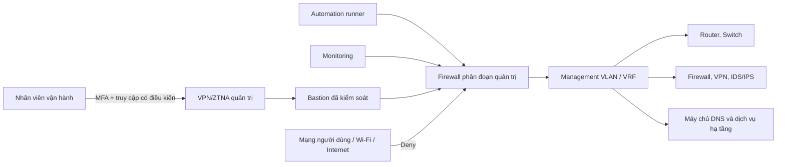

# Giới hạn nguồn được phép truy cập quản trị

Trong chương **Hardening thiết bị và dịch vụ mạng**, một bước quan trọng là kiểm soát **ai có thể kết nối đến giao diện quản trị từ đâu**. Router, switch, firewall, VPN gateway, IDS/IPS, máy chủ DNS, điểm truy cập không dây và bảng điều khiển dịch vụ đám mây thường cung cấp SSH, HTTPS, API, SNMP hoặc giao diện quản trị chuyên dụng. Nếu mọi máy trong mạng nội bộ, hoặc thậm chí Internet, đều có thể mở kết nối đến các cổng này, kẻ tấn công sẽ có thêm cơ hội dò mật khẩu, khai thác lỗi dịch vụ và lạm dụng tài khoản bị đánh cắp.

**Giới hạn nguồn được phép truy cập quản trị** (*management access source restriction*) là việc chỉ cho phép các nguồn kết nối đã được phê duyệt đi tới đúng giao diện, giao thức và cổng quản trị. Biện pháp này bổ sung cho xác thực mạnh, phân quyền tối thiểu, giám sát và phân đoạn mạng. Nó không có nghĩa rằng một địa chỉ IP nằm trong danh sách cho phép đã trở thành danh tính đáng tin cậy của người dùng.

## 1. Mục tiêu học tập

Sau bài học, người học có thể:

1. Phân biệt mặt phẳng quản trị với mặt phẳng chuyển tiếp dữ liệu và các dịch vụ mạng công khai.
2. Xây dựng ma trận nguồn–đích–giao thức phục vụ chính sách quản trị theo nguyên tắc **deny by default**.
3. Đánh giá mô hình quản trị qua management VLAN/VRF, VPN, bastion host và Zero Trust Network Access (ZTNA).
4. Chọn vị trí thực thi giới hạn nguồn: ACL trên thiết bị, firewall phân đoạn, host firewall và chính sách mạng đám mây.
5. Áp dụng và kiểm tra cấu hình minh họa với SSH/HTTPS/SNMP, có tính đến IPv4, IPv6 và NAT.
6. Triển khai thay đổi an toàn để tránh khóa mất quyền quản trị và thiết lập giám sát truy cập bất thường.

## 2. Hiểu đúng bề mặt quản trị

### 2.1. Management plane, control plane và data plane

Thiết bị mạng thường xử lý ba nhóm hoạt động:

| Mặt phẳng | Vai trò | Ví dụ | Liên hệ với hardening |
|---|---|---|---|
| **Management plane** | Cấu hình, vận hành và quan sát thiết bị | SSH, giao diện web quản trị, NETCONF/RESTCONF, SNMP, API cấu hình | Giới hạn nguồn, giao diện, tài khoản và quyền thao tác |
| **Control plane** | Hình thành, duy trì thông tin điều khiển mạng | OSPF, BGP, ARP/ND, một số giao thức điều khiển | Áp dụng chính sách bảo vệ riêng, như xác thực láng giềng và CoPP khi phù hợp |
| **Data plane** | Chuyển tiếp gói tin của ứng dụng/người dùng | Kết nối web tới máy chủ sau firewall, lưu lượng VPN người dùng | Không chặn nhầm lưu lượng sản xuất khi bảo vệ quản trị |

Ví dụ: cùng một firewall có thể xử lý HTTPS của người dùng đi qua thiết bị và phục vụ giao diện HTTPS để nhân viên vận hành cấu hình. Quy tắc cho phép HTTPS của người dùng **không được mặc nhiên** cho phép họ truy cập HTTPS quản trị của chính firewall.

Tương tự, dịch vụ DNS phục vụ truy vấn cho khách hàng có thể cần cổng UDP/TCP 53 cho nhiều nguồn; bảng điều khiển quản trị DNS, SSH đến máy chủ DNS hoặc API thay đổi zone vẫn phải hạn chế theo nguồn đã phê duyệt.

### 2.2. Vì sao chỉ tắt Telnet hoặc đổi cổng SSH là chưa đủ?

Đổi Telnet sang SSH bảo vệ tốt hơn tính bí mật của phiên quản trị. Tuy nhiên, nếu SSH được mở cho `0.0.0.0/0` (mọi địa chỉ IPv4), đối thủ vẫn có thể thử đăng nhập hoặc khai thác lỗi trong dịch vụ. Đổi SSH từ cổng 22 sang cổng khác chỉ làm giảm một phần quét tự động, không thay thế chính sách nguồn. Tương tự, MFA không ngăn hoàn toàn việc khai thác lỗ hổng ở dịch vụ trước giai đoạn đăng nhập.

Một cấu hình vững hơn cần các lớp độc lập:

- **Thu hẹp phạm vi kết nối:** chỉ các subnet/host quản trị được phép tiếp cận.
- **Xác thực mạnh:** SSH key hoặc chứng chỉ, MFA ở VPN/IdP, tài khoản cá nhân thay cho tài khoản chia sẻ khi thiết bị hỗ trợ.
- **Phân quyền:** vai trò chỉ đọc, vận hành, thay đổi cấu hình; ghi nhận thao tác nhạy cảm.
- **Bảo vệ và giám sát dịch vụ:** bản vá, giao thức bảo mật, log đăng nhập và cảnh báo thay đổi bất thường.

## 3. Xác định nguồn tin cậy và phạm vi áp dụng

### 3.1. Không đồng nhất «mạng nội bộ» với «mạng quản trị»

Mạng văn phòng, Wi-Fi nhân viên, VLAN máy chủ ứng dụng hay IP của nhà cung cấp đều có thể bị xâm nhập. Vì vậy, không nên viết luật «mọi địa chỉ RFC 1918 được quản trị thiết bị». Nguồn quản trị phải được định nghĩa **cụ thể theo vai trò**:

| Nhóm nguồn | Trường hợp cho phép | Điều kiện đi kèm |
|---|---|---|
| **Bastion/jump host** | Quản trị SSH/HTTPS tập trung | Chỉ các máy được quản lý; MFA trước khi vào; ghi log phiên khi được yêu cầu |
| **VPN quản trị** | Nhân viên từ xa đến mạng quản trị | Nhóm quyền riêng, xác thực mạnh, subnet cấp phát tách người dùng thường |
| **Automation runner** | Sao lưu cấu hình, Ansible, API tự động hóa | Danh tính dịch vụ riêng, cấp quyền hạn chế, nhật ký thực thi |
| **Hệ thống giám sát** | SNMPv3, API chỉ đọc hoặc health check | Chỉ mở đúng cổng, tài khoản/role giám sát |
| **Thiết bị quản trị ngoài băng (OOB)** | Khôi phục sự cố khi mạng chính bị lỗi | Mạng/tuyến riêng, nguồn truy cập độc lập có kiểm soát |
| **Đối tác bảo trì** | Truy cập tạm qua cổng trung gian | Phê duyệt, có thời hạn, giới hạn thiết bị và ghi nhận hoạt động |

**Nguồn được phép** nên là một tập IP/CIDR nhỏ đã kiểm soát được, hoặc là nguồn được xác định sau khi qua cổng truy cập với danh tính đã xác minh. Một subnet được cấp cho thiết bị đầu cuối thông thường không phải nguồn quản trị tốt chỉ vì nó nằm trong LAN.

### 3.2. Xác định tài sản, dịch vụ và đường đi

Trước khi cấu hình, tạo danh mục các điểm vào:

1. Địa chỉ quản trị riêng của switch/router/firewall và giao diện kết nối đến địa chỉ này.
2. SSH, HTTPS, API, NETCONF/RESTCONF, SNMP và các cổng quản trị khác thực sự đang bật.
3. Đường từ từng nhóm nguồn tới thiết bị: LAN, VPN, WAN, overlay cloud, đường OOB.
4. Các thành phần thay đổi địa chỉ nguồn như NAT, proxy hoặc load balancer.
5. Cách truy cập trong tình huống khẩn cấp khi bastion/VPN gặp sự cố.

Không giới hạn ở cổng 22 và 443. Ví dụ, thiết bị có thể dùng giao diện web cổng 8443, NETCONF qua SSH cổng 830, SNMP cổng UDP 161 hoặc API vendor-specific. Phải kiểm kê cả IPv6 và giao diện quản trị phụ.

### 3.3. Xây dựng ma trận chính sách

Ví dụ giả lập cho một tổ chức có gateway VPN, bastion và máy giám sát. Các địa chỉ `192.0.2.0/24`, `198.51.100.0/24` và `2001:db8::/32` là **dải tài liệu minh họa**; cần thay bằng địa chỉ thực tế trong môi trường triển khai.

| Nguồn | Đích | Dịch vụ | Quyết định | Giải thích |
|---|---|---|---|---|
| Bastion `192.0.2.10/32` | Router quản trị `10.20.0.1` | TCP 22 | Allow | Kỹ sư vận hành SSH |
| Bastion `192.0.2.10/32` | Firewall quản trị `10.20.0.2` | TCP 443 | Allow | Giao diện cấu hình |
| Automation `192.0.2.20/32` | Switch quản trị `10.20.0.3` | TCP 22 | Allow | Sao lưu cấu hình bằng key riêng |
| Monitoring `192.0.2.30/32` | Switch `10.20.0.3` | UDP 161 | Allow | Thu thập SNMPv3 |
| VPN người dùng thông thường | `10.20.0.0/24` | Mọi cổng quản trị | Deny | Không thuộc nhóm vận hành |
| WAN/Internet | `10.20.0.0/24` | Mọi cổng quản trị | Deny | Không cho quản trị trực tiếp từ Internet |
| Các nguồn còn lại | Các đích quản trị | Các dịch vụ quản trị | Deny | Mặc định từ chối |

Khi thiết bị có IPv6, cần chính sách tương ứng cho IPv6, không chỉ tạo ACL IPv4. Nguyên tắc chung: **đúng nguồn, đúng đích, đúng dịch vụ, đúng mục đích, đúng thời hạn**.

## 4. Thiết kế kiến trúc giới hạn nguồn

### 4.1. Mạng quản trị chuyên dụng

Đặt địa chỉ quản trị trên management VLAN, VRF hoặc mạng OOB chuyên dụng; chỉ định tuyến vào từ các điểm được phép. Tách subnet giúp giảm phạm vi tiếp cận và đơn giản hóa ACL.



Sơ đồ thể hiện ý tưởng kiểm soát tuyến đi. «Deny» có nghĩa là gói không được cho đi tiếp tới endpoint quản trị, tùy vị trí thực tế đặt firewall và route. Mạng OOB lý tưởng nên có đường kết nối độc lập với data plane để còn khôi phục được khi cấu hình định tuyến hoặc firewall chính gặp lỗi.

**Lưu ý:** VLAN chỉ là một thành phần phân đoạn. Nếu router/firewall giữa VLAN có luật cho phép quá rộng hoặc cùng thiết bị có nhiều giao diện quản trị mở, phân đoạn không còn tác dụng như mong muốn. VRF tách bảng định tuyến, nhưng vẫn cần kiểm soát việc *route leaking* và quyền truy cập vào dịch vụ local của thiết bị.

### 4.2. Bastion host và VPN/ZTNA

**Bastion** là điểm tập trung các phiên quản trị. Lợi ích của cách này là thu hẹp danh sách nguồn tại các thiết bị đích: thay vì cho phép toàn bộ laptop nhân viên, chỉ cho phép IP của bastion. Đồng thời có thể áp dụng MFA ở lớp truy cập, quản lý phiên, ghi nhật ký và hạn chế tải file.

**VPN quản trị** tạo đường đi được mã hóa cho nhân viên từ xa. Cần tách quyền và dải địa chỉ VPN quản trị khỏi VPN người dùng thông thường, áp dụng MFA, hạn chế thiết bị đích và kiểm tra tư thế thiết bị khi phù hợp. VPN vào mạng doanh nghiệp **không tự động** cấp quyền quản trị tất cả switch hay firewall.

**ZTNA** có thể cho phép kết nối theo danh tính, trạng thái thiết bị, ứng dụng và ngữ cảnh, thay cho quyền định tuyến vào cả subnet. Tuy nhiên, các dịch vụ SSH/API cũ có thể vẫn cần một connector/bastion và ACL ở phía đích. Chính sách «người dùng được phép» trong IdP chỉ phát huy tác dụng nếu đường truy cập trực tiếp tới dịch vụ quản trị đã được đóng.

### 4.3. Kiểm soát tại nhiều điểm

| Vị trí áp dụng | Ví dụ | Ưu điểm | Giới hạn cần chú ý |
|---|---|---|---|
| **Firewall/ACL phân đoạn** | Rule ingress tới subnet quản trị | Chặn trước khi lưu lượng tới nhiều thiết bị | Cần bảo vệ đường vòng, kết nối trực tiếp, IPv6 |
| **ACL trên thiết bị** | Giới hạn nguồn SSH vào VTY của router | Áp dụng ngay trên tài sản cần bảo vệ | Không nhất thiết bao phủ HTTPS, SNMP và mọi giao diện |
| **Host firewall** | nftables/Windows Defender Firewall | Chặn ngay trên máy chạy dịch vụ | Phải phối hợp với các rule hiện có, kiểm tra đúng interface |
| **Dịch vụ quản trị** | Bind SSH/API vào management IP; allowlist tích hợp | Giảm giao diện lắng nghe | Không phải dịch vụ nào cũng hỗ trợ |
| **Cloud security group / NSG** | Inbound từ bastion/VPN đến management ENI | Kiểm soát mạng trước workload | Dễ mở nhầm do rule rộng, nhiều ENI, IP công khai |
| **Identity-aware proxy** | ZTNA, IAP, PAM gateway | Kiểm tra danh tính/thiết bị/ngữ cảnh | Phải vô hiệu đường bypass trực tiếp |

Dùng nhiều lớp có mục đích rõ ràng. Ví dụ, firewall phân đoạn bảo vệ subnet quản trị; ACL trên router là hàng rào bổ sung nếu một rule mạng bị đặt sai.

## 5. Mẫu triển khai cho các môi trường phổ biến

Tất cả cấu hình dưới đây mang tính **minh họa**. Trước khi áp dụng, xác nhận phiên bản hệ điều hành/firmware, giao diện thực tế, phương án dự phòng và cách hoàn tác; thực hiện trong phiên bảo trì phù hợp. Việc thay policy của firewall hoặc ACL truy cập quản trị có thể cắt ngay phiên làm việc hiện tại.

### 5.1. Router/switch kiểu Cisco IOS: giới hạn SSH vào VTY

Trong tình huống cần cho phép chỉ bastion `192.0.2.10` và máy vận hành dự phòng `192.0.2.11` truy cập SSH:

```text
ip access-list standard MGMT-SSH-SOURCES
 permit host 192.0.2.10
 permit host 192.0.2.11
 deny any log
!
line vty 0 4
 transport input ssh
 access-class MGMT-SSH-SOURCES in
```

Ý nghĩa:

- `permit host` cho phép đúng một địa chỉ IPv4 nguồn.
- `access-class ... in` áp hạn chế nguồn cho phiên vào đường VTY được cấu hình.
- `transport input ssh` hạn chế giao thức VTY vào SSH, thay vì Telnet.
- `deny any log` từ chối các nguồn còn lại; log có thể bị giới hạn, phụ thuộc nền tảng và phiên bản.

Thiết bị có thể có thêm các đường VTY như `line vty 5 15`; phải kiểm tra và áp chính sách cho **tất cả** đường VTY liên quan. Chỉ thị này **không** tự bảo vệ web UI, SNMP hoặc API quản trị. IPv6 cần cấu hình lọc riêng theo khả năng nền tảng; không suy luận ACL IPv4 đã chặn IPv6. SSH vẫn phải có xác thực và phân quyền phù hợp (AAA/RBAC, key, logging).

Trước và sau khi áp dụng, kiểm tra trạng thái SSH, các dòng VTY, ACL đang thực thi và phiên đăng nhập thực tế từ cả nguồn được phép lẫn nguồn không được phép. Cú pháp chi tiết có thể khác giữa IOS, IOS XE, NX-OS và các nhà cung cấp.

### 5.2. Linux: giới hạn ingress với nftables

Giả sử một máy chủ hạ tầng có interface quản trị riêng `mgmt0` và chỉ chạy SSH/HTTPS quản trị trên đó. Nguồn IPv4 được phép là `192.0.2.10`, nguồn IPv6 được phép là `2001:db8:100::10`. Ví dụ cấu hình sau tạo một bảng có chuỗi `input` minh họa:

```nft
table inet mgmt_guard {
    set allowed_admin_v4 {
        type ipv4_addr
        flags interval
        elements = { 192.0.2.10 }
    }
    set allowed_admin_v6 {
        type ipv6_addr
        flags interval
        elements = { 2001:db8:100::10 }
    }

    chain input {
        type filter hook input priority filter; policy accept;

        iifname "mgmt0" tcp dport { 22, 443 } ip saddr @allowed_admin_v4 accept
        iifname "mgmt0" tcp dport { 22, 443 } ip6 saddr @allowed_admin_v6 accept
        iifname "mgmt0" tcp dport { 22, 443 } counter drop
    }
}
```

Các quy tắc trên chặn những nguồn khác **đến TCP 22/443 qua interface `mgmt0`**. Chúng không kiểm soát lưu lượng tới các interface khác, không chặn dịch vụ quản trị khác và không thay thế các chính sách firewall sẵn có. Để bảo đảm không có đường vòng, cần:

1. Chỉ bind dịch vụ quản trị vào IP của `mgmt0` nếu phần mềm hỗ trợ, hoặc có rule chặn truy cập quản trị ở các interface khác.
2. Tích hợp rule với tập luật hiện hữu, tránh bảng/chuỗi ưu tiên khác tạo kết quả ngoài dự kiến; «accept» ở một base chain không bảo đảm vượt qua mọi base chain khác của nftables.
3. Kiểm tra kết nối IPv4, IPv6, mạng người dùng, mạng WAN và mọi cổng quản trị đã kiểm kê.
4. Lưu cấu hình và quy trình khôi phục bằng console hoặc công cụ quản lý cấu hình.

Dùng `nft -c -f <file>` để kiểm tra cú pháp tập luật đã lưu, xem `nft list ruleset` để đối chiếu rule hiện hành, và chỉ áp dụng khi đã có phiên truy cập dự phòng. Ví dụ dùng dải IP tài liệu; cần thay bằng IP thật.

Nếu máy chủ còn phục vụ **ứng dụng HTTPS** trên cùng cổng 443, không được sao chép rule này một cách máy móc vì có thể chặn người dùng ứng dụng. Nên bind web quản trị vào địa chỉ/cổng riêng và điều kiện hóa rule theo **đích + interface + dịch vụ**.

### 5.3. Firewall/thiết bị bảo mật: local-in policy

Với firewall làm gateway cho nhiều vùng mạng, cần phân biệt:

- **Transit policy:** cho phép/chặn lưu lượng *đi qua* firewall.
- **Local-in / management policy:** cho phép/chặn lưu lượng *đến chính firewall* (ví dụ SSH, HTTPS, SNMP hoặc API cấu hình).

Một rule chặn transit từ Internet vào subnet quản trị có thể không hạn chế được HTTPS tới địa chỉ IP WAN của firewall. Do đó, phải kiểm tra cấu hình cho phép dịch vụ trên từng interface, danh sách nguồn tin cậy của tài khoản quản trị hoặc local-in policy theo khả năng thiết bị.

Ví dụ yêu cầu thiết kế: chỉ địa chỉ `10.10.30.5` (bastion nội bộ) được mở TCP 443 đến `10.20.0.2` (IP quản trị firewall); cổng WAN không bật web admin; SSH chỉ phục vụ mạng OOB. Với SNMP, chỉ máy monitoring được UDP 161, cấu hình SNMPv3 và hạn chế view/role phù hợp. Gửi syslog tới SIEM là **lưu lượng đi ra** (thường từ thiết bị tới bộ thu), không phải lý do để mở inbound cổng quản trị từ mọi nguồn.

### 5.4. Dịch vụ đám mây: security group, NSG và quản trị qua đường riêng

Ví dụ một máy ảo quản trị bằng SSH trong mạng cloud:

- Gỡ rule inbound `0.0.0.0/0:22` và `::/0:22` nếu đang mở.
- Chỉ cho phép TCP 22 từ địa chỉ nguồn thực sự của bastion/VPN hoặc từ security group của bastion khi nền tảng hỗ trợ tham chiếu và hai tài nguyên ở phạm vi hợp lệ.
- Ưu tiên kết nối private, dịch vụ truy cập có kiểm soát danh tính hoặc giải pháp session management thay vì gán public IP cho máy quản trị.
- Đối chiếu rule trên mọi network interface và các đường bổ sung như peering, transit network hoặc private endpoint.

Không được giả định rằng IP máy nhân viên bên ngoài luôn là địa chỉ nguồn mà workload nhìn thấy: VPN có thể cấp IP nội bộ hoặc áp dụng SNAT. Hãy ghi nhận nguồn **sau NAT tại điểm áp luật** trước khi cấu hình allowlist.

### 5.5. Wi-Fi controller, DNS và nền tảng giám sát

Các loại thiết bị và dịch vụ trong mạng có yêu cầu đặc thù:

| Đối tượng | Kênh cần giới hạn | Lưu ý vận hành |
|---|---|---|
| Wi-Fi controller / AP | HTTPS, SSH, API điều khiển | Tách SSID người dùng và management VLAN; không phơi giao diện quản trị trên SSID khách |
| DNS server | SSH, bảng điều khiển/API thay đổi zone, zone transfer khi liên quan | Không nhầm với cổng DNS phục vụ resolver; ACL zone transfer là chính sách riêng |
| IDS/IPS sensor | SSH, web console, API quản lý | Chỉ SOC/bastion; luồng sensor gửi telemetry tới manager cần rule khác |
| VPN gateway | API/web admin, SSH | Portal đăng nhập người dùng VPN và portal quản trị là hai bề mặt cần bảo vệ tách biệt |
| Hypervisor / hệ thống ảo hóa | Web UI, SSH, API | Quản trị từ jump host, hạn chế mạng máy ảo thông thường |
| SNMP agent | UDP 161 từ hệ thống giám sát | Ưu tiên SNMPv3 authPriv; nguồn được phép không thay thế xác thực mã hóa |

## 6. Những trường hợp dễ gây sai lệch khi viết allowlist

### 6.1. NAT làm thay đổi địa chỉ nguồn

Khi nhân viên kết nối từ Internet qua VPN, thiết bị đích có thể thấy IP pool VPN, IP SNAT của concentrator hoặc IP của bastion — không nhất thiết thấy IP công cộng của laptop. Vì vậy, phải xác nhận **địa chỉ nguồn tại điểm thực thi rule** bằng log/session table hoặc bắt gói tại vị trí được phép.

NAT có thể khiến nhiều người cùng dùng một IP nguồn. IP allowlist chỉ chứng minh kết nối đến từ một đường mạng cho phép, **không phân biệt được từng người**. Danh tính vẫn phải đến từ chứng thực và log phiên.

### 6.2. IPv6 là một đường quản trị độc lập

Thiết bị có thể có IPv6 global, ULA hoặc địa chỉ link-local, và giao diện SSH/HTTPS có thể lắng nghe trên `::`. Tắt hoặc chặn IPv4 không tự chặn IPv6. Cần:

- Liệt kê mọi địa chỉ IPv6 và các interface lắng nghe.
- Có rule IPv6 tương ứng hoặc tắt IPv6 trên dịch vụ quản trị nếu không sử dụng và môi trường cho phép.
- Kiểm tra truy cập từ nguồn IPv6 không được phép.
- Với địa chỉ link-local, chú ý phạm vi kết nối cùng link và chính sách trên các interface cục bộ.

### 6.3. IP động, DNS và thay đổi nguồn

Không nên tự động đưa mọi IP mới của một nhà cung cấp vào allowlist chỉ vì đó là IP của nhà cung cấp. Với kỹ sư có IP tại nhà thay đổi liên tục, giải pháp thích hợp thường là **VPN/ZTNA quản trị** hoặc bastion có địa chỉ ổn định.

Dùng FQDN làm điều kiện nguồn nếu firewall hỗ trợ cần xem kỹ thời điểm phân giải DNS, TTL, failover, cập nhật và nguy cơ thay đổi không được phê duyệt. Không mặc định chuỗi tên miền luôn tương đương một danh tính mạng cố định.

### 6.4. Danh sách quá rộng và cấp quyền tồn tại mãi

Các cách làm dễ tạo lỗ hổng:

- Cho phép toàn bộ `10.0.0.0/8` chỉ vì đó là dải nội bộ.
- Cho phép mọi IP đối tác dù chỉ một kỹ sư cần hỗ trợ ngắn hạn.
- Cho phép một VPN dành cho mọi nhân viên truy cập cả management VLAN.
- Để allowlist tạm thời sau kỳ bảo trì mà không thu hồi.
- Chỉ kiểm soát giao diện chính, bỏ sót IP WAN phụ, IPv6, API/port phụ hoặc đường OOB.

Cần quy định chủ sở hữu rule, ticket/yêu cầu thay đổi, lý do, ngày rà soát và ngày hết hạn nếu là quyền tạm.

## 7. Quy trình triển khai an toàn và tránh tự khóa truy cập

**Rủi ro thực tế:** một ACL sai có thể cắt quyền SSH/HTTPS, khiến đội vận hành không thể sửa lại thiết bị. Vì vậy, chuẩn bị khả năng khôi phục là một phần của hardening.

### Giai đoạn A — Khảo sát

1. Liệt kê cổng/giao thức quản trị và mọi interface/IP đang lắng nghe.
2. Ghi nhận đường đi của quản trị viên và automation (địa chỉ nguồn sau VPN/NAT, đích, cổng).
3. Xác minh tài khoản/nhóm thực sự cần truy cập; phân loại quyền theo vai trò.
4. Kiểm tra các kết nối phụ thuộc như giám sát, sao lưu, orchestration và tài khoản vận hành khẩn cấp.
5. Chuẩn bị sơ đồ route và ma trận allow/deny đã được duyệt.

### Giai đoạn B — Chuẩn bị rollback

- Sao lưu cấu hình hiện hành và kiểm tra khả năng khôi phục.
- Thiết lập console/OOB hoặc phiên quản trị dự phòng **độc lập với rule chuẩn bị thay đổi**.
- Sử dụng cơ chế **commit confirmed / rollback timer** nếu nền tảng hỗ trợ và đã hiểu rõ hành vi của nó.
- Chuẩn bị lệnh khôi phục chính xác trước khi áp dụng, người chịu trách nhiệm và điểm dừng.
- Với cloud, xác nhận có đường truy cập khẩn cấp được kiểm soát (ví dụ console/session access) trước khi thu hẹp security group.

### Giai đoạn C — Thay đổi theo từng lớp

1. Tạo nguồn quản trị ổn định (bastion/VPN subnet/automation/monitoring).
2. Thử kết nối hợp lệ từ từng nguồn, xác minh xác thực và log.
3. Thêm allow rule cụ thể cho nguồn, đích và dịch vụ thực sự cần.
4. Áp deny ở nơi kiểm soát management plane; đừng chặn nhầm data plane hoặc DNS/VPN người dùng.
5. Rà soát IPv6, interface phụ, API và đường vòng.
6. Lưu thay đổi sau khi xác nhận đầy đủ cả đường truy cập hợp lệ và đường bị cấm.

Chỉ thử nghiệm quét cổng, đăng nhập hoặc kiểm tra kết nối trong phạm vi tài sản/mạng có quyền quản lý và theo quy trình thay đổi của tổ chức.

## 8. Kiểm thử chính sách và tiêu chí chấp nhận

Thử nghiệm cần có **kiểm thử dương tính** (nguồn hợp lệ vẫn vào được) và **kiểm thử âm tính** (nguồn không hợp lệ bị chặn). Cả hai là bắt buộc để tránh kết luận sai «đã an toàn» khi thiết bị thực chất đang bị mất kết nối vì lỗi route hoặc lỗi dịch vụ.

| Test ID | Nguồn kiểm thử | Dịch vụ/đích | Kỳ vọng | Bằng chứng cần lưu |
|---|---|---|---|---|
| T1 | Bastion được phép | SSH router quản trị | Kết nối thành công sau xác thực | Log phiên, user, IP, thời điểm |
| T2 | Máy trong VLAN văn phòng | SSH router quản trị | Không vào được | Log deny/ACL counter; thử nghiệm từ nguồn xác định |
| T3 | Bastion được phép | HTTPS web quản trị firewall | Truy cập thành công qua TLS | URL đích, TLS, log tài khoản |
| T4 | Mạng khách/WAN | HTTPS quản trị firewall | Bị chặn | Rule hit hoặc bản ghi firewall |
| T5 | Monitoring | SNMPv3 đến switch | Truy vấn được đúng quyền | Audit SNMPv3, địa chỉ nguồn |
| T6 | Máy không thuộc monitoring | SNMP đến switch | Bị chặn | Log/counter từ chối |
| T7 | IPv6 không được phép | SSH/HTTPS quản trị | Bị chặn | Rule IPv6 và kết quả thử |
| T8 | Automation runner | API/SSH cần thiết | Hoạt động bình thường | Log backup/job, tài khoản dịch vụ |
| T9 | Đường WAN/IP quản trị phụ | Mọi cổng quản trị | Không mở ngoài chính sách | Kiểm tra listener và policy |
| T10 | Console/OOB khẩn cấp | Đường quản trị dự phòng | Vẫn sử dụng được | Biên bản thử khôi phục |

Lệnh minh họa từ **máy kiểm thử được phép**:

```bash
# Kiểm tra có mở kết nối TCP đến cổng SSH hay không.
nc -vz -w 3 10.20.0.1 22

# Kiểm tra chứng chỉ TLS và kết nối HTTPS quản trị.
curl -I --connect-timeout 3 https://10.20.0.2/

# Truy vấn SSH từ bastion; chỉ thao tác bằng tài khoản được cấp.
ssh -o ConnectTimeout=5 admin@10.20.0.1
```

Phải đọc kết quả đúng ngữ cảnh:

- `Connection refused` có thể là dịch vụ không lắng nghe, không nhất thiết ACL đang chặn.
- `Timeout` có thể do lọc firewall, sự cố định tuyến hoặc thiết bị không hoạt động.
- Phản hồi `401/403` từ web cho thấy đã đến được ứng dụng, có thể **không** đáp ứng yêu cầu chặn tiếp cận mạng.
- Đăng nhập thất bại nhưng màn hình SSH/HTTPS xuất hiện vẫn chứng minh dịch vụ có thể bị truy cập từ nguồn kiểm thử.

Để xác nhận chính sách, kết hợp kết quả từ client, counters/rule logs trên thiết bị chặn, bảng định tuyến và log dịch vụ đích. Không chỉ dựa vào một mã lỗi.

## 9. Vận hành liên tục, cảnh báo và rà soát

Sau triển khai, chính sách nguồn quản trị cần được quản lý như một thành phần có vòng đời:

| Tín hiệu | Ý nghĩa có thể có | Phản ứng |
|---|---|---|
| Nhiều lần kết nối bị từ chối từ cùng nguồn | Quét dịch vụ, cấu hình sai, nguồn chưa được cấp quyền | Phân tích nguồn, tỷ lệ, đường mạng và bối cảnh |
| Đăng nhập thành công từ IP mới trong allowlist | Bastion/NAT thay đổi hoặc phiên bất thường | Đối chiếu phiên VPN, người dùng, ticket và tài sản |
| Rule allowlist được mở rộng đột ngột | Thay đổi hợp lệ hoặc sai cấu hình | Đối chiếu yêu cầu thay đổi, người thực hiện, phạm vi |
| Nhiều thiết bị đột nhiên mất telemetry | SNMP/API bị chặn sau cập nhật | Kiểm tra policy, monitoring source và NAT |
| Web quản trị xuất hiện trên WAN | Dịch vụ lắng nghe trên interface ngoài dự kiến | Tắt listener, chặn local-in, xác nhận lại từ nguồn ngoài |
| Truy cập quản trị ngoài khung giờ | Hoạt động bảo trì hoặc lạm dụng tài khoản | Liên kết log IdP/VPN/bastion, xác minh thay đổi |

**Log nên có:** thời gian chuẩn hóa UTC, địa chỉ nguồn thực tế tại điểm kiểm soát, đích, port/protocol, action allow/deny, interface/zone, rule ID, user hoặc session ID nếu có, lý do thay đổi policy. Kết hợp log từ VPN, bastion, AAA, firewall và SIEM để truy vết từ địa chỉ mạng tới người thực hiện.

Không cần ghi từng gói bị từ chối với tốc độ quá cao nếu gây tràn log hoặc ảnh hưởng hiệu năng. Có thể sử dụng counters, sampling/rate limiting và quy tắc cảnh báo có ngưỡng. Tuy nhiên, log thay đổi rule và phiên quản trị thành công cần đủ chi tiết để phục vụ kiểm tra, điều tra sự cố.

**Rà soát định kỳ:** xác nhận chủ sở hữu từng allow rule, thu hồi IP không còn dùng, kiểm tra thiết bị mới/địa chỉ mới, IPv6 và dịch vụ cổng phụ. Một rule đúng hôm nay có thể trở nên nguy hiểm khi subnet đổi mục đích hoặc bastion bị ngừng quản lý.

## 10. Tình huống thực hành: bảo vệ quyền quản trị firewall chi nhánh

Một tổ chức có firewall chi nhánh, Wi-Fi khách, LAN nhân viên, VPN người dùng và một bastion dùng cho vận hành. Đội ứng cứu phát hiện giao diện HTTPS quản trị của firewall cũng lắng nghe trên IP WAN. Quy tắc hiện tại chấp nhận kết nối TCP 443 từ nhiều dải mạng, trong đó có VPN người dùng.

**Yêu cầu nghiệp vụ:** quản trị viên làm việc từ xa, truy cập firewall qua VPN quản trị và bastion; hệ thống giám sát vẫn lấy trạng thái bằng SNMPv3; người dùng LAN, Wi-Fi khách và Internet không được tiếp cận giao diện quản trị.

**Thiết kế đề xuất:**

1. Cấp IP quản trị riêng cho firewall trong management VLAN/VRF và chỉ dùng địa chỉ đó cho HTTPS quản trị.
2. Tắt giao diện web quản trị trên WAN nếu thiết bị cho phép; áp local-in/management ACL cho phép bastion đến IP quản trị TCP 443.
3. Giới hạn SSH (nếu thực sự cần) cho bastion hoặc OOB; chỉ mở UDP 161 từ monitoring, dùng SNMPv3.
4. VPN quản trị xác thực MFA, cấp quyền tới bastion; nhóm VPN thông thường không có route/policy vào management VLAN.
5. Đặt deny mặc định cho các nguồn khác ở điểm bảo vệ; kiểm tra IPv6 và mọi interface phụ.
6. Thử kết nối từ bastion, VPN người dùng, LAN, Wi-Fi khách và mạng bên ngoài; lưu log/counters và kết quả.
7. Thiết lập alert khi có rule local-in mới, khi login quản trị bất thường hoặc có kết nối tới cổng quản trị từ vùng không được phép.

**Phân tích một tình huống phát sinh:** sau khi đóng WAN HTTPS, kỹ sư ở nhà không thể đăng nhập trực tiếp bằng IP công cộng như trước. Đây là kết quả đúng theo chính sách. Đường hợp lệ là VPN quản trị → bastion → IP quản trị riêng của firewall, với kiểm tra danh tính ở các lớp tương ứng. Nếu giám sát SNMPv3 cũng mất dữ liệu, cần kiểm tra IP nguồn mà firewall quan sát được, cổng/protocol, route, rule và cấu hình SNMPv3; không mở lại UDP 161 cho mọi nguồn để xử lý nhanh.

### Tiêu chí hoàn thành tình huống

- Có bản đồ đường đi từ nguồn quản trị được phép đến thiết bị đích.
- Có ma trận nguồn–đích–dịch vụ rõ ràng và kiểm thử dương/âm tính.
- Không có giao diện quản trị trực tiếp trên WAN hoặc mạng người dùng ngoài nhu cầu đã phê duyệt.
- Mọi trường hợp truy cập bằng IPv4/IPv6, qua VPN/NAT, automation và monitoring đã được xét.
- Có phương án console/OOB và rollback đã thử.
- Log truy cập quản trị cùng thay đổi ACL có thể truy vết về người/phương tiện thực hiện.

## 11. Lỗi thường gặp và cách tự kiểm tra

| Sai sót | Hậu quả | Cách tránh |
|---|---|---|
| Chỉ dùng mật khẩu mạnh, không giới hạn nguồn | Dịch vụ vẫn bị quét và khai thác từ nhiều nơi | Thu hẹp network reachability và bật MFA/AAA |
| Chỉ chặn trên firewall transit | Giao diện quản trị trên chính firewall vẫn có thể mở | Kiểm tra local-in và listener từng interface |
| Chỉ bảo vệ SSH | Web UI, API, SNMP còn lộ | Kiểm kê toàn bộ service quản trị |
| Allow cả subnet người dùng | Máy người dùng bị xâm nhập có thể tiếp cận quản trị | Chỉ cho phép bastion, runner, monitoring cần thiết |
| Chỉ tạo ACL IPv4 | IPv6 trở thành đường vòng | Kiểm soát cả hai giao thức và interface |
| Đặt rule theo IP trước NAT | Nguồn hợp lệ bị chặn hoặc nguồn không mong muốn được cho qua | Xác nhận IP tại điểm thực thi |
| Không kiểm tra đường quản trị dự phòng | Mất quyền sửa cấu hình sau ACL sai | Console/OOB, commit confirmed, rollback |
| Nhầm kết nối bị timeout với đã chặn | Có thể là lỗi route hoặc host down | Xác thực bằng counters/log và thử nghiệm từ nhiều nguồn |
| Không thu hồi quyền tạm thời | Đối tác giữ quyền ngoài thời gian bảo trì | Gắn ticket, expiry và rà soát định kỳ |

### Câu hỏi tự kiểm tra

1. Vì sao địa chỉ IP trong allowlist không thể thay thế xác thực quản trị viên?
2. Sự khác biệt giữa firewall transit rule và local-in rule là gì? Nêu một ví dụ.
3. Một thiết bị có SSH trên IPv4 và HTTPS trên IPv6. ACL IPv4 giới hạn SSH đã đủ chưa?
4. Tại sao chính sách nên cho phép IP bastion thay vì toàn bộ dải VPN người dùng?
5. Trong trường hợp VPN áp SNAT, cần ghi địa chỉ nào vào ACL nguồn của firewall đích?
6. Bạn sẽ xác minh thế nào rằng một cổng quản trị bị chặn đúng bởi ACL chứ không phải dịch vụ đang tắt?
7. Cần chuẩn bị những gì để tránh tự khóa quyền quản trị khi thay đổi rule?
8. Hãy đề xuất ma trận cho bastion, automation runner và SNMP monitoring khi quản trị switch và firewall.

**Bài tập thiết kế:** hãy viết một ma trận 6–10 rule bảo vệ một management VLAN giả lập, trình bày nguồn, đích, giao thức/cổng, lý do, thời hạn, log và cách kiểm thử. Sau đó mô tả việc xử lý nếu laptop kỹ sư bị xâm nhập nhưng vẫn có IP nằm trong dải VPN quản trị; câu trả lời cần thể hiện sự phối hợp giữa kiểm soát mạng, danh tính, phân quyền và giám sát.

Giới hạn nguồn quản trị là một biện pháp giảm bề mặt tấn công có thể đo lường: danh sách người/thiết bị cần quyền trở nên rõ ràng, các đường truy cập ngoài ý muốn bị chặn và mọi phiên quản trị có thể truy vết. Để đạt hiệu quả thực sự, chính sách phải bao phủ toàn bộ đường đi và giao diện quản trị, đồng thời vẫn bảo đảm khả năng vận hành và phục hồi khi có sự cố.
