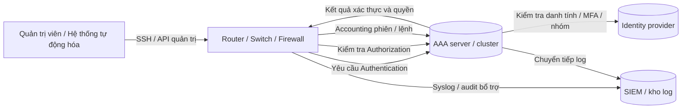

# AAA cho thiết bị mạng: xác thực, phân quyền và ghi nhận hoạt động quản trị

Khi quản trị router, switch, firewall, VPN gateway, wireless controller hoặc thiết bị bảo mật, chỉ có mật khẩu SSH mạnh là chưa đủ. Tổ chức cần biết **ai đã truy cập**, **được phép làm gì** và **đã thực hiện những hành động nào**. Ba câu hỏi này tạo thành mô hình **AAA: Authentication, Authorization, Accounting**, một lớp hardening quan trọng cho *management plane* của thiết bị mạng.

Bài học tập trung vào AAA đối với **quản trị viên và dịch vụ tự động hóa quản trị thiết bị**, trong phạm vi an ninh mạng, phân đoạn, firewall, VPN, IDS/IPS và giám sát hạ tầng. AAA cho người dùng truy cập mạng qua 802.1X có liên quan, nhưng cần phân biệt với AAA của phiên SSH/console hoặc API quản trị thiết bị.

## 1. Ba thành phần của AAA

| Thành phần | Câu hỏi kiểm soát | Cơ chế thường gặp | Ví dụ |
| --- | --- | --- | --- |
| **Authentication (xác thực)** | Danh tính khai báo có được kiểm chứng không? | Username/password, khóa SSH, chứng chỉ, MFA tích hợp qua hệ thống định danh | Quản trị viên đăng nhập switch qua SSH; hệ thống kiểm tra tài khoản và yếu tố xác thực bổ sung. |
| **Authorization (phân quyền)** | Danh tính đó có được phép vào chế độ hoặc thực hiện hành động này không? | Role/privilege, nhóm, policy, kiểm tra lệnh theo từng lần gọi | Nhân viên NOC được xem trạng thái cổng nhưng không được sửa cấu hình firewall. |
| **Accounting (ghi nhận hoạt động)** | Ai đã làm gì, khi nào, trên thiết bị nào, kết quả ra sao? | Log phiên và lệnh, AAA accounting, syslog, audit trail | Hệ thống lưu thời gian mở phiên, thiết bị đích và lệnh thay đổi cấu hình. |

Ba bước có quan hệ chặt chẽ nhưng phục vụ mục đích khác nhau. Một người dùng **được xác thực** không nhất thiết **được phép** chạy lệnh. Một lệnh được phép cũng cần **ghi nhận** để điều tra sự cố và kiểm toán. Accounting cho biết hoạt động đã được ghi nhận; nó tự thân không ngăn hành động trái phép.

Ví dụ: tài khoản `noc-readonly` đăng nhập hợp lệ vào switch `SW-CORE-01`. AAA xác thực tài khoản, gán vai trò chỉ đọc, từ chối lệnh cấu hình VLAN và ghi sự kiện từ chối. Việc từ chối lệnh thuộc **authorization**; bản ghi sự kiện thuộc **accounting**.

## 2. Kiến trúc AAA trên mạng quản trị



Các thành phần cần phân biệt:

- **AAA client / Network Access Server (NAS):** Thiết bị mạng cần kiểm soát truy cập; trong mô hình quản trị thiết bị, router/switch/firewall thường là client của máy chủ AAA.
- **AAA server:** Máy chủ TACACS+ hoặc RADIUS, thực thi chính sách và có thể trao đổi với LDAP, Active Directory, IdP hoặc nền tảng MFA tùy sản phẩm.
- **Hệ thống định danh:** Quản lý tài khoản, nhóm, vòng đời nhân sự, điều kiện xác thực. Không nên cho rằng mọi giao thức AAA đều hỗ trợ MFA trực tiếp theo cùng một cách.
- **Hệ thống audit/SIEM:** Thu thập nhật ký từ cả thiết bị và máy chủ AAA, phục vụ đối chiếu khi một nguồn mất log hoặc bị chiếm quyền.

Luồng đăng nhập điển hình: (1) quản trị viên kết nối qua SSH từ mạng quản trị; (2) thiết bị chuyển yêu cầu xác thực tới AAA; (3) server kiểm chứng danh tính, nếu cấu hình có thể yêu cầu MFA; (4) thiết bị thiết lập phiên theo quyền được cấp; (5) các hành động được phân quyền và ghi log; (6) khi kết thúc, sự kiện đóng phiên được lưu.

**Điểm quan trọng:** Thiết bị phải thực sự áp dụng kết quả phân quyền, không thể chỉ hiển thị role trong giao diện AAA rồi mặc nhiên xem là có kiểm soát. Chức năng kiểm tra từng lệnh còn phụ thuộc hỗ trợ của hệ điều hành thiết bị và giao thức.

## 3. TACACS+ và RADIUS: dùng giao thức nào?

| Tiêu chí | TACACS+ | RADIUS |
| --- | --- | --- |
| Trường hợp thường dùng | AAA cho người quản trị thiết bị mạng | Network access, VPN, Wi-Fi/802.1X; một số thiết bị cũng hỗ trợ AAA cho quản trị |
| Vận chuyển phổ biến | TCP, cổng 49 | UDP 1812 cho authentication/authorization và UDP 1813 cho accounting; có triển khai bảo vệ qua TLS (RadSec) tùy hỗ trợ |
| Mô hình dịch vụ | Có các loại thông điệp riêng cho authentication, authorization, accounting | Authorization gắn với trao đổi Access-Request/Access-Accept và thuộc tính trả về; accounting qua bản tin riêng |
| Phân quyền lệnh CLI | Thường phù hợp để xin phép theo từng lệnh khi thiết bị hỗ trợ | Thường dùng thuộc tính role/privilege; kiểm soát từng lệnh tùy nhà sản xuất, không nên mặc định có |
| Bảo vệ dữ liệu | TACACS+ truyền thống che một phần nội dung nhưng **không cung cấp cơ chế mã hóa/xác thực mạnh như TLS** | RADIUS/UDP truyền thống có giới hạn bảo mật; cần mạng quản trị bảo vệ và dùng phương thức vận chuyển bảo mật khi hỗ trợ |
| Lựa chọn vận hành | Hay được chọn cho quản trị CLI cần audit/phân quyền chi tiết | Thích hợp khi hệ thống sẵn dùng RADIUS và thiết bị hỗ trợ chính sách quản trị yêu cầu |

**TACACS+** theo RFC 8907 phù hợp với mô hình yêu cầu quyền thực thi lệnh, nhưng hỗ trợ kiểm tra lệnh và mức độ ghi log thực tế phụ thuộc thiết bị, phiên bản phần mềm, AAA server và cấu hình. TACACS+ truyền thống sử dụng cơ chế bảo vệ dựa trên shared secret, **không thay thế được kênh bảo mật đầu cuối hiện đại**. Nên giới hạn lưu lượng TACACS+ trong mạng quản trị cách ly và sử dụng lớp bảo vệ bổ sung phù hợp kiến trúc, chẳng hạn IPsec khi cần qua vùng không tin cậy.

**RADIUS** theo RFC 2865/2866 phổ biến trong xác thực truy cập. Không nên suy rằng shared secret và cơ chế bảo vệ của RADIUS/UDP truyền thống đủ chống nghe lén, giả mạo hoặc sửa đổi trên mạng không tin cậy. RadSec (RADIUS over TLS, RFC 6614) có thể bổ sung bảo vệ kênh ở môi trường hỗ trợ. Luôn kiểm tra tính tương thích server, firmware, chính sách mã hóa và phương án dự phòng trước khi triển khai.

**Không nhầm lẫn hai trường hợp:**

- *Quản trị switch qua SSH:* người quản trị đăng nhập để xem/sửa cấu hình; AAA xác thực tài khoản quản trị và giới hạn lệnh.
- *Người dùng cắm laptop vào cổng switch 802.1X:* thiết bị switch có thể làm authenticator, chuyển trao đổi EAP qua RADIUS để quyết định quyền truy cập mạng; đó là kiểm soát truy cập mạng (NAC), không tự động phân quyền CLI quản trị switch.

## 4. Chính sách phân quyền: quyền tối thiểu và tách nhiệm vụ

Thiết kế **RBAC (role-based access control)** bắt đầu từ công việc mà vai trò cần thực hiện, không bắt đầu từ nhóm tài khoản nào thuận tiện để cấp quyền `admin`.

| Vai trò ví dụ | Quyền nên có | Giới hạn cần đặt |
| --- | --- | --- |
| `noc-viewer` | Xem trạng thái interface, route, log vận hành đã cho phép | Không sửa cấu hình, không xem secret, không khởi động lại thiết bị |
| `network-operator` | Một số lệnh vận hành giới hạn theo runbook | Không sửa AAA, ACL quản trị, routing policy lõi nếu không được duyệt |
| `network-admin` | Thay đổi cấu hình thiết bị trong phạm vi được giao | Không được tự tắt audit, cấp quyền cao hơn hoặc xóa chứng cứ theo mặc định |
| `security-admin` | Quản lý chính sách bảo mật, phân quyền, kiểm tra sự kiện | Phân tách với quyền tự phê duyệt thay đổi và quản trị kho log khi khả thi |
| `automation-bot` | Chỉ hành động API/CLI cần cho tác vụ tự động | Danh tính máy riêng, không dùng tài khoản cá nhân, secret xoay vòng và quyền theo phạm vi |
| `break-glass-admin` | Quyền khôi phục khẩn cấp khi AAA trung tâm không hoạt động | Bảo quản an toàn, giám sát, kiểm tra định kỳ, dùng có ghi nhận và thu hồi/đổi thông tin sau sự cố |

Chính sách nên áp dụng **least privilege**, **separation of duties**, giới hạn thiết bị/vùng mạng, cửa sổ thời gian khi cần và quá trình phê duyệt thay đổi. Thực tế việc kiểm tra lệnh chính xác có thể phức tạp: một lệnh được phép ở chế độ xem có thể làm lộ secret; cùng lệnh cấu hình có thể có tác động khác tùy context. Cần kiểm thử trên **phiên bản hệ điều hành và chế độ CLI thực tế**.

Không dùng một tài khoản `admin` chung cho toàn đội. Tài khoản riêng giúp truy nguyên theo cá nhân; nếu truy cập do công cụ tự động, dùng danh tính dịch vụ riêng để không nhập nhằng với hoạt động của con người. Với API quản trị (RESTCONF/NETCONF/API vendor), cần xác minh máy chủ áp dụng phân quyền trên từng thao tác; giới hạn lệnh CLI không nhất thiết áp dụng tương đương cho API.

## 5. Hardening cho luồng AAA và mặt phẳng quản trị

### 5.1. Giới hạn đường truy cập

- Đặt interface quản trị trong **management VLAN/VRF** hoặc mạng out-of-band (OOB) riêng, điều khiển truy cập bằng ACL/firewall. Chỉ bastion/jump host, hệ thống automation và các máy quản trị được phê duyệt có quyền truy cập.
- Dùng **SSH với thuật toán và khóa còn được hỗ trợ an toàn**, HTTPS/TLS khi quản trị web/API, tắt Telnet và các dịch vụ quản trị không cần thiết. Không mở rộng quyền chỉ vì gói AAA được bảo vệ: AAA không tự mã hóa phiên CLI.
- Áp dụng MFA cho phiên quản trị qua IdP, AAA server, bastion hoặc cơ chế được vendor xác nhận. Kiểm tra MFA trên cả các đường SSH, web, console/OOB, API hoặc truy cập thông qua automation theo chính sách phù hợp.
- Dùng ít nhất hai AAA server trong các miền lỗi phù hợp; kiểm thử routing, ACL, DNS nếu có, VRF nguồn và timeout. Đặt AAA server trong vùng tin cậy, chỉ cho phép thiết bị đăng ký kết nối tới dịch vụ.
- Bảo vệ shared secret/credential bằng kho bí mật, giới hạn người đọc và có kế hoạch xoay vòng. Không nhúng secret thật trong tài liệu, ticket hoặc repository.

### 5.2. Phân biệt từ chối xác thực và mất dịch vụ

Một vấn đề thường gây lỗi bảo mật là **fallback sang tài khoản local**. Cần phân biệt:

- **AAA server reachable và trả về reject:** danh tính hoặc chính sách bị từ chối; *không* được tự chuyển sang local để vượt qua quyết định từ chối.
- **AAA server không liên lạc được / lỗi hệ thống:** nếu chính sách đã thiết kế, thiết bị có thể thử tài khoản khẩn cấp local dưới ràng buộc kiểm soát; hành vi chính xác phụ thuộc method list/vendor.
- **Server cho phép đăng nhập nhưng không cấp quyền phù hợp:** tránh tự động nâng quyền hoặc cho toàn quyền CLI.
- **Accounting mất kết nối:** quyết định cho tiếp tục hay chặn thao tác cần đánh giá đặc thù hệ thống; dù lựa chọn nào cũng phải tạo cảnh báo và có log bổ trợ. Không mặc định mọi thiết bị tự dừng phiên khi accounting không hoạt động.

Cấu hình local fallback dễ biến thành lỗ hổng nếu tài khoản khẩn cấp bị biết rộng rãi hoặc thực thi sai điều kiện. Tài khoản emergency cần bảo quản riêng, không dùng hằng ngày, có quy trình kiểm soát và **không được phép vượt qua lệnh reject một cách vô tình**. Khi có điều kiện, kiểm tra khôi phục qua console/OOB để không bị khóa thiết bị lúc thay chính sách.

### 5.3. Tính toàn vẹn của log

Accounting có thể ghi `start`, `stop`, thay đổi cấu hình, lệnh CLI và bản ghi bị từ chối, nhưng **khả năng ghi từng loại sự kiện tùy nền tảng**. Hãy kiểm thử thực tế. Tối thiểu nên có: `event_time_utc`, `device_id`, `source_ip`, `username` hoặc service principal, `session_id`, kênh SSH/console/API, loại hành động, quyết định authorization, kết quả thực thi (nếu có), request/command ID và nguồn log.

Đồng bộ thời gian bằng NTP hoặc dịch vụ thời gian đáng tin, theo dõi drift, gửi log ra SIEM tập trung, giới hạn quyền sửa/xóa và giữ log của cả **AAA server lẫn thiết bị**. Log của chính thiết bị có thể biến mất khi bị reset hoặc bị người có quyền cao xóa; cần nguồn quan sát độc lập. Tránh lưu mật khẩu, token, nội dung secret vào command log hay sự kiện vận hành.

## 6. Mẫu cấu hình logic trung lập nhà sản xuất

Ví dụ dưới đây là **pseudo-configuration dùng để thiết kế chính sách**, không phải câu lệnh có thể dán trực tiếp vào Cisco IOS, Junos, FortiOS hay bất kỳ hệ điều hành nào:

```yaml
management_plane:
  allowed_sources: ["jump-host-subnet", "automation-subnet"]
  protocols: ["ssh", "https"]
  reject_telnet: true
  aaa:
    authentication:
      primary: ["tacacs-a", "tacacs-b"]
      require_mfa_for_humans: true
      on_explicit_reject: "deny"
      on_all_servers_unreachable: "documented-break-glass-only"
    authorization:
      default_role: "deny"
      exec_policy: "role-by-device-scope"
      command_policy: "per-command-where-supported"
    accounting:
      sessions: "central-aaa-and-device-syslog"
      commands: "all-security-relevant-supported-actions"
      forward_to: "central-audit-collector"
```

Bản đồ chính sách này phải được chuyển thành cú pháp phù hợp từng dòng firmware và thiết bị. Ví dụ, một thiết bị hỗ trợ TACACS+ xác thực nhưng không hỗ trợ command authorization cần được xử lý bằng role nội bộ có giới hạn và kiểm soát khác; không thể coi pseudo-config đã bảo đảm phân quyền từng lệnh.

Quy trình triển khai an toàn:

1. **Kiểm kê** loại thiết bị, firmware, giao thức quản trị, nhóm vận hành và hỗ trợ AAA/authz/accounting.
2. **Thiết kế role** và matrix quyền; phân biệt quản trị thường nhật, automation và truy cập khẩn cấp.
3. **Thiết lập máy chủ AAA** có dự phòng, đồng bộ đồng hồ, cấu hình định danh và chính sách MFA; tạo shared secret bằng hệ thống quản lý bí mật.
4. **Bảo vệ đường truyền** tới AAA trên management VRF/ACL, xác thực đúng thiết bị NAS và giới hạn những client được gửi yêu cầu.
5. **Thử trước trên một thiết bị có khả năng khôi phục qua console/OOB**, giữ một phiên quản trị đang mở; kích hoạt lần lượt xác thực, phân quyền phiên, phân quyền lệnh và accounting.
6. **Kiểm tra quyền từng role** bằng những thao tác được phép và bị cấm, cả qua SSH và API/web khi có.
7. **Thử kịch bản lỗi**: server timeout, reject, mất một máy chủ, mất cả cluster, accounting unavailable, MFA failure và đường OOB.
8. **Triển khai theo đợt**, thu log và theo dõi lỗi đăng nhập/authorization trong thời gian giám sát; có cách rollback rõ ràng theo từng nền tảng.

## 7. Kịch bản minh họa: NOC không được thay ACL

Giả sử `SW-DIST-02` là switch trong một vùng mạng phân đoạn; tài khoản `linh.noc` thuộc role `noc-viewer`. Tại `2026-11-28T03:15:10Z`, quản trị viên đăng nhập qua jump host. Các sự kiện minh họa:

| Thời điểm UTC | Sự kiện | Kết quả dự kiến |
| --- | --- | --- |
| `03:15:10` | `linh.noc` kết nối SSH, MFA thành công | Authentication **allow**; log phiên mở. |
| `03:15:14` | Yêu cầu xem trạng thái interface | Authorization **allow**; hiển thị dữ liệu không nhạy cảm theo role. |
| `03:15:21` | Thử vào cấu hình ACL ngoài quyền | Authorization **deny**; không thay đổi ACL; log lệnh bị từ chối nếu nền tảng hỗ trợ. |
| `03:16:03` | Kết thúc phiên | Accounting ghi phiên đóng và thông tin thời gian. |

Ví dụ sự kiện audit đã chuẩn hóa (dữ liệu giả):

```json
{
  "event_time_utc": "2026-11-28T03:15:21Z",
  "device_id": "SW-DIST-02",
  "source_ip": "192.0.2.25",
  "username": "linh.noc",
  "session_id": "ssh-8821",
  "channel": "ssh-cli",
  "action_class": "acl-modification",
  "authorization_decision": "deny",
  "reason": "role-noc-viewer"
}
```

Nhật ký cho biết một yêu cầu thay đổi ACL **bị chặn** ở cấp quyền. Nó không tự chứng minh người thực hiện có ý đồ xấu: có thể là thao tác nhầm, lệnh từ script hoặc tài khoản bị lạm dụng. Nếu một nhật ký khác hiển thị ACL đã thực sự thay đổi, cần đối chiếu xem có đường quản trị khác, tài khoản khác hoặc lỗi thực thi policy.

## 8. Bộ kiểm thử bắt buộc trước khi nghiệm thu

| Kiểm thử | Kỳ vọng | Dấu hiệu cấu hình sai |
| --- | --- | --- |
| User hợp lệ, đúng role | Đăng nhập thành công, đúng phạm vi quyền | Đăng nhập được nhưng trở thành superuser mặc định |
| Sai mật khẩu/MFA | Bị từ chối, có log | Bỏ qua MFA qua đường khác không được phép |
| User bị khóa/thu hồi | Không tạo phiên quản trị mới | Tài khoản đã nghỉ việc vẫn đăng nhập được |
| Lệnh vượt quyền | Bị chặn, không thay đổi thiết bị | Role chỉ đọc chạy được lệnh cấu hình |
| Server A lỗi, B còn sống | Tiếp tục theo chính sách dự phòng | Mất một node làm toàn bộ quản trị thất bại |
| Tất cả AAA server mất kết nối | Chỉ phương án break-glass được phê duyệt mới áp dụng | Tất cả người dùng local cũ đều tự động được quyền admin |
| AAA server trả explicit reject | Từ chối; không bypass sang local do reject | Đăng nhập thành công bằng mật khẩu local dù server từ chối |
| Accounting gián đoạn | Phát cảnh báo, log bổ trợ và xử lý theo chính sách | Không có cảnh báo, thiếu audit trail kéo dài |
| Đường CLI và API | Áp dụng chính sách phù hợp ở từng kênh | CLI cấm thao tác nhưng API vẫn cho phép |
| Đồng hồ/đường truyền sai lệch | Có cảnh báo, chẩn đoán được lỗi | Log không ghép được hoặc ghi sai thời điểm |

Sau mỗi thử nghiệm, kiểm tra **trạng thái thiết bị và log ở cả hai phía**. Việc máy chủ AAA ghi `deny` chưa đủ nếu thiết bị đã thực thi lệnh; ngược lại, thiết bị từ chối lệnh nhưng server không thấy bản ghi có thể cho thấy thiết bị áp dụng role nội bộ hoặc log chưa được gửi đúng cách.

## 9. Sự cố thường gặp và cách chẩn đoán

| Triệu chứng | Nhóm nguyên nhân cần kiểm tra | Cách xác minh an toàn |
| --- | --- | --- |
| Mọi đăng nhập quản trị thất bại | Server AAA unreachable, sai VRF/source IP, ACL, khóa dùng chung, certificate/TLS, đồng hồ | Xem trạng thái kết nối từ management VRF, log AAA server và log thiết bị; khôi phục qua OOB khi cần |
| Chỉ một user thất bại | Account bị khóa, nhóm/role sai, MFA fail, policy từ chối | Đối chiếu event ID, kết quả authn và trạng thái định danh |
| Login thành công nhưng không vào được chế độ vận hành | Lỗi authorization exec/role mapping | Kiểm tra thuộc tính trả về và chính sách role trên đúng firmware |
| Xem được nhưng không cấu hình được | Command authorization deny hoặc privilege mapping sai | So sánh lệnh được phép/bị cấm và log authz theo thời điểm |
| Không thấy command accounting | Chưa bật đúng loại accounting, thiếu hỗ trợ thiết bị, log collector lỗi | Kiểm tra test lệnh an toàn và sự kiện phía AAA/SIEM |
| Thiết bị dùng local bất ngờ | Timeout, route tới AAA hỏng, policy fallback sai | Kiểm tra log đánh dấu timeout/reject và phương thức AAA đã chọn |
| Nhật ký không khớp nhau | Clock skew, timezone, NAT/proxy, thiếu session ID | Chuẩn hóa UTC, so khớp session/request ID và đường đi thực |

Khi khắc phục, tránh mở rộng role toàn cục hoặc tắt AAA chỉ để có thể đăng nhập nhanh. Ưu tiên truy cập OOB, kiểm tra chính sách và rollback trong phạm vi một thiết bị; sau sự cố, rà soát các tài khoản khẩn cấp và log bất thường.

## 10. Đe dọa còn lại và giới hạn của AAA

- **Chiếm quyền AAA server hoặc IdP:** có thể cho phép đăng nhập trái phép hoặc cấp quyền sai. Cần phân quyền quản trị AAA riêng, MFA, cập nhật bản vá, theo dõi thay đổi policy và bảo vệ log độc lập.
- **Đánh cắp phiên hoặc thiết bị quản trị:** AAA không thay thế hardening workstation/jump host; token, khóa SSH hoặc phiên đã xác thực có thể bị lạm dụng.
- **Tài khoản dịch vụ có quyền cao:** automation khó áp dụng MFA dạng tương tác; cần danh tính máy, credential ngắn hạn hoặc luân chuyển, phạm vi thiết bị/lệnh và lưu dấu thao tác.
- **Lỗ hổng firmware hoặc kênh quản trị không đi qua AAA:** có thể bỏ qua kiểm soát AAA. Hãy khóa cổng quản trị, vô hiệu hóa giao thức cũ, kiểm kê local account, cập nhật hệ điều hành và kiểm tra quyền API.
- **Thiếu log hoặc sửa log:** accounting không bảo đảm mọi hành động đều được ghi khi thiết bị mất kết nối, bị chiếm quyền hoặc loại thao tác không được hỗ trợ. Dùng syslog tập trung và đối chiếu thay đổi cấu hình.
- **Rủi ro khóa ngoài thiết bị:** AAA tập trung phụ thuộc kết nối và server; cần cụm dự phòng, OOB và break-glass đã thử nghiệm.

AAA tạo **khả năng kiểm soát danh tính và hành động**; tính an toàn của hạ tầng còn cần segmentation, ACL quản trị, firewall, IDS/IPS, quan sát lưu lượng, vá lỗ hổng và quản lý cấu hình. Vì vậy, thiết bị không nên được xem là đã harden chỉ vì đã bật TACACS+ hoặc RADIUS.

## 11. Checklist triển khai thực tế

- [ ] Chỉ cho phép quản trị từ management VRF/VLAN/OOB hoặc jump host đã kiểm soát.
- [ ] Dùng SSH/HTTPS với cấu hình phù hợp; tắt Telnet và dịch vụ quản trị thừa.
- [ ] Tài khoản quản trị cá nhân, MFA phù hợp; loại bỏ tài khoản chia sẻ thường nhật.
- [ ] Role được thiết kế theo nhiệm vụ, giới hạn quyền; kiểm tra trên CLI, API và web nếu có.
- [ ] AAA server và đường mạng có dự phòng; client/NAS và shared secret được quản lý an toàn.
- [ ] Explicit reject không bị chuyển sang tài khoản local để bypass chính sách.
- [ ] Break-glass có bảo quản, giám sát, diễn tập, quy trình đổi/thu hồi credential sau khi dùng.
- [ ] Accounting phiên, hành động nhạy cảm và log denied được kiểm tra; có collector độc lập.
- [ ] Thời gian đồng bộ; log có device, identity, session, source, kết quả và UTC.
- [ ] Đã thử mất server, lỗi authorization, mất log, lỗi MFA và đường khôi phục OOB.
- [ ] Có kế hoạch rollback, kiểm soát thay đổi, định kỳ soát lại nhóm/quyền và firmware.

**Nguyên tắc vận hành:** AAA hiệu quả khi mỗi truy cập quản trị được xác thực, quyền thực thi gắn với nhiệm vụ và hoạt động có thể kiểm toán. Cần kiểm thử cả các đường lỗi và khôi phục để kiểm soát vẫn hữu dụng khi hạ tầng gặp sự cố.

## Tài liệu tham khảo

- [RFC 8907 — The TACACS+ Protocol](https://datatracker.ietf.org/doc/html/rfc8907): giao thức TACACS+, dịch vụ authentication, authorization và accounting.
- [RFC 2865 — Remote Authentication Dial In User Service (RADIUS)](https://datatracker.ietf.org/doc/html/rfc2865): trao đổi RADIUS authentication/authorization và thuộc tính.
- [RFC 2866 — RADIUS Accounting](https://datatracker.ietf.org/doc/html/rfc2866): ghi nhận sự kiện accounting của RADIUS.
- [RFC 6614 — Transport Layer Security (TLS) Encryption for RADIUS](https://datatracker.ietf.org/doc/html/rfc6614): vận chuyển RADIUS qua TLS trong triển khai hỗ trợ.
- [RFC 3748 — Extensible Authentication Protocol (EAP)](https://datatracker.ietf.org/doc/html/rfc3748): nền tảng EAP sử dụng trong nhiều hệ thống xác thực truy cập mạng.
- [NIST SP 800-53 Rev. 5 — Security and Privacy Controls](https://csrc.nist.gov/pubs/sp/800/53/r5/upd1/final): các nhóm kiểm soát AC (access control), IA (identification and authentication) và AU (audit and accountability).
