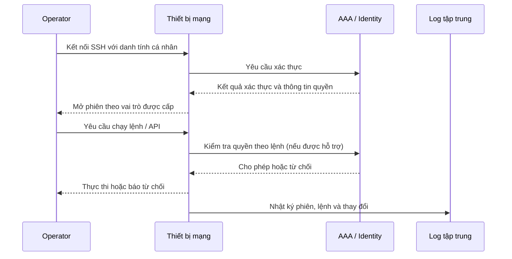

# Role-based access cho operator

## 1. Vì sao operator mạng cần RBAC?

Trong hệ thống mạng doanh nghiệp, một ca trực có thể cần nhiều người cùng giám sát router, switch, firewall, VPN gateway, thiết bị bảo vệ DNS và hệ thống IDS/IPS. Tuy nhiên, **khả năng xem trạng thái mạng** không đồng nghĩa với **quyền thay đổi cấu hình**. Nếu mọi operator dùng cùng tài khoản quản trị toàn quyền, một lệnh nhầm có thể làm mất kết nối của cả vùng mạng; khi có sự cố, cũng khó xác định ai đã làm gì.

**Role-based access control (RBAC)** là mô hình kiểm soát truy cập theo vai trò: quyền thao tác được gán cho *role* (vai trò), còn danh tính người dùng hoặc tài khoản dịch vụ được gán vào role phù hợp với công việc. RBAC là một lớp quan trọng khi **hardening thiết bị và dịch vụ mạng**, bên cạnh quản lý bản vá, tắt dịch vụ không cần thiết, bảo vệ giao diện quản trị, xác thực mạnh và ghi nhật ký.

Sau bài này, người học có thể:

1. Phân biệt xác thực, phân quyền và ghi nhận hoạt động (AAA) trong truy cập quản trị mạng.
2. Thiết kế role cho nhân sự giám sát, vận hành, triển khai thay đổi và quản trị quyền.
3. Áp dụng nguyên tắc ít quyền nhất cho cả CLI, giao diện web, API và kênh dự phòng.
4. Mô tả cách RBAC phối hợp với TACACS+, RADIUS, danh tính tập trung và quyền khẩn cấp.
5. Kiểm chứng chính sách bằng các ca thử cho phép, từ chối và thu hồi quyền.

## 2. Các thành phần của mô hình RBAC

RBAC tách biệt bốn khái niệm:

| Thành phần | Ý nghĩa | Ví dụ ở môi trường mạng |
| --- | --- | --- |
| **Subject (chủ thể)** | Người hoặc danh tính máy yêu cầu truy cập | Operator trực NOC, kỹ sư vận hành, tài khoản tự động hóa |
| **Role (vai trò)** | Nhóm trách nhiệm được cấp tập quyền | `network-viewer`, `network-operator`, `network-change` |
| **Permission (quyền)** | Thao tác có thể thực hiện đối với một đối tượng | Đọc trạng thái interface, chạy ping, xem log, sửa ACL |
| **Resource / scope (tài nguyên và phạm vi)** | Đối tượng mà quyền có hiệu lực | Router khu vực A; switch access; firewall production |

Một cách mô hình hóa đơn giản:

```text
Danh tính operator
      │ được gán
      ▼
     Role ── chứa ──► Permission (hành động)
      │                      │
      └── bị giới hạn bởi ───► Thiết bị / nhóm thiết bị / môi trường
```

Ví dụ, một người có role `network-operator` trên nhóm switch access có thể được phép xem `interface status` và chạy chẩn đoán cơ bản tại nhóm đó, nhưng không mặc nhiên được đổi cấu hình router lõi hoặc chính sách firewall.

Các nguyên tắc cần nhớ:

- **Least privilege:** chỉ cấp hành động và phạm vi tài nguyên thực sự cần thiết.
- **Default deny:** yêu cầu ngoài danh sách quyền hợp lệ bị từ chối.
- **Separation of duties:** hạn chế một người vừa tự phê duyệt vừa triển khai thay đổi nhạy cảm, đặc biệt ở AAA và firewall.
- **Named identity:** mỗi operator có danh tính riêng; tài khoản dùng chung làm giảm khả năng truy vết.
- **Time-bound privilege:** quyền thay đổi quan trọng có thể chỉ có hiệu lực trong khoảng thời gian được duyệt.

RBAC trả lời câu hỏi *người này thuộc vai trò nào và vai trò đó được phép làm gì?*. Các điều kiện theo thời điểm, vị trí kết nối, thiết bị hoặc phiếu phê duyệt bổ sung cho RBAC bằng chính sách truy cập có điều kiện. **Chỉ khai báo một role không bảo đảm những điều kiện này tự được thực thi**; cần có thiết bị, hệ thống quản lý truy cập đặc quyền (PAM/JIT) hoặc cơ chế chính sách tương ứng.

## 3. RBAC nằm ở đâu trong AAA?

**AAA** gồm ba hoạt động liên quan nhưng khác nhau:

| Trụ cột | Câu hỏi | Áp dụng với operator |
| --- | --- | --- |
| **Authentication (xác thực)** | Bạn là ai? | Xác thực tài khoản cá nhân, khóa SSH/chứng chỉ, MFA khi hệ thống hỗ trợ |
| **Authorization (phân quyền)** | Bạn được làm gì? | Role, phạm vi thiết bị, cấp phép từng lệnh hoặc API, quyền nâng cao tạm thời |
| **Accounting (ghi nhận hoạt động)** | Bạn đã làm gì, khi nào? | Ghi đăng nhập, đăng xuất, lệnh quản trị, lần bị từ chối, thay đổi cấu hình |

Luồng tham khảo cho kết nối SSH vào một thiết bị mạng:



Trong thực tế, có thiết bị tự kiểm tra quyền bằng role cục bộ sau khi đăng nhập; có thiết bị hỗ trợ xác minh từng lệnh qua máy chủ AAA. Vì vậy sơ đồ thể hiện **một khả năng triển khai**, không phải luồng bắt buộc của mọi hãng. Nhật ký có thể phát sinh ở cả thiết bị và AAA server.

### TACACS+ và RADIUS

- **TACACS+** thường phù hợp với quản trị thiết bị mạng vì nhiều nền tảng hỗ trợ phân quyền theo lệnh (command authorization) và ghi nhận lệnh qua TACACS+. Mức độ chi tiết phụ thuộc thiết bị, phiên bản hệ điều hành và cấu hình.
- **RADIUS** thường được dùng cho truy cập mạng và có thể chuyển thuộc tính role/privilege cho thiết bị quản trị nếu nhà sản xuất hỗ trợ. Không được mặc định rằng RADIUS kiểm soát được từng lệnh CLI tương tự TACACS+.
- **Role cục bộ** tồn tại trực tiếp trên router, switch hoặc firewall. Nó hữu ích để bảo đảm thiết bị thực thi quyền và hỗ trợ truy cập khôi phục, nhưng dễ bị lệch cấu hình khi quản lý nhiều thiết bị.
- **IdP/Directory** (chẳng hạn hệ thống định danh doanh nghiệp) quản lý danh tính và nhóm; ánh xạ nhóm sang role trên thiết bị hoặc AAA gateway cần được cấu hình và kiểm thử cụ thể.

Việc truyền thông tin AAA phải được bảo vệ qua mạng quản trị cô lập, kiểm soát nguồn truy cập và cơ chế bảo vệ đường truyền phù hợp với giao thức, thiết bị. Không giả định một giao thức AAA bất kỳ tự cung cấp mã hóa đầu cuối đầy đủ cho mọi dữ liệu.

## 4. Thiết kế role cho đội vận hành

Một thiết kế mẫu có thể bắt đầu với năm role. Đây là **chính sách tham khảo**, không phải role mặc định của một hãng thiết bị.

| Role | Công việc chính | Quyền tiêu biểu | Quyền không cấp mặc định |
| --- | --- | --- | --- |
| `network-viewer` | NOC quan sát và nhận cảnh báo | Xem trạng thái interface, route, log vận hành đã lọc, tình trạng dịch vụ | Thay đổi cấu hình, khởi động lại thiết bị, xem bí mật |
| `network-operator` | Chẩn đoán và xử lý sự cố mức thường | Quyền viewer, ping/traceroute, xem phiên hoặc chỉ số vận hành | Sửa routing, ACL, AAA, firmware; chạy lệnh gây gián đoạn |
| `network-change` | Triển khai thay đổi đã duyệt | Chỉnh và commit cấu hình trên nhóm thiết bị được giao trong cửa sổ thay đổi | Tự tạo quyền admin, tự phê duyệt thay đổi, mở rộng sang thiết bị khác |
| `access-admin` | Quản trị danh tính và ánh xạ quyền | Quản lý nhóm, role, quy trình cấp/thu hồi quyền | Tự động có quyền thay đổi lưu lượng hoặc firewall production |
| `break-glass` | Khôi phục khi các đường quản trị thông thường thất bại | Quyền khẩn cấp có giới hạn thời gian, giám sát và kiểm toán tăng cường | Sử dụng làm tài khoản vận hành hằng ngày |

Không nên lấy `network-operator` làm tên thay thế cho tài khoản `admin`. Những thao tác như `reload`, `shutdown interface`, sửa ACL, thay đổi bảng định tuyến, thay DNS resolver hoặc sửa VPN policy có thể ảnh hưởng tính sẵn sàng và cần quyền cao hơn mức chẩn đoán thông thường.

**Lưu ý về quyền đọc:** lệnh hiển thị toàn bộ cấu hình, log debug, gói tin, SNMP OID hoặc báo cáo hỗ trợ kỹ thuật có thể chứa thông tin nội bộ và bí mật. Cần lọc/redact khi phù hợp, giới hạn quyền xuất dữ liệu, và không coi mọi hành động `read` đều vô hại.

### Ma trận phân quyền theo tác vụ

Trong bảng dưới đây, **Có** nghĩa là role có thể được phép nếu phạm vi tài nguyên và các điều kiện truy cập khác cũng hợp lệ; **Có điều kiện** cần phê duyệt, thời hạn hoặc kiểm soát bổ sung.

| Tác vụ | Viewer | Operator | Change | Access admin |
| --- | :---: | :---: | :---: | :---: |
| Xem sức khỏe interface, route và cảnh báo | Có | Có | Có | Không |
| Chạy ping/traceroute phục vụ chẩn đoán | Không | Có | Có | Không |
| Xem cấu hình đã loại bỏ bí mật | Có | Có | Có | Không |
| Thay đổi VLAN, ACL, routing, VPN policy | Không | Không | Có điều kiện | Không |
| Commit/rollback thay đổi đã duyệt | Không | Không | Có điều kiện | Không |
| Cấp role hoặc sửa chính sách AAA | Không | Không | Không | Có điều kiện |
| Xem khóa riêng, mật khẩu hoặc token dạng rõ | Không | Không | Không | Không |

Không có nghĩa một người luôn chỉ được có duy nhất một role. Nhưng nếu một danh tính đồng thời giữ nhiều role, cần xét **quyền hợp nhất**, các luật từ chối và nguy cơ vượt qua phân tách nhiệm vụ. Tốt hơn hết, quyền đặc biệt nên được kích hoạt tạm thời, có chứng cứ phê duyệt.

## 5. Ranh giới thực thi: role phải có hiệu lực trên mọi kênh

Quản trị mạng không chỉ đi qua CLI. Mọi kênh có khả năng đọc dữ liệu nhạy cảm hoặc thay đổi cấu hình đều phải được kiểm tra:

| Kênh | Điều phải kiểm soát | Lỗi hay gặp |
| --- | --- | --- |
| **SSH/CLI** | Quyền theo mode, lệnh và tham số; ghi nhật ký phiên/lệnh | Cho phép đăng nhập role viewer nhưng lại cho vào chế độ privileged |
| **HTTPS/GUI** | Menu, nút hành động và *API phía máy chủ* | Ẩn nút trên giao diện nhưng API vẫn cho ghi |
| **NETCONF/RESTCONF/API** | Quyền đọc/ghi datastore, RPC, endpoint và phạm vi | Token của automation có quyền ghi toàn bộ thiết bị |
| **SNMPv3** | User/group, view OID, quyền đọc/ghi, bảo vệ xác thực và riêng tư | Community hoặc user có quyền SET ngoài nhu cầu giám sát |
| **Console/OOB** | Truy cập vật lý hoặc out-of-band, ghi phiên, phân quyền khẩn cấp | Console bỏ qua quy trình cấp quyền từ xa |
| **Automation/CI** | Service identity riêng, token giới hạn phạm vi, vòng đời khóa | Dùng chung mật khẩu admin cho script |

Một cổng VPN hoặc jump host có MFA là lớp bảo vệ tốt trước đường quản trị, nhưng **không thay thế việc thiết bị thực thi authorization**. Người dùng đã vào được mạng quản trị chưa chắc được phép thực hiện thao tác cấu hình. Tương tự, hạn chế lệnh CLI sẽ không đủ nếu cùng tài khoản đó có thể gọi API với đặc quyền lớn hơn.

## 6. Ví dụ thiết kế chính sách

Giả sử tổ chức có 60 switch access, 8 router biên và 2 firewall production. Operator NOC cần xem cảnh báo và chẩn đoán interface; nhóm triển khai được sửa một số switch theo phiếu thay đổi; nhóm quản trị truy cập quản lý role.

Đoạn YAML dưới đây là **pseudocode chính sách**, nhằm diễn tả yêu cầu RBAC theo một cách dễ đọc. Nó **không phải cú pháp cấu hình thực thi** của TACACS+, RADIUS, Cisco, Juniper hay firewall cụ thể.

```yaml
roles:
  network-viewer:
    allow:
      - device.health.read
      - interface.status.read
      - routing.summary.read
      - audit.filtered.read
    scope: ["noc-managed-devices"]

  network-operator:
    includes: ["network-viewer"]
    allow:
      - diagnostic.ping
      - diagnostic.traceroute
      - interface.counters.read
    scope: ["noc-managed-devices"]

  network-change:
    includes: ["network-viewer"]
    allow:
      - configuration.candidate.edit
      - configuration.commit
      - configuration.rollback
    scope: ["access-switches"]
    conditions:
      approved_change_ticket: required
      elevation_minutes: 60

  access-admin:
    allow:
      - identity.role.assign
      - identity.role.revoke
      - aaa.policy.manage
    scope: ["management-plane"]

deny_for_everyday_roles:
  - credentials.secrets.export
  - emergency_account.disable
```

Để đưa thiết kế vào thực tế, người triển khai phải ánh xạ các hành động trừu tượng sang khả năng của từng nền tảng: nhóm lệnh CLI, parser view/task group, privilege level, API permission, AAA attribute và danh sách thiết bị. Các điều kiện `approved_change_ticket` và `elevation_minutes` chỉ có tác dụng nếu được tích hợp với hệ thống phê duyệt/JIT hoặc giải pháp kiểm soát truy cập tương đương. Một số thiết bị không thể phân quyền hẹp đến từng tham số; khi đó phải giảm phạm vi, dùng cổng quản trị trung gian hoặc cơ chế thực thi thay đổi có kiểm soát.

### Cách ra quyết định truy cập

Với một yêu cầu, hệ thống cần xét đồng thời:

1. **Danh tính:** tài khoản có hợp lệ, chưa bị khóa, đã đáp ứng yêu cầu xác thực?
2. **Role đang hoạt động:** người đó có role phù hợp tại thời điểm yêu cầu?
3. **Hành động:** quyền đã khai báo có bao phủ chính xác lệnh/API được gọi?
4. **Tài nguyên:** thiết bị hoặc nhóm thiết bị có thuộc phạm vi của role?
5. **Điều kiện bổ sung:** có phiếu thay đổi, cửa sổ bảo trì, quyền JIT và phiên hợp lệ khi cần?
6. **Quy tắc từ chối:** có explicit deny hoặc chính sách an toàn ưu tiên hơn?

Nếu bất kỳ kiểm tra bắt buộc nào không đạt, từ chối và ghi dấu vết. Không mở rộng quyền chỉ vì lệnh có tên gần giống lệnh được phép. Trên thiết bị hỗ trợ phân quyền từng lệnh, hãy xét cả **tham số lệnh**; cho phép `show` không có nghĩa cho phép mọi tùy chọn có thể tiết lộ bí mật.

### Hai tình huống thực tế

**Tình huống A — cảnh báo interface down:** operator NOC đăng nhập bằng danh tính cá nhân, xem trạng thái cổng và log đã lọc, chạy ping tới địa chỉ đích trong phạm vi cho phép. Yêu cầu `shutdown` hoặc thay VLAN bị từ chối vì không thuộc role vận hành thường ngày. Operator mở phiếu thay đổi cho nhóm có quyền phù hợp nếu cần can thiệp cấu hình.

**Tình huống B — triển khai ACL theo phiếu đã duyệt:** người triển khai được cấp `network-change` cho hai switch cụ thể trong 60 phút. Người này kiểm tra cấu hình hiện tại, nạp thay đổi, xác thực kết quả, lưu bản thay đổi và kết thúc phiên. Sau khi hết hạn, role nâng cao bị thu hồi; cùng danh tính không thể tiếp tục sửa ACL. Nhật ký liên kết phiên, thiết bị, thay đổi và mã phiếu.

## 7. Quyền khẩn cấp và phương án khi AAA lỗi

Thiết bị mạng vẫn cần đường truy cập phục hồi khi mất kết nối tới AAA hoặc hệ thống quản trị. Tuy nhiên, quy tắc *fallback* tùy sản phẩm và cấu hình, nên phải được thử nghiệm trước khi triển khai rộng.

- Dùng cơ chế **break-glass** được phê duyệt trước, với thông tin xác thực được giữ trong kho bí mật có kiểm soát truy cập.
- Hạn chế người có thể lấy thông tin, phạm vi thiết bị và thời gian sử dụng; phát cảnh báo khi mở phiên khẩn cấp.
- Ghi nhật ký trên thiết bị và/hoặc cổng console/OOB; đồng bộ lên hệ thống tập trung khi kết nối phục hồi.
- Sau khi sử dụng, đối soát thao tác, luân chuyển bí mật và xem xét nguyên nhân phải kích hoạt quyền khẩn cấp.
- Kiểm tra chính xác trạng thái khi AAA server không phản hồi: có nền tảng cho phép **local fallback**, nhưng cũng có trường hợp từ chối truy cập hoặc áp dụng role mặc định. Không để lỗi AAA vô tình làm rơi về quyền admin không giới hạn.

Nếu buộc phải có tài khoản local dự phòng, phải bảo vệ nó như tài khoản đặc quyền, tránh dùng chung trong công việc thường ngày. Không cấu hình một chính sách `fail-open` thiếu kiểm soát chỉ để tiện vận hành.

## 8. Quy trình áp dụng RBAC trên hệ thống mạng

### Bước 1 — Lập danh mục và phân loại thao tác

Thống kê thiết bị, phiên bản firmware/OS, kênh truy cập (CLI, GUI, API, SNMP, console), công việc của từng nhóm và thao tác có nguy cơ gián đoạn. Xác định rõ người nào cần xem, người nào được thay đổi và ai được duyệt thay đổi. Với nhiều hãng, ghi nhận khả năng RBAC thực tế của từng nền tảng.

### Bước 2 — Xây ma trận quyền và mapping

Thiết kế role theo công việc, gắn danh sách tài nguyên được quản lý và định nghĩa quyền bằng **hành động cụ thể**. Kiểm tra các đường nâng quyền như mode đặc quyền, API token, quyền ghi SNMP, tài khoản automation và console. Ánh xạ role doanh nghiệp sang role/privilege/command-set thực thi của từng hãng.

### Bước 3 — Thiết lập danh tính và AAA

Ưu tiên tài khoản cá nhân, xác thực mạnh và nhóm danh tính tập trung; cấu hình AAA trên thiết bị với máy chủ dự phòng và kênh quản trị bảo vệ. Tạo đường khôi phục được kiểm soát trước khi thử chính sách mới. Gắn việc cấp `network-change` với quy trình phê duyệt thay đổi và thời hạn nếu hệ thống hỗ trợ.

### Bước 4 — Thử với tài khoản đại diện

Kiểm tra cả truy cập **được phép** lẫn hành động **phải bị từ chối**. Thử riêng từng kênh CLI/GUI/API/SNMP liên quan và kiểm tra lúc AAA bị gián đoạn theo kịch bản khôi phục. Không xác nhận hoàn thành chỉ vì đăng nhập thành công.

| Ca thử | Danh tính / tình huống | Kỳ vọng |
| --- | --- | --- |
| T01 | Viewer xem trạng thái interface | Cho phép và ghi nhận phiên |
| T02 | Viewer cố thay đổi ACL | Từ chối, có log từ chối |
| T03 | Operator chạy ping/traceroute hợp lệ | Cho phép |
| T04 | Operator gửi lệnh shutdown interface | Từ chối kể cả khi thử bằng GUI/API |
| T05 | Change operator sửa switch ngoài scope | Từ chối |
| T06 | Change operator sửa switch trong scope và có duyệt/JIT hợp lệ | Cho phép, ghi nhận thay đổi |
| T07 | Phiên nâng quyền hết hạn hoặc người dùng bị thu hồi role | Không còn quyền thay đổi; kiểm tra tác động đến phiên đang mở |
| T08 | AAA không phản hồi | Hành vi khớp chính sách fallback đã thiết kế, không tự nâng lên admin |
| T09 | Tài khoản automation chỉ có quyền đọc | API ghi và SNMP SET bị từ chối |

**Chú ý:** việc thu hồi role không luôn làm ngắt ngay phiên SSH, token hoặc quyền đã cache. Cần kiểm tra hành vi của từng sản phẩm và có cơ chế kết thúc phiên/thu hồi token khi yêu cầu phản ứng tức thời.

### Bước 5 — Triển khai theo đợt và giám sát

Áp dụng thí điểm trên số ít thiết bị, giữ đường khôi phục, xác thực kết quả rồi mở rộng. Thu nhận accounting log, cấu hình đồng bộ thời gian (NTP) và cảnh báo hoạt động bất thường: lệnh bị từ chối liên tiếp, cấp quyền ngoài giờ, thay đổi AAA, dùng break-glass hoặc đăng nhập từ nguồn không mong đợi.

### Bước 6 — Rà soát vòng đời quyền

Khi nhân viên thay đổi vị trí, nghỉ việc hoặc kết thúc hợp đồng, thu hồi role và khóa phiên/token còn hiệu lực. Định kỳ rà soát quyền cao, tài khoản lâu không sử dụng, role kế thừa, tài khoản dịch vụ và sai khác cấu hình giữa các thiết bị.

## 9. Sự cố cấu hình RBAC thường gặp

| Hiện tượng | Nguyên nhân có thể | Hướng xử lý |
| --- | --- | --- |
| Operator đăng nhập được nhưng không chạy được lệnh chẩn đoán | Ánh xạ role sai, command-set thiếu lệnh/tham số, AAA policy chưa áp dụng | So sánh role thực nhận với ma trận quyền; xem log authorization trên thiết bị và AAA |
| Viewer không sửa được qua CLI nhưng sửa được qua API | API hoặc GUI dùng quyền khác; tài khoản/token quá rộng | Đồng bộ phạm vi và quyền ở máy chủ API, giảm quyền token; thử lại với cả hai kênh |
| User đã bị thu hồi nhưng phiên cũ vẫn thao tác được | Cache quyền, phiên SSH/token còn sống | Thu hồi hoặc kết thúc phiên theo khả năng nền tảng; kiểm chứng quyền trên phiên mới và cũ |
| AAA mất kết nối, operator bị khóa khỏi thiết bị | Chưa thử chính sách dự phòng hoặc đường OOB | Dùng phương án khôi phục đã phê duyệt, kiểm tra dự phòng và thiết kế fallback |
| Thiếu log lệnh dù có log đăng nhập | Chưa cấu hình accounting chi tiết hoặc nền tảng không hỗ trợ | Bật cơ chế có sẵn, kết hợp log thay đổi cấu hình, PAM/session recording và SIEM |
| Role change có thể tự sửa AAA | Quyền quá rộng hoặc gộp chức năng quản trị | Tách quyền quản lý danh tính khỏi quyền thay đổi mạng, kiểm thử leo thang quyền |

Đặc biệt, kiểm tra các cách **đi vòng role** như tài khoản local không quản lý, API key cũ, đường console không giám sát, chức năng copy/restore cấu hình và cơ chế nâng privilege. Việc rà soát phải bao gồm cả kênh truy cập gián tiếp, ví dụ hệ thống automation có quyền triển khai thay cho operator.

## 10. Đo lường hiệu quả và checklist vận hành

Nhóm vận hành có thể theo dõi tỷ lệ thiết bị tích hợp AAA, tỷ lệ tài khoản đặc quyền có chủ sở hữu rõ ràng, số quyền change thường trực, số lần dùng break-glass, thời gian thu hồi quyền, tỷ lệ lệnh quản trị được ghi nhận và số kết quả kiểm thử từ chối sai lệch so với chính sách.

Trước khi kết luận RBAC đã hoạt động, tự kiểm tra:

- [ ] Mỗi operator dùng danh tính riêng, có role tương ứng với trách nhiệm.
- [ ] Role viewer và operator không sửa được cấu hình hoặc bí mật ngoài phạm vi.
- [ ] Quyền của CLI, GUI, API, SNMP và console được kiểm tra riêng.
- [ ] Quyền thay đổi quan trọng có scope, phê duyệt và thời hạn khi cần.
- [ ] Tài khoản dịch vụ và đường local/break-glass được quản lý và kiểm toán.
- [ ] Có log phiên, truy cập bị từ chối và thay đổi; thời gian trên hệ thống được đồng bộ.
- [ ] Ca thử cho phép/từ chối, mất AAA và thu hồi quyền đều đạt kỳ vọng.

## 11. Tự kiểm tra kiến thức

**Câu 1.** Một operator trực NOC cần xem trạng thái BGP và chạy ping tới router. Có nên cấp tài khoản admin toàn quyền để giảm thao tác cấp quyền?

*Gợi ý trả lời:* Không. Cấp role chẩn đoán chỉ đọc và quyền ping trong phạm vi thiết bị cần theo dõi. Chỉ nâng quyền khi có công việc thay đổi được phê duyệt.

**Câu 2.** Tài khoản `network-viewer` bị từ chối lệnh thay ACL qua SSH, nhưng vẫn sửa được ACL qua REST API. RBAC đã đạt yêu cầu chưa?

*Gợi ý trả lời:* Chưa. Cần kiểm soát authorization tại API và thống nhất chính sách trên các kênh; giới hạn cả token và danh tính dịch vụ nếu có.

**Câu 3.** Sau khi người dùng rời nhóm vận hành, role đã bị gỡ khỏi IdP nhưng phiên SSH cũ vẫn chạy được lệnh. Cần bổ sung biện pháp gì?

*Gợi ý trả lời:* Thu hồi hoặc kết thúc các phiên và token còn hiệu lực theo khả năng nền tảng, xem xét TTL/cache, đối soát log và kiểm thử quy trình offboarding.

**Câu 4.** AAA server bị lỗi và thiết bị chuyển sang tài khoản local có toàn quyền mà không cảnh báo. Rủi ro là gì?

*Gợi ý trả lời:* Một lỗi sẵn sàng có thể làm yếu kiểm soát phân quyền, tăng khả năng lạm dụng đặc quyền và làm thiếu dấu vết. Cần thiết kế fallback có kiểm soát, bảo vệ bí mật, giám sát, diễn tập và rà soát sau sử dụng.

## Kết luận

RBAC giúp đội vận hành mạng làm đúng phần việc của mình mà không phải giữ đặc quyền quản trị thường trực. Để RBAC thực sự góp phần hardening, cần thống nhất **danh tính cá nhân → role → hành động → phạm vi thiết bị → điều kiện thực thi → dấu vết kiểm toán**. Chính sách chỉ hoàn chỉnh khi được kiểm thử với các hành động bị từ chối, các kênh quản trị khác nhau, quyền khẩn cấp và tình huống mất kết nối tới AAA.
