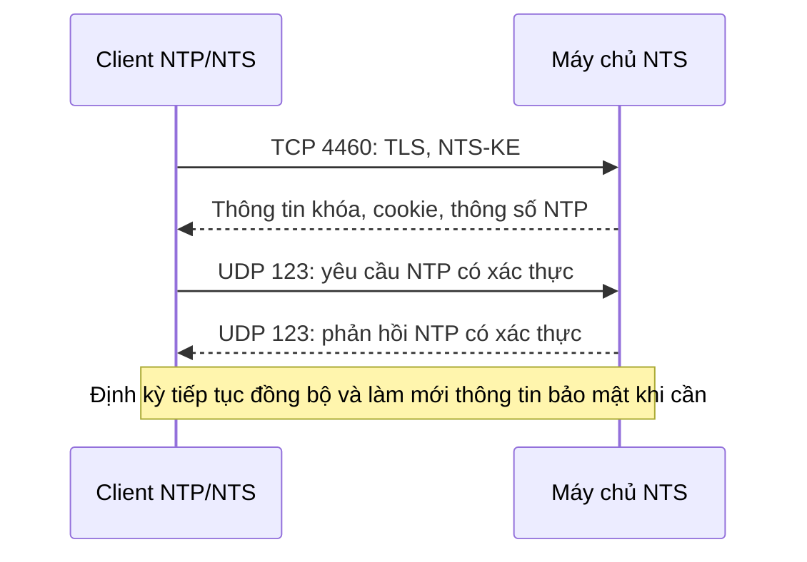
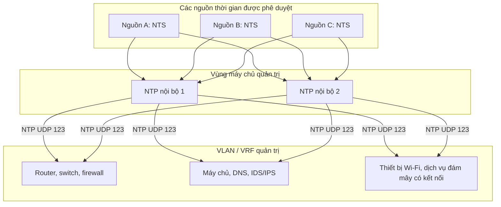

# NTP an toàn và đồng bộ thời gian

## 1. Vì sao đồng bộ thời gian là một phần của bảo mật mạng?

Một hệ thống có thể áp dụng firewall, phân đoạn mạng, VPN, IDS/IPS và xác thực kết nối đúng cách nhưng vẫn gặp sự cố nếu đồng hồ của các thiết bị không thống nhất. Nhật ký của router ghi sự kiện lúc 10:00:05, firewall ghi 09:59:50 và máy chủ ứng dụng ghi 10:00:13 sẽ khiến việc dựng lại chuỗi tấn công, đối chiếu gói tin và truy vết trong SIEM trở nên thiếu tin cậy. Sai lệch thời gian còn ảnh hưởng tới thời hạn chứng chỉ, phiên đăng nhập, Kerberos, tác vụ định kỳ, bản sao dữ liệu và một số cơ chế chống phát lại.

Trong phạm vi module **SECURITY_NETWORK_SECURITY**, đồng bộ thời gian cần được bảo vệ như một dịch vụ hạ tầng: lựa chọn nguồn đáng tin cậy, xác thực luồng NTP khi có thể, giới hạn đường truy cập bằng phân đoạn mạng và firewall, giám sát bất thường, đồng thời duy trì khả năng điều tra sự cố. Điều này áp dụng cho thiết bị mạng vật lý, máy ảo, thiết bị không dây, dịch vụ DNS, máy chủ và hạ tầng đám mây.

**Sau bài học, người học có thể:**

- Giải thích NTP đồng bộ đồng hồ như thế nào, phân biệt thời gian chính xác với thời gian được xác thực.
- Nhận diện rủi ro giả mạo máy chủ thời gian, can thiệp gói tin, sai lệch đồng hồ và lạm dụng NTP để khuếch đại lưu lượng.
- Thiết kế kiến trúc NTP nhiều nguồn, có ranh giới tin cậy và chính sách mạng rõ ràng.
- Cấu hình mẫu một máy khách NTP sử dụng NTS, kiểm tra chất lượng đồng bộ và ứng phó khi nguồn thời gian có vấn đề.

## 2. Các khái niệm cần nắm

**NTP (Network Time Protocol)** dùng thông tin trao đổi giữa máy khách và máy chủ để ước lượng độ lệch đồng hồ, độ trễ đường truyền và chất lượng nguồn thời gian. NTPv4 thường dùng **UDP 123**. Khả năng đồng bộ phụ thuộc vào chất lượng nguồn, độ ổn định đường truyền, lựa chọn nguồn và cấu hình của thiết bị.

Các khái niệm thường gặp:

| Khái niệm | Ý nghĩa vận hành |
| --- | --- |
| UTC | Mốc thời gian dùng chung để lưu trữ, đối chiếu nhật ký giữa các múi giờ. Hiển thị giờ địa phương là vấn đề định dạng, không phải nguồn thời gian khác. |
| Stratum | Số tầng cách nguồn tham chiếu của NTP: nguồn tham chiếu trực tiếp thường được gọi là stratum 0; máy chủ gắn với nguồn đó là stratum 1; các tầng sau tăng dần. Stratum thấp không tự bảo đảm tính an toàn hay chính xác. |
| Offset | Ước lượng mức lệch giữa đồng hồ cục bộ và nguồn tham chiếu. |
| Delay | Ước lượng độ trễ trao đổi qua mạng, có thể gây sai số nếu hai chiều không đối xứng. |
| Jitter | Biến thiên của các phép đo offset; giá trị cao thường cho thấy đường truyền hoặc nguồn không ổn định. |
| Root delay / root dispersion | Thông tin về tổng độ trễ và mức bất định tích lũy tới nguồn tham chiếu. |
| Reachability | Lịch sử phản hồi gần đây từ một nguồn; nguồn cấu hình sẵn chưa chắc đang trả lời được. |
| Clock stepping / slewing | **Step** là chỉnh đồng hồ bằng bước nhảy; **slew** là điều chỉnh tốc độ chạy để giảm lệch dần, thường tránh đảo thứ tự dấu thời gian khi hệ thống đang hoạt động. |
| RTC | Đồng hồ phần cứng giữ thời gian gần đúng khi tắt máy; giúp khởi động nhưng không thay thế nguồn đồng bộ đáng tin cậy. |

Một phép trao đổi NTP có thể được mô tả bằng bốn dấu thời gian: `t1` (máy khách gửi), `t2` (máy chủ nhận), `t3` (máy chủ gửi) và `t4` (máy khách nhận). Trong mô hình đơn giản, offset `θ` và độ trễ khứ hồi `δ` được ước lượng:

```text
offset (θ) = [(t2 - t1) + (t3 - t4)] / 2
delay  (δ) = (t4 - t1) - (t3 - t2)
```

Các công thức giả định thời gian truyền hai chiều đủ gần nhau. Chỉ riêng phép tính không phân biệt được nguồn thật với nguồn giả mạo, cũng không loại bỏ được ảnh hưởng của một kẻ tấn công cố tình trì hoãn gói tin. Vì vậy, **đồng bộ được** và **đồng bộ từ nguồn đáng tin** là hai yêu cầu phải kiểm chứng riêng.

NTP không đồng nghĩa với PTP (Precision Time Protocol). PTP thường được chọn khi cần độ chính xác rất cao và hạ tầng mạng hỗ trợ dấu thời gian phần cứng; NTP phù hợp với phần lớn nhu cầu vận hành mạng và tương quan nhật ký. Dù dùng giao thức nào, kiểm soát nguồn tin cậy và đường truyền vẫn cần thiết.

## 3. Mô hình đe dọa đối với dịch vụ thời gian

| Đe dọa | Tác động có thể xảy ra | Biện pháp ưu tiên |
| --- | --- | --- |
| NTP server giả mạo hoặc phản hồi UDP bị sửa | Thiết bị chỉnh sai giờ; nhật ký, xác thực, lịch tác vụ bị ảnh hưởng | Dùng NTS hoặc xác thực NTP được thiết bị hỗ trợ; hạn chế nguồn theo danh sách cho phép |
| Chiếm quyền nguồn NTP hợp lệ | Nguồn vẫn có thể trả lời hợp lệ nhưng cung cấp thời gian sai | Nhiều nguồn độc lập, giám sát offset và thay đổi nguồn; bảo vệ máy chủ nguồn |
| DNS hoặc DHCP bị thao túng để trỏ tới nguồn lạ | Máy khách chọn sai đích trước khi đồng bộ | Kiểm soát DHCP option liên quan tới NTP, DNS và cấu hình nguồn; xác minh danh tính máy chủ bằng NTS |
| Trì hoãn hoặc làm nghẽn gói tin | Tăng delay/jitter, làm mất đồng bộ hoặc làm sai ước lượng | Phân đoạn đường quản trị, dự phòng mạng/nguồn, cảnh báo mất đồng bộ |
| Máy chủ NTP mở ra Internet, truy vấn điều khiển cũ bị lạm dụng | Dịch vụ có thể tham gia phản xạ/khuếch đại DDoS hoặc lộ thông tin vận hành | Chặn truy vấn không cần thiết; cập nhật phần mềm; chỉ cho phép các client xác định |
| Quyền quản trị thiết bị bị lộ | Cấu hình lại nguồn, đặt tay đồng hồ hoặc tắt xác thực | RBAC, MFA ở lớp quản trị, theo dõi thay đổi cấu hình, ghi nhật ký |
| Nguồn GNSS/GPS bị nhiễu hoặc giả mạo | Nguồn tham chiếu tầng trên có thể sai hoặc mất tín hiệu | Đa dạng nguồn, xác minh trạng thái thu, chế độ giữ giờ (holdover), giám sát chéo |

**Giới hạn bảo mật quan trọng:** Xác thực NTP chứng minh phản hồi đến từ bên có khóa/danh tính phù hợp và phát hiện nhiều dạng sửa đổi gói tin. Nó **không chứng minh** đồng hồ của nguồn đang đúng; đồng thời một kẻ tấn công trên đường truyền vẫn có thể gây nhiễu hoặc trì hoãn gói tin. Kiểm tra đồng chéo nhiều nguồn và giám sát chất lượng thời gian luôn cần thiết.

## 4. Các cơ chế xác thực và NTS

Có nhiều cách bảo vệ NTP, với mức độ hỗ trợ khác nhau trên hệ điều hành và firmware:

| Cơ chế | Khả năng bảo vệ | Điều cần kiểm tra |
| --- | --- | --- |
| NTP truyền thống, không xác thực | Đồng bộ thời gian nhưng không xác minh nguồn ở cấp giao thức | Chỉ sử dụng trong miền tin cậy được kiểm soát, chấp nhận rủi ro còn lại; ACL không thay thế xác thực |
| NTP với khóa đối xứng/MAC | Kiểm tra tính xác thực và toàn vẹn khi hai đầu chia sẻ khóa phù hợp | Thuật toán được thiết bị hỗ trợ, quản lý khóa, luân chuyển và tránh thuật toán lỗi thời |
| **NTS (Network Time Security)** | Xác thực máy chủ bằng TLS trong bước trao đổi khóa, sau đó bảo vệ gói NTP bằng khóa và cơ chế xác thực mật mã | Hỗ trợ NTS của cả hai đầu, chứng chỉ TLS hợp lệ, chuỗi tin cậy, cổng mạng và trạng thái cookie |
| PTP với các biện pháp bảo vệ tương ứng | Phục vụ hệ thống đòi hỏi độ chính xác cao | Thiết kế riêng về đồng hồ, thiết bị mạng và xác thực; không mặc định PTP là an toàn |

### NTS hoạt động như thế nào?

NTS được chuẩn hóa trong **RFC 8915**. Quá trình gồm hai bước:

1. **NTS Key Establishment (NTS-KE):** máy khách kết nối tới dịch vụ NTS-KE qua **TCP 4460**, dùng TLS để xác minh máy chủ, thiết lập dữ liệu khóa và nhận các cookie cần thiết.
2. **Trao đổi NTP đã xác thực:** máy khách tiếp tục trao đổi gói NTP qua **UDP 123**, sử dụng trường mở rộng, cookie và cơ chế AEAD để xác thực gói tin.



NTS xác thực và bảo vệ tính toàn vẹn của trao đổi theo thiết kế của giao thức; **không nên coi NTS là giải pháp mã hóa toàn bộ thông tin thời gian hay chống tuyệt đối tấn công gây trễ**. Ngoài ra, chứng chỉ TLS còn hạn sử dụng có thể đặt ra bài toán khởi động: một thiết bị có đồng hồ sai quá xa có thể không xác minh được chứng chỉ NTS-KE. Cần có RTC hợp lý, thời gian khởi tạo đáng tin cậy hoặc cơ chế khởi tạo được kiểm soát; không tắt kiểm tra chứng chỉ để xử lý sự cố này.

Nếu thiết bị mạng chưa hỗ trợ NTS, hãy ưu tiên cơ chế khóa đối xứng an toàn **nếu firmware có hỗ trợ**, đồng thời giới hạn nguồn và đường truy cập bằng mạng quản trị. Không giả định rằng mọi lệnh cấu hình NTP hay mọi thuật toán MAC đều tương đương giữa các hãng.

## 5. Kiến trúc đồng bộ thời gian cho mạng doanh nghiệp

Một kiến trúc tham khảo gồm nhiều nguồn chuẩn độc lập và ít nhất hai máy chủ thời gian nội bộ. Thiết bị mạng truy vấn máy chủ nội bộ qua mạng quản trị; máy chủ nội bộ trao đổi với upstream bằng NTS nếu upstream hỗ trợ.



Các đường từ nguồn upstream tới máy chủ nội bộ cần cho phép NTS-KE **TCP 4460** và NTP **UDP 123** theo hướng kết nối tương ứng. Đường từ client tới máy chủ nội bộ cũng phải được xác thực nếu có khả năng; nếu chưa hỗ trợ, sơ đồ này chỉ cung cấp **kiểm soát đường mạng**, không tự động bảo đảm xác thực đầu cuối.

Nguyên tắc triển khai:

- **Nguồn độc lập:** ưu tiên từ ba nguồn upstream đáng tin và có đường/phụ thuộc hạ tầng khác nhau. Hai nguồn giúp tăng sẵn sàng nhưng khó xác định nguồn nào sai khi chúng mâu thuẫn.
- **Máy chủ nội bộ dự phòng:** đặt ở hai máy/miền lỗi khác nhau; đồng bộ cả hai tới các nguồn upstream, giám sát chất lượng riêng.
- **Vùng quản trị:** đưa lưu lượng NTP của thiết bị mạng qua management VLAN/VRF khi phù hợp; không cho các host bất kỳ dùng server nội bộ làm bộ phản xạ công cộng.
- **Chính sách nguồn rõ ràng:** khai báo máy chủ NTP cụ thể; quản lý mọi thay đổi từ DNS, DHCP, cấu hình tập trung và hạ tầng cloud.
- **Bảo vệ nguồn thời gian:** vá lỗi hệ điều hành, hạn chế quyền quản trị, bảo vệ khóa/chứng chỉ, đồng bộ nhật ký trên chính server NTP.
- **Phân loại mức chính xác:** hệ thống giao dịch hoặc điều khiển có thể cần yêu cầu nghiêm ngặt hơn hệ thống ghi log thông thường; đưa ngưỡng chấp nhận vào SLA vận hành.

### Ví dụ chính sách firewall

| Nguồn → Đích | Cổng/giao thức | Mục đích | Kiểm soát |
| --- | --- | --- | --- |
| NTP nội bộ → NTS upstream được duyệt | TCP 4460 | Trao đổi khóa NTS-KE | Chỉ FQDN/IP và đường ra được phê duyệt |
| NTP nội bộ → NTP upstream được duyệt | UDP 123 | Đồng bộ NTP sau thương lượng | Chặn đích ngoài danh sách nguồn |
| VLAN quản trị → NTP nội bộ | UDP 123 | Thiết bị mạng đồng bộ thời gian | Chỉ cho phép các phân đoạn/client cần thiết |
| Nguồn không tin cậy → NTP nội bộ | UDP 123; cổng quản trị | Không có nhu cầu | Từ chối, ghi nhận truy cập bất thường |
| Máy quản trị được duyệt → giao diện quản trị NTP | Theo sản phẩm | Kiểm tra/troubleshoot | Chỉ qua kênh quản trị an toàn và tài khoản được cấp quyền |

Với firewall có trạng thái (stateful), cần xét cả lưu lượng phản hồi theo phiên. Không mở UDP 123 đến toàn Internet chỉ vì một số client cần đồng bộ.

## 6. Ví dụ thực hành: cấu hình máy khách Chrony sử dụng NTS

Ví dụ sau áp dụng cho **Chrony** trên Linux có phiên bản và gói biên dịch hỗ trợ NTS; tên máy chủ là minh họa, phải thay bằng các nguồn NTS đã kiểm tra. Tệp cấu hình thường nằm ở `/etc/chrony.conf` hoặc `/etc/chrony/chrony.conf` tùy bản phân phối.

```conf
# Ba nguồn NTS độc lập, có chứng chỉ TLS đáng tin
server time-a.example.net iburst nts
server time-b.example.net iburst nts
server time-c.example.net iburst nts

# Yêu cầu ít nhất hai nguồn đủ điều kiện trước khi cập nhật đồng hồ
minsources 2

# Chỉ cho phép bước nhảy lớn lúc mới khởi động, trong 3 lần cập nhật đầu
makestep 1.0 3

# Giúp đồng hồ phần cứng theo sát đồng hồ hệ thống khi phù hợp
rtcsync
```

Giải thích các tùy chọn:

- `server ... nts`: kết nối tới nguồn hỗ trợ NTS; kiểm tra cả TCP 4460 và UDP 123.
- `iburst`: tăng tốc quá trình lấy mẫu ban đầu khi mới có kết nối, không đồng nghĩa tăng độ tin cậy của nguồn.
- `minsources 2`: hạn chế việc chỉnh đồng hồ chỉ dựa trên một nguồn đủ điều kiện. Với số lượng nguồn ít hoặc sự cố mạng, chính sách này có thể khiến máy tạm thời không đồng bộ.
- `makestep 1.0 3`: cho phép sửa độ lệch lớn hơn một giây bằng bước nhảy trong ba lần cập nhật đầu; giảm nguy cơ nhảy thời gian bất ngờ về sau. Chọn chính sách phù hợp với ứng dụng.
- `rtcsync`: hỗ trợ giữ RTC hợp lý khi nhân hệ điều hành và nền tảng hỗ trợ.

**Lưu ý:** NTS chỉ hoạt động nếu máy chủ triển khai NTS thực sự. Các địa chỉ `example.net` là placeholder, không phải gợi ý về máy chủ thời gian công cộng. Đừng thay `nts` bằng chế độ không xác thực trong cấu hình sản xuất mà không đánh giá rủi ro.

Sau khi cấu hình, quản trị viên có thể dùng các lệnh sau để kiểm tra:

```bash
# Tình trạng đồng hồ: offset, sai số, nguồn tham chiếu, leap status
chronyc tracking

# Các nguồn: nguồn được chọn, chất lượng và khả năng truy cập
chronyc sources -v

# Trạng thái xác thực/NTS (trên phiên bản Chrony hỗ trợ)
chronyc authdata

# Trạng thái đồng bộ mà hệ điều hành hiển thị
timedatectl status
```

Khi diễn giải kết quả, hãy kiểm tra **cả nguồn đang được chọn lẫn trạng thái xác thực**. Một nguồn có phản hồi mạng hoặc báo offset thấp chưa chứng minh rằng NTS đang hoạt động. Lệnh `chronyc authdata` và định dạng đầu ra có thể khác giữa các phiên bản; đối chiếu với tài liệu của bản đang triển khai.

Nếu sử dụng Chrony làm **máy chủ NTP nội bộ**, còn cần giới hạn các client được phép hỏi bằng cấu hình cho phép subnet phù hợp và firewall. Ví dụ trên chỉ cấu hình **máy khách**, chưa thiết lập dịch vụ chia sẻ thời gian cho thiết bị khác. Việc bật NTS ở phía máy chủ cần cấu hình chứng chỉ/khóa, DNS và dịch vụ NTS-KE tương ứng; cấu hình mẫu máy khách không tự biến máy thành NTS server.

### Thiết bị mạng không hỗ trợ NTS

Một số router, switch và firewall chỉ hỗ trợ NTP không xác thực hoặc xác thực khóa chung. Cần đối chiếu tài liệu firmware để xác nhận khả năng, sau đó áp dụng chính sách ở mức khái niệm:

```text
CHÍNH SÁCH THIẾT BỊ (mã giả, không phải lệnh của hãng):
  ntp_sources = [192.0.2.10, 192.0.2.11]   # máy chủ NTP nội bộ
  source_interface = management_interface
  allow_ntp_outbound = only(ntp_sources, UDP/123)
  ntp_authentication = strongest_supported_and_approved
  audit = log_configuration_changes_and_time_adjustments
```

Địa chỉ `192.0.2.0/24` thuộc dải dành cho ví dụ tài liệu. Không sao chép nguyên dạng vào hệ thống thực. Nếu thiết bị chỉ hỗ trợ thuật toán xác thực lỗi thời, cần đánh giá giới hạn và bảo vệ bổ sung ở lớp mạng; không tự cho rằng đường quản trị riêng là tương đương bảo mật mật mã.

## 7. Giám sát trạng thái thời gian và xử lý sự cố

Để phục vụ SIEM và điều tra sự cố, mỗi máy chủ và nhóm thiết bị quan trọng cần gửi thông tin trạng thái đồng bộ về hệ thống giám sát. Ngưỡng cảnh báo phải căn cứ vào yêu cầu ứng dụng và độ chính xác thực đo, tránh sử dụng một số cố định cho mọi loại mạng.

| Tín hiệu | Ý nghĩa | Hành động khi bất thường |
| --- | --- | --- |
| Offset tuyệt đối tăng nhanh | Đồng hồ có thể trôi, nguồn bất ổn hoặc có can thiệp | Đối chiếu các nguồn khác và sự kiện cấu hình; kiểm tra delay/jitter |
| Delay hoặc jitter tăng | Đường truyền nghẽn, định tuyến bất đối xứng hoặc upstream có vấn đề | Kiểm tra tuyến, QoS, lỗi mạng, độ trễ NTS/NTP |
| Mất nguồn được chọn, reachability thấp | Mất kết nối, ACL/DNS sai hoặc server ngừng hoạt động | Kiểm tra firewall và trạng thái nguồn; chuyển sang nguồn dự phòng |
| NTS-KE/TLS thất bại hoặc hết chứng chỉ | Thiếu kết nối TCP 4460, thời gian khởi tạo sai, chứng chỉ/CA gặp lỗi | Kiểm tra nhật ký TLS, danh tính tên miền, chuỗi tin cậy và RTC |
| Nguồn đổi bất thường hoặc leap status không đồng bộ | Đồng hồ không còn được cập nhật từ nguồn thích hợp | Khoanh vùng hệ thống phụ thuộc vào timestamp, điều tra trước khi sửa |
| Nhiều thiết bị chỉnh giờ đồng loạt | Vấn đề ở NTP nội bộ hoặc nguồn upstream dùng chung | Kiểm tra máy chủ nội bộ, thay đổi cấu hình, sự kiện an ninh |
| Thay đổi giờ bằng tay / thay đổi cấu hình NTP | Có thể là thao tác vận hành hoặc truy cập trái phép | Đối chiếu ticket bảo trì, audit và quyền quản trị |

Ví dụ **mục tiêu tham khảo**, không phải tiêu chuẩn bắt buộc: có thể đặt cảnh báo offset vượt `100 ms` trong một LAN được thiết kế ổn định, còn các hệ thống qua WAN phải chọn ngưỡng theo đường truyền và nhu cầu thực. Hệ thống yêu cầu độ chính xác cỡ microsecond cần thiết kế chuyên biệt, thường không thể đánh giá chỉ bằng ngưỡng NTP thông thường.

### Quy trình chẩn đoán theo thứ tự

1. **Xác định phạm vi:** một host, một VLAN/VRF hay toàn bộ hệ thống? Kiểm tra thời điểm sự cố và các dịch vụ bị ảnh hưởng như VPN, xác thực, chứng chỉ, log.
2. **Xác nhận trạng thái nguồn:** đối chiếu `chronyc tracking`, `chronyc sources -v` hoặc lệnh trạng thái NTP của hãng; kiểm tra nguồn được chọn và reachability.
3. **Kiểm tra xác thực:** với NTS, kiểm tra NTS-KE, xác minh chứng chỉ và trạng thái `authdata`. Không kết luận nguồn an toàn chỉ từ việc ping thành công.
4. **Kiểm tra lớp mạng:** UDP 123 tới đúng máy chủ; TCP 4460 nếu dùng NTS; DNS, ACL, management VRF, NAT, firewall và QoS.
5. **Xác định thay đổi gần nhất:** bản vá, khởi động lại, chuyển máy ảo, snapshot, thay firmware, đổi NTP/DHCP/DNS, thay chứng chỉ hoặc khóa.
6. **Khôi phục có kiểm soát:** chuyển sang nguồn dự phòng đã duyệt, ghi lại độ lệch trước và sau khi sửa, ưu tiên chỉnh từ từ với dịch vụ nhạy cảm với bước nhảy; xác minh nhật ký liên quan.
7. **Đóng sự cố:** kiểm tra lại trạng thái đồng bộ và xác thực, đảm bảo chuỗi timestamp sau phục hồi hợp lệ, cập nhật quy trình vận hành.

**Không nên** chỉnh tay đồng hồ hàng loạt khi chưa xác định nguồn sai, vì có thể làm mất thứ tự sự kiện và phá phiên xác thực đang hoạt động.

## 8. Các tình huống đặc biệt

### 8.1 Khởi động máy mới và sự phụ thuộc vào chứng chỉ

Nếu hệ thống khởi động với năm/tháng sai nghiêm trọng, việc kiểm tra thời hạn chứng chỉ NTS-KE có thể thất bại. Quy trình cấp phát cần đưa đồng hồ về mức gần đúng bằng RTC, quy trình khởi tạo có kiểm soát hoặc thiết bị tham chiếu đáng tin; sau đó mới xác thực NTS và đồng bộ chính xác. Chỉ thị `ignore certificate errors` hoặc tắt xác minh TLS là hướng xử lý nguy hiểm.

### 8.2 Máy ảo, container và hạ tầng đám mây

Máy ảo có thể bị ảnh hưởng bởi pause/resume, live migration, snapshot, đồng hồ hypervisor hoặc công cụ đồng bộ của nhà cung cấp cloud. Phải thống nhất **nguồn thời gian ưu tiên** và trách nhiệm giữa guest, host và dịch vụ cloud; tránh hai cơ chế cùng cố chỉnh đồng hồ theo cách xung đột. Container thông thường dùng đồng hồ kernel của host, do đó kiểm tra đồng bộ ở host thay vì giả định mỗi container có đồng hồ độc lập.

### 8.3 Leap second, leap smear và múi giờ

NTP phân phối trạng thái liên quan tới giây nhuận. Một số nhà cung cấp áp dụng *leap smear* trong khoảng thời gian nhất định; trộn nguồn smear và nguồn xử lý leap second theo bước có thể gây lệch giữa các máy. Cần chọn chính sách nhất quán cho toàn miền thời gian. Nhật ký nên lưu **UTC với múi giờ/offset rõ ràng**, ví dụ `2026-11-28T07:00:00Z`; đổi timezone chỉ thay cách hiển thị, không phải biện pháp sửa đồng bộ.

### 8.4 Thời gian tường và thời gian đơn điệu

Ứng dụng nên dùng **wall clock** để ghi thời điểm xảy ra sự kiện, đồng thời dùng **monotonic clock** để đo thời lượng, timeout và khoảng cách giữa hai thao tác. Wall clock có thể được chỉnh bằng NTP hoặc quản trị viên; monotonic clock được thiết kế để không chịu bước nhảy giờ lịch theo cùng cách. Đây là biện pháp giảm tác động ứng dụng, không thay thế đồng bộ hạ tầng.

## 9. Bài tập tình huống: điều tra nhật ký lệch nhau

Một doanh nghiệp có firewall, máy chủ VPN và SIEM. Trên dashboard, sự kiện đăng nhập VPN được ghi lúc `09:58:12`, firewall ghi chặn luồng liên quan lúc `09:58:05` và máy chủ ứng dụng ghi truy cập lúc `09:58:17`. Sau đợt bảo trì, phát hiện máy chủ NTP nội bộ chỉ truy vấn một upstream không xác thực, còn một switch quản trị dùng máy chủ NTP do DHCP tự cấp.

**Yêu cầu phân tích:**

1. Chỉ ra vì sao thứ tự timestamp hiện tại chưa đủ để kết luận chính xác thứ tự tấn công.
2. Xác định hai điểm yếu về nguồn thời gian và ranh giới tin cậy.
3. Đề xuất tối thiểu ba biện pháp sửa kiến trúc và hai phép kiểm tra sau khi sửa.

**Gợi ý lời giải:**

- Sai lệch giữa các thiết bị có thể làm sự kiện xuất hiện trước hoặc sau thời điểm thực. Cần thu thập offset và trạng thái đồng bộ của từng thiết bị tại thời điểm xảy ra sự kiện; không tự sắp xếp timeline bằng timestamp thô.
- Máy chủ NTP nội bộ phụ thuộc một upstream không xác thực nên dễ bị giả mạo/can thiệp và thiếu kiểm chứng chéo. Switch lấy NTP qua DHCP không được kiểm soát có thể bị chuyển sang nguồn không phê duyệt.
- Chọn từ ba nguồn upstream độc lập có NTS, triển khai ít nhất hai server NTP nội bộ, cấu hình nguồn tĩnh được kiểm soát cho thiết bị mạng, khóa ACL theo management VLAN/VRF, giám sát offset và thay đổi nguồn.
- Kiểm tra nguồn được chọn và offset trên server/thiết bị; xác minh NTS hoạt động ở tuyến upstream; thử ngắt một nguồn trong môi trường kiểm thử để xác nhận cơ chế dự phòng; đối chiếu lại timestamp của các hệ thống.

## 10. Checklist nghiệm thu vận hành

- [ ] Tài liệu hóa các nguồn NTP/NTS được duyệt, chủ sở hữu, phụ thuộc mạng và phạm vi sử dụng.
- [ ] Có nhiều nguồn upstream độc lập và máy chủ nội bộ dự phòng phù hợp mức sẵn sàng yêu cầu.
- [ ] Đã xác minh chứng chỉ và trạng thái xác thực NTS ở nơi hỗ trợ; quản lý khóa và chứng chỉ theo vòng đời.
- [ ] Chỉ các client và đích cần thiết được phép dùng UDP 123; NTS-KE TCP 4460 chỉ mở tới đích được duyệt.
- [ ] Giao diện điều khiển/quản trị NTP được hạn chế; phần mềm và firmware đã được cập nhật.
- [ ] Có giám sát offset, delay, jitter, nguồn được chọn, mất đồng bộ và các thay đổi cấu hình.
- [ ] Có quy trình xử lý khởi động với RTC sai, mất upstream, thay nguồn, sự cố chứng chỉ và bước nhảy đồng hồ.
- [ ] Nhật ký bảo mật lưu thời gian UTC nhất quán; hệ thống SIEM biết được giới hạn chính xác của timestamp.

**Tài liệu chuẩn để tra cứu thêm:** RFC 5905 (NTPv4), RFC 8915 (Network Time Security), RFC 8633 (Network Time Protocol Best Current Practices), và hướng dẫn Chrony/firmware tương ứng với phiên bản đang sử dụng.

