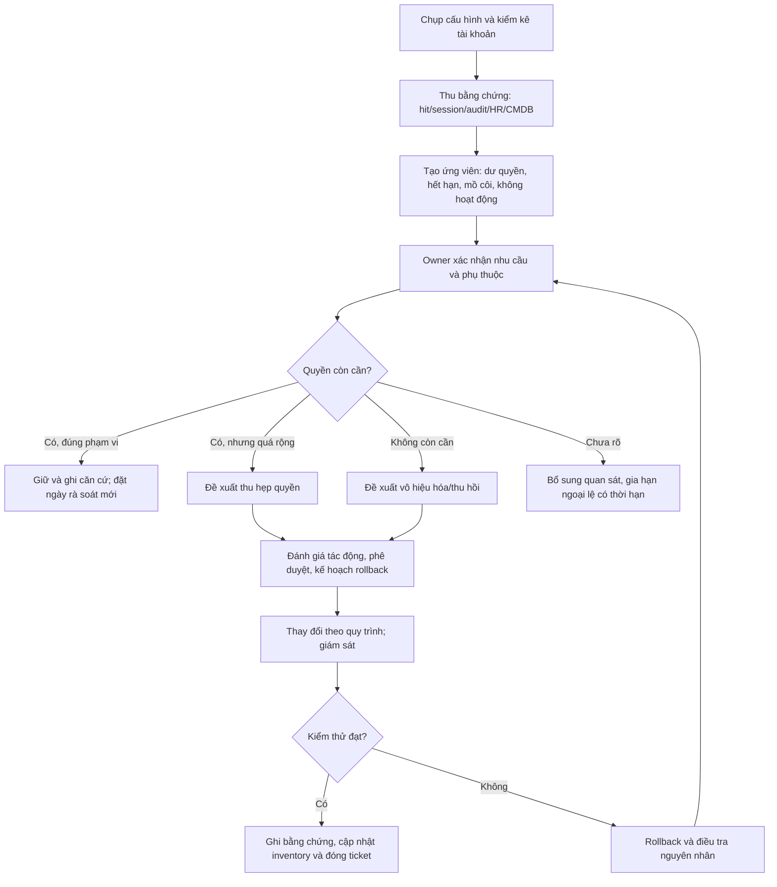

# Định kỳ rà soát rule và tài khoản không dùng

Trong module **SECURITY_NETWORK_SECURITY**, kiến trúc mạng an toàn không dừng ở việc thiết lập firewall, phân đoạn, VPN, IDS/IPS và kiểm soát truy cập quản trị ban đầu. Hệ thống liên tục thay đổi: ứng dụng ngừng hoạt động, địa chỉ IP được tái sử dụng, máy chủ chuyển vùng mạng, nhân sự thay vai trò, nhà thầu kết thúc hợp đồng và tài khoản tự động hóa được thay thế. Nếu các **rule truy cập** và **tài khoản** cũ vẫn tồn tại, quyền dư thừa tích lũy thành đường xâm nhập mà chính sách ban đầu không còn phản ánh nhu cầu thực tế.

Bài học **“Định kỳ rà soát rule và tài khoản không dùng”**, thuộc chương *Hardening thiết bị và dịch vụ mạng*, hướng dẫn cách kiểm kê, xác minh bằng chứng sử dụng, đánh giá tác động, phê duyệt và thu hồi quyền không còn cần thiết. Trọng tâm là thu hẹp bề mặt tấn công mà vẫn giữ được khả năng vận hành, kết nối dự phòng và khôi phục sự cố.

> **Nguyên tắc:** “Không thấy hoạt động” là tín hiệu **cần điều tra**, không tự động là bằng chứng “không còn cần thiết”. Quyết định giữ, hạn chế, vô hiệu hóa hay xóa phải dựa trên chủ sở hữu, nhu cầu nghiệp vụ, dấu vết kỹ thuật và phương án khôi phục.

## 1. Mục tiêu học tập

Sau bài học, người học có thể:

1. Phân biệt rule không được sử dụng, rule trùng lặp, rule bị che khuất, rule quá rộng và rule hết hạn; phân biệt tài khoản không hoạt động, tài khoản mồ côi và tài khoản đặc biệt.
2. Thu thập dữ liệu kiểm kê từ firewall, ACL, VPN, thiết bị mạng, máy chủ dịch vụ, hệ thống AAA/IdP và môi trường cloud.
3. Sử dụng hit counter, session log, flow log, audit log, CMDB và yêu cầu thay đổi để nhận diện **ứng viên rà soát**.
4. Thiết kế chu kỳ kiểm tra theo mức độ rủi ro, có owner và bằng chứng xác nhận.
5. Áp dụng trình tự thay đổi có kiểm thử, phê duyệt và rollback trước khi thu hồi quyền.
6. Phân biệt việc ngừng dùng tài khoản với việc còn tồn tại token, khóa SSH, API key, phiên đăng nhập hoặc quyền ủy quyền.
7. Đo lường hiệu quả rà soát bằng các chỉ số có thể kiểm chứng.

## 2. Phạm vi: “rule” và “tài khoản” gồm những gì?

### 2.1. Những rule cần kiểm kê

Từ “rule” trong hardening nên được hiểu theo **chức năng kiểm soát truy cập**, không chỉ là một dòng trong cấu hình firewall.

| Loại rule/chính sách | Ví dụ | Dấu hiệu cần rà soát |
|---|---|---|
| Firewall/ACL L3–L4 | Nguồn A đến máy chủ B qua TCP 22/443 | Nguồn/đích ngừng dùng, mở rộng hơn nhu cầu, zero hit lâu dài |
| Management access | ACL SSH, local-in policy, trusted-host, API allowlist | Bastion đổi IP, tài khoản quản trị đã chuyển đơn vị |
| VPN/Remote access | Nhóm VPN được phép vào subnet quản trị | Nhóm không còn người phụ trách, phạm vi truy cập thừa |
| Security group/NSG/cloud firewall | Inbound từ CIDR hoặc security group khác | Workload đã xóa, security group mồ côi, rule công khai |
| Chính sách phân đoạn | VLAN/VRF, microsegmentation, Kubernetes NetworkPolicy | Luồng nghiệp vụ bị bỏ, rule cho phép giữa các vùng quá rộng |
| NAT và đường xuất bản dịch vụ | DNAT/port-forward tới hệ thống nội bộ | Backend đã ngừng, ánh xạ hướng đến tài nguyên mới |
| API gateway/reverse proxy/WAF | Allowlist endpoint quản trị, exception bảo vệ | Ngoại lệ tồn tại sau khi lỗi đã được sửa |
| Dịch vụ hạ tầng | SNMP collector allowlist, DNS zone transfer ACL | Collector hoặc đối tác không còn sử dụng |

**Quy tắc deny, rule phát hiện IDS/IPS và rule allow có mục đích khác nhau.** Ví dụ, một deny rule không có hit vẫn có thể là hàng rào phòng vệ cần duy trì; một rule IDS ít tạo cảnh báo có thể vì hệ thống chưa bị tấn công. Không được dùng một tiêu chí “zero hit → xóa” cho mọi loại rule. Nội dung quyết định dưới đây chủ yếu áp dụng với **quyền truy cập cho phép** và các ngoại lệ mở rộng quyền; rule chặn/phát hiện phải được đánh giá theo mục tiêu kiểm soát tương ứng.

### 2.2. Những dạng tài khoản cần kiểm kê

| Nhóm tài khoản/danh tính | Ví dụ | Rủi ro khi bỏ sót |
|---|---|---|
| Cá nhân | Quản trị viên firewall, VPN, Wi-Fi controller | Người nghỉ việc/chuyển nhóm vẫn có quyền |
| Đặc quyền | Superuser, tài khoản thay đổi cấu hình, local admin | Chiếm quyền điều khiển thiết bị |
| Nhà thầu/đối tác | Tài khoản bảo trì có hạn | Quyền tồn tại sau hợp đồng |
| Dịch vụ/automation | Backup config, CI/CD, Ansible, API bot | Quyền máy–máy còn hiệu lực dù không đăng nhập tương tác |
| Local/fallback | Tài khoản thiết bị khi AAA gặp sự cố | Khó theo dõi trong IdP trung tâm |
| Break-glass | Tài khoản khẩn cấp được niêm phong/kiểm soát | Có thể lâu không sử dụng **theo thiết kế**, nhưng cần thử quy trình |
| Cloud identity | Service account, IAM user, role, service principal | Credential, role binding hoặc secret lâu ngày chưa thu hồi |
| Machine credentials | SSH authorized key, chứng chỉ, API token | Vẫn có thể xác thực dù tài khoản gốc không còn hoạt động ở hệ thống khác |

**Tài khoản không sử dụng** là tài khoản có dấu hiệu thiếu hoạt động trong khoảng quan sát xác định. **Tài khoản mồ côi** là tài khoản không xác định được người/nhóm chịu trách nhiệm hợp lệ. **Quyền dư thừa** là quyền vượt nhu cầu đã được phê duyệt; tài khoản vẫn đang dùng cũng có thể có quyền dư thừa.

## 3. Vì sao rà soát định kỳ làm giảm rủi ro?

### 3.1. Rule cũ có thể biến thành đường tấn công mới

Giả sử trước đây một rule cho phép từ subnet máy vận hành `10.10.8.0/24` tới TCP 22 của router. Sau khi hệ thống vận hành chuyển sang bastion khác, subnet cũ được cấp cho laptop hoặc máy thử nghiệm. Nếu rule vẫn tồn tại, một thiết bị bị xâm nhập trong subnet tái sử dụng có thể kết nối đến dịch vụ SSH của router.

Một số nhóm rủi ro thường gặp:

- **Quyền thừa tích lũy:** dải nguồn rộng như `10.0.0.0/8` hoặc `0.0.0.0/0` cho cổng quản trị.
- **Ngoại lệ tạm thời trở thành vĩnh viễn:** rule mở để xử lý sự cố hoặc bảo trì nhưng không thu hồi.
- **Rule bị che khuất hoặc trùng lặp:** cấu hình phức tạp khiến khó biết rule nào đang có hiệu lực.
- **NAT và IP tái sử dụng:** đối tượng ban đầu biến mất, nhưng địa chỉ vẫn khớp rule.
- **Đường vòng:** phân đoạn đã sửa tại một firewall nhưng management API hoặc IPv6 vẫn mở đường truy cập khác.

### 3.2. Tài khoản cũ có thể bỏ qua mô hình quản trị hiện tại

Một nhân viên đã chuyển bộ phận nhưng vẫn thuộc nhóm VPN quản trị; một tài khoản dịch vụ chỉ dùng để sao lưu cấu hình trước đây vẫn được gán quyền thay đổi firewall; một API token không có hạn sử dụng vẫn tồn tại trong máy chủ cũ. Kẻ tấn công có thể tận dụng các quyền này ngay cả khi chính sách mới đã siết chặt quyền của tài khoản đang hoạt động.

Trong điều tra sự cố, phải liên kết **danh tính → quyền được cấp → đường mạng → thao tác thực tế**. Chỉ kiểm tra “có đăng nhập hay không” sẽ bỏ sót khóa API, chứng chỉ hoặc quyền được kế thừa qua nhóm.

## 4. Tạo kiểm kê có thể truy vết

Không nên bắt đầu từ việc tìm nút *Delete*. Trước hết phải xây dựng một danh sách thống nhất phản ánh **cấu hình đang có hiệu lực**, đối chiếu với tài sản và nhu cầu hiện tại.

### 4.1. Các trường tối thiểu cho mỗi rule

| Nhóm thông tin | Trường đề xuất | Vì sao cần |
|---|---|---|
| Định danh | `device_id`, `rule_id`, `policy_version` | Nhận diện đúng rule, so sánh trước/sau |
| Phạm vi | `zone_in`, `zone_out`, `interface`, `direction` | Xác định đường đi mà rule thực sự áp dụng |
| Điều kiện khớp | `source`, `destination`, `service`, `protocol` | Phát hiện quyền dư thừa |
| Hành động | `action`, `nat_ref`, `priority/order` | Phân biệt allow/deny, ảnh hưởng NAT, thứ tự rule |
| Trách nhiệm | `owner`, `business_justification`, `ticket_id` | Biết ai xác nhận còn cần |
| Vòng đời | `created_at_utc`, `last_reviewed_utc`, `expires_at_utc` | Tìm rule quá hạn |
| Bằng chứng | `hit_counter`, `counter_since_utc`, `last_match_utc`, `log_ref` | Đánh giá hoạt động cùng cửa sổ quan sát |
| Thay đổi | `proposed_action`, `approval_ref`, `rollback_ref` | Theo dõi quyết định và khả năng khôi phục |

Một rule có 0 hit nhưng chỉ mới được đếm từ lần reboot hôm qua không thể xem như 0 hit trong ba tháng. **Thời điểm bắt đầu đếm** quan trọng không kém giá trị counter.

### 4.2. Các trường tối thiểu cho tài khoản

| Nhóm thông tin | Trường đề xuất | Vì sao cần |
|---|---|---|
| Danh tính | `principal_id`, `account_type`, `identity_store` | Phân biệt tài khoản local, IdP, IAM và service |
| Chủ sở hữu | `owner`, `manager_or_system_owner` | Xác minh trách nhiệm |
| Vòng đời | `created_at_utc`, `contract_end_utc`, `review_due_utc` | Phát hiện tài khoản hết nhu cầu |
| Trạng thái | `enabled`, `locked`, `mfa_state` | Không nhầm khóa tạm với đã thu hồi |
| Quyền | `role`, `groups`, `device_scope`, `privilege_level` | Đo quyền thực tế và quyền kế thừa |
| Hoạt động | `last_interactive_login_utc`, `last_noninteractive_use_utc` | Tránh bỏ sót automation/API |
| Credential | `ssh_keys`, `api_tokens`, `certificates`, `last_rotated_utc` | Đảm bảo không còn đường xác thực dư |
| Ngoại lệ | `break_glass`, `approved_exception`, `approval_ref` | Không vô hiệu hóa nhầm tài khoản dự phòng |
| Quyết định | `review_status`, `disabled_at_utc`, `change_id` | Có nhật ký hành động |

Lưu ý dữ liệu nhạy cảm: kiểm kê **metadata, ID, trạng thái và người sở hữu**, không sao chép mật khẩu, private key hay token thô vào bảng rà soát.

### 4.3. Chuẩn hóa thời gian để so sánh được

Dữ liệu đến từ firewall, VPN, IdP, Linux, Windows, SIEM và cloud có thể ghi theo UTC hoặc múi giờ địa phương. Chuẩn hóa sang UTC và lưu cả timestamp gốc cùng múi giờ/ý nghĩa trường. Một `lastSeen` trong SIEM có thể là thời gian **ingest** thay vì thời điểm phiên thực sự diễn ra. Nếu đồng hồ nguồn sai hoặc log bị gửi trễ, không nên tự tính ngày “không dùng” mà không kiểm tra.

Với tài khoản dùng định kỳ theo lịch quý hoặc cho diễn tập khôi phục, khoảng quan sát 30 ngày là không đủ. Kiểm kê phải ghi rõ **ngày bắt đầu/kết thúc cửa sổ quan sát** và giới hạn của bằng chứng.

## 5. Xác định “không dùng” bằng nhiều nguồn dữ liệu

### 5.1. Rule không có hit: tín hiệu, không phải kết luận

Các lý do khiến hit counter bằng 0 hoặc không cập nhật:

1. Counter bị reset sau reboot, failover HA, import policy hoặc thay đổi cấu hình.
2. Rule nằm ở nhánh xử lý khác với nơi đang đo; có rule ưu tiên phía trước, NAT, routing hoặc policy theo ứng dụng.
3. Chỉ một node của cặp HA xử lý luồng, hoặc thiết bị dùng cơ chế đồng bộ counter khác nhau.
4. Lưu lượng hợp lệ hiếm khi xuất hiện: bảo trì, backup theo quý, disaster recovery hoặc luồng failover.
5. Policy ghi session ở lúc **đóng**, không phải lúc bắt đầu; log chỉ ghi mẫu hoặc không bật theo rule.
6. Phiên đã thiết lập trước khi thay đổi rule vẫn tồn tại trong bảng session, tùy hành vi stateful firewall.

Vì vậy, phân loại ứng viên cần kết hợp **counter trong khoảng đo đáng tin cậy + flow/session log + lịch nghiệp vụ + xác nhận owner**. Một rule không có hit dài ngày được ưu tiên kiểm tra, nhưng chưa thể xóa tự động.

### 5.2. Rule trùng lặp, bị che khuất và mở quá rộng

- **Trùng lặp:** nhiều rule có điều kiện khớp và hành động tương đương, xét trong cùng ngữ cảnh xử lý.
- **Bị che khuất (*shadowed*):** trong bộ luật xử lý theo thứ tự đầu tiên khớp, một rule phía trước đã bao phủ toàn bộ lưu lượng của rule sau. Khái niệm này phụ thuộc vào cơ chế đánh giá policy của từng thiết bị.
- **Quá rộng:** nguồn, đích hoặc dịch vụ vượt quá những gì ứng dụng thực tế cần, dù rule có hit.
- **Không có chủ sở hữu/hết hạn:** rule có thể vẫn hoạt động nhưng không còn căn cứ phê duyệt.

Ví dụ, `allow source=any → management-ip TCP/22` là ứng viên ưu tiên cao **ngay cả khi có hit mỗi ngày**: cần xác định nguồn thực tế, chuyển lưu lượng hợp lệ sang bastion và thu hẹp rule. Ngược lại, một deny rule hiếm khớp không nhất thiết dư thừa.

**Không kết luận rule “shadowed” chỉ dựa trên tên hoặc vị trí trong danh sách**: firewall có thể xử lý theo zone, policy layer, identity, application, NAT trước/sau, route và thứ tự khác nhau. Phải phân tích **effective policy** với cách xử lý thực tế của nền tảng.

### 5.3. Tài khoản không có lần đăng nhập gần đây

Nguồn bằng chứng có thể gồm:

- Authentication log ở TACACS+/RADIUS, LDAP/AD, SSO/IdP và hệ thống PAM.
- Log VPN và bastion cho thấy người dùng có mở phiên quản trị hay không.
- Audit log trên router/switch/firewall, API gateway, cloud IAM và máy chủ.
- Hoạt động của token, SSH key, service principal hoặc tài khoản chạy tác vụ nền.
- Thông tin HR/nhà thầu, CMDB, ticket bàn giao và danh mục hệ thống đang vận hành.

**Không đăng nhập tương tác** không chứng minh tài khoản dịch vụ không hoạt động. Một backup agent dùng API token mỗi đêm có thể không sinh sự kiện “interactive login” nào. Ngược lại, một tài khoản cá nhân đăng nhập thường xuyên nhưng vẫn giữ quyền quản trị của vai trò cũ là trường hợp **quyền dư thừa**, cần sửa nhóm/quyền thay vì xóa tài khoản.

Một số log `lastLogon` có độ trễ đồng bộ giữa domain controller, có thể không bao quát ứng dụng dùng xác thực riêng; `lastLogonTimestamp` trong Active Directory không được thiết kế làm dấu thời gian chính xác đến phút. Khi cần xác minh, đối chiếu nhiều nguồn và ghi lại mức chắc chắn.

### 5.4. Phân loại ứng viên theo chất lượng bằng chứng

| Phát hiện | Có thể suy ra | Chưa thể suy ra | Bước tiếp theo |
|---|---|---|---|
| Rule 0 hit trong 90 ngày, counter ổn định | Chưa quan sát thấy lưu lượng khớp trong cửa sổ | Luồng sẽ không còn cần trong DR | Hỏi owner, kiểm tra lịch failover và flow log |
| Rule allow `any` vào mạng quản trị có nhiều hit | Quyền đang được dùng | Mọi nguồn hit đều được phê duyệt | Phân tích nguồn, thu hẹp điều kiện |
| User nghỉ việc, vẫn enabled | Có xung đột vòng đời danh tính | Token và session đã bị thu hồi | Xác minh HR/IdP, thực hiện offboarding |
| Service account 120 ngày không interactive login | Không có log tương tác | Không còn backup/API call | Kiểm tra lịch job và credential usage |
| Tài khoản break-glass 180 ngày không đăng nhập | Có thể đúng quy trình | Quy trình khôi phục còn hoạt động | Kiểm tra niêm phong, MFA, diễn tập được phê duyệt |
| Rule không có owner | Thiếu trách nhiệm giải trình | Không còn nghiệp vụ cần dùng | Truy tìm CMDB/ticket và người sở hữu hệ thống |

## 6. Thiết lập nhịp rà soát theo rủi ro

Không tồn tại một khoảng ngày cố định phù hợp với mọi tổ chức và mọi loại đối tượng. Chu kỳ cần căn cứ mức nhạy cảm, độ biến động, quy định áp dụng, thời gian lưu log và tần suất nghiệp vụ. Bảng sau là **lịch gợi ý để bắt đầu thiết kế**, không phải tiêu chuẩn bắt buộc:

| Đối tượng | Tần suất gợi ý | Sự kiện kích hoạt rà soát ngay |
|---|---|---|
| Quyền quản trị firewall, VPN, thiết bị lõi, IAM đặc quyền | Hàng tháng, hoặc mỗi thay đổi quan trọng | Nhân sự rời tổ chức, nghi lộ tài khoản, thay bastion/VPN |
| Rule truy cập management plane hoặc rule mở ra Internet | Hàng tháng | Bật dịch vụ mới, thay mạng quản trị, phát hiện lộ cổng |
| Rule giữa các vùng tin cậy/đám mây | Mỗi quý | Ứng dụng ngừng hoạt động, thay địa chỉ, thay phân đoạn |
| Ngoại lệ tạm thời, quyền nhà thầu | Theo ngày hết hạn và sau công việc | Kết thúc bảo trì, hết hợp đồng |
| Tài khoản dịch vụ, API token, SSH key | Mỗi quý hoặc theo chu kỳ vòng đời bí mật | Thay ứng dụng/runner, rò rỉ secret, đổi owner |
| Tài khoản break-glass | Kiểm kê thường xuyên; thử quy trình theo lịch diễn tập | Thay nhân sự phụ trách, thay cơ chế xác thực |
| Quy tắc ít thay đổi nhưng có vai trò DR | Theo lịch đánh giá rủi ro/diễn tập | Diễn tập DR, thay kiến trúc dự phòng |

Có thể đặt ngưỡng phát hiện ban đầu, ví dụ **không có hit trong 90 ngày**, **tài khoản không hoạt động 90 ngày**, **rule không được chủ sở hữu xác nhận trong 180 ngày**. Ngưỡng chỉ tạo **danh sách cần xác minh**. Quyết định vô hiệu hóa phải xét đến vòng đời thật, thời gian giữ log, tần suất tác vụ và ngoại lệ.

Cần điều chỉnh độ ưu tiên nếu rule quản trị mở ra Internet, liên kết vùng nhạy cảm, hoặc tài khoản có quyền thay đổi thiết bị mạng. Quyền có tác động lớn xứng đáng được xem xét sớm ngay cả khi chưa đạt ngưỡng không hoạt động.

## 7. Quy trình rà soát có phân trách nhiệm



### 7.1. Phân vai

| Vai trò | Trách nhiệm |
|---|---|
| **Security/Network Operations** | Thu policy đang có hiệu lực, counters/log, đề xuất và triển khai thay đổi |
| **Application/Service Owner** | Xác nhận luồng mạng và lịch vận hành, kể cả backup/DR |
| **Identity/IT Operations** | Kiểm kê tài khoản, nhóm, quyền, khóa/token, trạng thái offboarding |
| **HR/Vendor Management** | Cung cấp thông tin thay đổi nhân sự và hạn hợp đồng theo cơ chế phù hợp |
| **Change Approver** | Phê duyệt rủi ro, cửa sổ thay đổi, tác động và rollback |
| **Audit/Security Assurance** | Kiểm tra bằng chứng, ngoại lệ và tính tuân thủ quy trình |

Ở môi trường nhỏ, một người có thể thực hiện nhiều việc, nhưng cần cơ chế phê duyệt/kiểm tra độc lập tương xứng với quyền và rủi ro. Chủ sở hữu hệ thống phải xác nhận nhu cầu nghiệp vụ trước khi chặn một luồng ít được sử dụng.

### 7.2. Quyết định phải có trạng thái rõ ràng

Một bản ghi rà soát nên có một trong các trạng thái:

- **KEEP:** còn nhu cầu, phạm vi hợp lý, có owner và bằng chứng.
- **TIGHTEN:** còn nhu cầu nhưng cần thu hẹp nguồn/đích/cổng/quyền hoặc hạn sử dụng.
- **DISABLE / REVOKE:** không còn nhu cầu, đã phê duyệt rút quyền.
- **REMOVE:** đã vượt giai đoạn quan sát, sẵn sàng xóa cấu hình/đối tượng theo quy trình.
- **EXCEPTION:** có nhu cầu đặc biệt, căn cứ và ngày rà soát/hết hạn xác định.
- **INVESTIGATE:** bằng chứng mâu thuẫn hoặc chưa xác minh được phụ thuộc.

Không coi “đã gửi email hỏi owner” là “đã rà soát xong”. Cần quyết định rõ, người xác nhận và hạn hoàn thành.

## 8. Runbook rà soát và thu hồi rule an toàn

### Bước 1. Đóng băng bằng chứng trước thay đổi

Lưu cấu hình/policy hiện hành, rule ID, vị trí, các object tham chiếu, counter, session/log và thời gian truy xuất. Nếu có HA, chụp trạng thái trên các node liên quan. Ghi checksum hoặc định danh phiên bản của bản cấu hình xuất ra và ticket thay đổi.

Không sửa trực tiếp file chứng cứ để làm nó trông “sạch”. Mọi thay đổi phải được nhận diện ở cấu hình vận hành sau khi đã chụp bản gốc.

### Bước 2. Kiểm tra luồng phụ thuộc

Phân tích luồng mạng được rule cho phép gồm nguồn, đích, giao thức, ứng dụng, chiều đi/về, NAT, route và giao diện. Kiểm tra các hoạt động không thường xuyên: sao lưu, cấp chứng chỉ, đồng bộ thời gian, cập nhật DNS, giám sát SNMP, chuyển vùng HA, thao tác quản trị sự cố, VPN dự phòng.

Ví dụ: một rule cho phép máy chủ backup truy cập TCP 22 đến firewall có thể chỉ có lưu lượng lúc kiểm thử khôi phục mỗi quý. Không có hit trong 60 ngày vẫn chưa đủ để xóa.

### Bước 3. Đánh giá tác động và thiết kế thay thế

Nếu rule quá rộng, ưu tiên **thắt chặt điều kiện** hơn là xóa khi vẫn có luồng hợp lệ:

- Thu hẹp nguồn theo IP bastion/runner hoặc nhóm định danh phù hợp.
- Thu hẹp đích đúng IP hoặc nhóm workload còn dùng.
- Chỉ mở giao thức/cổng thực sự cần.
- Gỡ ngoại lệ tạm và quy định thời hạn.
- Xác minh rule IPv4 **và** IPv6; kiểm tra các interface/API quản trị khác.

Đối với rule bị che khuất hoặc trùng lặp, chỉ gỡ khi đã xác nhận trình tự xử lý và ảnh hưởng của object tham chiếu trên thiết bị.

### Bước 4. Phê duyệt và chuẩn bị rollback

Trước khi thay đổi:

1. Có owner xác nhận, đánh giá rủi ro, giờ bảo trì và người giám sát.
2. Có bản sao cấu hình, cách khôi phục chính xác, đường console/OOB nếu liên quan quản trị.
3. Có danh sách kiểm thử dương tính (luồng phải chạy) và âm tính (luồng cần bị chặn).
4. Có người quyết định rollback và ngưỡng dừng khi giám sát phát hiện lỗi.
5. Nếu nền tảng hỗ trợ, cân nhắc **commit confirmed**, thay đổi theo đợt hoặc vô hiệu hóa rule trước khi xóa vĩnh viễn.

**Chú ý:** Vô hiệu hóa rule hoặc thay ACL có thể làm hỏng những phiên **mới** ngay lập tức; phiên đã tồn tại có thể còn sống theo cơ chế stateful. Do đó, phải kiểm thử cả thiết lập kết nối mới và hành vi phiên đang chạy theo yêu cầu.

### Bước 5. Thực hiện, theo dõi và xóa sau khi đủ điều kiện

Thực hiện thay đổi theo phê duyệt; theo dõi lỗi dịch vụ, tỷ lệ kết nối, log deny, xác thực VPN, DNS, SNMP, SSH và công việc tự động hóa liên quan. Nếu kiểm thử thất bại, thực hiện rollback và đánh dấu trạng thái **FAILED/ROLLED_BACK**, không âm thầm xóa bằng chứng.

Một quy trình phù hợp với rủi ro có thể là:

```text
CANDIDATE
  → OWNER_CONFIRMED
  → APPROVED
  → RULE_DISABLED (có rollback)
  → OBSERVATION_WINDOW_PASSED
  → RULE_REMOVED
  → POST_CHANGE_VERIFIED
```

Không có “thời gian chờ thần kỳ” bảo đảm an toàn: cửa sổ quan sát phải bao trùm chu kỳ hoạt động quan trọng hoặc có xác nhận nghiệp vụ/diễn tập thay thế.

## 9. Runbook cho tài khoản và credential không còn dùng

Quy trình thu hồi quyền tài khoản liên quan đến mạng cần giải quyết cả **đăng nhập tương tác**, **tự động hóa** và **thông tin xác thực còn tồn tại**.

### 9.1. Tài khoản cá nhân và nhà thầu

1. Đối chiếu danh sách người đang làm việc, nhóm/role và nhu cầu quản trị được phê duyệt.
2. Xem lần xác thực gần nhất từ IdP, AAA, VPN, bastion, log thiết bị và SIEM.
3. Nếu người chuyển vai trò, trước hết gỡ các **role/nhóm quản trị** không còn cần; tài khoản có thể vẫn cần để làm việc thông thường.
4. Nếu tài khoản không còn hợp lệ, vô hiệu hóa/thu hồi quyền theo quy trình offboarding; thu hồi token/session/credential liên quan tùy khả năng nền tảng.
5. Kiểm tra tài khoản local trên thiết bị mạng, SSH authorized key, VPN certificate và quyền ở cloud không được đồng bộ qua IdP trung tâm.
6. Xác minh tài khoản không thể tạo **phiên mới**, quyền không còn qua nhóm phụ; lưu log và ngày hoàn tất.

Tài khoản đã bị disable ở một IdP không nhất thiết khiến phiên đang mở hoặc API token ở hệ thống khác lập tức mất hiệu lực. Cần đánh giá session revocation, token lifetime, federation và các credential được phát riêng.

### 9.2. Tài khoản dịch vụ và automation

Tài khoản dịch vụ có thể dùng theo lịch thưa hoặc chỉ được kích hoạt khi có lỗi. Các bước an toàn:

- Xác định ứng dụng/job và chủ sở hữu, lịch chạy, máy chủ/runner gọi dịch vụ.
- Đối chiếu nhật ký scheduler, API gateway, vault và hoạt động SSH/API. Không chỉ dùng `last interactive login`.
- Nếu cần thay, tạo danh tính/secret mới với quyền tối thiểu, cập nhật cấu hình dùng secret và kiểm thử job trước khi thu hồi credential cũ.
- Sau khi đổi, kiểm tra job thành công và không còn request sử dụng credential cũ trong cửa sổ quan sát hợp lý.
- Thu hồi key/token/certificate và mọi quyền/role không còn cần, tránh để song song vĩnh viễn.

Cần có chủ sở hữu rõ ràng cho từng tài khoản máy–máy. “Không có người dùng trực tiếp” không đồng nghĩa “không có owner”.

### 9.3. Break-glass, tài khoản local và phục hồi

Tài khoản khẩn cấp cần được bảo vệ riêng: lưu trong hệ thống kiểm soát bí mật, giới hạn người được phép lấy, ghi nhật ký sử dụng, cảnh báo khi hoạt động và thử quy trình theo kế hoạch. Tài khoản có thể **không có lượt đăng nhập gần đây do đúng thiết kế**. Không áp chính sách tự khóa/xóa theo tuổi không hoạt động cho loại này.

Mục tiêu là vừa tránh backdoor tồn đọng, vừa duy trì khả năng khôi phục khi mất IdP, VPN hoặc hệ thống AAA. Các tài khoản local trùng chức năng, không có owner hoặc chưa nằm trong quy trình khẩn cấp là ứng viên rà soát có độ ưu tiên cao.

## 10. Ví dụ thực hành: đợt rà soát môi trường mạng doanh nghiệp

Một doanh nghiệp giả lập vận hành firewall vùng DMZ, VLAN quản trị, VPN nhân viên, collector SNMPv3 và các máy chủ DNS. Đội vận hành nhận danh sách dưới đây sau một lần xuất cấu hình và đối chiếu log. **Thông tin là ví dụ học tập**, không đại diện cho môi trường thật.

| ID | Đối tượng | Dữ liệu quan sát | Phân loại sơ bộ | Hướng xử lý |
|---|---|---|---|---|
| F-014 | Allow `10.90.0.0/16 → 10.20.0.1 TCP/22` | 0 hit trong 120 ngày; subnet đã chuyển mục đích | Rule không hoạt động, phạm vi quá rộng | Xác minh owner, thay bằng bastion `10.90.5.10/32` nếu cần, kiểm thử, vô hiệu hóa rule cũ |
| F-019 | Allow `10.40.4.20 → 10.20.0.5 TCP/22` | 0 hit trong 60 ngày; job DR chạy mỗi quý | Có thể vẫn cần | Giữ tạm, xác nhận lịch DR và thử có kiểm soát |
| F-022 | Allow `any → 10.20.0.2 TCP/443` | Có hit từ LAN và VPN thông thường | Quyền quản trị quá rộng | Thu hẹp chỉ bastion; xác minh local-in và IPv6 |
| F-025 | Deny `WAN → management subnet` | 0 hit trong cửa sổ hiện tại | Rule bảo vệ | Giữ nếu chính sách phân đoạn yêu cầu |
| U-031 | `contractor_admin` | Hết hợp đồng; tài khoản VPN còn enabled | Hết hạn quyền | Xác nhận hồ sơ, khóa truy cập, thu hồi credential, kiểm tra log |
| U-044 | `svc_config_backup` | Không login tương tác; API call hàng tháng | Service account còn dùng | Giữ, xác nhận owner, quyền tối thiểu, lịch đổi credential |
| U-051 | `breakglass_fw` | Không đăng nhập 180 ngày; có hồ sơ khẩn cấp | Ngoại lệ có mục đích | Giữ với kiểm soát, diễn tập và giám sát |

Các dải địa chỉ trong bảng thuộc ví dụ nội bộ giả lập; khi áp dụng thực tế phải thay bằng địa chỉ, role và tên rule tại môi trường được quản lý.

### 10.1. Xử lý F-014

Mặc dù F-014 không ghi hit trong 120 ngày, đội vận hành vẫn cần kiểm tra:

- Counter có thực sự bao trùm 120 ngày hay đã reset?
- Có đường dự phòng/DR chỉ dùng mỗi quý hoặc theo sự cố?
- `10.90.0.0/16` còn thuộc phân vùng vận hành hay đã đổi chủ?
- Tài khoản SSH và đường bastion mới có vận hành được không?
- IPv6 hoặc interface phụ có đường quản trị tương đương chưa được bảo vệ?

Sau khi chủ sở hữu xác nhận chỉ bastion `10.90.5.10` cần SSH, áp rule cho phép mới hẹp hơn, kiểm thử từ bastion và từ subnet cũ, rồi mới vô hiệu hóa rule rộng có rollback. Quyết định xóa cuối cùng phụ thuộc kết quả theo dõi và chu kỳ nghiệp vụ.

### 10.2. Xử lý U-031

Với tài khoản nhà thầu đã hết hợp đồng, quy trình phải kiểm tra cả VPN group, quyền tại thiết bị, SSH key, tài khoản local và token/API cấp riêng nếu có. Sau khi thu hồi, thử tạo **phiên mới** qua đường được cấp trước kia và xác minh bị từ chối; không dùng đăng nhập thành công vào môi trường thật làm cách kiểm thử khi không có thẩm quyền.

Nếu tài khoản đã đăng nhập gần đây dù hợp đồng hết hạn, chuyển điều tra truy cập bất thường theo quy trình ứng cứu sự cố, đồng thời thực hiện biện pháp hạn chế phù hợp với rủi ro.

### 10.3. Vì sao giữ F-019 và U-051?

Một policy dự phòng hoặc tài khoản break-glass có thể nằm im nhiều tháng vì hệ thống vận hành ổn định. Xóa chúng chỉ dựa trên hoạt động thấp có thể gây thất bại khi khôi phục sự cố. Cách đúng là kiểm soát owner, đường truy cập, cơ chế bảo vệ, lịch diễn tập và ngày rà soát tiếp theo; nếu không còn nhu cầu, thu hồi qua cùng quy trình thay đổi.

## 11. Công cụ và truy vấn phục vụ rà soát

Các câu lệnh dưới đây chủ yếu dùng để **thu thập bằng chứng ở chế độ đọc**. Cú pháp thực tế phụ thuộc phiên bản firmware/hệ điều hành; cần có quyền xem cấu hình và tuân theo quy trình của tổ chức.

### 11.1. Thiết bị mạng và firewall

Với thiết bị hỗ trợ cú pháp Cisco IOS/IOS XE, một số thao tác tham khảo:

```text
show access-lists
show ip access-lists
show ip interface
show running-config | section access-list
show users
```

Kết quả `show access-lists` có thể cung cấp counters; nhưng ý nghĩa số đếm, thời điểm reset và khả năng áp lên hardware phụ thuộc nền tảng. `show users` chủ yếu là phiên đang hoạt động, không phải lịch sử đăng nhập đầy đủ. Với NGFW, nên dùng xuất policy + hit count + session/traffic logs và kiểm tra phạm vi của local-in, NAT, HA. Không giả định mọi rule được đánh giá từ trên xuống theo cùng mô hình.

### 11.2. Linux: xem tập luật và trạng thái dịch vụ

```bash
# Kiểm tra ruleset nftables đang áp dụng, có handle để đối chiếu.
sudo nft -a list ruleset

# Xem các socket TCP/UDP đang lắng nghe trên máy.
sudo ss -lntup

# Kiểm tra một tài khoản local có tồn tại không.
getent passwd svc_backup

# Xem sự kiện đăng nhập SSH nếu hệ thống dùng systemd journal và tên unit tương ứng.
sudo journalctl --utc -u ssh --since "2026-08-01" --until "2026-11-28"
```

`journalctl -u ssh` có thể cần thay bằng `-u sshd` hoặc nguồn log khác tùy bản phân phối. `getent passwd` không xác nhận tài khoản đã hoạt động, có quyền gì hay có thể đăng nhập từ mạng nào. Trước khi đánh giá tài khoản SSH cần xem cả `authorized_keys`, PAM/SSSD/LDAP, nhóm quyền và lịch sử xác thực; không đưa nội dung secret vào báo cáo.

### 11.3. IdP/IAM và đám mây

Xuất danh mục người dùng, nhóm, role, tài khoản dịch vụ, access key, secret metadata, lần sử dụng theo **thời gian và phạm vi mà nền tảng hỗ trợ**. Một số hệ thống chỉ lưu hoạt động gần đây hoặc chỉ ghi một nhóm loại API; giá trị `last_used` trống có thể là **không có dữ liệu** chứ không phải “chưa từng dùng”.

Đối với security group/NSG, kết hợp:

1. Rule inbound/outbound hiện hành và đối tượng tham chiếu.
2. Thông tin workload/ENI/NIC gắn với rule.
3. Flow log trong cửa sổ quan sát phù hợp.
4. Bản đồ ứng dụng, thay đổi hạ tầng và người sở hữu.
5. Chính sách tổ chức cao hơn, NACL hoặc network firewall khi có.

Nhận diện security group không gắn workload là tín hiệu để xác minh, nhưng cần xét kế hoạch provision, template, failover và môi trường được tạo theo lịch.

### 11.4. Truy vấn dữ liệu ứng viên: ví dụ SQL minh họa

Giả sử kho kiểm kê đã **chuẩn hóa và đối chiếu nguồn** có các trường `rules.rule_id`, `rules.owner`, `rules.action`, `rules.last_match_utc` và `rules.observation_start_utc`. Truy vấn sau chỉ tạo danh sách xem xét, không xóa hoặc vô hiệu hóa bất cứ thứ gì:

```sql
-- Pseudocode SQL: tham số :cutoff_utc do hệ thống cung cấp.
SELECT
    rule_id,
    owner,
    action,
    last_match_utc,
    observation_start_utc
FROM rules
WHERE action = 'allow'
  AND (
      owner IS NULL
      OR last_match_utc < :cutoff_utc
      OR last_match_utc IS NULL
  );
```

Truy vấn chỉ lọc **ứng viên**. `last_match_utc IS NULL` có thể nghĩa là không bật logging, không có khả năng truy vấn hoặc dữ liệu chưa đồng bộ. Cần kiểm tra độ dài cửa sổ quan sát, tính đầy đủ log và nhu cầu nghiệp vụ trước khi ra quyết định. Có thể bổ sung phân loại riêng cho rule không có owner, rule vượt hạn, rule mở rộng và rule được đánh dấu khẩn cấp.

### 11.5. Mẫu hồ sơ rà soát

```yaml
review_id: REV-2026-Q4-042
asset: branch-firewall-01
object_type: firewall_rule
object_id: F-014
business_owner: "Network Operations"
observation:
  window_start_utc: "2026-08-01T00:00:00Z"
  window_end_utc: "2026-11-28T00:00:00Z"
  log_sources:
    - "policy-export-2026q4"
    - "flow-logs-2026q4"
  counter_reset_verified: true
finding: "Rule cũ không thấy hit; subnet nguồn đã đổi mục đích"
proposed_action: "tighten_then_disable"
decision: "owner_review_required"
risk: high
evidence_refs:
  - "POLICY-SNAPSHOT-001"
  - "FLOW-ANALYSIS-032"
rollback_plan_ref: "CHG-2026-312"
next_review_utc: "2026-12-05T00:00:00Z"
```

Mẫu sử dụng tham chiếu/định danh giả lập. Trong môi trường thật, lưu hồ sơ theo chuẩn quản lý thay đổi và giới hạn truy cập theo độ nhạy cảm của dữ liệu.

## 12. Kiểm thử, đo lường và bằng chứng phục vụ audit

### 12.1. Kiểm thử trước/sau

| Nhóm kiểm thử | Kỳ vọng | Bằng chứng |
|---|---|---|
| Luồng mạng **được phép giữ** | Ứng dụng, DNS, VPN, SNMP và automation vẫn hoạt động | Synthetic transaction, job log, flow/connection log |
| Luồng **đã thu hồi** | Không thể khởi tạo kết nối mới ngoài chính sách | Counter deny, log firewall, kiểm tra từ nguồn được ủy quyền |
| Đường quản trị hợp lệ | Bastion và đường OOB hoạt động | Log đăng nhập/tài khoản, phiên được kiểm soát |
| Tài khoản bị vô hiệu hóa | Không thể xác thực mới ở các hệ thống liên quan | Log IdP/AAA/VPN/API, xác nhận session/token theo khả năng |
| Credential đã thu hồi | Key/token cũ không còn tạo được phiên mới | Audit key/token, kiểm tra tích hợp có thẩm quyền |
| Rule tạm đã hết hạn | Không còn đường truy cập và cấu hình khớp bản phê duyệt | Config diff, change ticket, bản chụp policy |
| Sự cố sau thay đổi | Rollback có thể thực hiện theo kịch bản đã chuẩn bị | Biên bản thử và trạng thái sau khôi phục |

Không nhầm việc **không thấy kết nối** do sự cố route, DNS hoặc dịch vụ tắt với việc rule deny thực sự chặn đúng như mong muốn. Xác nhận bằng cả hai phía và rule logs/counters tại điểm thực thi.

### 12.2. Chỉ số hữu ích

Một số chỉ số để điều hành chương trình rà soát:

- **Tỷ lệ có owner:** số rule/tài khoản có owner xác nhận ÷ tổng đối tượng trong phạm vi.
- **Tỷ lệ hoàn tất rà soát đúng hạn:** số đối tượng đã có quyết định và bằng chứng trước hạn ÷ số đối tượng đến hạn.
- **Số quyền không còn nhu cầu đã thu hồi:** theo loại đối tượng, mức rủi ro và môi trường.
- **Số ngoại lệ còn hiệu lực và quá hạn:** tách quyền tạm thời và break-glass.
- **Thời gian từ khi nhân sự rời tổ chức đến khi thu hồi quyền:** đánh giá offboarding.
- **Số lỗi dịch vụ và rollback do dọn rule:** theo dõi chất lượng kiểm tra phụ thuộc.
- **Tỷ lệ rule quá rộng đã được thu hẹp:** ví dụ giảm dải nguồn rộng vào management plane.

Ví dụ: nếu 180/200 rule đến hạn đã có owner, quyết định và bằng chứng trong kỳ, tỷ lệ hoàn tất đúng hạn là **90%**. Tuy nhiên, nếu 20 rule còn lại đều là quyền quản trị phơi ra WAN, mức rủi ro vẫn cao; không nên chỉ báo cáo tỷ lệ tổng.

### 12.3. Bằng chứng cần lưu

Hồ sơ hoàn chỉnh cho một lượt rà soát tối thiểu gồm:

1. Thời gian, phiên bản cấu hình, phạm vi hệ thống và tên người thực hiện.
2. Dữ liệu trước thay đổi, log nguồn, thời hạn dữ liệu và giới hạn quan sát.
3. Phát hiện, xác nhận owner, quyết định giữ/sửa/thu hồi và lý do.
4. Ticket phê duyệt, người triển khai và lịch thay đổi.
5. Diff cấu hình, kết quả kiểm thử, log theo dõi và rollback (nếu có).
6. Trạng thái inventory sau thay đổi, hạn rà soát tiếp theo và ngoại lệ còn mở.

Audit cần khả năng tái dựng **vì sao đã quyết định**, chứ không chỉ biết rằng mục “reviewed” đã được đánh dấu.

## 13. Sai lầm thường gặp

| Sai lầm | Hậu quả | Cách xử lý tốt hơn |
|---|---|---|
| Xóa mọi rule 0 hit | Mất luồng DR, backup hoặc giám sát ít dùng | Xác minh counter, thời gian quan sát và owner |
| Chỉ nhìn ngày đăng nhập cuối | Xóa nhầm automation hoặc bỏ sót API token | Kiểm tra cả hoạt động không tương tác và credential |
| Chỉ kiểm kê tài khoản tại IdP | Bỏ sót tài khoản local thiết bị và SSH key | Đối chiếu AAA, thiết bị, PAM và cloud |
| Không xét IPv6/NAT/HA | Rule nhìn “không dùng” do đo sai điểm | Kiểm tra đường đi và policy đang có hiệu lực |
| Xóa rule mà chưa chuẩn bị đường quản trị dự phòng | Tự khóa quyền chỉnh cấu hình | OOB/console, rollback và kiểm thử dương/âm |
| Không gán owner hay ngày hết hạn cho ngoại lệ | Quyền tạm tồn tại vô thời hạn | Gắn ticket, expiry và owner xác nhận |
| Chỉ báo cáo số lượng rule đã xóa | Khuyến khích xóa bừa, không giảm rủi ro | Đo phạm vi quyền thu hẹp và số sự cố phát sinh |
| Coi tài khoản break-glass không dùng là mồ côi | Mất đường khôi phục | Quản trị ngoại lệ, thử diễn tập và lưu nhật ký |

## 14. Bài tập vận dụng và câu hỏi tự kiểm tra

**Bài tập 1 — Phân loại rule.** Một rule cho phép TCP 443 từ `0.0.0.0/0` đến IP quản trị firewall, có 2.000 hit trong 30 ngày. Có thể giữ nguyên vì “đang dùng” không?

*Gợi ý:* Không đủ căn cứ để giữ nguyên. Đây là quyền quản trị quá rộng. Cần phân tích nguồn nào thực sự hợp lệ, giới hạn vào bastion/VPN quản trị, kiểm tra local-in và IPv6; chuẩn bị kiểm thử/rollback.

**Bài tập 2 — Dữ liệu không đầy đủ.** Rule R-008 có counter = 0. Hệ thống đã reboot ba ngày trước, còn job DR chạy sáu tháng một lần. Có đủ bằng chứng xóa chưa?

*Gợi ý:* Chưa. Thời gian counter chỉ bao trùm ba ngày, không bao phủ chu kỳ DR. Cần log lịch sử, owner và kế hoạch diễn tập/kiểm thử trước thay đổi.

**Bài tập 3 — Tài khoản máy–máy.** Tài khoản `svc_dns_sync` không có `lastInteractiveLogin` trong 180 ngày, nhưng scheduler ghi đồng bộ DNS lúc 02:00 mỗi đêm. Nên xử lý thế nào?

*Gợi ý:* Giữ chức năng còn cần, xác nhận owner, quyền và credential, kiểm thử phụ thuộc trước khi thay/thu hồi. Thiếu đăng nhập tương tác là bình thường với danh tính máy–máy.

**Bài tập 4 — Phê duyệt và rollback.** Một kỹ sư đã vô hiệu hóa rule SSH vì thấy 0 hit. Đến kỳ backup cấu hình đầu tháng, job thất bại. Hãy nêu các thiếu sót ở kiểm tra tác động, lịch nghiệp vụ, xác nhận owner, kiểm thử và giám sát. Đề xuất trình tự xử lý và cải thiện quy trình.

**Câu hỏi tự kiểm tra:**

1. “Rule không có hit”, “rule bị che khuất” và “rule quá rộng” khác nhau ở đâu?
2. Vì sao phải ghi thời điểm counter bắt đầu đếm và phiên bản policy?
3. Điều gì có thể xảy ra nếu xóa tài khoản local chỉ vì không có log SSO?
4. Cần xét những credential và phiên nào sau khi disable một tài khoản?
5. Vì sao quyền VPN của nhân sự nghỉ việc cần được thu hồi ngoài việc xóa tên khỏi nhóm nhân viên?
6. Khi nào một tài khoản không hoạt động trong sáu tháng vẫn nên được giữ?
7. Những thành phần nào cần có trong kế hoạch rollback của thay đổi ACL quản trị?
8. Làm sao xác minh việc chặn kết nối là do policy thay vì lỗi đường truyền?
9. KPI “đã xóa nhiều rule” có hạn chế gì? Nên bổ sung chỉ số nào?
10. Vì sao danh mục owner và ngày hết hạn cần được cập nhật cùng lúc với thay đổi kỹ thuật?

Một chương trình hardening hiệu quả duy trì được **bằng chứng về quyền đang cần thiết**, phát hiện sớm quyền dư, thu hồi an toàn và không đánh mất khả năng phục hồi. Định kỳ rà soát rule và tài khoản vì thế là một quy trình kỹ thuật kết hợp quản trị thay đổi, quản lý danh tính và phân tích lưu lượng, chứ không chỉ là đợt dọn cấu hình.
