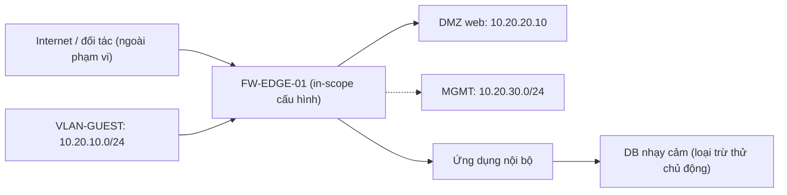
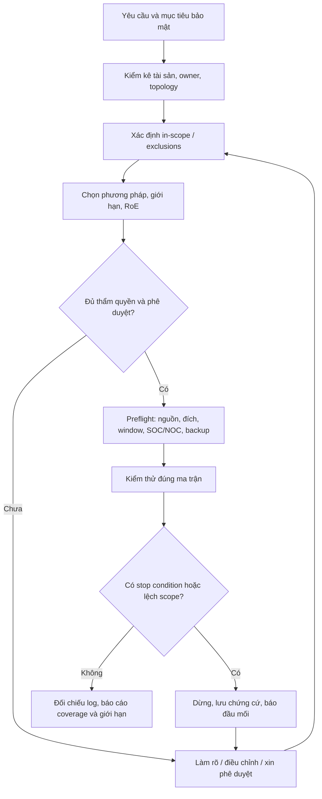

# Xây dựng phạm vi kiểm thử mạng (Network Security Testing Scope)

**Phạm vi kiểm thử mạng** là thỏa thuận xác định chính xác tài sản, đường kết nối, kiểm soát bảo mật và kỹ thuật nào được phép đánh giá, trong khoảng thời gian nào và dưới điều kiện vận hành nào. Trong hoạt động kiểm thử và xác minh bảo mật mạng, phạm vi rõ ràng giúp nhóm kỹ thuật tìm được rủi ro thực sự mà vẫn bảo vệ dịch vụ, dữ liệu và hệ thống không thuộc quyền đánh giá.

Ví dụ, một tổ chức muốn kiểm tra xem phân đoạn mạng văn phòng có ngăn được truy cập trực tiếp đến cơ sở dữ liệu hay không. Mục tiêu đó chưa đủ để bắt đầu quét tất cả địa chỉ trên mạng. Cần xác định VLAN nguồn, VLAN đích, cổng/giao thức, điểm kiểm thử, phương pháp được phép, cửa sổ bảo trì, đầu mối chịu trách nhiệm và cách dừng thử nghiệm khi có ảnh hưởng.

Trong module `SECURITY_NETWORK_SECURITY`, việc xác lập phạm vi áp dụng cho nhiều lớp: phân đoạn mạng, firewall, VPN, IDS/IPS, DNS, mạng không dây, thiết bị mạng và hạ tầng cloud. Bài học hướng dẫn chuyển yêu cầu bảo mật thành **phạm vi được phê duyệt, kiểm chứng được và có giới hạn an toàn**.

Sau bài này, người học có thể:
- Phân biệt mục tiêu đánh giá, phạm vi (*scope*), quy tắc tham gia (*Rules of Engagement*, RoE) và kế hoạch thực thi.
- Lập danh sách tài sản cùng ranh giới tin cậy, bao gồm IP/CIDR, FQDN, VLAN/VRF, VPN, cloud account/VPC/VNet và bên thứ ba.
- Chỉ rõ kiểm thử nào được phép, bị loại trừ hoặc cần chấp thuận riêng.
- Thiết kế ma trận kiểm thử gắn với giả thuyết, bằng chứng, rủi ro và tiêu chí hoàn thành.
- Xử lý thay đổi phạm vi, sự cố vận hành và lập báo cáo không vượt quá chứng cứ thu thập.

## 1. Phạm vi kiểm thử khác gì mục tiêu và kế hoạch?

Bốn khái niệm thường đi cùng nhau nhưng giải quyết những câu hỏi khác nhau:

| Khái niệm | Câu hỏi chính | Ví dụ |
| --- | --- | --- |
| **Mục tiêu (objective)** | Muốn kiểm chứng điều gì, vì sao? | Xác nhận máy trạm Guest không truy cập được subnet quản trị. |
| **Phạm vi (scope)** | Thành phần/ranh giới nào được phép kiểm tra? | Từ `VLAN-GUEST` tới `10.20.30.0/24` qua firewall `FW-EDGE-01`. |
| **Quy tắc tham gia (RoE)** | Được làm gì, khi nào, theo giới hạn nào? | Chỉ thử TCP 22/443; mức lưu lượng thấp; dừng ngay khi có cảnh báo mất dịch vụ. |
| **Kế hoạch kiểm thử (test plan)** | Thực hiện từng bước nào, ai phụ trách và ghi kết quả gì? | Xác nhận route, thử kết nối có kiểm soát, đối chiếu firewall log, lưu bằng chứng. |

Một kiểm thử chỉ có thể bắt đầu sau khi **quyền thực hiện** được xác lập. Người thuê dịch vụ có thể sở hữu một website nhưng không tự động có quyền kiểm thử IP của CDN, nhà cung cấp DNS, hệ thống SaaS hoặc mạng của đối tác. Phạm vi kỹ thuật phải đi cùng quyền sở hữu/quyền cho phép hợp lệ.

### 1.1. Năm chiều của một scope hoàn chỉnh

| Chiều | Nội dung cần chốt |
| --- | --- |
| **What — Tài sản/ranh giới** | Địa chỉ IP, subnet, hostname, zone DNS, VPN gateway, firewall, thiết bị, cloud project, wireless SSID, tài khoản dịch vụ. |
| **Where — Điểm quan sát/điểm khởi tạo** | Internet, mạng guest, DMZ, mạng nội bộ, VPN từ xa, jump host, agent trong cloud hay segment cụ thể. |
| **How — Hoạt động được phép** | Đọc cấu hình, kiểm tra log, passive capture, khám phá dịch vụ có giới hạn, xác minh rule, thử xác thực bằng tài khoản được cấp. |
| **When — Thời gian/giới hạn tài nguyên** | Ngày, timezone, maintenance window, tốc độ, số phiên, ngưỡng dừng và người trực vận hành. |
| **Who — Thẩm quyền/trách nhiệm** | Chủ tài sản, người phê duyệt, tester, người giám sát NOC/SOC, đầu mối ứng cứu, nhà cung cấp liên quan. |

Nên mô tả scope theo **giao của các điều kiện**: chỉ kiểm thử những tài sản *và* hành động *và* thời gian *và* điểm khởi tạo đã được phê duyệt. Một CIDR in-scope không có nghĩa mọi kỹ thuật trên mọi cổng đều được phép.

## 2. Bắt đầu từ câu hỏi bảo mật và bề mặt rủi ro

Trước khi chọn công cụ, thống nhất với chủ hệ thống về kiểm soát cần xác minh. Mỗi mục tiêu cần gắn với tài sản, ranh giới và bằng chứng dự kiến.

| Nhóm kiểm soát | Câu hỏi kiểm thử | Bề mặt cần đưa vào phạm vi | Bằng chứng phù hợp |
| --- | --- | --- | --- |
| Segmentation / ACL | Guest có bị chặn truy cập mạng quản trị? | VLAN nguồn, subnet đích, firewall/ACL, route/VRF | Log deny/allow, cấu hình, thử kết nối có kiểm soát từ đúng VLAN. |
| Firewall | Rule thực tế có tương ứng chính sách? | Zone, interface, NAT, security policy, đối tượng rule | Xuất cấu hình, hit counter, log phiên, đường đi lưu lượng. |
| VPN / Zero Trust access | Vai trò người dùng có bị giới hạn route và ứng dụng? | VPN gateway, pool IP, nhóm test, mạng đích | Kết quả phiên thử, route được cấp, log xác thực và policy. |
| IDS/IPS | Cảnh báo có được sinh và gửi đến SOC? | Sensor, span/TAP, chính sách phát hiện, kênh SIEM | Sự kiện thử nghiệm đã được phê duyệt, log sensor/SIEM và phản hồi SOC. |
| DNS security | Resolver có chặn truy vấn trái chính sách? | Resolver nội bộ, zone, forwarder, policy DNS | Log query, response, cấu hình policy và đường phân giải. |
| Wireless | SSID guest có bị cách ly khỏi VLAN quản trị? | SSID, AP/controller, địa điểm/vùng phát sóng, VLAN | Kết quả kết nối từ client được phép và log NAC/controller. |
| Cloud networking | Security group/NACL/firewall chặn đúng luồng? | Account, region, VPC/VNet, subnet, peering, private endpoint | Config snapshot, flow log, kết quả kết nối qua đường được duyệt. |
| Management plane | Chỉ mạng quản trị truy cập được SSH/HTTPS của router/switch? | Địa chỉ quản trị, ACL, jump host, AAA | Thử kết nối giới hạn, log quản trị và cấu hình ACL. |

Tránh mục tiêu chung như “kiểm thử toàn diện mạng công ty”. Hãy cụ thể hóa thành giả thuyết: **nguồn S không thể truy cập dịch vụ D bằng giao thức P qua đường R**, hoặc **chỉ danh tính nhóm G được phép mở phiên tới dịch vụ D**.

## 3. Xác định tài sản và quyền kiểm thử

Tập hợp tài sản từ nguồn do chủ hệ thống cung cấp: sơ đồ mạng, CMDB, IPAM, danh sách thiết bị, routing/VRF, cloud inventory, chính sách firewall, danh sách SSID, sơ đồ VPN và hợp đồng dịch vụ. Đây là đầu vào cần **xác nhận lại**, không mặc nhiên hoàn chỉnh hoặc chính xác.

Thông tin tối thiểu của một tài sản:

| Trường | Mục đích |
| --- | --- |
| `asset_id`, tên/role, môi trường | Định danh nhất quán và phân biệt production/staging/lab. |
| IP/CIDR, IPv6 prefix, FQDN, MAC/SSID khi cần | Chỉ ra định danh kỹ thuật và tính động của tài sản. |
| Site/region, VLAN, VRF, VPC/VNet, zone | Xác định vị trí tương đối trong kiến trúc và ranh giới định tuyến. |
| Chủ tài sản, đầu mối vận hành, nhà cung cấp | Xác nhận thẩm quyền và nơi điều phối. |
| Mức quan trọng và phụ thuộc | Nhận diện hệ thống có rủi ro gián đoạn cao. |
| Phương pháp cho phép, loại trừ, khung giờ | Bảo đảm từng kiểm thử đáp ứng điều kiện đã duyệt. |
| ID phê duyệt, ngày hiệu lực, phiên bản scope | Truy nguyên thay đổi và tránh dùng bản cho phép đã hết hạn. |

### 3.1. IP/CIDR và DNS chưa đủ để chỉ định tài sản

- **CIDR IPv4:** `10.20.10.0/24` là một dải địa chỉ; cần xác nhận dải đó nằm ở site/VRF nào và có subnet dùng chung, thiết bị nhạy cảm hoặc địa chỉ loại trừ hay không. Cùng dải riêng tư có thể xuất hiện trong nhiều mạng tách biệt.
- **IPv6:** Phải chỉ định prefix và danh sách tài sản/giao thức mục tiêu. Quét toàn bộ một prefix IPv6 lớn thường không phù hợp và không có ý nghĩa vận hành; dùng inventory và đích xác định.
- **FQDN:** Tên miền có thể phân giải ra nhiều IP, thay đổi theo vùng, thời gian, CDN hoặc cân bằng tải. Không mặc định mọi IP trả về đều nằm trong quyền kiểm thử.
- **NAT/load balancer:** IP public có thể đại diện cho nhiều dịch vụ và thuê bao. Kiểm thử theo hostname, SNI, endpoint và chính sách định tuyến thích hợp; không suy ra quyền kiểm tra toàn bộ IP dùng chung.
- **Cloud/SaaS:** Quyền sở hữu một cloud account không cấp quyền đánh giá hạ tầng vật lý chung hoặc dịch vụ của tenant khác. Kiểm tra chính sách nhà cung cấp và phạm vi tenant/project được duyệt.
- **Third-party links:** Đường kết nối với đối tác có thể cần được đưa vào sơ đồ để hiểu đường đi, nhưng endpoint của đối tác phải là **ngoài phạm vi** nếu chưa được cho phép riêng.

### 3.2. Phân loại theo ranh giới tin cậy

Hãy định vị tài sản theo zone và luồng liên vùng. Ví dụ:



Sơ đồ biểu diễn **các vùng cần xét**; đường mũi tên không khẳng định kết nối được cho phép. Mục tiêu của bài kiểm thử có thể là xác minh đường nét đứt từ Guest sang MGMT bị chặn, trong khi kết nối Guest tới web DMZ trên TCP/443 được phép.

## 4. Chốt ma trận In-scope / Out-of-scope / Conditional

Dưới đây là một **tình huống giả lập**, với các dải RFC1918 dành cho môi trường riêng và địa chỉ tài liệu theo RFC 5737. Chỉ dùng để lập kế hoạch; không phải quyền kiểm thử một mạng thực.

| Thành phần | Phân loại | Phương pháp được phép | Điều kiện/ngoại lệ |
| --- | --- | --- | --- |
| `VLAN-GUEST 10.20.10.0/24` | **In-scope** (nguồn thử) | Từ client test đã chỉ định, xác minh kết nối tới DMZ và MGMT | Không quét sang mạng lân cận; không thử thiết bị người dùng khác trong VLAN. |
| `FW-EDGE-01`, mgmt `10.20.30.1` | **In-scope** (kiểm tra cấu hình) | Rà rule, NAT, zone, log, xác minh ACL bằng tài khoản read-only | Không thay rule production nếu chưa có change riêng. |
| `DMZ-WEB-01 10.20.20.10` | **In-scope** | Kiểm thử mạng TCP/443, kiểm tra TLS và quy tắc kết nối có giới hạn | Tránh load test; kiểm thử web ứng dụng chuyên sâu cần scope riêng. |
| `MGMT 10.20.30.0/24` | **Conditional** (đích để xác minh chặn) | Chỉ xác nhận kết nối tới `10.20.30.1` ở cổng đã duyệt | Không khám phá toàn dải; dừng nếu có kết nối vượt mong đợi. |
| `DB-PROD 10.20.40.8` | **Out-of-scope** | Chỉ xem tài liệu cấu hình gián tiếp nếu chủ tài sản cho phép | Không tạo lưu lượng chủ động vào DB. |
| Public endpoint mô phỏng `203.0.113.20` | **Planning-only** | Dùng trong tài liệu, sơ đồ và kịch bản | Dải IP tài liệu không được xem là đích thực tế. |
| Hạ tầng CDN/ISP/SaaS | **Out-of-scope** | Không chủ động quét/khai thác | Chỉ đánh giá config tenant nếu được cho phép cụ thể. |

Các nhãn này chỉ hữu ích khi có **quy tắc ưu tiên rõ ràng**: điều kiện “loại trừ” thắng điều kiện “bao gồm”; mục “conditional” chỉ chuyển thành “in-scope” sau khi đáp ứng điều kiện và nhận phê duyệt. Nếu một IP xuất hiện trong hai danh sách mâu thuẫn, dừng và làm rõ.

### Các loại trừ thường bị bỏ sót

- Thiết bị y tế/OT/ICS, camera, IoT cũ, hệ thống điều khiển vận hành dễ bị ảnh hưởng bởi probe.
- Thiết bị end-user, máy chủ đối tác, CDN, dịch vụ cloud dùng chung, hệ thống thanh toán do bên thứ ba sở hữu.
- Môi trường production được chỉ định chỉ kiểm tra thụ động, dù bản sao staging được kiểm thử chủ động.
- Tài khoản thực của khách hàng, dữ liệu người dùng, nội dung lưu lượng hoặc thao tác gửi email ngoài phạm vi cho phép.
- DoS/stress/load testing, thử brute force, khai thác phá hoại, sửa cấu hình, pivot/lateral movement và kiểm thử vật lý/social engineering nếu chưa được duyệt thành hạng mục riêng.

## 5. Chọn phương pháp theo mức độ ảnh hưởng

Không đồng nhất “được phép kiểm thử” với “được phép thực hiện mọi thao tác”. Mỗi phương pháp phải có mục đích, rủi ro và giới hạn kiểm soát.

| Hoạt động | Tác động dự kiến | Cách giới hạn |
| --- | --- | --- |
| Rà cấu hình firewall, route, ACL, VPN, SG/NACL ở chế độ read-only | Thường thấp nhưng có nguy cơ lộ thông tin nhạy cảm | Chỉ tài khoản read-only, che secret, lưu bản trích xuất có kiểm soát. |
| Đối chiếu log/flow/PCAP sẵn có | Không phát sinh lưu lượng test; có rủi ro dữ liệu cá nhân | Phê duyệt nguồn, lọc dữ liệu cần thiết, hạn chế truy cập và thời hạn lưu. |
| Kiểm thử kết nối một số cổng/dịch vụ đã xác định | Có tạo kết nối thực | Chỉ điểm nguồn được duyệt; giới hạn cổng, thời gian, tốc độ, kết quả mong đợi. |
| Discovery hoặc vulnerability scan có xác thực | Có thể tăng tải hoặc gây lỗi dịch vụ cũ | Giới hạn đích, plugin, mức song song, timeout; thử staging trước nếu phù hợp. |
| Thử định tuyến/segmentation/firewall | Có thể tiếp cận vùng nhạy cảm nếu policy sai | Chỉ dùng test client, đích và giao thức cụ thể; không truy cập sâu tài sản vừa phát hiện. |
| Kiểm thử cảnh báo IDS/IPS | Có thể sinh alarm/chặn kết nối | SOC/NOC được báo trước, sử dụng traffic marker hoặc test case được chuẩn thuận. |
| Thử nghiệm gây gián đoạn, exploit, credential attack, red team | Tác động có thể lớn và khó đảo ngược | Cần authorization, RoE và quy trình phê duyệt riêng; mặc định loại trừ. |

Trong tài liệu lập phạm vi, mô tả “kiểm tra cổng quản trị chỉ mở từ management VLAN” là phù hợp; không cần mặc định thêm bước khai thác lỗ hổng của dịch vụ SSH. Mở rộng từ xác minh kiểm soát sang penetration testing cần quyết định phạm vi và đánh giá rủi ro mới.

## 6. Rules of Engagement (RoE): điều kiện vận hành

RoE quy định cách kiểm thử được tiến hành và phản ứng khi có sự cố. Những mục dưới đây nên được **chốt thành văn bản**, không chỉ thống nhất miệng:

1. **Người cho phép:** tên/vai trò chủ hệ thống, người phê duyệt, quyền sở hữu, mã thay đổi, ngày bắt đầu và kết thúc hiệu lực.
2. **Nhóm thực thi:** người phụ trách, máy nguồn/IP/VRF/VPN được phép, cách nhận diện traffic test, đầu mối SOC/NOC.
3. **Cửa sổ kiểm thử:** ngày/giờ có timezone cụ thể (ưu tiên UTC kèm giờ địa phương), sự khác biệt giữa read-only và active testing.
4. **Ngân sách lưu lượng:** giới hạn số kết nối/giây, đồng thời, timeout và kích thước yêu cầu dựa trên năng lực tài sản; không có một ngưỡng “an toàn” áp dụng cho mọi thiết bị.
5. **Các hành động được phép/cấm:** chế độ quét, xác thực, thao tác đọc/ghi, danh sách lệnh cấm, kỹ thuật có thể tạo tác động dịch vụ.
6. **Phản ứng với dữ liệu nhạy cảm:** quy tắc che thông tin tài khoản, secret, nội dung gói tin; vị trí lưu trữ và thời hạn giữ chứng cứ.
7. **Dừng khẩn cấp (stop condition):** dấu hiệu suy giảm latency, lỗi dịch vụ, CPU/memory, cảnh báo của hệ thống vận hành, mất liên lạc với đầu mối trực.
8. **Kênh liên lạc và leo thang:** hotline/chat nội bộ, người quyết định dừng/tiếp tục, tần suất cập nhật và mẫu biên bản sự cố.
9. **Thay đổi phạm vi:** cơ chế yêu cầu bổ sung đích, kỹ thuật hoặc cửa sổ; chỉ có hiệu lực sau khi phê duyệt có thể truy xuất.
10. **Khôi phục và kết thúc:** dọn tài khoản/agent test, kiểm tra sức khỏe dịch vụ, bàn giao log/chứng cứ và báo cáo.

**Ví dụ quy tắc dừng:** Nếu sau phép thử có cảnh báo suy giảm hiệu năng có liên quan thời điểm kiểm thử hoặc NOC yêu cầu dừng, nhóm ngừng tạo kết nối mới, lưu trạng thái/định danh phiên, thông báo đầu mối, phối hợp khôi phục rồi chờ quyết định được ghi nhận trước khi tiếp tục. Không tự tăng tải để “kiểm chứng lại” sự cố.

### Không nhầm whitelist với bỏ qua kiểm soát

Để tránh cảnh báo giả, đôi khi có đề xuất whitelist IP scanner trên firewall/IDS. Việc này có thể **làm mất tác dụng của chính kiểm soát cần kiểm thử**. Nếu mục tiêu là đo detection/blocking, phải thống nhất có hay không thay đổi rule; giữ một đợt baseline theo chính sách bình thường. Nếu cần whitelist phục vụ kiểm tra cấu hình riêng, phải ghi rõ tác động và hoàn nguyên sau thử nghiệm.

## 7. Lập ma trận kiểm thử có thể kiểm chứng

Mỗi test case nên gắn đủ các thành phần: mục tiêu → nguồn → đích → phương pháp → điều kiện → kết quả mong đợi → chứng cứ → chủ sở hữu.

| ID | Kiểm soát muốn xác minh | Nguồn / Đích | Phép thử giới hạn | Kết quả mong đợi | Bằng chứng |
| --- | --- | --- | --- | --- | --- |
| `T01` | Guest cách ly management | Test client `VLAN-GUEST` → `10.20.30.1:22/TCP` | Một phép kết nối có kiểm soát trong cửa sổ được duyệt | Kết nối bị chặn theo chính sách; không có phiên SSH được thiết lập | Thời điểm UTC, kết quả client, firewall policy/log/counter. |
| `T02` | Guest được truy cập web DMZ | Test client `VLAN-GUEST` → `10.20.20.10:443/TCP` | Thiết lập TLS/HTTPS cơ bản với request test hợp lệ | Kết nối thành công; log thể hiện rule đúng | Kết quả client, log firewall, web request ID nếu có. |
| `T03` | Chỉ jump host quản trị firewall | Jump host được duyệt → `FW-EDGE-01` | Truy cập SSH bằng tài khoản read-only được cấp | Chỉ role được phép đăng nhập; hành động được audit | AAA session log, device syslog, cấu hình ACL. |
| `T04` | IPS phát hiện loại traffic thử nghiệm | Test endpoint → sensor/đích lab đã phê duyệt | Gửi test traffic không phá hoại đã thống nhất với SOC | Alert có nhãn test, đủ timestamp và đường chuyển SIEM | Event ID, sensor log, SIEM event, ACK của SOC. |

Điều quan trọng là **đo thứ kiểm soát cần bảo vệ**. Ví dụ:
- Thử kết nối bị timeout không tự chứng minh firewall đã chặn; có thể do DNS, routing, host down hoặc dịch vụ không lắng nghe. Cần log/chính sách hoặc kiểm chứng bổ sung.
- Nếu kiểm tra từ sai VLAN/VPN, kết quả không đại diện cho đường đi cần đánh giá.
- Một bản ghi “allow” không khẳng định dữ liệu ứng dụng truyền được; phải phân biệt mở TCP, bắt tay TLS và xử lý request.
- Việc không sinh IDS alert có thể do sensor không nhìn thấy traffic, rule không phủ hoặc log pipeline lỗi, cần đối chiếu điểm quan sát.

## 8. Phê duyệt và kiểm soát thay đổi phạm vi

### 8.1. Các bên cần tham gia

| Vai trò | Trách nhiệm chính |
| --- | --- |
| Chủ tài sản / system owner | Xác nhận quyền kiểm thử, mức rủi ro có thể chấp nhận và tài sản phải loại trừ. |
| Network team | Xác nhận topology, VRF, ACL, NAT, window và phương án khôi phục. |
| SOC/Blue Team | Nhận diện traffic test, bảo đảm giám sát, xử lý alert và stop condition. |
| Application/Cloud owner | Xác nhận tác động lên dịch vụ, phụ thuộc và tenant/cloud policy. |
| Test lead | Quản lý scope version, RoE, bằng chứng, báo cáo và thực thi đúng giới hạn. |
| Change manager/Incident contact | Theo dõi phê duyệt, điều phối cửa sổ thử nghiệm và quyết định tạm dừng. |

Tùy quy mô tổ chức, một người có thể kiêm nhiều vai trò nhưng vẫn cần **rõ thẩm quyền phê duyệt**. Nếu điều kiện liên quan thiết bị thuê ngoài hoặc đối tác, phải có sự chấp thuận phù hợp từ tổ chức có quyền cho phép.

### 8.2. Quy tắc xử lý phát hiện ngoài phạm vi

Giả sử test client phát hiện tên miền trả về IP thuộc nhà cung cấp CDN, hoặc một lệnh kiểm tra cấu hình cho thấy route dẫn tới mạng đối tác. Đó là thông tin quan sát có thể ghi vào báo cáo, **không tự động mở rộng phạm vi**.

Quy trình phù hợp:

1. Ghi lại phát hiện ban đầu, thời điểm, nguồn thông tin và lý do có liên quan.
2. Ngừng mọi hoạt động chủ động hướng đến đích chưa có phê duyệt.
3. Xác minh chủ sở hữu, rủi ro, ảnh hưởng và yêu cầu đối với phương pháp mới.
4. Cập nhật ma trận tài sản/RoE và nhận chấp thuận theo quy trình.
5. Chỉ tiếp tục sau khi bản scope mới có hiệu lực và nhóm thực thi nắm được thay đổi.

Thay đổi địa chỉ do cloud autoscaling, DNS rotation hoặc failover cũng cần cơ chế cập nhật theo inventory và quyền sở hữu; không xem “cùng tên ứng dụng” là giấy phép quét mọi IP mới xuất hiện.

## 9. Mẫu hồ sơ phạm vi kiểm thử (dữ liệu giả lập)

Đây là tài liệu YAML **để minh họa bản ghi kế hoạch**, không phải cấu hình cho scanner và không đại diện cho giấy phép kiểm thử thực:

```yaml
scope_id: NET-TEST-2026-EXAMPLE-01
version: 1
status: draft                 # Chỉ được chạy khi đã được phê duyệt
objective: "Verify guest-to-management segmentation"
authorization:
  asset_owner: "Network Operations - example"
  approver: "Security Change Board - example"
  approval_reference: "CHG-EXAMPLE-001"
  valid_from_utc: "2026-12-01T01:00:00Z"
  valid_to_utc: "2026-12-01T03:00:00Z"
execution:
  testers: ["assigned-test-lead"]
  test_source: "guest-test-client-01 / VLAN-GUEST"
  allowed_methods: ["read-only-config-review", "bounded-connectivity-check"]
  maximum_rate: "defined-per-target-in-runbook"
  stop_condition: "NOC request or observed service degradation"
targets:
  - asset_id: FW-EDGE-01
    address: "10.20.30.1"
    permitted_ports: ["tcp/22"]
    target_use: "verify-deny-from-guest"
  - asset_id: DMZ-WEB-01
    address: "10.20.20.10"
    permitted_ports: ["tcp/443"]
    target_use: "verify-allow-from-guest"
exclusions:
  - "10.20.40.8 production database"
  - "all third-party CDN, ISP and SaaS infrastructure"
  - "any active exploit, denial-of-service or credential attack"
contacts:
  network_operator: "NOC duty channel"
  incident_contact: "IR duty channel"
evidence:
  timestamps: "UTC with synchronization checked"
  storage: "approved restricted repository"
  secret_handling: "redact passwords, tokens and private data"
```

Cần bổ sung chữ ký/phê duyệt có thể truy xuất, danh sách asset owner thực tế và các giá trị đo được cho giới hạn tải. `status: draft` phải chuyển trạng thái qua quy trình phê duyệt trước khi có hoạt động thử nghiệm. Không lấy một file mẫu tự tạo làm chứng cứ cấp phép.

### 9.1. Trình tự thực hiện trên hồ sơ ví dụ

1. Tester và network owner xác nhận client `guest-test-client-01` thực sự ở `VLAN-GUEST`; kiểm tra IP nguồn và route từ góc nhìn phù hợp.
2. Network team xác nhận `FW-EDGE-01` và `DMZ-WEB-01` thuộc quyền kiểm thử; SOC/NOC biết thời điểm và nguồn phép thử.
3. Trong cửa sổ được duyệt, thực hiện phép kết nối **chỉ đến các host/cổng đã ghi**; không mở rộng thành port sweep hoặc subnet discovery.
4. Thu log từ firewall và máy đích, kèm thời gian UTC; so sánh với expected deny/allow.
5. Nếu một đích nhạy cảm bất ngờ có thể truy cập, dừng tại dấu hiệu đủ để chứng minh sai lệch, không thử khai thác hoặc truy cập dữ liệu.
6. Bàn giao bản ghi, cập nhật kết quả và phối hợp khắc phục trong một change riêng nếu cần.

## 10. Bằng chứng, dữ liệu và báo cáo giới hạn

Bản ghi kiểm thử có ích nếu người khác tái hiện được *điều kiện kiểm thử*, đồng thời chứng cứ vẫn toàn vẹn và dữ liệu nhạy cảm được bảo vệ.

Một tập chứng cứ tối thiểu thường gồm:

| Thành phần | Nội dung |
| --- | --- |
| Test case và version scope | `scope_id`, `version`, `test_id`, điều khoản RoE tương ứng. |
| Thời gian và nguồn | UTC, độ lệch đồng hồ nếu biết, host nguồn, IP/VRF, tài khoản test. |
| Đích và kỹ thuật | Asset ID, IP/FQDN tại thời điểm kiểm tra, port, giao thức, phương pháp được duyệt. |
| Kết quả quan sát | Thành công/thất bại/không xác định; thông báo thực tế và số lần thử. |
| Dấu vết đối chiếu | Firewall/IDS log, request ID, config snapshot, syslog hoặc event SIEM liên quan. |
| Ảnh hưởng vận hành | Có/không gián đoạn, ticket, người nhận thông báo và quyết định dừng nếu có. |
| Toàn vẹn và kiểm soát dữ liệu | Nguồn file, mã băm khi phù hợp, kho lưu, phân quyền, thời hạn giữ. |

**Phân biệt ba tình trạng:** *pass* (đạt tiêu chí đã định), *fail* (quan sát được sai lệch có bằng chứng), *inconclusive* (không thể kết luận do DNS/route, sensor không quan sát, thiết bị không phản hồi hoặc dữ liệu thiếu). Không gán *pass* cho trường hợp không thử được.

### Ví dụ nhận định đúng giới hạn

> Trong cửa sổ đã duyệt, phiên thử `T01` từ `guest-test-client-01` đến `10.20.30.1:22/TCP` không thiết lập thành công. Bản ghi trên `FW-EDGE-01` cho thấy rule `GUEST-DENY-MGMT` đã chặn kết nối với cùng IP, cổng, thời điểm và chiều traffic. Kết quả hỗ trợ kết luận rằng **luồng cụ thể này** bị chặn theo chính sách tại thời điểm kiểm thử.

Không suy rộng kết luận trên thành “mọi kết nối từ Guest đến mọi tài sản MGMT luôn bị chặn”, bởi phạm vi chỉ bao gồm một điểm đích, một giao thức và một cửa sổ thử nghiệm.

### Các chỉ số phủ cần diễn giải thận trọng

- **Asset coverage:** số tài sản có test case thực thi trên tổng tài sản *in-scope* hợp lệ, tách theo phương pháp.
- **Control coverage:** số kiểm soát mục tiêu đã có bằng chứng đối chiếu trên tổng kiểm soát cần đánh giá.
- **Result distribution:** pass/fail/inconclusive/not run và lý do.
- **Change/exception coverage:** số trường hợp đổi scope được phê duyệt, exception được ghi nhận, thử nghiệm bị dừng.

Không có phát hiện lỗ hổng sau một phép quét không chứng minh hệ thống “an toàn tuyệt đối”. Cần nêu rõ các ngoại lệ, vùng không kiểm tra, giới hạn quyền, kỹ thuật và thời gian.

## 11. Những sai lầm thường gặp khi xây dựng scope

| Sai lầm | Rủi ro | Cách phòng tránh |
| --- | --- | --- |
| Chỉ ghi “kiểm thử toàn bộ subnet” | Đụng thiết bị nhạy cảm, hệ thống bên thứ ba hoặc target thiếu phê duyệt | Gắn asset owner, môi trường, phương pháp, ngoại lệ và nguồn test. |
| Coi DNS/FQDN là quyền với mọi IP trả về | Vượt phạm vi sang CDN/shared hosting hoặc đích mới | Xác minh sở hữu và hợp đồng trước khi thêm IP; quản lý thay đổi. |
| Chỉ xác định đích, bỏ qua nguồn và VRF | Kiểm thử sai đường đi, kết quả không đại diện chính sách | Định nghĩa từ-zone, tới-zone, interface, VPN/VRF cụ thể. |
| Cho phép tất cả plugin của scanner theo mặc định | Tác động dịch vụ, ghi dữ liệu hoặc kiểm thử ngoài mục tiêu | Danh sách phương pháp/plugin cho phép, cấu hình an toàn và cửa sổ phù hợp. |
| Bỏ qua IPv6, NAT, overlay, cloud peering | Có điểm lọt/đường phụ không được đánh giá | Inventory và traffic path cho cả IPv4/IPv6, VPN, SD-WAN và cloud. |
| Không định nghĩa dừng khẩn cấp | Chậm phản ứng khi lỗi dịch vụ | Có ngưỡng, đầu mối đang trực và quyền yêu cầu dừng. |
| Thay firewall/IDS để “dễ quét” mà không ghi nhận | Làm sai lệch điều kiện đánh giá | Baseline trước; ghi mọi exception và khôi phục sau. |
| Scope không có phiên bản và chữ ký | Tranh chấp phạm vi hoặc sử dụng bản hết hạn | Quản lý `scope_id`, version, thời gian hiệu lực, approval và change log. |
| Chỉ báo cáo test thành công | Che khuất vùng chưa kiểm thử và kết quả không xác định | Ghi rõ test không chạy, test inconclusive và lý do. |

## 12. Quy trình xây dựng và nghiệm thu phạm vi



### Checklist trước khi chấp thuận chạy

- [ ] Mục tiêu bảo mật và tiêu chí kiểm chứng đã được diễn đạt thành luồng và kiểm soát cụ thể.
- [ ] Tài sản có owner, môi trường, IP/FQDN/prefix, zone và quyền kiểm thử được xác minh.
- [ ] Đã xác định nguồn phát sinh traffic, tuyến/VRF/VPN, cổng, giao thức và danh tính test.
- [ ] Danh sách in-scope, out-of-scope và conditional không mâu thuẫn; mọi ngoại lệ đã ghi.
- [ ] Quyền với hạ tầng third-party, cloud, CDN và SaaS được kiểm tra rõ ràng.
- [ ] Phương pháp và hành động rủi ro cao được cho phép cụ thể hoặc loại trừ.
- [ ] Cửa sổ, giới hạn tải, stop condition, đầu mối NOC/SOC và kênh sự cố đều xác định.
- [ ] Quy tắc xử lý dữ liệu, secret, log, bằng chứng và thời hạn lưu đã được chốt.
- [ ] Scope, RoE, ma trận test, version và chữ ký/chứng cứ phê duyệt có thể truy xuất.
- [ ] Có kế hoạch dừng/khôi phục và quy trình phê duyệt bổ sung khi phát hiện ngoài phạm vi.
- [ ] Mọi test case có expected result, nguồn evidence và cách ghi nhận pass/fail/inconclusive.

**Nguyên tắc cốt lõi:** Phạm vi kiểm thử mạng là ranh giới kỹ thuật và thẩm quyền cho phép đánh giá. Một scope tốt giúp nhóm kiểm thử kiểm chứng đúng các lớp phòng vệ, đo được độ phủ và diễn giải chính xác những gì đã thử; mọi hoạt động phát sinh ngoài ranh giới phải được phê duyệt trước khi thực hiện.

## Tài liệu tham khảo

- [NIST SP 800-115 — Technical Guide to Information Security Testing and Assessment](https://csrc.nist.gov/pubs/sp/800/115/final): lập kế hoạch, quy tắc tham gia, triển khai và báo cáo đánh giá an ninh.
- [NIST SP 800-53 Rev. 5 — Security and Privacy Controls](https://csrc.nist.gov/pubs/sp/800/53/r5/upd1/final): các nhóm kiểm soát về quản lý cấu hình, bảo vệ mạng, giám sát và đánh giá (CA).
- [PTES — Pre-engagement Interactions](http://www.pentest-standard.org/index.php/Pre-engagement): trao đổi quyền hạn, scope, rủi ro và RoE trước hoạt động penetration testing.
- [RFC 1918 — Address Allocation for Private Internets](https://datatracker.ietf.org/doc/html/rfc1918): địa chỉ IPv4 riêng dùng trong ví dụ phân đoạn.
- [RFC 5737 — IPv4 Address Blocks Reserved for Documentation](https://datatracker.ietf.org/doc/html/rfc5737): các dải địa chỉ IPv4 dành cho ví dụ tài liệu.
- [RFC 3849 — IPv6 Address Prefix Reserved for Documentation](https://datatracker.ietf.org/doc/html/rfc3849): prefix IPv6 tài liệu.
