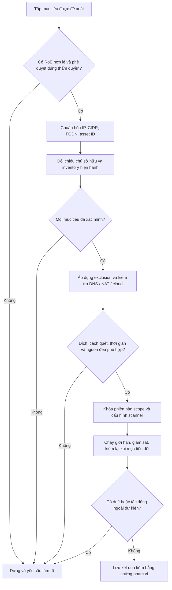

# Xác định tài sản được phép quét

## 1. Vì sao phải xác định phạm vi trước khi kiểm thử?

Kiểm thử bảo mật mạng giúp xác minh hiệu lực của các lớp phòng vệ như phân đoạn mạng, firewall, VPN, IDS/IPS, bảo vệ DNS, mạng không dây và hạ tầng đám mây. Tuy nhiên, một lệnh quét chỉ an toàn về mặt vận hành và đúng phạm vi khi **mục tiêu đã được cho phép rõ ràng**. Thiết bị tồn tại trong mạng, có địa chỉ IP thuộc dải quen thuộc hoặc được phát hiện từ DNS **không tự động** là tài sản được phép kiểm thử.

Trong chương **Kiểm thử và xác minh bảo mật mạng**, việc xác định tài sản được phép quét là bước đầu tiên để trả lời:

- **Quét cái gì?** Tên tài sản, địa chỉ IP, subnet, hostname, API endpoint, dịch vụ và môi trường.
- **Ai có thẩm quyền cho phép?** Chủ sở hữu tài sản, đơn vị vận hành, bên cung cấp dịch vụ hoặc người được ủy quyền.
- **Được phép làm đến đâu?** Loại kiểm thử, cổng/giao thức, xác thực, độ sâu, giới hạn tốc độ và hoạt động bị cấm.
- **Được thực hiện khi nào, từ đâu?** Khoảng thời gian, nguồn quét, vùng mạng và các phụ thuộc.
- **Khi nào phải dừng?** Thay đổi phạm vi, phát hiện bên thứ ba, ảnh hưởng dịch vụ, hết hiệu lực ủy quyền hoặc sự cố.

Mục tiêu học tập:

1. Phân biệt **tài sản được biết đến**, **tài sản thuộc tổ chức** và **tài sản được cấp quyền quét**.
2. Thu thập đủ bằng chứng quyền sở hữu, phê duyệt và điều kiện kiểm thử cho từng nhóm tài sản.
3. Xây dựng allowlist chính xác và exclusion list áp dụng cho IP, CIDR, FQDN, dịch vụ và môi trường.
4. Nhận diện rủi ro từ DNS, NAT, CDN, cloud, mạng chia sẻ và tài sản thay đổi liên tục.
5. Kiểm tra danh sách mục tiêu theo nguyên tắc **deny by default** trước và trong phiên quét.

## 2. Ba khái niệm dễ bị nhầm lẫn

| Khái niệm | Ý nghĩa | Có đủ để quét không? |
| --- | --- | --- |
| **Tài sản đã phát hiện** | Xuất hiện trong log, DNS, CMDB, sơ đồ mạng hoặc kết quả điều tra | **Không**; mới là thông tin nhận diện |
| **Tài sản thuộc quyền quản lý** | Tổ chức sở hữu hoặc vận hành tài nguyên | **Chưa chắc**; còn cần phê duyệt tác vụ, thời gian và ràng buộc khác |
| **Tài sản được phép quét** | Tài nguyên có chứng cứ ủy quyền hợp lệ và nằm trong phạm vi kiểm thử đã duyệt | **Có, nhưng chỉ trong điều kiện được duyệt** |

Ví dụ, một công ty dùng địa chỉ RFC 1918 trong mạng nội bộ. Kỹ sư tìm thấy máy chủ tại địa chỉ thuộc dải đó nhưng không có tên trong danh sách kiểm thử. Việc IP nằm ở mạng riêng không chứng minh kỹ sư được quét. Máy có thể thuộc đối tác kết nối qua VPN, mạng nghiên cứu độc lập hoặc hệ thống sản xuất được loại trừ.

Tương tự, tên miền doanh nghiệp có thể trỏ qua CDN hoặc nhà cung cấp SaaS. Tổ chức sở hữu tên miền **không mặc nhiên** sở hữu toàn bộ địa chỉ IP đáp ứng DNS hoặc có quyền quét hạ tầng của nhà cung cấp.

**Nguyên tắc nền tảng:** chỉ đưa một mục tiêu vào công cụ khi có thể chứng minh rõ *định danh tài sản + người có thẩm quyền + loại tác vụ được cho phép + hiệu lực thời gian + điều kiện triển khai*. Nếu bằng chứng mơ hồ, coi là **ngoài phạm vi** cho đến khi được xác nhận.

## 3. Xác định ai có quyền phê duyệt

Phê duyệt cần đến từ người hoặc tổ chức có thẩm quyền đối với **tài sản và hoạt động cụ thể**. Một người quản lý mạng có thể phê duyệt quét switch do nhóm quản lý nhưng chưa chắc có quyền cho phép quét máy chủ do bộ phận khác sở hữu, dịch vụ thuê ngoài hoặc hệ thống OT.

| Vai trò | Trách nhiệm chính |
| --- | --- |
| Chủ sở hữu nghiệp vụ / tài sản | Xác nhận tài sản, độ quan trọng và tác động được chấp nhận |
| Nhóm vận hành nền tảng / mạng | Xác thực địa chỉ, phụ thuộc, cửa sổ bảo trì và giới hạn kỹ thuật |
| Đầu mối bảo mật / người phụ trách kiểm thử | Định nghĩa phương pháp, cường độ, bằng chứng và điều kiện dừng |
| Chủ sở hữu hạ tầng bên thứ ba | Xác nhận phạm vi và giới hạn theo hợp đồng, chính sách dịch vụ |
| Người thực hiện quét | Đối chiếu allowlist, cấu hình công cụ đúng scope, giám sát và lưu vết |

Một **văn bản ủy quyền** hoặc quy tắc thực hiện (Rules of Engagement — RoE) nên có:

1. Tên dự án, mục đích, đầu mối liên hệ và người phê duyệt có thẩm quyền.
2. Danh sách tài sản hoặc phạm vi có thể đối chiếu chính xác: asset ID, IP/CIDR, hostname, tài khoản cloud, nhóm tài nguyên, environment.
3. Hoạt động cho phép: khám phá host, rà cổng, kiểm tra phiên bản dịch vụ, kiểm thử cấu hình, xác minh lỗ hổng bằng phương thức đã duyệt.
4. Hoạt động bị loại trừ: ví dụ DoS/stress, brute force, khai thác làm thay đổi dữ liệu, kiểm thử phá hoại hoặc phương thức gây ảnh hưởng dịch vụ.
5. Điều kiện: khoảng thời gian, timezone, dải nguồn quét, giới hạn gói tin/yêu cầu, xác thực, kênh liên lạc, cơ chế dừng.
6. Quy trình duyệt thay đổi: ai được thêm/bớt tài sản, cách lưu phiên bản phê duyệt và thời điểm hết hiệu lực.

Một phê duyệt kiểu “kiểm tra mạng công ty” thiếu khả năng xác định mục tiêu và giới hạn hoạt động. Cần chuyển thành phạm vi có cấu trúc trước khi cấu hình scanner.

## 4. Nguồn thông tin lập danh mục tài sản

Để tránh bỏ sót hoặc lẫn tài sản, đối chiếu nhiều nguồn; **nguồn phát hiện chỉ là bằng chứng kiểm kê, không thay thế phê duyệt**.

| Nguồn | Thông tin hữu ích | Điểm cần xác minh |
| --- | --- | --- |
| CMDB / hệ thống asset inventory | Asset ID, chủ sở hữu, nhóm dịch vụ, môi trường, trạng thái | Dữ liệu có thể chậm cập nhật, chủ sở hữu đổi |
| IPAM / DHCP / quản lý subnet | Dải IPv4/IPv6, cấp phát IP, VLAN, VRF, lease | Dải được cấp có thể chứa tài sản thuộc đơn vị khác |
| DNS / DNS quản trị nội bộ | FQDN, A/AAAA, CNAME, alias dịch vụ | Đích có thể thay đổi, trỏ CDN hoặc nhà cung cấp khác |
| Hệ thống ảo hóa và container | VM, cluster, namespace, service, IP tạm | IP/instance có thể tái sử dụng rất nhanh |
| Cloud inventory | Account/subscription/project, VPC/VNet, instance, load balancer, public IP | Phân quyền theo tenant và nhà cung cấp; tài nguyên dùng chung |
| Sơ đồ mạng, firewall và NAT | Đường đi, NAT, nhóm bảo vệ, phân đoạn | Một IP công khai có thể đại diện nhiều dịch vụ nội bộ |
| Hợp đồng và catalogue dịch vụ | SLA, đơn vị cung cấp, giới hạn kiểm thử | Quyền của khách hàng có thể không bao phủ hạ tầng nền |

Mỗi hàng kiểm kê nên mang một **định danh ổn định** như asset ID hoặc resource ID, thay vì chỉ dựa vào IP. IP là thuộc tính có thể thay đổi; asset ID giúp liên kết đúng chủ sở hữu, kết quả quét và lần cấp quyền.

### Phân nhóm theo độ nhạy vận hành

- **Lab / staging:** thường phù hợp để thử quy trình quét trước nhưng vẫn cần ủy quyền.
- **Production thông thường:** cần bảo đảm cửa sổ thực hiện, giới hạn tải và liên hệ đội trực.
- **Thiết bị mạng lõi, firewall, VPN concentrator, AAA, DNS quan trọng:** tác động có thể lan rộng; cần thiết kế kiểm thử thận trọng theo khả năng chịu tải.
- **OT/ICS, thiết bị y tế, IoT cũ, dịch vụ thời gian thực:** có thể gặp lỗi khi nhận gói tin hoặc truy vấn không quen thuộc; chỉ quét khi chủ sở hữu và nhóm chuyên môn đồng ý phương thức phù hợp.
- **Hệ thống đối tác, SaaS, CDN hoặc mạng dùng chung:** phải xác minh điều khoản và quyền riêng của bên liên quan.

Không suy ra cường độ quét từ độ quan trọng một cách tự động. Một host lab cũng có thể kết nối tới hệ thống sản xuất hoặc môi trường dùng chung.

## 5. Biểu diễn phạm vi theo từng loại mục tiêu

### 5.1. IP đơn lẻ

Phạm vi như \`192.0.2.10\` chỉ xác định một địa chỉ tại một thời điểm. Cần đối chiếu chủ sở hữu và tuyến đi, đặc biệt khi địa chỉ có thể được gán lại bằng DHCP, NAT hoặc tái sử dụng trên cloud.

### 5.2. Dải CIDR

\`192.0.2.0/27\` mô tả khối 32 địa chỉ IPv4 về mặt định tuyến, **không có nghĩa 32 địa chỉ đó đều được phép quét**. Phê duyệt phải nêu rõ cho phép toàn bộ khối hay chỉ một tập con, và liệu có subnet hoặc địa chỉ ngoại lệ không. Ví dụ:

| Mục | Nội dung minh họa |
| --- | --- |
| Allowed CIDR | \`192.0.2.0/27\` |
| Excluded IP | \`192.0.2.5\` (dịch vụ nhạy cảm) |
| Excluded CIDR | \`192.0.2.16/29\` (mạng thuê ngoài) |
| Scan methods | Discovery và rà cổng TCP theo profile giới hạn |
| Window | 22:00–23:00 theo timezone ghi trong RoE |

Trong ví dụ, \`192.0.2.5\` và mọi IP thuộc \`192.0.2.16/29\` phải bị loại trừ, dù nằm trong dải được phép ở mức tổng quát. Các địa chỉ là **dải dành cho tài liệu minh họa**, không phải mục tiêu thực tế.

### 5.3. IPv6

Với IPv6, các khối lớn như \`/64\` có không gian địa chỉ rất rộng. **Không tự động liệt kê hoặc quét toàn bộ** chỉ vì subnet nằm trong phạm vi sở hữu. Nên sử dụng danh sách tài sản cụ thể được phê duyệt, nguồn inventory cập nhật hoặc phương pháp khám phá phù hợp đã được duyệt. Cần ghi chính xác prefix, ngoại lệ, giới hạn và nguồn quét IPv6.

### 5.4. Hostname, FQDN và wildcard

\`app.example.test\` có thể thay đổi bản ghi A/AAAA, trỏ qua CNAME hoặc cân bằng tải. Để kiểm soát đích:

1. Xác minh hostname thuộc dịch vụ trong RoE và định danh chủ sở hữu.
2. Kiểm tra chuỗi CNAME, kết quả A/AAAA và cách dịch vụ định tuyến.
3. Đối chiếu **từng địa chỉ đích thực tế** với scope và loại trừ trước khi gửi lưu lượng; giải quyết thay đổi DNS trong lúc kiểm thử.
4. Nếu gặp CDN, nhà cung cấp lưu trữ hoặc IP chia sẻ chưa được chấp thuận, dừng và yêu cầu xác nhận thay vì tự mở rộng scope.

Wildcard như \`*.example.test\` cần được xét đặc biệt: nó có thể gồm hệ thống bên thứ ba hoặc môi trường chưa được duyệt. **Không dùng wildcard làm bằng chứng bao trùm** nếu RoE không cho phép rõ ràng và không có biện pháp lọc các mục tiêu phát sinh.

### 5.5. NAT, VIP, load balancer, CDN

Một IP hoặc VIP có thể đại diện nhiều ứng dụng, nhiều tenant hoặc dịch vụ được điều phối bởi host header/SNI. Phải phân biệt:

- **Địa chỉ đích** (IP/VIP) được cấu hình trên scanner.
- **Dịch vụ đích** (hostname, cổng, giao thức, virtual host) được phê duyệt.
- **Hệ thống phía sau** (backend) có thể phát sinh lưu lượng từ phép thử.

Ví dụ, công ty có quyền kiểm tra ứng dụng tại một hostname, nhưng chưa chắc được quét toàn bộ cổng của IP CDN hoặc tất cả backend do nhà cung cấp sở hữu. Cần phối hợp giới hạn theo **đích, tên dịch vụ và phương thức**; không chỉ cho phép bằng IP chung.

### 5.6. Cloud và tài sản động

Với cloud, nên ràng buộc scope bằng account/subscription/project, vùng (region), resource ID, VPC/VNet, nhãn tài sản được quản trị, danh sách IP hiện tại và phê duyệt của đúng chủ sở hữu. Một VM mới có thể nhận IP cũ của VM đã xóa; quyền quét máy cũ không tự chuyển sang máy mới.

Trong môi trường Kubernetes, pod IP hoặc service endpoint thay đổi nhanh. Cần xác minh namespace, cluster, service, owner và cách tiếp cận kiểm thử được phép. Nếu không xác định chắc đích cuối cùng, từ chối đưa vào tác vụ quét. Với cloud hoặc dịch vụ thuê ngoài, còn phải kiểm tra chính sách kiểm thử, điều khoản sử dụng và giới hạn tài nguyên chia sẻ của nhà cung cấp.

## 6. Thiết kế tài liệu phạm vi có thể kiểm tra bằng máy

Để tránh nhập danh sách từ email rời rạc vào công cụ, có thể lưu một **scope manifest** làm bản mô tả phiên quét. Ví dụ sau là **định dạng minh họa do bài học đề xuất**, không phải cú pháp của một công cụ quét cụ thể.

```yaml
assessment:
  id: NET-TEST-2026-014
  purpose: "Xác minh mức phơi lộ dịch vụ trong mạng lab"
  approval_reference: "ROE-2026-014"
  approved_by_role: "lab-asset-owner"
  status: approved
  valid_from: "2026-12-01T22:00:00+07:00"
  valid_until: "2026-12-01T23:00:00+07:00"
  source_ips:
    - "198.51.100.10"

targets:
  allow:
    ip_addresses:
      - "192.0.2.10"
    cidrs:
      - "192.0.2.0/27"
    fqdn:
      - "lab-app.example.test"
  exclude:
    ip_addresses:
      - "192.0.2.5"
    cidrs:
      - "192.0.2.16/29"
    fqdn:
      - "legacy.lab-app.example.test"

methods:
  permitted:
    - "host-discovery"
    - "limited-tcp-port-inventory"
  excluded:
    - "dos-or-stress"
    - "password-brute-force"
    - "destructive-exploitation"
  approved_tcp_ports: [22, 80, 443]
  max_parallel_targets: 2

operations:
  contact: "Đầu mối nội bộ theo ROE-2026-014"
  stop_on:
    - "unknown-target-ownership"
    - "unexpected-service-impact"
    - "approval-expired"
    - "resolved-ip-out-of-scope"
```

Các địa chỉ \`192.0.2.0/24\`, \`198.51.100.0/24\` và \`example.test\` là tài nguyên mẫu dành cho tài liệu. Manifest chỉ có giá trị vận hành khi liên kết với văn bản phê duyệt có thật, còn hiệu lực và đã được bộ phận chịu trách nhiệm xác nhận. Một trường \`status: approved\` do người dùng tự khai báo **không tự tạo quyền**.

Trong triển khai thực tế, nên bổ sung asset ID, owner, mức độ quan trọng, environment, ticket phê duyệt, revision và hash hoặc chữ ký của bản scope đã khóa. Hệ thống chạy quét phải đối chiếu bản manifest với nguồn phê duyệt có thẩm quyền trước khi thực thi.

### Quy tắc ưu tiên và hiệu lực

Giả sử ký hiệu:

- \`A\`: tập đích được phê duyệt rõ ràng (allowlist).
- \`E\`: tập đích loại trừ (exclusion list).
- \`C\`: tập đích đang được scanner đề xuất.
- \`P\`: tập đích đạt điều kiện thời gian, nguồn quét, phương thức và chủ sở hữu.

Khi đó, các đích đủ điều kiện ở mức kiểm tra ban đầu là:

\[
T = C \cap (A \setminus E) \cap P
\]

Điều này **không có nghĩa scanner tự động được chạy trên mọi phần tử của \`T\`**: RoE có thể hạn chế từng cổng, từng loại kỹ thuật và độ sâu kiểm thử. Mọi điều kiện bắt buộc phải được thực thi đồng thời. Khi có mâu thuẫn giữa rule cho phép và rule loại trừ, **rule loại trừ thắng**.

Ví dụ đối chiếu:

| Đích dự kiến | Trong allowlist? | Trong exclusion? | Kết luận |
| --- | --- | --- | --- |
| \`192.0.2.10\` | Có | Không | Có thể quét với điều kiện còn lại hợp lệ |
| \`192.0.2.5\` | Có qua \`/27\` | Có | **Từ chối** |
| \`192.0.2.18\` | Có qua \`/27\` | Có qua \`/29\` | **Từ chối** |
| \`192.0.2.40\` | Không | Không | **Từ chối** |
| \`lab-app.example.test\` | Có theo tên | Chưa xác minh IP thực | Chỉ quét sau khi kiểm tra đích/IP và bên sở hữu |

## 7. Kiểm tra đầu vào trước khi quét

Quy trình phê duyệt phạm vi cần có bước **preflight** độc lập với việc công cụ tìm thấy host. Một pipeline tiêu biểu:



### Kiểm tra cú pháp và tính hợp lệ

Với danh sách IP/CIDR:

- Chuẩn hóa IPv4/IPv6 bằng thư viện mạng đáng tin cậy; phân biệt IP đơn và prefix.
- Từ chối IP sai định dạng, prefix không hợp lệ hoặc entry không có chủ sở hữu/phê duyệt.
- Không tự động mở rộng một \`/32\` thành subnet lớn hơn; không chuyển một FQDN thành toàn bộ subnet chứa IP của nó.
- Phân biệt VRF/VLAN, mạng VPN, NAT và routing context khi các không gian IP riêng bị trùng.
- Tránh dùng cả vùng IP riêng hoặc mọi public IP gắn với doanh nghiệp như một allowlist tổng quát.

Ví dụ Python sau chỉ kiểm tra **membership cục bộ**, không phát sinh bất kỳ gói mạng nào. Nó là một lớp kiểm tra kỹ thuật, **không thay thế bằng chứng ủy quyền**:

```python
from ipaddress import ip_address, ip_network

# Dải ví dụ dành cho tài liệu, giả sử đã qua bước phê duyệt.
approved = [ip_network("192.0.2.0/27")]
excluded = [
    ip_network("192.0.2.5/32"),
    ip_network("192.0.2.16/29"),
]

def in_authorized_ip_ranges(ip_text: str) -> bool:
    address = ip_address(ip_text)
    return (
        any(address in network for network in approved)
        and not any(address in network for network in excluded)
    )

for candidate in ["192.0.2.10", "192.0.2.5", "192.0.2.18", "192.0.2.40"]:
    print(candidate, in_authorized_ip_ranges(candidate))

# 192.0.2.10 True
# 192.0.2.5  False
# 192.0.2.18 False
# 192.0.2.40 False
```

Kiểm tra trên mới lọc IP theo dải. Muốn quyết định một tác vụ quét hợp lệ còn phải xác nhận asset ID, chủ sở hữu, đối tượng sau NAT hoặc dịch vụ hostname, cửa sổ thời gian, loại hành động và trạng thái phê duyệt. Với IPv6, cần cấu hình các mạng IPv6 phù hợp; không ghép lẫn IPv4 và IPv6 nếu thiếu bằng chứng phạm vi.

### Ngăn mở rộng phạm vi ngoài ý muốn

Các lựa chọn trong scanner như tự động theo redirect, hostname discovery, \`-A\`/script scan tổng quát, lấy toàn bộ dải từ CIDR, tự follow liên kết, quét endpoint phụ hoặc chuyển từ hostname sang IP của bên thứ ba đều có thể làm phát sinh mục tiêu chưa được duyệt. Kiểm tra kỹ tính năng tự mở rộng phạm vi của từng công cụ và tắt hoặc giới hạn theo RoE.

Đặc biệt, DNS có thể thay đổi giữa lúc xét phạm vi và gửi yêu cầu. Cần có cơ chế kiểm tra lại IP đích ở thời điểm kết nối và khi thay đổi kết quả phân giải; không mặc định DNS được kiểm tra một lần là hợp lệ suốt phiên.

## 8. Các trường hợp cần đánh giá riêng

### 8.1. Tài sản nhiều bộ phận cùng dùng

Một firewall trung tâm quản lý các vùng mạng của nhiều đội. Dù thuộc doanh nghiệp, việc kiểm thử rule trên firewall có thể ảnh hưởng ứng dụng ngoài nhóm phê duyệt. Cần phối hợp chủ sở hữu thiết bị, ứng dụng liên quan và nhóm vận hành, xác định chính xác phương thức kiểm thử cũng như giới hạn phạm vi lưu lượng.

### 8.2. SaaS và hạ tầng thuê ngoài

Một ứng dụng SaaS thuộc hợp đồng sử dụng của công ty không tương đương với quyền chủ động quét máy chủ của bên cung cấp. Xem xét chính sách kiểm thử và hợp đồng, xin chấp thuận khi cần; nếu không được phép, thay bằng đánh giá tài liệu, cấu hình tenant hoặc nguồn kiểm thử do nhà cung cấp hỗ trợ.

### 8.3. Thiết bị được phát hiện ngoài danh sách

Trong phiên quét được phép, có thể gặp hostname, banner, IP hoặc dịch vụ mới. **Không tự thêm vào scope chỉ vì phát hiện ra**. Lưu thông tin tối thiểu để xác minh (trong giới hạn được cho phép), báo người chịu trách nhiệm, cập nhật danh sách và chỉ tiếp tục sau khi được phê duyệt.

### 8.4. Tài sản đổi IP hoặc owner

Khi VM bị thay thế, DNS đổi IP hoặc subnet chuyển đơn vị sở hữu, quyền đã cấp cho asset cũ phải được kiểm tra lại. Với tài sản động, nên tự động so khớp với inventory và chặn mục tiêu chưa xác minh. Định danh nguồn phát hiện, thời gian ghi nhận và revision của scope giúp giải thích vì sao một IP từng được phép nhưng không còn được phép.

### 8.5. Đánh giá từ Internet và phân đoạn nội bộ

Phải chỉ rõ **vị trí scanner**: ngoài Internet, trong một VLAN, sau VPN hoặc trong cloud VPC. Cùng một FQDN có thể phân giải đến IP khác theo split-horizon DNS; cùng IP nội bộ có thể trùng ở các VRF khác nhau. Kết quả kiểm tra từ một điểm quan sát không chứng minh được quyền truy cập hoặc phạm vi ở điểm quan sát khác.

## 9. Quy trình thực hành trong một cuộc kiểm thử

### Bước 1 — Tạo danh sách đề xuất

Nhận mục tiêu từ ticket và inventory được chỉ định. Với mỗi tài sản, ghi \`asset_id\`, hostname, IP/CIDR hoặc resource ID, owner, môi trường, loại dịch vụ, mức quan trọng và nguồn xác minh. Chỉ đề xuất phạm vi cần thiết cho mục tiêu kiểm thử.

### Bước 2 — Đối chiếu chủ sở hữu và phê duyệt

Đảm bảo người phê duyệt có thẩm quyền; đối chiếu từng nhóm tài sản với RoE và phương thức kiểm thử. Nếu tài sản đi qua mạng, tenant hoặc dịch vụ của bên thứ ba, ghi điều kiện và phạm vi do bên đó cho phép. Tài sản thiếu bằng chứng phải nằm ở trạng thái \`pending\` hoặc \`excluded\`.

### Bước 3 — Xây allowlist và loại trừ

Chuyển danh sách sang định dạng công cụ có thể đọc, giữ địa chỉ/hostname/resource ID chính xác. Thêm các ngoại lệ, phân đoạn nhạy cảm, địa chỉ NAT/shared và điều kiện cấm. Ưu tiên **danh sách cụ thể nhỏ nhất** đủ đạt mục tiêu, tránh quét rộng hơn nhu cầu.

### Bước 4 — Kiểm tra kỹ thuật và chạy pilot

Đối chiếu DNS, IPAM, routing context, chủ sở hữu và phiên bản scope gần thời điểm chạy. Chạy trước một nhóm mục tiêu đã phê duyệt với cấu hình tải nhẹ; giám sát độ trễ, lỗi ứng dụng, cảnh báo IDS/IPS và trạng thái hệ thống. Pilot **cũng phải nằm trong phạm vi được phép**.

### Bước 5 — Theo dõi scope trong phiên quét

Ghi log các mục tiêu thực tế, IP sau phân giải, nguồn gửi, profile quét, cổng và thời gian. Cảnh báo khi scanner muốn thêm host mới, đi theo redirect ra ngoài scope hoặc vượt cửa sổ thời gian. Tạm dừng khi không chắc nguồn sở hữu hoặc có dấu hiệu ảnh hưởng dịch vụ.

### Bước 6 — Đối soát và đóng phiên

So sánh danh sách đích thực sự đã chạm với allowlist, exclusion và bản phê duyệt có hiệu lực tại thời điểm quét. Nếu xuất hiện sai lệch, ghi nhận và xử lý theo quy trình sự cố. Lưu phiên bản manifest, bằng chứng ủy quyền, cấu hình công cụ, kết quả, biên bản dừng và đề xuất cải thiện phạm vi lần sau.

## 10. Các tình huống quyết định có được quét hay không

| Tình huống | Quyết định | Lý do |
| --- | --- | --- |
| IP hiện trong CMDB, có owner và được phê duyệt kiểm thử trong cửa sổ còn hiệu lực | **Có điều kiện** | Cần đúng phương pháp và giới hạn kỹ thuật |
| Một subnet \`/24\` thuộc hệ thống IPAM của doanh nghiệp nhưng RoE chỉ cho phép \`/28\` | **Chỉ \`/28\` đã duyệt** | Sở hữu dải lớn không mở rộng phạm vi được giao |
| Host trong allowlist nhưng xuất hiện trong exclusion list mới nhất | **Không** | Loại trừ có ưu tiên cao hơn |
| FQDN được cho phép nhưng hiện trỏ đến IP của CDN chưa được xác nhận | **Tạm dừng** | Cần kiểm tra phạm vi hạ tầng bên thứ ba |
| Một VM bị xóa; VM khác được cấp lại IP cũ | **Tạm dừng và xác minh lại** | Quyền gắn với tài sản và mục đích, không chỉ IP |
| Ứng dụng SaaS do tổ chức thuê, chưa có chấp thuận từ nhà cung cấp | **Không quét hạ tầng nhà cung cấp** | Quyền sử dụng dịch vụ không tự tạo quyền kiểm thử hạ tầng |
| Phê duyệt hết hạn nhưng chưa quét xong | **Dừng** | Phạm vi có hiệu lực theo thời gian |
| Scanner phát hiện thêm server bên ngoài danh sách từ phản hồi DNS | **Không tự mở rộng** | Mục tiêu mới cần được kiểm tra và phê duyệt |
| Tài sản đã duyệt nhưng phương thức DoS bị cấm trong RoE | **Không dùng DoS** | Quyền theo tài sản và loại kiểm thử là hai điều kiện độc lập |

## 11. Sai lầm thường gặp và cách khắc phục

| Sai lầm | Hệ quả | Cách khắc phục |
| --- | --- | --- |
| Chỉ dựa vào IP sở hữu doanh nghiệp | Quét nhầm tài sản của đối tác hoặc hệ thống ngoài dự án | Liên kết IP với asset ID, owner và phê duyệt |
| Nhập CIDR rộng rồi quên exclusion | Chạm hệ thống nhạy cảm hoặc ngoài scope | Áp dụng và kiểm chứng exclusion với độ ưu tiên cao |
| Dùng wildcard domain mà không xét CNAME/CDN | Gửi lưu lượng kiểm thử tới nền tảng bên thứ ba | Xác minh từng đích sau phân giải và phạm vi dịch vụ |
| Không phân biệt môi trường lab/prod | Ảnh hưởng hệ thống đang phục vụ người dùng | Ghi environment và profile được duyệt cho từng nhóm |
| Thử nghiệm công cụ trước khi duyệt phạm vi | Pilot cũng có thể là hoạt động không được phép | Chỉ thực hiện pilot trên mục tiêu có quyền hợp lệ |
| Giữ danh sách IP nhiều tuần không đối chiếu | Địa chỉ tái sử dụng, DNS hoặc owner thay đổi | Kiểm tra inventory và scope ngay trước/trong phiên |
| Chỉ kiểm tra danh sách lúc khởi chạy | Đích động đổi trong khi quét | Chặn mục tiêu mới hoặc kiểm tra lại tại thời điểm kết nối |
| Chỉ lưu báo cáo lỗ hổng, không lưu bằng chứng phạm vi | Không chứng minh được hoạt động nằm trong RoE | Lưu bản phê duyệt, revision, target log và cấu hình quét |

## 12. Checklist trước khi bấm Start Scan

- [ ] Có RoE hoặc văn bản ủy quyền còn hiệu lực, nêu đúng người phê duyệt và mục tiêu.
- [ ] Từng mục tiêu có owner, asset ID hoặc thông tin nhận diện tương đương đã xác minh.
- [ ] Danh sách IP/CIDR/FQDN được chuẩn hóa; subnet và wildcard không được mở rộng ngầm.
- [ ] Đã xử lý ngoại lệ, thiết bị nhạy cảm, NAT/CDN/shared IP và tài sản của bên thứ ba.
- [ ] Đã đối chiếu DNS, cloud inventory và trạng thái IP gần thời điểm bắt đầu.
- [ ] Đã cấu hình giới hạn loại kiểm thử, cổng, tốc độ, song song, nguồn quét và thời gian.
- [ ] Có đầu mối liên hệ, cách dừng và cơ chế giám sát ảnh hưởng dịch vụ.
- [ ] Công cụ hoặc quy trình kiểm tra từ chối mọi đích ngoài allowlist sau khi áp dụng exclusion.
- [ ] Đã khóa phiên bản scope và chuẩn bị thu thập log đích thực tế.

Nếu một mục bắt buộc chưa đáp ứng, hoãn thực thi trên phần phạm vi liên quan đến khi được xác minh.

## 13. Câu hỏi tự kiểm tra

**Câu 1.** Một kỹ sư có danh sách các địa chỉ \`10.10.0.0/16\` từ IPAM. Phiếu duyệt chỉ ghi rõ \`10.10.20.0/24\`. Có thể quét toàn bộ \`/16\` không?

*Gợi ý:* Không. Chỉ \`/24\` được phê duyệt, đồng thời phải áp dụng loại trừ và giới hạn phương thức. IPAM không phải bằng chứng ủy quyền.

**Câu 2.** Nhóm bảo mật được phép quét \`portal.example.test\` nhưng DNS của hostname này trỏ đến nhà cung cấp CDN chưa có trong RoE. Nên làm gì?

*Gợi ý:* Dừng phép thử chủ động vào IP chưa được chấp thuận; làm rõ quyền với chủ sở hữu và nhà cung cấp hoặc dùng phương pháp đánh giá được họ cho phép. Không suy rộng quyền từ tên miền.

**Câu 3.** Trong quá trình quét, scanner tìm thấy một dịch vụ mới trên địa chỉ ngoài dải đã duyệt. Có nên tự động bổ sung vì dịch vụ có vẻ thuộc doanh nghiệp?

*Gợi ý:* Không. Ghi thông tin tối thiểu trong giới hạn cho phép, xác minh owner, phê duyệt cập nhật scope trước khi quét tiếp.

**Câu 4.** Một VM cloud từng được duyệt đã bị xóa nhưng IP công khai được cấp cho VM khác. Có thể tiếp tục dùng allowlist IP cũ không?

*Gợi ý:* Không tự động. Đối chiếu asset/resource ID và owner hiện tại, cập nhật phê duyệt theo tài sản mới và điều kiện kiểm thử.

**Câu 5.** Vì sao cần lưu cả log đích thực tế và phiên bản danh sách được phê duyệt?

*Gợi ý:* Để đối soát những gì đã quét với những gì được phép **tại thời điểm thực hiện**, phát hiện sai lệch do DNS/cloud động và cung cấp dấu vết cho kiểm toán hoặc xử lý sự cố.

## Kết luận

Xác định tài sản được phép quét là bài toán kết hợp **quản lý tài sản, bằng chứng ủy quyền và thực thi phạm vi kỹ thuật**. Hãy bắt đầu từ chủ sở hữu và RoE, chuẩn hóa mục tiêu thành allowlist có loại trừ rõ ràng, kiểm tra IP/FQDN/cloud theo trạng thái thực tế, áp dụng đồng thời giới hạn phương thức và thời gian, rồi đối soát những đích scanner thực sự đã chạm. Một scope đáng tin cậy luôn có thể trả lời: **vì sao chính tài sản này, ở thời điểm này, bằng phương pháp này, được phép kiểm thử?**
