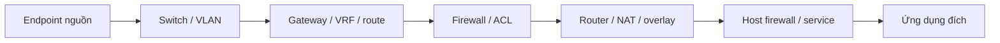
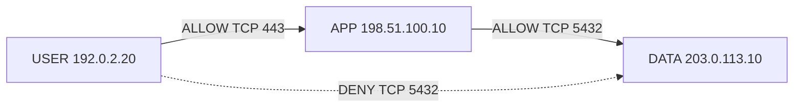
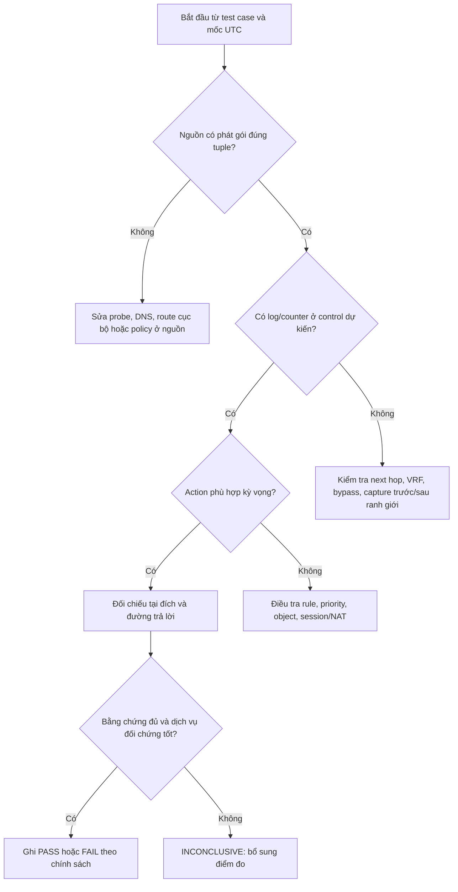

# Xác minh segmentation bằng đường đi thực tế

## 1. Mục tiêu: chứng minh lưu lượng thực sự đi đúng vùng bảo mật

**Network segmentation** (phân đoạn mạng) là cách chia hệ thống thành các vùng có mức độ tin cậy và quyền truy cập khác nhau, rồi đặt quy tắc kiểm soát lưu lượng giữa các vùng. Một sơ đồ có VLAN, subnet, VRF hoặc security group mới chỉ mô tả **ý định thiết kế**. Muốn khẳng định segmentation đang có hiệu lực, cần quan sát và kiểm thử **đường đi thực tế của gói tin từ một điểm nguồn cụ thể tới một dịch vụ đích cụ thể**.

Trong module **SECURITY_NETWORK_SECURITY**, nội dung này kết nối kiến thức phân đoạn mạng, firewall, VPN, IDS/IPS, DNS, Wi-Fi và hạ tầng đám mây với hoạt động kiểm thử có thể lặp lại. Kết quả tốt phải chứng minh được hai mặt:

- **Luồng cần thiết hoạt động:** nguồn được phép kết nối đúng đích, giao thức và cổng, ứng dụng trả lời đúng như mong đợi.
- **Luồng bị cấm thực sự bị chặn:** thử từ đúng vị trí nguồn, xác nhận không đạt đến dịch vụ đích, đồng thời có dấu vết từ thiết bị kiểm soát hoặc cảm biến để giải thích việc chặn.

Kết thúc bài học, người học có thể chuyển chính sách segmentation thành ma trận kiểm thử; chọn điểm đo đúng phía nguồn/đích; kiểm tra định tuyến, NAT, firewall và kết quả ứng dụng; phân biệt lỗi kết nối với bằng chứng chặn; báo cáo lỗ hổng phân đoạn kèm đường đi thực tế và cách xác minh sau khắc phục.

> **Phạm vi kiểm thử:** Chỉ thử các tài sản, cổng và luồng được cấp phép trong kế hoạch kiểm thử; giới hạn lưu lượng để tránh ảnh hưởng dịch vụ sản xuất. Bài học dùng địa chỉ IP và tên miền dành cho tài liệu, không phải địa chỉ hệ thống thực.

## 2. Hiểu đúng “đường đi thực tế”

Một đường kết nối thông thường đi qua nhiều lớp:



Đường đi này là **mô hình tham khảo**, không có nghĩa mọi gói đều đi qua đủ các nút theo thứ tự đó. Ví dụ, hai host cùng subnet có thể trao đổi trực tiếp qua switch; tuyến cloud có thể đi qua gateway, transit network hoặc endpoint riêng; gói có thể bị tunnel VPN bọc lại, đi qua service mesh, proxy hoặc load balancer.

Trong một bài kiểm thử segmentation, phải phân biệt bốn lớp thông tin:

| Lớp | Câu hỏi | Bằng chứng phù hợp |
| --- | --- | --- |
| **Ý định** (policy intent) | Nguồn nào phải được phép hoặc bị chặn khi tới đích nào? | Ma trận luồng, yêu cầu nghiệp vụ, quy tắc phân đoạn được phê duyệt |
| **Control plane** | Thiết bị đã có route/ACL/SG/NetworkPolicy nào? | Bảng định tuyến, cấu hình và trạng thái quy tắc, danh sách tuyến/VPN |
| **Data plane** | Gói từ nguồn này thực sự đi đâu và bị xử lý ở đâu? | Flow logs, packet capture giới hạn, counter rule, session/NAT table |
| **Ứng dụng** | Giao dịch có hoàn tất và được phép ở tầng ứng dụng không? | TCP/TLS handshake, phản hồi dịch vụ, log ứng dụng và xác thực |

Chỉ xem cấu hình là chưa đủ: route ưu tiên cao hơn, rule bị che, IP thay đổi, exception cũ, tunnel phụ, NAT hoặc host firewall có thể làm hành vi thực tế khác bản thiết kế. Ngược lại, một kết nối thất bại cũng chưa chứng minh segmentation đúng, bởi dịch vụ có thể ngừng chạy hoặc DNS bị lỗi.

### 2.1 Segmentation không đồng nghĩa với VLAN

- **VLAN/subnet:** chia broadcast domain hay miền địa chỉ; nếu có L3 routing hoặc bridge khác, lưu lượng vẫn có thể qua lại.
- **VRF:** tách bảng định tuyến; route leaking, shared service và kết nối ngoài VRF có thể tạo đường giao tiếp.
- **Firewall/ACL:** kiểm soát theo hướng, địa chỉ, giao thức, cổng và trạng thái; phụ thuộc rule order, object group và vị trí triển khai.
- **Host firewall và endpoint policy:** có thể chặn ngay ở máy đích hoặc nguồn; cần phân biệt với tác dụng của firewall giữa vùng.
- **Cloud security group / network ACL / route table:** cùng ảnh hưởng tới một flow, nhưng đặc tính stateful/stateless khác nhau theo nền tảng.
- **Kubernetes NetworkPolicy, service mesh, overlay:** kiểm soát ở lớp pod/service hoặc tầng ứng dụng; chỉ hoạt động nếu dataplane/CNI thực thi đúng.
- **Zero Trust / kiểm soát danh tính:** bổ sung điều kiện người dùng, thiết bị và phiên truy cập; một luồng TLS thành công chưa chứng minh người dùng có quyền thao tác.

**Segmentation hiệu quả** đòi hỏi các lớp trên phối hợp. Kiểm thử phải xác định *control nào được kỳ vọng chặn* và kiểm chứng chính control đó trong quá trình gửi luồng.

## 3. Xây dựng ma trận luồng từ yêu cầu nghiệp vụ

Ví dụ một hệ thống ba vùng:

| Vùng | Endpoint ví dụ | Vai trò |
| --- | --- | --- |
| USER | `192.0.2.20` | Máy người dùng |
| APP | `198.51.100.10`, DNS `app.example.test` | API/ứng dụng HTTPS |
| DATA | `203.0.113.10` | PostgreSQL, chỉ ứng dụng được truy cập |

Các địa chỉ thuộc khối dành riêng cho tài liệu theo RFC 5737. Không dùng các địa chỉ này để định tuyến trong hạ tầng thật.

**Ý định chính sách:**



Ma trận kiểm thử được chuẩn hóa như sau:

| ID | Điểm thử thực tế | Đích | Protocol / port | Kỳ vọng | Mục đích |
| --- | --- | --- | --- | --- | --- |
| S01 | USER `192.0.2.20` | APP `198.51.100.10` | TCP 443 | **ALLOW** | Đường nghiệp vụ hợp lệ |
| S02 | USER `192.0.2.20` | DATA `203.0.113.10` | TCP 5432 | **DENY** | USER không được vào cơ sở dữ liệu |
| S03 | APP `198.51.100.10` | DATA `203.0.113.10` | TCP 5432 | **ALLOW** | Ứng dụng truy cập dữ liệu |
| S04 | DATA `203.0.113.10` | USER `192.0.2.20` | TCP 443 | **DENY** nếu là phiên mới | Ngăn luồng chủ động ngược vùng |
| S05 | USER `192.0.2.20` | APP `198.51.100.10` | TCP 22 | **DENY** | Cấm SSH trực tiếp từ USER |

**Định nghĩa kỳ vọng cần chính xác:** với firewall *stateful*, gói trả lời thuộc phiên S01/S03 đã được cho phép thường được chấp nhận. Điều đó khác với một **kết nối mới** khởi tạo từ vùng đích đi ngược về vùng nguồn. Vì vậy, ghi rõ chiều *initiator → responder*, trạng thái phiên, giao thức và cổng.

Mỗi test case nên có các thuộc tính sau:

```yaml
id: S02
owner: network-security
source_zone: USER
source_host: 192.0.2.20
destination_zone: DATA
destination_host: 203.0.113.10
transport: TCP
destination_port: 5432
session: new
expected: deny
expected_enforcement: inter-zone-firewall
probe_location: actual-user-segment
evidence:
  - client-result
  - firewall-rule-log
  - destination-observation
```

Đây là **mẫu dữ liệu minh họa**, không phải cấu hình firewall hoặc script thực thi.

### 3.1 Điều kiện để một ca kiểm thử có ý nghĩa

Trước khi chạy, xác nhận:

1. **Đúng nguồn:** câu lệnh phải chạy trên endpoint hoặc probe nằm trong đúng subnet, VRF, VLAN, pod, VPC, VPN role và danh tính bị áp chính sách. Chạy từ laptop quản trị có quyền rộng không đại diện cho máy người dùng.
2. **Đúng đích:** kiểm tra IP đã được DNS phân giải, VIP/load balancer, địa chỉ backend, DNAT và dịch vụ đang lắng nghe.
3. **Đúng thời điểm:** ghi thời gian UTC, phiên bản chính sách, thay đổi gần nhất và cửa sổ bảo trì. Chính sách theo giờ hoặc danh tính có thể làm kết quả khác nhau.
4. **Có đường kiểm tra nền:** một ca ALLOW hợp lệ giúp xác minh probe và dịch vụ hoạt động. Ca DENY nên có thêm đối chứng từ nguồn được phép tới cùng dịch vụ nếu khả thi.
5. **Có bằng chứng ở ranh giới:** biết firewall, router, host policy hoặc cloud control nào sẽ thực thi quyết định.
6. **Có định nghĩa PASS/FAIL:** xác định tín hiệu nào là kết quả đủ mạnh, tránh gán “timeout = policy đúng”.

## 4. Quy trình xác minh theo đường đi thực tế

### Bước 1 — Lập bản đồ nguồn, đích và ranh giới phân đoạn

Từ yêu cầu nghiệp vụ và bảng địa chỉ, mô tả đường dự kiến: nguồn → switch/VLAN → default gateway → VRF/route → firewall → NAT/overlay → network của đích → host firewall → dịch vụ.

Đặt các câu hỏi:

- Có **đường khác** qua VPN site-to-site, mạng quản trị, Wi-Fi guest, secondary NIC, peering, transit gateway hoặc kết nối Internet hay không?
- Default gateway nằm ở firewall, router hay switch L3? Hai endpoint có thể nói chuyện **nội vùng** mà không đi qua firewall không?
- Có policy routing, asymmetric routing, ECMP hoặc SD-WAN làm lưu lượng thực tế chọn đường khác không?
- Có SNAT làm firewall nhìn thấy một IP nguồn khác với endpoint? Có DNAT/VIP khiến đích thực tế không phải địa chỉ đã kiểm tra?

Trong mô hình zero trust hoặc cloud, **danh tính** và nhãn/nhóm bảo mật cũng là một phần của điểm nguồn; chỉ IP có thể chưa đủ để tái hiện chính sách.

### Bước 2 — Xác nhận trạng thái thiết bị và route từ đúng vị trí

Ví dụ trên một Linux endpoint được cấp phép:

```bash
# Đường ra kernel dự kiến dùng tới IP DATA (trên chính máy USER)
ip route get 203.0.113.10

# Kiểm tra route IPv6 khi có dual stack
ip -6 route get 2001:db8:20::10

# Kiểm tra tên miền đích ứng dụng có phân giải đúng
getent ahosts app.example.test
```

Thông tin từ `ip route get` cho biết quyết định định tuyến cục bộ theo các tham số hiện tại; **không chứng minh** toàn bộ đường chuyển tiếp sau gateway. Cũng cần kiểm tra VRF/interface, bảng route và namespace nếu probe chạy trong container hoặc host đa mạng. IPv6 `2001:db8::/32` cũng là dải ví dụ tài liệu.

Có thể khảo sát các hop bằng công cụ TCP traceroute hoặc tracepath trên hệ thống cho phép:

```bash
# Mở rộng quan sát đường đi tới dịch vụ HTTPS đã được phê duyệt
traceroute -T -p 443 198.51.100.10
```

**Giới hạn:** router và firewall thường không trả lời TTL exceeded; tunnel, NAT, ECMP và rule bảo mật có thể làm hiển thị hop thiếu hoặc khác so với luồng ứng dụng. Một traceroute dừng giữa đường không chứng minh rằng gói bị firewall chặn tại hop cuối cùng hiện ra. Lựa chọn đích và phương thức probe cũng có thể thay đổi hash ECMP.

### Bước 3 — Kiểm thử luồng phải được cho phép

Từ **USER**, kiểm tra HTTPS tới APP:

```bash
# Cổng TCP có cho phép bắt tay hay không?
nc -vz -w 3 198.51.100.10 443

# Có hoàn tất TLS/HTTP tới đúng hostname hay không?
curl -v --connect-timeout 3 --max-time 8   --resolve app.example.test:443:198.51.100.10   https://app.example.test/health
```

`--resolve` buộc `curl` thử IP ví dụ nhưng vẫn sử dụng hostname cho TLS/SNI và HTTP Host. Đây là cú pháp **minh họa**; cần sửa host/IP theo hạ tầng và chỉ gọi endpoint kiểm tra được cho phép. Không thêm `-k` để bỏ qua chứng chỉ trong kết luận kiểm thử an toàn. Dịch vụ có thể yêu cầu xác thực và trả `401` hoặc `403`: khi đó cần phân biệt **kết nối TCP/TLS đã qua segmentation** với **ủy quyền ở tầng ứng dụng**.

Từ **APP**, kiểm tra đường tới DATA:

```bash
# Chạy trên APP, không chạy trên USER
nc -vz -w 3 203.0.113.10 5432
```

Lệnh thành công chứng minh bước kết nối TCP tới cổng đã mở; để chứng minh giao dịch ứng dụng thực sự dùng được, cần kiểm tra thêm handshake/health-check PostgreSQL theo quyền được cấp. Không dùng tài khoản quản trị hoặc thực hiện thao tác ghi dữ liệu chỉ để thử phân đoạn.

### Bước 4 — Kiểm thử luồng phải bị chặn

Từ chính **USER**, thử cổng DATA bị cấm:

```bash
# Test S02, chạy từ host USER đúng vùng và đúng danh tính kiểm thử
nc -vz -w 3 203.0.113.10 5432

# Test S05, USER không được SSH trực tiếp vào APP
nc -vz -w 3 198.51.100.10 22
```

Một ca DENY đạt yêu cầu khi chứng minh được các điều kiện kết hợp:

- Test được phát từ đúng vùng nguồn và đúng port/protocol; có mốc thời gian và mã test.
- Service đích đã được xác nhận hoạt động từ nguồn được phép, hoặc có bằng chứng tương đương.
- Firewall/SG/ACL/NetworkPolicy dự kiến chặn có counter/log/telemetry khớp 5-tuple hoặc ngữ cảnh định danh.
- Không thấy phiên ứng dụng được thiết lập ở đích; nếu có packet capture, đối chiếu capture với thời gian và đường mạng.

**Các trạng thái phản hồi dễ gây hiểu lầm:**

| Quan sát tại client | Có thể nghĩa là | Kết luận được phép đưa ra |
| --- | --- | --- |
| TCP handshake thành công | Đường TCP tới cổng thông; có thể đi qua nhiều control | Không thể gọi ca DENY là PASS; phải điều tra nơi cho phép |
| Timeout | Packet bị drop, mất mạng, đích tắt, return path hỏng hoặc NAT lỗi | **Chưa đủ** để kết luận segmentation đã chặn đúng |
| `Connection refused` / TCP RST | Host hoặc thiết bị trên đường chủ động từ chối, cổng đóng | Chứng minh không có service TCP ở trạng thái chấp nhận; chưa xác định control chặn |
| HTTP 401/403 | TCP/TLS và HTTP tới được nơi phản hồi; ứng dụng từ chối quyền | Tầng ứng dụng từ chối; segmentation L3/L4 không nhất thiết đã chặn |
| DNS thất bại | Resolver/policy DNS/đường DNS gặp vấn đề | Không chứng minh đường IP trực tiếp bị cấm |
| ICMP ping không trả lời | ICMP bị lọc hoặc host không phản hồi | Không chứng minh TCP/UDP dịch vụ bị chặn |

Đối với **UDP**, việc không có phản hồi càng khó diễn giải: UDP không có handshake như TCP, một dịch vụ có thể im lặng khi nhận datagram sai định dạng. Kiểm tra bằng yêu cầu ứng dụng hợp lệ (ví dụ DNS query tới resolver được phê duyệt), log tại đích và log kiểm soát trên đường; không lấy `nc -u` không phản hồi làm chứng cứ chặn cuối cùng.

### Bước 5 — Đối chiếu dữ liệu ở từng điểm đo

Tại một số điểm được cấp quyền, có thể dùng packet capture **ngắn, giới hạn theo IP/port, tránh payload nhạy cảm**:

```bash
# Chỉ trên interface được phép quan sát; dừng sau tối đa 20 gói
sudo tcpdump -nni eth0 -c 20   'host 203.0.113.10 and tcp port 5432'
```

Kết hợp các bằng chứng sau để xác định đường thực tế:

| Vị trí quan sát | Điều cần biết | Giới hạn |
| --- | --- | --- |
| Client | SYN/request có được phát và phản hồi nào nhận được? | Client không thấy rõ điểm drop phía sau gateway |
| Gateway/route | Next hop, VRF, PBR, interface ra có khớp mong đợi? | RIB/FIB hoặc route local không luôn phơi bày mọi overlay |
| Firewall/ACL | Rule ID, action, vùng, session ID, 5-tuple và counter có khớp? | Log có thể bị lấy mẫu hoặc tắt cho một số rule |
| NAT / load balancer | IP/port trước và sau dịch, backend và đường return? | Tuple thay đổi nên không thể chỉ ghép log theo IP gốc |
| Máy đích | Gói có tới NIC/host firewall; dịch vụ có nhận kết nối? | Không thấy gói có thể do điểm capture/interface sai |
| SIEM / flow logs / IDS/IPS | Có chuỗi sự kiện đồng bộ UTC, dấu vết vượt ranh giới? | NetFlow/VPC Flow Logs thường có trễ và dữ liệu tổng hợp |

**Với một luồng bị chặn hợp lệ**, ví dụ dễ giải thích là: client ghi TCP SYN tới DATA; firewall giữa USER và DATA ghi action=deny khớp source/destination/port vào cùng thời điểm; phía DATA không thấy SYN tới được; trong khi probe từ APP tới DATA đã thành công. Nếu chỉ có một dòng timeout tại client, kết quả nên ghi **INCONCLUSIVE**.

### Bước 6 — Kiểm tra đường phản hồi và lưu trạng thái

Segmentation không chỉ xét hướng đi:

- Với firewall **stateful**, phản hồi thuộc phiên đã được cho phép phải qua được, kể cả khi không tồn tại rule ALLOW khởi tạo theo hướng ngược.
- Với ACL hoặc network ACL **stateless**, có thể cần quy tắc chiều về cho địa chỉ và ephemeral port tương ứng.
- **Asymmetric routing** khiến forward path và return path đi qua các thiết bị khác nhau; firewall stateful có thể không nhận ra phiên và drop gói trả lời.
- **SNAT/DNAT** thay đổi địa chỉ/port trên đường; log ở hai phía có tuple khác nhau.
- **Proxy/L7 gateway** có thể tạo hai kết nối độc lập: client → proxy và proxy → backend. Cần kiểm thử từng chân kết nối, quyền proxy và cách định danh caller.

Vì vậy, không kết luận “firewall đã chặn hai chiều” từ một lần thử theo một hướng.

## 5. Xác định đúng điểm thực thi khi có nhiều lớp kiểm soát

Giả sử USER tới DATA không kết nối được, nhưng tại firewall giữa vùng không xuất hiện deny log. Có nhiều khả năng: route không đến firewall, packet bị ACL ở switch chặn, host firewall drop tại DATA, nguồn sai VLAN, firewall không log hoặc service không lắng nghe.

Quy trình khoanh vùng:



Cần tránh hiểu nhầm một công cụ chẩn đoán là kết luận cuối cùng: **traceroute chỉ gợi ý đường**, **scan chỉ mô tả khả năng tiếp cận** và **config chỉ mô tả rule được khai báo**. Bằng chứng mạnh xuất hiện khi chúng phù hợp với dữ liệu quan sát lúc thử cùng một flow.

## 6. Những đường đi dễ bị bỏ sót

### 6.1 IPv6 và dual-stack

Một hệ thống có thể chặn IPv4 hoàn hảo nhưng vẫn mở kết nối qua IPv6. DNS trả cả A và AAAA, client có thể chọn địa chỉ IPv6 khi dịch vụ hỗ trợ. Mỗi test case phải chỉ rõ address family; với hệ thống dual-stack, tạo ca tương đương trên IPv4 và IPv6, kiểm tra RA, default route, IPv6 ACL/firewall và tài nguyên cloud tương ứng. **Không dùng kết quả IPv4 để chứng minh IPv6 an toàn.**

### 6.2 Wi-Fi, VPN và quyền truy cập từ xa

Một người dùng có thể có nhiều đường vào: Wi-Fi nội bộ, Wi-Fi khách, VPN theo nhóm, ZTNA, mạng dây, mạng 4G qua tunnel hoặc mạng nhà thầu. Kiểm thử cùng cặp nguồn-đích theo từng **kiểu kết nối thực tế**, role, chính sách split tunnel và tình trạng thiết bị. Nếu VPN đưa luồng vào một VRF/zone khác, test từ LAN văn phòng không đại diện cho người dùng từ xa.

### 6.3 DNS, VIP, load balancer và CDN

Segmentation theo hostname hay FQDN có thể lệch so với IP thực do DNS split-horizon, round-robin, caching, NAT hoặc nhiều backend. Cần lưu kết quả phân giải, nơi xử lý TLS, địa chỉ VIP và backend tại thời điểm thử. Nếu policy cho phép theo FQDN, kiểm tra điều kiện cập nhật địa chỉ và ảnh hưởng failover. **DNS không phân giải** và **IP bị firewall chặn** là hai kết quả khác nhau.

### 6.4 Cloud VPC, peering và kết nối hybrid

Kiểm tra đồng thời route tables, security groups, network ACLs, firewall mạng, endpoint riêng, transit gateway và các route từ on-premises. Cần đo từ đúng instance/subnet/security identity. Một rule SG deny có thể bị hiểu sai khi luồng thực tế được proxy qua một instance trung gian. Đường VPC peering hoặc private endpoint cũng có thể tạo lối đi hợp lệ nhưng không nằm trên sơ đồ firewall on-prem.

Trong mô hình cloud, log luồng thường là dữ liệu tổng hợp; một dòng `ACCEPT` chỉ phản ánh quyết định của lớp ghi log đó, không chứng minh giao dịch ứng dụng thành công hoặc rằng **mọi** control đều cho phép.

### 6.5 Container, Kubernetes và service mesh

Pod có thể nằm trên overlay, có địa chỉ thay đổi và chạy qua NAT. Kiểm thử cả **pod → pod**, **pod → service**, **pod → external endpoint** và **external → ingress** theo nhãn và namespace phù hợp. Xác nhận NetworkPolicy thực sự được CNI thực thi, kể cả egress. Với service mesh, phân biệt mạng cho phép TCP đi tới sidecar với việc sidecar áp chính sách mTLS/authorization. Thay đổi label, pod scheduling, node hoặc service endpoint có thể làm policy khác đi.

### 6.6 Microsegmentation và đường nội vùng

Hai VM/pod trong cùng subnet, cùng VPC hoặc cùng cụm ảo hóa có thể giao tiếp trực tiếp mà không qua firewall liên vùng. Nếu yêu cầu tách workload cùng vùng, phải kiểm thử các cặp **east-west** bên trong subnet theo chính sách host/virtual firewall/identity. Chỉ kiểm tra luồng north-south qua perimeter firewall bỏ sót đường nội vùng này.

### 6.7 NAT, tunnel và đường đi bất đối xứng

Luồng xuyên SD-WAN, IPsec, GRE hoặc VXLAN có thể được phân loại theo header ngoài thay vì địa chỉ bên trong, tùy điểm thực thi. Cần xác định nơi giải đóng gói và nơi policy nhìn thấy inner/outer tuple. Với NAT hoặc proxy, ghép flow bằng session ID, NAT translation, timestamp và giao thức, không suy ra nguồn thật từ một IP dịch đơn lẻ.

## 7. Cách chấm PASS, FAIL và INCONCLUSIVE

Một kết quả đáng tin cậy cần lưu **expected**, **observed** và **evidence**, rồi chấm theo định nghĩa:

| Phân loại | Điều kiện tối thiểu |
| --- | --- |
| **PASS — ALLOW** | Giao dịch hợp lệ đi qua đúng đường và đạt kết quả ứng dụng dự kiến; dấu vết không phát hiện đường bất thường vượt yêu cầu |
| **PASS — DENY** | Luồng thử đúng nguồn/đích/port bị control kỳ vọng chặn, có log/counter/quan sát đối chiếu và dịch vụ đối chứng hoạt động |
| **FAIL — ALLOW** | Luồng nghiệp vụ hợp lệ không hoạt động hoặc phải đi qua đường sai yêu cầu; đã loại trừ lỗi probe trước khi kết luận |
| **FAIL — DENY** | Phiên hoặc thao tác bị cấm vẫn đi tới service; bằng chứng chỉ ra đường, ranh giới hoặc policy cho phép |
| **INCONCLUSIVE** | Thiếu quan sát, đích lỗi, không kiểm chứng được nguồn, log không khớp hoặc chỉ có timeout |

Lưu ý một ca **ALLOW** thành công cũng cần đánh giá phạm vi: nếu policy yêu cầu chỉ đến `TCP/443` nhưng USER đồng thời truy cập được `TCP/22`, cả hệ thống chưa đạt yêu cầu, dù ca `S01` riêng lẻ thành công.

Một bản ghi kết quả mẫu:

```yaml
test_id: S02
executed_at_utc: "2026-11-28T07:15:00Z"
source: 192.0.2.20
destination: 203.0.113.10
protocol: TCP
port: 5432
expected: deny
client_observation: "TCP connect timeout"
network_observation: "inter-zone firewall rule 204 action=deny matched"
destination_observation: "no matching SYN within aligned capture window"
control_check: "APP source to DATA:5432 succeeded"
verdict: PASS
notes: "Ví dụ minh họa; phải thu thập chứng cứ thực trước khi chấm"
```

Cần quản lý log và packet capture như dữ liệu có thể chứa thông tin nhạy cảm: giới hạn người truy cập, thời gian lưu trữ và phạm vi thu thập theo quy định tổ chức. Đối chiếu timestamp bằng NTP/NTS đáng tin cậy để tránh kết luận sai về thứ tự sự kiện.

## 8. Tình huống thực tế: bypass qua đường quản trị

Một tổ chức quy định USER chỉ được truy cập APP qua HTTPS; truy cập DATA từ USER bị chặn. Nhóm vận hành đã kiểm tra cấu hình firewall và thấy rule DENY `USER → DATA:5432`. Tuy nhiên, một kỹ sư phát hiện từ máy có hai kết nối mạng (USER và management), kết nối tới cơ sở dữ liệu vẫn thành công.

Bản phân tích sau nêu **giả thuyết cần kiểm chứng**, không mặc nhiên kết luận:

1. **Xác định nguồn thực:** `ip route get` trên máy đa giao diện có thể chọn cổng management thay vì USER; source IP phát gói khác với IP trong ca test.
2. **Lấy log NAT/flow:** có thể một proxy/đường quản trị đang chuyển tiếp và thay địa chỉ nguồn. Rule DENY trên firewall USER → DATA không bao phủ luồng đó.
3. **Khoanh vùng đúng điểm:** chạy probe từ host chỉ gắn USER VLAN, từ host management có quyền và từ host đa giao diện, với cùng đích/cổng trong cửa sổ kiểm thử.
4. **Đối chiếu các control:** kiểm tra quyền của management subnet, policy route leaking, host firewall, VPN/ZTNA và danh sách ngoại lệ.
5. **Sửa theo nguyên tắc ít đặc quyền:** bỏ đường truy cập không cần thiết, giới hạn nguồn quản trị được phép, buộc workload DATA chỉ nhận kết nối từ APP và nguồn quản trị được duyệt. Kiểm tra hậu sửa bằng cả ca ALLOW và DENY.

| Phép thử hậu sửa | Kỳ vọng |
| --- | --- |
| USER single-homed → DATA TCP 5432 | DENY tại đúng ranh giới |
| Máy đa giao diện nhưng chạy với ngữ cảnh nguồn USER → DATA | DENY theo policy USER |
| APP → DATA TCP 5432 | ALLOW, giao dịch cơ sở dữ liệu hợp lệ |
| Management đã được duyệt → DATA theo port quản trị được duyệt | ALLOW có ghi log, xác thực và phê duyệt |
| Nguồn management không được duyệt → DATA | DENY |

Bài học chính là **đường đi thực tế phụ thuộc cả nguồn, route, danh tính và control đã áp**, nên kiểm thử phải tìm đường có thể đi tới đích, kể cả khi có đường không xuất hiện trên sơ đồ dự kiến.

## 9. Tự động hóa kiểm thử hồi quy có kiểm soát

Khi ma trận segmentation đủ ổn định, có thể duy trì một bộ test nhỏ chạy sau thay đổi firewall, route, cloud SG, NetworkPolicy, VPN, triển khai application mới hoặc thay topology.

Luồng kiểm thử nên thực hiện:

1. Nạp danh sách ca kiểm thử đã phê duyệt với nguồn/đích/port/protocol, kỳ vọng và chủ sở hữu.
2. Triển khai tác vụ thử từ **agent đặt trong đúng vùng**; gắn ID chạy và đồng bộ thời gian.
3. Thực hiện kết nối giới hạn số lần, timeout ngắn, không gửi payload thay đổi dữ liệu và tránh làm tăng tải.
4. Thu kết quả client, log firewall/cloud, telemetry ở đích trong cùng khoảng UTC.
5. Chấm PASS/FAIL/INCONCLUSIVE theo tiêu chí đã thống nhất, tạo bằng chứng và mở ticket nếu policy lệch.
6. Chạy lại test sau khắc phục; lưu phiên bản policy và dấu vết để so sánh.

Một phép kiểm tra CI/CD chỉ chạy từ **một** runner trung tâm không thể thay thế tập probe đại diện cho mọi zone, VRF, VPN, namespace và cloud VPC. Khi mở rộng coverage, ưu tiên ranh giới có rủi ro cao (USER → DATA, GUEST → INTERNAL, PROD → NONPROD, Internet → management), sau đó bổ sung các biến thể IPv6, failover và đường dự phòng.

### 9.1 Chỉ số đánh giá chất lượng segmentation

- **Coverage chính sách:** số luồng được kiểm thử / số luồng quan trọng trong ma trận, kèm coverage theo vùng và hướng.
- **Tỷ lệ kết luận có bằng chứng:** số test PASS/FAIL kèm chứng cứ ở control / tổng số ca đã chạy; theo dõi riêng số INCONCLUSIVE.
- **Unauthorized reachability:** số cặp nguồn–đích–dịch vụ bị cấm nhưng vẫn kết nối thành công.
- **Drift:** thay đổi luồng thực tế so với lần kiểm thử trước, có thể đến từ config/routing/DNS/NAT.
- **MTTR:** thời gian từ phát hiện bypass đến khắc phục và xác minh lại.

Không tối ưu bằng cách loại bỏ ca FAIL hoặc chỉ kiểm tra các cổng đã biết là dễ chặn; bộ thử nghiệm phải bắt nguồn từ rủi ro và yêu cầu nghiệp vụ đã phê duyệt.

## 10. Checklist nghiệm thu đường đi thực tế

- [ ] Đã xác định vùng nguồn, đích, IP/FQDN, danh tính, giao thức, cổng, chiều phiên và kỳ vọng ALLOW/DENY.
- [ ] Đã chạy probe từ chính VLAN/VRF/VPC/pod/VPN role được áp chính sách.
- [ ] Đã kiểm tra DNS, VIP, source/destination NAT, route và cả đường phản hồi.
- [ ] Đã đối chiếu firewall rule, ACL/SG/NetworkPolicy và host control thực thi trong data plane.
- [ ] Với ca DENY, đã xác nhận dịch vụ đích hoạt động từ nguồn hợp lệ và có bằng chứng từ điểm chặn.
- [ ] Với ca ALLOW, đã xác minh được tầng giao thức và kết quả ứng dụng mong đợi.
- [ ] Đã kiểm tra ngoại lệ quan trọng: IPv6, mạng quản trị, Wi-Fi, VPN, đường cloud/overlay, proxy và đường nội vùng.
- [ ] Đã ghi timestamp UTC, cấu hình/rule version, log và giới hạn của phép thử.
- [ ] Đã phân loại rõ PASS, FAIL hoặc INCONCLUSIVE; có người chịu trách nhiệm xử lý và kiểm thử lại các FAIL.
- [ ] Đã đưa các flow quan trọng vào bài kiểm thử hồi quy sau thay đổi mạng.

## 11. Câu hỏi tự đánh giá

1. Hai endpoint khác VLAN có mặc nhiên không truy cập được nhau không? Vì sao?
2. Một bài thử `nc` trả timeout; cần thêm các dữ liệu nào để kết luận firewall đã thực thi DENY?
3. Vì sao rule chặn IPv4 không đủ để chứng minh một ứng dụng dual-stack được phân đoạn an toàn?
4. Khi firewall báo ALLOW nhưng ứng dụng trả HTTP 403, phân biệt kết quả kiểm thử segmentation và authorization thế nào?
5. Một flow đi qua NAT hoặc proxy thì cần đối chiếu tuple và session ra sao để nhận diện nguồn thực?
6. Trong hệ thống cloud có nhiều lớp SG/NACL/route, cần chọn điểm phát probe và điểm thu bằng chứng nào?
7. Vì sao phải thử cả đường kết nối mới theo hướng ngược, thay vì dựa vào các gói trả lời của phiên stateful?

**Tài liệu tham khảo định hướng:** RFC 5737 (địa chỉ IPv4 dùng cho tài liệu), RFC 3849 (địa chỉ IPv6 cho tài liệu), tài liệu vận hành của firewall/SD-WAN/VPN, tiêu chuẩn phân đoạn và phân quyền truy cập của tổ chức, cùng hướng dẫn NetworkPolicy, VPC flow logs hoặc công cụ quan sát tương ứng với nền tảng triển khai.

