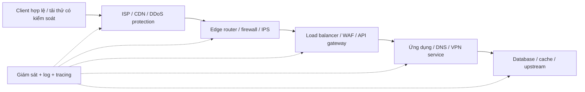

# Kiểm thử rate limit và chống flood

Trong module **SECURITY_NETWORK_SECURITY**, các lớp phòng vệ như firewall, VPN, IDS/IPS, phân đoạn mạng, bảo vệ DNS và hạ tầng đám mây cần được **kiểm thử dưới tải bất thường**. Một hệ thống có xác thực tốt vẫn có thể bị gián đoạn nếu không hạn chế tốc độ tạo kết nối, gửi truy vấn hoặc tiêu thụ tài nguyên. Ngược lại, giới hạn quá chặt có thể chặn người dùng hợp lệ trong giờ cao điểm.

Bài học **“Kiểm thử rate limit và chống flood”** thuộc chương *Kiểm thử và xác minh bảo mật mạng*, hướng dẫn lập kế hoạch, triển khai và đánh giá những phép thử tải **có kiểm soát** để xác minh khả năng từ chối lưu lượng quá mức mà vẫn bảo đảm chất lượng cho yêu cầu hợp lệ. Bài tập dùng môi trường lab/staging hoặc hệ thống được chủ sở hữu phê duyệt, với giới hạn thời gian, tốc độ, số kết nối và điều kiện dừng được xác định trước.

## 1. Kết quả học tập

Sau bài học, người học có thể:

1. Phân biệt rate limiting, connection limiting, traffic shaping, phát hiện flood và khả năng chống chịu DDoS.
2. Giải thích các đơn vị đo **RPS/QPS, CPS, PPS, bps, concurrency**, ý nghĩa của burst và giới hạn theo danh tính/địa chỉ.
3. So sánh thuật toán fixed window, sliding window, token bucket và leaky bucket ở mức hành vi.
4. Thiết kế phép thử vượt ngưỡng, thử burst, tải kéo dài, giới hạn kết nối và kiểm thử nhiều đối tượng mà vẫn bảo vệ dịch vụ.
5. Đánh giá tác dụng của firewall/WAF/API gateway/IDS/IPS, VPN, DNS và cơ chế chống flood ở từng lớp.
6. Đọc số liệu HTTP 429, 5xx, độ trễ p95/p99, CPU, bộ nhớ, queue, conntrack và tỷ lệ yêu cầu hợp lệ bị từ chối.
7. Nhận biết điểm mù do NAT, reverse proxy, IPv6, CDN, triển khai nhiều node và thao tác retry của client.
8. Viết báo cáo kiểm thử có thể tái hiện, nêu được giới hạn quan sát và khuyến nghị cải thiện.

## 2. Định nghĩa các cơ chế và loại tải cần phân biệt

### 2.1. Rate limit là gì?

**Rate limiting** quyết định số lần một hành động được phép xảy ra trong một khoảng thời gian. Ví dụ, API quản trị có thể giới hạn số request trên mỗi tài khoản, SSH/VPN giới hạn lần xác thực sai, DNS resolver giới hạn truy vấn từ một nguồn, hoặc firewall áp ngưỡng tạo phiên mới.

Giới hạn có thể áp dụng theo:

- Địa chỉ IP, subnet, tenant, user, API key, session hoặc thiết bị đã xác thực.
- Tuyến API, loại thao tác (đọc/ghi), độ tốn kém, cổng hay giao thức.
- Phạm vi toàn hệ thống, một vùng, mỗi node, mỗi người dùng hoặc đồng thời nhiều chiều.
- Mức độ ưu tiên: người dùng bình thường, automation, dịch vụ nội bộ và đường khẩn cấp.

**Rate limit không phải là biện pháp xác thực.** Một IP nằm trong danh sách cho phép vẫn có thể bị chiếm quyền và gửi quá nhiều yêu cầu. Ngược lại, cùng một public IP sau NAT có thể đại diện cho hàng trăm người hợp lệ; chặn theo IP quá chặt sẽ gây *collateral damage*.

### 2.2. Flood và DoS/DDoS

*Flood* là tình huống lưu lượng hoặc số lượng thao tác tăng đến mức có thể làm cạn băng thông, bảng trạng thái kết nối, hàng đợi, CPU, bộ nhớ hoặc tài nguyên phía ứng dụng. Không phải mọi đợt tăng đột biến đều do tấn công: phát hành sản phẩm, sự kiện khuyến mãi, job đồng bộ lỗi hoặc vòng lặp retry cũng có thể tạo tải cao.

| Loại hiện tượng | Tài nguyên chịu áp lực | Ví dụ cần phòng vệ | Lớp kiểm soát thường gặp |
|---|---|---|---|
| **Lưu lượng khối lượng lớn** | Băng thông mạng và thiết bị biên | Nhiều gói/byte đến đường Internet | ISP/CDN, upstream filtering, DDoS scrubbing, giới hạn theo vùng |
| **Flood gói/phiên L3–L4** | CPU packet processing, SYN backlog, conntrack, session table | Số gói hoặc phiên mới tăng mạnh | Stateful firewall, SYN protection, ACL, queue/connection controls |
| **Flood yêu cầu L7** | Web/API workers, DB pool, cache, CPU | Nhiều truy vấn HTTP, DNS hoặc xác thực | WAF/API gateway, rate limit theo route/identity, cache |
| **Slow/long-lived connections** | Slot kết nối, worker, file descriptor, timeout | Kết nối giữ lâu nhưng gửi dữ liệu chậm | Connection cap, read/idle timeout, tài nguyên tách biệt |
| **Retry storm** | Dịch vụ và các phụ thuộc phía sau | Client tự gửi lại đồng thời sau lỗi 429/503 | Backoff có jitter, Retry-After, circuit breaker, retry budget |

**DoS** là làm suy giảm hoặc gián đoạn khả năng phục vụ; **DDoS** có thể đến từ nhiều nguồn phân tán. Một rate limit theo IP có thể giảm hành vi lạm dụng của một nguồn, nhưng **không đủ** để chặn toàn bộ một đợt DDoS đến từ nhiều địa chỉ hoặc làm bão hòa đường truyền trước điểm chặn.

### 2.3. Rate, concurrency và dung lượng không tương đương

| Ký hiệu | Đơn vị | Đo cái gì? | Trường hợp sử dụng |
|---|---|---|---|
| RPS / QPS | Request hoặc query/giây | Tần suất yêu cầu ở tầng ứng dụng | API, DNS resolver |
| CPS | Connection/giây | Số kết nối mới | Firewall/VPN, TCP/TLS |
| PPS | Packet/giây | Tốc độ gói | Thiết bị mạng/IPS |
| bps | Bit/giây | Băng thông truyền tải | Router, ISP, liên kết WAN |
| Concurrent connections | Số kết nối đồng thời | Tải trạng thái đang giữ | Reverse proxy, firewall, load balancer |
| Concurrent requests | Số tác vụ đang xử lý | Áp lực lên workers/database | Web/API/service mesh |

Ví dụ, 50 RPS với thời gian xử lý 20 ms thường có áp lực concurrency thấp hơn 50 RPS với mỗi request giữ worker 5 giây. Nếu hệ thống ở trạng thái ổn định, định luật Little cho gần đúng `L = λ × W`: số tác vụ đang xử lý `L` bằng tốc độ hoàn thành `λ` nhân thời gian trung bình `W`. Khi quá tải, hàng đợi tăng liên tục, không thể dùng quan hệ trạng thái ổn định để khẳng định hệ thống đã an toàn.

## 3. Thuật toán giới hạn tốc độ và hành vi cần kiểm thử

### 3.1. Fixed window

Mỗi khóa có bộ đếm trong một cửa sổ cố định, ví dụ tối đa 60 request trong mỗi phút lịch. Cài đặt đơn giản, nhưng có thể cho phép gần 120 request trong một khoảng rất ngắn quanh ranh giới hai cửa sổ: 60 yêu cầu ngay cuối phút cũ, 60 ngay đầu phút mới.

**Kiểm thử:** gửi một lượng request nhỏ, có kiểm soát gần ranh giới cửa sổ để xác định burst ngoài dự kiến; chú ý sự đồng bộ thời gian giữa client và server.

### 3.2. Sliding window

Giới hạn dựa trên khoảng thời gian trượt gần thời điểm hiện tại (log/counter hoặc ước lượng có trọng số), làm dịu hiệu ứng “dồn lượt” quanh ranh giới. Mức chính xác và chi phí bộ nhớ phụ thuộc cách triển khai.

**Kiểm thử:** so sánh mức chấp nhận khi request phân bố đều và khi nhiều request nằm sát nhau; kiểm tra tính nhất quán giữa node khi triển khai phân tán.

### 3.3. Token bucket

Một *bucket* chứa tối đa `B` token và được nạp lại với tốc độ `r` token/giây. Một hành động hợp lệ tiêu thụ một số token (thường là 1); nếu không đủ token thì bị từ chối hoặc xử lý theo chính sách.

Giả sử bucket ban đầu đầy, có sức chứa **B = 6 token**, nạp **r = 3 token/giây**, mỗi request tốn 1 token:

- Trong thời điểm ban đầu, một burst ngắn tối đa 6 request có thể được chấp nhận ngay.
- Nếu không có request mới, bucket cần khoảng 2 giây để nạp từ 0 lên 6 token.
- Tải đều 5 RPS kéo dài sẽ vượt tốc độ nạp 3 RPS, nên sau khi tiêu thụ burst sẽ có một phần request bị giới hạn.

Mô hình hóa:

\[
T(t) = \min\left(B,\;T(t_0)+r(t-t_0)\right)
\]

Request có chi phí `c` được chấp nhận khi `T(t) \ge c`, sau đó giảm số token còn lại đi `c`. Hệ thống thật có thể cho phép token phân số, làm tròn thời gian, dùng hàng đợi hoặc thay đổi chi phí theo route. Vì vậy, kiểm thử nên kiểm tra **biên cho phép và mục tiêu bảo vệ**, không áp đặt một tỷ lệ 429 chính xác tới từng request khi chưa biết thuật toán.

### 3.4. Leaky bucket, hàng đợi và backpressure

*Leaky bucket* thường được dùng để điều tiết tốc độ thoát khỏi hàng đợi, tạo đầu ra đều hơn; một số thư viện dùng tên này với cách triển khai khác nhau. Nếu không đủ tài nguyên xử lý, hàng đợi phải có **giới hạn độ dài/thời gian**, nếu không độ trễ và bộ nhớ sẽ tiếp tục tăng.

**Backpressure** là cơ chế khiến thành phần phía trước giảm nhịp tạo tải khi phía sau không theo kịp; có thể kết hợp trả 429/503, hạn chế concurrency hoặc tạm dừng nhận việc mới. Kiểm thử cần đánh giá độ dài queue, thời gian chờ và tác động lên request hợp lệ.

### 3.5. Chọn giới hạn theo khóa (*key*)

| Khóa giới hạn | Phù hợp | Rủi ro hoặc điểm mù |
|---|---|---|
| Client IP | Lưu lượng chưa xác thực, nhiều endpoint công khai | NAT chia sẻ IP, IPv6 thay địa chỉ, proxy làm che IP thật |
| User/tenant sau xác thực | Công bằng theo danh tính và hạn mức gói dịch vụ | Một tài khoản có thể bị chiếm quyền; xác thực cũng tiêu tốn tài nguyên |
| API key/service identity | Automation, dịch vụ máy–máy | Key chia sẻ rộng, rotation, tài khoản dịch vụ quá quyền |
| Route/endpoint | Tách thao tác đắt tiền khỏi thao tác đơn giản | Bypass qua route alias, phiên bản API khác |
| IP + user + route | Hạn chế nhiều chiều, bảo vệ cả trước và sau auth | Phức tạp hơn; cần định nghĩa hành vi khi nhiều hạn mức cùng khớp |
| Global/cluster | Bảo vệ tổng tài nguyên | Dễ ảnh hưởng hàng loạt tenant nếu thiếu phân bổ công bằng |

Một thiết kế tốt thường dùng **nhiều ngưỡng**: chặn ở edge trước xác thực theo IP/subnet, giới hạn theo user/tenant sau xác thực, giới hạn riêng cho endpoint đắt tiền và đặt trần toàn hệ thống để bảo vệ backend.

## 4. Vị trí áp dụng phòng vệ và những gì cần quan sát



| Lớp | Mục tiêu phòng vệ | Dữ liệu kiểm thử |
|---|---|---|
| ISP/CDN/anti-DDoS upstream | Không để đường WAN bão hòa trước khi gói tới firewall | Bit/s, packet/s, drop upstream, latency từ bên ngoài |
| Router/firewall | Bảo vệ bảng phiên, CPU chuyển tiếp, nguồn/đích nhạy cảm | CPS, PPS, session-table/conntrack usage, drop, CPU |
| IDS/IPS | Phát hiện và chặn mẫu đáng ngờ, không trở thành nút cổ chai | Alert rate, policy hit, false positive, CPU, latency |
| WAF/API gateway | Giới hạn request theo đường dẫn/danh tính và kiểm soát lạm dụng | RPS, 2xx/429/5xx, key, route, rule, backend latency |
| Dịch vụ DNS | Giữ truy vấn hợp lệ; hạn chế truy vấn/bản trả lời bất thường | QPS, latency, SERVFAIL, cache hit, client distribution |
| VPN gateway | Bảo vệ đăng nhập/phiên, không chặn nhầm người dùng hợp lệ | Auth attempts, timeout, CPS, session count, login error |
| Backend | Bảo toàn tài nguyên và phục hồi khi bị áp tải | CPU, RAM, worker pool, DB connections, queue, p95/p99 |

Chống flood ở lớp ứng dụng **không giải quyết được** trường hợp liên kết WAN đã hết băng thông. Ngược lại, thiết bị mạng có thể chuyển tiếp gói tốt nhưng một endpoint tốn nhiều CPU vẫn ngừng phục vụ chỉ với lượng request không quá lớn. Phải lựa chọn điểm thử dựa trên tài nguyên cần bảo vệ.

## 5. Xác định mục tiêu, ngưỡng và giới hạn an toàn trước khi thử

### 5.1. Tài liệu phạm vi và điều kiện dừng

Trước một đợt kiểm thử, thống nhất ít nhất:

1. **Đối tượng:** hostname/IP, route, giao thức, port, zone, tenant, môi trường được phép.
2. **Chủ sở hữu và phê duyệt:** người chịu trách nhiệm, khung giờ, kênh liên lạc, người có quyền dừng thử.
3. **Tài nguyên/tác động:** giới hạn RPS/CPS/PPS, số VU/connection, tổng request, thời gian mỗi lần thử.
4. **Số liệu nền:** lưu lượng thường ngày, SLA/SLO, p95/p99 bình thường, CPU, RAM, connection table.
5. **Điều kiện dừng:** ví dụ tăng 5xx bất thường, p99 vượt ngưỡng đã duyệt, CPU/conntrack quá mức an toàn, lỗi dịch vụ phụ thuộc hoặc cảnh báo từ SOC.
6. **Khôi phục:** cấu hình rate limit, lệnh bật/tắt policy, rollback, thời gian cooldown và người xác nhận hồi phục.
7. **Bằng chứng:** test ID, thời điểm UTC, commit/config version, request ID, dashboard, log và kết quả.

Nên ưu tiên môi trường staging mô phỏng được topology và policy của production. Nếu kiểm thử ở production được cho phép, cần **giảm tốc, giới hạn ngắn, đủ số liệu quan sát và điều kiện dừng tự động/thủ công**. Không dùng traffic vô hạn hoặc cố làm cạn băng thông để chứng minh chống flood.

### 5.2. Baseline và tải mục tiêu

Giả sử một API staging xử lý bình thường 40 RPS, p95 khoảng 90 ms, CPU 25%. Quy định kiểm thử cho **mỗi client** là 3 RPS, burst 6 request; tổng tải thử dự kiến 5 RPS trong 15 giây.

Các con số trên chỉ là **ví dụ**. Nếu service thực tế chịu được rất ít request, kể cả 5 RPS cũng có thể quá tải. Mục tiêu là **quan sát điểm bắt đầu giới hạn** trong cửa sổ nhỏ, không tạo flood cường độ lớn. Sau đó mới điều chỉnh biên theo cấu hình, nhu cầu kinh doanh và khả năng thực tế.

### 5.3. Phân biệt số lượng giới hạn và năng lực hệ thống

Giới hạn 3 RPS/người dùng không đồng nghĩa hệ thống chỉ nhận 3 RPS; 100 người dùng khác nhau có thể cùng gửi hợp lệ. Nếu backend chỉ đáp ứng tối đa 80 RPS, phải có thêm hạn mức tổng, hàng đợi hợp lý và chính sách ưu tiên. Ngưỡng nên dựa trên capacity test an toàn và mô hình lưu lượng thực tế, không chọn một con số tùy ý chỉ vì dễ cấu hình.

## 6. Ma trận kịch bản kiểm thử

| ID | Kịch bản | Tải minh họa đã giới hạn | Kết quả mong đợi |
|---|---|---|---|
| T01 | Dưới ngưỡng | 1 RPS trong 10 giây, một client | 2xx ổn định, không bị throttle nếu đường đi không lỗi |
| T02 | Sát ngưỡng | 3 RPS trong 15 giây | Không bị từ chối quá mức trong điều kiện policy quy định |
| T03 | Quá ngưỡng có kiểm soát | 5 RPS trong 15 giây | Có 429/throttle sau burst; backend vẫn khỏe |
| T04 | Burst ngắn | 6 request trong thời gian ngắn theo năng lực lab | Burst được xử lý trong giới hạn; lần tiếp theo có thể throttle |
| T05 | Hồi phục | Dừng/giảm tải, sau đó gửi 1 RPS | Khả năng cho phép quay lại theo cơ chế refill/window |
| T06 | Hai user cùng IP | Mỗi user tạo tải nhỏ qua cùng NAT | Đánh giá mức công bằng và chiều khóa limit |
| T07 | Một user qua hai nguồn | Giữ tổng request nhỏ, phân bổ hai kết nối | Limit theo user không bị bỏ qua nếu thiết kế theo user |
| T08 | Nhiều node/HA | Gửi tải giới hạn qua load balancer vào các node | Hạn mức được áp đúng phạm vi global/per-node đã công bố |
| T09 | IPv4/IPv6 | Mức thử giống nhau cho từng giao thức | Không có đường bypass IPv6 |
| T10 | API tốn tài nguyên | Gửi ít yêu cầu đọc/ghi giả lập | Hạn mức và trọng số phù hợp độ tốn kém |
| T11 | Retry sau 429 | Client tôn trọng Retry-After/backoff | Không tạo retry storm |
| T12 | VPN/DNS/SSH auth | Một số request thất bại hợp lệ trong lab | Giới hạn đăng nhập/truy vấn theo đúng chính sách |
| T13 | Policy failover | Chuyển node kiểm soát trong bài thử được duyệt | Trạng thái hạn mức rõ ràng, không mở quyền ngoài dự kiến |
| T14 | Giám sát | Tải chỉ đủ kích hoạt một số deny | Log/counter/alert phản ánh đúng nguồn, route, rule và thời gian |

**Kết quả mong đợi phải tùy thuật toán.** Với token bucket có burst, vài request vượt tốc độ nạp vẫn có thể được phép lúc đầu. Với rate limit theo cụm, trạng thái có thể đồng bộ trễ. Không lấy một tỷ lệ 429 cố định làm tiêu chí chung cho tất cả thiết bị.

## 7. Kiểm thử HTTP rate limit có giới hạn bằng k6

### 7.1. Giả định của ví dụ

Chúng ta có API lab `http://127.0.0.1:8080/api/test`, đã cấu hình rate limit theo **client IP** ở gateway: tốc độ nạp 3 request/giây, burst 6. Không dùng endpoint có side effect như tạo đơn hàng, thanh toán, gửi email hoặc xóa dữ liệu. Nên cung cấp route kiểm thử riêng chỉ trả về dữ liệu nhỏ, không truy cập cơ sở dữ liệu thật.

Ví dụ k6 sau gửi **tối đa theo lịch 5 request/giây trong 15 giây**, có giới hạn VU, tổng lượt dự kiến xấp xỉ 75 nếu máy sinh tải đáp ứng lịch. Đây là **tải nhỏ cho môi trường đã chuẩn bị**, không phải mẫu tấn công flood:

```javascript
// rate-limit-lab.js — chỉ dùng trên môi trường được phê duyệt
import http from 'k6/http';
import { check } from 'k6';
import { Counter, Rate } from 'k6/metrics';

const accepted = new Counter('accepted_requests');
const throttled = new Counter('throttled_requests');
const unexpected = new Counter('unexpected_responses');
const throttledShare = new Rate('throttled_share');

const target = __ENV.TEST_TARGET || 'http://127.0.0.1:8080/api/test';

export const options = {
  scenarios: {
    bounded_api_check: {
      executor: 'constant-arrival-rate',
      rate: 5,
      timeUnit: '1s',
      duration: '15s',
      preAllocatedVUs: 2,
      maxVUs: 4,
      gracefulStop: '2s',
    },
  },
  thresholds: {
    checks: ['rate>0.99'],
    unexpected_responses: ['count==0'],
  },
};

export default function () {
  const res = http.get(target, {
    headers: { 'X-Test-Run': 'lab-rate-limit-011' },
    timeout: '3s',
    tags: { case: 'T03_bounded' },
  });

  const isSuccess = res.status >= 200 && res.status < 300;
  const isThrottled = res.status === 429;

  accepted.add(isSuccess ? 1 : 0);
  throttled.add(isThrottled ? 1 : 0);
  throttledShare.add(isThrottled);
  unexpected.add(!isSuccess && !isThrottled ? 1 : 0);

  check(res, {
    'phản hồi 2xx hoặc 429': () => isSuccess || isThrottled,
  });
}
```

Chạy trong **lab**:

```bash
k6 run rate-limit-lab.js

# Chỉ dùng TEST_TARGET khi đích là môi trường có quyền kiểm thử.
TEST_TARGET=http://127.0.0.1:8080/api/test k6 run rate-limit-lab.js
```

Đọc kết quả:

- **2xx:** request được phục vụ; không có nghĩa mọi thành phần phía sau đều khỏe, cần theo dõi độ trễ.
- **429 Too Many Requests:** chính sách từ chối theo hạn mức. Mã này cần được trả về ở đúng lớp/thời điểm; gateway có thể dùng mã khác nếu chưa cấu hình.
- **5xx, timeout, kết nối reset:** có thể là lỗi dịch vụ, proxy hoặc phụ thuộc; cần điều tra chứ không coi như rate limiting đạt yêu cầu.
- **`http_req_failed` trong k6:** có thể đếm HTTP 429 là thất bại theo tiêu chí mặc định của k6, dù 429 là phản hồi **được kỳ vọng** trong phép thử này. Vì vậy, ví dụ dùng custom metrics `accepted_requests`, `throttled_requests` và `unexpected_responses` để phân biệt.

Một lượt thử 5 RPS không chứng minh khả năng chống DDoS volumetric. Nó chỉ xác nhận hành vi của một policy ở phạm vi và cường độ đã thiết kế.

### 7.2. Kiểm thử thủ công khi chưa có k6

Để xác nhận endpoint và mã phản hồi trước khi chạy tự động, có thể gửi **một vài request** tuần tự, ghi lại mã HTTP và header:

```bash
curl --silent --show-error --dump-header - \
  --output /dev/null \
  --max-time 3 \
  http://127.0.0.1:8080/api/test
```

Thử cùng một client hai lần, sau đó nghỉ để kiểm tra hồi phục. Khi cần đối chiếu chi tiết, lưu mốc UTC của mỗi request/response và header như `Retry-After` hoặc các trường `RateLimit-*` **nếu dịch vụ có công bố**. Không dựa vào những header không tồn tại hoặc không được triển khai nhất quán.

### 7.3. Ví dụ cấu hình NGINX phục vụ lab

Đoạn dưới minh họa cú pháp phổ biến của NGINX HTTP module; chỉ dùng trong môi trường có upstream demo ở `127.0.0.1:9000`. Việc áp vào ứng dụng thật còn phụ thuộc cấu trúc config, các `location` khác, ingress, CDN và reverse proxy.

```nginx
http {
    # Mỗi địa chỉ nguồn được nạp 3 request/giây; bucket có burst 6.
    limit_req_zone $binary_remote_addr zone=api_per_ip:10m rate=3r/s;

    upstream demo_backend {
        server 127.0.0.1:9000;
    }

    server {
        listen 127.0.0.1:8080;

        location /api/test {
            limit_req zone=api_per_ip burst=6 nodelay;
            limit_req_status 429;
            proxy_pass http://demo_backend;
        }
    }
}
```

Ý nghĩa:

- `rate=3r/s` là tốc độ theo khóa `$binary_remote_addr`.
- `burst=6` cho phép đợt ngắn vượt tốc độ nạp theo cơ chế của NGINX.
- `nodelay` cho phép các request trong ngưỡng burst được chuyển tiếp ngay, thay vì xếp lịch làm chậm; request vượt phần cho phép bị từ chối.
- `limit_req_status 429` dùng HTTP 429 cho request bị giới hạn; mã mặc định có thể khác khi không cấu hình.
- `proxy_pass` gửi các request được chấp nhận sang dịch vụ demo thật. Nếu backend bị lỗi, đó là sự cố riêng cần quan sát.

**Lưu ý thiết kế:** NGINX Open Source thường lưu trạng thái `limit_req` trong vùng nhớ chia sẻ **giữa các worker của cùng instance**, không mặc nhiên tạo một hạn mức thống nhất cho nhiều instance/pod. Sau load balancer hoặc proxy, `$remote_addr` có thể là IP của proxy, khiến mọi client cùng chia bucket. Chỉ sử dụng thông tin IP client từ `X-Forwarded-For` hoặc trường tương đương khi **proxy tin cậy** và cấu hình trust boundary đúng; không cho client Internet tự khai IP để né hạn mức.

Không tự thêm `Retry-After` cố định vào **mọi** response 2xx. Khi cần header này, hãy cấu hình middleware/xử lý lỗi cho đúng những response 429 và tính khoảng chờ thích hợp theo policy.

## 8. Kiểm thử connection limit và chống flood L3–L4

Rate limit HTTP đo tần suất request, nhưng nhiều rủi ro nằm ở lớp kết nối hoặc gói tin:

- Thiết bị có thể bị áp lực trên **SYN backlog**, bảng trạng thái phiên/conntrack hoặc bộ nhớ packet buffers.
- Một số client giữ nhiều kết nối idle hoặc kết nối đọc/ghi chậm khiến worker/file descriptor bị chiếm.
- Gói UDP không có phiên TCP tương ứng; chính sách CPS không kiểm soát trực tiếp số UDP packet/second.
- Tường lửa bảo vệ lưu lượng đi qua có thể áp chính sách khác với lưu lượng đến **chính địa chỉ quản trị** của thiết bị.

### 8.1. Cần kiểm tra gì trước khi tăng tải?

Kiểm kê và kiểm chứng:

1. Giới hạn tổng **concurrent connections** và **new connections/second** ở load balancer, firewall, server.
2. Giá trị timeout cho kết nối idle, TLS handshake, header/body read; ràng buộc theo dịch vụ.
3. Bảo vệ SYN trong môi trường có hỗ trợ: backlog tuning, SYN cookies, cơ chế SYN proxy nếu phù hợp, cùng ảnh hưởng tới telemetry.
4. Dung lượng conntrack/session table, mức sử dụng hiện tại và cảnh báo khi tiến gần ngưỡng.
5. Các giới hạn riêng cho VPN login, bảng tunnel/SA, NAT state hoặc DNS transaction.
6. Khả năng failover và tốc độ tăng state sau chuyển node.

**Phép thử được khuyến nghị:** trong lab, mở số kết nối tăng dần ở mức thấp, cố định thời gian giữ, đo counters và độ trễ của một nhóm kết nối hợp lệ. Dừng tại ngưỡng được phê duyệt. Không cần tạo gói giả mạo hoặc flood cường độ cao để chứng minh một **connection cap** đã được cấu hình và hoạt động.

### 8.2. Công cụ quan sát trên Linux

Lệnh đọc trạng thái dưới đây không tự tạo lưu lượng:

```bash
# Thống kê socket TCP; xem trạng thái phiên thay vì đoán từ HTTP codes.
ss -s

# Thống kê kernel TCP; tên trường có thể tùy hệ điều hành.
nstat -az | grep -Ei 'Listen|Syncookies|Retrans|Reset'

# Xem mức dùng conntrack nếu host có bật và expose counters.
cat /proc/sys/net/netfilter/nf_conntrack_count
cat /proc/sys/net/netfilter/nf_conntrack_max

# Kiểm tra socket đang lắng nghe trên máy được quản lý.
ss -lntup
```

Một số tệp trong `/proc/sys/net/netfilter` có thể không tồn tại nếu kernel/module hoặc namespace không dùng conntrack. Không coi đó là chứng cứ thiết bị “không có giới hạn”. Trên thiết bị firewall, ưu tiên số liệu riêng của vendor: current/max sessions, denied new sessions, CPU dataplane/control plane, buffer drops và interface utilization.

### 8.3. Khi nào phải cần bảo vệ upstream?

Nếu lưu lượng đến đã chiếm hết liên kết Internet, rate limit trên API gateway **đặt phía sau WAN** không giúp người dùng hợp lệ đi qua đường nghẽn. Lúc này cần phối hợp ISP, CDN/Anycast, dịch vụ scrubbing và cấu hình định tuyến/edge phù hợp. Một test lab vài trăm request chỉ có thể kiểm tra luồng chính sách ở các lớp sau, không thay thế diễn tập DDoS với nhà cung cấp và giới hạn tải được phê duyệt.

## 9. Kiểm thử DNS, VPN, IDS/IPS và dịch vụ quản trị

### 9.1. DNS

Đối với DNS resolver hoặc authoritative DNS, phải tách bạch:

- **Client query rate limit**: giới hạn truy vấn đến resolver theo nguồn, tenant hoặc loại truy vấn.
- **Response rate limiting (RRL)**: một kỹ thuật ở một số authoritative DNS để hạn chế mẫu trả lời có nguy cơ bị lợi dụng khuếch đại.
- **DNS cache**: giảm số truy vấn ra upstream nhưng không tự ngăn mọi kiểu tải gây cạn tài nguyên.

Kịch bản an toàn: gửi truy vấn đến **tên miền test được kiểm soát**, theo tốc độ thấp đã phê duyệt, đo QPS, latency, tỷ lệ phản hồi, cache hit, timeout và SERVFAIL. Kiểm tra liệu client hợp lệ sau cùng NAT có bị ảnh hưởng không. Không sử dụng nguồn spoofed và không gửi truy vấn lặp cường độ cao ra resolver công cộng.

Một truy vấn DNS bị giới hạn không nhất thiết được biểu diễn như HTTP 429; response có thể bị bỏ, chậm hoặc có mã DNS cụ thể tùy phần mềm. Tiêu chí chấp nhận phải theo hành vi mà DNS server công bố.

### 9.2. VPN và xác thực dịch vụ

Giới hạn tốc độ đăng nhập VPN/SSH/portal quản trị phải:

- Giảm khả năng dò đoán thông tin xác thực và làm cạn tài nguyên xác thực.
- Không biến một public IP NAT chung thành nguyên nhân khóa đồng loạt người dùng.
- Phân biệt giới hạn theo tài khoản, IP, thiết bị và rủi ro; hỗ trợ MFA khi có thể.
- Có cảnh báo cho đợt đăng nhập sai, tài khoản bị khóa bất thường và thay đổi chính sách.

Kiểm thử bằng **tài khoản test đã cấp quyền**, số lần thử thấp và kế hoạch mở khóa; tránh thử liên tục trên tài khoản thật hoặc tạo khóa ngoài ý muốn. Kiểm tra log AAA, thời gian xác thực, 429/khóa/challenge tùy giao thức và tác động tới phiên hợp lệ.

### 9.3. IDS/IPS và firewall

Một IDS chỉ phát hiện và cảnh báo, còn IPS có thể chặn theo chính sách; vì vậy không nên nói “IDS đã chống flood” nếu không có cơ chế chặn khác. Khi đánh giá cần so sánh:

- Lưu lượng quan sát được tại cảm biến và lưu lượng đến backend.
- Rule match, hành động detect/drop/rate-limit, số lần chặn và độ trễ cảnh báo.
- CPU/packet drops trên chính cảm biến: thiết bị phòng vệ không nên trở thành điểm nghẽn ngoài dự kiến.
- False positive trên luồng VPN, DNS, backup, monitoring hợp lệ.

Có thể phát lại **mẫu PCAP kiểm thử nhỏ trong lab** theo chính sách của tổ chức để xác nhận rule và log, nhưng không cần sinh lưu lượng flood hoặc làm gián đoạn dịch vụ thật.

## 10. Điểm mù khi hệ thống phân tán và có proxy

### 10.1. NAT/CGNAT và reverse proxy

Khi 200 client cùng đi qua một địa chỉ public NAT, rule `10 RPS/IP` có thể khiến mọi người chia chung 10 RPS, dù mỗi người chỉ gửi rất ít yêu cầu. Ngược lại, dùng header client tự nhập để tính IP có thể khiến một nguồn chuyển khóa và vượt giới hạn.

Cần làm rõ:

1. Tại điểm rate limit, trường IP thực sự chứa nguồn nào?
2. Proxy nào được tin cậy để gắn/ghi đè header forwarding?
3. Hệ thống bỏ qua header do client tự khai nếu client không đi qua proxy tin cậy như thế nào?
4. Có cần giới hạn theo **authenticated principal**, tenant và route để công bằng hơn không?

### 10.2. Multi-node, autoscaling và state store

Nếu mỗi pod có `3 RPS` theo IP và có 4 pod với bucket **độc lập**, tải phân tán qua 4 pod có thể được nhận ở mức cao hơn một instance đơn lẻ. Đây không nhất thiết là lỗi nếu chính sách cố ý giới hạn **per-node**, nhưng sẽ không đáp ứng yêu cầu “3 RPS toàn cụm”.

Các cách triển khai:

- **Local limiter:** nhanh, ít phụ thuộc, phù hợp bảo vệ mỗi node; cần chấp nhận lệch giữa node.
- **Shared/distributed limiter:** phối hợp state qua Redis hoặc cơ chế tương đương; đánh đổi độ trễ, khả năng chịu lỗi và tính nhất quán.
- **Hierarchical limits:** ngưỡng local bảo vệ node + ngưỡng theo user/tenant hoặc toàn cụm.

Khi state store gặp lỗi phải xác định rõ **fail-open** (có thể tăng tải) hay **fail-closed** (có thể chặn người dùng hợp lệ) và ngưỡng dự phòng. Không chỉ thử điều kiện bình thường: kiểm tra cách phục hồi khi reconnect, pod restart, đổi route hoặc triển khai nhiều khu vực, trong phạm vi staging được phê duyệt.

### 10.3. IPv6, đường phụ và route alias

Một limiter chỉ kiểm tra IPv4 có thể bỏ sót luồng IPv6. Một API có cả `/v1/search` và `/v2/search` hoặc host alias có thể áp hạn mức không đồng nhất. Cần thống kê các đường đi: CDN → ingress, private endpoint → service mesh, VPN → admin API, IPv4/IPv6 và đường bypass có thể truy cập trực tiếp backend.

**Vị trí kiểm soát quan trọng:** nếu chỉ rate limit ở CDN nhưng origin lộ IP truy cập trực tiếp, một số lưu lượng có thể không qua lớp bảo vệ. Kiểm thử bằng các điểm truy cập được chủ sở hữu cho phép và xác nhận origin được giới hạn theo nguồn/đường riêng.

## 11. Đo lường, phân tích và tiêu chí đạt

### 11.1. Theo dõi ở cả client lẫn server

| Chỉ số | Cách diễn giải | Dấu hiệu cần chú ý |
|---|---|---|
| Requests/s từ tool | Lượng **đã thực sự gửi** | Tool thiếu VU có thể không đạt tốc độ cấu hình |
| 2xx và 429 | Tỷ lệ được phục vụ/được giới hạn | Cần đối chiếu ngưỡng, burst, khóa limit |
| 5xx, timeout, reset | Lỗi không mong đợi | Backend/proxy có thể bị quá tải hoặc hỏng |
| p50, p95, p99 latency | Độ trễ các phân vị | p99 tăng trước khi thấy nhiều 5xx |
| CPU/RAM | Tài nguyên dịch vụ/thiết bị | Rate limit ở quá sâu khiến backend vẫn phải làm việc nhiều |
| Queue length / active workers | Tải chưa xử lý xong | Queue tăng không kiểm soát khi tốc độ vào vượt năng lực xử lý |
| Conntrack/session table | Dung lượng trạng thái mạng | Sắp đầy dù RPS không cao |
| 429 by key/route | Phân phối throttle | Một tenant hoặc subnet NAT bị ảnh hưởng quá lớn |
| Login/VPN/DNS errors | Tác động tới dịch vụ bảo mật | Không được chặn nhầm hoạt động vận hành |
| Upstream bandwidth/drops | Khả năng nghẽn tại biên | Limiter L7 không xử lý được nghẽn trước nó |

**Ghi chú về số liệu:** `p99` đáng tin cậy khi có số lượng mẫu đủ và đo cùng một population yêu cầu; nếu 429 thường trả lời rất nhanh, việc trộn 429 với 2xx có thể làm p95/p99 hiển thị “đẹp hơn” trong khi trải nghiệm người dùng xấu đi. Nên tách **latency của request được chấp nhận**, latency của request bị throttle và tỷ lệ lỗi theo route/tenant.

### 11.2. Mẫu tiêu chí chấp nhận cho API staging

Ví dụ cho policy **3 RPS/client, burst 6**:

| Điều kiện | Kết quả đạt mong đợi |
|---|---|
| Gửi dưới ngưỡng với backend ổn định | Hầu hết request được chấp nhận; không xuất hiện 429 sai lệch đáng kể |
| Gửi trên ngưỡng trong giới hạn thử | Một phần request được throttle tương ứng chính sách |
| Request hợp lệ từ một key khác | Tiếp tục phục vụ bình thường, không bị lây ảnh hưởng ngoài thiết kế |
| Sau khi dừng tải | Bucket/window hồi phục, request hợp lệ được phục vụ lại |
| Quan sát backend | Không vượt ngưỡng CPU, queue, conntrack và latency đã thỏa thuận |
| Header/response | 429 có định dạng rõ ràng; `Retry-After` nếu triển khai thì chỉ dẫn hợp lý |
| Logging | Có test ID, thời gian UTC, rule/key phù hợp và thống kê có thể đối chiếu |
| IPv6, HA, proxy | Chính sách thực thi trong các đường đã cam kết; không có bypass trái thiết kế |

Không thể kết luận “rate limit hoạt động” chỉ vì nhìn thấy vài HTTP 429. Có thể gateway trả 429 quá muộn sau khi request đã tiêu tốn phần lớn tài nguyên backend, hoặc một nhóm người dùng hợp lệ đang bị chặn vì dùng chung IP.

### 11.3. Phân tích năng lực bằng mô hình hàng đợi

Giả sử một backend xử lý bền vững `μ = 80` request/giây, trong khi lưu lượng chấp nhận được đẩy vào `λ = 110` request/giây. Trong giai đoạn chưa có backpressure hoặc giới hạn, hàng đợi có thể tăng xấp xỉ:

\[
\Delta Q \approx (\lambda-\mu)\Delta t
\]

Với `Δt = 10` giây, backlog có thể tăng khoảng **300 request** nếu tốc độ giữ nguyên và chưa có drop/timeout. Đây là mô hình trực giác, không dự báo chính xác trên hệ thống thực với số worker hữu hạn, lưu lượng biến thiên và cơ chế phản hồi. Bài kiểm thử cần đo **queue thực**, độ trễ và tỷ lệ timeout, từ đó quyết định giới hạn admission sớm hơn hoặc mở rộng năng lực xử lý.

## 12. Quan sát log và xác minh khả năng điều tra

Một bản ghi rate limit tốt nên cho phép nối thông tin giữa client, gateway và backend:

```json
{
  "timestamp_utc": "2026-11-28T09:00:00.250Z",
  "test_run_id": "lab-rate-limit-011",
  "component": "api-gateway",
  "route": "/api/test",
  "client_ip_at_policy": "192.0.2.25",
  "principal_id": "test-user-01",
  "limit_policy": "api-per-user-3rps",
  "decision": "throttle",
  "response_status": 429,
  "request_id": "req-example-042",
  "upstream_called": false
}
```

Dữ liệu là ví dụ, không bắt buộc mọi gateway cung cấp đủ trường. Khi triển khai thật:

- Dùng **UTC** để ghép timeline với firewall, CDN, VPN, DNS và SIEM; đồng bộ đồng hồ các thành phần.
- Ghi khóa giới hạn **an toàn để phân tích**; không đưa mật khẩu, raw access token hoặc dữ liệu cá nhân không cần thiết vào log.
- Ghi mức hit/drop, trạng thái policy, route, zone, IP tại điểm áp luật và request/correlation ID.
- Tách **đã chặn tại edge** với **backend đã nhận request** để xác định vị trí chặn.
- Đặt cơ chế sampling/rate limiting cho log quá nhiều, tránh chính hệ thống ghi log trở thành nút nghẽn.
- Tạo cảnh báo khi tỷ lệ 429/5xx tăng bất thường, một tenant bị ảnh hưởng, session table gần đầy hoặc policy bị vô hiệu hóa.

Trong điều tra flood, sự kiện ở nhiều nguồn có thể đến SIEM trễ. Không sắp xếp đơn giản theo `ingest_time` rồi kết luận thứ tự gây lỗi; kiểm tra `event_time` và độ lệch đồng hồ khi đối chiếu.

## 13. Các lỗi triển khai và kiểm thử thường gặp

| Lỗi | Tác động | Cách kiểm tra/khắc phục |
|---|---|---|
| Chỉ giới hạn RPS, bỏ qua kết nối dài | Hết slot/worker dù ít request | Thêm concurrency cap và timeout phù hợp |
| Chỉ giới hạn tại origin trong khi WAN đã bão hòa | Dịch vụ vẫn không tiếp cận được | Cần lớp bảo vệ upstream |
| Chọn IP proxy làm khóa | Hàng nghìn client chung một bucket | Xác thực nguồn IP qua proxy tin cậy; bổ sung key theo identity |
| Tin trực tiếp `X-Forwarded-For` từ Internet | Nguồn có thể thao túng khóa limit | Chỉ tin header do proxy tin cậy thiết lập |
| State per-node thay vì toàn cụm | Hạn mức hiệu lực thay đổi theo số pod | Định nghĩa rõ local/global, kiểm thử HA và autoscaling |
| Chỉ kiểm tra IPv4 | Đường IPv6 không được kiểm soát | Thử cả IPv4, IPv6 và interface phụ |
| Rate limit sau truy vấn DB | Backend vẫn quá tải trước 429 | Áp admission sớm nhất có thể |
| Retry ngay sau 429/503 | Tạo vòng phản hồi làm tăng tải | Exponential backoff, jitter, retry budget |
| Xem 429 là lỗi hạ tầng | Báo sai mục tiêu kiểm thử | Tách expected throttle khỏi lỗi 5xx/timeout |
| Xem mọi 429 là thành công | Bỏ sót chặn nhầm người hợp lệ | Kiểm thử công bằng theo user, tenant, NAT |
| Không quan sát số request thực phát | Tool thiếu khả năng sinh tải | Đo generator drops/iterations và server requests |
| Bật rate limit không có rollback | Chặn sản xuất kéo dài khi policy sai | Thử ở staging, commit/rollback, người trực |
| Chỉ nhìn RPS trung bình | Không thấy microburst hoặc p99 | Đo cửa sổ ngắn, burst, độ trễ và queue |

## 14. Tình huống thực hành: kiểm thử API quản trị phía sau VPN

Một doanh nghiệp giả lập vận hành API cấu hình thiết bị mạng. Kỹ sư truy cập qua VPN quản trị, rồi bastion hoặc API gateway. Đội bảo mật muốn xác minh hai mục tiêu:

1. Mỗi tài khoản quản trị chỉ được gửi tối đa tốc độ theo policy; một tài khoản gửi quá nhiều request không làm ảnh hưởng tài khoản khác.
2. Gateway giảm request dư trước khi đến backend, vẫn giữ được đường điều khiển mạng và giám sát IDS/IPS, firewall, VPN hoạt động bình thường.

**Giả định lab:**

- Gateway có ngưỡng **3 RPS/tài khoản**, burst 6, cùng một trần tổng phù hợp capacity backend.
- Hai tài khoản test `admin-a` và `admin-b` cùng đi qua một public IP NAT của VPN.
- Có endpoint chỉ đọc `/api/test`, không có side effect, kèm request ID.
- Tải của `admin-a` là 5 RPS trong 15 giây; `admin-b` giữ 1 RPS trong cùng kỳ.
- Có dashboard 2xx/429/5xx, upstream RPS, CPU, p95/p99, log theo user và test ID.

**Các bước thực hành:**

1. Đo baseline riêng cho mỗi tài khoản ở 1 RPS, xác nhận không phát sinh throttle sai.
2. Chạy `admin-a` ở 5 RPS trong cửa sổ ngắn đã phê duyệt; `admin-b` gửi đều 1 RPS.
3. Xác minh có 429 dành cho `admin-a` sau phần burst, còn `admin-b` được phục vụ theo policy.
4. Kiểm tra log IP và principal. Nếu cả hai bị giới hạn như một key, nhiều khả năng policy đang giới hạn theo **IP NAT chung** thay vì tài khoản như thiết kế.
5. Xem backend RPS, CPU và độ trễ. Nếu CPU vẫn tăng mạnh dù nhiều 429, xác định limiter có đặt sau xử lý đắt tiền hay không.
6. Dừng tải từ `admin-a`, tiếp tục truy vấn thấp và kiểm tra cơ chế hồi phục.
7. Thử đường IPv6, route alias, nhiều node trong **staging** với tổng request vẫn trong biên cho phép.
8. Lưu chứng cứ và đề xuất sửa khóa limit/kiến trúc, sau đó lặp lại các kịch bản để xác minh.

**Ví dụ kết quả cần phân tích:**

| Quan sát | Kết luận ban đầu | Điều cần xác minh |
|---|---|---|
| `admin-a` nhận một số 429; `admin-b` vẫn 2xx | Có phân tách hạn mức hiệu quả | Khóa theo principal hay còn lớp giới hạn chung? |
| Cả hai tài khoản đều 429 khi chung VPN NAT | Nghi chặn theo địa chỉ NAT | Log policy key và thứ tự limiter |
| Gateway 429 nhưng backend CPU cao | Có thể chặn quá muộn hoặc backend nhận tải khác | Tracing, upstream request count, DB metrics |
| Đổi pod làm số request được phép tăng mạnh | State limiter có thể local | Yêu cầu global hay per-node? |
| Giảm về 1 RPS nhưng vẫn bị chặn kéo dài | Cửa sổ/penalty chưa hồi phục hoặc policy khác đang khớp | TTL, thuật toán, log và cấu hình |

Trong báo cáo, **không ghi “chống DDoS thành công”** chỉ từ phép thử 5 RPS. Kết luận phù hợp hơn là: *“Giới hạn ứng dụng theo danh tính trong điều kiện thử đã hoạt động như chính sách; cần đánh giá riêng năng lực chống quá tải L3/L4 và DDoS upstream.”*

## 15. Mẫu báo cáo kết quả

```yaml
test_id: "NS-RT-011-T03"
environment: "staging"
service: "admin-api-lab"
approved_scope: "127.0.0.1:8080/api/test"
test_window_utc:
  start: "2026-11-28T09:00:00Z"
  end: "2026-11-28T09:00:15Z"
traffic:
  configured_arrival_rate_rps: 5
  planned_duration_seconds: 15
  max_vus: 4
  actual_requests: "<ghi sau khi chạy>"
policy:
  key: "authenticated-principal"
  refill_rate_rps: 3
  burst_capacity: 6
results:
  accepted_2xx: "<đo>"
  throttled_429: "<đo>"
  unexpected_5xx_or_timeout: "<đo>"
  accepted_p95_ms: "<đo>"
  accepted_p99_ms: "<đo>"
  backend_cpu_peak_pct: "<đo>"
  user_b_unexpected_throttle: "<đo>"
observability:
  gateway_log_ref: "<đường dẫn/ID chứng cứ>"
  backend_metrics_ref: "<đường dẫn/ID chứng cứ>"
decision: "PASS/FAIL/INCONCLUSIVE"
limitations:
  - "Không đánh giá flood cường độ cao hoặc nghẽn WAN"
next_action: "<đề xuất và người phụ trách>"
```

**PASS** chỉ khi điều kiện chấp nhận đã thống nhất đều có bằng chứng; **FAIL** khi vi phạm tiêu chí; **INCONCLUSIVE** khi log, đồng hồ, counters hoặc lượng mẫu chưa đủ để kết luận. Ghi trạng thái cấu hình và thời gian kiểm thử để người khác có thể tái hiện, đồng thời lưu nguyên dữ liệu đo và các thay đổi đã thực hiện.

## 16. Bài tập và câu hỏi tự kiểm tra

### Bài tập 1 — Token bucket

Một policy có `rate = 4 request/giây`, `burst capacity = 8`, bucket ban đầu đầy. Nếu 8 request tới gần như cùng lúc và đều được chấp nhận, bucket còn bao nhiêu token? Nếu không có request mới trong 1 giây, sẽ nạp lại xấp xỉ bao nhiêu token?

*Đáp án gợi ý:* 0 token ngay sau burst nếu mỗi request tiêu thụ 1 token; sau khoảng 1 giây, bucket có thể có khoảng 4 token, tùy độ chính xác của clock/algorithm.

### Bài tập 2 — NAT chung

Một IP VPN đại diện cho 50 nhân viên, mỗi người gửi 1 RPS. Gateway giới hạn 10 RPS/IP. Giải thích tại sao nhiều người dùng hợp lệ vẫn bị chặn và nêu cách cải thiện mà không bỏ lớp bảo vệ trước xác thực.

*Đáp án gợi ý:* Tổng 50 RPS qua cùng khóa IP vượt giới hạn 10 RPS, nên bị throttle chung. Dùng thêm limiter theo danh tính đã xác thực, phân tầng theo route/tenant và ngưỡng upstream; vẫn giữ giới hạn IP phù hợp cho traffic chưa đăng nhập.

### Bài tập 3 — Chỉ số dễ gây hiểu nhầm

Sau khi bật rate limit, p95 toàn bộ request giảm từ 400 ms xuống 100 ms nhưng số 429 chiếm 40%. Có thể kết luận trải nghiệm người dùng đã tốt hơn không?

*Đáp án gợi ý:* Chưa. Phản hồi 429 thường nhanh và kéo p95 tổng xuống. Cần tách latency 2xx, tỷ lệ request hợp lệ bị chặn, số lượng 5xx, retry và tác động đến nhóm người dùng.

### Bài tập 4 — Phân tán nhiều node

Ba pod độc lập cùng giới hạn 3 RPS/IP; hệ thống yêu cầu **3 RPS/IP toàn cụm**. Trình bày vì sao kết quả có thể vượt yêu cầu và đề xuất cách thử trong staging.

*Đáp án gợi ý:* Mỗi pod có bucket riêng, lưu lượng được cân bằng sang nhiều pod có thể tiêu thụ nhiều hạn mức local. Cần state phối hợp hoặc kiến trúc giới hạn toàn cụm, rồi chạy tải nhỏ qua nhiều node, đối chiếu counter theo key và gateway.

### Bài tập 5 — Kế hoạch chống flood theo lớp

Thiết kế ma trận kiểm tra riêng cho DNS resolver, VPN gateway, firewall và API gateway. Với mỗi lớp, nêu **tài nguyên**, **chỉ số đo**, **kiểm soát**, **ngưỡng dừng thử** và **bằng chứng PASS/FAIL**. Giải thích tại sao kiểm thử HTTP 429 không đủ để khẳng định chống được flood băng thông ở upstream.

### Câu hỏi tự kiểm tra

1. Rate limiting và connection limiting giải quyết những rủi ro khác nhau như thế nào?
2. Vì sao fixed window có thể cho phép burst vượt dự tính ở ranh giới cửa sổ?
3. Với token bucket, vai trò của tốc độ nạp và sức chứa bucket là gì?
4. Khi nào rate limiting theo IP gây ra false positive cho người dùng hợp lệ?
5. Vì sao không được tin `X-Forwarded-For` từ mọi client?
6. Cần quan sát những chỉ số nào để biết yêu cầu bị chặn **trước** khi backend làm việc đắt tiền?
7. HTTP 429 khác với 5xx và timeout thế nào trong việc đánh giá policy?
8. Vì sao rate limit độc lập trên mỗi pod có thể không đạt mục tiêu toàn cụm?
9. Những cơ chế nào cần kết hợp khi đường WAN bị bão hòa?
10. Một phép thử được xem là **INCONCLUSIVE** trong những trường hợp nào?

Một hệ thống có khả năng chống flood tốt cần **giới hạn ở đúng lớp**, áp dụng hạn mức **công bằng theo đối tượng**, **bảo vệ tài nguyên phía sau** và **phục hồi ổn định** khi tải giảm. Việc kiểm thử chỉ có giá trị khi phạm vi, giới hạn an toàn, số liệu, tiêu chí PASS/FAIL và bằng chứng đều rõ ràng; các bài thử tải nhỏ được dùng để xác minh cơ chế, còn khả năng chịu đựng sự cố quy mô lớn phải được đánh giá bằng quy trình diễn tập chuyên biệt được kiểm soát.
